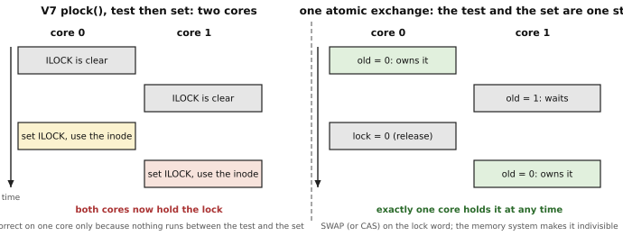
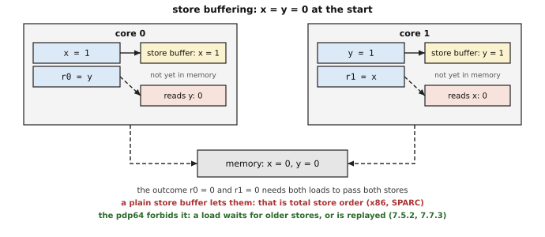
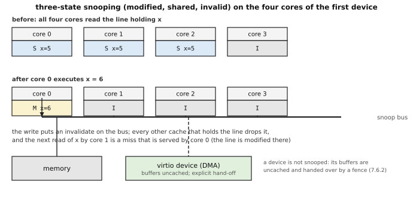
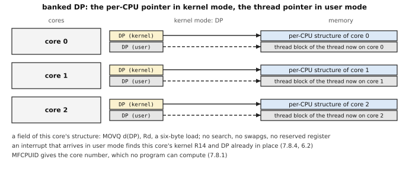
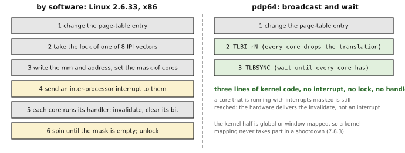

# 7. Multiple processors

[← manual index](00-index.md)

**A second core costs the pdp64 seventeen operations and no ordering code: memory is sequentially consistent, so a program never needs a barrier between two ordinary accesses; ten atomic instructions make a lock one instruction; the per-CPU pointer is a register that already exists; and one broadcast invalidates the other cores' translation buffers.** The reader is taken to be a first-year computer-science student or a PDP-11 programmer who has read the Unix Version 6 or 7 kernel, and to know nothing of multiprocessing, because the PDP-11 of that kernel had one processor. The chapter starts from how that kernel keeps its data safe on one processor (7.1), follows the machines and kernels that came between (7.2) and then takes the problems in the order a second core raises them: an instruction that cannot be interrupted (7.4), what another core sees and when (7.5), copies of memory in caches (7.6), data and translations that belong to one core (7.8 and 7.9), waiting and signalling (7.10) and cores that differ (7.11). The instruction-set text is [`pdp64-isa.md`](../pdp64-isa.md), section 17; the comparisons with other architectures are in [`pdp64-system-architecture.md`](../pdp64-system-architecture.md) and the SMP study [`smp-decisions.md`](../smp-decisions.md). The start of the other cores at power-on is chapter 4 (4.7), translation buffers are chapter 6 (6.8), and the bus side of atomics is chapter 2 (2.10).

*How to read this chapter.* A term is defined where it first appears, as the technical word followed by a plain restatement. In the pictures a box is a piece of memory, a register or a core and an arrow is an address or a message. Code blocks are pseudocode (C-like, `#` starts a comment) unless the text says they are PDP-11 or VAX assembly; the PDP-11 and VAX code is quoted from the V7, 4.3BSD and NetBSD sources on this machine (7.14). The pdp64 code is **an illustration written for this chapter**, not part of the architecture: the placement of the operands of an atomic instruction is open (7.4.6), so atomics are written as function calls. The decisions are the numbered statements. A fact marked *unverified* is general knowledge that could not be checked on this machine.

## 7.1 What you already know: a kernel for one processor

Take Unix Version 7 on a PDP-11/45 or 70. It has one **processor** (the part that executes instructions; a modern chip holds several, each called a **core**). Even so, two things can disturb a piece of kernel code in the middle: an interrupt handler (a device asks for attention and the processor runs the handler between two instructions) and another process (the kernel switches to it). V7 defends against each with a method that depends on there being one processor.

**Against an interrupt: the priority.** The processor status word holds a priority, 0 to 7, and an interrupt is taken only if its level is higher (chapter 6, 6.3). Code that shares data with an interrupt handler raises the priority, works, and restores it. This is V7's `brelse()` (`dev/bio.c`) putting a buffer back on the free list, which the disk interrupt does too:

```
    s = spl6();                      # priority 6: the disk and the clock are held back
    ... link bp into bfreelist ...
    splx(s);                         # back to the old priority
```

`sleep()` and `wakeup()` in `slp.c` begin the same way, `s = spl6()`. This protects against the interrupt and against nothing else: it says nothing to a second processor, which does not look at this processor's priority.

**Against another process: the kernel is not preempted.** `trap()` ends with `if (runrun) qswtch();` (`sys/trap.c`): the clock only sets a flag, and the processor is taken from a process when it returns to user mode or goes to sleep. A process in the kernel therefore runs until it chooses to stop. V7's lock on an inode relies on that. This is `plock()` from `pipe.c` (the loop in `iget()` is the same):

```
plock(ip):
    while (ip->i_flag & ILOCK):      # test: is it locked?
        ip->i_flag |= IWANT
        sleep(ip, PINOD)             # wait; the unlocker calls wakeup
    ip->i_flag |= ILOCK              # then set
```

Test, then set, with no protection between: another process cannot run between the test and the set, so this is correct. It is correct only because no other processor exists (figure below, left).

**An instruction that cannot be split.** `inc`, `bis` and `bic` with a memory operand read the word, change it and write it back. On the Unibus the processor keeps the bus between the read and the write (the cycles `DATIP` and `DATO`; *unverified*, the handbooks are not on this machine), so a device doing its own transfer cannot slip between them. This is the PDP-11's only atomic operation, and it is only atomic against devices.

**Waiting for work.** When no process can run, `swtch()` calls `idle()` in a loop, and `idle()` is a few instructions (V7's `conf/mch_i.s`: `mov PS,-(sp)`, `bic $HIPRI,PS`, `wait`, then `mov (sp)+,PS` and `rts pc`; the variant for machines with separate instruction and data space, `mch_id.s`, writes `spl 0` for the second; 2.11BSD's `idle` in `pdp/mch_xxx.s` uses the macro `SPLLOW`, which is `spl 0` or `clrb PS`, and also loads `r0` for the display lights). `wait` stops the processor until an interrupt comes. There is a gap: an interrupt that arrives after the priority is lowered and before `wait` runs is handled, makes a process runnable, and returns, and the processor then waits with work on the run queue. The clock (`HZ` is 60 in V7's `param.h`) ends the wait within a sixtieth of a second, so a lost wake-up costs a tick and nothing worse.



**The PDP-11 with several processors.** DEC built multiprocessor PDP-11s, the 11/74 among them (*unverified*: the handbook for it is not on this machine, and the repository's notes name it from memory). None of the Unix sources on this machine, V6, V7, 2.9BSD or 2.11BSD, contains code for a second processor: a search for `tstset` and `wrtlck`, the names the notes give for the 11/74's special instructions, found nothing, and the one mention of an 11/74 in these trees is a line of the 2.9BSD setup document that tells its owner to configure a uniprocessor CPU type, 73. The question a second processor poses was therefore answered in no kernel that the reader has read.

**What carries over, and what is new.** The pdp64 keeps the priority and `SPL`, a stack pointer for each mode and an instruction that waits (`WFE`, 7.10). Six things are new, each met where it first matters: an indivisible read-modify-write that works against another core (7.4); a rule for the order in which another core sees one core's accesses (7.5); caches that must agree (7.6); per-core data that the kernel must find (7.8); translation buffers in every core, which one core's page-table change must reach (7.9); and cores that wait for each other, signal each other and are not all alike (7.10 and 7.11).

## 7.2 What came between: the VAX, the BSDs and the PC

**The VAX added the instructions and left the kernel alone.** The VAX-11 architecture has interlocked bit and queue instructions: `BBSSI` and `BBCCI` (branch on a bit, setting or clearing it in the same indivisible step), `ADAWI` (add an aligned word, indivisibly) and the queue instructions `INSQHI` and `REMQHI` (insert at or remove from the head of a queue, indivisibly). These are checked against the VAX-11 Architecture Reference Manual, revision 6.1 (`docs/codegen-data/verification/claims.csv`, claim C028); the 1977 handbook has only the uninterlocked `INSQUE` and `REMQUE`. DEC sold VAX multiprocessors: the 11/782 (*unverified*: two 11/780 processors, only one of which handles input and output), and the 8300, 8800 and 6000 families (all *unverified*). The NetBSD tree on this machine supports several processors on the KA820 (the CPU of the VAX 8200, `vax/ka820.c`), on a KA88 and on a KA6400, through one machine-independent file, `vax/multicpu.c` ("CPU-type independent code to spin up other VAX CPU's"). Its inter-processor interrupt is a message bit set in the target's word with `bbssi`, then a write to a processor register (`PR_IPIR`, "KA820 Interprocessor register", `mtpr.h`), and cleared by the receiver with `bbcci`; one of the messages is `IPI_TBIA`, "invalidate all translations", which `pmap.c` sends to every processor where it invalidates the translation buffer. A **VAXcluster** is a different thing: several complete computers on a fast bus sharing disks, with no shared memory (*unverified*). Multiprocessing means one memory shared by several processors, and it is the subject of this chapter.

**4.3BSD on the VAX did not use them.** `vax/locore.s` of 4.3BSD takes its exclusion from the interrupt priority register (`mtpr $0x18,$IPL`) and uses `bbss` and `bbcc` (the uninterlocked forms) on the run-queue summary; a search of the `vax` directory finds no `BBSSI`. Its idle loop spins: `idle: mtpr $0,$IPL; tstl _whichqs; bneq sw1; brb idle`, a loop that rechecks the run queues forever at priority 0 (the V7 gap does not arise, since the loop retests every pass). One comment shows what its authors expected: "Masterpaddr is the p->p_addr of the running process on the master processor. When a multiprocessor system, the slave processors will have an array of slavepaddr's". The design is **master and slave**: one processor runs all kernel code and the others run user programs (*unverified* as a history of Unix ports; the comment is the evidence here).

**The kernels grew locks.** Three stages follow, each a bigger change to the kernel than the last (*unverified* as a history, but each stage is visible in a tree on this machine). A **giant lock** is one lock held whenever any processor is in the kernel. Linux 2.6.33's `lib/kernel_lock.c` still begins "This is the traditional BKL - big kernel lock. Largely relegated to obsolescence", and OpenBSD's current `kern_lock.c` has `kernel_lock`, a ticket lock with a spin-out counter. **Fine-grained locks** protect each data structure separately, which lets processors run kernel code at once: FreeBSD 5.3's `sys/mutex.h` carries a 1997 Berkeley Software Design copyright, the BSD/OS mutexes that FreeBSD's SMP rework took over (*unverified* as the lineage). The Linux 0.96c source (a 1992 release, *unverified*) contains no multiprocessor code (a search for `smp`, `spinlock` and `multiprocessor` found none); by 2.6.33 the x86 spin lock is a **ticket lock** (a lock that hands out numbers, like a delicatessen), taken with `lock; xaddw`. The pain-points report records a measured cost of the next design step: an OpenBSD developer reports that replacing its ticket lock by an Anderson lock (each waiter spins on its own memory word: *unverified* as a description) raised an `fstat` loop from 2.3 to 5.9 million operations a second, 155% more (`docs/kernel-pain-points.md`, citing a December 2025 message to the openbsd-tech list).

**The PC added the APIC and kept the work in software.** x86 machines described their processors to the operating system with the Intel MultiProcessor Specification (versions 1.1 and 1.4, named in the header of Linux's `arch/x86/kernel/mpparse.c`) and the **APIC** (advanced programmable interrupt controller: a controller in each core, the local APIC, plus one or more that take device interrupts, the I/O APICs). A core interrupts another by writing to its local APIC; Linux 2.6.33 reserves vectors for it (`irq_vectors.h`: `RESCHEDULE_VECTOR` 0xfd, `CALL_FUNCTION_VECTOR` 0xfc, and eight vectors 0xf0 to 0xf7 for translation shootdowns). The other cores are started by the INIT and START-UP signals (chapter 4, 4.7). The PC's contribution to the ordering problem was a hardware one: x86 allowed itself a store buffer (7.5) and gave programs the `lock` prefix, a one-word atomic read-modify-write, and the `PAUSE` and `MONITOR`/`MWAIT` instructions for waiting (`arch/x86/include/asm/mwait.h`, read).

**Then the memories went weak.** ARM, POWER and RISC-V (*unverified* as a list) let a core reorder its memory accesses as seen by others unless the program inserts a barrier. The DEC Alpha was the extreme: the Linux kernel's `Documentation/memory-barriers.txt` calls it "one of the most relaxed CPUs there is", with a split data cache that updates two related lines at separate times, and writes the Linux rules for the weakest case ("the Alpha defines the Linux kernel's memory model"). That one file is 3,016 lines (counted). 7.5 returns to this.

## 7.3 The multiprocessor instructions at a glance

Before the details, the whole list. The instructions that exist for several processors fall into two sets, ten atomics and seven others, and the umbrella is conceptual: they are not one group in the encoding.

| Group | Operations |
|---|---|
| **Atomics (10)** | compare-and-swap (`CAS`), swap (`SWAP`), fetch-and-add (`XADD`), fetch-and-and (`XAND`), fetch-and-or (`XOR_`), fetch-and-exclusive-or (`XXOR`), fetch-and-maximum (`XMAX`, with `XMAXU`), fetch-and-minimum (`XMIN`, with `XMINU`), load-linked (`LL`), store-conditional (`SC`) |
| **Others (7)** | `FENCE`, wait-for-event (`WFE`), send-event (`SEV`), `TLBI` (with `TLBIA` as its "all" form), `TLBSYNC`, instruction-cache invalidate (`ICINV`, with `ICINVA`), read the core number (`MFCPUID`) |

**7.3.1** The instructions that exist for multiple processors fall under one umbrella of seventeen operations: ten atomics and seven others. *(D)*

**7.3.2** Every atomic has a variant, `_DB`, that folds a barrier into the instruction, so that a lock acquire or release is one instruction. Under sequential consistency the barrier is a convenience (errata 45). *(D)*

By inference (the text says no more), what the barrier still orders under sequential consistency is the accesses that `FENCE` orders, those to devices (7.5.7); for ordinary memory the model already does it.

**7.3.3** The atomics live in the atomic leaves and the other operations in the system leaves; the umbrella is conceptual, not an encoding. *(D)*

**7.3.4** Supporting these are the banked direct-page register, the address-space tag, the global-page bit and the banked stack pointer (section 7.8). *(D)*

*Commentary.* **Chain.** PDP-11: read-modify-write instructions that the bus keeps whole, and nothing else. VAX: interlocked bit, word and queue instructions, added to a machine that BSD still ran with `spl`. The RISC architectures that followed: load-linked and store-conditional (MIPS, Alpha, POWER, ARM, RISC-V; `arch/arm64/include/asm/atomic_ll_sc.h` uses `ldxr` and `stxr`, `arch/riscv/include/asm/cmpxchg.h` uses `lr.w` and `sc.w`, both read). x86: the `lock` prefix on a read-modify-write instruction (`LOCK_PREFIX "addl"`, read). Later ARM and RISC-V added single-instruction forms, `cas` (`atomic_lse.h`) and `amoswap` (`cmpxchg.h`), both read. pdp64: all three designs, a compare-and-swap, a fetch-and-operate family and a load-linked pair. **Trade-offs.** The set is the union of the three designs, which the repository's survey counts as more atomic operations than any architecture it surveyed (repo, `docs/decisions-pending.md`), in exchange for nothing a kernel writer has to emulate; each fetch-and-operate is a couple of hundred lookup tables and saves a compare-and-swap retry loop (repo, `docs/pdp64-isa.md` section 15). **Improvements.** The `_DB` forms were taken from LoongArch: a lock acquire should be one instruction, with no separate fence. **Benefits.** The seven non-atomic operations are the minimum that a kernel cannot synthesise: which core am I, wait and signal, invalidate everywhere, and make the instruction fetch see what the data side wrote. **Impact.** *Kernel:* each of the seventeen operations is one instruction in the kernel's lock, idle, shootdown and per-CPU code. *Compiler:* C11 atomics and the kernel's intrinsics map to them directly. *Hardware:* the atomics live in one escape group and the other seven in the system group, so the decoder has two places to look.

## 7.4 Atomic operations

**The problem.** The figure of 7.1 shows two cores both finding `ILOCK` clear and both setting it. The test and the set must be **one step that no other core can interrupt**: an **atomic** operation (from the Greek for indivisible; here, an operation of which every other core sees either all or none). The hardware offers four shapes of atomic, and the pdp64 has all four. In the pseudocode each line of an atomic's body happens as one step, and `a` is the address of an aligned word:

```
SWAP(a, v):      old = *a ; *a = v ; return old                          # test-and-set when v is 1
CAS(a, e, n):    old = *a ; if old == e: *a = n ; return old             # compare-and-swap
XADD(a, v):      old = *a ; *a = old + v ; return old                    # one of the fetch-and-operate family
LL(a):           take a reservation on a's granule ; return *a           # load-linked
SC(a, v):        if the reservation is intact: *a = v ; return success   # store-conditional
                 else: write nothing ; return failure
```

`XAND`, `XOR_`, `XXOR`, `XMAX`, `XMIN` and the unsigned `XMAXU` and `XMINU` have the shape of `XADD` with another operation. `CAS` and `XADD` are the same idea as `SWAP`, extended: `CAS` writes only if the word still has the value the program expected, which is how a lock-free list changes a pointer (if two cores race, one `CAS` fails and the loser retries). The weakness of `CAS` is the **ABA problem**: it compares values, so a word that changed from A to B and back to A looks untouched, though the structure behind it may have changed. `LL` and `SC` do not have it, because `SC` fails if anything wrote the word in between, even if it wrote the same value. `CAS` operates on 4 or 8 bytes, and an 8-byte `CAS` may span two adjacent 4-byte fields (9.13.2).

**The reservation.** `LL` does not lock anything. It marks a **granule** (a naturally aligned piece of memory, at least 8 bytes, of a size the implementation chooses) as reserved by this core; a write to the granule by any other core, by a device, or by an atomic clears the mark, and `SC` writes only if the mark is still there. This is called a **monitor**, in the word of the bus designs it maps onto, as against the PDP-11's bus lock, which stops everyone else's access for the duration of the instruction pair. A lock is simple and a bottleneck as cores multiply; a monitor lets other cores go on with other addresses. A monitor needs a **progress rule**: with two cores each doing `LL`, then writing, then `SC`, both reservations could be cleared forever. The pdp64 takes the rule that RISC-V gives (checked in the RISC-V manual in an earlier review: `docs/decisions-pending.md`): a constrained sequence, short and with no other memory access or exception between the `LL` and the `SC`, must eventually succeed if no other initiator keeps writing the granule.

**7.4.1** `LL` takes a reservation on a naturally aligned granule of memory, of a size the implementation chooses and not smaller than 8 bytes; a write to the granule by any initiator, core or device, clears it; `SC` succeeds exactly when the reservation is intact and otherwise writes nothing. *(D)*

**7.4.2** A constrained `LL`/`SC` sequence (short, with no other memory access and no exception between the two) must eventually succeed if no other initiator keeps writing the granule. *(D)*

**7.4.3** The read-modify-write atomics (`CAS`, `SWAP`, `XADD` and the others) are single-copy atomic with respect to every initiator, cores and devices alike; the memory system may build them from an exclusive access with hardware retry. *(D)*

**7.4.4** A device that writes memory shared with a core takes part by clearing reservations. *(D)*

**7.4.5** Open: what an atomic does on uncached memory and on device memory ([J.7.4](appendix-j-open.md#j74)).

**7.4.6** Open: where the registers and the size of the atomic words sit in the instruction ([J.7.3](appendix-j-open.md#j73)); the granule, and how software learns its size, are not fixed either ([J.7.6](appendix-j-open.md#j76)).

**What a kernel does with them.** The lock of 7.1 becomes one `CAS` with the barrier built in; the release is an ordinary store, because under sequential consistency (7.5) nothing more is needed. A **ticket lock**, the lock V7's successors converged on, is one `XADD` to take a number and a plain store to call the next. A counter is one `XADD`; a lock-free structure uses `CAS`; the rest use `LL` and `SC`. Illustration, not architecture:

```
lock_acquire(l):                          # l holds 0 (free) or 1 (held)
    while CAS_DB(l, 0, 1) != 0:           # one instruction, with the barrier folded in
        HINT #1                           # tell the core this is a spin (7.10)
lock_release(l):
    *l = 0                                # an ordinary store

ticket_acquire(t):                        # t has two counters: next, serving
    mine = XADD_DB(&t->next, 1)           # take a number
    while t->serving != mine: HINT #1
ticket_release(t):
    t->serving = t->serving + 1           # serve the next number

atomic_or(a, bits):                       # any operation that is not in the fetch-and-operate set
    loop:
        old = LL(a)
        if SC(a, old | bits) fails: goto loop     # nothing between LL and SC but register work
```

*Commentary.* **Chain.** PDP-11: one processor, the lock of 7.1 and the `spl` calls; atomic only against devices. VAX: `BBSSI`, `ADAWI` and `INSQHI` in the architecture and `spl` in 4.3BSD; in the NetBSD VAX port `bbssi` takes a spin lock and sets an inter-processor message bit (`vax/lock_stubs.S`, `multicpu.c`, read). x86: `lock cmpxchg` and `lock xadd`; Linux 2.6.33 builds its ticket lock on `lock; xaddw` (`arch/x86/include/asm/spinlock.h`, read). ARM and RISC-V: exclusive pairs and, later, single-instruction atomics. pdp64: a monitor, so that the bus and the memory controller need no lock cycle (2.10), and the whole set so that the compiler's C11 atomics map one to one. **Trade-offs.** A monitor needs forward-progress rules and, under contention, can livelock if the rules are not specified; the guarantee for a constrained sequence is the model. The pain-points report records that the kernels' simple lock does not scale (7.2: the Anderson lock) and that Linux moved from test-and-set through ticket locks to queued locks; the instruction set provides the primitives and the lock design is the kernel's. **Benefits.** A lock needs one instruction; lock-free queues need `CAS`. **Use.** `CAS` for lock-free structures and lock words; `XADD` for counters and ticket numbers; `LL`/`SC` for everything else. **Modern comparables.** RISC-V `LR`/`SC` with its constrained-loop guarantee, AArch64 load-exclusive and `CAS`, x86 `LOCK CMPXCHG`. **Impact.** *Kernel:* a lock is one `_DB` instruction. *Compiler:* a `LL`/`SC` loop must be emitted in the constrained form, with no other memory access between the two; C11 atomics map one to one, and under sequential consistency no ordering fence is emitted. *Hardware:* a reservation granule tag in the cache controller and an exclusive-access path to memory; the read-modify-write atomics use an exclusive access with hardware retry.

<!-- entries:7.4 -->
**The instruction entries for this section are in chapter 9, section 9.13:** each entry there is complete (syntax, encoding diagram, operation, flags, exceptions, status); the commentary above gives the reasons and the use.

| Entry | Mnemonics |
|---|---|
| [Compare and swap](09-isa.md#cas-compare-and-swap) | `CAS`, `CASDB` |
| [Atomic exchange](09-isa.md#swap-atomic-exchange) | `SWAP`, `SWAPDB` |
| [Atomic fetch and add](09-isa.md#xadd-atomic-fetch-and-add) | `XADD`, `XADDDB` |
| [Atomic fetch and and, or, xor](09-isa.md#xand-atomic-fetch-and-and-or-xor) | `XAND`, `XANDDB`, `XOR`, `XOR_DB`, `XXOR`, `XXORDB` |
| [Atomic fetch and minimum or maximum](09-isa.md#xmax-atomic-fetch-and-minimum-or-maximum) | `XMAX`, `XMAXDB`, `XMIN`, `XMINDB`, `XMAXU`, `XMAXUDB`, `XMINU`, `XMINUDB` |
| [Load-linked and store-conditional](09-isa.md#llsc-load-linked-and-store-conditional) | `LL`, `SC` |
<!-- /entries:7.4 -->

## 7.5 Memory ordering: from sequential consistency to the weak models

**What the question is.** Two cores share memory. Core 0 executes two stores, core 1 two loads. In what order may core 1 see the stores? On a PDP-11 the question had one answer, program order, because one processor did one access after another. With several cores each core has a **store buffer** (a small queue between the core and its cache that holds stores that have been executed and not yet delivered, so that the core need not wait for the slow memory), and a core may also execute loads early. A **memory model** is the architecture's promise about which values a load may then return. **Sequential consistency** (SC; Lamport, 1979, *unverified*) is the strongest and simplest promise: the result is as if the accesses of all the cores were executed one at a time, in one order, with each core's accesses in that core's program order. Weaker models allow results that no such order explains, in return for letting the hardware reorder.

**Three litmus tests.** A **litmus test** is a tiny two-core program with one interesting outcome that a model either forbids or allows. Memory starts at zero; `r0` and `r1` are registers.

```
SB (store buffering)        MP (message passing)         LB (load buffering)
core 0:  x = 1              core 0:  data = 1            core 0:  r0 = y
         r0 = y                      flag = 1                     x = 1
core 1:  y = 1              core 1:  r0 = flag           core 1:  r1 = x
         r1 = x                      r1 = data                    y = 1
the outcome r0 = 0, r1 = 0   the outcome r0 = 1, r1 = 0   the outcome r0 = 1, r1 = 1
```

| Model | SB | MP | LB | Machines |
|---|---|---|---|---|
| Sequential consistency | forbidden | forbidden | forbidden | the pdp64 |
| Total store order (TSO) | allowed | forbidden | forbidden | x86, SPARC |
| Weak | allowed | allowed | allowed | ARM, POWER, RISC-V, Alpha |

(*Unverified*: the table gives the standard results of the published litmus-test literature; the Linux documentation on this machine describes the weak case in `memory-barriers.txt`, and the Linux tree keeps real tests in `Documentation/litmus-tests`.) MP is the one every program meets: core 1 waits for the flag and then reads the data. Under SC and TSO it works with no help; under a weak model it needs a barrier on both cores. Linux's `locking/DCL-broken.litmus` is **double-checked locking** (test a flag without the lock, take the lock only if it is clear): its header says "Result: Sometimes", and the file's own comment says "more than just locking is required". The kernel's answer on weak machines is a barrier at each such place; the ordering vocabulary of the current Linux tree matches 5,596 lines of code in 855 files and 743 lines of documentation (repo, counted in `docs/kernel-pain-points.md`).



**The pdp64's choice.** SC is the one model that costs software nothing. A program written against a weak model runs on a strong machine and not the reverse, so the choice is close to irreversible and is made once. It costs hardware: a core that reorders, speculates and buffers is faster than one that does not, and holds SC only by checking afterwards. The first pdp64 cores are in order and do not speculate, so they have nothing to buy with a weaker promise (7.7).

**7.5.1** Memory is sequentially consistent: the result is as if all cores' accesses happened in one order that respects each program's order. *(D)*

**7.5.2** A store buffer is allowed, provided loads snoop it, stores drain in program order, and a load does not complete ahead of an older store to another address that is still in the buffer (or is replayed if it did, 7.7.3). Without the last condition the buffer gives the SB outcome of the figure, which is total store order and not sequential consistency. *(D)*

**7.5.3** Quad accesses are naturally aligned, so every aligned access is atomic within its own size and cannot be torn across cores. An explicit unaligned form (`MOVUB` to `MOVUQ`, 9.6.5) is two accesses in a defined order, each atomic and the pair not. *(D)*

**7.5.4** The first implementations are in order and do not speculate, so no speculative side channel exists in them to be mitigated; an out-of-order core must keep that property (7.7). *(D)*

**7.5.5** The ABI says nothing about memory ordering, because with sequential consistency there is nothing to say. *(D)*

**7.5.6** Memory is sequentially consistent per byte: a load returns, for each byte, the value written by the last store to that byte in the single order, and an aligned access of N bytes is single-copy atomic. A load that overlaps a buffered store of a different size either waits for the buffer to drain or merges the buffer and memory in one step; it never returns a mixture that no order of the stores could produce. *(D)*

**7.5.7** `FENCE` orders device accesses. *(D)*

The block operations of chapter 9 are sequences of ordinary accesses, each in the single order (inference from 7.5.1; 9.11.4 and 9.11.5 give their progress rules); a block operation as a whole is not atomic.

*Commentary.* **Chain.** PDP-11 and VAX: one processor in the model that mattered, so the question did not arise; devices were ordered by the bus. Alpha (1992): the weakest model ever shipped, with the Linux rule that even a load that depends on another load's result may need a barrier (`memory-barriers.txt`, "AND THEN THERE'S THE ALPHA", read). x86: total store order, a store buffer and nothing else. ARM, POWER and RISC-V: weak, with formal models that took years to write (*unverified*), and C11 and C++11, whose model exists to hide the differences between them (*unverified*). pdp64: SC, by the rule that a load never passes an older store to another address. **Trade-offs.** SC is the model with no cost to software and the highest cost to a large speculative core; the pdp64 pays it with a small in-order core and with the load replay of 7.7.3 if it ever builds a large one. The cost of a store buffer under SC is that a store followed soon by a load of another address makes the load wait; a store followed by arithmetic does not stall. **Benefits.** None of the barrier code that fills other kernels: the kernel survey found barrier vocabulary in 5,596 lines of Linux code and none of it arises here. **Modern comparables.** x86 and SPARC are total store order; ARM, POWER and RISC-V are weak. **Impact.** *Kernel:* none of the 5,596 lines of ordering code found in Linux, nor the barrier documentation, is needed. *Compiler:* the optimiser may move non-volatile accesses as C allows, and no fence is inserted for ordering. *Hardware:* in order with a snooped store buffer and loads that wait for older stores to other addresses; the expensive part of SC appears only on a speculative core.

## 7.6 Cache coherence

**What you know, and what the problem is.** The PDP-11/70 had a **cache** (a small fast memory that holds copies of recently used words of the big slow one) in front of main memory (*unverified*; the handbooks are not on this machine). With one processor and a device that writes memory by DMA, the only stale copy is a cache word that a device has overwritten, and the cache controller can watch the bus for that. With several cores, each core has its own cache, and a write by core 0 leaves a stale copy of the word in core 1's. **Cache coherence** is the rule that makes the copies agree: for any one word, all cores see the writes to it in one order. Coherence concerns one word; the memory model of 7.5 concerns the order across many words, and a machine needs both.

**Snooping.** In a **snooping** protocol every cache watches a shared bus. Each cache keeps a state for each line (a **line** is the unit of copying, 64 bytes on most current machines, *unverified*; the pdp64's line size is open, J.7.2): **modified** (this cache has the only copy and has changed it), **shared** (several caches hold it unchanged) or **invalid** (no usable copy). A write to a shared line first puts an invalidate on the bus, and every other cache drops its copy (the figure). A read of a line that another cache holds modified is served from that cache. This is the protocol of the first device, with three states, and it needs a snoop port on each data cache, about 500 lookup tables per port and a small state machine (repo, `docs/pdp64-isa.md` section 17.3: a paper estimate). **MESI** adds a fourth state, **exclusive** (the only copy, unchanged), so that a write to a line nobody else holds needs no bus transaction. A **directory** replaces the bus watching by a table that records which caches hold each line, and sends messages to those only.



**Devices are the other case.** A DMA device does not take part in snooping: the queue memory and the buffers of a virtio device are uncached (2.5.2) and the hand-off between the core and the device is explicit, a `FENCE` and a doorbell write. The reasons are that snooping the DMA path costs hardware and that DMA transfers are large, infrequent and have an explicit hand-off.

**7.6.1** Between processors, coherence is transparent to software, by snooping with three states (modified, shared, invalid), for the four cores of the first device. *(D)*

**7.6.2** A DMA device is the opposite case: the buffers are uncached and the hand-off is explicit, because snooping the DMA path is expensive and DMA transfers are large, infrequent and have an explicit hand-off. *(D)*

**7.6.3** The design supports at least four cores; sixteen or more is the preferred ceiling that no decision may preclude; the initial device has four cores, which it is hoped will fit the FPGA (errata 92). *(D)*

**7.6.4** Open: the coherence protocol for more than four cores ([J.7.2](appendix-j-open.md#j72)).

*Commentary.* **Chain.** PDP-11: one processor and a cache that DMA writes invalidate (*unverified*). Bus-snooping multiprocessors (Sequent, Sun Enterprise): snooping to some 16 to 64 processors, where every cache sees every transaction (*unverified*). Directory machines (Stanford DASH, SGI Origin): messages to the sharers only (*unverified*). x86 and ARM: filters or directories inside a chip and between sockets (*unverified*). pdp64: snooping with three states for four cores; the design does not preclude sixteen, and the protocol that serves them is open (J.7.2). **Trade-offs.** Software-managed coherence is cheaper in hardware and is where concurrency bugs live, since every missing flush is a race that reproduces once a week. Three states cost less than MESI, whose benefit at four cores is small (repo, ISA section 17.3). **Benefits.** The instruction set owes nothing to the coherence protocol, which keeps the two separate: the architecture promises "coherent and sequentially consistent" and says nothing of the protocol, so more cores are an implementation and not a change. **Impact.** *Kernel:* no coherence code, in either direction between cores. *Compiler:* none. *Hardware:* a snoop port on each data cache and a three-state machine; DMA buffers stay uncached.

## 7.7 What a simple model does not give for free, and the road to out of order

**7.7.1** A simple memory model does not make an atomic implementation simple by itself: cache coherence, exclusive ownership, invalidation, ordering and the interaction with interrupts still have to be designed and tested. *(D)*

**7.7.2** Out-of-order execution is not ruled out: the first implementations are in order, and the architecture is kept ready for a large out-of-order design. *(D)*

**7.7.3** Sequential consistency on a speculative core needs loads that are replayed when another core intervenes: the core executes a load early and, before the load retires, checks whether another core has written its line since, and if so executes it again. The readiness review calls this awkward but defined, and names the flag rules, the reservation rules and the `ISYNC` and `HINT` instructions as what a speculative core needs. *(D)*

The tests are part of the work. A declaration of sequential consistency is easy to violate by accident, in a store buffer that forwards wrongly or a cache that reorders its fills, so the standard litmus suites (the `litmus7` and `herd7` families) are to run against two cores before any lock-based software is trusted (repo, `docs/pdp64-fpga-plan.md` item 7; open as part of [J.9.11](appendix-j-open.md#j911)).

*Commentary.* **Chain.** One instruction set often spans small in-order and large out-of-order cores: the x86 Pentium and P6, Alpha's 21064 and 21264, ARM's small and large cores, RISC-V's Rocket and BOOM (all *unverified*). The out-of-order designs that kept SC did it with speculative loads and a check (MIPS R10000, *unverified*), the technique 7.7.3 names. **Trade-offs.** What the pdp64 gains by refusing speculation is a smaller design with fewer error cases and none of the speculative side channels; what it gives up is the performance of an aggressive core, which an FPGA or a small chip could not build anyway. The readiness document ([`pdp64-ooo-readiness.md`](../pdp64-ooo-readiness.md)) and the hardware-vulnerabilities report give the rules a future core would follow. **Impact.** *Kernel:* none. *Compiler:* none. *Hardware:* a speculative core needs loads that replay when another core intervenes, and the flag and reservation rules keep that path open.

## 7.8 Per-CPU state and cheap context

**What you know.** V7 reaches the data of the running process as the global `u`: the memory manager maps the process's user structure at one fixed kernel address (`_u = 140000` in `conf/mch_i.s`, octal), and `runrun`, `curpri` and the run queue are ordinary globals, because there is one processor. With two cores, `u` must mean a different structure on each. Every SMP kernel therefore needs a **per-CPU pointer**: from any code, find the structure that belongs to this core. The difficulty is that on entry from user mode the kernel has no free register and no stack yet, so something must be reachable without either.

**Each architecture's answer.** x86 swaps the `GS` base register with a saved kernel value on entry (`swapgs`, 65 uses in the four kernels of the survey); AArch64 holds the pointer in `tpidr_el1` and the current task in `sp_el0`; RISC-V holds it in the supervisor scratch register `sscratch` and exchanges it with the thread pointer in one `csrrw`, and OpenBSD's riscv64 port keeps `curcpu()` in a register, `register struct cpu_info *__curcpu asm ("tp")` (`cpu.h`, read), with `cpu_number()` as `curcpu()->ci_cpuid`; MIPS reserves two registers, `k0` and `k1`, for the kernel in the ABI; the VAX and the 68000 push everything and need no scratch (the numbers are from `docs/kernel-asm-survey.md`; the OpenBSD and Linux lines were read).

**The pdp64's answer.** `DP`, the direct-page register of chapter 6 (6.2), has a copy for each mode. In kernel mode it is the per-CPU pointer: a field of this core's structure is one `MOVQ d(DP), Rd`, a six-byte load with a 28-bit displacement (9.3.5). In user mode the same register is the thread pointer, so thread-local data costs the same, and the two copies do not interfere. The kernel sets its copy with `MTDP` when it starts the core. A store through `d(DP)` is not in the grammar yet ([J.9.5](appendix-j-open.md#j95)); a store takes the pointer in a register.

```
cpu_number():   MOVQ ci_cpuid(DP), Rd        # a field of this core's structure; MFCPUID is read once, at start
curcpu():       MFDP Rd                      # kernel mode: DP is the address of this core's struct cpu_info
```



**7.8.1** `MFCPUID` returns the number of the core that executes it. It cannot be synthesised and per-CPU data needs it. *(D)*

**7.8.2** `DP`, the direct-page register, has a copy per mode; in kernel mode it is the per-CPU pointer and a field of the per-CPU structure is one six-byte instruction, `MOVQ d(DP), Rd`. *(D)*

**7.8.3** The address-space tag makes a context switch constant-time, and global page-table entries and the direct-mapping windows keep the kernel's own mappings out of the invalidation path. *(D)*

**7.8.4** The stack pointer is banked by mode, so an interrupt arriving in user mode on any core finds that core's kernel stack without a search. *(D)*

*Commentary.* **Chain.** PDP-11: globals and one fixed `u`; nothing to find. VAX: the same, with the process pointer in a processor register (`PR_SSP`, as `lock_stubs.S` of the NetBSD VAX port reads it to get `curlwp`, read). x86, ARM, RISC-V, MIPS: a hand-built per-CPU base, a special register or a reserved one, and a rule about who may touch it when. pdp64: `DP`. **Improvements.** `DP` serves code density, and is also what both an SMP kernel and a threaded C runtime need most, in the mode where each needs it. **Benefits.** No `swapgs`, no reserved scratch register, no code spent finding the CPU; the context switch of chapter 6 (6.11) writes two registers. **Impact.** *Kernel:* per-CPU data is one six-byte `MOVQ d(DP), Rd`. *Compiler:* the compiler addresses per-CPU variables relative to `DP`. *Hardware:* three copies of `DP` and of the stack pointer, one per mode.

## 7.9 Translation and instruction-cache coherence

**Translation buffers.** A core keeps a **translation buffer** (TLB: a small memory that holds recent virtual-to-physical translations, chapter 6, 6.8), one for each core. When the kernel changes or removes a page-table entry, the old translation may be in any core's buffer. On the PDP-11 there was none: the page registers *were* the translation. On a multiprocessor the other cores must be told. The older method is the **shootdown**: the core that changed the entry sends an inter-processor interrupt to the others, each runs a handler that invalidates its entry, and the sender waits for all of them. Linux 2.6.33 on x86 does exactly that (`arch/x86/mm/tlb.c`, read): eight interrupt vectors, one lock for each, a mask of the cores to reach, an interrupt to them, and a loop `while (!cpumask_empty(...)) cpu_relax();` until the last has cleared its bit. FreeBSD 5.3 sends `IPI_INVLTLB` and NetBSD's VAX port sends `IPI_TBIA` (both read). ARM made the invalidate a broadcast instruction (`tlbi vae1is`, the inner-shareable form, in `arch/arm64/include/asm/tlbflush.h`, read); RISC-V's `sfence.vma` acts on the executing core (*unverified* as architecture), and Linux either sends an interrupt or asks the firmware for a remote fence (`arch/riscv/mm/tlbflush.c`, read); x86 got a broadcast instruction late, `INVLPGB`, which the current Linux uses (`arch/x86/mm/tlb.c`, read; its vendor and date are *unverified*).



**The pdp64's way.** `TLBI` and `TLBIA` (chapter 6, 6.8) are broadcast by the hardware, and `TLBSYNC` waits until every core has finished, so the kernel knows no core holds the old translation. A broadcast that cannot be waited for is no use, which is why the completion instruction exists. The kernel's own mappings are global or window-mapped (6.9) and are never part of a shootdown.

**Instruction caches.** The data cache is coherent between cores (7.6). The **instruction cache** (the cache that the instruction fetch reads) is not coherent with the data cache. A program that writes instructions as data (a loader, a **JIT** compiler that generates code as it runs, a trampoline, a Lisp runtime compiling a function) must make the instruction fetch see them. x86 keeps its instruction cache coherent (*unverified*). ARM requires cache maintenance and an `isb` (`arch/arm64/mm/cache.S`, read) and RISC-V a `fence.i`, which across cores Linux does by interrupt or firmware call (`arch/riscv/mm/cacheflush.c`, read). The pdp64 follows ARM: coherent instruction caches would cost a snoop port for a case that almost never happens.

**7.9.1** `TLBI` and `TLBIA` broadcast to all cores; `TLBSYNC` waits until the broadcast has completed everywhere. *(D)*

**7.9.2** Instruction caches are not coherent with data caches; `ICINV` invalidates a line and `ICINVA` all of it, and neither is privileged, because a JIT needs them. *(D)*

**7.9.3** A write to the page-table base, the address-space tag, the translation-enable bit or the vector base takes effect only after the next `ISYNC`; `ISYNC` makes earlier system-register writes and earlier `ICINV` take effect for what follows. *(D)*

*Commentary.* **Chain.** PDP-11: no buffer, no shootdown. VAX: a software interrupt to the other processors (NetBSD's `IPI_TBIA`). x86: an interrupt and a software handshake; AMD's broadcast instruction late. ARM: a broadcast instruction and a barrier. RISC-V: software, by interrupt or firmware. pdp64: a broadcast instruction and a completion wait. **Trade-offs.** A broadcast is simpler in hardware and far faster for two to four cores; it needs the completion barrier. Making instruction caches coherent would cost a snoop port. **Improvements.** The kernel's own mappings never take part in a shootdown. **Benefits.** The pain-points report finds that remote translation-buffer shootdown, a source of deadlocks in the BSDs and of much code in Linux, does not arise (repo, `docs/kernel-pain-points.md`). **Impact.** *Kernel:* a shootdown is `TLBI` then `TLBSYNC` (the listing is in 6.8); a module or JIT write is `ICINV` then `ISYNC`. *Compiler:* a JIT or a trampoline generator must call `ICINV` after writing code. *Hardware:* a broadcast on the interconnect and a counter for completion; the instruction cache has an invalidate port but no snoop port.

## 7.10 Waiting, signalling and interrupting another core

**The PDP-11's wait and its gap.** 7.1 showed `idle()`: lower the priority, `wait`, with the gap in which a wake-up can be lost and the clock tick that repairs it. A core that takes no clock tick has no repair, and a core that spins instead of waiting, as 4.3BSD's VAX idle does, uses memory bandwidth that other cores need. On an FPGA, where a spinning core competes for the memory the others use, that is the reason to prefer a real wait.

**The precedents.** x86's `PAUSE` tells a spinning core to back off, and `MONITOR`/`MWAIT` waits on a cache line (`arch/x86/include/asm/mwait.h`, `vdso/processor.h`, read). ARM's `WFE` (wait for event) stops the core until another core executes `SEV` (send event), an interrupt arrives, or the monitor of a load-exclusive is cleared; Linux's `__cmpwait` is `sevl; wfe; ldxr; eor; cbnz; wfe`, a loop that sleeps until a store by another core changes the word (`arch/arm64/include/asm/cmpxchg.h`, read; the architectural wake conditions are *unverified*). RISC-V's `wfi` ends when an interrupt is pending and enabled in its own register; OpenBSD's riscv64 idle is `intr_enable(); wfi`, with a comment that asks whether a barrier is needed (`XXX Data Sync Barrier?`, read), and the same gap as V7's.

**The pdp64's way.** `WFE` is both the multiprocessor wait and the uniprocessor idle (`WAIT` is its assembler alias, 7.10.3). The gap closes by one rule, which the author decided (2026-10-22, "Yes, wake on pending"): `WFE` ends its sleep for an interrupt that is pending even if the priority masks it. The idle loop is then correct with no tick (this is the loop of 6.11):

```
idle():
    loop:
        SPL #7                       # mask everything while looking
        if run_queue is not empty:  SPL #0 ; return
        WFE                          # an interrupt that arrives after the test ends the sleep at once
        SPL #0                       # now take the interrupt that woke us
```

**Interrupting another core.** A core wakes another by `SEV`, or interrupts it: an **inter-processor interrupt** (IPI), an interrupt raised by one core on another. It reschedules a core that is running a low-priority process, stops a core, or runs a function on it; the secure core is stopped and preempted by one (7.11). x86 writes to the other core's local APIC (`CALL_FUNCTION_VECTOR`, read), the NetBSD VAX port writes a processor register (`PR_IPIR`, read), and OpenBSD's riscv64 port needs two kinds of IPI, `IPI_NOP` and `IPI_DDB` (`intr.h`, read).

**7.10.1** `WFE` sleeps until another core executes `SEV` or an interrupt arrives, and `HINT #1` is the spin-wait pause; `HINT #n` has no other architectural effect (2 is a speculation barrier, the rest are reserved). *(D)*

**7.10.2** `WFE` ends its sleep when an interrupt is pending, even if the priority masks it, so that an idle loop is `SPL #7`, check for work, `WFE`, `SPL #0`, with no gap in which a wake-up can be lost. *(D)* Details pending ([J.7.1](appendix-j-open.md#j71)).

**7.10.3** On one core `WFE` is the idle instruction, and `WAIT` is its assembler alias. *(D)*

**7.10.4** One core can interrupt another: an inter-processor interrupt. The secure core is stopped and preempted by one (7.11.3). *(D)* Details pending ([J.6.3](appendix-j-open.md#j63)).

**7.10.5** Open: how a device interrupt and an inter-processor interrupt reach a core ([J.6.3](appendix-j-open.md#j63)).

*Commentary.* **Chain.** PDP-11: `wait` at priority 0 in a loop that retests the run queue, a lost wake-up costing one tick. VAX: an idle loop that spins; in the NetBSD port a message bit and a processor-register write. x86: `PAUSE`, `MWAIT` and an APIC write. ARM: `WFE`/`SEV`. RISC-V: `wfi`. pdp64: `WFE` with the wake on pending. **Trade-offs.** On an FPGA a spinning core consumes memory bandwidth the other cores want, which is the reason to prefer a real wait; a rule that wakes for a masked interrupt costs the core one extra instruction after the wake. **Benefits.** An idle core costs nothing and wakes on a signal. **Modern comparables.** ARM `WFE` and `SEV`, RISC-V `WFI`. **Impact.** *Kernel:* an idle core waits on `WFE` and costs no bandwidth. *Compiler:* spin-wait loops use `HINT #1`. *Hardware:* `WFE` stalls or gates the core's clock until an event or an interrupt.

## 7.11 Cores that differ: classes, the secure core and the dedicated cores

**What you know.** Every PDP-11 processor in a machine was alike, but some machines had a second, unlike processor: the VAX's console processor, which started the machine and ran the front panel, was a second computer (*unverified*). The Blit terminal had a processor of its own (Pike, Locanthi and Reiser, 1985; chapter 3). The CDC 6600's peripheral processors and the IBM channel processors were cores given to input and output (*unverified*).

**Classes.** The pdp64 allows cores that are not alike, on one condition: software must be able to tell which is which, and a core may differ in speed, never in what a program can observe. A read-only **identification register** in each core gives its class and capacity, and a **stop-and-drain** register lets a kernel take a core offline: the core finishes its outstanding bus transactions and stops. Cores of an in-order and an out-of-order design may share a die (the author, 2026-11-04, "its ok to have in order and out of order cores on the same die as long as we can tell which is which"); the memory model and the meaning of every instruction are the same on every core.

**The secure core.** A **timing channel** is a leak of secret data through how long something takes: if a division stops early when the quotient is small, how long it ran tells an observer something about the operands. Cryptographic code that must not leak a key needs instructions whose time does not depend on the data. At least one core, the **secure core**, is built to give that guarantee in hardware. The author approved its design ("i like your design. approved.", errata 86; the document is [`crypto-secure-core.md`](../crypto-secure-core.md)) and the rule that no tick or timing interrupt is introduced where an instruction can be made constant-time without one. The same instruction set runs on it, with promises about time, memory and isolation added.

```
secure core, one domain at a time:
    run the process                       # every instruction takes a time set by the opcode and length only
    on an inter-processor interrupt from a general core (7.10.4):
        stop or preempt                   # no periodic tick exists; the inter-processor interrupt is what stops it
        handler touches no secure state; its duration does not depend on secure state
    switching to another domain:
        hardware clears the private window ; the kernel clears the registers
```

**The dedicated cores.** The author recommends (errata 76, 2026-11-04) one core for the graphics device, one for the network interface running the whole TCP/IP stack, one for audio, and a number of others for general work. The graphics core is the Blit's model (3.8.2); the network core drives a standard PCI Express card, so no network hardware beyond that is implied.

**7.11.1** Each core has a read-only identification register giving its class and capacity, defined from the first system although every core is alike, and a stop-and-drain register that a kernel writes to take a core offline: the core finishes its outstanding bus transactions and stops. *(D)*

**7.11.2** In-order and out-of-order cores may share a die if software can tell which is which, which the class register of 7.11.1 reports; the memory model and the semantics of every instruction are identical on every core, and a core class may differ in speed and never in what a program can observe. *(D)*

**7.11.3** At least one core is a secure core: every timing channel is removed (every instruction and every cache fetch takes a time independent of its data), it has private cache lines and takes no periodic timer tick, and it is stopped and preempted by an inter-processor interrupt. It has constant-time AES and SHA instructions (9.9.7), or whichever opcodes would speed up and enable AES and SHA. *(D)* Details to be determined: the instruction words ([J.9.12](appendix-j-open.md#j912)) and which ordinary instructions are constant-time ([J.9.2](appendix-j-open.md#j92)).

**7.11.4** The secure core's memory has no hit or miss: it is a private window of memory with one fixed access time, mapped by a direct-mapping window, and a load or store outside the window aborts; its translation buffer is locked, so a miss aborts and no page walk occurs; it has no demand paging, no simultaneous multithreading, no speculation and no data-dependent prefetch, and its clock is held fixed while it runs a secure domain. *(D)* Details to be determined: the size of the window, the latencies and the field numbers of the class register.

**7.11.5** Before another domain runs on the secure core the hardware clears the window and the kernel clears the registers; transfers between the window and main memory take a time that depends only on their length, which the interconnect secures with a reserved slot. *(D)* Details to be determined: the slot period and the clear engine.

**7.11.6** The machine has one core dedicated to the graphics device, one dedicated to the network interface and running the full TCP/IP stack, one dedicated to audio (MIDI, digital signal processing and the like), and a number of other cores for general processing. *(D)* Details pending ([J.7.5](appendix-j-open.md#j75)).

*Commentary.* **Chain.** PDP-11: processors alike; the Unibus devices and later the VAX console processor carried the unlike work. VAX: a console processor that starts the machine (*unverified*). ARM and RISC-V: big and little cores of one instruction set. x86: the same, from the Pentium and P6 pair on (*unverified*). Security: Arm's `DIT` bit asks the core to avoid data-dependent timing optimisations (repo, `docs/hardware-vulnerabilities.md`), x86 has AES instructions and OpenBSD uses them (`aesni.c`, read), RISC-V's scalar cryptography extensions `Zkne` and `Zknh` appear in Linux's hwprobe list (read). pdp64: a class register, one secure class whose guarantee is in hardware, and dedicated cores as scheduling roles that the architecture names. **Trade-offs.** The secure core is a crypto engine rather than a general core: a process with a 100 MB secret-indexed working set does not fit, which is acceptable because the use is keys and cipher state, kilobytes. A machine with four cores cannot spare three for dedicated work and keep a usable general-purpose system, which is why J.7.5 asks what the first device has. **Impact.** *Kernel:* one affinity rule, a domain-switch routine, and interrupt handlers for the secure core that obey the rules of 7.11.5. *Compiler:* secure code is written with intrinsics. *Hardware:* a class register, a stop-and-drain register, and for the secure core a small in-order core with a fixed-latency memory, a clear engine and a bus slot.

## 7.12 A kernel's view

The idioms of 7.3 to 7.11, in the order a kernel meets them. Illustration, not architecture:

```
lock       :  CAS_DB(l, 0, 1) until it returns 0                      # 7.4
unmap page :  pte = 0 ; TLBI va ; TLBSYNC                             # 7.9, listing in 6.8
new code   :  write the instructions ; ICINV line ; ISYNC             # 7.9
idle       :  SPL #7 ; test ; WFE ; SPL #0                            # 7.10
wake a core:  SEV, or an inter-processor interrupt                    # 7.10
my data    :  MOVQ d(DP), Rd                                          # 7.8
```

**7.12.1** The kernel keeps its per-CPU structure at the address in `DP` and takes a lock with one `_DB` atomic. *(D)*

**7.12.2** It unmaps a page by changing the entry, issuing `TLBI`, and waiting with `TLBSYNC`. *(D)*

**7.12.3** It makes new instructions visible by writing them, issuing `ICINV` and executing `ISYNC`. *(D)*

**7.12.4** It idles a core with `WFE` and wakes it with `SEV`. *(D)*

*Commentary.* Each item is one instruction, and each is a place where other architectures need a trampoline, a handshake or a fence. The port's machine-dependent SMP work is estimated, from the line counts of OpenBSD's riscv64 port, at 8,000 to 9,000 lines (repo, `docs/smp-decisions.md` section 6); that is the size of the task, not a measurement of a pdp64 port.

## 7.13 What was avoided

**7.13.1** The architecture has no weak ordering, no speculative execution, no hardware transactional memory, no software-managed coherence between processors, no coherent instruction caches, no inter-processor-interrupt shootdown as the main mechanism, and no memory-model-dependent ABI. *(D)*

*Commentary.* **Trade-offs.** Intel's transactional memory (a way to run a group of loads and stores as one atomic step, rolling back if another core interferes) has a record of errata and side channels in the hardware-vulnerabilities report (repo: the TAA entry), for a feature few programs used; `CAS` and `LL`/`SC` suffice. Each avoided item is a tax on every concurrent program, or on every implementation, in exchange for performance the small in-order core cannot use. **Impact.** *Kernel:* each avoided feature is code a kernel does not have to write: no barriers, no software coherence, no shootdown interrupts. *Compiler:* each is analysis the compiler does not have to do: no memory-model-dependent code generation. *Hardware:* each is a block not built: no speculation, no transactional memory, no coherent instruction cache.

## 7.14 What was checked, and what was not

* **Read in the Unix sources on this machine** (`facetlang/unixtree`, files gzipped; V7M under `V7M/sys`): `plock()` of `pipe.c` and the loop of `iget()` (`ILOCK`, `IWANT`); `sleep()` and `wakeup()` with `spl6()`; `brelse()` with `spl6()` and `splx()`; the end of `trap()` (`if (runrun) qswtch();`); `swtch()` and its call of `idle()`; `idle()` in `mch_i.s` (`bic $HIPRI,PS`, `wait`) and 2.11BSD's (`spl 0`, `wait`); `_u = 140000`; `HZ` 60. 4.3BSD: `vax/locore.s` (the `idle` loop, `bbss` and `bbcc`, `insque` and `remque`, `masterpaddr`), `vax/mtpr.h` (`IPL`, `SIRR`, `TBIA`), and the absence of `BBSSI` in `vax/`. Linux 0.96c (no `smp`, `spinlock` or `multiprocessor`); Linux 2.6.33.2: `lib/kernel_lock.c`, `arch/x86/mm/tlb.c` (the shootdown), `irq_vectors.h`, `spinlock.h` (`lock; xaddw`), `mpparse.c` (the MP specification), `smpboot.c`; FreeBSD 5.3 `mutex.h` and `i386/mp_machdep.c` (`IPI_INVLTLB`). 2.9BSD `usr/doc/setup`: the line on the 11/74.
* **Read in the kernel trees on this machine** (`kernel-src`): NetBSD `sys/arch/vax` (`multicpu.c`, `lock_stubs.S`, `include/lock.h`, `ka820.c`, `ka88.c`, `ka6400.c`, `pmap.c`, `mtpr.h`); Linux `arch/arm64` (`atomic_ll_sc.h`, `atomic_lse.h`, `cmpxchg.h`, `barrier.h`, `tlbflush.h`, `percpu.h`, `mm/cache.S`), `arch/riscv` (`cmpxchg.h`, `mm/tlbflush.c`, `mm/cacheflush.c`, `csr.h`), `arch/x86` (`atomic.h`, `mwait.h`, `vdso/processor.h`, `irq_vectors.h`, `percpu.h`, `mm/tlb.c`), `Documentation/memory-barriers.txt` (3,016 lines, the Alpha section) and `Documentation/litmus-tests` (`DCL-broken.litmus`); OpenBSD `arch/riscv64` (`cpu.h`: `tp`, `MAXCPUS`; `machdep.c`: `cpu_idle_cycle`; `intr.h`: `IPI_NOP`, `IPI_DDB`) and `kern/kern_lock.c` (`kernel_lock`).
* **Read in the repository:** the statements of this chapter against `docs/pdp64-isa.md` section 17 and 4.11, `docs/errata.md` entries 39, 45, 76, 85, 86 and 92, `docs/crypto-secure-core.md` section 1, `docs/decisions-pending.md` (the VAX claim C028 in `docs/codegen-data/verification/claims.csv`), `docs/kernel-pain-points.md`, `docs/kernel-asm-survey.md`, `docs/smp-decisions.md`, `docs/pdp64-fpga-plan.md`; the grammar `spec/pdp64-mnemonics.hbnf` for the names of the atomic and system words.
* **Counted, not re-counted here:** the 5,596 lines in 855 files of ordering vocabulary in Linux and 743 lines of documentation (`docs/kernel-pain-points.md`); the 155% of the Anderson lock (its source, a mailing-list message, was not read here).
* **Unverified** (general knowledge; the handbooks and papers are not on this machine): that the 11/74 was a multiprocessor and the names of its instructions; the Unibus cycles `DATIP` and `DATO` as one locked pair; the cache of the 11/70; the VAX-11/782, 8300, 8800 and 6000 as multiprocessors and the VAXcluster as shared-disk; the history of master and slave and of the BSD/OS mutexes; Lamport's definition and date; the litmus results of the table in 7.5; the memory models of ARM, POWER and RISC-V; Alpha's year; the history of snooping and directory machines; the big and small cores named in 7.7 and 7.11; the Blit and the CDC 6600 as cores for input and output; the architectural conditions that end a `WFE` and a `wfi`; the date of `INVLPGB`; the estimate of 500 lookup tables per snoop port, which is the ISA text's own paper estimate (the earlier text added about 600 per core with no source, and that figure is dropped).
* **Decided by the author and recorded in `errata.md`:** everything stated as a decision with a tag *(D)*; the pseudocode of this chapter is an illustration and not a decision.
