# 9. The instruction set

[← manual index](00-index.md)

**The instruction set is built around one idea: the length of an instruction is known from its first two bits, so the cheapest instructions are two bytes and nothing is longer than six.** This chapter first shows how the 64 opcodes are divided, then states the properties and principles that hold throughout, then the registers, the format and the addressing modes, then each group of instructions, then faults, restart and memory management, and ends with position-independent code, what was rejected, the idioms restored and lost, the comparison with the PDP-11 and VAX, what was taken from LoongArch, and what is still open. Every instruction has its entry (syntax, encoding drawing, operation, flags, exceptions) in the section of its group below; the atomic instructions are in section 7.12 and the system instructions in section 6.7; the [reference tables](dictionary/index.md) hold the second page, the aliases, the constants and the lists of mnemonics and opcodes. The full text with every encoding is [`../pdp64-isa.md`](../pdp64-isa.md); every number here comes from the grammars that the tools are generated from.

## 9.1 How the opcode space is divided

**9.1.1** Every instruction begins with a 16-bit parcel with four fields: `len` (2 bits), `opcode` (6 bits), `reg` (4 bits) and `mode` or `rm` (4 bits).


**9.1.2** There are 64 opcodes on the first page. An operation gets a top-level opcode if its common case is register to register, because only then can it be two bytes; every other operation lives in an escape group and costs nothing for it.

**9.1.3** Six escape groups, `001100 (0x0C)` to `010001 (0x11)`, read a sub-opcode from the second parcel: `BESC` (bits, fields, rotates, UTF-8), `MBLK` (block memory), `AESC` (divide, remainder, absolute, minimum, maximum, set), `MESC` (unaligned access, ALU to memory), `FESC` (fused multiply-add, binary32 and binary16, divide, square root, classify) and `ATOM` (atomics).

**9.1.4** Three groups, `010010 (0x12)` to `010100 (0x14)`, take their sub-opcode from the register field: `XFER` (indirect jump and call, tag dispatch), `SOP` (single-operand instructions, jump, call, push, pop) and `SYS` (system control).

**9.1.5** Every other run of opcodes is one kind, and its low bits select the operation directly: twelve moves (`000000 (0x00)`-`001011 (0x0B)`), thirteen ALU operations (`010110 (0x16)`-`100010 (0x22)`), four floating-point operations (`100100 (0x24)`-`100111 (0x27)`), three compare-and-branch forms (`101000 (0x28)`-`101010 (0x2A)`) and sixteen branches (`110000 (0x30)`-`111111 (0x3F)`).

**9.1.6** Fifty-eight of the sixty-four opcodes are assigned, one ALU slot (`100011 (0x23)`) is spare and five (`101011 (0x2B)`-`101111 (0x2F)`) are reserved.

**9.1.7** When `len` is `11`, the instruction is a single parcel from a second page of 64 opcodes, 45 defined and 19 reserved, each an exact abbreviation of a first-page instruction.

*Commentary.* **Precedent.** The PDP-11 partitioned its opcodes by the addressing modes of the first word; the VAX by operand specifiers parsed in sequence; x86 by prefixes, opcode, ModR/M and SIB read one after another. Each step down that list costs more front-end logic before the address of the next instruction is known. **Trade-offs.** Putting an operation in an escape group makes its shortest form four bytes, since the sub-opcode lives in the second parcel, so the allocation is a frequency sort, and five groups were demoted for that reason (divide and remainder, rotate by a register count, floating-point divide and square root, and the read-modify-write memory forms) where the demotion cost nothing or almost nothing. **Improvements.** The six second-parcel escapes sit together so that "read a sub-opcode" is one range comparison on bits 13 to 8; the three register-field escapes sit together so that one range compare enables the mux that already feeds the register file's address inputs; the other runs are contiguous so their low bits are wired straight to the function selects. **Benefits.** The decoder is a few comparators and wires, and a new instruction usually costs a sub-opcode, not an opcode. **Modern comparables.** RISC-V groups its major opcodes by format and AArch64 by top-level encoding class; the pdp64 groups by the one property that matters most to its front end, whether the sub-opcode needs the second parcel. **Impact.** *Kernel:* Nothing in the kernel depends on the opcode map except the privileged group, which sits in one place. *Compiler:* The instruction selector gets the two-byte form for every register-to-register operation and must charge four bytes for anything in an escape group, which its cost model has to know. *Hardware:* The decoder is a few range comparisons and wires: six escape groups are one compare on bits 13 to 8, three register-field escapes are one compare that enables a mux already feeding the register file, and every run's low bits go straight to its function select.

## 9.2 Properties and principles

**9.2.1** The length of an instruction is a function of its `len` field alone: 0, 1 or 2 extension parcels, for 2, 4 or 6 bytes. *(D)*

**9.2.2** At most one operand of an instruction may be a memory reference; the other, where present, is a register. The block operations are the one admitted exception. *(D)*

**9.2.3** No instruction is longer than six bytes. *(D)*

**9.2.4** A register is always written in full: narrow loads sign- or zero-extend, and there is no partial-register write. *(D)*

**9.2.5** Compatibility is by conversion instructions, never by mode bits that change what other instructions mean. *(D, a strong default under errata 42)*

**9.2.6** Every instruction can be restarted after a fault, and exceptions are precise; the machine has no hidden instruction state. *(D)*

**9.2.7** Floating point is done in the general registers; there is no separate floating-point register file. *(D)*

**9.2.8** Memory is sequentially consistent between processors. *(D)*

**9.2.9** The ALU has one width, 64 bits; sizes appear only on loads, stores and conversions. *(D, errata 28)*

**9.2.10** Addresses are canonical: 39 bits of virtual address, 40 bits of physical address. *(D)*

**9.2.11** Instructions are aligned to two bytes; quad data accesses are naturally aligned, and the explicit unaligned forms exist for the cases that need them. *(D)*

**9.2.12** An instruction does what its name says and nothing else; no flag is set that its entry does not list. *(D)*

*Commentary.* **Precedent.** 9.2.2 is x86's ModR/M idea made architectural; it is also what lets the exception machinery be small (the PDP-11 recorded at most two register side effects per instruction because it had two specifiers; with one memory operand there is at most one). 9.2.6 exists because the Motorola 68000, which was very nearly this machine, could not restart an instruction after a bus error and so could not do demand paging until its successor retrofitted a fault model. 9.2.4 is the rule x86-64 adopted for 32-bit writes and failed to apply to the 8- and 16-bit forms. 9.2.7 is the arrangement RISC-V standardised as Zfinx. **Trade-offs.** 9.2.9 means narrow arithmetic is done wide and converted, which costs an extension instruction after some narrow operations; whether that cost is large enough to justify 32-bit forms of add and subtract is an open question that the compiled corpus can answer (appendix B). 9.2.8 is the cheapest model on a small in-order core and the most expensive on a large speculative one. 9.2.10 gives up the 48-bit space of x86-64 and AArch64 for a three-level page table. **Improvements.** The rules are ranked as defaults, not laws: each says what it protects and what breaking it costs. **Benefits.** Together they make the machine small, restartable and easy for a compiler; the measured code size is in chapter 1. **Modern comparables.** AArch64 and RISC-V have fixed-length register-to-register encodings and weak memory models; x86-64 has memory operands and total store order; the pdp64 takes memory operands, strong ordering and a bounded fault surface. **Impact.** *Kernel:* Restartable instructions and precise exceptions mean a page-fault handler repairs the mapping and returns, with no instruction-specific cases, and sequential consistency means no barrier code. *Compiler:* One memory operand keeps instruction selection and register allocation simple; a register written in full removes partial-register merges; the single ALU width costs an extension instruction after some narrow arithmetic. *Hardware:* One address generator, at most one register side effect, a single-entry undo buffer, no byte-lane multiplexing and a two-bit length are what keep the die small.

## 9.3 State: registers and flags

**9.3.1** There are sixteen 64-bit general registers, `R0` to `R15`. `R14` is the stack pointer `SP`, with three copies (kernel, supervisor, user) chosen by the current mode; `R13` is the frame pointer by convention only; the others carry no meaning to the hardware. *(D)*

**9.3.2** The program counter is not a general register; it is read with `LEA 0(PC), Rn`. *(D)*

**9.3.3** The processor status word is 16 bits. *(D)*


(Bit positions as in System v1: `C` 0, `V` 1, `Z` 2, `N` 3, `T` 4, priority 5-7, current mode 8-9, previous mode 10-11, `UA` 12.)

**9.3.4** The flags form two groups, `C` and `{N, Z, V}`, and no instruction writes part of `{N, Z, V}` or writes it conditionally. Moves, loads, stores and the compare-and-branch instructions write no flags; shifts write the same flags for every count; rotates and the funnel shift write none; the by-one left shift sets `V` to `N` xor `C`. *(D, errata 39 and the author's ruling)*

**9.3.5** `DP`, the direct-page base, has three copies by mode. It makes `d(DP)` the shortest address form (a 12-bit displacement in four bytes); in kernel mode it is the per-CPU pointer, and in user mode the thread pointer. *(D)*

**9.3.6** Other special registers: `FPSR` (five sticky floating-point flags), `ASID`, `PTBR`, `DMW0` and `DMW1`, `EPC`, `EPSW`, `EVA`, `ECAUSE`, `VBR`, `MMUCTL`; the system registers are read and written by `MFSR` and `MTSR` with an 8-bit register number. *(D)*

**9.3.7** A bit `DIT` in the status word (position not yet assigned) promises data-independent timing: while it is set no data-dependent timing effect of any kind remains, neither in instruction latency (divide, `MSCN`, `MCMP` and floating point included), nor in frequency or power management (a core that scales frequency holds it steady while the bit is set, or says in a feature register that it cannot), nor from any data-dependent prefetcher or value predictor (a core may have one, but it is off while the bit is set). User code may set it for its own use. *(D, the author 2026-10-23, errata 71; not yet in the specification files, the simulator or QEMU)*

*Commentary.* **Precedent.** The PDP-11's PC and SP were ordinary registers and its flags were set by nearly every instruction. The VAX put the PC in R15. **Trade-offs.** Keeping the PC out of the register file means a jump to a computed address uses `JMP`, not a write to a register, so that writing `SP` has no control-flow consequence and the hazard logic treats it like any other destination. Condition codes were kept (rather than a flagless design) because compare-and-branch and flag-setting arithmetic make for dense code; they were made cheap for a future out-of-order implementation by errata 39, because the compiled corpus showed that 68% of instructions wrote a flag and only 1.5% read one. **Improvements.** The status word carries a user-memory guard bit (9.14) and the per-mode `DP` has found two jobs nobody designed it for. **Benefits.** An exception handler finds a kernel stack and a per-CPU pointer without first searching for them; a threaded program's thread-local variable is one instruction. **Modern comparables.** x86-64 keeps `FS` and `GS` base registers for the same two jobs; AArch64 has `TPIDR_EL0` and `TPIDR_EL1`; RISC-V uses `tp` and the supervisor scratch register. **Impact.** *Kernel:* Banked stack and direct-page registers let entry find a kernel stack and a per-CPU pointer with no code, and the status word is saved by one `PUSHX`. *Compiler:* The flag rules decide when a compare may fuse with its branch (1,893 pairs stay separate because a second branch reads the flags) and what the compiler may move between a compare and a branch. *Hardware:* Two flag groups need one or two rename targets, not one per bit; the register file is 16 by 64 with two read ports and one write (about 250 lookup tables of distributed memory); the banked copies are a three-way mux.

## 9.4 The instruction format

**9.4.1** The first parcel holds `len`, the opcode and two four-bit fields; `len` is the number of extension parcels (0, 1 or 2) when it is less than 3. *(D)*

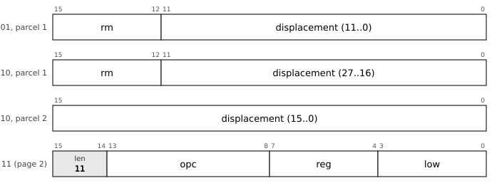

**9.4.2** Instructions are parcel-aligned and little-endian; an instruction may cross any boundary of 8 bytes, a cache line or a page. *(D)*

**9.4.3** Most instructions are two or four bytes: register-to-register work and the whole conversion set is one parcel; any memory operand within ±2 KB is two; displacements to ±128 MB, 32-bit immediates and branches to ±4 GB are three. *(D)*

**9.4.4** Where an addressing mode names no base register (immediate, absolute, PC-relative), the register nibble of the second parcel carries payload, so those modes reach 16 bits at four bytes and 32 bits at six. *(D)*

**9.4.5** A constant wider than 32 bits is loaded from a literal pool with `MOVQ =K, Rd`, written with an explicit `=`; nothing is pooled silently. *(D, errata 33)*

*Commentary.* **Precedent.** The PDP-11 had the length in the first word, but as a function of both of its six-bit specifiers; UTF-8 made "the leading unit says how long" famous, but what matters here is that length is the *primary* partition, so the payload is budgeted by what each form needs and not carved from a fixed width. **Trade-offs.** Byte-granular encoding, as in x86, buys perhaps a tenth of the code size and costs a full alignment rotator and cross-line splice logic in the fetch path on a 64-bit datapath; the pdp64 refuses it. Forcing an instruction to stay inside an eight-byte window would simplify fetch and would cost 5% to 10% of code size in padding. **Improvements.** The fourth parcel of earlier revisions was removed (errata 31) and its code now selects a second page of one-parcel abbreviations; the measured average is near three bytes per instruction. **Benefits.** The front end is a two-bit counter, a two-deep parcel buffer and no feedback. **Modern comparables.** Thumb-2 and RISC-V's compressed instructions mix 16- and 32-bit forms too, with the length read from the low bits. **Impact.** *Kernel:* Page-2 forms make kernel text smaller with no source change. *Compiler:* The assembler picks the shortest form, branch relaxation is just a length choice, and the cost model knows only 2, 4 and 6 bytes. *Hardware:* The fetch unit is a two-bit down-counter and a two-deep parcel buffer with no feedback.

## 9.5 Addressing modes

**9.5.1** Four bits select one of eight modes, present at four bytes and longer. *(D)*

| Mode | Syntax | Effect |
|---|---|---|
| `0000` | `d(Rn)` | base plus displacement |
| `0001` | `d(Rn)(Rx*s)` | scaled index, `s` in {1, 2, 4, 8} |
| `0010` | `d(PC)` | PC-relative; the base is the first parcel of the instruction |
| `0011` | `d(DP)` | direct page |
| `0100` | `#imm` | immediate, sign-extended |
| `0101` | `@abs` | absolute, sign-extended |
| `0110` | `(Rn)+d` | post-increment by `d` (default: the operand size) |
| `0111` | `-(Rn)` or `(Rn)-d` | pre-decrement by the operand size, or by `d` |

**9.5.2** The deferred modes of the PDP-11 are removed; indirection is done with `JMPI`, `CALLI` and a load. *(D)*

**9.5.3** At most one register side effect occurs per instruction, and it is committed at retirement; a fault discards it. *(D)*

*Commentary.* **Precedent.** The PDP-11 had eight modes for each of eight registers, with a deferred flavour of each, and it made `*p++` and `*--p` single instructions. **Trade-offs.** Dropping the deferred modes removes the case where a fault occurs after a register has been updated at an address that itself came from a load; keeping the strided autoincrement costs nothing, because the undo information was already a delta (the PDP-11's `MMR1` recorded an amount for the same reason). **Improvements.** The increment is a stride, so walking an array of 16-byte records is one instruction; the PC-relative modes count from the instruction itself, so a branch needs no adjustment and `LEA` reads the PC. **Benefits.** Address generation is one adder pass, never load-then-add, which is the difference between one cycle and a long path on an FPGA. **Modern comparables.** AArch64 has pre- and post-indexed forms with an immediate; x86 has scaled index with a base; RISC-V has base plus immediate only. **Impact.** *Kernel:* A strided autoincrement walks a table of records, and `d(DP)` reaches the per-CPU structure in one instruction. *Compiler:* The modes match C idioms (`*p++`, `a[i]`) one-to-one, and dropping the deferred modes removes the cases the selector would otherwise have to consider. *Hardware:* Address generation is one adder pass, never load-then-add, and the PC-relative base is the first parcel, so no adjustment is needed.

## 9.6 Moves, conversions and address formation

<!-- notation -->
**The instructions.** Every instruction has an entry in the section of its group, laid out as in a processor reference manual: its mnemonics, its syntax, its encoding (a drawing of the parcels and the numbers), its operation in pseudocode, the flags it writes, the exceptions it can take, and where the book explains the matter it touches (*Cf.*). Every instruction, the atomic and the system instructions included, has its official entry in this chapter (sections 9.13 and 9.14 for those two groups); the chapters on the kernel and on several processors give the reasons and the history, and an entry may point back to them for a fuller explanation. In the pseudocode, ← is assignment, = and ≠ compare, × and ÷ multiply and divide, and `M[a]` is memory at address `a`. Numbers that are encodings (opcodes, sub-opcodes, field values) are written in binary with the hexadecimal value in brackets behind, as `010011 (0x13)`. Masks are binary too, with a subscript 2 to mark the base (`Rn & 111₂` keeps the low three bits). The entries are generated from `spec/pdp64-mnemonics.hbnf`, the one place where the numbers of the architecture are written, so an encoding here cannot disagree with the assembler or the simulators; the words (operation, flags, exceptions) were checked against the reference executor, `common/pdp64exec.c`, which `sim64` and QEMU share, and an entry says when the executor does not implement an instruction yet. The one-parcel second page, the aliases, the constants and the lists of the mnemonics and the opcodes are in the [reference tables](dictionary/index.md).

**The stories.** An instruction that is not common (the PDP-11 core and the operations every architecture has carry none) is followed by *Why it is here*: the record of why it was chosen, from the author's questions in the original design chat (`chat01.txt`), the author's messages in the archive of the working session (dates are those of the archive, in UTC), the revision changelogs of the instruction-set text, the errata and the measurements. Where the record gives no reason, the paragraph says so.

**Notation.** `Rd` is the destination register (the `reg` field of parcel 0), `Rs` the first source (`low`), `Rt` the second (`t` of parcel 1), `Ru` the third (`x`); the assembler writes the destination last. `rm` is a general operand: a register at `len = 00`, or a memory operand, an immediate or an absolute address by one of the eight addressing modes (section 9.5). `EA(rm)` is its effective address. `M[a]` is memory, `M8[a]` one byte. `sext` and `zext` sign- and zero-extend. A `len = 01` instruction is two parcels (four bytes) and a `len = 10` instruction three (six bytes); `len = 11` is page 2. `N Z V C` are the condition flags. In the drawings the bits of a parcel are numbered from 15 at the left, a shaded box is a fixed value, and a white box is a field that varies.
<!-- /notation -->

*Cf. section 6.4 for the memory types that decide whether an access is cached, and section 6.8 for what a faulting load leaves behind.*

**9.6.1** `MOVQ`, `MOVL`, `MOVW` and `MOVB` load and store 64, 32, 16 and 8 bits; the loads sign-extend. `MOVZL`, `MOVZW` and `MOVZB` load with zero extension. *(opcodes `000000 (0x00)`-`001010 (0x0A)`)*

**9.6.2** With a register operand, the same opcodes are the conversion set: `MOVB R1, R2` sign-extends the low byte, `MOVZW R1, R2` zero-extends the low word.

**9.6.3** `LEA` forms an effective address; `LEA 0(PC), Rn` reads the program counter. *(opcode `001011 (0x0B)`)*

**9.6.4** Moves, loads and stores write no flags. *(D, errata 39)*

**9.6.5** The explicit unaligned forms `MOVUB`, `MOVUW`, `MOVUL` and `MOVUQ` exist in both directions, in the memory escape. *(D)*

**9.6.6** Page 2 abbreviates the common cases to one parcel: loads and stores through `(rn)`, loads and stores at small offsets from `SP`, `LEA` from `SP`, and `MOVQ #imm, rd` with a four-bit immediate. *(D)*

*Commentary.* **Precedent.** The PDP-11 had `MOV` and `MOVB` with a byte sign-extended into a register; the VAX had a sized `MOV` for every width. **Trade-offs.** Keeping the sized loads costs four extra opcodes against a quad-only design, but without `MOVL` a struct field load becomes two `MOVW`s, a shift and an or, and ELF, timestamps and most on-disk and wire structures are full of 32- and 16-bit fields. **Improvements.** There is no separate `CVT` group: the conversions are the moves with a register source, so they cost nothing. **Benefits.** No partial-register state anywhere. **Modern comparables.** AArch64 and RISC-V have the same sized loads with sign and zero extension; x86-64 keeps 8- and 16-bit register writes that preserve the upper bits, which makes narrow writes depend on the old value. **Use.** `LEA 0(PC)` is how a position-independent program finds itself; the unaligned forms are for packed on-disk and network structures. **Impact.** *Kernel:* `LEA 0(PC)` lets position-independent kernel code find itself; the unaligned forms read packed on-disk and network structures. *Compiler:* Sized loads avoid the shift, mask and or of a struct-field read, and the conversions are moves, so no separate conversion selection exists. *Hardware:* No partial-register write anywhere; the conversions reuse the load-extend path.

<!-- entries:9.6 -->
### MOV: Move, load and store (64, 32, 16 and 8 bits)

**Mnemonics:** `MOVQ`, `MOVL`, `MOVW`, `MOVB`

**Syntax**

```
MOVQ rm, Rd        ; load
MOVQ Rs, rm        ; store
MOVL, MOVW, MOVB likewise
```

**Encoding**


`reg` is the register `Rd` (the source of a store); `low` is a second register (`Rs`) at `len = 00`, where the instruction is two bytes. At `len = 01` or `10`, `low` is the addressing mode and parcel 1 (and 2) carry the operand (section 9.5).

| Mnemonic | Opcode (the load or direct form) |
|---|---|
| `MOVQ` | `000000 (0x00)` |
| `MOVL` | `000010 (0x02)` |
| `MOVW` | `000100 (0x04)` |
| `MOVB` | `000110 (0x06)` |

The store form of each move has the opcode of its load form plus 1: `MOVQ` `000001 (0x01)`, `MOVL` `000011 (0x03)`, `MOVW` `000101 (0x05)`, `MOVB` `000111 (0x07)`.

**Operation**

```
size = 8 (MOVQ), 4 (MOVL), 2 (MOVW) or 1 (MOVB) bytes
load :  Rd ← sext(M[EA(rm)], size)          ; len = 00: Rd ← sext(Rs[8×size-1:0])
store:  M[EA(rm)] ← Rs[8×size-1:0]          ; len = 00: Rd ← sext(Rs[8×size-1:0])
```

**Flags** None written. (Errata 39: moves, loads and stores write no flags.)

**Exceptions** Memory operand: page fault, protection fault, alignment fault or bus error (a read of non-existent memory is a precise abort with cause `BUSFAULT`). Every such fault is precise and the instruction restarts after it, because the register update of an auto-increment or auto-decrement mode is held until the instruction retires.

A register is always written in full: a narrow load sign-extends to 64 bits and there is no partial-register write anywhere. At `len = 00` the same opcodes are the conversion set: `MOVB R1, R2` sign-extends the low byte of `R1` into `R2`. Page 2 abbreviates the loads and stores through `(rn)`, at small offsets from `SP` and from a register, and `MOVQ #imm, rd` with a 4-bit immediate (see the page-2 table).

**Cf.** 6.4 for the memory type that decides whether the access is cached; 6.8 for what a faulting access leaves behind.

**Status** implemented in the reference executor (`common/pdp64exec.c`, shared by `sim64` and QEMU).


### MOVZ: Move zero-extended (32, 16 and 8 bits)

**Mnemonics:** `MOVZL`, `MOVZW`, `MOVZB`

**Syntax**

```
MOVZL rm, Rd
MOVZW rm, Rd
MOVZB rm, Rd
```

**Encoding**


`reg` is the register `Rd` (the source of a store); `low` is a second register (`Rs`) at `len = 00`, where the instruction is two bytes. At `len = 01` or `10`, `low` is the addressing mode and parcel 1 (and 2) carry the operand (section 9.5).

| Mnemonic | Opcode (the load or direct form) |
|---|---|
| `MOVZL` | `001000 (0x08)` |
| `MOVZW` | `001001 (0x09)` |
| `MOVZB` | `001010 (0x0A)` |

**Operation**

```
Rd ← zext(M[EA(rm)], size)      ; len = 00: Rd ← zext(Rs[8×size-1:0])
```

**Flags** None written.

**Exceptions** Memory operand: page fault, protection fault, alignment fault or bus error (a read of non-existent memory is a precise abort with cause `BUSFAULT`). Every such fault is precise and the instruction restarts after it, because the register update of an auto-increment or auto-decrement mode is held until the instruction retires.

There is no zero-extending 64-bit move (it would be `MOVQ`). At `len = 00` these are the zero-extending half of the conversion set.

**Status** implemented in the reference executor (`common/pdp64exec.c`, shared by `sim64` and QEMU).


### LEA: Load effective address

**Mnemonics:** `LEA`

**Syntax**

```
LEA d(Rn), Rd
LEA d(PC), Rd
LEA d(Rn)(Rx×s), Rd
```

**Encoding**


`reg` is the register `Rd` (the source of a store); `low` is a second register (`Rs`) at `len = 00`, where the instruction is two bytes. At `len = 01` or `10`, `low` is the addressing mode and parcel 1 (and 2) carry the operand (section 9.5).

**Operation**

```
Rd ← EA(rm)          ; no memory access
```

**Flags** None written.

**Exceptions** The operand must name memory; `len = 00` (a register) and the immediate mode are reserved. No memory access is made, so the instruction takes no memory fault. A reserved encoding aborts with the illegal-instruction vector.

`LEA 0(PC), Rd` is how the program counter is read: it puts the address of the `LEA` itself in `Rd`. At `len = 10` it forms any address within ±2 GB of itself PC-relatively in six bytes. The base of every PC-relative displacement is the address of the first parcel of the instruction.

**Why it is here.** The design chat opened with the questions "why is SP in the register file but not PC?", "what is the problem with letting programmers read and modify PC directly?" and "what if R7 was a read-only view of the PC?". The answer (ISA revision 13, section 9.3 of the book) was to keep the program counter out of the register file, because every register write would then be a potential branch, and to refuse the read-only view, which would fix for ever *which* PC is meant (ARM32 is stuck with `PC+8`). `LEA 0(PC), Rn` gives the capability without the commitment: the address of the instruction itself, in one instruction. The same instruction forms any address PC-relatively, which is what makes position-independent code free (section 9.16).

**Status** implemented in the reference executor (`common/pdp64exec.c`, shared by `sim64` and QEMU).


### MOVU: Unaligned load and store

**Mnemonics:** `MOVUB`, `MOVUW`, `MOVUL`, `MOVUQ`

**Syntax**

```
MOVUQ rm, Rd        ; load, any alignment
MOVUQ Rs, rm        ; store, any alignment
MOVUW, MOVUL, MOVUB likewise
```

**Encoding**

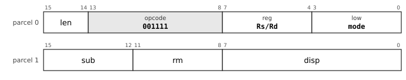

Parcel 0's `low` is an addressing mode, as in the ordinary memory format; parcel 1 is `sub(4) rm(4) disp(8)` (16 more displacement bits per further parcel).

| Mnemonic | Sub-opcode |
|---|---|
| `MOVUB` | `0000 (0x0)` |
| `MOVUW` | `0010 (0x2)` |
| `MOVUL` | `0100 (0x4)` |
| `MOVUQ` | `0110 (0x6)` |

**Operation**

```
size = 1, 2, 4 or 8 bytes
load :  Rd ← sext(M[EA(rm)], size)            ; the access may cross an alignment boundary
store:  M[EA(rm)] ← Rs[8×size-1:0]
```

**Flags** None written.

**Exceptions** Page and protection faults and bus errors as for any memory operand; **no alignment fault**.

The ordinary moves fault on a misaligned address (the alignment fault is the tag check of section 9.5); these are the explicit forms for data that is not aligned, in `MESC`.

**Why it is here.** Data alignment is architectural on this machine: an ordinary quad access to an address that is not a multiple of 8 aborts, and that abort doubles as the tag check for tagged pointers (ISA sections 6.2 and 7.4; the rejection of "a load form that ignores low pointer bits" in section 11 gives the reason). Packed on-disk and network structures still need unaligned access, so `MESC` carries explicit unaligned forms rather than weakening the rule for every load. The record gives no further history for these four.

**Cf.** 6.4, 6.8.

**Status** specified; **not yet implemented** in the reference executor.
<!-- /entries:9.6 -->

## 9.7 Integer arithmetic

*Cf. section 6.2 for the divide-by-zero vector (`DIV`, `DIVU`, `MOD`, `MODU`).*

**9.7.1** `ADD`, `SUB`, `CMP`, `MUL` and `MULH` are two bytes with register operands; `MULHU` (high half of an unsigned product), `DIV`, `DIVU`, `MOD` and `MODU` are in the arithmetic escape. *(D)*

**9.7.2** `CMP` is written `CMP Rd, rm`, register first, and computes `Rd - rm`. *(D, errata 13)*

**9.7.3** `ADD` sets `C` on a carry; `SUB` and `CMP` set `C` on a borrow, the PDP-11 sense, so `BHIS` and `BCC` mean "no borrow", unsigned greater or equal. *(D, errata 14)*

**9.7.4** `ADC` and `SBC` add and subtract the carry; `INC`, `DEC`, `NEG`, `CLR` and `TST` are single-operand forms that work on a register or memory. *(opcode group `SOP`)*

**9.7.5** `ABS`, `MIN`, `MAX`, `MINU` and `MAXU`, and `SET cc, Rd` (write 1 if the condition holds, else 0), are in the arithmetic escape. *(D, errata 23 and 25)*

*Commentary.* **Precedent.** `ADD`, `SUB`, `CMP`, `BIT`, `BIS`, `BIC` and the single-operand set are the PDP-11's, unchanged in name and meaning except for the order of `CMP`'s operands. **Trade-offs.** The PDP-11 wrote `CMP a, b` to compute `a - b`; since the destination of an ALU operation here must be a register, a literal `src, dst` reading would force every comparison against an immediate or memory to be reversed, so the register comes first. Divide was demoted to four bytes because compilers turn division by a constant into `MULH` plus a shift, so a real divide is rare. **Improvements.** The high-half multiply that bignum code needs was added; a second unsigned multiply, which turned out to be the same instruction as the first, was not. **Benefits.** `SET` replaces a branch around a move for the very common "store the truth value of a comparison", and absolute value, minimum and maximum remove a compare-and-branch from small loops. **Modern comparables.** RISC-V has `MULH`, `MULHU` and `MULHSU`, and AArch64 `SMULH` and `UMULH`; x86 has a one-operand multiply that produces both halves; AArch64's conditional select and set instructions are the nearest to `SET`. **Use.** `MULH` and `MULHU` are for multi-precision arithmetic and for division by constants; `ADC` and `SBC` carry a multi-word add or subtract; `MIN`, `MAX` and `ABS` appear under a tenth of a percent of compiled code but each replaces a branch. **Impact.** *Kernel:* `ADC` and `SBC` carry multiword arithmetic for the kernel's 128-bit counters and for the bignum code in the base system. *Compiler:* `MULH` turns division by a constant into a multiply and a shift; `SET` materialises a comparison without a branch; `CMP` takes the register first, as the compiler orders its operands. *Hardware:* One adder on the carry chain; on an FPGA the multiplier is built from two to four multiplier blocks over four to eight cycles; the divide is a sequencer.

<!-- entries:9.7 -->
### ADD: Add

**Mnemonics:** `ADD`

**Syntax**

```
ADD rm, Rd
```

**Encoding**


`reg` is the register `Rd` (the source of a store); `low` is a second register (`Rs`) at `len = 00`, where the instruction is two bytes. At `len = 01` or `10`, `low` is the addressing mode and parcel 1 (and 2) carry the operand (section 9.5).

**Operation**

```
Rd ← Rd + rm
```

**Flags** `N` and `Z` from the result, `V` set on signed overflow, `C` set on a carry out of bit 63.

**Exceptions** Memory operand: page fault, protection fault, alignment fault or bus error (a read of non-existent memory is a precise abort with cause `BUSFAULT`). Every such fault is precise and the instruction restarts after it, because the register update of an auto-increment or auto-decrement mode is held until the instruction retires.

All ALU operations are 64 bits, with no size field. Page 2 has `ADD #imm, rd` with a 4-bit immediate and `ADD #(8*n), SP`.

**Status** implemented in the reference executor (`common/pdp64exec.c`, shared by `sim64` and QEMU).


### SUB: Subtract

**Mnemonics:** `SUB`

**Syntax**

```
SUB rm, Rd
```

**Encoding**


`reg` is the register `Rd` (the source of a store); `low` is a second register (`Rs`) at `len = 00`, where the instruction is two bytes. At `len = 01` or `10`, `low` is the addressing mode and parcel 1 (and 2) carry the operand (section 9.5).

**Operation**

```
Rd ← Rd - rm
```

**Flags** `N` and `Z` from the result, `V` set on signed overflow, `C` set on a **borrow** (the PDP-11 sense): `C` = 1 when the unsigned operand being subtracted is the larger.

**Exceptions** Memory operand: page fault, protection fault, alignment fault or bus error (a read of non-existent memory is a precise abort with cause `BUSFAULT`). Every such fault is precise and the instruction restarts after it, because the register update of an auto-increment or auto-decrement mode is held until the instruction retires.

Page 2 has `SUB #(8*n), SP`.

**Status** implemented in the reference executor (`common/pdp64exec.c`, shared by `sim64` and QEMU).


### CMP: Compare

**Mnemonics:** `CMP`

**Syntax**

```
CMP Rd, rm        ; register first
```

**Encoding**


`reg` is the register `Rd` (the source of a store); `low` is a second register (`Rs`) at `len = 00`, where the instruction is two bytes. At `len = 01` or `10`, `low` is the addressing mode and parcel 1 (and 2) carry the operand (section 9.5).

**Operation**

```
tmp ← Rd - rm         ; the result is discarded
```

**Flags** `N` and `Z` from the result, `V` set on signed overflow, `C` set on a **borrow** (the PDP-11 sense): `C` = 1 when the unsigned operand being subtracted is the larger.

**Exceptions** Memory operand: page fault, protection fault, alignment fault or bus error (a read of non-existent memory is a precise abort with cause `BUSFAULT`). Every such fault is precise and the instruction restarts after it, because the register update of an auto-increment or auto-decrement mode is held until the instruction retires.

**The operands are in the order register, then the other operand**, the reverse of the PDP-11 `CMP src,dst`: `CMP Rd, rm` computes `Rd - rm`, so a compare of a register against an immediate or memory operand does not reverse its branch condition. After `CMP`, `BHIS`/`BCC` mean unsigned `>=` (no borrow) and `BLO`/`BCS` mean a borrow occurred.

**Status** implemented in the reference executor (`common/pdp64exec.c`, shared by `sim64` and QEMU).


### MUL: Multiply, low 64 bits

**Mnemonics:** `MUL`  (aliases: `MULU`)

**Syntax**

```
MUL rm, Rd
```

**Encoding**


`reg` is the register `Rd` (the source of a store); `low` is a second register (`Rs`) at `len = 00`, where the instruction is two bytes. At `len = 01` or `10`, `low` is the addressing mode and parcel 1 (and 2) carry the operand (section 9.5).

**Operation**

```
Rd ← (Rd × rm)[63:0]         ; sign-agnostic
```

**Flags** `N` and `Z` from the result, `V` set when the signed 128-bit product does not fit in 64 bits, `C` unchanged.

**Exceptions** Memory operand: page fault, protection fault, alignment fault or bus error (a read of non-existent memory is a precise abort with cause `BUSFAULT`). Every such fault is precise and the instruction restarts after it, because the register update of an auto-increment or auto-decrement mode is held until the instruction retires.

The low 64 bits of a two's-complement product are the same whether the operands are read as signed or unsigned, so there is one low-half multiply. The old mnemonic `MULU` is an alias of `MUL`. The high half is `MULH` (signed) and `MULHU` (unsigned).

**Status** implemented in the reference executor (`common/pdp64exec.c`, shared by `sim64` and QEMU).


### MULH: Multiply, high 64 bits, signed

**Mnemonics:** `MULH`

**Syntax**

```
MULH rm, Rd
```

**Encoding**


`reg` is the register `Rd` (the source of a store); `low` is a second register (`Rs`) at `len = 00`, where the instruction is two bytes. At `len = 01` or `10`, `low` is the addressing mode and parcel 1 (and 2) carry the operand (section 9.5).

**Operation**

```
Rd ← (sext(Rd) × sext(rm))[127:64]
```

**Flags** `N` and `Z` from the result, `V` cleared, `C` unchanged.

**Exceptions** Memory operand: page fault, protection fault, alignment fault or bus error (a read of non-existent memory is a precise abort with cause `BUSFAULT`). Every such fault is precise and the instruction restarts after it, because the register update of an auto-increment or auto-decrement mode is held until the instruction retires.

With `MULH`, division by a constant is a multiply by a reciprocal and a shift, which is what compilers emit.

**Why it is here.** ISA revision 17 pruned instructions that were carried for continuity and found one duplicate hiding a genuine hole: `MUL` and `MULU` were the same instruction, because the low 64 bits of a two's-complement product are identical signed or unsigned, so two ALU slots held one operation, while nothing in the architecture produced the *high* half. Without it a 64 by 64 to 128-bit multiply, every bignum multiply, 128-bit fixed point and divide-by-a-constant by multiplying by the reciprocal were impossible. `MULH` took the duplicate's slot (ISA revision 17, section 4.2.2). It is also why a divide is rare in compiled code: compilers turn division by a constant into `MULH` and a shift.

**Status** implemented in the reference executor (`common/pdp64exec.c`, shared by `sim64` and QEMU).


### ADDM: ALU operation with a memory destination

**Mnemonics:** `ADDM`, `SUBM`, `BICM`, `BISM`

**Syntax**

```
ADDM Rs, rm
SUBM Rs, rm
BICM Rs, rm
BISM Rs, rm
```

**Encoding**


Parcel 0's `low` is an addressing mode, as in the ordinary memory format; parcel 1 is `sub(4) rm(4) disp(8)` (16 more displacement bits per further parcel).

| Mnemonic | Sub-opcode |
|---|---|
| `ADDM` | `1000 (0x8)` |
| `SUBM` | `1001 (0x9)` |
| `BICM` | `1010 (0xA)` |
| `BISM` | `1011 (0xB)` |

**Operation**

```
ADDM: M[EA] ← M[EA] + Rs
SUBM: M[EA] ← M[EA] - Rs
BICM: M[EA] ← M[EA] AND NOT Rs
BISM: M[EA] ← M[EA] OR Rs
```

**Flags** As for `ADD`, `SUB`, `BIC` and `BIS`.

**Exceptions** Memory operand: page fault, protection fault, alignment fault or bus error (a read of non-existent memory is a precise abort with cause `BUSFAULT`). Every such fault is precise and the instruction restarts after it, because the register update of an auto-increment or auto-decrement mode is held until the instruction retires. Write permission is checked during the read access, so the write cannot fault after the read has succeeded.

Parcel 0's low nibble is a mode, as in the ordinary memory format, so these are `MESC` forms with a memory destination (`len >= 01`). `INC`, `DEC`, `NEG`, `COM` and `CLR` on a memory operand are in `SOP`.

**Why it is here.** Through ISA revision 19 these were top-level opcodes `100000 (0x20)` to `100011 (0x23)`. Revision 20 reallocated all sixty-four opcodes by one rule (a top-level opcode is for an operation whose common case is register to register) and moved them to `MESC` at no cost, because an instruction with a memory destination is at least four bytes anyway; that freed four top-level slots. They cover the case where the second operand is a register, for example `BISM Rmask, flags(DP)` (ISA section 4.13). The measurement of 2026-10-22 found 265 sites in the compiled corpus (1.6 KB), so they earn their place in the escape group but not in the opcode space (this chat, the instruction-set analysis).

**Status** specified; **not yet implemented** in the reference executor.


### INC: Increment

**Mnemonics:** `INC`

**Syntax**

```
INC rm
```

**Encoding**


The `reg` field is the sub-opcode; `rm` and the mode give the single operand, at any length (section 9.5).

**Operation**

```
rm ← rm + 1
```

**Flags** `N`, `Z` and `V` as for `ADD`; `C` **unchanged**.

**Exceptions** Memory operand: page fault, protection fault, alignment fault or bus error (a read of non-existent memory is a precise abort with cause `BUSFAULT`). Every such fault is precise and the instruction restarts after it, because the register update of an auto-increment or auto-decrement mode is held until the instruction retires.

**Status** implemented in the reference executor (`common/pdp64exec.c`, shared by `sim64` and QEMU).


### DEC: Decrement

**Mnemonics:** `DEC`

**Syntax**

```
DEC rm
```

**Encoding**


The `reg` field is the sub-opcode; `rm` and the mode give the single operand, at any length (section 9.5).

**Operation**

```
rm ← rm - 1
```

**Flags** `N`, `Z` and `V` as for `SUB`; `C` **unchanged**.

**Exceptions** Memory operand: page fault, protection fault, alignment fault or bus error (a read of non-existent memory is a precise abort with cause `BUSFAULT`). Every such fault is precise and the instruction restarts after it, because the register update of an auto-increment or auto-decrement mode is held until the instruction retires.

**Status** implemented in the reference executor (`common/pdp64exec.c`, shared by `sim64` and QEMU).


### NEG: Negate

**Mnemonics:** `NEG`

**Syntax**

```
NEG rm
```

**Encoding**


The `reg` field is the sub-opcode; `rm` and the mode give the single operand, at any length (section 9.5).

**Operation**

```
rm ← 0 - rm
```

**Flags** `N` and `Z` from the result, `V` set on signed overflow, `C` set on a **borrow** (the PDP-11 sense): `C` = 1 when the unsigned operand being subtracted is the larger. (`C` = 1 unless the operand was 0.)

**Exceptions** Memory operand: page fault, protection fault, alignment fault or bus error (a read of non-existent memory is a precise abort with cause `BUSFAULT`). Every such fault is precise and the instruction restarts after it, because the register update of an auto-increment or auto-decrement mode is held until the instruction retires.

**Status** implemented in the reference executor (`common/pdp64exec.c`, shared by `sim64` and QEMU).


### ADC: Add carry

**Mnemonics:** `ADC`

**Syntax**

```
ADC rm
```

**Encoding**


The `reg` field is the sub-opcode; `rm` and the mode give the single operand, at any length (section 9.5).

**Operation**

```
rm ← rm + C
```

**Flags** `N` and `Z` from the result, `V` set on signed overflow, `C` set on a carry out of bit 63.

**Exceptions** Memory operand: page fault, protection fault, alignment fault or bus error (a read of non-existent memory is a precise abort with cause `BUSFAULT`). Every such fault is precise and the instruction restarts after it, because the register update of an auto-increment or auto-decrement mode is held until the instruction retires.

With `ADD`, multi-word addition.

**Status** implemented in the reference executor (`common/pdp64exec.c`, shared by `sim64` and QEMU).


### SBC: Subtract carry

**Mnemonics:** `SBC`

**Syntax**

```
SBC rm
```

**Encoding**


The `reg` field is the sub-opcode; `rm` and the mode give the single operand, at any length (section 9.5).

**Operation**

```
rm ← rm - C
```

**Flags** `N` and `Z` from the result, `V` set on signed overflow, `C` set on a **borrow** (the PDP-11 sense): `C` = 1 when the unsigned operand being subtracted is the larger.

**Exceptions** Memory operand: page fault, protection fault, alignment fault or bus error (a read of non-existent memory is a precise abort with cause `BUSFAULT`). Every such fault is precise and the instruction restarts after it, because the register update of an auto-increment or auto-decrement mode is held until the instruction retires.

**Status** implemented in the reference executor (`common/pdp64exec.c`, shared by `sim64` and QEMU).


### DIV: Divide and remainder, signed and unsigned

**Mnemonics:** `DIV`, `DIVU`, `MOD`, `MODU`

**Syntax**

```
DIV Ra, Rb, Rd
DIVU Ra, Rb, Rd
MOD Ra, Rb, Rd
MODU Ra, Rb, Rd
```

**Encoding**


From `len = 01`. In this group `low` is a register, never a mode. 

| Mnemonic | Sub-opcode |
|---|---|
| `DIV` | `00000000 (0x00)` |
| `DIVU` | `00000001 (0x01)` |
| `MOD` | `00000010 (0x02)` |
| `MODU` | `00000011 (0x03)` |

**Operation**

```
if Rb = 0 then divide-by-zero abort
DIV : Rd ← Ra ÷ Rb  (signed, rounded toward zero; INT_MIN ÷ -1 = INT_MIN)
DIVU: Rd ← Ra ÷ Rb  (unsigned)
MOD : Rd ← Ra mod Rb (signed, the sign of Ra; any value mod -1 = 0)
MODU: Rd ← Ra mod Rb (unsigned)
```

**Flags** None written.

**Exceptions** Division by zero aborts with the divide-by-zero vector (cause `DIVZERO`). There is no overflow trap: `INT_MIN / -1` returns `INT_MIN`.

Division by a constant is a `MULH` and a shift, so a real divide is rare; this is why divide has no two-byte form.

**Cf.** 6.2 (the divide-by-zero vector).

**Status** implemented in the reference executor (`common/pdp64exec.c`, shared by `sim64` and QEMU).


### MULHU: Multiply, high 64 bits, unsigned

**Mnemonics:** `MULHU`

**Syntax**

```
MULHU Ra, Rb, Rd
```

**Encoding**


From `len = 01`. In this group `low` is a register, never a mode. 

**Operation**

```
Rd ← (Ra × Rb)[127:64]    ; unsigned
```

**Flags** None written.

**Exceptions** None.

`MULHSU` (signed by unsigned) is reserved and not committed.

**Why it is here.** The unsigned partner of `MULH`, added in ISA revision 17 for the same reason (the high half of the product was missing). It went to `BESC` first and moved to `AESC` in revision 20, where arithmetic belongs. `MULHSU`, signed times unsigned for a bignum's top limb, was left reserved because it can be built from `MULH` with one correction.

**Status** implemented in the reference executor (`common/pdp64exec.c`, shared by `sim64` and QEMU).


### ABS: Absolute value

**Mnemonics:** `ABS`

**Syntax**

```
ABS Rs, Rd
```

**Encoding**


From `len = 01`. In this group `low` is a register, never a mode. 

**Operation**

```
Rd ← |Rs|
```

**Flags** `N` and `Z` from the result, `V` set if `Rs` is the most negative value (the result is then still negative), `C` unchanged.

**Exceptions** None.

**Why it is here.** The author asked on 2026-10-21: "do we have abs opcode?" There was none for integers, only `FABS`. After the cost was worked out (about 150 to 250 lookup tables, no new operation by the folding rule, the compiler recognising `x < 0 ? -x : x` being the real cost) the author said "add them, and if we have to teach the front end about abs/min/max nodes that is fine". The measurement that followed found 18 uses of `abs` and 5 of its unsigned form in the compiled corpus, under 0.1% of code, so the case is clarity and the idiom more than size (errata 23; CHANGES section 14.4).

**Status** implemented in the reference executor (`common/pdp64exec.c`, shared by `sim64` and QEMU).


### MINMAX: Minimum and maximum, signed and unsigned

**Mnemonics:** `MIN`, `MINU`, `MAX`, `MAXU`

**Syntax**

```
MIN Ra, Rb, Rd
MINU Ra, Rb, Rd
MAX Ra, Rb, Rd
MAXU Ra, Rb, Rd
```

**Encoding**


From `len = 01`. In this group `low` is a register, never a mode. 

| Mnemonic | Sub-opcode |
|---|---|
| `MIN` | `00010000 (0x10)` |
| `MINU` | `00010001 (0x11)` |
| `MAX` | `00010010 (0x12)` |
| `MAXU` | `00010011 (0x13)` |

**Operation**

```
MIN : Rd ← smaller of Ra, Rb (signed)         MINU: unsigned
MAX : Rd ← larger of Ra, Rb (signed)          MAXU: unsigned
```

**Flags** `N` and `Z` from the result, `V` = 0, `C` unchanged.

**Exceptions** None.

**Why it is here.** Asked for together with `ABS` on 2026-10-21 ("what would be the cost of adding abs/min/max for ints?"; "add them"), as the integer counterparts of `FMIN` and `FMAX`. By the folding rule (integer against float and signed against unsigned are qualifiers) they add no operation, and the hardware reuses the subtract-and-compare that `CMP` already does plus a 64-bit select. The corpus has 171 uses of `MIN` and 52 of `MAX` across 95 files, under 0.1% of code in all (errata 23; CHANGES section 14.4). The alternative the assistant raised, a general conditional select, was left on hold for want of a speed model.

**Status** implemented in the reference executor (`common/pdp64exec.c`, shared by `sim64` and QEMU).


### SET: Set a register from a condition

**Mnemonics:** `SET`

**Syntax**

```
SET cc, Rd        ; for example SET EQ, R1
```

**Encoding**


From `len = 01`. In this group `low` is a register, never a mode. 

**Operation**

```
Rd ← 1 if condition cc holds on the current flags, else 0
```

**Flags** None written.

**Exceptions** None.

The condition is the `x` field of parcel 1, numbered as the low nibble of the branch opcodes (`al` 0, `ne` 1, `eq` 2, ... `los` 14).

**Why it is here.** The first instruction written with a condition word: the author's questions on 2026-10-21 were "why do them as single opcodes instead of as an opcode that takes a flag?" and "set eq instead of seteq", which fixed the form as one instruction, `SET cc, Rd`, with the condition in a field numbered like the low nibble of the branch opcodes (errata 25). It turns a comparison used as a value into 0 or 1 without a branch. gcc `-Os` for amd64 emits 673 `set<cc>` on the corpus, and `SET` would remove about six bytes per site, around 0.4% of code; the compiler cannot yet reach it because pass 1 turns such a comparison into branches before pass 2 sees it (CHANGES section 14.4).

**Status** implemented in the reference executor (`common/pdp64exec.c`, shared by `sim64` and QEMU).
<!-- /entries:9.7 -->

## 9.8 Logic, shifts and rotates

**9.8.1** `AND`, `BIC` (bit clear), `BIS` (bit set, the or), `XOR` and `BIT` (test) are two-byte ALU operations; `COM` is one's complement. *(opcodes `011000 (0x18)`, `011001 (0x19)`, `011011 (0x1B)`, `011100 (0x1C)`, `011101 (0x1D)`)*

**9.8.2** `SHL`, `SHR` and `SAR` shift by a count taken from `rm` (a register, an immediate, or memory); `ASL` and `ASR` are the by-one forms in two bytes. *(D)*

**9.8.3** A shift count of 64 or more shifts the value entirely away; `C` receives the last bit that left. *(D)*

**9.8.4** `ROR` rotates right by a register count and `RORI` by an immediate; `ROL Rd, Rs, #n` assembles to `RORI` with `64 - n`; `RORI32` rotates the low 32 bits and sign-extends. Rotates write no flags. *(D)*

**9.8.5** `DSHR` is a double-width funnel shift. It writes no flags. *(D)*

*Commentary.* **Precedent.** The PDP-11 had `ASL`, `ASR`, `ROL` and `ROR` by one through the carry; x86's `SHRD` and ARM's `EXTR` are the funnel shifts. **Trade-offs.** One rotate direction is enough, so the by-one `ROL` was removed from its two-byte slot; rotates are not through the carry because a carry chain is fragile when the carry flag is shared. **Improvements.** The shift count comes from `rm`, not from a fixed register like x86's `CL`, which costs a register shuffle in every hand-written loop. **Benefits.** Multi-precision shifting is `DSHR`, two instructions for any distance. **Modern comparables.** RISC-V and AArch64 have rotates by register and by immediate; x86 has `ROL`/`ROR` through the carry as well. **Use.** `RORI` and `RORI32` are for hashes and ciphers, which rotate by constants; `DSHR` shifts a bignum. **Impact.** *Kernel:* Bit tests and mask operations on the status and page-table words are single instructions. *Compiler:* The shift count may be any register, immediate or memory operand, so the compiler never has to move a count into a fixed register; hashes and ciphers rotate by constants. *Hardware:* The barrel shifter (about 450 lookup tables) serves shifts and rotates, and writing no flag for rotates removes a result path.

<!-- entries:9.8 -->
### BIC: Bit clear

**Mnemonics:** `BIC`

**Syntax**

```
BIC rm, Rd
```

**Encoding**


`reg` is the register `Rd` (the source of a store); `low` is a second register (`Rs`) at `len = 00`, where the instruction is two bytes. At `len = 01` or `10`, `low` is the addressing mode and parcel 1 (and 2) carry the operand (section 9.5).

**Operation**

```
Rd ← Rd AND NOT rm
```

**Flags** `N` and `Z` from the result, `V` cleared, `C` unchanged.

**Exceptions** Memory operand: page fault, protection fault, alignment fault or bus error (a read of non-existent memory is a precise abort with cause `BUSFAULT`). Every such fault is precise and the instruction restarts after it, because the register update of an auto-increment or auto-decrement mode is held until the instruction retires.

The assembler also accepts `BIC #imm, rm` as `AND #~imm, rm`.

**Status** implemented in the reference executor (`common/pdp64exec.c`, shared by `sim64` and QEMU).


### BIS: Bit set (inclusive or)

**Mnemonics:** `BIS`

**Syntax**

```
BIS rm, Rd
```

**Encoding**


`reg` is the register `Rd` (the source of a store); `low` is a second register (`Rs`) at `len = 00`, where the instruction is two bytes. At `len = 01` or `10`, `low` is the addressing mode and parcel 1 (and 2) carry the operand (section 9.5).

**Operation**

```
Rd ← Rd OR rm
```

**Flags** `N` and `Z` from the result, `V` cleared, `C` unchanged.

**Exceptions** Memory operand: page fault, protection fault, alignment fault or bus error (a read of non-existent memory is a precise abort with cause `BUSFAULT`). Every such fault is precise and the instruction restarts after it, because the register update of an auto-increment or auto-decrement mode is held until the instruction retires.

**Status** implemented in the reference executor (`common/pdp64exec.c`, shared by `sim64` and QEMU).


### BIT: Bit test

**Mnemonics:** `BIT`

**Syntax**

```
BIT rm, Rd
```

**Encoding**


`reg` is the register `Rd` (the source of a store); `low` is a second register (`Rs`) at `len = 00`, where the instruction is two bytes. At `len = 01` or `10`, `low` is the addressing mode and parcel 1 (and 2) carry the operand (section 9.5).

**Operation**

```
tmp ← Rd AND rm         ; the result is discarded
```

**Flags** `N` and `Z` from the result, `V` cleared, `C` unchanged.

**Exceptions** Memory operand: page fault, protection fault, alignment fault or bus error (a read of non-existent memory is a precise abort with cause `BUSFAULT`). Every such fault is precise and the instruction restarts after it, because the register update of an auto-increment or auto-decrement mode is held until the instruction retires.

**Status** implemented in the reference executor (`common/pdp64exec.c`, shared by `sim64` and QEMU).


### XOR: Exclusive or

**Mnemonics:** `XOR`

**Syntax**

```
XOR rm, Rd
```

**Encoding**


`reg` is the register `Rd` (the source of a store); `low` is a second register (`Rs`) at `len = 00`, where the instruction is two bytes. At `len = 01` or `10`, `low` is the addressing mode and parcel 1 (and 2) carry the operand (section 9.5).

**Operation**

```
Rd ← Rd XOR rm
```

**Flags** `N` and `Z` from the result, `V` cleared, `C` unchanged.

**Exceptions** Memory operand: page fault, protection fault, alignment fault or bus error (a read of non-existent memory is a precise abort with cause `BUSFAULT`). Every such fault is precise and the instruction restarts after it, because the register update of an auto-increment or auto-decrement mode is held until the instruction retires.

**Status** implemented in the reference executor (`common/pdp64exec.c`, shared by `sim64` and QEMU).


### AND: And

**Mnemonics:** `AND`

**Syntax**

```
AND rm, Rd
```

**Encoding**


`reg` is the register `Rd` (the source of a store); `low` is a second register (`Rs`) at `len = 00`, where the instruction is two bytes. At `len = 01` or `10`, `low` is the addressing mode and parcel 1 (and 2) carry the operand (section 9.5).

**Operation**

```
Rd ← Rd AND rm
```

**Flags** `N` and `Z` from the result, `V` cleared, `C` unchanged.

**Exceptions** Memory operand: page fault, protection fault, alignment fault or bus error (a read of non-existent memory is a precise abort with cause `BUSFAULT`). Every such fault is precise and the instruction restarts after it, because the register update of an auto-increment or auto-decrement mode is held until the instruction retires.

**Status** implemented in the reference executor (`common/pdp64exec.c`, shared by `sim64` and QEMU).


### SHIFT: Shift left, shift right logical, shift right arithmetic

**Mnemonics:** `SHL`, `SHR`, `SAR`

**Syntax**

```
SHL rm, Rd
SHR rm, Rd
SAR rm, Rd
```

**Encoding**


`reg` is the register `Rd` (the source of a store); `low` is a second register (`Rs`) at `len = 00`, where the instruction is two bytes. At `len = 01` or `10`, `low` is the addressing mode and parcel 1 (and 2) carry the operand (section 9.5).

| Mnemonic | Opcode (the load or direct form) |
|---|---|
| `SHL` | `100000 (0x20)` |
| `SHR` | `100001 (0x21)` |
| `SAR` | `100010 (0x22)` |

**Operation**

```
n ← rm                                 ; the count: a register, an immediate, or memory
SHL: Rd ← (n ≥ 64) ? 0 : Rd << n
SHR: Rd ← (n ≥ 64) ? 0 : Rd >>u n
SAR: Rd ← (n ≥ 64) ? (Rd < 0 ? -1 : 0) : Rd >>s n
```

**Flags** `N` and `Z` from the result, `V` cleared, `C` the last bit shifted out (bit 63 for `SHL`, bit 0 for `SHR` and `SAR`). **The same flags are written for every count**: a count of zero gives `N` and `Z` from the unchanged operand, `V` = 0 and `C` = 0 (errata 39).

**Exceptions** Memory operand: page fault, protection fault, alignment fault or bus error (a read of non-existent memory is a precise abort with cause `BUSFAULT`). Every such fault is precise and the instruction restarts after it, because the register update of an auto-increment or auto-decrement mode is held until the instruction retires.

The count is read as an unsigned 64-bit value, so a count of 64 or more shifts the value entirely away. Page 2 has the three shifts by an immediate 0 to 15. `ASL` and `ASR` (in `SOP`) are the by-one forms in two bytes; rotates are in `BESC`.

**Status** implemented in the reference executor (`common/pdp64exec.c`, shared by `sim64` and QEMU).


### CLR: Clear

**Mnemonics:** `CLR`

**Syntax**

```
CLR rm
```

**Encoding**


The `reg` field is the sub-opcode; `rm` and the mode give the single operand, at any length (section 9.5).

**Operation**

```
rm ← 0
```

**Flags** `N` = 0, `Z` = 1, `V` = 0, `C` = 0.

**Exceptions** Memory operand: page fault, protection fault, alignment fault or bus error (a read of non-existent memory is a precise abort with cause `BUSFAULT`). Every such fault is precise and the instruction restarts after it, because the register update of an auto-increment or auto-decrement mode is held until the instruction retires.

**Status** implemented in the reference executor (`common/pdp64exec.c`, shared by `sim64` and QEMU).


### COM: Complement

**Mnemonics:** `COM`

**Syntax**

```
COM rm
```

**Encoding**


The `reg` field is the sub-opcode; `rm` and the mode give the single operand, at any length (section 9.5).

**Operation**

```
rm ← NOT rm
```

**Flags** `N` and `Z` from the result, `V` = 0, `C` = 1 (the PDP-11 rule).

**Exceptions** Memory operand: page fault, protection fault, alignment fault or bus error (a read of non-existent memory is a precise abort with cause `BUSFAULT`). Every such fault is precise and the instruction restarts after it, because the register update of an auto-increment or auto-decrement mode is held until the instruction retires.

A two-byte instruction for a register operand.

**Status** implemented in the reference executor (`common/pdp64exec.c`, shared by `sim64` and QEMU).


### TST: Test

**Mnemonics:** `TST`

**Syntax**

```
TST rm
```

**Encoding**


The `reg` field is the sub-opcode; `rm` and the mode give the single operand, at any length (section 9.5).

**Operation**

```
set flags from rm; nothing is written
```

**Flags** `N` and `Z` from the operand, `V` = 0, `C` = 0.

**Exceptions** Memory operand: page fault, protection fault, alignment fault or bus error (a read of non-existent memory is a precise abort with cause `BUSFAULT`). Every such fault is precise and the instruction restarts after it, because the register update of an auto-increment or auto-decrement mode is held until the instruction retires.

**Status** implemented in the reference executor (`common/pdp64exec.c`, shared by `sim64` and QEMU).


### ASL: Arithmetic shift left by one

**Mnemonics:** `ASL`

**Syntax**

```
ASL rm
```

**Encoding**


The `reg` field is the sub-opcode; `rm` and the mode give the single operand, at any length (section 9.5).

**Operation**

```
C ← rm[63] ; rm ← rm << 1
```

**Flags** `N` and `Z` from the result, `C` the bit shifted out of bit 63, `V` = `N` xor `C` (set if the sign changed: the PDP-11 rule).

**Exceptions** Memory operand: page fault, protection fault, alignment fault or bus error (a read of non-existent memory is a precise abort with cause `BUSFAULT`). Every such fault is precise and the instruction restarts after it, because the register update of an auto-increment or auto-decrement mode is held until the instruction retires.

The by-one form of `SHL` in two bytes.

**Status** implemented in the reference executor (`common/pdp64exec.c`, shared by `sim64` and QEMU).


### ASR: Arithmetic shift right by one

**Mnemonics:** `ASR`

**Syntax**

```
ASR rm
```

**Encoding**


The `reg` field is the sub-opcode; `rm` and the mode give the single operand, at any length (section 9.5).

**Operation**

```
C ← rm[0] ; rm ← rm >>s 1
```

**Flags** `N` and `Z` from the result, `C` the bit shifted out of bit 0, `V` = 0.

**Exceptions** Memory operand: page fault, protection fault, alignment fault or bus error (a read of non-existent memory is a precise abort with cause `BUSFAULT`). Every such fault is precise and the instruction restarts after it, because the register update of an auto-increment or auto-decrement mode is held until the instruction retires.

The by-one form of `SAR` in two bytes.

**Status** implemented in the reference executor (`common/pdp64exec.c`, shared by `sim64` and QEMU).
<!-- /entries:9.8 -->

## 9.9 Bits, bytes and text

**9.9.1** The bit-and-field escape provides `CLZ`, `CTZ`, `CLO`, `CTO` (count leading and trailing zeros and ones), `POPCNT`, `BSWAP`, `BSWAPW`, `BSWAPL` and `BITREV`. *(opcode `001100 (0x0C)`)*

**9.9.2** `EXTB` and `EXTZB` extract a bitfield at a position and width, sign- or zero-extended, and `INSB` inserts one; the position and width are in the third parcel, so these are six bytes. *(D)*

**9.9.3** `XNORPOP` computes the population count of the exclusive-nor of two registers. *(D)*

**9.9.4** `CLMULL` and `CLMULH` are the low and high halves of a carry-less multiply; no polynomial is built into the architecture. *(D)*

**9.9.5** `UTF8LEN`, `UTF8DEC` and `UTF8ENC` find the length of, decode and encode a UTF-8 sequence, and reject overlong forms, surrogates, out-of-range values and bad continuation bytes. *(D)*

*Commentary.* **Precedent.** The PDP-11 had `SWAB`; the VAX had bit-field instructions and a table-driven `CRC`; x86 added `POPCNT`, `LZCNT` and `PCLMULQDQ` late, and committed `CRC32` to one polynomial. **Trade-offs.** A bit unit is one shared structure: `POPCNT`, `XNORPOP` and a garbage collector's mark-bitmap scan all want the same 64-input adder tree, and `CLZ` and its relatives want a priority encoder over the same operand. **Improvements.** A carry-less multiply replaced a `CRC` instruction: no polynomial is baked in, and the same instruction serves CRC, the Galois-counter-mode authentication used in TLS, and hashing. Every UTF-8 security hole of the past is three comparators, which an instruction cannot omit and software often does. **Benefits.** The bit unit and the UTF-8 decoder together cost less than 5% of the die. **Modern comparables.** RISC-V's bit-manipulation and carry-less-multiply extensions, AArch64's `CLZ`, `RBIT`, `REV` and `PMULL`, and x86's `PCLMULQDQ`. **Use.** `POPCNT` for bitsets and Hamming distance; `XNORPOP` for binary-weight neural networks and bitset intersection; `CLMUL` for CRC, GCM and fingerprinting; `UTF8*` for text validation in parsers and kernels. **Impact.** *Kernel:* `CTZ` and `CLZ` find the first set bit in a run-queue or free-page bitmap; `POPCNT` counts bits in bitmaps; `BSWAP` converts network byte order. *Compiler:* The compiler maps `__builtin_clz`, `__builtin_popcount` and `__builtin_bswap` directly, and a carry-less multiply is the primitive for CRC and hashing code. *Hardware:* One bit unit holds a shared 64-input adder tree and a priority encoder, and the UTF-8 comparators are about 300 lookup tables.

<!-- entries:9.9 -->
### COUNT: Count leading and trailing zeros and ones

**Mnemonics:** `CLZ`, `CTZ`, `CLO`, `CTO`

**Syntax**

```
CLZ Rs, Rd
CTZ Rs, Rd
CLO Rs, Rd
CTO Rs, Rd
```

**Encoding**


From `len = 01`. In this group `low` is a register, never a mode. Register to register only; four bytes.

| Mnemonic | Sub-opcode |
|---|---|
| `CLZ` | `00000000 (0x00)` |
| `CTZ` | `00000001 (0x01)` |
| `CLO` | `00000010 (0x02)` |
| `CTO` | `00000011 (0x03)` |

**Operation**

```
CLZ: Rd ← number of leading zero bits of Rs        (64 if Rs = 0)
CTZ: Rd ← number of trailing zero bits of Rs       (64 if Rs = 0)
CLO: Rd ← number of leading one bits of Rs         (64 if Rs = all ones)
CTO: Rd ← number of trailing one bits of Rs        (64 if Rs = all ones)
```

**Flags** None written.

**Exceptions** None.

`CTZ` is the VAX `FFS`. Bit manipulation is core on a machine that does filesystem and bignum work, not an extension.

**Why it is here.** ISA revision 13 restored a bit-manipulation group, `BESC`, because revision 10's reorganisation had silently dropped `BSWAP`, `EXTB`, `INSB` and `MOD` ("a plain bug"): bit manipulation is not an extension on a machine that does filesystem work, bignum arithmetic and the like. They restore the VAX `FFS` and `FFC` idiom (find first set, find first clear; ISA section 14.1). LoongArch was the model for putting them in the base: it has `CLO`, `CLZ`, `CTO`, `CTZ` there, and that was "the decisive argument for giving it a top-level opcode" (ISA section 15.1). The compiler emits none of them yet, since C has no operator for them; the corpus shows zero uses (CHANGES section 14.4).

**Status** implemented in the reference executor (`common/pdp64exec.c`, shared by `sim64` and QEMU).


### POPCNT: Population count

**Mnemonics:** `POPCNT`

**Syntax**

```
POPCNT Rs, Rd
```

**Encoding**


From `len = 01`. In this group `low` is a register, never a mode. 

**Operation**

```
Rd ← number of one bits in Rs
```

**Flags** None written.

**Exceptions** None.

**Why it is here.** One of the counts restored with `BESC` in ISA revision 13; it is also the building block of `XNORPOP`. A compiler needs `__builtin_popcount` to emit it, so the corpus shows no use (see `COUNT`).

**Status** implemented in the reference executor (`common/pdp64exec.c`, shared by `sim64` and QEMU).


### BSWAP: Byte swap

**Mnemonics:** `BSWAP`, `BSWAPW`, `BSWAPL`

**Syntax**

```
BSWAP Rs, Rd
BSWAPW Rs, Rd
BSWAPL Rs, Rd
```

**Encoding**


From `len = 01`. In this group `low` is a register, never a mode. 

| Mnemonic | Sub-opcode |
|---|---|
| `BSWAP` | `00000101 (0x05)` |
| `BSWAPW` | `00000110 (0x06)` |
| `BSWAPL` | `00000111 (0x07)` |

**Operation**

```
BSWAP : Rd ← Rs with all 8 bytes reversed
BSWAPW: Rd ← Rs with the bytes of each 16-bit word reversed
BSWAPL: Rd ← Rs with the bytes of each 32-bit long reversed
```

**Flags** None written.

**Exceptions** None.

The generalisation of the PDP-11 `SWAB` to 64 bits.

**Why it is here.** The PDP-11 `SWAB` swapped the bytes of a word; revision 13 restored it generalised to 64 bits, with word and long variants, after revision 10 had dropped it by accident. `SWAB` is therefore subsumed, not lost (ISA section 14.3). 

**Status** implemented in the reference executor (`common/pdp64exec.c`, shared by `sim64` and QEMU).


### BITREV: Reverse the bits

**Mnemonics:** `BITREV`

**Syntax**

```
BITREV Rs, Rd
```

**Encoding**


From `len = 01`. In this group `low` is a register, never a mode. 

**Operation**

```
Rd ← Rs with bit i moved to bit 63-i
```

**Flags** None written.

**Exceptions** None.

**Why it is here.** Part of the `BESC` group of revision 13, borrowed with the other LoongArch bit operations (`REVB`, `REVH`, `BITREV`, ISA section 15.1). The record gives no workload from the corpus.

**Status** implemented in the reference executor (`common/pdp64exec.c`, shared by `sim64` and QEMU).


### ROR: Rotate right by a register count

**Mnemonics:** `ROR`

**Syntax**

```
ROR Ra, Rb, Rd
```

**Encoding**

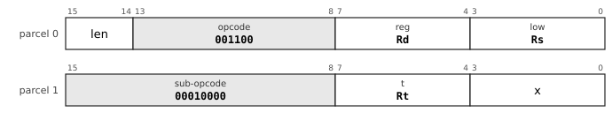

From `len = 01`. In this group `low` is a register, never a mode. 

**Operation**

```
Rd ← Ra rotated right by (Rb mod 64)
```

**Flags** None written (rotates write no flags: errata 39).

**Exceptions** None.

There is no rotate left instruction: `ROL rs, #n, rd` is an assembler spelling of `RORI rs, #(64-n), rd`. No rotate is through carry; multi-word shifting uses `DSHR`.

**Why it is here.** The question that started revision 16 was why the ALU group had `ROR` but not `ROL`. The answer was that one rotate direction suffices and `ROR` is the one to keep: `ROL x, #n` is exactly `ROR x, #(64-n)`, and a funnel shifter yields `ROR` directly (ISA section 4.5.1). Revision 16 also stated for the first time that no rotate is through carry. In revision 20 `ROR` was demoted from the ALU group to `BESC`, "accepted, and revision 16's justification for its ALU slot was simply wrong": crypto rotates by compile-time constants, so a four-byte immediate form is needed either way. On 2026-10-22 the author took the recommendation that rotates write no flags (, errata 39).

**Status** implemented in the reference executor (`common/pdp64exec.c`, shared by `sim64` and QEMU).


### RORI: Rotate right by an immediate

**Mnemonics:** `RORI`  (aliases: `ROL`)

**Syntax**

```
RORI Rs, #n, Rd
ROL Rs, #n, Rd        ; assembles to RORI Rs, #(64-n), Rd
```

**Encoding**


From `len = 01`. In this group `low` is a register, never a mode. Parcel 1 is `sub:8 count:8`.

**Operation**

```
Rd ← Rs rotated right by (n mod 64)
```

**Flags** None written.

**Exceptions** None.

Four bytes: the count is in the low byte of parcel 1.

**Why it is here.** Added with the register-count rotate in revision 16 and given its own mnemonic in errata 10, because an immediate count and a register count are different encodings. `ROL Rs, #n, Rd` is accepted by the assembler as `RORI Rs, #(64-n), Rd` (ISA revision 17, section 4.15): the complement costs nothing at assembly time, so there is no reason to make programmers do it, and a register-count `ROL` is rejected so that one mnemonic stays one instruction.

**Status** implemented in the reference executor (`common/pdp64exec.c`, shared by `sim64` and QEMU).


### RORI32: Rotate right by an immediate, 32 bits

**Mnemonics:** `RORI32`

**Syntax**

```
RORI32 Rs, #n, Rd
```

**Encoding**


From `len = 01`. In this group `low` is a register, never a mode. 

**Operation**

```
Rd ← sext32(ror32(Rs[31:0], n mod 32))
```

**Flags** None written.

**Exceptions** None.

The 32-bit rotate with the result sign-extended like every 32-bit result; the primitive of most hash functions and ciphers.

**Why it is here.** Added on 2026-10-22 with the second page (errata 31): a 32-bit rotate by a constant, the shape of crypto and hash inner loops (revision 20 had noted that crypto rotates by compile-time constants), estimated together with `CBCC` at 22 KB (1.3%) of the compiled image. Its first specification zero-extended the result; the author decided "make rori32 sign-extend like the rest", so that no instruction is needed after it (errata 34). It removed 44 `MOVL` instructions in the corpus, the demand analysis having already removed nearly all of them.

**Status** implemented in the reference executor (`common/pdp64exec.c`, shared by `sim64` and QEMU).


### DSHR: Double-width funnel shift right

**Mnemonics:** `DSHR`

**Syntax**

```
DSHR Ra, Rb, #n, Rd
```

**Encoding**

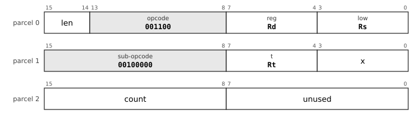

From `len = 01`. In this group `low` is a register, never a mode. 

**Operation**

```
t ← Ra:Rb                    ; 128 bits, Ra the high half
Rd ← (t >> n)[63:0]          ; n = 0..63
```

**Flags** None written.

**Exceptions** None.

x86 `SHRD`, ARM `EXTR`. Six bytes (the count is in parcel 2). A 128-bit left shift by k is `DSHR hi, hi, lo, #(64-k)` then `SHL #k, lo`.

**Why it is here.** Added in ISA revision 16: a double-width funnel shift (x86 `SHRD`, ARM `EXTR`), the right primitive for multi-word shifting. Two instructions shift a 128-bit value by any distance, where rotate-through-carry took one bit per instruction, and that is why no rotate is through carry. It also subsumes `ROR` when both sources are the same register. It leaves every flag alone.

**Status** implemented in the reference executor (`common/pdp64exec.c`, shared by `sim64` and QEMU).


### EXTB: Extract a bit field

**Mnemonics:** `EXTB`, `EXTZB`

**Syntax**

```
EXTB Rs, #pos, #width, Rd        ; sign-extended
EXTZB Rs, #pos, #width, Rd       ; zero-extended
```

**Encoding**

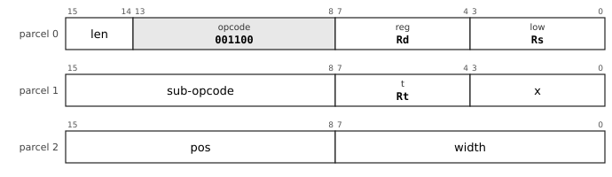

From `len = 01`. In this group `low` is a register, never a mode. 

| Mnemonic | Sub-opcode |
|---|---|
| `EXTB` | `00100001 (0x21)` |
| `EXTZB` | `00100010 (0x22)` |

**Operation**

```
Rd ← ext((Rs >> pos)[width-1:0])          ; sext for EXTB, zext for EXTZB; width 0 or > 64 means 64
```

**Flags** None written.

**Exceptions** None.

Six bytes (position and width are in parcel 2), so these exist at `len = 10` only.

**Why it is here.** Revision 10's reorganisation dropped bit-field extract and insert by accident; revision 13 restored them (the VAX `EXTV`, `EXTZV` and `INSV` idiom, ISA section 14.1). The compiler does not use them: the shift-pair extraction pattern occurs 151 times in 26 files of the corpus, about 600 bytes at best (0.03%), and there are four true bit-field extracts in all. They are for hand-written protocol and bit-stream code (CHANGES section 14.4).

**Status** implemented in the reference executor (`common/pdp64exec.c`, shared by `sim64` and QEMU).


### INSB: Insert a bit field

**Mnemonics:** `INSB`

**Syntax**

```
INSB Rs, #pos, #width, Rd
```

**Encoding**

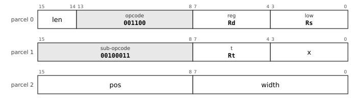

From `len = 01`. In this group `low` is a register, never a mode. 

**Operation**

```
mask ← ((1 << width) - 1) << pos
Rd ← (Rd AND NOT mask) OR ((Rs << pos) AND mask)
```

**Flags** None written.

**Exceptions** None.

Six bytes. `Rd` is both source and destination.

**Why it is here.** Restored with `EXTB` in revision 13 (the VAX `INSV` idiom). The record names no use in the compiled corpus.

**Status** implemented in the reference executor (`common/pdp64exec.c`, shared by `sim64` and QEMU).


### XNORPOP: Population count of the equality of two words

**Mnemonics:** `XNORPOP`

**Syntax**

```
XNORPOP Ra, Rb, Rd
```

**Encoding**


From `len = 01`. In this group `low` is a register, never a mode. 

**Operation**

```
Rd ← popcount(NOT (Ra XOR Rb))
```

**Flags** None written.

**Exceptions** None.

For binary-activation networks, Hamming distance and bitset intersection cardinality. It does **not** serve sub-1-bit language models (book section 8.3).

**Why it is here.** Added in ISA revision 13 in answer to the author's design-chat question about the new language models that use single-bit encodings ("are there instruction sequences that would benefit from coalescing?"). Revision 14 corrected the reason: the instruction does **not** serve sub-1-bit language models, because the activations in the LittleBit work are FP16 and the inner loop is a conditional add, not a popcount. It stays for what it does serve: binary-activation networks, Hamming distance, bitset intersection counts and counting a collector's mark bitmap. The sub-1-bit kernel is bandwidth-bound and belongs to a bus-mastering accelerator, not an opcode (ISA section 4.6.2; chapter 8).

**Status** implemented in the reference executor (`common/pdp64exec.c`, shared by `sim64` and QEMU).


### CLMUL: Carry-less multiply

**Mnemonics:** `CLMULL`, `CLMULH`

**Syntax**

```
CLMULL Ra, Rb, Rd
CLMULH Ra, Rb, Rd
```

**Encoding**


From `len = 01`. In this group `low` is a register, never a mode. 

| Mnemonic | Sub-opcode |
|---|---|
| `CLMULL` | `00110001 (0x31)` |
| `CLMULH` | `00110010 (0x32)` |

**Operation**

```
p ← carry-less (polynomial over GF(2)) product of Ra and Rb      ; 128 bits
CLMULL: Rd ← p[63:0]
CLMULH: Rd ← p[127:64]
```

**Flags** None written.

**Exceptions** None.

The primitive under every CRC (with a Barrett reduction), GF(2^k) arithmetic and GCM; no polynomial is committed to the architecture.

**Why it is here.** ISA revision 15 added carry-less multiply as the primitive beneath every CRC polynomial (a CRC is a carry-less multiply plus a Barrett reduction), GF(2^k) erasure codes and AES-GCM, chosen over a `CRC` instruction because x86 and ARM each committed a polynomial to the architecture. On 2026-10-21 the author asked "how about the 2 crc variants also?", the assistant added eight `CRC32`/`CRC32C` words, and the author withdrew them at: "ok, we have carryless mul no need for either crc" (errata 20).

**Status** implemented in the reference executor (`common/pdp64exec.c`, shared by `sim64` and QEMU).


### UTF8LEN: Length of a UTF-8 sequence from its leading byte

**Mnemonics:** `UTF8LEN`

**Syntax**

```
UTF8LEN Rs, Rd
```

**Encoding**


From `len = 01`. In this group `low` is a register, never a mode. 

**Operation**

```
Rd ← length (1 to 4) implied by the leading byte Rs[7:0]; 0 if it cannot begin a valid sequence
```

**Flags** None written.

**Exceptions** None.

**Why it is here.** The design chat asked "do we have any special instructions for utf8?" and later whether the "string" functions being omitted included `utf8enc` and `utf8dec`. ISA revision 13 added three, because most of what UTF-8 needs is general bit manipulation but "the validity rules are where the bugs are". `UTF8LEN` is the exception that is nearly free: `CLO` on the leading byte, mapped to 1, 2, 3 or 4 (ISA section 4.6.1).

**Status** specified; **not yet implemented** in the reference executor.


### UTF8DEC: Decode a UTF-8 sequence

**Mnemonics:** `UTF8DEC`

**Syntax**

```
UTF8DEC Rs, Rd
```

**Encoding**


From `len = 01`. In this group `low` is a register, never a mode. 

**Operation**

```
Rs holds up to 4 bytes, leading byte in bits 7..0
Rd ← the scalar value
V  ← 1 if the sequence is not a valid encoding
```

**Flags** `V` set for a bad continuation byte, an overlong form, a surrogate (U+D800 to U+DFFF), a value above U+10FFFF, or a leading byte of `11000000 (0xC0)`, `11000001 (0xC1)` or `11110101 (0xF5)` to `11111111 (0xFF)`; the length consumed is reported in a scratch field of the status word (details in the instruction-set text, section 4.6.1).

**Exceptions** None.

**Why it is here.** Added in ISA revision 13 (the design chat: "do we have any special instructions for utf8?"). Not for speed but for correctness: overlong forms, surrogates, values above U+10FFFF and the bytes that can never begin a sequence are each a historical security hole, each is three comparators in hardware, and software implementations get them wrong or omit them for speed (ISA section 4.6.1, about 300 lookup tables).

**Status** specified; **not yet implemented** in the reference executor.


### UTF8ENC: Encode a Unicode scalar value

**Mnemonics:** `UTF8ENC`

**Syntax**

```
UTF8ENC Rs, Rd
```

**Encoding**


From `len = 01`. In this group `low` is a register, never a mode. 

**Operation**

```
Rd ← the UTF-8 bytes of the scalar value Rs, leading byte in bits 7..0
V  ← 1 if Rs is not a Unicode scalar value
```

**Flags** `V` set if `Rs` is not a Unicode scalar value (a surrogate or above U+10FFFF).

**Exceptions** None.

**Why it is here.** The encoding half of the UTF-8 pair added in ISA revision 13; it refuses surrogates and values above U+10FFFF so that an encoder cannot produce what a decoder must reject.

**Status** specified; **not yet implemented** in the reference executor.
<!-- /entries:9.9 -->

## 9.10 Branches and control flow

*Cf. section 6.7 for `TRAP`, `RTI` and `RTT`, and section 6.2 for how a trap enters the kernel; section 9.16 for `CALLI` and `JMPI` in position-independent code.*

**9.10.1** There is an unconditional branch `BR` and fourteen conditional branches, two bytes with an 8-bit displacement, four with 16 bits, six with 32 bits, counting two-byte parcels from the first parcel of the branch: ±256 bytes, ±64 KB, ±4 GB. *(opcodes `110000 (0x30)`-`111110 (0x3E)`)*

**9.10.2** The conditions are `ne`, `eq`, `pl`, `mi`, `vc`, `vs`, `cc`/`hs`, `cs`/`lo`, `ge`, `lt`, `gt`, `le`, `hi` and `los`.

**9.10.3** `SOB Rn, dst` subtracts one from `Rn` and branches if the result is nonzero, forward or backward. *(opcode `111111 (0x3F)`)*

**9.10.4** `CBCC` compares a register with a 5-bit immediate and branches (four bytes, ±1024 parcels); `CBW` takes a 16-bit immediate and a 16-bit displacement (six bytes); `CBRR` compares two registers and branches. None writes the flags. *(D, errata 34, 35 and 39)*

**9.10.5** `JMP` and `CALL` take any address mode; `RET` returns; `JMPI` and `CALLI` jump and call through a pointer in memory; `JTAG` dispatches on the tag in the low three bits of a register; `BTAG` and `BNTAG` branch on a tag. *(D)*

**9.10.6** A call pushes the return address on the stack; there is no link register. *(D, ABI)*

*Commentary.* **Precedent.** The complete PDP-11 branch set, which the long-branch problem of the PDP-11 (±256 bytes) made awkward, here reaches ±4 GB with no long-branch opcode and no trampoline, because the displacement widens with the length. `SOB` was the PDP-11's, which could only branch backward. **Trade-offs.** A compare-and-branch that writes no flags cannot feed a second branch that reads them, so a three-way compare is compare-then-branch; the compiler fuses only where the flags are dead afterwards, which cost about 0.4% in code size and was accepted. **Improvements.** The tag branches serve a Lisp or other tagged runtime in one instruction. **Benefits.** Branch relaxation in the assembler is just choosing a length. **Modern comparables.** RISC-V and MIPS are compare-and-branch machines with no flags; AArch64 has `CBZ` and `TBZ`; x86 uses flags like the pdp64's branches. **Use.** `JMPI` and `CALLI` are the shared-library call and the virtual call; `JTAG` is the dispatch of a dynamic-language interpreter. **Impact.** *Kernel:* `JMPI`, `CALLI` and `JTAG` are the shared-library call, the virtual call and the dispatch of an interpreter; `SOB` and `CBCC` are the loops of the kernel's inner routines. *Compiler:* Branch relaxation is choosing a length; fusing a compare and a branch is legal only where the flags are dead afterwards, so the compiler needs a flag-liveness analysis. *Hardware:* The next-PC mux takes the load-return path for the indirect forms; the compare-and-branch compare runs in the branch unit beside the ALU; displacements count parcels, so no shifter is needed.

<!-- entries:9.10 -->
### BCC: Branch on condition

**Mnemonics:** `BR`, `BNE`, `BEQ`, `BPL`, `BMI`, `BVC`, `BVS`, `BCC`, `BCS`, `BGE`, `BLT`, `BGT`, `BLE`, `BHI`, `BLOS`  (aliases: `BHIS`, `BLO`)

**Syntax**

```
BR target
BNE target
BEQ target ... and the rest
```

**Encoding**

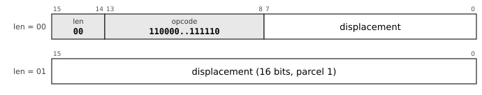

The displacement is signed and counts 2-byte parcels from the first parcel of the instruction: 8 bits at `len = 00` (about ±256 bytes), 16 bits at `len = 01` (±64 KB), 32 bits in parcels 1 and 2 at `len = 10` (±4 GB).

| Mnemonic | Opcode |
|---|---|
| `BR` | `110000 (0x30)` (condition 0) |
| `BNE` | `110001 (0x31)` (condition 1) |
| `BEQ` | `110010 (0x32)` (condition 2) |
| `BPL` | `110011 (0x33)` (condition 3) |
| `BMI` | `110100 (0x34)` (condition 4) |
| `BVC` | `110101 (0x35)` (condition 5) |
| `BVS` | `110110 (0x36)` (condition 6) |
| `BCC` | `110111 (0x37)` (condition 7) |
| `BCS` | `111000 (0x38)` (condition 8) |
| `BGE` | `111001 (0x39)` (condition 9) |
| `BLT` | `111010 (0x3A)` (condition 10) |
| `BGT` | `111011 (0x3B)` (condition 11) |
| `BLE` | `111100 (0x3C)` (condition 12) |
| `BHI` | `111101 (0x3D)` (condition 13) |
| `BLOS` | `111110 (0x3E)` (condition 14) |

**Operation**

```
if cond(c) then PC ← address of this instruction + 2 × disp
```

**Flags** None written.

**Exceptions** None; a branch to an unmapped or non-executable address faults on the fetch of the target.

Condition numbers: `al` 0 (`BR`), `ne` 1, `eq` 2, `pl` 3, `mi` 4, `vc` 5, `vs` 6, `cc`/`hs` 7, `cs`/`lo` 8, `ge` 9, `lt` 10, `gt` 11, `le` 12, `hi` 13, `los` 14. Conditions on the flags: `ne` `!Z`; `eq` `Z`; `pl` `!N`; `mi` `N`; `vc` `!V`; `vs` `V`; `cc` `!C`; `cs` `C`; `ge` `N == V`; `lt` `N != V`; `gt` `!Z and N == V`; `le` `Z or N != V`; `hi` `!C and !Z`; `los` `C or Z`. The displacement counts 2-byte parcels; the branch reaches ±4 GB with no long-branch instruction.

**Cf.** 6.7 for `TRAP`, `RTI` and `RTT`.

**Status** implemented in the reference executor (`common/pdp64exec.c`, shared by `sim64` and QEMU).


### SOB: Subtract one and branch

**Mnemonics:** `SOB`

**Syntax**

```
SOB Rn, target
```

**Encoding**

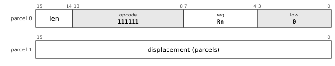

From `len = 01`; the signed displacement is 16 bits (32 at `len = 10`).

**Operation**

```
Rn ← Rn - 1
if Rn ≠ 0 then PC ← address of this instruction + 2 × disp
```

**Flags** None written.

**Exceptions** None.

Restored from the PDP-11, where it could branch only backward; here the signed displacement goes either way. Four bytes at least.

**Why it is here.** Restored from the PDP-11 in ISA revision 13 at the branch group's one free opcode. The PDP-11's could only branch backward (a 6-bit unsigned displacement); this one branches either way. It answers the design chat's question about the "cbnz idiom": it does not save bytes (`DEC` plus `BNE` is also four) but it saves an instruction issue, a cycle per iteration on a machine that does not pipeline. The measurement of 2026-10-22: "same size, one instruction fewer" (static `dec; bne` pairs exist).

**Status** implemented in the reference executor (`common/pdp64exec.c`, shared by `sim64` and QEMU).


### CBCC: Compare and branch on condition

**Mnemonics:** `CBNE`, `CBEQ`, `CBPL`, `CBMI`, `CBVC`, `CBVS`, `CBCC`, `CBCS`, `CBGE`, `CBLT`, `CBGT`, `CBLE`, `CBHI`, `CBLOS`  (aliases: `CBHIS`, `CBLO`)

**Syntax**

```
CBNE Rd, #imm, target
CBEQ Ra, Rb, target ... and the rest
```

**Encoding**

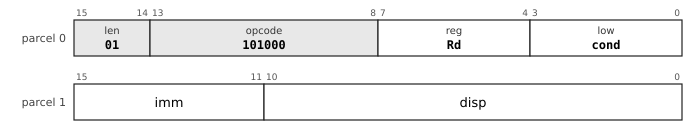

`CBCC` (opcode `101000 (0x28)`), four bytes: a signed 5-bit immediate (-16 to 15) and an 11-bit displacement in parcels. At `len = 10` (six bytes) parcel 1 is `imm(5) disp(26..16)` and parcel 2 `disp(15..0)`.

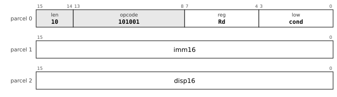

`CBW` (opcode `101001 (0x29)`), six bytes: a 16-bit immediate and a 16-bit displacement in parcels.

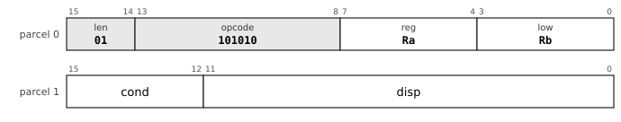

`CBRR` (opcode `101010 (0x2A)`), four bytes (six at `len = 10`, with a 28-bit displacement): compares two registers. The condition numbers are those of the branches: `al` 0, `ne` 1, `eq` 2, `pl` 3, `mi` 4, `vc` 5, `vs` 6, `cc`/`hs` 7, `cs`/`lo` 8, `ge` 9, `lt` 10, `gt` 11, `le` 12, `hi` 13, `los` 14. There is no `len = 00` form.

**Operation**

```
tmp ← Rd - (imm or Rb)         ; as CMP, for the decision only
if cond(c) on that comparison then PC ← address of this instruction + 2 × disp
```

**Flags** **None written** (errata 39): the instruction computes the comparison for its own decision and leaves `N Z V C` as they were.

**Exceptions** None.

Three encodings, chosen by the assembler: `CBCC` (`101000 (0x28)`, a 5-bit signed immediate -16 to 15, a displacement of ±1024 parcels at four bytes or 27 bits at six), `CBW` (`101001 (0x29)`, a 16-bit immediate and a 16-bit displacement, six bytes) and `CBRR` (`101010 (0x2A)`, two registers, ±2,048 parcels at four bytes or 28 bits at six). There is no `len = 00` form. A target in another section is refused.

**Why it is here.** The author asked on 2026-10-22: "why do we need 8 byte instructions? only amd64 has more than 6 bytes. can we squeeze into 3 parcels?" The fourth parcel was removed and the freed length code became the second page (errata 31); at the same time a fused compare-and-branch, `CBCC`, was added in the reserved opcode `101000 (0x28)`, estimated with `RORI32` at 22 KB (1.3%) of the image. Then, measured, step by step: the author asked for the wider form ("do the wider cbcc") and the **wide-immediate `CBCC`** removed 11,735 instructions (3.4%) and 1,828 bytes; "do the register-register compare-and-branch" added **`CBRR`**, which removed 4,631 instructions (1.4%) and 142 bytes (errata 34 and 35). The reason it is not a replacement for flags: LoongArch and RISC-V chose fused compare-and-branch instead of flags, and the ISA declines that (section 15.2) because it needs a comparator in the branch unit and a third read port; here the fused form is added beside the flags. Errata 39 then made `CBCC` write no flags.

**Status** implemented in the reference executor (`common/pdp64exec.c`, shared by `sim64` and QEMU).


### BTAG: Branch on pointer tag

**Mnemonics:** `BTAG`, `BNTAG`

**Syntax**

```
BTAG Rn, #tag, target
BNTAG Rn, #tag, target
```

**Encoding**

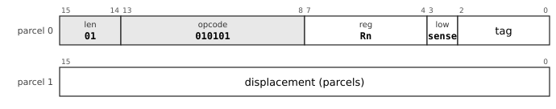

`sense` is 0 for `BTAG` and 1 for `BNTAG`; `tag` is the 3-bit tag. The displacement is 16 bits (32 at `len = 10`).

**Operation**

```
BTAG : if (Rn & 111₂) = tag then PC ← address of this instruction + 2 × disp
BNTAG: if (Rn & 111₂) ≠ tag then PC ← address of this instruction + 2 × disp
```

**Flags** None written.

**Exceptions** None.

For runtimes that keep a 3-bit type tag in the low bits of a pointer (`lowtag`). Four bytes at least; the displacement is 16 bits (32 at `len = 10`).

**Why it is here.** The design chat asked: "what instructions are there that make using the lowtag stuff easy for lisp type things?" ISA revision 13 answered with the tag branches `BTAG` and `BNTAG` and the table dispatch `JTAG`, "to make tagged pointers cheap to use rather than merely possible": three bits of tag and one of sense fit the `low` nibble exactly, so parcel 1 is a full displacement. Because quad-aligned objects have zero in the low three bits, the tag is free, and an unaligned access is a fault. The compiler for C never emits them (the corpus shows none); they are for Lisp and other tagged runtimes.

**Status** implemented in the reference executor (`common/pdp64exec.c`, shared by `sim64` and QEMU).


### JMP: Jump

**Mnemonics:** `JMP`

**Syntax**

```
JMP rm        ; a register, or an address by any memory mode
```

**Encoding**


The `reg` field is the sub-opcode; `rm` and the mode give the single operand, at any length (section 9.5).

**Operation**

```
PC ← (register operand) ? Rm : EA(rm)
```

**Flags** None written.

**Exceptions** A jump to an unmapped or non-executable address faults on the fetch of the target.

A switch is a `CMP` against the limit, a `BHIS` to the default and a `JMP` through a scaled index.

**Status** implemented in the reference executor (`common/pdp64exec.c`, shared by `sim64` and QEMU).


### CALL: Call

**Mnemonics:** `CALL`

**Syntax**

```
CALL rm
```

**Encoding**


The `reg` field is the sub-opcode; `rm` and the mode give the single operand, at any length (section 9.5).

**Operation**

```
t ← (register operand) ? Rm : EA(rm)
SP ← SP - 8 ; M[SP] ← address of the next instruction
PC ← t
```

**Flags** None written.

**Exceptions** Memory operand: page fault, protection fault, alignment fault or bus error (a read of non-existent memory is a precise abort with cause `BUSFAULT`). Every such fault is precise and the instruction restarts after it, because the register update of an auto-increment or auto-decrement mode is held until the instruction retires.

The return address is on the data stack where every unwinder and debugger expects it. `RET` pops it.

**Status** implemented in the reference executor (`common/pdp64exec.c`, shared by `sim64` and QEMU).


### JMPI: Jump and call through memory

**Mnemonics:** `JMPI`, `CALLI`

**Syntax**

```
JMPI rm        ; PC ← M[EA]
CALLI rm       ; push the return address, then PC ← M[EA]
```

**Encoding**


The `reg` field is the sub-opcode; `rm` and the mode give the single operand, at any length (section 9.5).

| Mnemonic | `reg` (sub-opcode) |
|---|---|
| `JMPI` | `0000 (0x0)` |
| `CALLI` | `0001 (0x1)` |

**Operation**

```
JMPI : PC ← M[EA(rm)]
CALLI: t ← M[EA(rm)] ; SP ← SP - 8 ; M[SP] ← address of the next instruction ; PC ← t
```

**Flags** None written.

**Exceptions** Memory operand: page fault, protection fault, alignment fault or bus error (a read of non-existent memory is a precise abort with cause `BUSFAULT`). Every such fault is precise and the instruction restarts after it, because the register update of an auto-increment or auto-decrement mode is held until the instruction retires. For `CALLI` the order is specified: load the target, then push, then transfer; a fault on the load leaves nothing changed.

The one deferred reference the architecture admits, for control transfer only: the PLT stub (`JMPI got_slot(PC)`) and virtual-method dispatch (`CALLI vtbl_off(Robj)`). It needs a memory operand, so it is four bytes at least.

**Why it is here.** ISA revision 18 reintroduced exactly one deferred reference, for control transfer only, in `XFER`: the PLT stub of every dynamically linked program (`JMPI got_slot(PC)`) and virtual-method dispatch (`CALLI vtbl_off(Robj)`), each two instructions and a scratch register without it. It is admitted because it breaks none of the reasons deferred modes were removed (no register is side-effected, the reference is in the branch path and not the operand path, a fault is clean by ordering; ISA section 4.9.1). The measurement of 2026-10-22: jump tables through `JMPI` are not smaller, because the table entries are 8 bytes against 8 for a case in a compare chain.

**Status** implemented in the reference executor for `CALLI`; not yet for the others.


### JTAG: Jump through a tag table

**Mnemonics:** `JTAG`

**Syntax**

```
JTAG d(Rb)(Rx×s)
```

**Encoding**


The `reg` field is the sub-opcode; `rm` and the mode give the single operand, at any length (section 9.5).

**Operation**

```
PC ← M[Rb + d + 8 × (Rx & 111₂)]
```

**Flags** None written.

**Exceptions** Memory operand: page fault, protection fault, alignment fault or bus error (a read of non-existent memory is a precise abort with cause `BUSFAULT`). Every such fault is precise and the instruction restarts after it, because the register update of an auto-increment or auto-decrement mode is held until the instruction retires.

Legal only with the scaled-index mode (`0001`). Dispatches on the low three bits of a tagged pointer through a table of eight entries; the 3-bit tag cannot index out of range.

**Why it is here.** The table-dispatch partner of `BTAG`, added in ISA revision 13 for the same question about tagged Lisp pointers. It is legal only in the scaled-index mode (errata 6), the one mode with a free register slot for the tagged value. It replaces the PDP-11 dispatch-table idiom `@(Rn)+` better, because it needs no pointer register and cannot index out of range (ISA section 14.2).

**Status** implemented in the reference executor (`common/pdp64exec.c`, shared by `sim64` and QEMU).
<!-- /entries:9.10 -->

## 9.11 The stack and block operations

*Cf. section 6.8 for restarting a block operation after a fault (progress is held in registers) and section 6.4 for the page faults it can take; section 7.2 for how block operations order their accesses.*

**9.11.1** `PUSH` and `POP` move one register; `PUSHM` and `POPM` move a set named by a mask (a short mask form is in page 2). A mask containing `R14` is reserved. *(D)*

**9.11.2** `PUSHX` and `POPX` save and restore the exception state `EPSW` and `EPC` in one instruction each; both words are checked before either is accessed, so an abort leaves nothing changed. *(D, errata 37)*

**9.11.3** The block operations `MCPY`, `MMOV` (overlap-safe), `MSET`, `MCMP`, `MSCN` and `MSCNN` take a destination pointer, a source pointer or value and a count in registers; `MVAL` validates a buffer as UTF-8. *(opcode `001101 (0x0D)`)*

**9.11.4** A block operation keeps its progress in its registers: when it completes, the count is zero and the pointers are one past the end; when it stops early or is interrupted, they point where it stopped, and it restarts by running again. *(D)*

**9.11.5** An implementation may move more than a byte per step, provided the registers are consistent with byte-at-a-time progress wherever an exception can be taken. *(D)*

*Commentary.* **Precedent.** The VAX's `MOVC5` is the canonical argument against such instructions: its operands could be memory, its architectural definition needed the original values to survive, and so it required hidden state and a first-part-done bit in the status word to resume. The PDP-10 had a block transfer, and x86's `REP MOVS` keeps its progress in registers as the pdp64's do. **Trade-offs.** This is the one admitted exception to the one-memory-operand rule, accepted because its mechanism, hidden state, is absent: the state is the registers, which are already architectural. A large copy can evict the whole data cache, and a non-temporal variant is an open question. **Improvements.** ARM reached the same design in 2022 with `FEAT_MOPS`, whose specification says the registers are updated so that progress is not lost. **Benefits.** The block-move sequencer is three counters and a byte-lane selector, about 1,500 transistors. **Modern comparables.** x86 `REP MOVSB` and `REP STOSB` with fast-string microcode; AArch64 `CPYP`/`CPYM`/`CPYE` and `SETP`/`SETM`/`SETE`; s390 `MVC`. **Use.** `memcpy`, `memmove`, `memset`, `memcmp` and `memchr` in the C library; `MVAL` in parsers and kernels. **Impact.** *Kernel:* `PUSHM`, `POPM`, `PUSHX` and `POPX` shorten entry, exit and the context switch, and the block operations are `copyin`, `copyout`, page clearing and `memcpy`. *Compiler:* A prologue and an epilogue are one instruction each, and `memcpy` and `memset` lower to the block operations. *Hardware:* The block-move sequencer is three counters and a byte-lane selector, about 1,500 transistors, with no hidden state.

<!-- entries:9.11 -->
### PUSHM: Push registers by mask

**Mnemonics:** `PUSHM`

**Syntax**

```
PUSHM #mask        ; a 16-bit immediate, bit n is Rn
```

**Encoding**


The `reg` field is the sub-opcode; `rm` and the mode give the single operand, at any length (section 9.5).

**Operation**

```
for n = 0 to 15, if mask bit n:
    SP ← SP - 8 ; M[SP] ← Rn
```

**Flags** None written.

**Exceptions** Memory operand: page fault, protection fault, alignment fault or bus error (a read of non-existent memory is a precise abort with cause `BUSFAULT`). Every such fault is precise and the instruction restarts after it, because the register update of an auto-increment or auto-decrement mode is held until the instruction retires. A mask that includes `R14` (`SP`) is reserved.

Four bytes (mode `0100`, immediate). The registers are pushed in ascending order, so `POPM` with the same mask restores them. Page 2 has an 8-bit mask for `R8` to `R15`.

**Why it is here.** The VAX procedure entry mask was the useful half of `CALLS`; ISA revision 13 kept that half as `PUSHM` and `POPM` without the frame (which the book rejects: hardware call frames ran slower than the sequence on later VAXes). They began in `MBLK` and moved to `SOP` because a 16-bit mask does not fit beside `MBLK`'s sub-opcode; that used `SOP`'s last two free slots (CHANGES section 3.2). The second page has 8-bit forms for `R8` to `R15`, because all 2,392 push sites and 2,392 pop sites in the measured corpus used a mask within `R8` to `R15`.

**Cf.** 6.8 for the restart rule.

**Status** implemented in the reference executor (`common/pdp64exec.c`, shared by `sim64` and QEMU).


### POPM: Pop registers by mask

**Mnemonics:** `POPM`

**Syntax**

```
POPM #mask
```

**Encoding**


The `reg` field is the sub-opcode; `rm` and the mode give the single operand, at any length (section 9.5).

**Operation**

```
for n = 15 down to 0, if mask bit n:
    Rn ← M[SP] ; SP ← SP + 8
```

**Flags** None written.

**Exceptions** Memory operand: page fault, protection fault, alignment fault or bus error (a read of non-existent memory is a precise abort with cause `BUSFAULT`). Every such fault is precise and the instruction restarts after it, because the register update of an auto-increment or auto-decrement mode is held until the instruction retires.

The mirror of `PUSHM`; four bytes, with an 8-bit-mask form on page 2.

**Status** implemented in the reference executor (`common/pdp64exec.c`, shared by `sim64` and QEMU).


### PUSH: Push

**Mnemonics:** `PUSH`

**Syntax**

```
PUSH rm
```

**Encoding**


The `reg` field is the sub-opcode; `rm` and the mode give the single operand, at any length (section 9.5).

**Operation**

```
v ← rm ; SP ← SP - 8 ; M[SP] ← v
```

**Flags** None written.

**Exceptions** Memory operand: page fault, protection fault, alignment fault or bus error (a read of non-existent memory is a precise abort with cause `BUSFAULT`). Every such fault is precise and the instruction restarts after it, because the register update of an auto-increment or auto-decrement mode is held until the instruction retires.

A one-parcel instruction for a register operand.

**Status** implemented in the reference executor (`common/pdp64exec.c`, shared by `sim64` and QEMU).


### POP: Pop

**Mnemonics:** `POP`

**Syntax**

```
POP rm
```

**Encoding**


The `reg` field is the sub-opcode; `rm` and the mode give the single operand, at any length (section 9.5).

**Operation**

```
v ← M[SP] ; SP ← SP + 8 ; rm ← v
```

**Flags** None written.

**Exceptions** Memory operand: page fault, protection fault, alignment fault or bus error (a read of non-existent memory is a precise abort with cause `BUSFAULT`). Every such fault is precise and the instruction restarts after it, because the register update of an auto-increment or auto-decrement mode is held until the instruction retires.

**Status** implemented in the reference executor (`common/pdp64exec.c`, shared by `sim64` and QEMU).


### MCPY: Copy a block of bytes

**Mnemonics:** `MCPY`, `MMOV`

**Syntax**

```
MCPY Rd, Rs, Rn        ; destination pointer, source pointer, count
MMOV Rd, Rs, Rn        ; correct for overlap
```

**Encoding**

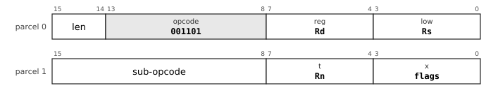

`reg` is the destination pointer, `low` the source pointer (or the value register `Rv`), parcel 1 `t` the count register `Rn`.

| Mnemonic | Sub-opcode |
|---|---|
| `MCPY` | `00000000 (0x00)` |
| `MMOV` | `00000001 (0x01)` |

**Operation**

```
MCPY:                            ; ascending; overlap is undefined
  while Rn ≠ 0:  M8[Rd] ← M8[Rs] ; Rd ← Rd + 1 ; Rs ← Rs + 1 ; Rn ← Rn - 1
MMOV: as MCPY, but the direction is chosen from the pointers so that an overlapping copy is correct
```

**Flags** None written.

**Exceptions** Memory operand: page fault, protection fault, alignment fault or bus error (a read of non-existent memory is a precise abort with cause `BUSFAULT`). Every such fault is precise and the instruction restarts after it, because the register update of an auto-increment or auto-decrement mode is held until the instruction retires. The three registers are updated as work completes, so a fault leaves a consistent state and the instruction restarts from its registers.

The one granted exception to the one-memory-operand rule. All three registers are architectural state: on completion `Rn` is 0 and `Rd` and `Rs` point one past the end. An implementation may move more than a byte per step, so long as the register state at every point where an exception can be taken is consistent with a byte-at-a-time copy. The accesses made inside one block operation are unordered with respect to each other.

**Why it is here.** The design chat's questions: "maybe memory to memory mov is useful and should be allowed, especially with a loop" and "principles exceptions are allowed where there is a clear benefit" (which produced the exception rule of ISA section 1.1), then "is there any indirect addressing, so you could load r1 and r2 with addresses then `rep movsb r1,r2,10` to mov 10 bytes. and maybe an instruction to zero out a range of memory. is the cbnz idiom better? how about mmov mcpy mset like ibm system z?". ISA revision 13 answered with `MBLK`: `MCPY`, `MMOV`, `MSET`, `MCMP`, `MSCN`, the one granted exception to the one-memory-operand rule, made safe by keeping the progress in architectural registers (the VAX `MOVC5` kept it in hidden microstate, which is why it was rejected; ARM reached the same design in 2022 with `FEAT_MOPS`). `MCPY` replaces the PDP-11 `MOV (R1)+,(R2)+` loop with one restartable instruction.

**Cf.** 6.8 (restart, progress faults); 7.2 (ordering of the accesses).

**Status** implemented in the reference executor (`common/pdp64exec.c`, shared by `sim64` and QEMU).


### MSET: Fill a block of bytes

**Mnemonics:** `MSET`

**Syntax**

```
MSET Rd, Rv, Rn
```

**Encoding**


`reg` is the destination pointer, `low` the source pointer (or the value register `Rv`), parcel 1 `t` the count register `Rn`.

**Operation**

```
while Rn ≠ 0:  M8[Rd] ← Rv[7:0] ; Rd ← Rd + 1 ; Rn ← Rn - 1
```

**Flags** None written.

**Exceptions** Memory operand: page fault, protection fault, alignment fault or bus error (a read of non-existent memory is a precise abort with cause `BUSFAULT`). Every such fault is precise and the instruction restarts after it, because the register update of an auto-increment or auto-decrement mode is held until the instruction retires.

`MSET` with `Rv = 0` is the range-zeroing instruction: `bzero` and the clear of `calloc` are one instruction.

**Why it is here.** Asked for in the design chat ("maybe an instruction to zero out a range of memory") and delivered in ISA revision 13 with `MCPY`; with a zero value it is the range-zeroing instruction, so `bzero` and the clearing of `calloc` need no separate opcode.

**Cf.** 6.8.

**Status** implemented in the reference executor (`common/pdp64exec.c`, shared by `sim64` and QEMU).


### MCMP: Compare two blocks of bytes

**Mnemonics:** `MCMP`

**Syntax**

```
MCMP Rd, Rs, Rn
```

**Encoding**

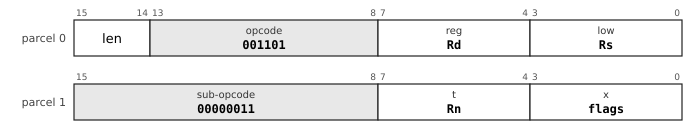

`reg` is the destination pointer, `low` the source pointer (or the value register `Rv`), parcel 1 `t` the count register `Rn`.

**Operation**

```
while Rn ≠ 0:
    x ← M8[Rd] ; y ← M8[Rs]
    if x ≠ y then  flags ← flags of (x - y) ; stop      ; pointers left AT the differing byte
    Rd ← Rd + 1 ; Rs ← Rs + 1 ; Rn ← Rn - 1
if equal:  N = 0, Z = 1, V = 0, C = 0
```

**Flags** From the first differing byte as for `CMP` of the two bytes (`C` set if `x < y` unsigned, `N` and `V` from the signed difference); for equal blocks `N` = 0, `Z` = 1, `V` = 0, `C` = 0.

**Exceptions** Memory operand: page fault, protection fault, alignment fault or bus error (a read of non-existent memory is a precise abort with cause `BUSFAULT`). Every such fault is precise and the instruction restarts after it, because the register update of an auto-increment or auto-decrement mode is held until the instruction retires.

When the instruction stops at a difference, `Rd` and `Rs` point at the differing bytes and `Rn` is the count remaining, so the position of the difference is in the registers.

**Why it is here.** The design chat asked about the "string" functions being omitted: "doesn't mcmp/mmov count?". It did: ISA revision 15 corrected the book-keeping, because the rejection of "string" instructions was wrong from revision 8 and visibly wrong by revision 13. Seven of the VAX's ten character-string instructions are present (`MOVC3`, `CMPC3`, `LOCC` and `SKPC` among them), and the rejection was always about `EDITPC` and packed decimal. `MCMP` is the `CMPC3` equivalent.

**Cf.** 6.8.

**Status** implemented in the reference executor (`common/pdp64exec.c`, shared by `sim64` and QEMU).


### MSCN: Scan a block for a byte, or for a byte not equal to it

**Mnemonics:** `MSCN`, `MSCNN`

**Syntax**

```
MSCN Rd, Rv, Rn
MSCNN Rd, Rv, Rn
```

**Encoding**


`reg` is the destination pointer, `low` the source pointer (or the value register `Rv`), parcel 1 `t` the count register `Rn`.

| Mnemonic | Sub-opcode |
|---|---|
| `MSCN` | `00000100 (0x04)` |
| `MSCNN` | `00000101 (0x05)` |

**Operation**

```
while Rn ≠ 0:
    hit ← (M8[Rd] = Rv[7:0])             ; MSCNN: hit ← (M8[Rd] ≠ Rv[7:0])
    if hit then  Z = 1 ; stop              ; Rd points AT the byte found
    Rd ← Rd + 1 ; Rn ← Rn - 1
not found: Z = 0
```

**Flags** **All four flags are written** (errata 39): `Z` = 1 if the byte was found, else 0; `N`, `V` and `C` are cleared.

**Exceptions** Memory operand: page fault, protection fault, alignment fault or bus error (a read of non-existent memory is a precise abort with cause `BUSFAULT`). Every such fault is precise and the instruction restarts after it, because the register update of an auto-increment or auto-decrement mode is held until the instruction retires.

`MSCN` is `memchr`; with an explicit count it gives `strnlen`, and composing it with `MCPY` gives a bounded `strcpy` in two instructions. There are no NUL-terminated string instructions.

**Why it is here.** `MSCN` is `LOCC` and `memchr`; **`MSCNN` was added in ISA revision 15 to fill the `SKPC` gap** (the first byte that is *not* equal). Both cost no opcode and almost no hardware. With an explicit count `MSCN` gives `strnlen`, and with `MCPY` a bounded `strcpy` in two instructions. NUL-terminated string instructions (the System/z `MVST`, `SRST`, `CLST`) are explicitly rejected, because they encode an unbounded read, the largest single source of memory-safety failures in C (ISA sections 11 and 14.2).

**Cf.** 6.8.

**Status** implemented in the reference executor (`common/pdp64exec.c`, shared by `sim64` and QEMU).


### MVAL: Validate a block as UTF-8

**Mnemonics:** `MVAL`

**Syntax**

```
MVAL Rd, Rn
```

**Encoding**


`reg` is the destination pointer, `low` the source pointer (or the value register `Rv`), parcel 1 `t` the count register `Rn`.

**Operation**

```
scan Rn bytes at Rd; stop at the first byte that cannot be part of a valid UTF-8 sequence (the rules of UTF8DEC)
```

**Flags** On completion `Rn` is 0 and the buffer is valid; otherwise `Rd` points at the offending sequence and `Rn` counts the bytes remaining (details in the instruction-set text, section 4.7.1).

**Exceptions** Memory operand: page fault, protection fault, alignment fault or bus error (a read of non-existent memory is a precise abort with cause `BUSFAULT`). Every such fault is precise and the instruction restarts after it, because the register update of an auto-increment or auto-decrement mode is held until the instruction retires.

The `UTF8DEC` comparators wired to the block sequencer.

**Why it is here.** The design chat asked "what is mblk? what is a swar? validating an entire utf8 string sounds nice... do we do it often enough to justify the opcode? if utf8 is already 3 or 4 parcels, it's ok." ISA revision 15 committed `MVAL`: the UTF-8 validity comparators already built for `UTF8DEC`, wired to the `MBLK` streaming sequencer already built for `MCPY`, so it costs no opcode and almost no hardware. The alternative, a SWAR loop (SIMD within a register), runs at about two to three cycles a byte and is respectable, which is why the justification is cost and not throughput.

**Cf.** 6.8.

**Status** specified; **not yet implemented** in the reference executor.
<!-- /entries:9.11 -->

## 9.12 Floating point

**9.12.1** Floating point uses the general registers: a `binary64` value fills one register, and the instruction, not the register, decides how its bits are read. *(D)*

**9.12.2** `FADD`, `FSUB`, `FMUL` and `FCMP` are two-byte instructions; `FDIV`, `FSQRT`, the fused multiply-add family, `FABS`, `FMIN`, `FMAX`, `FCLASS`, the roundings and the `binary32` forms are in the floating-point escape; `binary16` has seventeen operations and conversions. *(D, errata 24 and 27)*

**9.12.3** The five IEEE flags (invalid, divide by zero, overflow, underflow, inexact) accumulate in `FPSR`; no floating-point operation traps; `FSFLAGS` reads and clears them. *(D, errata 17)*

**9.12.4** Every NaN that an operation creates is the canonical quiet NaN. *(D, errata 26)*

**9.12.5** There are no rounding-mode or precision mode bits: the precision is in the opcode, and so is the rounding mode wherever it is not nearest-even. *(D)*

**9.12.6** There are no transcendental instructions. *(D)*

*Commentary.* **Precedent.** The PDP-11's FP11 had `AC0` to `AC5` and mode bits for single and double precision; the VAX had F, D, G and H formats. **Trade-offs.** An integer operation applied to a register holding a `binary64` destroys it, with no trap and no tag; that is intended and must be said aloud in the ABI. A separate register file would cost a second set of read ports and a floating-point context; on a small implementation the register file is among the largest blocks. **Improvements.** The fused multiply-add is the largest single addition to the datapath (about 9,000 transistors) and the least negotiable; the IEEE exception flags are recorded without traps, which is what C99 `<fenv.h>` needs. **Benefits.** No transfer instructions between files and a single calling convention. **Modern comparables.** RISC-V Zfinx and Zdinx use the integer register file for the same reason; AArch64 and x86 have separate vector and floating-point files. **Use.** `FCLASS` begins every library maths function; `FMA` is the building block of accurate polynomial evaluation. **Impact.** *Kernel:* There is no separate floating-point state to save at a context switch beyond the registers already saved, and the sticky flags go with the status word. *Compiler:* One calling convention for integers and floats, fused multiply-add contraction, and no rounding-mode state for the compiler to track. *Hardware:* No second register file (one of the largest blocks of a small floating-point unit); the floating-point unit with fused multiply-add is about 34,000 transistors.

<!-- entries:9.12 -->
### FADD: Floating add, subtract and multiply, binary64

**Mnemonics:** `FADD`, `FSUB`, `FMUL`  (aliases: `FADDD`, `FSUBD`, `FMULD`)

**Syntax**

```
FADD rm, Rd
FSUB rm, Rd
FMUL rm, Rd
```

**Encoding**


`reg` is the register `Rd` (the source of a store); `low` is a second register (`Rs`) at `len = 00`, where the instruction is two bytes. At `len = 01` or `10`, `low` is the addressing mode and parcel 1 (and 2) carry the operand (section 9.5).

| Mnemonic | Opcode (the load or direct form) |
|---|---|
| `FADD` | `100100 (0x24)` |
| `FSUB` | `100101 (0x25)` |
| `FMUL` | `100110 (0x26)` |

**Operation**

```
Rd ← Rd + rm   (FADD)
Rd ← Rd - rm   (FSUB)
Rd ← Rd × rm   (FMUL)       ; IEEE 754 binary64, round to nearest even
```

**Flags** None written. The five IEEE exception flags are ORed into `FPSR`; no instruction traps.

**Exceptions** Memory operand: page fault, protection fault, alignment fault or bus error (a read of non-existent memory is a precise abort with cause `BUSFAULT`). Every such fault is precise and the instruction restarts after it, because the register update of an auto-increment or auto-decrement mode is held until the instruction retires. Floating-point exceptions never trap.

Floating-point values live in the general registers; there is no separate register file and no mode bit. A NaN result is the canonical quiet NaN `0x7FF8000000000000`. The old spellings `FADDD`, `FSUBD`, `FMULD` are aliases.

**Status** implemented in the reference executor (`common/pdp64exec.c`, shared by `sim64` and QEMU).


### FCMP: Floating compare, binary64

**Mnemonics:** `FCMP`  (aliases: `FCMPD`)

**Syntax**

```
FCMP Rd, rm        ; register first
```

**Encoding**


`reg` is the register `Rd` (the source of a store); `low` is a second register (`Rs`) at `len = 00`, where the instruction is two bytes. At `len = 01` or `10`, `low` is the addressing mode and parcel 1 (and 2) carry the operand (section 9.5).

**Operation**

```
N ← Rd < rm ; Z ← Rd = rm ; V ← unordered ; C ← 0
```

**Flags** `N` set if `Rd < rm`, `Z` if equal, `V` if the operands are unordered (either is a NaN), `C` cleared. A signalling NaN raises `NV` in `FPSR`.

**Exceptions** Memory operand: page fault, protection fault, alignment fault or bus error (a read of non-existent memory is a precise abort with cause `BUSFAULT`). Every such fault is precise and the instruction restarts after it, because the register update of an auto-increment or auto-decrement mode is held until the instruction retires.

The signed branches do not yet treat the unordered case cleanly (`BLT` after an unordered compare takes `N xor V` = 1); this is an open item of the instruction set.

**Status** implemented in the reference executor (`common/pdp64exec.c`, shared by `sim64` and QEMU).


### FDIV: Floating divide and square root, binary64

**Mnemonics:** `FDIV`, `FSQRT`  (aliases: `FDIVD`, `FSQRTD`)

**Syntax**

```
FDIV Rs, Rd
FSQRT Rs, Rd
```

**Encoding**


From `len = 01`. In this group `low` is a register, never a mode. Operand roles: `reg` is the destination `Rd`, `low` the first source `Rs`, `t` the second `Rt` and `x` the third `Ru`; the assembler writes the destination last.

| Mnemonic | Sub-opcode |
|---|---|
| `FDIV` | `00000000 (0x00)` |
| `FSQRT` | `00000001 (0x01)` |

**Operation**

```
FDIV : Rd ← Rd ÷ Rs
FSQRT: Rd ← sqrt(Rs)
```

**Flags** No integer flag is written. The IEEE exception flags raised are ORed into `FPSR` (`NX` inexact, `UF` underflow, `OF` overflow, `DZ` divide by zero, `NV` invalid); nothing traps.

**Exceptions** None.

`FDIV` and `FSQRT` are multi-cycle sequencer operations and rarely appear in a two-byte form, so they are in `FESC`. The old spellings `FDIVD`, `FSQRTD` are aliases.

**Status** implemented in the reference executor (`common/pdp64exec.c`, shared by `sim64` and QEMU).


### FSINGLE: Floating arithmetic, binary32

**Mnemonics:** `FADD32`, `FSUB32`, `FMUL32`, `FDIV32`, `FSQRT32`, `FCMP32`  (aliases: `FADDS`, `FSUBS`, `FMULS`, `FDIVS`, `FSQRTS`, `FCMPS`)

**Syntax**

```
FADD32 Rs, Rd
FSUB32 Rs, Rd
FMUL32 Rs, Rd
FDIV32 Rs, Rd
FSQRT32 Rs, Rd
FCMP32 Rd, Rs
```

**Encoding**


From `len = 01`. In this group `low` is a register, never a mode. Operand roles: `reg` is the destination `Rd`, `low` the first source `Rs`, `t` the second `Rt` and `x` the third `Ru`; the assembler writes the destination last.

| Mnemonic | Sub-opcode |
|---|---|
| `FADD32` | `00001000 (0x08)` |
| `FSUB32` | `00001001 (0x09)` |
| `FMUL32` | `00001010 (0x0A)` |
| `FDIV32` | `00001011 (0x0B)` |
| `FSQRT32` | `00001100 (0x0C)` |
| `FCMP32` | `00001101 (0x0D)` |

**Operation**

```
Rd ← Rd op Rs  (FADD32 FSUB32 FMUL32 FDIV32); Rd ← sqrt(Rs) (FSQRT32)
FCMP32: flags as FCMP, comparing Rd with Rs
```

**Flags** No integer flag is written. The IEEE exception flags raised are ORed into `FPSR` (`NX` inexact, `UF` underflow, `OF` overflow, `DZ` divide by zero, `NV` invalid); nothing traps. `FCMP32` writes `N Z V C` as `FCMP` does.

**Exceptions** None.

A `binary32` lives in the low 32 bits of a register, sign-extended to 64 like every 32-bit result. Results are correctly rounded to nearest even. The old spellings `FADDS`, `FSUBS`, ... are aliases.

**Why it is here.** `binary64` has first-class opcodes because on a 64-bit machine it is the common case; `binary32` is in `FESC` with the same operations, held in the low 32 bits of a register and sign-extended like every other 32-bit value (ISA section 4.10, and the ABI). The old spellings (`FADDS` and so on) became aliases when the author fixed the naming rule on 2026-10-21: "putting f in front for floating point ops is ok, `fadd` and I guess `fadd16`" (errata 24).

**Status** implemented in the reference executor (`common/pdp64exec.c`, shared by `sim64` and QEMU).


### FMADD: Fused multiply-add, binary64

**Mnemonics:** `FMADD`, `FMSUB`, `FNMADD`, `FNMSUB`  (aliases: `FMADDD`, `FMSUBD`, `FNMADDD`, `FNMSUBD`)

**Syntax**

```
FMADD Rs, Rt, Ru, Rd
FMSUB Rs, Rt, Ru, Rd
FNMADD Rs, Rt, Ru, Rd
FNMSUB Rs, Rt, Ru, Rd
```

**Encoding**


From `len = 01`. In this group `low` is a register, never a mode. Operand roles: `reg` is the destination `Rd`, `low` the first source `Rs`, `t` the second `Rt` and `x` the third `Ru`; the assembler writes the destination last.

| Mnemonic | Sub-opcode |
|---|---|
| `FMADD` | `00010000 (0x10)` |
| `FMSUB` | `00010001 (0x11)` |
| `FNMADD` | `00010010 (0x12)` |
| `FNMSUB` | `00010011 (0x13)` |

**Operation**

```
FMADD : Rd ← Rs×Rt + Ru
FMSUB : Rd ← Rs×Rt - Ru
FNMADD: Rd ← -(Rs×Rt) - Ru
FNMSUB: Rd ← -(Rs×Rt) + Ru          ; each rounded once
```

**Flags** No integer flag is written. The IEEE exception flags raised are ORed into `FPSR` (`NX` inexact, `UF` underflow, `OF` overflow, `DZ` divide by zero, `NV` invalid); nothing traps.

**Exceptions** None.

Four register operands are available at `len = 01`. The old spellings `FMADDD`, ... are aliases.

**Why it is here.** ISA revision 13 added the whole fused multiply-add family to `FESC` because its absence "was the single worst gap in the floating-point set": one rounding instead of two, and the inner step of dot products, polynomial evaluation and every matrix kernel. `FESC` gives it four register operands (errata 22). It replaces the VAX `POLY`, which section 11 of the ISA calls the best answer before fused multiply-add and now superseded by it.

**Status** implemented in the reference executor (`common/pdp64exec.c`, shared by `sim64` and QEMU).


### FMADD32: Fused multiply-add, binary32

**Mnemonics:** `FMADD32`, `FMSUB32`, `FNMADD32`, `FNMSUB32`  (aliases: `FMADDS`, `FMSUBS`, `FNMADDS`, `FNMSUBS`)

**Syntax**

```
FMADD32 Rs, Rt, Ru, Rd
FMSUB32 ...
FNMADD32 ...
FNMSUB32 ...
```

**Encoding**


From `len = 01`. In this group `low` is a register, never a mode. Operand roles: `reg` is the destination `Rd`, `low` the first source `Rs`, `t` the second `Rt` and `x` the third `Ru`; the assembler writes the destination last.

| Mnemonic | Sub-opcode |
|---|---|
| `FMADD32` | `00011000 (0x18)` |
| `FMSUB32` | `00011001 (0x19)` |
| `FNMADD32` | `00011010 (0x1A)` |
| `FNMSUB32` | `00011011 (0x1B)` |

**Operation**

```
As FMADD, in binary32, rounded once
```

**Flags** No integer flag is written. The IEEE exception flags raised are ORed into `FPSR` (`NX` inexact, `UF` underflow, `OF` overflow, `DZ` divide by zero, `NV` invalid); nothing traps.

**Exceptions** None.

**Why it is here.** The `binary32` forms of the fused multiply-add family, added with it in ISA revision 13.

**Status** implemented in the reference executor (`common/pdp64exec.c`, shared by `sim64` and QEMU).


### FSIGN: Sign operations on the bits

**Mnemonics:** `FNEG`, `FABS`, `FCOPYSIGN`

**Syntax**

```
FNEG Rs, Rd
FABS Rs, Rd
FCOPYSIGN Rs, Rt, Rd
```

**Encoding**


From `len = 01`. In this group `low` is a register, never a mode. Operand roles: `reg` is the destination `Rd`, `low` the first source `Rs`, `t` the second `Rt` and `x` the third `Ru`; the assembler writes the destination last.

| Mnemonic | Sub-opcode |
|---|---|
| `FNEG` | `00100000 (0x20)` |
| `FABS` | `00100001 (0x21)` |
| `FCOPYSIGN` | `00100010 (0x22)` |

**Operation**

```
FNEG     : Rd ← Rs with the sign bit flipped
FABS     : Rd ← Rs with the sign bit cleared
FCOPYSIGN: Rd ← magnitude of Rs, sign of Rt
```

**Flags** None. These operate on the bits, do not canonicalise a NaN and raise no exception flag.

**Exceptions** None.

**Why it is here.** Part of the floating-point set of the instruction-set text (section 4.10, "sign and selection"): they work on the bits, do not canonicalise a NaN and raise no flag, so they cost almost nothing. When the author asked on 2026-10-21 what the PowerPC 601 had in floating point and "any we may want to include?", the comparison (made from memory and not checked against a manual) listed negate, absolute value and the like on the PowerPC side as well, and what the machine lacked was recorded in errata 17, 18 and 19. The record gives no separate reason for these three.

**Status** implemented in the reference executor (`common/pdp64exec.c`, shared by `sim64` and QEMU).


### FMIN: Floating minimum and maximum, binary64

**Mnemonics:** `FMIN`, `FMAX`  (aliases: `FMIND`, `FMAXD`)

**Syntax**

```
FMIN Rs, Rt, Rd
FMAX Rs, Rt, Rd
```

**Encoding**


From `len = 01`. In this group `low` is a register, never a mode. Operand roles: `reg` is the destination `Rd`, `low` the first source `Rs`, `t` the second `Rt` and `x` the third `Ru`; the assembler writes the destination last.

| Mnemonic | Sub-opcode |
|---|---|
| `FMIN` | `00100011 (0x23)` |
| `FMAX` | `00100100 (0x24)` |

**Operation**

```
if Rs is a NaN then Rd ← Rt ; else if Rt is a NaN then Rd ← Rs ; else Rd ← smaller (FMIN) or larger (FMAX)
if both are NaNs the result is the canonical quiet NaN
```

**Flags** No integer flag is written. The IEEE exception flags raised are ORed into `FPSR` (`NX` inexact, `UF` underflow, `OF` overflow, `DZ` divide by zero, `NV` invalid); nothing traps.

**Exceptions** None.

The old spellings `FMIND`, `FMAXD` are aliases.

**Why it is here.** In the original floating-point set (ISA section 4.10), as the floating counterparts of the integer `MIN` and `MAX` added later on the author's request (errata 23). A NaN operand loses to a number and two NaNs give the canonical quiet NaN (errata 26, decided in `sim64`).

**Status** implemented in the reference executor (`common/pdp64exec.c`, shared by `sim64` and QEMU).


### FCLASS: Classify a floating-point value

**Mnemonics:** `FCLASS`, `FCLASS32`, `FCLASS16`  (aliases: `FCLASSD`, `FCLASSS`)

**Syntax**

```
FCLASS Rs, Rd
FCLASS32 Rs, Rd
FCLASS16 Rs, Rd
```

**Encoding**

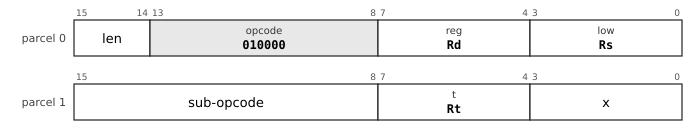

From `len = 01`. In this group `low` is a register, never a mode. Operand roles: `reg` is the destination `Rd`, `low` the first source `Rs`, `t` the second `Rt` and `x` the third `Ru`; the assembler writes the destination last.

| Mnemonic | Sub-opcode |
|---|---|
| `FCLASS` | `00101000 (0x28)` |
| `FCLASS32` | `00101001 (0x29)` |
| `FCLASS16` | `01011100 (0x5C)` |

**Operation**

```
Rd ← a bit vector with exactly one bit set:
bit 0 -infinity      bit 1 -normal      bit 2 -subnormal   bit 3 -zero
bit 4 +zero          bit 5 +subnormal   bit 6 +normal      bit 7 +infinity
bit 8 signalling NaN bit 9 quiet NaN
```

**Flags** None.

**Exceptions** None.

Every libm function begins with this dispatch. The old spellings `FCLASSD`, `FCLASSS` are aliases.

**Why it is here.** "Every libm function begins with this dispatch" (ISA section 4.10): one instruction returns which of ten kinds a value is (signalling or quiet NaN, infinity, normal, subnormal, zero, each signed), where software needs several compares and masks. It is in the original floating-point set; the assistant listed it among the items justified by a workload and not by compiled C, together with the tag branches, and recommended waiting for the frequency table before cutting any (this chat, 2026-10-21). Nothing in the corpus emits it, because the compiler is not taught to.

**Status** implemented in the reference executor for `FCLASS`, `FCLASS16`; not yet for the others.


### FRINT: Round to an integral value, binary64

**Mnemonics:** `FRINT`, `FRINTZ`, `FRINTM`, `FRINTP`, `FRINTA`  (aliases: `FRINTD`, `FRINTDZ`, `FRINTDM`, `FRINTDP`, `FRINTDA`)

**Syntax**

```
FRINT Rs, Rd
FRINTZ Rs, Rd
FRINTM Rs, Rd
FRINTP Rs, Rd
FRINTA Rs, Rd
```

**Encoding**


From `len = 01`. In this group `low` is a register, never a mode. Operand roles: `reg` is the destination `Rd`, `low` the first source `Rs`, `t` the second `Rt` and `x` the third `Ru`; the assembler writes the destination last.

| Mnemonic | Sub-opcode |
|---|---|
| `FRINT` | `00110000 (0x30)` |
| `FRINTZ` | `00110001 (0x31)` |
| `FRINTM` | `00110010 (0x32)` |
| `FRINTP` | `00110011 (0x33)` |
| `FRINTA` | `00110100 (0x34)` |

**Operation**

```
FRINT : Rd ← Rs rounded to nearest, ties to even
FRINTZ: toward zero         FRINTM: toward -infinity
FRINTP: toward +infinity    FRINTA: to nearest, ties away from zero (C round())
```

**Flags** No integer flag is written. The IEEE exception flags raised are ORed into `FPSR` (`NX` inexact, `UF` underflow, `OF` overflow, `DZ` divide by zero, `NV` invalid); nothing traps.

**Exceptions** None.

The rounding mode is in the opcode, never in a mode bit. The old spellings `FRINTD`, `FRINTDZ`, ... are aliases.

**Why it is here.** Rounding to an integral value in each direction (nearest even, toward zero, down, up) is in the original set. **`FRINTA`, ties away from zero, was added on 2026-10-21** after the PowerPC 601 comparison, for C's `round()`, which is common in libm; it is a qualifier of the round operation and so costs no new operation (errata 19). The author's reaction: "add those 3 things, i like having the rounding variants" (the other two were the exception flags and the unsigned conversions).

**Status** implemented in the reference executor (`common/pdp64exec.c`, shared by `sim64` and QEMU).


### FCVT: Floating conversions

**Mnemonics:** `FCVTDQ`, `FCVTDQU`, `FCVTQD`, `FCVTQUD`, `FCVTDS`, `FCVTSD`, `FCVTSL`, `FCVTLS`

**Syntax**

```
FCVTDQ Rs, Rd        ; binary64 to signed quad
FCVTDQU Rs, Rd       ; binary64 to unsigned quad
FCVTQD Rs, Rd        ; signed quad to binary64
FCVTQUD Rs, Rd       ; unsigned quad to binary64
FCVTDS Rs, Rd        ; binary64 to binary32
FCVTSD Rs, Rd        ; binary32 to binary64
FCVTSL Rs, Rd        ; binary32 to signed 32-bit integer
FCVTLS Rs, Rd        ; signed 32-bit integer to binary32
```

**Encoding**


From `len = 01`. In this group `low` is a register, never a mode. Operand roles: `reg` is the destination `Rd`, `low` the first source `Rs`, `t` the second `Rt` and `x` the third `Ru`; the assembler writes the destination last.

| Mnemonic | Sub-opcode |
|---|---|
| `FCVTDQ` | `00111000 (0x38)` |
| `FCVTDQU` | `00111110 (0x3E)` |
| `FCVTQD` | `00111001 (0x39)` |
| `FCVTQUD` | `00111111 (0x3F)` |
| `FCVTDS` | `00111010 (0x3A)` |
| `FCVTSD` | `00111011 (0x3B)` |
| `FCVTSL` | `00111100 (0x3C)` |
| `FCVTLS` | `00111101 (0x3D)` |

**Operation**

```
float to integer: truncate toward zero, then saturate; a NaN gives the largest value
integer to float: round to nearest even
```

**Flags** No integer flag is written. The IEEE exception flags raised are ORed into `FPSR` (`NX` inexact, `UF` underflow, `OF` overflow, `DZ` divide by zero, `NV` invalid); nothing traps. A NaN or an out-of-range value raises `NV` and saturates.

**Exceptions** None.

Integer results are 64-bit (`FCVTDQ`, `FCVTDQU`) or 32-bit sign-extended (`FCVTSL`). Unsigned conversion of a negative value is invalid and gives 0.

**Why it is here.** The conversions were in the original set. **`FCVTDQU` and `FCVTQUD`, unsigned 64-bit to and from `binary64`, were added on 2026-10-21** because C needs both and without them each takes a branch and several instructions; the author approved them with the other two additions ("add those 3 things"; errata 18).

**Status** implemented in the reference executor (`common/pdp64exec.c`, shared by `sim64` and QEMU).


### FSFLAGS: Swap the floating-point exception flags

**Mnemonics:** `FSFLAGS`

**Syntax**

```
FSFLAGS Rs, Rd
```

**Encoding**


From `len = 01`. In this group `low` is a register, never a mode. Operand roles: `reg` is the destination `Rd`, `low` the first source `Rs`, `t` the second `Rt` and `x` the third `Ru`; the assembler writes the destination last.

**Operation**

```
old ← FPSR
FPSR ← Rs[4:0]
Rd ← old
```

**Flags** None.

**Exceptions** None.

`FPSR` is the sticky five-bit register (`NX` bit 0, `UF` 1, `OF` 2, `DZ` 3, `NV` 4). C99 `<fenv.h>` is built on this one instruction.

**Why it is here.** The one thing missing for IEEE 754 conformance, found on 2026-10-21 while answering the author's question about the PowerPC 601's floating-point operations: a search of the instruction-set text for flags, `fenv`, "inexact" and "sticky" found nothing, yet IEEE requires five status flags and C99 `<fenv.h>` needs software access to them. The fix is a sticky five-bit `FPSR`, laid out as RISC-V's `fflags`, written by every operation that can raise a flag and never trapping, and one swap instruction to read and write it. It is a record of what happened, not a mode, so the rule against mode bits is untouched. The author approved it with "add those 3 things" (; errata 17).

**Status** implemented in the reference executor (`common/pdp64exec.c`, shared by `sim64` and QEMU).


### FHALF: Floating arithmetic, binary16

**Mnemonics:** `FADD16`, `FSUB16`, `FMUL16`, `FDIV16`, `FSQRT16`, `FCMP16`, `FMADD16`, `FMSUB16`, `FNMADD16`, `FNMSUB16`

**Syntax**

```
FADD16 Rs, Rd
FSUB16 Rs, Rd
FMUL16 Rs, Rd
FDIV16 Rs, Rd
FSQRT16 Rs, Rd
FCMP16 Rd, Rs
FMADD16 Rs, Rt, Ru, Rd ...
```

**Encoding**


From `len = 01`. In this group `low` is a register, never a mode. Operand roles: `reg` is the destination `Rd`, `low` the first source `Rs`, `t` the second `Rt` and `x` the third `Ru`; the assembler writes the destination last.

| Mnemonic | Sub-opcode |
|---|---|
| `FADD16` | `01010000 (0x50)` |
| `FSUB16` | `01010001 (0x51)` |
| `FMUL16` | `01010010 (0x52)` |
| `FDIV16` | `01010011 (0x53)` |
| `FSQRT16` | `01010100 (0x54)` |
| `FCMP16` | `01010101 (0x55)` |
| `FMADD16` | `01011000 (0x58)` |
| `FMSUB16` | `01011001 (0x59)` |
| `FNMADD16` | `01011010 (0x5A)` |
| `FNMSUB16` | `01011011 (0x5B)` |

**Operation**

```
as the binary32 words, in binary16: Rd ← Rd op Rs ; the fused forms take Rs, Rt, Ru, Rd
a half lives in the low 16 bits of a register, sign-extended to 64
```

**Flags** No integer flag is written. The IEEE exception flags raised are ORed into `FPSR` (`NX` inexact, `UF` underflow, `OF` overflow, `DZ` divide by zero, `NV` invalid); nothing traps. `FCMP16` writes `N Z V C` as `FCMP`.

**Exceptions** None.

Results are correctly rounded to nearest even, tininess judged after rounding; a NaN result is the canonical `0x7E00`. Half `FMIN`, `FMAX`, `FRINT*`, bfloat16 and conversions to and from 64-bit integers are open items.

**Why it is here.** The author raised half precision on 2026-10-21 (the assistant's answer opens "Is FP16 a GPU thing?" and goes on "You're right about the gradients"). The answer, from memory and not checked against a manual, was that it began as one (NVIDIA's `half`, 2002), spread to machine learning and image formats, and is now in CPUs (x86 `F16C` and AVX-512 FP16, ARMv8.2, RISC-V `Zfh` and `Zfhmin`). The assistant laid out two levels, conversions only (about 500 to 1,000 lookup tables, no new operation by the folding rule) and full arithmetic (about 2,000 to 3,500 tables, estimates of its own), and noted that the existing double datapath can compute half correctly rounded. On 2026-10-22 the author decided: "add fp16 conversions and arithmetic". The leftovers (half `FMIN`, `FRINT*`, bfloat16, 64-bit integer conversions) are open items. The related question of 16-bit *integer* arithmetic was treated as a design item and decided against (errata 28).

**Status** implemented in the reference executor (`common/pdp64exec.c`, shared by `sim64` and QEMU).


### FCVTH: Conversions to and from binary16

**Mnemonics:** `FCVTSH`, `FCVTHS`, `FCVTDH`, `FCVTHD`, `FCVTHL`, `FCVTLH`

**Syntax**

```
FCVTSH Rs, Rd        ; binary32 to half
FCVTHS Rs, Rd        ; half to binary32
FCVTDH Rs, Rd        ; binary64 to half
FCVTHD Rs, Rd        ; half to binary64
FCVTHL Rs, Rd        ; half to signed 32-bit integer, toward zero
FCVTLH Rs, Rd        ; signed 32-bit integer to half
```

**Encoding**


From `len = 01`. In this group `low` is a register, never a mode. Operand roles: `reg` is the destination `Rd`, `low` the first source `Rs`, `t` the second `Rt` and `x` the third `Ru`; the assembler writes the destination last.

| Mnemonic | Sub-opcode |
|---|---|
| `FCVTSH` | `01100000 (0x60)` |
| `FCVTHS` | `01100001 (0x61)` |
| `FCVTDH` | `01100010 (0x62)` |
| `FCVTHD` | `01100011 (0x63)` |
| `FCVTHL` | `01100100 (0x64)` |
| `FCVTLH` | `01100101 (0x65)` |

**Operation**

```
narrowing: round to nearest even ; widening: exact
FCVTHL of a NaN or an infinity is invalid and saturates; truncating a fraction is inexact
```

**Flags** No integer flag is written. The IEEE exception flags raised are ORed into `FPSR` (`NX` inexact, `UF` underflow, `OF` overflow, `DZ` divide by zero, `NV` invalid); nothing traps.

**Exceptions** None.

**Why it is here.** The conversion half of the `binary16` decision (see `FHALF`): on 2026-10-22 the author asked for "fp16 conversions and arithmetic". The conversions are the part machine-learning code needs most, because a half is normally loaded and stored with `MOVW`, converted, computed in single or double, and converted back.

**Status** implemented in the reference executor (`common/pdp64exec.c`, shared by `sim64` and QEMU).
<!-- /entries:9.12 -->

## 9.13 Atomics and ordering

*Cf. chapter 7, section 7.12 (the atomic and ordering instructions), section 7.3 (the atomics in detail) and section 7.2 (the memory model).*

**9.13.1** The atomic escape `ATOM` (opcode `010001 (0x11)`) holds `CAS`, `SWAP`, `XADD`, `XAND`, `XOR_`, `XXOR`, `XMAX`, `XMIN`, `XMAXU` and `XMINU`, each with a `_DB` variant that adds a barrier, and `LL` and `SC`; `FENCE`, `WFE`, `SEV`, `ISYNC` and `HINT` are in `SYS`. Their semantics, ordering rules and the reservation monitor are in the chapter named above. *(opcode `010001 (0x11)`)*

**9.13.2** `CAS` operates on 4 or 8 bytes; an 8-byte compare-and-swap may span two adjacent 4-byte fields, because the usual lock-and-count fast path of an operating system is exactly that (an 8-byte whole over two 4-byte members). How the size is encoded is not yet fixed. *(D, the author 2026-10-23, errata 71; not yet in the specification files, the simulator or QEMU)*

*Commentary.* The official entry of each instruction is below, in this section; chapter 7 gives the reasons, the memory model and the use. **Impact.** *Kernel:* the entries below are all a kernel needs to write its locks; chapter 7 explains how they compose. *Compiler:* a lock acquire is one `_DB` instruction. *Hardware:* a reservation monitor beside the data cache.

<!-- entries:9.13 -->
### CAS: Compare and swap

**Mnemonics:** `CAS`, `CASDB`

**Syntax**

```
CAS expected, new, (address)        ; operand placement and size encoding not yet fixed; size is 4 or 8 bytes
CASDB ...                            ; with a full barrier
```

**Encoding**


From `len = 01`. In this group `low` is a register, never a mode. The text of the instruction set fixes the sub-opcodes of this group and its semantics but not yet the placement of the operands of each form; the forms below name the roles, and the assembler and the reference executor do not implement the group yet.

| Mnemonic | Sub-opcode |
|---|---|
| `CAS` | `00000000 (0x00)` |
| `CASDB` | `00000001 (0x01)` |

**Operation**

```
old ← M[address]                         ; 4 or 8 bytes, naturally aligned
if old = expected then M[address] ← new
result ← old          ; the program compares result with expected to learn whether the swap happened
```

**Flags** Not specified beyond "none for the read-modify-write forms"; `SC` reports success in its result register.

**Exceptions** Page fault, protection fault, alignment fault (the address must be naturally aligned) or bus error. The access is atomic with respect to every initiator, cores and devices alike.

The text of the instruction set fixes the sub-opcodes of this group and its semantics but not yet the placement of the operands of each form; the forms below name the roles, and the assembler and the reference executor do not implement the group yet.

**Why it is here.** ISA revision 13 expanded the atomic escape with barrier-fused variants, taken from LoongArch's pragmatism: a lock acquire is one instruction rather than an atomic followed by a `FENCE`, and that pair is in every critical section of the system. The design chat asked what is needed for symmetric multiprocessing and what can be learned from modern multi-core processors; revision 15 added section 17 (a sequentially consistent model, nearly free on an in-order machine) and the `SYS` additions. The author's question on 2026-10-21, "how many folded opcodes in system and smp? i thought atomics and smp would be in the same umbrella", made the seventeen-operation SMP umbrella. On 2026-10-22 the author chose atomics defined on a reservation monitor and not a bus lock (decision P11, errata 45). The group is specified and not yet implemented in the reference executor.

**Cf.** 7.12 (the atomic instructions), 7.3 (the atomics in detail: the reservation monitor), 7.2 (the memory model).

**Status** specified; **not yet implemented** in the reference executor.


### SWAP: Atomic exchange

**Mnemonics:** `SWAP`, `SWAPDB`

**Syntax**

```
SWAP value, (address)
SWAPDB ...
```

**Encoding**


From `len = 01`. In this group `low` is a register, never a mode. The text of the instruction set fixes the sub-opcodes of this group and its semantics but not yet the placement of the operands of each form; the forms below name the roles, and the assembler and the reference executor do not implement the group yet.

| Mnemonic | Sub-opcode |
|---|---|
| `SWAP` | `00000010 (0x02)` |
| `SWAPDB` | `00000011 (0x03)` |

**Operation**

```
old ← M[address] ; M[address] ← value ; result ← old
```

**Flags** Not specified beyond "none for the read-modify-write forms"; `SC` reports success in its result register.

**Exceptions** Page fault, protection fault, alignment fault (the address must be naturally aligned) or bus error. The access is atomic with respect to every initiator, cores and devices alike.

The text of the instruction set fixes the sub-opcodes of this group and its semantics but not yet the placement of the operands of each form; the forms below name the roles, and the assembler and the reference executor do not implement the group yet.

**Why it is here.** One of the read-modify-write atomics of the `ATOM` group (see `CAS`). The record gives no separate history for it.

**Cf.** 7.12 (the atomic instructions), 7.3 (the atomics in detail: the reservation monitor), 7.2 (the memory model).

**Status** specified; **not yet implemented** in the reference executor.


### XADD: Atomic fetch and add

**Mnemonics:** `XADD`, `XADDDB`

**Syntax**

```
XADD value, (address)
XADDDB ...
```

**Encoding**


From `len = 01`. In this group `low` is a register, never a mode. The text of the instruction set fixes the sub-opcodes of this group and its semantics but not yet the placement of the operands of each form; the forms below name the roles, and the assembler and the reference executor do not implement the group yet.

| Mnemonic | Sub-opcode |
|---|---|
| `XADD` | `00000100 (0x04)` |
| `XADDDB` | `00000101 (0x05)` |

**Operation**

```
old ← M[address] ; M[address] ← old + value ; result ← old
```

**Flags** Not specified beyond "none for the read-modify-write forms"; `SC` reports success in its result register.

**Exceptions** Page fault, protection fault, alignment fault (the address must be naturally aligned) or bus error. The access is atomic with respect to every initiator, cores and devices alike.

The text of the instruction set fixes the sub-opcodes of this group and its semantics but not yet the placement of the operands of each form; the forms below name the roles, and the assembler and the reference executor do not implement the group yet.

**Why it is here.** One of the fetch-and-operate atomics of `ATOM` (see `CAS`), in the place of the PDP-11's read-modify-write instructions, which were indivisible on the Unibus through the `DATIP`/`DATO` pair (ISA section 9.13).

**Cf.** 7.12 (the atomic instructions), 7.3 (the atomics in detail: the reservation monitor), 7.2 (the memory model).

**Status** specified; **not yet implemented** in the reference executor.


### XAND: Atomic fetch and and, or, xor

**Mnemonics:** `XAND`, `XANDDB`, `XOR`, `XOR_DB`, `XXOR`, `XXORDB`

**Syntax**

```
XAND value, (address)
XOR_ value, (address)        ; the trailing underscore keeps the mnemonic distinct from XOR
XXOR value, (address)
each with a DB form
```

**Encoding**


From `len = 01`. In this group `low` is a register, never a mode. The text of the instruction set fixes the sub-opcodes of this group and its semantics but not yet the placement of the operands of each form; the forms below name the roles, and the assembler and the reference executor do not implement the group yet.

| Mnemonic | Sub-opcode |
|---|---|
| `XAND` | `00000110 (0x06)` |
| `XANDDB` | `00000111 (0x07)` |
| `XOR_` | `00001000 (0x08)` |
| `XOR_DB` | `00001001 (0x09)` |
| `XXOR` | `00001010 (0x0A)` |
| `XXORDB` | `00001011 (0x0B)` |

**Operation**

```
old ← M[address]
XAND: M[address] ← old AND value
XOR_: M[address] ← old OR value
XXOR: M[address] ← old XOR value
result ← old
```

**Flags** Not specified beyond "none for the read-modify-write forms"; `SC` reports success in its result register.

**Exceptions** Page fault, protection fault, alignment fault (the address must be naturally aligned) or bus error. The access is atomic with respect to every initiator, cores and devices alike.

The text of the instruction set fixes the sub-opcodes of this group and its semantics but not yet the placement of the operands of each form; the forms below name the roles, and the assembler and the reference executor do not implement the group yet.

**Why it is here.** The fetch-and-and, or and xor atomics of `ATOM` (see `CAS`). The record gives no separate history for them.

**Cf.** 7.12 (the atomic instructions), 7.3 (the atomics in detail: the reservation monitor), 7.2 (the memory model).

**Status** specified; **not yet implemented** in the reference executor.


### XMAX: Atomic fetch and minimum or maximum

**Mnemonics:** `XMAX`, `XMAXDB`, `XMIN`, `XMINDB`, `XMAXU`, `XMAXUDB`, `XMINU`, `XMINUDB`

**Syntax**

```
XMAX value, (address)
XMIN ..., XMAXU ..., XMINU ...
each with a DB form
```

**Encoding**


From `len = 01`. In this group `low` is a register, never a mode. The text of the instruction set fixes the sub-opcodes of this group and its semantics but not yet the placement of the operands of each form; the forms below name the roles, and the assembler and the reference executor do not implement the group yet.

| Mnemonic | Sub-opcode |
|---|---|
| `XMAX` | `00001100 (0x0C)` |
| `XMAXDB` | `00001101 (0x0D)` |
| `XMIN` | `00001110 (0x0E)` |
| `XMINDB` | `00001111 (0x0F)` |
| `XMAXU` | `00010000 (0x10)` |
| `XMAXUDB` | `00010001 (0x11)` |
| `XMINU` | `00010010 (0x12)` |
| `XMINUDB` | `00010011 (0x13)` |

**Operation**

```
old ← M[address] ; M[address] ← max(old, value) (XMAX, XMAXU) or min (XMIN, XMINU) ; result ← old
signed for XMAX and XMIN, unsigned for the U forms
```

**Flags** Not specified beyond "none for the read-modify-write forms"; `SC` reports success in its result register.

**Exceptions** Page fault, protection fault, alignment fault (the address must be naturally aligned) or bus error. The access is atomic with respect to every initiator, cores and devices alike.

The text of the instruction set fixes the sub-opcodes of this group and its semantics but not yet the placement of the operands of each form; the forms below name the roles, and the assembler and the reference executor do not implement the group yet.

**Why it is here.** The fetch-and-minimum and maximum atomics, borrowed from LoongArch's richer atomic set (ISA section 15.1): each is a couple of hundred lookup tables and saves a compare-and-swap retry loop.

**Cf.** 7.12 (the atomic instructions), 7.3 (the atomics in detail: the reservation monitor), 7.2 (the memory model).

**Status** specified; **not yet implemented** in the reference executor.


### LLSC: Load-linked and store-conditional

**Mnemonics:** `LL`, `SC`

**Syntax**

```
LL (address), Rd
SC value, (address), result
```

**Encoding**


From `len = 01`. In this group `low` is a register, never a mode. The text of the instruction set fixes the sub-opcodes of this group and its semantics but not yet the placement of the operands of each form; the forms below name the roles, and the assembler and the reference executor do not implement the group yet.

| Mnemonic | Sub-opcode |
|---|---|
| `LL` | `00100000 (0x20)` |
| `SC` | `00100001 (0x21)` |

**Operation**

```
LL: Rd ← M[address] ; take a reservation on the granule containing address
SC: if the reservation is intact then M[address] ← value ; result ← 0 (success)
    else nothing is written ; result ← 1 (failure)
a write to the granule by any initiator, core or device, clears the reservation
```

**Flags** Not specified beyond "none for the read-modify-write forms"; `SC` reports success in its result register.

**Exceptions** Page fault, protection fault, alignment fault (the address must be naturally aligned) or bus error. The access is atomic with respect to every initiator, cores and devices alike.

A short `LL`/`SC` sequence must eventually succeed if no other initiator keeps writing the granule (the RISC-V guarantee for constrained sequences). The text of the instruction set fixes the sub-opcodes of this group and its semantics but not yet the placement of the operands of each form; the forms below name the roles, and the assembler and the reference executor do not implement the group yet. The result convention shown for `SC` is the usual one and is not yet fixed in the text.

**Why it is here.** Load-linked and store-conditional, with the reservation made a monitor in errata 45 (the author's pick, decision P11, 2026-10-22), because a monitor maps onto the exclusive access of AXI and of FPGA and modern memory systems, where the Unibus's locked read-modify-write (`DATIP`/`DATO`) does not scale as cores multiply. A short sequence must eventually succeed if no other initiator keeps writing the granule, the RISC-V rule.

**Cf.** 7.12 (the atomic instructions), 7.3 (the atomics in detail: the reservation monitor), 7.2 (the memory model).

**Status** specified; **not yet implemented** in the reference executor.
<!-- /entries:9.13 -->

## 9.14 System instructions, exceptions and interrupts

*Cf. chapter 6, section 6.7 (system instructions, exceptions and interrupts), section 6.2 (exceptions and interrupts) and section 6.3 (system registers).*

**9.14.1** The system escape `SYS` (opcode `010100 (0x14)`) holds the privileged and system instructions: `TRAP`, `TRAPL`, `RTI`, `RTT`, `RET`, `HALT`, `BPT`, `MTPS`, `MFPS`, `SPL`, `MFSR`, `MTSR`, `MTDP`, `MFDP`, `MFCPUID`, `PROBER`, `PROBEW`, `PUSHX`, `POPX`, and the translation and cache maintenance instructions (`TLBI`, `TLBIA`, `TLBSYNC`, `MTASID`, `MFASID`, `ICINV`, `ICINVA`). The user-memory guard instructions `STUA` and `CLUA` are described with them. *(opcode `010100 (0x14)`)*

*Commentary.* The official entry of each instruction is below, in this section; the kernel chapter gives the modes, the entry sequence, the system registers and the reasons. **Impact.** *Kernel:* the entries below are the complete list of what the kernel may execute that user code may not, and of what both may; chapter 6 explains how they are used. *Compiler:* none, apart from `TRAP` in system-call stubs. *Hardware:* a class decode and one privilege check.

<!-- entries:9.14 -->
### NOP: No operation and landing pad

**Mnemonics:** `NOP`, `LPAD`

**Syntax**

```
NOP
LPAD
```

**Encoding**


The `reg` field is the **class**. Class 0 takes a minor opcode from `low`; the other classes take a register or a 4-bit immediate from `low`.

| Mnemonic | Class (`reg`) | Minor (`low`) |
|---|---|---|
| `NOP` | 0 | `0000 (0x0)` |
| `LPAD` | 0 | `1001 (0x9)` |

**Operation**

```
nothing
```

**Flags** None written.

**Exceptions** None.

`LPAD` marks a legal target of an indirect jump or call; no instruction enforces it in ABI version 1.

**Why it is here.** `NOP` is common and has no story; `LPAD` is the landing pad. Landing pads, `LPAD`, mark the legal targets of indirect jumps and calls so that jump-oriented attacks can be stopped at the transfer, as Intel's indirect-branch tracking and ARM's branch target identification do and OpenBSD enforces. ABI version 1 leaves them off (an open item of the instruction set, section 12.3 of the text), and the assembler provides `.lpad`; the kernel pain-points and mitigations reports (this chat, 2026-10-22) record why deciding later gets more expensive (appendix A, section A.1).

**Cf.** Appendix A, section A.1 (landing pads).

**Status** specified; **not yet implemented** in the reference executor.


### RTI: Return from interrupt or exception

**Mnemonics:** `RTI`, `RTT`

**Syntax**

```
RTI
RTT
```

**Encoding**


The `reg` field is the **class**. Class 0 takes a minor opcode from `low`; the other classes take a register or a 4-bit immediate from `low`.

| Mnemonic | Class (`reg`) | Minor (`low`) |
|---|---|---|
| `RTI` | 0 | `0001 (0x1)` |
| `RTT` | 0 | `0010 (0x2)` |

**Operation**

```
PC ← EPC ; PSW ← EPSW           ; a PSW with the reserved mode 2 in either mode field aborts
RTT: and then set the trace bit T after the return
```

**Flags** Replaced by `EPSW`, including the flags.

**Exceptions** Privileged: outside kernel mode the instruction aborts with the privileged-instruction vector.

`RTT` sets the trace bit *after* the return rather than before, which is what lets a debugger single-step out of its own trap handler.

**Why it is here.** `RTT` stays despite looking redundant against `RTI` (ISA revision 17): it sets the trace bit *after* the return rather than before, which is what lets a debugger single-step out of its own trap handler.

**Cf.** 6.2 (exceptions and interrupts), 6.7.

**Status** implemented in the reference executor (`common/pdp64exec.c`, shared by `sim64` and QEMU).


### RET: Return from subroutine

**Mnemonics:** `RET`

**Syntax**

```
RET
```

**Encoding**


The `reg` field is the **class**. Class 0 takes a minor opcode from `low`; the other classes take a register or a 4-bit immediate from `low`.

| Mnemonic | Class (`reg`) | Minor (`low`) |
|---|---|---|
| `RET` | 0 | `0011 (0x3)` |

**Operation**

```
PC ← M[SP] ; SP ← SP + 8
```

**Flags** None written.

**Exceptions** Memory operand: page fault, protection fault, alignment fault or bus error (a read of non-existent memory is a precise abort with cause `BUSFAULT`). Every such fault is precise and the instruction restarts after it, because the register update of an auto-increment or auto-decrement mode is held until the instruction retires.

Not privileged, though it is in the system escape: it is the two-byte partner of `CALL`.

**Status** implemented in the reference executor (`common/pdp64exec.c`, shared by `sim64` and QEMU).


### HALT: Halt the processor

**Mnemonics:** `HALT`

**Syntax**

```
HALT
```

**Encoding**


The `reg` field is the **class**. Class 0 takes a minor opcode from `low`; the other classes take a register or a 4-bit immediate from `low`.

| Mnemonic | Class (`reg`) | Minor (`low`) |
|---|---|---|
| `HALT` | 0 | `0100 (0x4)` |

**Operation**

```
stop the processor
```

**Flags** None written.

**Exceptions** Privileged: outside kernel mode the instruction aborts with the privileged-instruction vector.

**Cf.** 6.6.

**Status** implemented in the reference executor (`common/pdp64exec.c`, shared by `sim64` and QEMU).


### BPT: Breakpoint

**Mnemonics:** `BPT`

**Syntax**

```
BPT
```

**Encoding**


The `reg` field is the **class**. Class 0 takes a minor opcode from `low`; the other classes take a register or a 4-bit immediate from `low`.

| Mnemonic | Class (`reg`) | Minor (`low`) |
|---|---|---|
| `BPT` | 0 | `0101 (0x5)` |

**Operation**

```
take the breakpoint vector with EPC = the address of the next instruction
```

**Flags** None written.

**Exceptions** Enters the kernel by the `BPT` vector.

A trap like any other, but kept as its own two-byte instruction because a debugger patches it over an existing instruction, so it must be the shortest instruction the machine has.

**Why it is here.** `BPT` is just a trap vector, but a debugger patches it over an existing instruction, so it must be the shortest instruction the machine has; that is why it stayed when `IOT` and `EMT` were dropped in ISA revision 17.

**Cf.** 6.2.

**Status** implemented in the reference executor (`common/pdp64exec.c`, shared by `sim64` and QEMU).


### FENCE: Memory fence

**Mnemonics:** `FENCE`

**Syntax**

```
FENCE
```

**Encoding**


The `reg` field is the **class**. Class 0 takes a minor opcode from `low`; the other classes take a register or a 4-bit immediate from `low`.

| Mnemonic | Class (`reg`) | Minor (`low`) |
|---|---|---|
| `FENCE` | 0 | `0110 (0x6)` |

**Operation**

```
order the memory accesses before it against those after it, for every initiator that observes them
```

**Flags** None written.

**Exceptions** None.

Owed to devices (one `FENCE` separates writing a device's registers from setting its go bit) and to other cores.

**Why it is here.** ISA revision 15 declared the memory model sequentially consistent and so needs `FENCE` only for what is outside the model: devices and the framebuffer (one `FENCE` between writing a device's registers and setting its go bit, section 3.4 of the book) and instruction streams. The record says the `_DB` barrier forms of the atomics were added so that a `FENCE` is not needed in a lock acquire.

**Cf.** 7.2 (the memory model), 2.2 (what the processor owes the bus).

**Status** specified; **not yet implemented** in the reference executor.


### WFE: Wait for an event

**Mnemonics:** `WFE`  (aliases: `WAIT`)

**Syntax**

```
WFE
```

**Encoding**


The `reg` field is the **class**. Class 0 takes a minor opcode from `low`; the other classes take a register or a 4-bit immediate from `low`.

| Mnemonic | Class (`reg`) | Minor (`low`) |
|---|---|---|
| `WFE` | 0 | `0111 (0x7)` |

**Operation**

```
sleep until an interrupt is pending or another core executes SEV
```

**Flags** None written.

**Exceptions** Privileged: outside kernel mode the instruction aborts with the privileged-instruction vector.

`WAIT` is an assembler alias. Whether `WFE` wakes on a pending but masked interrupt (the idle-loop question) is open.

**Why it is here.** `WAIT` was a PDP-11 instruction (sleep until an interrupt) and was dropped in ISA revision 17 as subsumed by `WFE`, which sleeps until an interrupt or another core's `SEV`; on a uniprocessor it behaves exactly as `WAIT` did. `WFE` and `SEV` came with the SMP additions of revision 15 (the design chat's question about symmetric multiprocessing). The wake rule (whether a pending but masked interrupt wakes it) was an accidental decision that the author asked to see written up like the others; it is open item P1.

**Cf.** 7.6 (waiting and signalling).

**Status** implemented in the reference executor (`common/pdp64exec.c`, shared by `sim64` and QEMU).


### SEV: Send an event

**Mnemonics:** `SEV`

**Syntax**

```
SEV
```

**Encoding**


The `reg` field is the **class**. Class 0 takes a minor opcode from `low`; the other classes take a register or a 4-bit immediate from `low`.

| Mnemonic | Class (`reg`) | Minor (`low`) |
|---|---|---|
| `SEV` | 0 | `1000 (0x8)` |

**Operation**

```
wake every core waiting in WFE
```

**Flags** None written.

**Exceptions** None.

**Why it is here.** The signalling half of `WFE`, added in ISA revision 15 so that a core waiting for a lock can sleep instead of spinning and be woken by the core that releases it.

**Cf.** 7.6.

**Status** specified; **not yet implemented** in the reference executor.


### TLBA: Invalidate all translations; wait for translation invalidations; invalidate the whole instruction cache

**Mnemonics:** `TLBIA`, `TLBSYNC`, `ICINVA`

**Syntax**

```
TLBIA
TLBSYNC
ICINVA
```

**Encoding**


The `reg` field is the **class**. Class 0 takes a minor opcode from `low`; the other classes take a register or a 4-bit immediate from `low`.

| Mnemonic | Class (`reg`) | Minor (`low`) |
|---|---|---|
| `TLBIA` | 0 | `1010 (0xA)` |
| `TLBSYNC` | 0 | `1011 (0xB)` |
| `ICINVA` | 0 | `1100 (0xC)` |

**Operation**

```
TLBIA   : invalidate every translation-buffer entry on this core and, by broadcast, on the others
TLBSYNC : wait until the invalidations this core started have completed on every core
ICINVA  : invalidate the whole instruction cache
```

**Flags** None written.

**Exceptions** Privileged (`TLBIA`, `TLBSYNC`); the reference executor treats `ICINVA` as a no-op.

**Why it is here.** ISA revision 15 respecified `TLBI` and `TLBIA` as broadcasting and added `TLBSYNC` to wait for the other cores, and `ICINV` and `ICINVA`: "the absence of an I-cache invalidate through revision 14 was a hole", because a Lisp runtime that compiles a function cannot work without it.

**Cf.** 7.5 (translation and instruction-cache coherence).

**Status** implemented in the reference executor for `TLBIA`, `TLBSYNC`; not yet for the others.


### PUSHX: Push and pop the exception state

**Mnemonics:** `PUSHX`, `POPX`

**Syntax**

```
PUSHX
POPX
```

**Encoding**


The `reg` field is the **class**. Class 0 takes a minor opcode from `low`; the other classes take a register or a 4-bit immediate from `low`.

| Mnemonic | Class (`reg`) | Minor (`low`) |
|---|---|---|
| `PUSHX` | 0 | `1111 (0xF)` (`SYSX`), sub-opcode `0` in parcel 1 |
| `POPX` | 0 | `1111 (0xF)` (`SYSX`), sub-opcode `1` in parcel 1 |

**Operation**

```
PUSHX: SP ← SP - 16 ; M[SP] ← EPSW ; M[SP + 8] ← EPC
POPX : EPSW ← M[SP] ; EPC ← M[SP + 8] ; SP ← SP + 16
```

**Flags** None written.

**Exceptions** Privileged: outside kernel mode the instruction aborts with the privileged-instruction vector. `SP` must be 8-byte aligned (a misaligned-access abort); both words are checked before either is touched.

Four bytes (the `SYSX` escape, sub-opcodes 0 and 1) and two bytes on page 2. For a handler that wants to be interrupted: it can save the exception state and lower the priority.

**Why it is here.** The author decided on 2026-10-22: "add pushx popx", then "i like the pushx popx savings; they might not show up high in the instruction count, but they'd save bytes and cycles in a very tight, very often used kernel loop, no?" A handler that can be interrupted must save `EPC` and `EPSW` before it lowers the priority; with only `MFSR` that costs two moves and two stores (sixteen bytes) on every such kernel entry, and the same to restore. It came out of the System v1 design (errata 36 and 37). Page 2 has the two-byte forms.

**Cf.** 6.2, 6.7.

**Status** implemented in the reference executor (`common/pdp64exec.c`, shared by `sim64` and QEMU).


### ISYNC: Instruction synchronisation

**Mnemonics:** `ISYNC`

**Syntax**

```
ISYNC
```

**Encoding**


The `reg` field is the **class**. Class 0 takes a minor opcode from `low`; the other classes take a register or a 4-bit immediate from `low`.

| Mnemonic | Class (`reg`) | Minor (`low`) |
|---|---|---|
| `ISYNC` | 0 | `1111 (0xF)` (`SYSX`), sub-opcode `2` in parcel 1 |

**Operation**

```
make earlier writes to PTBR, ASID, MMUCTL and VBR, and earlier ICINVs, take effect for the instructions that follow
```

**Flags** None written.

**Exceptions** Privileged: outside kernel mode the instruction aborts with the privileged-instruction vector. A non-zero pad byte is an illegal instruction.

The architecture promises the effect only after the next `ISYNC`; an in-order implementation may make it immediate, and software must not rely on that.

**Why it is here.** Adopted on 2026-10-22 (errata 39) from the out-of-order readiness review, which the author asked for ("i'm ok with the fpga/asic being in order, but want to be ready for the out of order large scale design"): it makes earlier writes to `PTBR`, `ASID`, `MMUCTL` and `VBR` take effect for what follows, so an in-order machine may make them immediate and a speculative one has a place to serialise.

**Cf.** 7.5, 6.3.

**Status** implemented in the reference executor (`common/pdp64exec.c`, shared by `sim64` and QEMU).


### HINT: Hint

**Mnemonics:** `HINT`

**Syntax**

```
HINT #n        ; n = 0 to 255
```

**Encoding**


The `reg` field is the **class**. Class 0 takes a minor opcode from `low`; the other classes take a register or a 4-bit immediate from `low`.

| Mnemonic | Class (`reg`) | Minor (`low`) |
|---|---|---|
| `HINT` | 0 | `1111 (0xF)` (`SYSX`), sub-opcode `3` in parcel 1 |

**Operation**

```
no architectural effect
```

**Flags** None written.

**Exceptions** None.

Defined codes: 0 a plain no-op hint, 1 pause (spin-wait), 2 speculation barrier. Every other code is a reserved hint that executes as a no-op; software shall not use it. Not privileged.

**Why it is here.** Adopted with `ISYNC` on 2026-10-22 (errata 39): a no-op with a byte of code, defined for `0` (plain), `1` (pause, for spin-wait loops) and `2` (speculation barrier), every other code a reserved hint that executes as a no-op so that a later machine can give it a meaning without breaking an old binary.

**Status** implemented in the reference executor (`common/pdp64exec.c`, shared by `sim64` and QEMU).


### MFSR: Move from and to a system register

**Mnemonics:** `MFSR`, `MTSR`

**Syntax**

```
MFSR Rd, name
MTSR name, Rs
```

**Encoding**


The `reg` field is the **class**. Class 0 takes a minor opcode from `low`; the other classes take a register or a 4-bit immediate from `low`.

| Mnemonic | Class (`reg`) | Minor (`low`) |
|---|---|---|
| `MFSR` | 0 | `1101 (0xD)`, system register number in parcel 1 |
| `MTSR` | 0 | `1110 (0xE)`, system register number in parcel 1 |

**Operation**

```
MFSR: Rd ← system register `name`
MTSR: system register `name` ← Rs         ; read-only registers are an illegal instruction
```

**Flags** None written.

**Exceptions** Privileged: outside kernel mode the instruction aborts with the privileged-instruction vector. An unassigned system register is an illegal instruction.

The register is chosen by name (a number in parcel 1); the instruction is four bytes. A write to `PTBR`, `ASID` or `MMUCTL` flushes the translation buffer.

| Name | Number | Access |
|---|---|---|
| `PTBR` | 0 | read and write |
| `EPC` | 1 | read and write |
| `EVA` | 2 | read only |
| `ECAUSE` | 3 | read only |
| `DMW0` | 4 | read and write |
| `DMW1` | 5 | read and write |
| `USP` | 6 | read and write |
| `SSP` | 7 | read and write |
| `EPSW` | 8 | read and write |
| `VBR` | 9 | read and write |
| `MMUCTL` | 10 | read and write |
| `ASID` | 11 | read and write |
| `CPUID` | 12 | read only |

**Why it is here.** The author asked on 2026-10-22: "actually didn't you notice some missing instructions that a paging os needs? you should add them in now to, to the docs, the grammar, and the backend". The instruction-set text named `PTBR`, `EPC`, `EVA` and `ECAUSE` and had no instruction to write the first or read the others, so a kernel could neither install a page table nor learn why it was entered. One general pair reaches all of them by name (errata 32). The user and supervisor stack pointers are in the set because any kernel must read and write the user stack pointer to build a signal frame, copy a process or switch context.

**Cf.** 6.3 (system registers).

**Status** implemented in the reference executor (`common/pdp64exec.c`, shared by `sim64` and QEMU).


### MTPS: Move to and from the processor status word

**Mnemonics:** `MTPS`, `MFPS`

**Syntax**

```
MTPS Rs
MFPS Rd
```

**Encoding**


The `reg` field is the **class**. Class 0 takes a minor opcode from `low`; the other classes take a register or a 4-bit immediate from `low`.

| Mnemonic | Class (`reg`) | Minor (`low`) |
|---|---|---|
| `MTPS` | `0001 (0x1)` | operand in `low` |
| `MFPS` | `0010 (0x2)` | operand in `low` |

**Operation**

```
MTPS: PSW ← Rs          ; in user mode only the flags N Z V C are written
MFPS: Rd ← PSW
```

**Flags** `MTPS` writes the flags from `Rs`; `MFPS` writes none.

**Exceptions** A `MTPS` value with the reserved mode 2 in a mode field aborts.

**Cf.** 6.1 (modes and the status word).

**Status** implemented in the reference executor (`common/pdp64exec.c`, shared by `sim64` and QEMU).


### SPL: Set the interrupt priority level

**Mnemonics:** `SPL`

**Syntax**

```
SPL #n        ; n = 0 to 7
```

**Encoding**


The `reg` field is the **class**. Class 0 takes a minor opcode from `low`; the other classes take a register or a 4-bit immediate from `low`.

| Mnemonic | Class (`reg`) | Minor (`low`) |
|---|---|---|
| `SPL` | `0011 (0x3)` | operand in `low` |

**Operation**

```
PSW.priority ← n
```

**Flags** None written. The condition flags are untouched.

**Exceptions** Privileged: outside kernel mode the instruction aborts with the privileged-instruction vector. A priority above 7 is an illegal instruction.

Kept despite `MTPS` writing the whole word because it sets the priority alone: a kernel raising priority around a critical section must not clobber the flags.

**Why it is here.** `SPL` stays despite `MTPS` writing the whole status word (ISA revision 17): it sets the priority alone, leaving the condition codes untouched, so a kernel raising priority around a critical section does not clobber flags. It is the PDP-11 instruction of the same name.

**Cf.** 6.2.

**Status** implemented in the reference executor (`common/pdp64exec.c`, shared by `sim64` and QEMU).


### TRAP: System call and trap

**Mnemonics:** `TRAP`, `TRAPL`

**Syntax**

```
TRAP #n        ; n = 0 to 15, two bytes
TRAPL #n       ; n = 0 to 255, four bytes
```

**Encoding**


The `reg` field is the **class**. Class 0 takes a minor opcode from `low`; the other classes take a register or a 4-bit immediate from `low`.

| Mnemonic | Class (`reg`) | Minor (`low`) |
|---|---|---|
| `TRAP` | `0100 (0x4)` | operand in `low` |
| `TRAPL` | `1111 (0xF)` | operand in `low` |

**Operation**

```
enter the kernel by vector (TRAP_BASE + n), with EPC = the address of the next instruction
```

**Flags** None written.

**Exceptions** Enters the kernel; not privileged.

The replacement for the PDP-11 `IOT` and `EMT`. `TRAPL` reaches the vectors 0 to 255 with `n` in the high byte of parcel 1.

**Why it is here.** `TRAPL` was added (errata 5) so that the vector range of 256 and the two-byte common case could both be kept: `TRAP #n` for `n` below 16 is two bytes and the long form reaches 256. `IOT` and `EMT`, which were `TRAP` at two particular vectors on the PDP-11, were dropped in ISA revision 17.

**Cf.** 6.2, 6.5 (system calls).

**Status** implemented in the reference executor (`common/pdp64exec.c`, shared by `sim64` and QEMU).


### TLBI: Invalidate a translation

**Mnemonics:** `TLBI`

**Syntax**

```
TLBI Rs
```

**Encoding**


The `reg` field is the **class**. Class 0 takes a minor opcode from `low`; the other classes take a register or a 4-bit immediate from `low`.

| Mnemonic | Class (`reg`) | Minor (`low`) |
|---|---|---|
| `TLBI` | `0101 (0x5)` | operand in `low` |

**Operation**

```
invalidate the translation-buffer entry for the page containing the address in Rs, on this core and by broadcast on the others
```

**Flags** None written.

**Exceptions** Privileged: outside kernel mode the instruction aborts with the privileged-instruction vector.

**Why it is here.** Respecified as broadcasting in ISA revision 15 (SMP section): a translation changed by one core must be invalidated on all of them, and `TLBSYNC` waits for it.

**Cf.** 7.5, 6.4.

**Status** implemented in the reference executor (`common/pdp64exec.c`, shared by `sim64` and QEMU).


### MTASID: Move to and from the address-space identifier

**Mnemonics:** `MTASID`, `MFASID`

**Syntax**

```
MTASID Rs
MFASID Rd
```

**Encoding**


The `reg` field is the **class**. Class 0 takes a minor opcode from `low`; the other classes take a register or a 4-bit immediate from `low`.

| Mnemonic | Class (`reg`) | Minor (`low`) |
|---|---|---|
| `MTASID` | `0110 (0x6)` | operand in `low` |
| `MFASID` | `0111 (0x7)` | operand in `low` |

**Operation**

```
MTASID: ASID ← Rs[15:0]          ; the translation buffer is flushed in the reference executor
MFASID: Rd ← ASID
```

**Flags** None written.

**Exceptions** Privileged: outside kernel mode the instruction aborts with the privileged-instruction vector.

The `ASID` tags translation-buffer entries so a context switch is one store.

**Why it is here.** The `ASID` tags translation-buffer entries so a context switch is one store and no flush, which preserves the constant-time context switch the earlier map-set design was for (ISA section 8.1). The record gives no further history.

**Cf.** 6.4.

**Status** implemented in the reference executor (`common/pdp64exec.c`, shared by `sim64` and QEMU).


### MTDP: Move to and from the direct pointer

**Mnemonics:** `MTDP`, `MFDP`

**Syntax**

```
MTDP Rs
MFDP Rd
```

**Encoding**


The `reg` field is the **class**. Class 0 takes a minor opcode from `low`; the other classes take a register or a 4-bit immediate from `low`.

| Mnemonic | Class (`reg`) | Minor (`low`) |
|---|---|---|
| `MTDP` | `1000 (0x8)` | operand in `low` |
| `MFDP` | `1001 (0x9)` | operand in `low` |

**Operation**

```
MTDP: DP ← Rs
MFDP: Rd ← DP
```

**Flags** None written.

**Exceptions** None.

`DP` is the thread pointer in user mode and the per-CPU pointer in kernel mode; there is one copy per mode.

**Why it is here.** `DP` entered at revision 1 as the descendant of the 6502's zero page, kept for code density (a 12-bit displacement in four bytes); it turned out to be the thread pointer in user mode and, in kernel mode, the per-CPU pointer that an SMP kernel wants (ISA sections 2.2 and 19.3). `MTDP` and `MFDP` read and write the current mode's copy.

**Cf.** 7.4 (per-CPU state).

**Status** implemented in the reference executor (`common/pdp64exec.c`, shared by `sim64` and QEMU).


### MTDMW: Move to a direct-mapping window

**Mnemonics:** `MTDMW`

**Syntax**

```
MTDMW Rs
```

**Encoding**


The `reg` field is the **class**. Class 0 takes a minor opcode from `low`; the other classes take a register or a 4-bit immediate from `low`.

| Mnemonic | Class (`reg`) | Minor (`low`) |
|---|---|---|
| `MTDMW` | `1010 (0xA)` | operand in `low` |

**Operation**

```
DMW0 ← Rs          ; storage only: the operand names no window and the windows are not yet defined
```

**Flags** None written.

**Exceptions** Privileged: outside kernel mode the instruction aborts with the privileged-instruction vector.

The direct-mapping windows are deferred (errata 44).

**Why it is here.** Taken from LoongArch's direct-mapping windows (ISA section 15.1), which stop the kernel taking translation-buffer misses on its own text. The author decided on 2026-10-22 that the windows are deferred, `MMUCTL` stays, and the instruction is storage only for now (errata 44).

**Cf.** 6.4.

**Status** implemented in the reference executor (`common/pdp64exec.c`, shared by `sim64` and QEMU).


### MFCPUID: Read the processor identifier

**Mnemonics:** `MFCPUID`

**Syntax**

```
MFCPUID Rd
```

**Encoding**


The `reg` field is the **class**. Class 0 takes a minor opcode from `low`; the other classes take a register or a 4-bit immediate from `low`.

| Mnemonic | Class (`reg`) | Minor (`low`) |
|---|---|---|
| `MFCPUID` | `1011 (0xB)` | operand in `low` |

**Operation**

```
Rd ← CPUID
```

**Flags** None written.

**Exceptions** None.

The index of this core, for per-CPU data.

**Why it is here.** Added in ISA revision 15 with the SMP section, because per-CPU data needs each core to know which one it is.

**Cf.** 7.4, 7.8.

**Status** implemented in the reference executor (`common/pdp64exec.c`, shared by `sim64` and QEMU).


### ICINV: Invalidate the instruction cache for an address

**Mnemonics:** `ICINV`

**Syntax**

```
ICINV Rs
```

**Encoding**


The `reg` field is the **class**. Class 0 takes a minor opcode from `low`; the other classes take a register or a 4-bit immediate from `low`.

| Mnemonic | Class (`reg`) | Minor (`low`) |
|---|---|---|
| `ICINV` | `1100 (0xC)` | operand in `low` |

**Operation**

```
invalidate the instruction-cache line containing the address in Rs
```

**Flags** None written.

**Exceptions** The reference executor treats it as a no-op; privilege as for the other cache-maintenance instructions.

**Why it is here.** Added with `ICINVA` in ISA revision 15: instruction-cache invalidation, by address and whole. The reason is the one given for `TLBA`: a runtime that compiles a function cannot work without it.

**Cf.** 7.5.

**Status** implemented in the reference executor (`common/pdp64exec.c`, shared by `sim64` and QEMU).


### PROBE: Probe an address for read or write access

**Mnemonics:** `PROBER`, `PROBEW`

**Syntax**

```
PROBER Rd, Rs
PROBEW Rd, Rs
```

**Encoding**


The `reg` field is the **class**. Class 0 takes a minor opcode from `low`; the other classes take a register or a 4-bit immediate from `low`.

| Mnemonic | Class (`reg`) | Minor (`low`) |
|---|---|---|
| `PROBER` | `1101 (0xD)` | operand in `low` |
| `PROBEW` | `1110 (0xE)` | operand in `low` |

**Operation**

```
Rd ← 1 if the address in Rs is readable (PROBER) or writable (PROBEW) in the previous mode, else 0
no fault is taken
```

**Flags** None written.

**Exceptions** Privileged: outside kernel mode the instruction aborts with the privileged-instruction vector.

Taken from the VAX `PROBER` and `PROBEW`: the kernel validates a user address before using it.

**Why it is here.** Restored from the VAX `PROBER` and `PROBEW` in the idioms the revision 13 inventory brought back (ISA section 14.1): the kernel validates a user address before using it, and it replaces the `nofault` global of the V7 kernel for the address-validation case.

**Cf.** 6.5 (the user-memory guard), 6.4.

**Status** implemented in the reference executor (`common/pdp64exec.c`, shared by `sim64` and QEMU).
<!-- /entries:9.14 -->

## 9.15 Faults, restart and memory management

*Cf. chapter 6, section 6.8 (faults, restart and memory management) and section 6.4 (memory management).*

**9.15.1** A fault is a trap, an abort, a progress stop in a block operation or a machine check, and every instruction either completes or is annulled and restarted with no state to undo (`MCPY` and its kin keep their progress in registers); the page-table format, the memory types and the translation registers are in the kernel chapter. *(D)*

*Commentary.* The instruction-set consequence is the restart rule: the register update of an auto-increment mode is held until the instruction retires. **Impact.** *Kernel:* see 6.8. *Compiler:* no scheduling restriction arises from faults. *Hardware:* a single-entry undo buffer and a read-only walker.

## 9.16 Position-independent code

**9.16.1** Position-independent code costs nothing extra on this machine: every access to code or data in the same module is PC-relative by an ordinary addressing mode, so there is no GOT register and no prologue to set one up. *(D, ABI version 1)*

**9.16.2** A call to an imported function is `CALLI got_slot(PC)` and a PLT stub is the single instruction `JMPI got_slot(PC)`; an imported variable's address is one `MOVQ got_slot(PC), Rd`. *(D)*

**9.16.3** A position-independent access to a global is no longer than an absolute one: four bytes within 32 KB and six within 2 GB, against six for a 32-bit absolute address. *(D)*

**9.16.4** The thread pointer is `DP`, so the local-exec thread-local model is one four-byte `MOVQ tls_offset(DP), Rd`. *(D)*

**9.16.5** A branch at the middle length reaches 4 GB, so no linker veneers are needed for any binary smaller than that; the assembler's and the linker's branch relaxation both reduce to choosing a length. *(D)*

**9.16.6** `R12` is the linker's scratch register. Lazy against eager binding, and whether imports are always called without a PLT stub, are decided for version 1 (no stub) and open for later versions. *(D for `R12` and no stub; open for binding)*

*Commentary.* **Precedent.** On i386 a position-independent executable reserved `%ebx` (one of eight registers) for the GOT base and set it in every prologue, which cost a few percent of size and speed; x86-64 fixed that with RIP-relative addressing, and AArch64 needs linker veneers because its branches reach only 128 MB. **Trade-offs.** The two-byte PC-relative form is the shortest, so position-independent data access is slightly smaller than absolute access; the price is a GOT load per imported call site where a PLT stub would cost a load per function. **Improvements.** Position-independence is a side effect of three decisions made for other reasons: PC-relative as an ordinary mode (adopted because the PC left the register file), variable-length encoding (for density) and `DP` (a 6502 zero-page descendant kept for density), which is exactly the thread pointer. **Benefits.** OpenBSD builds everything position-independent by default, and here that costs nothing. **Modern comparables.** x86-64 RIP-relative addressing; AArch64 `ADRP` with a GOT load and veneers for far calls. **Impact.** *Kernel:* a loader applies only relocations for data pointers, and write-xor-execute and randomisation come with no code penalty. *Compiler:* `-fPIE` is the default and emits the same instructions as `-fno-pic` for local data; no reserved register, no per-function setup. *Hardware:* nothing; the PC-relative mode is in the address adder already.

## 9.17 What was rejected

**9.17.1** The architecture refuses, by design, every feature that adds hidden state, an unbounded instruction, a second operand path or a mode bit that changes what other instructions mean. *(D)*

**9.17.2** From the PDP-11 and VAX it refuses general memory-to-memory operands, deferred addressing as a general form (only `JMPI` and `CALLI` are deferred), unbounded instructions with hidden microstate (`MOVC5`, `EDITPC`), packed decimal, hardware call frames (`CALLS`, `CALLG`), the PC as a general register, multiple floating-point formats, `POLY`, the `IOT`, `EMT`, `WAIT` and `RESET` instructions, a distinct low-half unsigned multiply, and the PDP-11's compare operand order. *(D)*

**9.17.3** From x86 it refuses partial-register writes that preserve upper bits, operand-size and `REX` prefixes, segmentation, flag writes that vary by instruction, implicit registers for multiply, divide and shift count, the x87 stack, transcendental instructions and byte-granular instruction fetch. *(D)*

**9.17.4** From the RISC family it refuses a register hardwired to zero (a sixteenth of a 16-register file), fused compare-and-branch in place of flags, branch delay slots, register windows and software-refilled translation buffers. *(D)*

**9.17.5** It also refuses features of its own invention: NUL-terminated string instructions (`MSCN` with an explicit maximum gives a bounded `strlen`), `CRC32` words (carry-less multiply is the primitive under every CRC), reciprocal-estimate instructions, NaN payload propagation, a 32-bit profile, an eight-byte instruction alignment, `MOVT` and `MOVK` partial-immediate inserts, hardware tag checking, store-with-write-barrier, a self-synchronising encoding, and a scalar instruction for sub-1-bit inference (the accelerator of chapter 8 does it). *(D)*

*Commentary.* **Precedent.** The VAX's `EDITPC` is a bytecode interpreter in microcode, and DEC needed a separate control chip for the PDP-11's commercial instruction set and shipped none; the VAX's hardware call frames ran slower than the equivalent sequence on later models; ARM32's `PC+8` and MIPS's delay slot expose one implementation's pipeline forever. **Trade-offs.** Each refusal gives up a real convenience: the lost `MOV (R1)+,(R2)+` copy loop, the byte-wide `ADDB`, the inline-argument `JSR`. Section 9.18 says what replaces each. **Improvements.** The common pattern is that a refused feature was either subsumed by a more general one (`MCPY` for the copy loop) or paid its cost in every implementation for a few users (`EDITPC`). **Benefits.** An instruction set a small in-order core can implement completely and a compiler can target without exceptions. **Modern comparables.** RISC-V and AArch64 also refuse memory-to-memory operands and delay slots; AArch64 keeps flags where RISC-V refuses them. **Impact.** *Kernel:* no instruction has a restart state except the three that keep their progress in architectural registers, so a fault is always restartable. *Compiler:* no special cases: every operand rule is uniform, one memory operand and the rest registers. *Hardware:* no microcode engine, no second operand path, no hidden-state latch, no alignment rotator in the fetch path.

## 9.18 Idioms: restored, lost and replaced

**9.18.1** Several idioms that the PDP-11 and VAX had and later RISC designs dropped are restored: subtract-one-and-branch (`SOB`, here in both directions), probe an address without faulting (`PROBER`, `PROBEW`), bit-field extract and insert, find-first-set (`CTZ`, `CLZ`), byte swap, block move, fill, compare and scan with their progress held in registers, the register-save mask (`PUSHM`, `POPM`, the useful half of `CALLS`), and carry-less multiply. *(D)*

**9.18.2** The VAX's counted-string instructions are largely present: `MOVC3` is `MCPY`, `CMPC3` is `MCMP`, `LOCC` is `MSCN`, `SKPC` is `MSCNN`, and `MOVC5` is `MCPY` plus `MSET`. Table-translated move, table scans and substring search are absent because a per-byte table lookup stops a block operation from streaming. *(D)*

**9.18.3** Deliberately lost, with their replacements: memory-to-memory `MOV` (replaced by `MCPY`); autoincrement-deferred and the dispatch-table idiom (replaced by `JTAG` for tag dispatch and a scaled-index `JMP` for the rest); `JSR Rn` and `RTS Rn` with inline arguments and cheap coroutines (replaced by `CALL` and `RET` with the return address on the stack where every unwinder and debugger expects it); the VAX `CASE` and `INDEX` instructions (replaced by a compare, branch and scaled `JMP`); byte and word ALU operations (`MOVZB`, the operation, `MOVB`: three instructions where the PDP-11 had one); and the flag set and clear instructions. *(D)*

**9.18.4** Subsumed, so not losses: `SXT` (the conversion moves), `SWAB` (`BSWAP`), `MARK` (the convention it served is gone), `ASH` and `ASHC` (the shifts take a register count), `MFPI` and `MTPI` (`PROBER` with the previous-mode bits and the user-memory guard), `MULU` (identical to `MUL` in the low half), and `ROL` (an assembler alias for `ROR`). *(D)*

**9.18.5** Measurements decided what was added: the compiler uses `SET cc, rd` (about 0.4% of code), not integer `ABS`, `MIN` or `MAX` (under 0.1%), not the bit-field instructions (0.03%) and not the auto-increment modes (0.1%); the second opcode page is about 7% of the instructions emitted. *(D, with the figures in the instruction-set text, section 14.4)*

*Commentary.* **Precedent.** The PDP-11's `JSR Rn` put the return address in a register of the caller's choosing, which made coroutines a pair of `JSR`s and inline arguments free; the VAX replaced it with `CALLS` and a frame, which was slower than the code it replaced. **Trade-offs.** The most frequently felt loss in hand-written code is the byte-wide read-modify-write; the compiler never notices it. A bounds-checked `INDEX` for Pascal and Ada is a plausible later addition. **Improvements.** `SOB` branches either way, with four reaches; the block operations keep their progress in registers, which is what the VAX got wrong, so a fault restarts for free. **Benefits.** The code a compiler emits is the code the table above measures, and the extras are for the people who write assembler. **Modern comparables.** x86 keeps `LOOP` and the string instructions with `REP`; AArch64 has bit-field moves and no memory-to-memory forms; RISC-V has none of them in the base. **Impact.** *Kernel:* `PROBER` and `PROBEW` replace the `nofault` global in the user-copy routines. *Compiler:* idioms the compiler never emits are not built for it, so the compiler's instruction selection stays small. *Hardware:* each restored idiom is a few hundred gates of existing datapath, and each lost one is a decode that never existed.

## 9.19 Side by side: the PDP-11, the VAX and the pdp64

**9.19.1** The word is 64 bits against the PDP-11's 16 and the VAX's 32, the registers are 16 as on the VAX, the virtual address is 39 bits with 40 physical, and the instruction count is 58 assigned opcodes plus 45 on the second page, against the VAX's 304. *(D)*

**9.19.2** The program counter is not a register, there is no argument pointer, and the frame pointer and the linker scratch are ordinary software conventions. *(D)*

**9.19.3** An instruction has one or two operands (three for the block operations) and at most one memory operand, against the PDP-11's two and the VAX's six. *(D)*

**9.19.4** The condition codes are the same four, `N`, `Z`, `V` and `C`; floating point is in the base and in the general registers, with three IEEE formats (half, single, double) and no mode bits that change the meaning of other instructions, where the PDP-11 had `FPS.FD`, `FL` and `FT` and the VAX had rounding bits in the status word. *(D)*

**9.19.5** An instruction is two, four or six bytes (one to three parcels of 16 bits) with a one-parcel second page, against the PDP-11's two to six and the VAX's one to more than fifty. *(D)*

*Commentary.* **Precedent.** The PDP-11 and VAX instruction formats, with their encodings drawn side by side, are in the instruction-set text, section 13. **Trade-offs.** The pdp64 keeps what made the PDP-11 pleasant, orthogonal addressing and a small register set, and what made the VAX powerful, flags, a register-save mask and string operations, and drops what made both expensive: memory-to-memory operands and unbounded instructions. **Improvements.** The compiler's code averages about 3.3 bytes an instruction, measured on the fair corpus before the second page. **Benefits.** A processor that is smaller than either predecessor while running 64-bit code. **Modern comparables.** The closest family is AArch64 in the number of registers and addressing modes and RISC-V compressed in density; neither has flags and a variable length together. **Impact.** *Kernel:* the exception model is the PDP-11's with the VAX's per-mode stacks. *Compiler:* one memory operand makes instruction selection a register-allocation problem, as on a RISC. *Hardware:* a decoder that reads two bits to find the length, and no microcode.

## 9.20 What was taken from LoongArch, and what was not

**9.20.1** LoongArch64 is the most recent clean-room instruction set designed without an ideological commitment: it borrowed from MIPS, RISC-V and ARM as each had the better answer, which is the posture this book takes. *(the author's design principle)*

**9.20.2** Adopted from it: bit manipulation in the base (`CLO`, `CLZ`, `CTZ`, bit-field moves, byte reverse), atomics with the barrier folded in (the `_DB` variants), a richer atomic set (fetch-and-minimum and maximum), and memory type as a page attribute. *(D)*

**9.20.3** Declined, with reasons: `R0` hardwired to zero (a sixteenth of a 16-register file, and `CLR` and `NEG` are one parcel already); no condition codes (a third read port in the branch unit against a four-bit latch); `FCSR` rounding-mode bits (hidden state that changes other instructions); four PC-relative address-formation instructions (one `LEA` carries 32 bits); 32 registers (this encoding has no bit to spare for the field); and separate vector register files (chapter 8). *(D)*

**9.20.4** Still under consideration: separate floating-point condition flags, software-visible translation-buffer manipulation (to pin an entry for a real-time kernel), and a conditional select for constant-time code. *(P)*

*Commentary.* **Precedent.** LoongArch has a fixed 32-bit encoding with room for two register fields and a displacement, so it can afford compare-and-branch and needs four instructions to form an address; this machine's variable length reverses both trade-offs. **Trade-offs.** The direct-mapping windows LoongArch uses to avoid translation-buffer misses on kernel text were considered and deferred (errata 44). **Improvements.** The lesson is that the same idea is right or wrong depending on the encoding around it, and the book keeps asking which. **Benefits.** Borrowing the tested parts saves design time and avoids their bugs. **Modern comparables.** LoongArch itself; the RISC-V bit-manipulation extensions (Zbb, Zbs) do much of the same. **Impact.** *Kernel:* atomics with barriers make a lock acquire one instruction. *Compiler:* bit operations in the base mean the compiler can use them without a feature test. *Hardware:* each adopted idea is a few hundred lookup tables and each declined one is a block not built.

## 9.21 What is still open in the instruction set

**9.21.1** Open, with the reasoning in appendix B or in the instruction-set text, section 12: the thin 6-bit displacement of the shortest scaled-index form; the landing-pad decision (optional now, mandatory later); atomics against the bus (the lock against the monitor, settled in favour of the monitor by errata 45); worst-case instruction latency for the block operations (an interrupt-latency claim must state the block granularity); the floating-point condition flags (the signed branches do not treat unordered cleanly); the block operations and the cache (a streaming memory type or a non-temporal variant); directed rounding for arithmetic (a rounding field in the instruction); the leftovers of half precision (minimum, maximum, rounding, bfloat16); conditional select; lazy against eager binding in the ABI; the verification of the memory model against published litmus tests; and the coherence protocol if the core count passes four. *(P and open)*

**9.21.2** Resolved since the first listing: the reserved-opcode discipline (a top-level opcode is for an operation whose common case is register to register, written down), the fourth parcel (removed, and the code `11` is a second page of 64 one-parcel opcodes), UTF-8 scope (`MVAL` is committed), and the measured length distribution (2, 4, 6 and 8 bytes at 46.5, 42.8, 10.6 and 0.1 percent, before the second page). *(D)*

*Commentary.* **Trade-offs.** None of the open items blocks the first implementation; the three that must be settled before silicon, the memory model verification, the coherence choice and the worst-case latency figure, are verification tasks, not design changes. **Impact.** *Kernel:* the open items touching the kernel are the user-memory guard, the floating-point state and the block-operation granularity. *Compiler:* conditional select and directed rounding would change instruction selection. *Hardware:* the coherence protocol must be chosen before the cache is built, not after.
