# 9. The instruction set

[← manual index](00-index.md)

**The instruction set is built around one idea: the first parcel of an instruction says both what the instruction is and how long it is, so the commonest instructions are two bytes and nothing is longer than six, one literal excepted.** The chapter covers how the opcode space is divided into prefix-coded leaves, the properties and principles that hold throughout, the registers, the format and the addressing modes, each group of instructions, faults, restart and memory management, position-independent code, what is rejected, the idioms of the PDP-11 and VAX that are restored, lost or replaced and the idioms of the compiler, the comparison with the PDP-11 and VAX, and what is taken from LoongArch. Every instruction has its entry (syntax, bit-layout chart, operation, exceptions) in the section of its group below; the atomic instructions are in section 9.13 and the system instructions in section 9.14; the [reference tables](dictionary/index.md) hold the aliases, the constants, the lists of mnemonics and the chart of every leaf. The grammars the tools are generated from are described in [`../../spec/README.md`](../../spec/README.md); every number here comes from them or from the measurements cited.

## 9.1 How the opcode space is divided

**9.1.1** Every instruction begins with a 16-bit parcel (the unit of instruction encoding), and the first parcel alone fixes what the instruction is and how long it is: its top 3 to 16 bits are a prefix, and the prefix selects a leaf.

**9.1.2** A leaf is a group of mnemonics that share one form. A form lists the operand shapes (how each operand is written in assembly, and how many bits each part of it has); the leaf fixes where every field lies. After the prefix comes the sub-opcode, which selects one mnemonic of the leaf, and then the pieces of the operands: register fields from bit 0 of the first parcel upward, the last register operand lowest, displacements and immediates after them, the widest field last. No bit is padding. The encoding has 182 forms in 240 leaves.

**9.1.3** The prefixes form a prefix code (a set of bit strings none of which begins another, so that the first parcel matches at most one leaf and the match needs no look-ahead). The lengths were chosen by an optimiser that was given the compiled corpus, so the shortest prefixes belong to the forms the compiler emits most.

**9.1.4** A leaf is one, two or three parcels long, which is two, four or six bytes; 32, 138 and 69 of the leaves are of those lengths. One leaf, the move of a 64-bit constant (`MOVQ #imm64, Rd`), is five parcels (ten bytes) because it carries a 64-bit literal.

**9.1.5** 3,278 of the 65,536 patterns of a first parcel (5.0%) match no prefix and are illegal instructions; so is a sub-opcode that no mnemonic uses and a hot-register index beyond the table (9.4.6), so that a wild jump fails early and nothing is undefined.

**9.1.6** The assembly language and the mnemonics of the PDP-11 are kept for the instructions that the machine keeps; `CMP`, `TST`, `BIT`, `ADC`, `SBC`, the flag branches and the instructions that set and clear flags are not among them, because there are no flags (9.10.1). The leaves add words to them: the compare-and-branch family (`CBCC` for integers, `FCBCC` for floating point) and the compare into a register (`SETCC`), the four fused pairs (`MOVCALL`, `POPRET`, `POPMRET`, `MOV2`), `MASKEQZ` and `MASKNEZ`, `BSEL`, the checked arithmetic `ADDV`, `SUBV` and `MULV`, the user-qualified moves (`.U`, seven words), and the seven AES and eight SHA words.

*Commentary.* **Precedent.** The PDP-11 partitioned its opcodes by the addressing modes of the first word; the VAX by operand specifiers parsed in sequence; x86 by prefixes, opcode, ModR/M and SIB read one after another. The prefix code is the device of a Huffman code (the commonest symbols get the shortest strings) applied to the first parcel, with the length of the instruction as a by-product of the match. **Trade-offs.** The decoder reads up to 16 bits to find the length. In the timing model the decoder pays one cycle of length-decode latency on every taken branch and refill, and fetch-wait is 7.2% of the cycles at four bytes per cycle. What the prefix buys is density: the 841-file corpus is 964,158 bytes, 3.26 bytes an instruction, and the instructions executed fall with the compiler and the fused pairs (appendix E, E.4). **Improvements.** Every bit is a prefix, sub-opcode or operand bit, so an unused code is an illegal instruction and not a silent no-op; the fields of every leaf come from the grammar, so no table is written twice. **Benefits.** The common operations, a register move, a load from the stack, a branch on a register against zero, cost two bytes with no look at a second parcel, and the rare ones are as long as they need to be. **Modern comparables.** Thumb-2 and RISC-V's compressed instructions mix 16- and 32-bit forms with the length in a few bits; x86 finds the length by parsing; the prefix code here is the general case of the first and avoids the second. **Impact.** *Kernel:* nothing in the kernel depends on the opcode map; a debugger and the fault handler's step-over read the same generated table as the assembler. *Compiler:* the cost model charges 2, 4 or 6 bytes (10 for `MOVQ` of a 64-bit constant) and knows which operands fit a one-parcel form, the hot registers above all (9.4.6). *Hardware:* the length is a function of up to 16 bits of the first parcel, a lookup in the fetch path; a front end that decodes several instructions a cycle needs such a lookup at each parcel position, a cost that the timing model does not measure beyond the one cycle above.

## 9.2 Properties and principles

**9.2.1** The length of an instruction is a function of its first parcel alone: the prefix selects the leaf, and the leaf has 1, 2 or 3 parcels, for 2, 4 or 6 bytes.

**9.2.2** At most one operand of an instruction may be a memory reference; the other, where present, is a register. The block operations are the one admitted exception.

**9.2.3** No instruction is longer than six bytes, with one exception: `MOVQ #imm64, Rd` carries a 64-bit literal and is ten bytes, the literal not being counted as part of the instruction.

**9.2.4** A register is always written in full: narrow loads sign- or zero-extend, and there is no partial-register write.

**9.2.5** Anything that changes what an instruction means is, by default, visible state set by an instruction that names it, not hidden state; whether a mode bit is worth its cost is decided case by case. Compatibility is by conversion instructions where that is cheap.

**9.2.6** Every instruction can be restarted after a fault, and exceptions are precise; the machine has no hidden instruction state that a program can see. The one exception is the hidden resume record of a vector block that an exception interrupted: a program sees nothing of it except its token and the time it saves, an implementation need not keep one, and it is discarded as 6.16.31 says, after which the block starts again from its first strip.

**9.2.7** Floating point is done in the general registers; there is no separate floating-point register file.

**9.2.8** Memory is sequentially consistent between processors.

**9.2.9** The ALU has one width, 64 bits; sizes appear only on loads, stores and conversions.

**9.2.10** Addresses are canonical: 39, 48 or 57 bits of virtual address, according to the three, four or five levels of the page table (6.6.1), and a physical address of 40 to 64 bits, 40 in the present implementation (2.3.5).

**9.2.11** Instructions are aligned to two bytes; a plain load or store works at any address, aligned or not (9.6.5), and the atomics, the operands of the vector blocks and `PUSHX` and `POPX` keep the alignment fault, as does a plain access that is not aligned to its size to strongly ordered device memory (9.6.6).

**9.2.12** An instruction does what its name says and nothing else: it writes its result and leaves nothing behind, because the machine has no condition codes for it to leave.

**9.2.13** Measured on the 841-file corpus of the compiler (instruction bytes, `as64 --stats`), the output of the compiler is 964,158 bytes in 296,070 instructions (3.26 bytes an instruction); over six large programs the average is 2.934 bytes an executed instruction (1.8). The fused pairs account for 19,786 instructions of the corpus. Linker relaxation (9.5.5) takes a further 3.76% off the text of the corpus. The tables and their provenance are in appendix E.

*Commentary.* **Precedent.** 9.2.2 is x86's ModR/M idea made architectural; it is also what lets the exception machinery be small (the PDP-11 recorded at most two register side effects per instruction because it had two specifiers; with one memory operand there is at most one). 9.2.6 exists because the Motorola 68000, which was very nearly this machine, could not restart an instruction after a bus error and so could not do demand paging until its successor retrofitted a fault model. 9.2.4 is the rule x86-64 adopted for 32-bit writes and failed to apply to the 8- and 16-bit forms. 9.2.7 is the arrangement RISC-V standardised as Zfinx. **Trade-offs.** 9.2.9 means narrow arithmetic is done wide and converted, which costs an extension instruction after some narrow operations. 9.2.8 is the cheapest model on a small in-order core and the most expensive on a large speculative one. 9.2.10 lets the page table have three levels, as RISC-V's Sv39 does, or four or five as x86-64, AArch64 and Sv48 and Sv57 do, at a longer walk for each level. **Improvements.** The rules are soft defaults: each says what it protects and what breaking it costs. **Benefits.** Together they make the machine small, restartable and easy for a compiler; the measured code size is in chapter 1. **Modern comparables.** AArch64 and RISC-V have fixed-length register-to-register encodings and weak memory models; x86-64 has memory operands and total store order; the pdp64 takes memory operands, strong ordering and a bounded fault surface. **Impact.** *Kernel:* Restartable instructions and precise exceptions mean a page-fault handler repairs the mapping and returns, with no instruction-specific cases, and sequential consistency means no barrier code. *Compiler:* One memory operand keeps instruction selection and register allocation simple; a register written in full removes partial-register merges; the single ALU width costs an extension instruction after some narrow arithmetic. *Hardware:* One address generator, at most one register side effect, a single-entry undo buffer, no byte-lane multiplexing and a length that is a lookup on one parcel are what keep the die small.

## 9.3 State: registers and the status word

**9.3.1** There are thirty-two 64-bit general registers, `R0` to `R31`. `R14` is the stack pointer `SP`, with three copies (kernel, supervisor, user) chosen by the current mode; `R13` is the frame pointer by convention only; the others carry no meaning to the hardware.

**9.3.2** The program counter is not a general register, and `R7` is an ordinary general register, not a view of the program counter; the program counter is read with `LEA 0(PC), Rn`.

**9.3.3** The processor status word is 16 bits.


(Bit positions: `T` 4, priority 5-7, current mode 8-9, previous mode 10-11. Bits 0 to 3, which held `C`, `V`, `Z` and `N` on the PDP-11, are reserved and read as zero.)

**9.3.4** The machine has no condition codes: no instruction writes or reads `N`, `Z`, `V` or `C`. The PDP-11 set them as a side effect of nearly every instruction and branched on whatever the last instruction had left; here every decision is a compare-and-branch that compares two values and branches in one instruction (9.10), a comparison that is wanted as a number is `SETCC` (9.7.5), and every ALU instruction writes its result and nothing else. `MFPS` returns bits 0 to 3 as zero, and `MTPS` is privileged, because there is no part of the status word that user mode may write. The only flags that remain are the five sticky exception flags of the floating-point register `FPSR` (9.12.3), which are not condition codes: no branch reads them.

**9.3.5** `DP`, the direct-page base, has three copies by mode. It makes `d(DP)` an address form that needs no base register (a 28-bit displacement in six bytes; the grammar has loads through `d(DP)` and no store); in kernel mode it is the per-CPU pointer, and in user mode the thread pointer.

**9.3.6** Other special registers: `FPSR` (five sticky floating-point flags), `ASID`, `PTBR`, `EPC`, `EPSW`, `EVA`, `ECAUSE`, `VBR`, `MMUCTL`; the system registers are read and written by `MFSR` and `MTSR` with an 8-bit register number.

**9.3.7** A bit `DIT` in the status word promises data-independent timing: while it is set no data-dependent timing effect of any kind remains, neither in instruction latency (divide, `MSCN`, `MCMP` and floating point included), nor in frequency or power management (a core that scales frequency holds it steady while the bit is set, or says in a feature register that it cannot), nor from any data-dependent prefetcher or value predictor (a core may have one, but it is off while the bit is set). User code may set it for its own use.

**9.3.8** A register-save mask (`PUSHM`, `POPM`, `POPMRET`) names the registers by bit: bit n is `R`n, and the mask is 32 bits. The forms carry the mask in 8 bits (two bytes), 16 or 24 bits (four bytes) and 32 bits (six bytes); the fused `POPMRET` has an 8-bit field scaled by 256, which names `R8` to `R15` and no other register. A mask containing `R14` is reserved. Masks are written in binary with the hexadecimal in brackets: the mask of `R8` to `R11` is `0000 1111 0000 0000` (0x0F00), and the 8-bit field of `POPMRET` that names `R8` to `R15` is `1111 1111` (0xFF, which is 0xFF00 as a mask).

**9.3.9** `R16` to `R31` are ordinary registers to the hardware. `R24`, `R25` and `R26` are among the sixteen hot registers of the four-bit fields (9.4.6).

*Commentary.* **Precedent.** The PDP-11's PC and SP were ordinary registers and its condition codes were set by nearly every instruction. The VAX put the PC in R15. **Trade-offs.** Keeping the PC out of the register file means a jump to a computed address uses `JMP`, not a write to a register, so that writing `SP` has no control-flow consequence and the hazard logic treats it like any other destination. There are no condition codes, a hidden register that every arithmetic instruction might write; the reason is given with the branches (9.10.1). **Improvements.** The status word carries a user-memory guard bit (9.14) and the per-mode `DP` serves two jobs, the per-CPU pointer in the kernel and the thread pointer in user mode. **Benefits.** An exception handler finds a kernel stack and a per-CPU pointer without first searching for them; a threaded program's thread-local variable is one instruction. **Modern comparables.** x86-64 keeps `FS` and `GS` base registers for the same two jobs; AArch64 has `TPIDR_EL0` and `TPIDR_EL1`; RISC-V uses `tp` and the supervisor scratch register. **Impact.** *Kernel:* Banked stack and direct-page registers let entry find a kernel stack and a per-CPU pointer with no code, and the status word is saved by one `PUSHX`. *Compiler:* There is no condition-code state to track, so a comparison and its branch are one instruction and the compiler may schedule any instruction anywhere that the registers allow. *Hardware:* No condition-code rename targets and no flag latch to save and restore; the register file is 32 by 64 bits; the banked copies are a three-way mux.

## 9.4 The instruction format

**9.4.1** An instruction is one, two or three parcels (two, four or six bytes; `MOVQ` with a 64-bit constant is five parcels); the first parcel holds the prefix, the sub-opcode and the operand pieces that fit, and the later parcels hold the rest. The bit layout of every leaf is a chart in the [reference tables](dictionary/by-encoding.md).

**9.4.2** Instructions are parcel-aligned and little-endian; an instruction may cross any boundary of 8 bytes, a cache line or a page.

**9.4.3** Most instructions are two or four bytes. Register-to-register work and the whole conversion set are one parcel; so is a memory operand through a hot base register with a displacement of up to three bits, a load or store from the stack pointer at a small offset, and a constant of up to seven bits. A base register with a 12-bit displacement, a post-increment or pre-decrement with a 12-bit stride, a scaled index with a 6- or 8-bit displacement, a pc-relative address within ±32 KiB and an immediate of up to 18 bits are two parcels. Displacements to ±128 MiB, absolute addresses, 32-bit immediates and branches to ±4 GiB are three.

**9.4.4** Where an addressing mode names no base register (immediate, absolute, PC-relative), no field is spent on one: the later parcels are all value, so those modes reach 16 bits at four bytes and 32 bits at six.

**9.4.5** A constant wider than 32 bits is either written in the instruction, `MOVQ #imm64, Rd`, which is ten bytes with the literal in the four later parcels, or loaded from a literal pool with `MOVQ =K, Rd`, written with an explicit `=`; nothing is pooled silently. `MOVQ #imm` is one mnemonic for every size of constant: the assembler picks the two-, four-, six- or ten-byte form that holds it.

**9.4.6** In a one-parcel form a 3-bit register field is not a register number but an index into a table of the eight hottest registers, `R0 R1 R8 R2 SP R3 R9 R10`. A 4-bit field indexes the sixteen hottest, `R0 R1 R8 R2 SP R3 R9 R10 R11 R4 R15 R5 R24 R25 R26 R6`. The tables are part of the ABI, and the compiler's register allocator prefers the hot registers.

*Commentary.* **Precedent.** The PDP-11 had the length in the first word, but as a function of both of its six-bit specifiers; Thumb-2 and RISC-V's compressed instructions mix 16- and 32-bit forms with the length in a few bits. Here the length and the identity of the instruction are one match on the prefix. **Trade-offs.** Byte-granular encoding, as in x86, buys perhaps a tenth of the code size and costs a full alignment rotator and cross-line splice logic in the fetch path on a 64-bit datapath; this CPU refuses it. A hot-register index buys a one-parcel form and costs a rule for the compiler: a value that lives in one of the eight (for the 4-bit fields, sixteen) hottest registers is cheaper to use, which the allocator learns, and the ABI cannot move the tables without changing the encoding. Forcing an instruction to stay inside an eight-byte window would simplify fetch and would cost 5% to 10% of code size in padding. **Improvements.** `MOVQ #imm64, Rd` takes a 64-bit constant in one instruction instead of a literal-pool load, at ten bytes against six, the literal not counting against the three-parcel rule. **Benefits.** The measured average is 2.7 to 3.3 bytes an instruction (9.2.13). **Modern comparables.** AArch64 and RISC-V have fixed or two-length encodings; x86 has byte-granular ones; this CPU has parcel-granular ones with three common lengths. **Impact.** *Kernel:* a one-parcel form is cheaper in kernel text with no source change. *Compiler:* the assembler picks the shortest form, branch and call relaxation is a length choice, and the cost model knows 2, 4 and 6 bytes and which registers are hot. *Hardware:* the fetch unit has a parcel buffer and a length lookup on the first parcel; no instruction crosses more than two parcel-aligned windows of eight bytes except the ten-byte `MOVQ` of a 64-bit constant.

## 9.5 Addressing modes

**9.5.1** The addressing mode is not a field: it is the leaf, whose form lists the shape of each operand. The assembly language has the eight modes below, and the assembler gives each operand the shortest leaf that holds it.

| Syntax | Effect | One parcel | Two parcels | Three parcels |
|---|---|---|---|---|
| `d(Rn)` | base plus displacement | a hot base register with a displacement of 1 to 3 bits; `d(SP)` with a displacement of 4 to 7 bits | 8-, 10- or 12-bit displacement (scaled by the size of the access in most forms) | 28-bit signed displacement, ±128 MiB |
| `d(Rn)(Rx*s)` | scaled index, `s` in {1, 2, 4, 8} | none | 6- or 8-bit displacement, or none with a 5-bit base and index | 22-bit displacement |
| `d(PC)` | PC-relative; the base is the first parcel of the instruction | none | 12-, 14- or 16-bit byte displacement: ±2 KiB, ±8 KiB, ±32 KiB | 32-bit displacement, ±2 GiB |
| `d(DP)` | direct page, loads only | none | none | 28-bit displacement |
| `#imm` | immediate, sign-extended | 3 to 7 bits | up to 18 bits | 32 bits (a `MOVQ` of a wider constant: 64 bits, five parcels) |
| `@abs` | absolute, sign-extended | none | none | 32-bit address |
| `(Rn)+d` | post-increment by a stride `d` (0: the operand size) | none | 12-bit stride | none |
| `-(Rn)` or `(Rn)-d` | pre-decrement by a stride (0: the operand size) | none | 12-bit stride | none |

**9.5.2** The deferred modes of the PDP-11 are removed; indirection is done with `JMPI`, `CALLI` and a load.

**9.5.3** At most one register side effect occurs per instruction, and it is committed at retirement; a fault discards it.

**9.5.4** A pc-relative operand is measured in bytes from the first parcel of the instruction; the field counts bytes for a memory operand and parcels for a branch or call. A branch has a field of 6 to 9 bits in one parcel (±64 to ±512 bytes), 16 bits in two (±64 KiB) and 32 bits in three (±4 GiB); a `CALL` has 18 bits in two parcels (±256 KiB) and 32 in three; a `LEA` or a load through `d(PC)` reaches ±2 KiB to ±32 KiB in two parcels and ±2 GiB in three. The dictionary lists the width and reach of every operand shape.

**9.5.5** The assembler cannot know the distance to a symbol in another object, so it writes such a `CALL` or `LEA` of a data symbol in its long form (six bytes) with a relocation; the linker lays out the sections, gives each such instruction the shortest form that reaches (a 4-byte `CALL` within ±256 KiB, a 4-byte `LEA` or pc-relative load within ±32 KiB, a 4-byte `JMP` or `MOVCALL` within ±64 KiB) and moves everything behind it. It grows each instruction from its shortest form, so the lengths only grow and the iteration ends. Relaxation is on by default; `as64 --no-relax` and `ld64 --no-relax` give the unrelaxed bytes.

*Commentary on 9.5.1, 9.5.4 and 9.5.5.* **Precedent.** The PDP-11 chose the mode in each six-bit specifier; x86 chooses it in ModR/M and SIB; here the leaf chooses it, and the cost of a mode is the length of the leaf that has it. **Trade-offs.** The scaled index is the thin case: its shortest form has a 6-bit displacement, and `d(DP)` has only the six-byte load form, so a thread-local access through `DP` costs six bytes. Relaxation turns the assembler's guess into the linker's measurement: it saved 3.76% of the text of the corpus (an upper bound for the reach of the 4-byte call, since the corpus stub places symbols right behind each file) and 1.65% of the linked text of the six large programs; external calls, 6 bytes each, are the bulk. **Improvements.** The stride of the post-increment and pre-decrement is the same field in every leaf, so an array of 16-byte records is one instruction per element; the scaled index takes a conversion of a narrower index in the compiler (`bs_ec`'s inner loop, 31% fewer instructions). **Benefits.** An object file from `as64` is correct without relaxation and smaller with it, and a program linked either way produces the same output on the six large programs. **Modern comparables.** RISC-V's linker relaxes `call` and `lui`/`addi` pairs for the same reason; AArch64 needs linker veneers for far branches. **Impact.** *Kernel:* the kernel is relaxed like any other program, and text near the reach limits is smaller by the 4-byte forms. *Compiler:* it emits the long form for an external symbol and leaves the choice to the linker; it prefers scaled index and strided autoincrement where its loops allow (appendix E, E.4). *Hardware:* nothing: the address adder takes a field and a base in every leaf.

*Commentary.* **Precedent.** The PDP-11 had eight modes for each of eight registers, with a deferred flavour of each, and it made `*p++` and `*--p` single instructions. **Trade-offs.** Dropping the deferred modes removes the case where a fault occurs after a register has been updated at an address that itself came from a load; keeping the strided autoincrement costs nothing, because the undo information was already a delta (the PDP-11's `MMR1` recorded an amount for the same reason). **Improvements.** The increment is a stride, so walking an array of 16-byte records is one instruction; the PC-relative modes count from the instruction itself, so a branch needs no adjustment and `LEA` reads the PC. **Benefits.** Address generation is one adder pass, never load-then-add, which is the difference between one cycle and a long path on an FPGA. **Modern comparables.** AArch64 has pre- and post-indexed forms with an immediate; x86 has scaled index with a base; RISC-V has base plus immediate only. **Impact.** *Kernel:* A strided autoincrement walks a table of records, and `d(DP)` reaches the per-CPU structure in one instruction. *Compiler:* The modes match C idioms (`*p++`, `a[i]`) one-to-one, and dropping the deferred modes removes the cases the selector would otherwise have to consider. *Hardware:* Address generation is one adder pass, never load-then-add, and the PC-relative base is the first parcel, so no adjustment is needed.

## 9.6 Moves, conversions and address formation

<!-- notation -->
**The instructions.** Every instruction has an entry in the section of its group, laid out as in a processor reference manual: its mnemonics, its syntax, its encoding (the chart of its layout and the list of all its layouts, each with a chart of its own), its operation in pseudocode, the exception flags it raises if it is a floating-point instruction, the exceptions it can take, and where the manual explains the matter it touches (*Cf.*). Every instruction, the atomic and the system instructions included, has its official entry below (sections 9.13 and 9.14 for those two groups); the chapters on the kernel and on several processors give the reasons, and an entry may point back to them for a fuller explanation. In the pseudocode, ← is assignment, = and ≠ compare, × and ÷ multiply and divide, and `M[a]` is memory at address `a`. Numbers that are encodings (prefixes, sub-opcodes, field values) are written in binary. Masks are binary too, with a subscript 2 to mark the base (`Rn & 111₂` keeps the low three bits). The layouts are generated from the grammars of the encodings, `spec/grammars.d/22-enc-vocabulary.hbnf` and the grammar of the CPU, so a chart here cannot disagree with the assembler, the linker or the simulator. The aliases, the constants, the lists of the mnemonics and the bit layouts of every opcode are in the [reference tables](dictionary/index.md).

**The stories.** An instruction that is not common (the PDP-11 core and the operations every architecture has carry none) is followed by *Why it is here*: the machine the idea came from and the reason it was chosen, with the measurements that bear on it. Where no reason is recorded, the paragraph says so. The documents behind the paragraphs are listed in [appendix E](appendix-e-evidence.md).

**Notation.** `Rd` is the destination register, `Rs` the first source, `Rt` the second, `Ru` the third; the assembler writes the destination last, and the operands of a chart are numbered `op1`, `op2`, ... in the order of the assembly syntax. `rm` is a general operand: a register, or a memory operand, an immediate, a pc-relative or an absolute address, by the addressing forms that the layouts of the instruction give (section 9.5). `EA(rm)` is its effective address. `M[a]` is memory, `M8[a]` one byte. `sext` and `zext` sign- and zero-extend. In the charts the bits of a parcel are numbered from 15 at the left, a shaded box is a fixed value, and a white box is a field that varies.

**Registers.** The pdp64 has 32 registers, `R0` to `R31`. A register field of an instruction is the full number of bits (5), or fewer where the field names one of the hot registers; the entries that name `R0` to `R15` apply to `R16` to `R31` too; the hot-register tables are part of the ABI: the 3-bit fields hold, in order, `R0` `R1` `R8` `R2` `SP` `R3` `R9` `R10`; the 4-bit fields hold, in order, `R0` `R1` `R8` `R2` `SP` `R3` `R9` `R10` `R11` `R4` `R15` `R5` `R24` `R25` `R26` `R6`. `PUSHM` and `POPM` take a 32-bit mask.
<!-- /notation -->

*Cf. section 6.7 for the memory types that decide whether an access is cached, and section 6.4 for what a faulting load leaves behind.*

**9.6.1** `MOVQ`, `MOVL`, `MOVW` and `MOVB` load and store 64, 32, 16 and 8 bits; the loads sign-extend. `MOVZL`, `MOVZW` and `MOVZB` load with zero extension.

**9.6.2** With a register operand, the same opcodes are the conversion set: `MOVB R1, R2` sign-extends the low byte, `MOVZW R1, R2` zero-extends the low word.

**9.6.3** `LEA` forms an effective address; `LEA 0(PC), Rn` reads the program counter.

**9.6.4** A move, a load or a store writes its destination and nothing else.

**9.6.5** A plain load or store works at any address in memory: there is no alignment fault for memory, and so no separate unaligned move. The one place it does not is strongly ordered device memory, below. A plain access is a `MOV` form and any instruction whose memory operand is read or written once (the stack, the arithmetic with a memory operand, the read-modify-write forms). An access that is not aligned to its size is one access for the program and, where it crosses a boundary of a cache line or of a page, two for the machine; the core that executes it sees it whole, and **nothing of it changes if any part of it faults**: a store that crosses into a page that faults writes none of its bytes, a load that does leaves its destination register as it was, and the fault is precise on whichever page refuses it, with `EVA` the address of the access when its first page refuses and the first byte of the second page when that one does. To the other cores and to devices the two halves are two accesses, in ascending address order (7.5.3). The atomics keep the alignment fault (7.4.7); so do `PUSHX` and `POPX` and the operands of the vector blocks, and the block copies move bytes and have none to make. Normal cached and uncached memory and device weakly ordered memory (memory types 0, 1 and 2, 6.7.4) take such an access as just described. Strongly ordered device memory (type 3) does not: every access to it goes to the device in the order written, one at a time and never combined, so an access that is not aligned to its size would be two transactions on the device, a clear-on-read register read twice or a data register written in halves. A plain access that is not aligned to its size to a page of that type takes the misalignment fault, precise, with nothing performed: no byte read or written, no register of the device touched, the destination register as it was, `EVA` the address of the access and `EPC` the instruction (9.6.6). The registers of a device are accessed at their own width (5.3.4), so a driver that maps them as the device type never meets the fault.

**9.6.6** An access that touches two pages is judged by the stricter of the two: if either page is strongly ordered device memory and the access is not aligned to its size, it takes the misalignment fault, however little of it lies in that page. The memory type of a page is the stricter of its types in the stages of translation that map it (the larger code), and with translation off the address decides: a physical address at which a device answers is strongly ordered.


**9.6.7** A runtime that keeps a 3-bit type tag in the low bits of a pointer cannot rely on a fault to find a pointer with the wrong tag: the access through it simply works, at an address that is not aligned. The check is explicit and is one four-byte instruction, `BNTAG Rn, #T, slow`, placed before the access, which is then made with the tag taken off by the displacement, `MOVQ k-T(Rn), Rd`; on the way that has the right tag the branch is not taken. One check covers every access made through the same pointer, so a cell whose `car` and `cdr` are both read is checked once; and where a loop already tests its pointer (a list walk that tests for the end) `BTAG` makes that test and the type check at once, so the check costs nothing. An array index is bounds checked by `CTCC` as before, and a pointer whose tag is checked before a loop is not checked again inside it. A table dispatch on the tag is `JTAG`.

**9.6.8** The one-parcel forms abbreviate the common cases: loads and stores through a hot base register or the stack pointer at small offsets, `LEA` from `SP`, and `MOVQ #imm, rd` with an immediate of up to seven bits.

**9.6.9** A load or store may be qualified `.U` (the memory operand is accessed with user privilege, which is how the kernel reaches user memory past the user-memory guard of 6.10); the block copy has the same qualifier for each of its sides, `MCPY.UR` and `MCPY.UW`.

*Commentary.* **Precedent.** The PDP-11 had `MOV` and `MOVB` with a byte sign-extended into a register; the VAX had a sized `MOV` for every width. **Trade-offs.** Keeping the sized loads costs four extra opcodes against a quad-only design, but without `MOVL` a struct field load becomes two `MOVW`s, a shift and an or, and ELF, timestamps and most on-disk and wire structures are full of 32- and 16-bit fields. **Improvements.** There is no separate `CVT` group: the conversions are the moves with a register source, so they cost nothing. **Benefits.** No partial-register state anywhere. **Modern comparables.** AArch64 and RISC-V have the same sized loads with sign and zero extension; x86-64 keeps 8- and 16-bit register writes that preserve the upper bits, which makes narrow writes depend on the old value. **Use.** `LEA 0(PC)` is how a position-independent program finds itself; a plain load reads a packed on-disk or network structure at whatever address it has. **Impact.** *Kernel:* `LEA 0(PC)` lets position-independent kernel code find itself; the plain moves read packed on-disk and network structures where they lie. *Compiler:* Sized loads avoid the shift, mask and or of a struct-field read, and the conversions are moves, so no separate conversion selection exists. *Hardware:* No partial-register write anywhere; the conversions reuse the load-extend path.

<!-- entries:9.6 -->
### MOV: Move, load and store (64, 32, 16 and 8 bits)

**Mnemonics:** `MOVQ`, `MOVL`, `MOVW`, `MOVB`

**Syntax**

```
MOVQ rm, Rd        ; load
MOVQ Rs, rm        ; store
MOVQ #imm, Rd      ; a constant of any size
MOVL, MOVW, MOVB likewise
```

**Encoding**

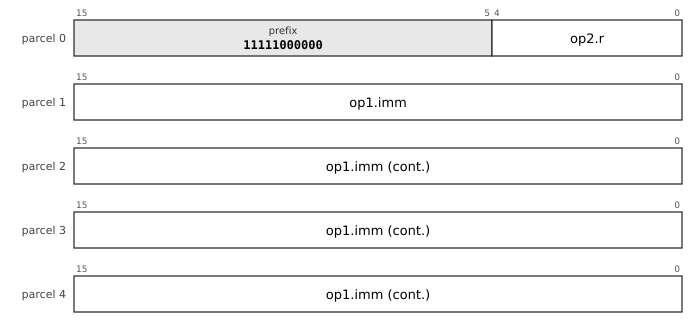

The chart is the leaf `MOVQ64-1`, MOVQ64, prefix `11001110100`. `op1` is `imm64s`: signed 64-bit immediate, -9223372036854775808 to 9223372036854775807. `op2` is `reg5`: register, 5 bits.

**All the layouts of this entry** (a chart for each, with its fields and the sub-opcode of each mnemonic, in [the bit layouts of every opcode](dictionary/by-encoding.md)): [`MOVQ64-1`](dictionary/by-encoding.md#MOVQ64-1), [`LDF-B28-1`](dictionary/by-encoding.md#LDF-B28-1), [`LDF-X22-1`](dictionary/by-encoding.md#LDF-X22-1), [`LDF-PI12-1`](dictionary/by-encoding.md#LDF-PI12-1), [`LDF-PD12-1`](dictionary/by-encoding.md#LDF-PD12-1), [`LDF-PC32-1`](dictionary/by-encoding.md#LDF-PC32-1), [`LDF-A32-1`](dictionary/by-encoding.md#LDF-A32-1), [`LDFI-I32-1`](dictionary/by-encoding.md#LDFI-I32-1), [`STF-B28-1`](dictionary/by-encoding.md#STF-B28-1), [`STF-X22-1`](dictionary/by-encoding.md#STF-X22-1), [`STF-PI12-1`](dictionary/by-encoding.md#STF-PI12-1), [`STF-PD12-1`](dictionary/by-encoding.md#STF-PD12-1), [`STF-PC32-1`](dictionary/by-encoding.md#STF-PC32-1), [`STF-A32-1`](dictionary/by-encoding.md#STF-A32-1), [`DPF-D28-1`](dictionary/by-encoding.md#DPF-D28-1), [`RRF-1`](dictionary/by-encoding.md#RRF-1), [`RRF5-1`](dictionary/by-encoding.md#RRF5-1), [`RR5-1`](dictionary/by-encoding.md#RR5-1), [`LDHHH3-a-1`](dictionary/by-encoding.md#LDHHH3-a-1), [`STHHH3-a-1`](dictionary/by-encoding.md#STHHH3-a-1), [`STSPh4-a-1`](dictionary/by-encoding.md#STSPh4-a-1), [`LDSPh5-a-1`](dictionary/by-encoding.md#LDSPh5-a-1), [`IMMh47-a-1`](dictionary/by-encoding.md#IMMh47-a-1), [`STBs8-a-1`](dictionary/by-encoding.md#STBs8-a-1), [`LDBs10-a-1`](dictionary/by-encoding.md#LDBs10-a-1), [`LDX0-a-1`](dictionary/by-encoding.md#LDX0-a-1), [`STX0-a-1`](dictionary/by-encoding.md#STX0-a-1), [`LDPC14-a-1`](dictionary/by-encoding.md#LDPC14-a-1), [`LDI12-a-1`](dictionary/by-encoding.md#LDI12-a-1), [`LDBu12H-a-1`](dictionary/by-encoding.md#LDBu12H-a-1), [`STBu12H-a-1`](dictionary/by-encoding.md#STBu12H-a-1), [`LDX6H-a-1`](dictionary/by-encoding.md#LDX6H-a-1), [`STX6H-a-1`](dictionary/by-encoding.md#STX6H-a-1), [`LDPC16H-a-1`](dictionary/by-encoding.md#LDPC16H-a-1), [`LDI18H-a-1`](dictionary/by-encoding.md#LDI18H-a-1), [`LDFI-I32-2`](dictionary/by-encoding.md#LDFI-I32-2), [`STHHH1-b-1`](dictionary/by-encoding.md#STHHH1-b-1), [`LDBs6-b-1`](dictionary/by-encoding.md#LDBs6-b-1), [`STBs6-b-1`](dictionary/by-encoding.md#STBs6-b-1), [`LDBu6-b-1`](dictionary/by-encoding.md#LDBu6-b-1), [`LDX0-b-1`](dictionary/by-encoding.md#LDX0-b-1), [`STX0-b-1`](dictionary/by-encoding.md#STX0-b-1), [`STBs8H-b-1`](dictionary/by-encoding.md#STBs8H-b-1), [`LDBu12H-b-1`](dictionary/by-encoding.md#LDBu12H-b-1), [`STBu12H-b-1`](dictionary/by-encoding.md#STBu12H-b-1), [`LDX4H-b-1`](dictionary/by-encoding.md#LDX4H-b-1), [`STX6H-b-1`](dictionary/by-encoding.md#STX6H-b-1), [`LDPC14H-b-1`](dictionary/by-encoding.md#LDPC14H-b-1), [`LDI12-d-2`](dictionary/by-encoding.md#LDI12-d-2).

**Operation**

```
size = 8 (MOVQ), 4 (MOVL), 2 (MOVW) or 1 (MOVB) bytes
load :  Rd ← sext(M[EA(rm)], size)          ; len = 00: Rd ← sext(Rs[8×size-1:0])
store:  M[EA(rm)] ← Rs[8×size-1:0]          ; len = 00: Rd ← sext(Rs[8×size-1:0])
```

**Exceptions** Memory operand: page fault, protection fault or bus error (a read of non-existent memory is a precise abort with cause `BUSFAULT`); there is no alignment fault, and an access that crosses a page changes nothing when either page faults (9.6.5). Every such fault is precise and the instruction restarts after it, because the register update of an auto-increment or auto-decrement mode is held until the instruction retires.

A register is always written in full: a narrow load sign-extends to 64 bits and there is no partial-register write anywhere. The register-to-register forms of the sized moves are the conversion set: `MOVB R1, R2` sign-extends the low byte of `R1` into `R2`.

**Why it is here.** A 64-bit constant otherwise comes from the literal pool. The mnemonic does not say how long the instruction is: `MOVQ #imm, Rd` is the one word for every constant, and the assembler picks the two-, four-, six- or ten-byte form. The alignment fault had been the one trap of an ordinary access, and it had been useful as a free tag check of tagged pointers; the explicit tag branches are the check now. ARM and x86 do the same (*unverified*); RISC-V leaves it to the implementation, which is the opposite of one binary for every core, so it is not the precedent.

**Cf.** 6.7 for the memory type that decides whether the access is cached; 6.4 for what a faulting access leaves behind.

<a id="w-movq"></a>
#### MOVQ

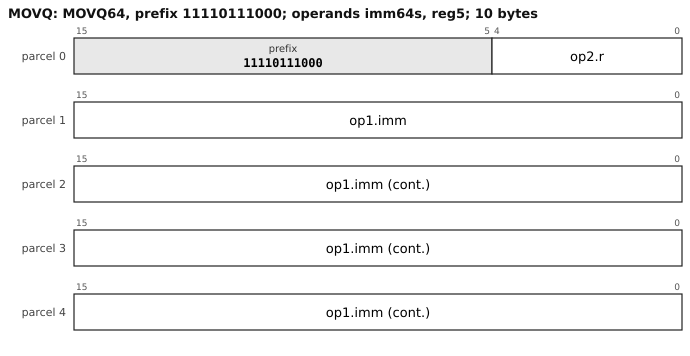

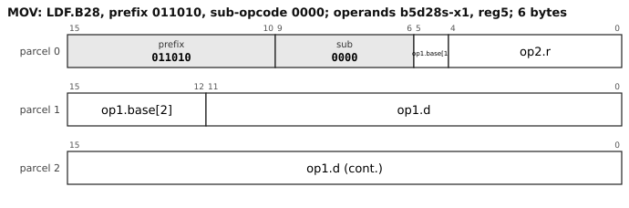


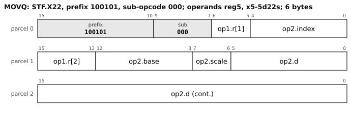


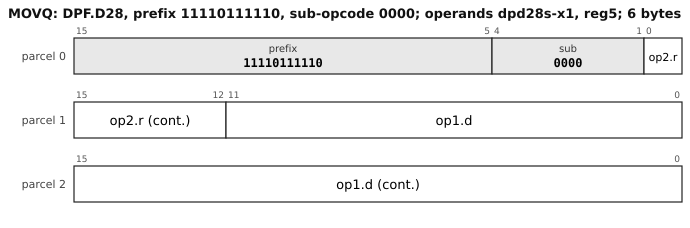


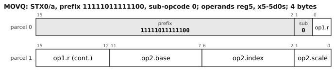


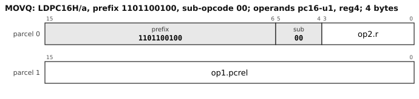


```
MOVQ rm, Rd
MOVQ Rs, rm
MOVQ #imm, Rd
```

Operation and exceptions as for the entry MOV above; 35 layout forms, each a chart of its own (above).

<a id="w-movl"></a>
#### MOVL


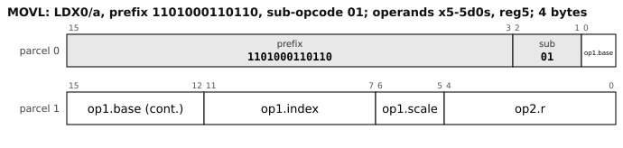


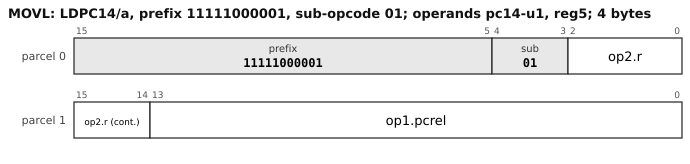


```
MOVL, MOVW, MOVB likewise
```

Operation and exceptions as for the entry MOV above; 31 layout forms, each a chart of its own (above).

<a id="w-movw"></a>
#### MOVW


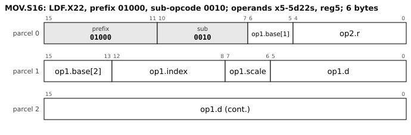

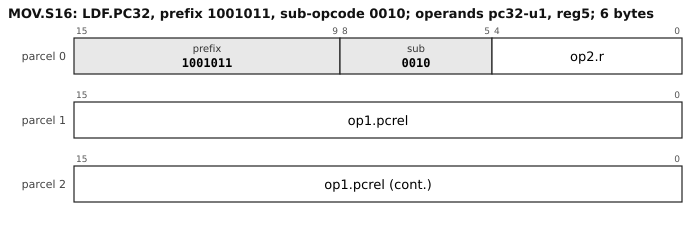


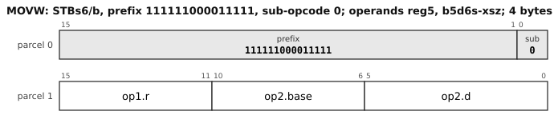


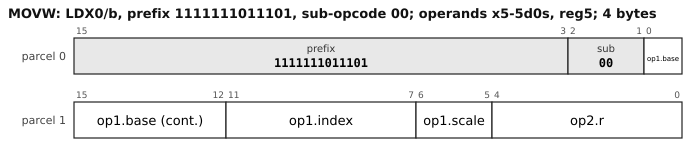


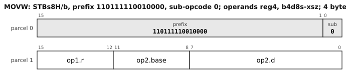


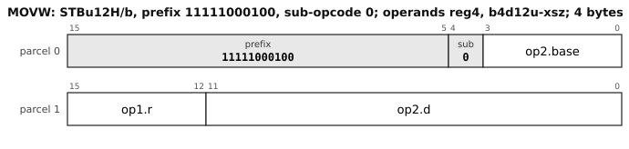

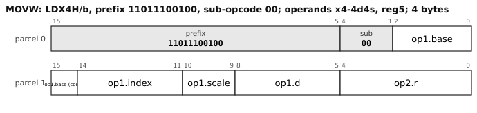

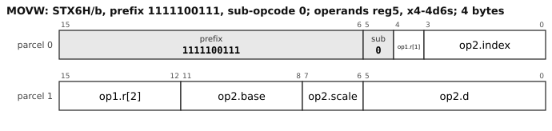


Operation and exceptions as for the entry MOV above; 28 layout forms, each a chart of its own (above).

<a id="w-movb"></a>
#### MOVB


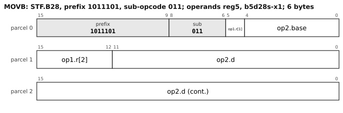


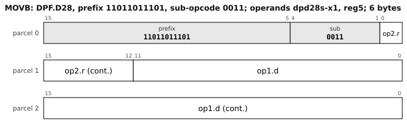


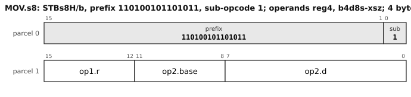


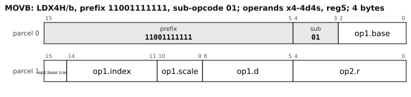


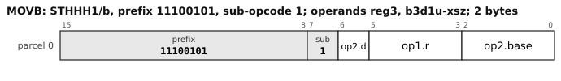

Operation and exceptions as for the entry MOV above; 29 layout forms, each a chart of its own (above).


### MOVZ: Move zero-extended (32, 16 and 8 bits)

**Mnemonics:** `MOVZL`, `MOVZW`, `MOVZB`

**Syntax**

```
MOVZL rm, Rd
MOVZW rm, Rd
MOVZB rm, Rd
```

**Encoding**

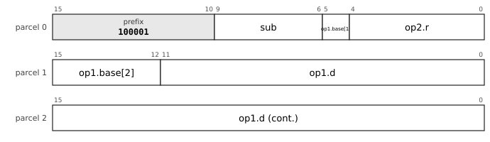

The chart is the leaf `LDF-B28-1`, LDF.B28, prefix `011010`. `op1` is `b5d28s-x1`: memory at base register, 5 bits + signed 28-bit displacement times 1, -134217728 to 134217727 bytes. `op2` is `reg5`: register, 5 bits. `sub` (4 bits) selects the mnemonic: `movq` 0000, `movl` 0001, `movw` 0010, `movb` 0011, `movzl` 0100, `movzw` 0101, `movzb` 0110, `add` 0111, `sub` 1000, `bic` 1001, `bis` 1010, `xor` 1011, `and` 1100, `mul` 1101, `mulh` 1110, `shl` 1111.

**All the layouts of this entry** (a chart for each, with its fields and the sub-opcode of each mnemonic, in [the bit layouts of every opcode](dictionary/by-encoding.md)): [`LDF-B28-1`](dictionary/by-encoding.md#LDF-B28-1), [`LDF-X22-1`](dictionary/by-encoding.md#LDF-X22-1), [`LDF-PI12-1`](dictionary/by-encoding.md#LDF-PI12-1), [`LDF-PD12-1`](dictionary/by-encoding.md#LDF-PD12-1), [`LDF-PC32-1`](dictionary/by-encoding.md#LDF-PC32-1), [`LDF-A32-1`](dictionary/by-encoding.md#LDF-A32-1), [`LDFI-I32-2`](dictionary/by-encoding.md#LDFI-I32-2), [`DPF-D28-1`](dictionary/by-encoding.md#DPF-D28-1), [`RRF-1`](dictionary/by-encoding.md#RRF-1), [`RRF5-1`](dictionary/by-encoding.md#RRF5-1), [`LDBs6-b-1`](dictionary/by-encoding.md#LDBs6-b-1), [`LDBu6-b-1`](dictionary/by-encoding.md#LDBu6-b-1), [`LDX0-b-1`](dictionary/by-encoding.md#LDX0-b-1), [`LDBu12H-b-1`](dictionary/by-encoding.md#LDBu12H-b-1), [`LDX4H-b-1`](dictionary/by-encoding.md#LDX4H-b-1), [`LDPC14H-b-1`](dictionary/by-encoding.md#LDPC14H-b-1), [`LDFI-I32-3`](dictionary/by-encoding.md#LDFI-I32-3), [`LDHHH3-a-1`](dictionary/by-encoding.md#LDHHH3-a-1), [`LDSPh5-a-1`](dictionary/by-encoding.md#LDSPh5-a-1), [`LDBs10-a-1`](dictionary/by-encoding.md#LDBs10-a-1), [`LDX0-a-1`](dictionary/by-encoding.md#LDX0-a-1), [`LDPC14-a-1`](dictionary/by-encoding.md#LDPC14-a-1), [`LDBu12H-a-1`](dictionary/by-encoding.md#LDBu12H-a-1), [`LDX6H-a-1`](dictionary/by-encoding.md#LDX6H-a-1), [`LDPC16H-a-1`](dictionary/by-encoding.md#LDPC16H-a-1).

**Operation**

```
Rd ← zext(M[EA(rm)], size)      ; len = 00: Rd ← zext(Rs[8×size-1:0])
```

**Exceptions** Memory operand: page fault, protection fault or bus error (a read of non-existent memory is a precise abort with cause `BUSFAULT`); there is no alignment fault, and an access that crosses a page changes nothing when either page faults (9.6.5). Every such fault is precise and the instruction restarts after it, because the register update of an auto-increment or auto-decrement mode is held until the instruction retires.

There is no zero-extending 64-bit move (it would be `MOVQ`). The register-to-register forms are the zero-extending half of the conversion set.

<a id="w-movzl"></a>
#### MOVZL


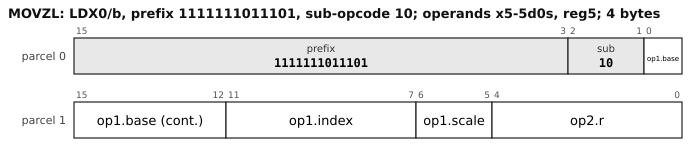


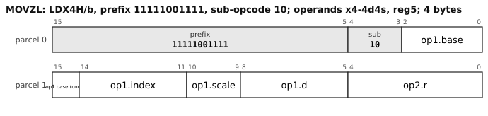


```
MOVZL rm, Rd
```

Operation and exceptions as for the entry MOVZ above; 16 layout forms, each a chart of its own (above).

<a id="w-movzw"></a>
#### MOVZW


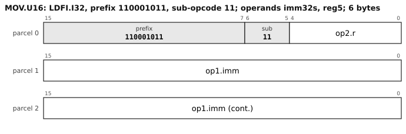


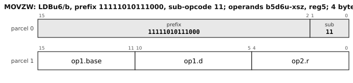


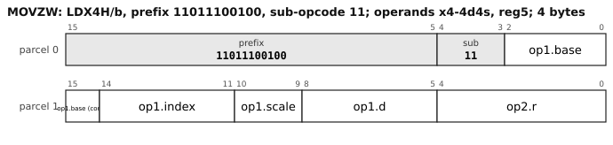


```
MOVZW rm, Rd
```

Operation and exceptions as for the entry MOVZ above; 16 layout forms, each a chart of its own (above).

<a id="w-movzb"></a>
#### MOVZB


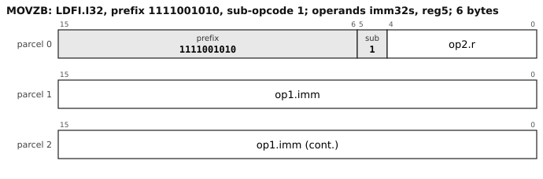


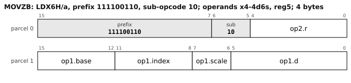


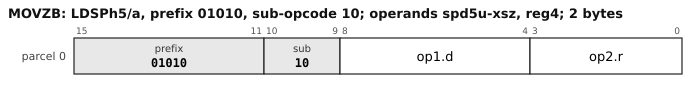

```
MOVZB rm, Rd
```

Operation and exceptions as for the entry MOVZ above; 18 layout forms, each a chart of its own (above).


<a id="w-lea"></a>
### LEA: Load effective address


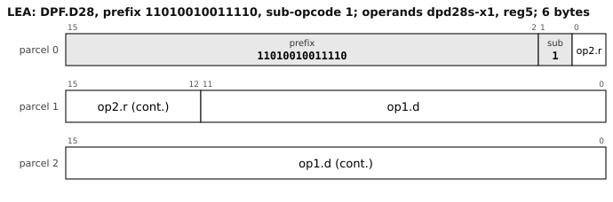


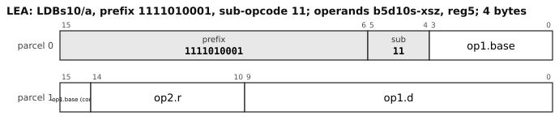


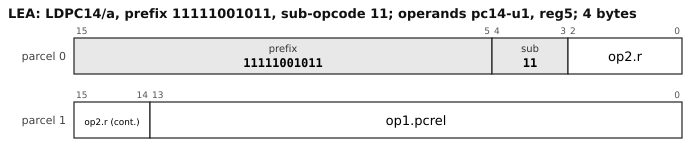


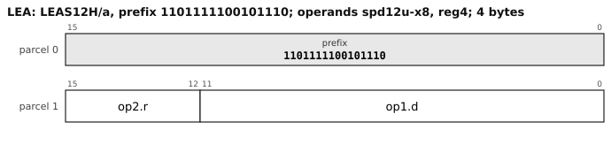


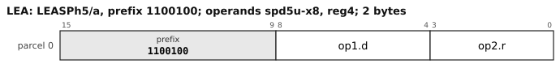

**Mnemonics:** `LEA`

**Syntax**

```
LEA d(Rn), Rd
LEA d(PC), Rd
LEA d(Rn)(Rx×s), Rd
```

**Encoding**

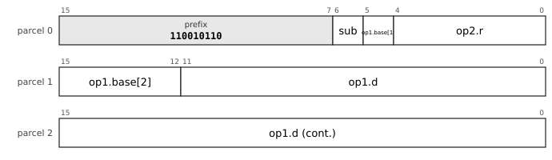

The chart is the leaf `LDF-B28-3`, LDF.B28, prefix `110000110`. `op1` is `b5d28s-x1`: memory at base register, 5 bits + signed 28-bit displacement times 1, -134217728 to 134217727 bytes. `op2` is `reg5`: register, 5 bits. `sub` (1 bit) selects the mnemonic: `fmul` 0, `lea` 1.

**All the layouts of this entry** (a chart for each, with its fields and the sub-opcode of each mnemonic, in [the bit layouts of every opcode](dictionary/by-encoding.md)): [`LDF-B28-3`](dictionary/by-encoding.md#LDF-B28-3), [`LDF-X22-3`](dictionary/by-encoding.md#LDF-X22-3), [`LDF-PI12-3`](dictionary/by-encoding.md#LDF-PI12-3), [`LDF-PD12-3`](dictionary/by-encoding.md#LDF-PD12-3), [`LDF-PC32-3`](dictionary/by-encoding.md#LDF-PC32-3), [`LDF-A32-3`](dictionary/by-encoding.md#LDF-A32-3), [`DPF-D28-3`](dictionary/by-encoding.md#DPF-D28-3), [`LDHHH3-a-1`](dictionary/by-encoding.md#LDHHH3-a-1), [`LDSPh5-a-1`](dictionary/by-encoding.md#LDSPh5-a-1), [`LEASPh5-a-1`](dictionary/by-encoding.md#LEASPh5-a-1), [`LDBs10-a-1`](dictionary/by-encoding.md#LDBs10-a-1), [`LDX0-a-1`](dictionary/by-encoding.md#LDX0-a-1), [`LDPC14-a-1`](dictionary/by-encoding.md#LDPC14-a-1), [`LDBu12H-a-1`](dictionary/by-encoding.md#LDBu12H-a-1), [`LEAS12H-a-1`](dictionary/by-encoding.md#LEAS12H-a-1), [`LDX6H-a-1`](dictionary/by-encoding.md#LDX6H-a-1), [`LDPC16H-a-1`](dictionary/by-encoding.md#LDPC16H-a-1).

**Operation**

```
Rd ← EA(rm)          ; no memory access
```

**Exceptions** The operand must name memory (a register or an immediate is not a form). No memory access is made, so the instruction takes no memory fault. A reserved encoding aborts with the illegal-instruction vector.

`LEA 0(PC), Rd` is how the program counter is read: it puts the address of the `LEA` itself in `Rd`. The base of every PC-relative displacement is the address of the first parcel of the instruction.

**Why it is here.** The PDP-11 and the VAX made the program counter a register (R7, R15). Here the program counter is kept out of the register file, because every register write would then be a potential branch, and a read-only view of it (R7 as a view of the PC) is refused, because it would fix for ever *which* PC is meant (ARM32 is stuck with `PC+8`). `LEA 0(PC), Rn` gives the capability without the commitment: the address of the instruction itself, in one instruction. The same instruction forms any address PC-relatively, which is what makes position-independent code free (section 9.16).


<a id="w-mov2"></a>
### MOV2: Two register moves


**Mnemonics:** `MOV2`

**Syntax**

```
MOV2 Ra, Rb, Rc, Rd
```

**Encoding**


The chart is the leaf `FX-MOV2-1`, FX.MOV2, prefix `0011`. `op1` is `reg3`: register, 3 bits (an index into the hot-register table). `op2` is `reg3`: register, 3 bits (an index into the hot-register table). `op3` is `reg3`: register, 3 bits (an index into the hot-register table). `op4` is `reg3`: register, 3 bits (an index into the hot-register table).

**All the layouts of this entry** (a chart for each, with its fields and the sub-opcode of each mnemonic, in [the bit layouts of every opcode](dictionary/by-encoding.md)): [`FX-MOV2-1`](dictionary/by-encoding.md#FX-MOV2-1).

**Operation**

```
Rb ← Ra
Rd ← Rc           ; in this order
```

**Exceptions** None.

`MOVQ Ra, Rb` followed by `MOVQ Rc, Rd`, fused. The four operands are 3-bit fields: only the eight hot registers (`R0 R1 R8 R2 SP R3 R9 R10`, the ABI table of the encoding) can be named, and the instruction takes one sixteenth of the first-parcel space, which is why the grammar gives it a prefix of four bits. If `Rb` is `Rc` the second move reads the new value, as two instructions would.

**Why it is here.** I decided the four fused pairs (`movcall`, `popmret`, `popret`, `mov2`) and left the fusing to the compiler: the assembler never fuses. The reason is the measurement of `docs/encoding-proposal.md` section 8 (static size of the training corpus, in the encoding): `MOVQ Ra, Rb` followed by `MOVQ Rc, Rd` occurs 6,742 times and saves 0.50%, the smallest gain of the four and the dearest in code space: four 3-bit register fields use one sixteenth of the first-parcel space and can name only the eight hot registers. The encoding study lists both as costs, and one instruction that writes two registers (the rename width of an out-of-order core).

**Cf.** Appendix C (the hot-register tables).


### MOVUSER: User-qualified load and store

**Mnemonics:** `MOVQ.U`, `MOVL.U`, `MOVW.U`, `MOVB.U`, `MOVZL.U`, `MOVZW.U`, `MOVZB.U`

**Syntax**

```
MOVQ.U d(Rn), Rd
MOVQ.U Rs, d(Rn)
MOVL.U ..., MOVW.U ..., MOVB.U ...
MOVZL.U ..., MOVZW.U ..., MOVZB.U ...    ; loads only
```

**Encoding**


The chart is the leaf `LDU-B28-1`, LDU.B28, prefix `10110001`. `op1` is `b5d28s-x1`: memory at base register, 5 bits + signed 28-bit displacement times 1, -134217728 to 134217727 bytes. `op2` is `reg5`: register, 5 bits. `sub` (2 bits) selects the mnemonic: `movq.u` 00, `movl.u` 01, `movw.u` 10, `movb.u` 11.

**All the layouts of this entry** (a chart for each, with its fields and the sub-opcode of each mnemonic, in [the bit layouts of every opcode](dictionary/by-encoding.md)): [`LDU-B28-1`](dictionary/by-encoding.md#LDU-B28-1), [`STU-B28-1`](dictionary/by-encoding.md#STU-B28-1), [`LDU-B12-1`](dictionary/by-encoding.md#LDU-B12-1), [`STU-B12-1`](dictionary/by-encoding.md#STU-B12-1), [`LDU-X6-1`](dictionary/by-encoding.md#LDU-X6-1), [`STU-X6-1`](dictionary/by-encoding.md#STU-X6-1), [`LDU-B28-2`](dictionary/by-encoding.md#LDU-B28-2), [`LDU-B12-2`](dictionary/by-encoding.md#LDU-B12-2), [`LDU-X6-2`](dictionary/by-encoding.md#LDU-X6-2), [`LDU-B28-3`](dictionary/by-encoding.md#LDU-B28-3), [`LDU-B12-3`](dictionary/by-encoding.md#LDU-B12-3), [`LDU-X6-3`](dictionary/by-encoding.md#LDU-X6-3).

**Operation**

```
the access of MOVQ, MOVL, MOVW, MOVB and MOVZ* with the operand checked as a user-mode access:
the page must be present, have U = 1, and permit R (a load) or W (a store); a kernel page takes the protection abort
```

**Exceptions** The faults of the access, as a user-mode access. In user mode the encoding is a privileged-instruction abort.

Item 18 of `docs/study-proposals.md`: user access is an attribute of one memory operand, so it cannot outlive the instruction, cannot leak across an interrupt, and `RTI` re-executes the instruction with the attribute. I accepted four of the five leanings: a fixup table in place of `pcb_onfault`, the `.U` spelling, `ECAUSE` bit 15 to say that the access was user-qualified, and the atomics taking the user form once the operand placement of `ATOM` is fixed; the fifth, keeping a status bit and two instructions beside `.U`, is gone, because one mechanism that cannot be left open is enough. A kernel-mode data access to a user page that is not `.U` is always a protection fault.

**Why it is here.** Copying between the kernel and the user is where kernels pay for the user-memory guard. x86 opens a window with `STAC` and closes it with `CLAC` (35 and 53 sites in the kernel-assembly corpus), and a forgotten `CLAC` on an error path is the bug class; Arm's `LDTR` and `STTR` make the access itself unprivileged (52 sites), but only for plain loads and stores. Item 18 of the study makes user access an attribute of one operand, so that no window exists to leave open and the range check of the copy routines (`addr + len` against the top of the user half) disappears into the hardware: a kernel address faults at the first byte. I accepted four of its five leanings; the fifth, keeping `PSW.UA`, `STUA` and `CLUA` beside the new qualifier, I gave up on 2026-11-25: one mechanism is enough, and it is the one that cannot be left open.

**Cf.** 6.10 (the user-memory guard), docs/study-proposals.md item 18.

<a id="w-movq-u"></a>
#### MOVQ.U


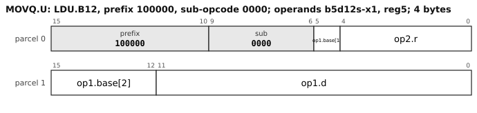


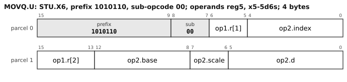

```
MOVQ.U d(Rn), Rd
MOVQ.U Rs, d(Rn)
```

Operation and exceptions as for the entry MOVUSER above; 6 layout forms, each a chart of its own (above).

<a id="w-movl-u"></a>
#### MOVL.U

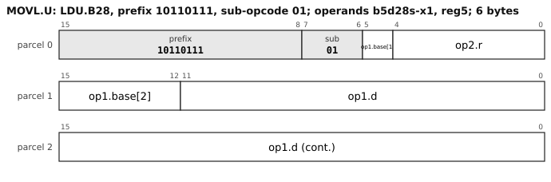

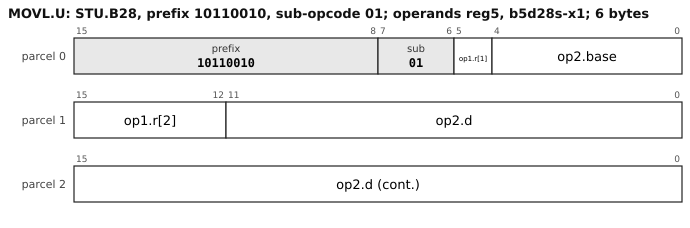


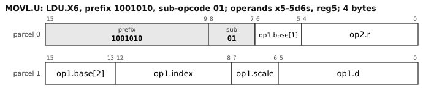

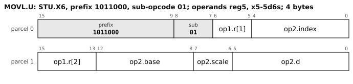

```
MOVL.U ..., MOVW.U ..., MOVB.U ...
```

Operation and exceptions as for the entry MOVUSER above; 6 layout forms, each a chart of its own (above).

<a id="w-movw-u"></a>
#### MOVW.U


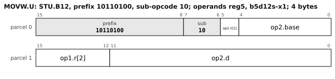

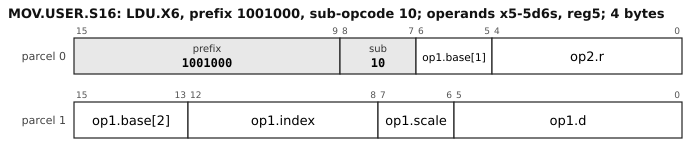

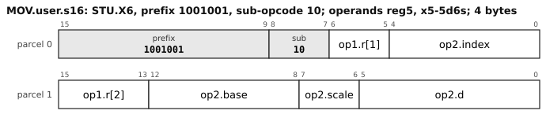

Operation and exceptions as for the entry MOVUSER above; 6 layout forms, each a chart of its own (above).

<a id="w-movb-u"></a>
#### MOVB.U

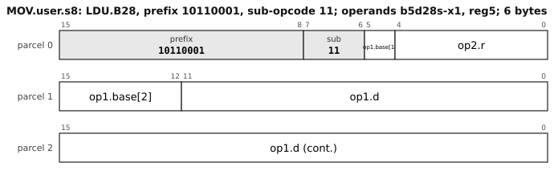

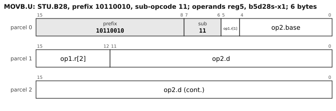


Operation and exceptions as for the entry MOVUSER above; 6 layout forms, each a chart of its own (above).

<a id="w-movzl-u"></a>
#### MOVZL.U

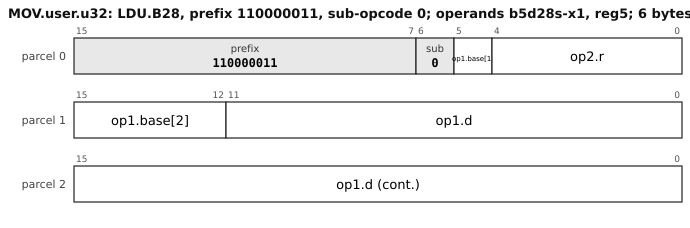

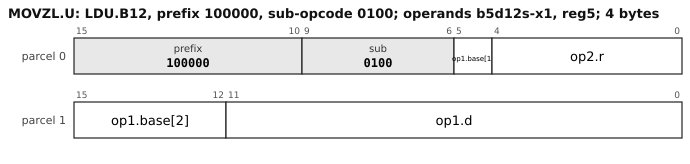


```
MOVZL.U ..., MOVZW.U ..., MOVZB.U ...
```

Operation and exceptions as for the entry MOVUSER above; 3 layout forms, each a chart of its own (above).

<a id="w-movzw-u"></a>
#### MOVZW.U


Operation and exceptions as for the entry MOVUSER above; 3 layout forms, each a chart of its own (above).

<a id="w-movzb-u"></a>
#### MOVZB.U


Operation and exceptions as for the entry MOVUSER above; 3 layout forms, each a chart of its own (above).


### MCPYU: User-qualified block copy

**Mnemonics:** `MCPY.UR`, `MCPY.UW`

**Syntax**

```
MCPY.UR Rd, Rs, Rn      ; the bytes read are user memory (copy-in)
MCPY.UW Rd, Rs, Rn      ; the bytes written are user memory (copy-out)
```

**Encoding**


The chart is the leaf `R3-1`, R3, prefix `1100101000`. `op1` is `reg5`: register, 5 bits. `op2` is `reg5`: register, 5 bits. `op3` is `reg5`: register, 5 bits. `xsub` selects the mnemonic.

**All the layouts of this entry** (a chart for each, with its fields and the sub-opcode of each mnemonic, in [the bit layouts of every opcode](dictionary/by-encoding.md)): [`R3-1`](dictionary/by-encoding.md#R3-1).

**Operation**

```
as MCPY, with the accesses of one side checked as user-mode accesses:
MCPY.UR: each byte is read with the privilege of user mode (the page must be present, have U = 1 and permit R) and written as any kernel access is
MCPY.UW: each byte is read as any kernel access is and written with the privilege of user mode (the page must have U = 1 and permit W)
```

**Exceptions** The faults of the accesses; a fault on the user side has bit 15 of `ECAUSE` set, as a `.U` move does. A plain `MCPY` of a user page is a protection fault.

The block copy of a copy-in (`MCPY.UR`) and of a copy-out (`MCPY.UW`): the user-memory guard is always on, and these two words are how a kernel block-copies to or from user memory. The registers are updated as for `MCPY`, so a fault leaves them at the byte that failed. There is no form with both sides user (a copy from a user page to a user page is not a kernel job) and none for `MMOV`, `MSET` and `MCMP`: a fill of user memory is a copy from a zero buffer.

**Why it is here.** The block copy is how a kernel copies a buffer, and it had no user-qualified form, which was the reason to keep the status bit and its two instructions. It has two now, one for each direction, because a copy-in reads user memory and writes kernel memory and a copy-out the other way round; a qualifier that said both sides were user would fault on the kernel side.

**Cf.** 6.10 (the user-memory guard).

<a id="w-mcpy-ur"></a>
#### MCPY.UR


```
MCPY.UR Rd, Rs, Rn
```

Operation and exceptions as for the entry MCPYU above; 1 layout form, each a chart of its own (above).

<a id="w-mcpy-uw"></a>
#### MCPY.UW


```
MCPY.UW Rd, Rs, Rn
```

Operation and exceptions as for the entry MCPYU above; 1 layout form, each a chart of its own (above).
<!-- /entries:9.6 -->

## 9.7 Integer arithmetic

*Cf. section 6.3 for the divide-by-zero vector (`DIV`, `DIVU`, `MOD`, `MODU`).*

**9.7.1** `ADD`, `SUB`, `MUL` and `MULH` are two bytes with register operands; `MULHU` (high half of an unsigned product), `DIV`, `DIVU`, `MOD` and `MODU` are in the arithmetic escape.

**9.7.2** There is no compare instruction that leaves its answer in a flag: `CBCC` compares and branches (9.10.5) and `SETCC` compares and writes 0 or 1 (9.7.5). In both the left operand is written first, `cblt Ra, Rb, L` branching when `Ra < Rb`.

**9.7.3** `ADD` and `SUB` write their result and nothing else. The carry out of an addition and the borrow of a subtraction are not kept anywhere: when a program wants one it computes it as a comparison, as 9.7.8 shows.

**9.7.4** `INC`, `DEC`, `NEG` and `CLR` are single-operand forms that work on a register or memory.

**9.7.5** `SETCC Ra, Rb, Rd` (or `SETCC Ra, #imm, Rd`) writes 1 into `Rd` if the comparison holds and 0 if it does not, for the ten conditions of the compare-and-branch: `SETEQ`, `SETNE`, `SETLT`, `SETLE`, `SETGT`, `SETGE` and the unsigned `SETCS` (lower, also `SETLO`), `SETCC` (higher or the same, also `SETHIS`), `SETHI` and `SETLOS`. It is how a comparison used as a value is written. The immediate is 8 bits, signed, and is sign-extended to 64 bits for the unsigned conditions too; the instruction is four bytes, and the destination may be one of the sources.

```
        setlt   r1, r2, r3      ; r3 = 1 if r1 < r2 (signed), else 0
        setlos  r1, #9, r4      ; r4 = 1 if r1 <= 9 as an unsigned number
```

**9.7.6** `ABS`, `MIN`, `MINU`, `MAX` and `MAXU` are assembler aliases, not native instructions: `ABS` is the absolute value, and the others the smaller or the larger of two registers, signed or unsigned.

**9.7.7** A range check on a register value, such as an array index, is made with `CBCC` (9.10.5; one unsigned compare tests `0 <= i < n`, because a negative index is a large unsigned number) or with the compare-and-trap words `CT<cc>` (9.14), which keep a table of check sites, with the trap-if-zero and the two-bound check `CHK2`; `ADDV`, `SUBV` and `MULV` check signed overflow.

**9.7.8** A number wider than a register is added a register at a time, and the carry out of one word must reach the next. On the PDP-11 every `ADD` left its carry in the `C` flag, and `ADC` (add carry) added that flag into the next word; a double-word addition `a1:a0 += b1:b0`, with `a1:a0` in `r3:r2` and `b1:b0` in `r5:r4`, was three instructions (the high words first, so that the carry the low words leave is the one `ADC` finds):

```
        add     r5, r3          / PDP-11: a1 += b1
        add     r4, r2          / a0 += b0, and C = the carry out of it
        adc     r3              / a1 += C
```

Here no instruction leaves a carry behind, so each carry is computed as a number. The carry out of `ADD Rb, Ra` (`Ra` := `Ra` + `Rb`) is 1 exactly when the new sum is lower than an addend, as unsigned numbers (a sum that wrapped past 2^64 is smaller than what was added), and `SETLO Ra, Rb, Rt` writes that 0 or 1 in `Rt` in one instruction (`CBLO Ra, Rb, L` branches on it instead). The same addition is four instructions (the carry out of the top word is not wanted, so none is computed):

```
        add     r4, r2          ; a0 += b0
        setlo   r2, r4, r6      ; t = 1 if that carried (the new a0 is lower than b0)
        add     r5, r3          ; a1 += b1
        add     r6, r3          ; a1 += t
```

For a third word, or when the carry out of the second is wanted, each word after the first adds the carry in first and then the other word, and ORs the two carries (each addition can carry, and the two cannot both do so):

```
        add     r7, r2          ; a_i += carry in (r7)
        setlo   r2, r7, r8      ; carry of that addition
        add     r4, r2          ; a_i += b_i
        setlo   r2, r4, r7      ; carry of that addition (r7 is free again)
        bis     r8, r7          ; carry out, in r7 to be the carry in of the next word
```

The borrow of a subtraction `SUB Rb, Ra` is the comparison made before it: `SETLO Ra, Rb, Rt` gives 1 when `Ra` is lower than `Rb`, unsigned, and then `SUB Rb, Ra` follows. `MULH` and `MULHU` give the high half of a product, which is the other part that multi-word multiplication needs.

*Commentary.* **Precedent.** `ADD`, `SUB`, `BIS`, `BIC` and the single-operand set are the PDP-11's, unchanged in name and meaning; the PDP-11's `CMP`, `TST`, `BIT`, `ADC` and `SBC` existed to set or read condition codes, which this machine does not have. The specification of RISC-V gives the same test for the carry out of an unsigned addition: the sum is compared with an addend and a branch is taken if it is lower. **Trade-offs.** A carry costs an extra instruction in a multi-word add where `ADC` was free, and multi-word arithmetic is rare. Divide is in the escape group, at four bytes, because compilers turn division by a constant into `MULH` plus a shift, so a real divide is rare. **Improvements.** The high-half multiply that bignum code needs is present; a second unsigned multiply is the same instruction as the first and is not provided. **Benefits.** `SETCC` replaces a branch around a move for the very common "store the truth value of a comparison", and gives the carry of an addition in one instruction; absolute value, minimum and maximum (as aliases) remove a compare-and-branch from small loops. **Modern comparables.** RISC-V has `MULH`, `MULHU` and `MULHSU`, and AArch64 `SMULH` and `UMULH`; x86 has a one-operand multiply that produces both halves; **Use.** `MULH` and `MULHU` are for multi-precision arithmetic and for division by constants; `SETLO` carries a multi-word add or subtract; `MIN`, `MAX` and `ABS` (aliases) appear under a tenth of a percent of compiled code but each replaces a branch. **Impact.** *Kernel:* `SETLO` carries multiword arithmetic for the kernel's 128-bit counters and for the bignum code in the base system. *Compiler:* `MULH` turns division by a constant into a multiply and a shift; `SETCC` materialises a comparison without a branch. *Hardware:* One adder on the carry chain; on an FPGA the multiplier is built from two to four multiplier blocks over four to eight cycles; the divide is a sequencer.

<!-- entries:9.7 -->
<a id="w-add"></a>
### ADD: Add


**Mnemonics:** `ADD`

**Syntax**

```
ADD rm, Rd
```

**Encoding**


The chart is the leaf `LDF-B28-1`, LDF.B28, prefix `011010`. `op1` is `b5d28s-x1`: memory at base register, 5 bits + signed 28-bit displacement times 1, -134217728 to 134217727 bytes. `op2` is `reg5`: register, 5 bits. `sub` (4 bits) selects the mnemonic: `movq` 0000, `movl` 0001, `movw` 0010, `movb` 0011, `movzl` 0100, `movzw` 0101, `movzb` 0110, `add` 0111, `sub` 1000, `bic` 1001, `bis` 1010, `xor` 1011, `and` 1100, `mul` 1101, `mulh` 1110, `shl` 1111.

**All the layouts of this entry** (a chart for each, with its fields and the sub-opcode of each mnemonic, in [the bit layouts of every opcode](dictionary/by-encoding.md)): [`LDF-B28-1`](dictionary/by-encoding.md#LDF-B28-1), [`LDF-X22-1`](dictionary/by-encoding.md#LDF-X22-1), [`LDF-PI12-1`](dictionary/by-encoding.md#LDF-PI12-1), [`LDF-PD12-1`](dictionary/by-encoding.md#LDF-PD12-1), [`LDF-PC32-1`](dictionary/by-encoding.md#LDF-PC32-1), [`LDF-A32-1`](dictionary/by-encoding.md#LDF-A32-1), [`LDFI-I32-1`](dictionary/by-encoding.md#LDFI-I32-1), [`DPF-D28-1`](dictionary/by-encoding.md#DPF-D28-1), [`RRF-1`](dictionary/by-encoding.md#RRF-1), [`RRF5-1`](dictionary/by-encoding.md#RRF5-1), [`SPADJF-1`](dictionary/by-encoding.md#SPADJF-1), [`RR5-1`](dictionary/by-encoding.md#RR5-1), [`IMMh44-b-1`](dictionary/by-encoding.md#IMMh44-b-1), [`SPADJ6-a-1`](dictionary/by-encoding.md#SPADJ6-a-1), [`LDBu8-c-1`](dictionary/by-encoding.md#LDBu8-c-1), [`LDX0-c-1`](dictionary/by-encoding.md#LDX0-c-1), [`LDI12-b-1`](dictionary/by-encoding.md#LDI12-b-1), [`LDBu10H-c-1`](dictionary/by-encoding.md#LDBu10H-c-1), [`LDPC16H-c-1`](dictionary/by-encoding.md#LDPC16H-c-1), [`LDI18H-b-1`](dictionary/by-encoding.md#LDI18H-b-1).

**Operation**

```
Rd ← Rd + rm
```

**Exceptions** Memory operand: page fault, protection fault or bus error (a read of non-existent memory is a precise abort with cause `BUSFAULT`); there is no alignment fault, and an access that crosses a page changes nothing when either page faults (9.6.5). Every such fault is precise and the instruction restarts after it, because the register update of an auto-increment or auto-decrement mode is held until the instruction retires.

All ALU operations are 64 bits, with no size field.


<a id="w-sub"></a>
### SUB: Subtract


**Mnemonics:** `SUB`

**Syntax**

```
SUB rm, Rd
```

**Encoding**


The chart is the leaf `LDF-B28-1`, LDF.B28, prefix `011010`. `op1` is `b5d28s-x1`: memory at base register, 5 bits + signed 28-bit displacement times 1, -134217728 to 134217727 bytes. `op2` is `reg5`: register, 5 bits. `sub` (4 bits) selects the mnemonic: `movq` 0000, `movl` 0001, `movw` 0010, `movb` 0011, `movzl` 0100, `movzw` 0101, `movzb` 0110, `add` 0111, `sub` 1000, `bic` 1001, `bis` 1010, `xor` 1011, `and` 1100, `mul` 1101, `mulh` 1110, `shl` 1111.

**All the layouts of this entry** (a chart for each, with its fields and the sub-opcode of each mnemonic, in [the bit layouts of every opcode](dictionary/by-encoding.md)): [`LDF-B28-1`](dictionary/by-encoding.md#LDF-B28-1), [`LDF-X22-1`](dictionary/by-encoding.md#LDF-X22-1), [`LDF-PI12-1`](dictionary/by-encoding.md#LDF-PI12-1), [`LDF-PD12-1`](dictionary/by-encoding.md#LDF-PD12-1), [`LDF-PC32-1`](dictionary/by-encoding.md#LDF-PC32-1), [`LDF-A32-1`](dictionary/by-encoding.md#LDF-A32-1), [`LDFI-I32-1`](dictionary/by-encoding.md#LDFI-I32-1), [`DPF-D28-1`](dictionary/by-encoding.md#DPF-D28-1), [`RRF-1`](dictionary/by-encoding.md#RRF-1), [`RRF5-1`](dictionary/by-encoding.md#RRF5-1), [`SPADJF-1`](dictionary/by-encoding.md#SPADJF-1), [`RR5-1`](dictionary/by-encoding.md#RR5-1), [`IMMh44-b-1`](dictionary/by-encoding.md#IMMh44-b-1), [`SPADJ6-a-1`](dictionary/by-encoding.md#SPADJ6-a-1), [`LDBu8-c-1`](dictionary/by-encoding.md#LDBu8-c-1), [`LDX0-c-1`](dictionary/by-encoding.md#LDX0-c-1), [`LDI12-b-1`](dictionary/by-encoding.md#LDI12-b-1), [`LDBu10H-c-1`](dictionary/by-encoding.md#LDBu10H-c-1), [`LDPC16H-c-1`](dictionary/by-encoding.md#LDPC16H-c-1), [`LDI18H-b-1`](dictionary/by-encoding.md#LDI18H-b-1).

**Operation**

```
Rd ← Rd - rm
```

**Exceptions** Memory operand: page fault, protection fault or bus error (a read of non-existent memory is a precise abort with cause `BUSFAULT`); there is no alignment fault, and an access that crosses a page changes nothing when either page faults (9.6.5). Every such fault is precise and the instruction restarts after it, because the register update of an auto-increment or auto-decrement mode is held until the instruction retires.


<a id="w-mul"></a>
<a id="w-mulu"></a>
### MUL: Multiply, low 64 bits


**Mnemonics:** `MUL`  (aliases: `MULU`)

**Syntax**

```
MUL rm, Rd
```

**Encoding**


The chart is the leaf `LDF-B28-1`, LDF.B28, prefix `011010`. `op1` is `b5d28s-x1`: memory at base register, 5 bits + signed 28-bit displacement times 1, -134217728 to 134217727 bytes. `op2` is `reg5`: register, 5 bits. `sub` (4 bits) selects the mnemonic: `movq` 0000, `movl` 0001, `movw` 0010, `movb` 0011, `movzl` 0100, `movzw` 0101, `movzb` 0110, `add` 0111, `sub` 1000, `bic` 1001, `bis` 1010, `xor` 1011, `and` 1100, `mul` 1101, `mulh` 1110, `shl` 1111.

**All the layouts of this entry** (a chart for each, with its fields and the sub-opcode of each mnemonic, in [the bit layouts of every opcode](dictionary/by-encoding.md)): [`LDF-B28-1`](dictionary/by-encoding.md#LDF-B28-1), [`LDF-X22-1`](dictionary/by-encoding.md#LDF-X22-1), [`LDF-PI12-1`](dictionary/by-encoding.md#LDF-PI12-1), [`LDF-PD12-1`](dictionary/by-encoding.md#LDF-PD12-1), [`LDF-PC32-1`](dictionary/by-encoding.md#LDF-PC32-1), [`LDF-A32-1`](dictionary/by-encoding.md#LDF-A32-1), [`LDFI-I32-1`](dictionary/by-encoding.md#LDFI-I32-1), [`DPF-D28-1`](dictionary/by-encoding.md#DPF-D28-1), [`RRF-1`](dictionary/by-encoding.md#RRF-1), [`RRF5-1`](dictionary/by-encoding.md#RRF5-1), [`LDI12-d-1`](dictionary/by-encoding.md#LDI12-d-1), [`LDPC12H-d-1`](dictionary/by-encoding.md#LDPC12H-d-1), [`LDI14H-c-1`](dictionary/by-encoding.md#LDI14H-c-1).

**Operation**

```
Rd ← (Rd × rm)[63:0]         ; sign-agnostic
```

**Exceptions** Memory operand: page fault, protection fault or bus error (a read of non-existent memory is a precise abort with cause `BUSFAULT`); there is no alignment fault, and an access that crosses a page changes nothing when either page faults (9.6.5). Every such fault is precise and the instruction restarts after it, because the register update of an auto-increment or auto-decrement mode is held until the instruction retires.

The low 64 bits of a two's-complement product are the same whether the operands are read as signed or unsigned, so there is one low-half multiply. The mnemonic `MULU` is an alias of `MUL`. The high half is `MULH` (signed) and `MULHU` (unsigned).

<a id="w-mulu"></a>
**`MULU`** is an alias of `MUL`: the assembler writes it as that word.


<a id="w-mulh"></a>
### MULH: Multiply, high 64 bits, signed


**Mnemonics:** `MULH`

**Syntax**

```
MULH rm, Rd
```

**Encoding**


The chart is the leaf `LDF-B28-1`, LDF.B28, prefix `011010`. `op1` is `b5d28s-x1`: memory at base register, 5 bits + signed 28-bit displacement times 1, -134217728 to 134217727 bytes. `op2` is `reg5`: register, 5 bits. `sub` (4 bits) selects the mnemonic: `movq` 0000, `movl` 0001, `movw` 0010, `movb` 0011, `movzl` 0100, `movzw` 0101, `movzb` 0110, `add` 0111, `sub` 1000, `bic` 1001, `bis` 1010, `xor` 1011, `and` 1100, `mul` 1101, `mulh` 1110, `shl` 1111.

**All the layouts of this entry** (a chart for each, with its fields and the sub-opcode of each mnemonic, in [the bit layouts of every opcode](dictionary/by-encoding.md)): [`LDF-B28-1`](dictionary/by-encoding.md#LDF-B28-1), [`LDF-X22-1`](dictionary/by-encoding.md#LDF-X22-1), [`LDF-PI12-1`](dictionary/by-encoding.md#LDF-PI12-1), [`LDF-PD12-1`](dictionary/by-encoding.md#LDF-PD12-1), [`LDF-PC32-1`](dictionary/by-encoding.md#LDF-PC32-1), [`LDF-A32-1`](dictionary/by-encoding.md#LDF-A32-1), [`LDFI-I32-1`](dictionary/by-encoding.md#LDFI-I32-1), [`DPF-D28-1`](dictionary/by-encoding.md#DPF-D28-1), [`RRF-1`](dictionary/by-encoding.md#RRF-1), [`RRF5-1`](dictionary/by-encoding.md#RRF5-1), [`LDPC12H-d-1`](dictionary/by-encoding.md#LDPC12H-d-1).

**Operation**

```
Rd ← (sext(Rd) × sext(rm))[127:64]
```

**Exceptions** Memory operand: page fault, protection fault or bus error (a read of non-existent memory is a precise abort with cause `BUSFAULT`); there is no alignment fault, and an access that crosses a page changes nothing when either page faults (9.6.5). Every such fault is precise and the instruction restarts after it, because the register update of an auto-increment or auto-decrement mode is held until the instruction retires.

With `MULH`, division by a constant is a multiply by a reciprocal and a shift, which is what compilers emit.

**Why it is here.** The low 64 bits of a two's-complement product are identical signed or unsigned, so a second multiply (`MULU`) would duplicate `MUL`; what the architecture needs in that place is the *high* half of the product. Without it a 64 by 64 to 128-bit multiply, every bignum multiply, 128-bit fixed point and divide-by-a-constant by multiplying by the reciprocal are impossible. `MULH` is that instruction. It is also why a divide is rare in compiled code: compilers turn division by a constant into `MULH` and a shift.


### ADDM: ALU operation with a memory destination

**Mnemonics:** `ADDM`, `SUBM`, `BICM`, `BISM`

**Syntax**

```
ADDM Rs, rm
SUBM Rs, rm
BICM Rs, rm
BISM Rs, rm
```

**Encoding**


The chart is the leaf `STF-B28-1`, STF.B28, prefix `1001110`. `op1` is `reg5`: register, 5 bits. `op2` is `b5d28s-x1`: memory at base register, 5 bits + signed 28-bit displacement times 1, -134217728 to 134217727 bytes. `sub` (3 bits) selects the mnemonic: `movq` 000, `movl` 001, `movw` 010, `movb` 011, `addm` 100, `subm` 101, `bicm` 110, `bism` 111.

**All the layouts of this entry** (a chart for each, with its fields and the sub-opcode of each mnemonic, in [the bit layouts of every opcode](dictionary/by-encoding.md)): [`STF-B28-1`](dictionary/by-encoding.md#STF-B28-1), [`STF-X22-1`](dictionary/by-encoding.md#STF-X22-1), [`STF-PI12-1`](dictionary/by-encoding.md#STF-PI12-1), [`STF-PD12-1`](dictionary/by-encoding.md#STF-PD12-1), [`STF-PC32-1`](dictionary/by-encoding.md#STF-PC32-1), [`STF-A32-1`](dictionary/by-encoding.md#STF-A32-1).

**Operation**

```
ADDM: M[EA] ← M[EA] + Rs
SUBM: M[EA] ← M[EA] - Rs
BICM: M[EA] ← M[EA] AND NOT Rs
BISM: M[EA] ← M[EA] OR Rs
```

**Exceptions** Memory operand: page fault, protection fault or bus error (a read of non-existent memory is a precise abort with cause `BUSFAULT`); there is no alignment fault, and an access that crosses a page changes nothing when either page faults (9.6.5). Every such fault is precise and the instruction restarts after it, because the register update of an auto-increment or auto-decrement mode is held until the instruction retires. Write permission is checked during the read access, so the write cannot fault after the read has succeeded.

The forms with a memory destination are in the ordinary memory families of the encoding, with every addressing form.

**Why it is here.** These are the read-modify-write forms with a memory destination. They cover the case where the second operand is a register, for example `BISM Rmask, flags(DP)`. The compiled corpus has 265 sites (1.6 KB) for them, which is why they are not worth an opcode of their own.

<a id="w-addm"></a>
#### ADDM


```
ADDM Rs, rm
```

Operation and exceptions as for the entry ADDM above; 6 layout forms, each a chart of its own (above).

<a id="w-subm"></a>
#### SUBM


```
SUBM Rs, rm
```

Operation and exceptions as for the entry ADDM above; 6 layout forms, each a chart of its own (above).

<a id="w-bicm"></a>
#### BICM


```
BICM Rs, rm
```

Operation and exceptions as for the entry ADDM above; 6 layout forms, each a chart of its own (above).

<a id="w-bism"></a>
#### BISM


```
BISM Rs, rm
```

Operation and exceptions as for the entry ADDM above; 6 layout forms, each a chart of its own (above).


<a id="w-inc"></a>
### INC: Increment


**Mnemonics:** `INC`

**Syntax**

```
INC rm
```

**Encoding**


The chart is the leaf `SOF-B28-1`, SOF.B28, prefix `110100000110`. `op1` is `b5d28s-x1`: memory at base register, 5 bits + signed 28-bit displacement times 1, -134217728 to 134217727 bytes. `sub` (3 bits) selects the mnemonic: `clr` 000, `com` 001, `inc` 010, `dec` 011, `neg` 100, `asl` 101, `asr` 110, `push` 111.

**All the layouts of this entry** (a chart for each, with its fields and the sub-opcode of each mnemonic, in [the bit layouts of every opcode](dictionary/by-encoding.md)): [`SOF-B28-1`](dictionary/by-encoding.md#SOF-B28-1), [`SOF-X22-1`](dictionary/by-encoding.md#SOF-X22-1), [`SOF-PI12-1`](dictionary/by-encoding.md#SOF-PI12-1), [`SOF-PD12-1`](dictionary/by-encoding.md#SOF-PD12-1), [`SOF-PC32-1`](dictionary/by-encoding.md#SOF-PC32-1), [`SOF-A32-1`](dictionary/by-encoding.md#SOF-A32-1), [`SOPR-1`](dictionary/by-encoding.md#SOPR-1), [`SOBs12-a-1`](dictionary/by-encoding.md#SOBs12-a-1), [`SOX4-a-1`](dictionary/by-encoding.md#SOX4-a-1), [`SOBu12H-a-1`](dictionary/by-encoding.md#SOBu12H-a-1).

**Operation**

```
rm ← rm + 1
```

**Exceptions** Memory operand: page fault, protection fault or bus error (a read of non-existent memory is a precise abort with cause `BUSFAULT`); there is no alignment fault, and an access that crosses a page changes nothing when either page faults (9.6.5). Every such fault is precise and the instruction restarts after it, because the register update of an auto-increment or auto-decrement mode is held until the instruction retires.


<a id="w-dec"></a>
### DEC: Decrement


**Mnemonics:** `DEC`

**Syntax**

```
DEC rm
```

**Encoding**


The chart is the leaf `SOF-B28-1`, SOF.B28, prefix `110100000110`. `op1` is `b5d28s-x1`: memory at base register, 5 bits + signed 28-bit displacement times 1, -134217728 to 134217727 bytes. `sub` (3 bits) selects the mnemonic: `clr` 000, `com` 001, `inc` 010, `dec` 011, `neg` 100, `asl` 101, `asr` 110, `push` 111.

**All the layouts of this entry** (a chart for each, with its fields and the sub-opcode of each mnemonic, in [the bit layouts of every opcode](dictionary/by-encoding.md)): [`SOF-B28-1`](dictionary/by-encoding.md#SOF-B28-1), [`SOF-X22-1`](dictionary/by-encoding.md#SOF-X22-1), [`SOF-PI12-1`](dictionary/by-encoding.md#SOF-PI12-1), [`SOF-PD12-1`](dictionary/by-encoding.md#SOF-PD12-1), [`SOF-PC32-1`](dictionary/by-encoding.md#SOF-PC32-1), [`SOF-A32-1`](dictionary/by-encoding.md#SOF-A32-1), [`SOPR-1`](dictionary/by-encoding.md#SOPR-1), [`SOBs12-a-1`](dictionary/by-encoding.md#SOBs12-a-1), [`SOX4-a-1`](dictionary/by-encoding.md#SOX4-a-1), [`SOBu12H-a-1`](dictionary/by-encoding.md#SOBu12H-a-1).

**Operation**

```
rm ← rm - 1
```

**Exceptions** Memory operand: page fault, protection fault or bus error (a read of non-existent memory is a precise abort with cause `BUSFAULT`); there is no alignment fault, and an access that crosses a page changes nothing when either page faults (9.6.5). Every such fault is precise and the instruction restarts after it, because the register update of an auto-increment or auto-decrement mode is held until the instruction retires.


<a id="w-neg"></a>
### NEG: Negate


**Mnemonics:** `NEG`

**Syntax**

```
NEG rm
```

**Encoding**


The chart is the leaf `SOF-B28-1`, SOF.B28, prefix `110100000110`. `op1` is `b5d28s-x1`: memory at base register, 5 bits + signed 28-bit displacement times 1, -134217728 to 134217727 bytes. `sub` (3 bits) selects the mnemonic: `clr` 000, `com` 001, `inc` 010, `dec` 011, `neg` 100, `asl` 101, `asr` 110, `push` 111.

**All the layouts of this entry** (a chart for each, with its fields and the sub-opcode of each mnemonic, in [the bit layouts of every opcode](dictionary/by-encoding.md)): [`SOF-B28-1`](dictionary/by-encoding.md#SOF-B28-1), [`SOF-X22-1`](dictionary/by-encoding.md#SOF-X22-1), [`SOF-PI12-1`](dictionary/by-encoding.md#SOF-PI12-1), [`SOF-PD12-1`](dictionary/by-encoding.md#SOF-PD12-1), [`SOF-PC32-1`](dictionary/by-encoding.md#SOF-PC32-1), [`SOF-A32-1`](dictionary/by-encoding.md#SOF-A32-1), [`SOPR-1`](dictionary/by-encoding.md#SOPR-1).

**Operation**

```
rm ← 0 - rm
```

**Exceptions** Memory operand: page fault, protection fault or bus error (a read of non-existent memory is a precise abort with cause `BUSFAULT`); there is no alignment fault, and an access that crosses a page changes nothing when either page faults (9.6.5). Every such fault is precise and the instruction restarts after it, because the register update of an auto-increment or auto-decrement mode is held until the instruction retires.


### DIV: Divide and remainder, signed and unsigned

**Mnemonics:** `DIV`, `DIVU`, `MOD`, `MODU`

**Syntax**

```
DIV Ra, Rb, Rd
DIVU Ra, Rb, Rd
MOD Ra, Rb, Rd
MODU Ra, Rb, Rd
```

**Encoding**


The chart is the leaf `R3-1`, R3, prefix `1100101000`. `op1` is `reg5`: register, 5 bits. `op2` is `reg5`: register, 5 bits. `op3` is `reg5`: register, 5 bits. `xsub` selects the mnemonic.

**All the layouts of this entry** (a chart for each, with its fields and the sub-opcode of each mnemonic, in [the bit layouts of every opcode](dictionary/by-encoding.md)): [`R3-1`](dictionary/by-encoding.md#R3-1).

**Operation**

```
if Rb = 0 then divide-by-zero abort
DIV : Rd ← Ra ÷ Rb  (signed, rounded toward zero; INT_MIN ÷ -1 = INT_MIN)
DIVU: Rd ← Ra ÷ Rb  (unsigned)
MOD : Rd ← Ra mod Rb (signed, the sign of Ra; any value mod -1 = 0)
MODU: Rd ← Ra mod Rb (unsigned)
```

**Exceptions** Division by zero aborts with the divide-by-zero vector (cause `DIVZERO`). There is no overflow trap: `INT_MIN / -1` returns `INT_MIN`.

Division by a constant is a `MULH` and a shift, so a real divide is rare; this is why divide has no two-byte form.

**Cf.** 6.3 (the divide-by-zero vector).

<a id="w-div"></a>
#### DIV


```
DIV Ra, Rb, Rd
```

Operation and exceptions as for the entry DIV above; 1 layout form, each a chart of its own (above).

<a id="w-divu"></a>
#### DIVU


```
DIVU Ra, Rb, Rd
```

Operation and exceptions as for the entry DIV above; 1 layout form, each a chart of its own (above).

<a id="w-mod"></a>
#### MOD


```
MOD Ra, Rb, Rd
```

Operation and exceptions as for the entry DIV above; 1 layout form, each a chart of its own (above).

<a id="w-modu"></a>
#### MODU


```
MODU Ra, Rb, Rd
```

Operation and exceptions as for the entry DIV above; 1 layout form, each a chart of its own (above).


<a id="w-mulhu"></a>
### MULHU: Multiply, high 64 bits, unsigned


**Mnemonics:** `MULHU`

**Syntax**

```
MULHU Ra, Rb, Rd
```

**Encoding**


The chart is the leaf `R3-1`, R3, prefix `1100101000`. `op1` is `reg5`: register, 5 bits. `op2` is `reg5`: register, 5 bits. `op3` is `reg5`: register, 5 bits. `xsub` selects the mnemonic.

**All the layouts of this entry** (a chart for each, with its fields and the sub-opcode of each mnemonic, in [the bit layouts of every opcode](dictionary/by-encoding.md)): [`R3-1`](dictionary/by-encoding.md#R3-1).

**Operation**

```
Rd ← (Ra × Rb)[127:64]    ; unsigned
```

**Exceptions** None.

**Why it is here.** The unsigned partner of `MULH`, for the same reason (the high half of the product). `MULHSU`, signed times unsigned for a bignum's top limb, is reserved because it can be built from `MULH` with one correction.


<a id="w-abs"></a>
### ABS: Absolute value (assembler alias)

**Mnemonics:** `ABS`

**Alias** *(D)* `ABS` is an assembler alias, not a native instruction (my decision). Meaning: `Rd <- |Rs|`.

**Syntax**

```
ABS Rs, Rd
```

**Encoding** None of its own: the assembler expands an alias into other instructions.

**Operation**

```
Rd ← |Rs|
```

**Exceptions** None.

**Why it is here.** Integer absolute value is the counterpart of `FABS`. I decided (2026-11-10) that it is an assembler alias, not a native instruction; the compiler's work of recognising `x < 0 ? -x : x` is the real cost. The compiled corpus has 18 uses of `abs` and 5 of its unsigned form, under 0.1% of code, so the case is clarity and the idiom more than size.


<a id="w-min"></a>
<a id="w-minu"></a>
<a id="w-max"></a>
<a id="w-maxu"></a>
### MINMAX: Minimum and maximum, signed and unsigned (assembler aliases)

**Mnemonics:** `MIN`, `MINU`, `MAX`, `MAXU`

**Alias** *(D)* `MIN`, `MINU`, `MAX` and `MAXU` are assembler aliases, not native instructions (my decision). Meaning: the smaller or the larger of `Ra` and `Rb`, signed for `MIN` and `MAX` and unsigned for `MINU` and `MAXU`.

**Syntax**

```
MIN Ra, Rb, Rd
MINU Ra, Rb, Rd
MAX Ra, Rb, Rd
MAXU Ra, Rb, Rd
```

**Encoding** None of its own: the assembler expands an alias into other instructions.

**Operation**

```
MIN : Rd ← smaller of Ra, Rb (signed)         MINU: unsigned
MAX : Rd ← larger of Ra, Rb (signed)          MAXU: unsigned
```

**Exceptions** None.

**Why it is here.** The integer counterparts of `FMIN` and `FMAX`, provided with `ABS`; I decided (2026-11-10) that they are assembler aliases, not native instructions. The corpus has 171 uses of `MIN` and 52 of `MAX` across 95 files, under 0.1% of code in all.


### SETCC: Compare into a register

**Mnemonics:** `SETEQ`, `SETNE`, `SETLT`, `SETLE`, `SETGT`, `SETGE`, `SETCS`, `SETCC`, `SETHI`, `SETLOS`

**Syntax**

```
SETLT Ra, Rb, Rd
SETEQ Ra, #imm, Rd ... and the rest
```

**Encoding**


The chart is the leaf `SETCCR-1`, SETCCR, prefix `1101001001001`. `op1` is `reg5`: register, 5 bits. `op2` is `reg5`: register, 5 bits. `op3` is `reg5`: register, 5 bits. `xsub` selects the mnemonic.

**All the layouts of this entry** (a chart for each, with its fields and the sub-opcode of each mnemonic, in [the bit layouts of every opcode](dictionary/by-encoding.md)): [`SETCCR-1`](dictionary/by-encoding.md#SETCCR-1), [`SETCCI-1`](dictionary/by-encoding.md#SETCCI-1).

**Operation**

```
Rd ← 1 if the comparison of Ra with Rb (or with the signed immediate) holds, else 0
```

**Exceptions** None.

The conditions are equal, not equal, the signed less, less-or-equal, greater and greater-or-equal, and the unsigned lower (`SETCS`, also `SETLO`), higher-or-the-same (`SETCC`, also `SETHIS`), higher and lower-or-the-same, as the compare-and-branch words have them. `SETLT Ra, Rb, Rd` is `Rd <- (Ra < Rb)`, the first operand the left of the comparison. The immediate is an 8-bit signed number, sign-extended to 64 bits before the comparison, for the unsigned conditions as well; a wider constant is loaded into a register first. The destination may be one of the sources; they are read before it is written. Four bytes. A carry out of an addition is `ADD Rb, Ra` then `SETLO Ra, Rb, Rt`: the sum is lower than an addend exactly when the addition carried.

**Why it is here.** A comparison used as a value, with the condition in the word's name instead of a condition register: one instruction writes 0 or 1 into a register from a comparison of two registers or of a register and a small constant, for the ten conditions that the compare-and-branch has. A comparison in the compiled corpus is a compare-and-branch nine times in ten, and the rest is this instruction. It also gives the carry of an addition without a carry flag (`ADD Rb, Ra` then `SETLO Ra, Rb, Rt`), which is why the machine has no `ADC`.

<a id="w-seteq"></a>
#### SETEQ


```
SETEQ Ra, #imm, Rd ... and the rest
```

Operation and exceptions as for the entry SETCC above; 2 layout forms, each a chart of its own (above).

<a id="w-setne"></a>
#### SETNE


Operation and exceptions as for the entry SETCC above; 2 layout forms, each a chart of its own (above).

<a id="w-setlt"></a>
#### SETLT


```
SETLT Ra, Rb, Rd
```

Operation and exceptions as for the entry SETCC above; 2 layout forms, each a chart of its own (above).

<a id="w-setle"></a>
#### SETLE


Operation and exceptions as for the entry SETCC above; 2 layout forms, each a chart of its own (above).

<a id="w-setgt"></a>
#### SETGT


Operation and exceptions as for the entry SETCC above; 2 layout forms, each a chart of its own (above).

<a id="w-setge"></a>
#### SETGE


Operation and exceptions as for the entry SETCC above; 2 layout forms, each a chart of its own (above).

<a id="w-setcs"></a>
#### SETCS


Operation and exceptions as for the entry SETCC above; 2 layout forms, each a chart of its own (above).

<a id="w-setcc"></a>
#### SETCC


Operation and exceptions as for the entry SETCC above; 2 layout forms, each a chart of its own (above).

<a id="w-sethi"></a>
#### SETHI


Operation and exceptions as for the entry SETCC above; 2 layout forms, each a chart of its own (above).

<a id="w-setlos"></a>
#### SETLOS


Operation and exceptions as for the entry SETCC above; 2 layout forms, each a chart of its own (above).


### MASK: Mask by a condition register

**Mnemonics:** `MASKEQZ`, `MASKNEZ`

**Syntax**

```
MASKEQZ Ra, Rc, Rd
MASKNEZ Ra, Rc, Rd
```

**Encoding**


The chart is the leaf `R3-1`, R3, prefix `1100101000`. `op1` is `reg5`: register, 5 bits. `op2` is `reg5`: register, 5 bits. `op3` is `reg5`: register, 5 bits. `xsub` selects the mnemonic.

**All the layouts of this entry** (a chart for each, with its fields and the sub-opcode of each mnemonic, in [the bit layouts of every opcode](dictionary/by-encoding.md)): [`R3-1`](dictionary/by-encoding.md#R3-1).

**Operation**

```
MASKEQZ: Rd ← (Rc = 0) ? 0 : Ra
MASKNEZ: Rd ← (Rc ≠ 0) ? 0 : Ra
```

**Exceptions** None.

The branch-free select is adopted. `Rc` is tested whole, all 64 bits, so any non-zero value is true, and the latency is fixed. `Rd` may be `Ra` or `Rc`. A constant-time select `d = c ? a : b` is `MASKEQZ a, c, t`, `MASKNEZ b, c, d`, `BIS t, d`. The semantics are those of LoongArch `maskeqz` and `masknez` and of RISC-V Zicond (the crypto study states this from memory).

**Why it is here.** I adopted the branch-free select when the crypto study asked for it: constant-time code must choose between two values without a branch, and a flag-reading conditional move would put a secret in a flag. `MASKEQZ` and `MASKNEZ` are the select of LoongArch and of RISC-V Zicond (stated from memory in the study, not checked against a manual); the pair and an `OR` make `c ? a : b` in three instructions, against two for `CMP` and a conditional move, but the conditional move would be used at 783 sites in 284,641 instructions (0.28%), and the case for the pair is the constant-time idiom, where the condition is already a register. I confirmed the pair and wrote "looks good" on the section. About 100 look-up tables, one cycle (the study's estimate).

**Cf.** 9.7 (SETCC), docs/crypto-secure-core.md section 2.

<a id="w-maskeqz"></a>
#### MASKEQZ


```
MASKEQZ Ra, Rc, Rd
```

Operation and exceptions as for the entry MASK above; 1 layout form, each a chart of its own (above).

<a id="w-masknez"></a>
#### MASKNEZ


```
MASKNEZ Ra, Rc, Rd
```

Operation and exceptions as for the entry MASK above; 1 layout form, each a chart of its own (above).


### OVF: Add, subtract and multiply, trapping on signed overflow

**Mnemonics:** `ADDV`, `SUBV`, `MULV`

**Syntax**

```
ADDV Rs, Rd
SUBV Rs, Rd
MULV Rs, Rd
```

**Encoding**


The chart is the leaf `R2-1`, R2, prefix `110100000100`. `op1` is `reg5`: register, 5 bits. `op2` is `reg5`: register, 5 bits. `xsub` selects the mnemonic.

**All the layouts of this entry** (a chart for each, with its fields and the sub-opcode of each mnemonic, in [the bit layouts of every opcode](dictionary/by-encoding.md)): [`R2-1`](dictionary/by-encoding.md#R2-1).

**Operation**

```
t ← Rd op Rs                 ; op is +, - or ×, on signed 64-bit values
if t does not fit in 64 bits then abort at this instruction (vector CHECK), Rd unwritten
else Rd ← t
```

**Exceptions** Aborts with the `CHECK` vector on signed overflow, with `EPC` at the instruction and the destination unwritten; a blind restart faults again unless the handler changed an operand.

The fused add, subtract and multiply that check for overflow. The tables of the grammars hold the two-register form (`Rd <- Rd op Rs`, like `ADD`, `SUB`, `MUL`) and no immediate or memory form.

**Why it is here.** Checked arithmetic is what clang `-ftrapv` and `__builtin_*_overflow`, Rust's debug overflow checks, Swift's default arithmetic and Ada's `Constraint_Error` need. I decided the fused `ADDV`, `SUBV` and `MULV`, as the case where one non-destructive instruction beats `ADD` and a check. The corpus cannot size the use: it contains no `BVS` or `BVC` at all, because the overflow builtins were not implemented in the compiler that produced it, and the study says that sanitiser builds are the target. The record gives the precedent only for the trap, not for the fused forms.

**Cf.** 9.14 (the check words), docs/study-proposals.md item 9.

<a id="w-addv"></a>
#### ADDV


```
ADDV Rs, Rd
```

Operation and exceptions as for the entry OVF above; 1 layout form, each a chart of its own (above).

<a id="w-subv"></a>
#### SUBV


```
SUBV Rs, Rd
```

Operation and exceptions as for the entry OVF above; 1 layout form, each a chart of its own (above).

<a id="w-mulv"></a>
#### MULV


```
MULV Rs, Rd
```

Operation and exceptions as for the entry OVF above; 1 layout form, each a chart of its own (above).
<!-- /entries:9.7 -->

## 9.8 Logic, shifts and rotates

**9.8.1** `AND`, `BIC` (bit clear), `BIS` (bit set, the or) and `XOR` are two-byte ALU operations; `COM` is one's complement. A test of bits is `AND` into a scratch register and a compare-and-branch against zero.

**9.8.2** `SHL`, `SHR` and `SAR` shift by a count taken from `rm` (a register, an immediate, or memory); `ASL` and `ASR` are the by-one forms in two bytes.

**9.8.3** A shift count of 64 or more shifts the value entirely away.

**9.8.4** `ROR` rotates right by a register or a constant count (the assembler picks the form: two bytes for a constant count from -8 to 7 of a register that is both source and destination and is one of r0 to r15, a negative count rotating left, and four bytes otherwise); `ROL` is an assembler spelling of the same instruction with the count complemented, `ROL Rs, #n, Rd` being `ROR Rs, #(64-n), Rd`, and takes a constant only, because the count of `ROR` is taken modulo 64 and a rotate left by a register count is `ROR` by the negated register; `ROR32` rotates the low 32 bits and sign-extends.

**9.8.5** `DSHR` is a double-width funnel shift.

*Commentary.* **Precedent.** The PDP-11 had `ASL`, `ASR`, `ROL` and `ROR` by one through the carry; x86's `SHRD` and ARM's `EXTR` are the funnel shifts. **Trade-offs.** One rotate direction is enough, so there is no by-one `ROL` in a two-byte slot; there is no carry for a rotate to pass through. **Improvements.** The shift count comes from `rm`, not from a fixed register like x86's `CL`, which costs a register shuffle in every hand-written loop. **Benefits.** Multi-precision shifting is `DSHR`, two instructions for any distance. **Modern comparables.** RISC-V and AArch64 have rotates by register and by immediate; x86 has `RCL`/`RCR` through the carry as well. **Use.** `ROR` with a constant and `ROR32` are for hashes and ciphers, which rotate by constants; `DSHR` shifts a bignum. **Impact.** *Kernel:* Bit tests and mask operations on the status and page-table words are single instructions. *Compiler:* The shift count may be any register, immediate or memory operand, so the compiler never has to move a count into a fixed register; hashes and ciphers rotate by constants. *Hardware:* The barrel shifter (about 450 lookup tables) serves shifts and rotates,.

<!-- entries:9.8 -->
<a id="w-bic"></a>
### BIC: Bit clear


**Mnemonics:** `BIC`

**Syntax**

```
BIC rm, Rd
```

**Encoding**


The chart is the leaf `LDF-B28-1`, LDF.B28, prefix `011010`. `op1` is `b5d28s-x1`: memory at base register, 5 bits + signed 28-bit displacement times 1, -134217728 to 134217727 bytes. `op2` is `reg5`: register, 5 bits. `sub` (4 bits) selects the mnemonic: `movq` 0000, `movl` 0001, `movw` 0010, `movb` 0011, `movzl` 0100, `movzw` 0101, `movzb` 0110, `add` 0111, `sub` 1000, `bic` 1001, `bis` 1010, `xor` 1011, `and` 1100, `mul` 1101, `mulh` 1110, `shl` 1111.

**All the layouts of this entry** (a chart for each, with its fields and the sub-opcode of each mnemonic, in [the bit layouts of every opcode](dictionary/by-encoding.md)): [`LDF-B28-1`](dictionary/by-encoding.md#LDF-B28-1), [`LDF-X22-1`](dictionary/by-encoding.md#LDF-X22-1), [`LDF-PI12-1`](dictionary/by-encoding.md#LDF-PI12-1), [`LDF-PD12-1`](dictionary/by-encoding.md#LDF-PD12-1), [`LDF-PC32-1`](dictionary/by-encoding.md#LDF-PC32-1), [`LDF-A32-1`](dictionary/by-encoding.md#LDF-A32-1), [`LDFI-I32-1`](dictionary/by-encoding.md#LDFI-I32-1), [`DPF-D28-1`](dictionary/by-encoding.md#DPF-D28-1), [`RRF-1`](dictionary/by-encoding.md#RRF-1), [`RRF5-1`](dictionary/by-encoding.md#RRF5-1), [`LDI12-d-2`](dictionary/by-encoding.md#LDI12-d-2), [`LDPC12H-d-1`](dictionary/by-encoding.md#LDPC12H-d-1), [`LDI14H-c-1`](dictionary/by-encoding.md#LDI14H-c-1).

**Operation**

```
Rd ← Rd AND NOT rm
```

**Exceptions** Memory operand: page fault, protection fault or bus error (a read of non-existent memory is a precise abort with cause `BUSFAULT`); there is no alignment fault, and an access that crosses a page changes nothing when either page faults (9.6.5). Every such fault is precise and the instruction restarts after it, because the register update of an auto-increment or auto-decrement mode is held until the instruction retires.

The assembler also accepts `BIC #imm, rm` as `AND #~imm, rm`.


<a id="w-bis"></a>
### BIS: Bit set (inclusive or)


**Mnemonics:** `BIS`

**Syntax**

```
BIS rm, Rd
```

**Encoding**


The chart is the leaf `LDF-B28-1`, LDF.B28, prefix `011010`. `op1` is `b5d28s-x1`: memory at base register, 5 bits + signed 28-bit displacement times 1, -134217728 to 134217727 bytes. `op2` is `reg5`: register, 5 bits. `sub` (4 bits) selects the mnemonic: `movq` 0000, `movl` 0001, `movw` 0010, `movb` 0011, `movzl` 0100, `movzw` 0101, `movzb` 0110, `add` 0111, `sub` 1000, `bic` 1001, `bis` 1010, `xor` 1011, `and` 1100, `mul` 1101, `mulh` 1110, `shl` 1111.

**All the layouts of this entry** (a chart for each, with its fields and the sub-opcode of each mnemonic, in [the bit layouts of every opcode](dictionary/by-encoding.md)): [`LDF-B28-1`](dictionary/by-encoding.md#LDF-B28-1), [`LDF-X22-1`](dictionary/by-encoding.md#LDF-X22-1), [`LDF-PI12-1`](dictionary/by-encoding.md#LDF-PI12-1), [`LDF-PD12-1`](dictionary/by-encoding.md#LDF-PD12-1), [`LDF-PC32-1`](dictionary/by-encoding.md#LDF-PC32-1), [`LDF-A32-1`](dictionary/by-encoding.md#LDF-A32-1), [`LDFI-I32-1`](dictionary/by-encoding.md#LDFI-I32-1), [`DPF-D28-1`](dictionary/by-encoding.md#DPF-D28-1), [`RRF-1`](dictionary/by-encoding.md#RRF-1), [`RRF5-1`](dictionary/by-encoding.md#RRF5-1), [`RR5-1`](dictionary/by-encoding.md#RR5-1), [`LDBu8-c-1`](dictionary/by-encoding.md#LDBu8-c-1), [`LDX0-c-1`](dictionary/by-encoding.md#LDX0-c-1), [`LDBu10H-c-1`](dictionary/by-encoding.md#LDBu10H-c-1), [`LDPC16H-c-1`](dictionary/by-encoding.md#LDPC16H-c-1), [`LDI14H-c-1`](dictionary/by-encoding.md#LDI14H-c-1).

**Operation**

```
Rd ← Rd OR rm
```

**Exceptions** Memory operand: page fault, protection fault or bus error (a read of non-existent memory is a precise abort with cause `BUSFAULT`); there is no alignment fault, and an access that crosses a page changes nothing when either page faults (9.6.5). Every such fault is precise and the instruction restarts after it, because the register update of an auto-increment or auto-decrement mode is held until the instruction retires.


<a id="w-xor"></a>
<a id="w-fneg32"></a>
### XOR: Exclusive or


**Mnemonics:** `XOR`  (aliases: `FNEG32`)

**Syntax**

```
XOR rm, Rd
```

**Encoding**


The chart is the leaf `LDF-B28-1`, LDF.B28, prefix `011010`. `op1` is `b5d28s-x1`: memory at base register, 5 bits + signed 28-bit displacement times 1, -134217728 to 134217727 bytes. `op2` is `reg5`: register, 5 bits. `sub` (4 bits) selects the mnemonic: `movq` 0000, `movl` 0001, `movw` 0010, `movb` 0011, `movzl` 0100, `movzw` 0101, `movzb` 0110, `add` 0111, `sub` 1000, `bic` 1001, `bis` 1010, `xor` 1011, `and` 1100, `mul` 1101, `mulh` 1110, `shl` 1111.

**All the layouts of this entry** (a chart for each, with its fields and the sub-opcode of each mnemonic, in [the bit layouts of every opcode](dictionary/by-encoding.md)): [`LDF-B28-1`](dictionary/by-encoding.md#LDF-B28-1), [`LDF-X22-1`](dictionary/by-encoding.md#LDF-X22-1), [`LDF-PI12-1`](dictionary/by-encoding.md#LDF-PI12-1), [`LDF-PD12-1`](dictionary/by-encoding.md#LDF-PD12-1), [`LDF-PC32-1`](dictionary/by-encoding.md#LDF-PC32-1), [`LDF-A32-1`](dictionary/by-encoding.md#LDF-A32-1), [`LDFI-I32-1`](dictionary/by-encoding.md#LDFI-I32-1), [`DPF-D28-1`](dictionary/by-encoding.md#DPF-D28-1), [`RRF-1`](dictionary/by-encoding.md#RRF-1), [`RRF5-1`](dictionary/by-encoding.md#RRF5-1), [`RR5-1`](dictionary/by-encoding.md#RR5-1), [`LDBu8-c-2`](dictionary/by-encoding.md#LDBu8-c-2), [`LDX0-c-2`](dictionary/by-encoding.md#LDX0-c-2), [`LDBu10H-c-2`](dictionary/by-encoding.md#LDBu10H-c-2), [`LDPC16H-c-2`](dictionary/by-encoding.md#LDPC16H-c-2), [`LDI14H-c-1`](dictionary/by-encoding.md#LDI14H-c-1).

**Operation**

```
Rd ← Rd XOR rm
```

**Exceptions** Memory operand: page fault, protection fault or bus error (a read of non-existent memory is a precise abort with cause `BUSFAULT`); there is no alignment fault, and an access that crosses a page changes nothing when either page faults (9.6.5). Every such fault is precise and the instruction restarts after it, because the register update of an auto-increment or auto-decrement mode is held until the instruction retires.

<a id="w-fneg32"></a>
**`FNEG32`** is an alias of `XOR`: the assembler writes it as that word.


<a id="w-and"></a>
<a id="w-fabs32"></a>
### AND: And


**Mnemonics:** `AND`  (aliases: `FABS32`)

**Syntax**

```
AND rm, Rd
```

**Encoding**


The chart is the leaf `LDF-B28-1`, LDF.B28, prefix `011010`. `op1` is `b5d28s-x1`: memory at base register, 5 bits + signed 28-bit displacement times 1, -134217728 to 134217727 bytes. `op2` is `reg5`: register, 5 bits. `sub` (4 bits) selects the mnemonic: `movq` 0000, `movl` 0001, `movw` 0010, `movb` 0011, `movzl` 0100, `movzw` 0101, `movzb` 0110, `add` 0111, `sub` 1000, `bic` 1001, `bis` 1010, `xor` 1011, `and` 1100, `mul` 1101, `mulh` 1110, `shl` 1111.

**All the layouts of this entry** (a chart for each, with its fields and the sub-opcode of each mnemonic, in [the bit layouts of every opcode](dictionary/by-encoding.md)): [`LDF-B28-1`](dictionary/by-encoding.md#LDF-B28-1), [`LDF-X22-1`](dictionary/by-encoding.md#LDF-X22-1), [`LDF-PI12-1`](dictionary/by-encoding.md#LDF-PI12-1), [`LDF-PD12-1`](dictionary/by-encoding.md#LDF-PD12-1), [`LDF-PC32-1`](dictionary/by-encoding.md#LDF-PC32-1), [`LDF-A32-1`](dictionary/by-encoding.md#LDF-A32-1), [`LDFI-I32-1`](dictionary/by-encoding.md#LDFI-I32-1), [`DPF-D28-1`](dictionary/by-encoding.md#DPF-D28-1), [`RRF-1`](dictionary/by-encoding.md#RRF-1), [`RRF5-1`](dictionary/by-encoding.md#RRF5-1), [`RR5-1`](dictionary/by-encoding.md#RR5-1), [`IMMh44-b-1`](dictionary/by-encoding.md#IMMh44-b-1), [`LDBu8-c-1`](dictionary/by-encoding.md#LDBu8-c-1), [`LDX0-c-1`](dictionary/by-encoding.md#LDX0-c-1), [`LDI12-b-2`](dictionary/by-encoding.md#LDI12-b-2), [`LDBu10H-c-1`](dictionary/by-encoding.md#LDBu10H-c-1), [`LDPC16H-c-1`](dictionary/by-encoding.md#LDPC16H-c-1), [`LDI18H-b-2`](dictionary/by-encoding.md#LDI18H-b-2).

**Operation**

```
Rd ← Rd AND rm
```

**Exceptions** Memory operand: page fault, protection fault or bus error (a read of non-existent memory is a precise abort with cause `BUSFAULT`); there is no alignment fault, and an access that crosses a page changes nothing when either page faults (9.6.5). Every such fault is precise and the instruction restarts after it, because the register update of an auto-increment or auto-decrement mode is held until the instruction retires.

<a id="w-fabs32"></a>
**`FABS32`** is an alias of `AND`: the assembler writes it as that word.


### SHIFT: Shift left, shift right logical, shift right arithmetic

**Mnemonics:** `SHL`, `SHR`, `SAR`

**Syntax**

```
SHL rm, Rd
SHR rm, Rd
SAR rm, Rd
```

**Encoding**


The chart is the leaf `LDF-B28-1`, LDF.B28, prefix `011010`. `op1` is `b5d28s-x1`: memory at base register, 5 bits + signed 28-bit displacement times 1, -134217728 to 134217727 bytes. `op2` is `reg5`: register, 5 bits. `sub` (4 bits) selects the mnemonic: `movq` 0000, `movl` 0001, `movw` 0010, `movb` 0011, `movzl` 0100, `movzw` 0101, `movzb` 0110, `add` 0111, `sub` 1000, `bic` 1001, `bis` 1010, `xor` 1011, `and` 1100, `mul` 1101, `mulh` 1110, `shl` 1111.

**All the layouts of this entry** (a chart for each, with its fields and the sub-opcode of each mnemonic, in [the bit layouts of every opcode](dictionary/by-encoding.md)): [`LDF-B28-1`](dictionary/by-encoding.md#LDF-B28-1), [`LDF-X22-1`](dictionary/by-encoding.md#LDF-X22-1), [`LDF-PI12-1`](dictionary/by-encoding.md#LDF-PI12-1), [`LDF-PD12-1`](dictionary/by-encoding.md#LDF-PD12-1), [`LDF-PC32-1`](dictionary/by-encoding.md#LDF-PC32-1), [`LDF-A32-1`](dictionary/by-encoding.md#LDF-A32-1), [`LDFI-I32-1`](dictionary/by-encoding.md#LDFI-I32-1), [`DPF-D28-1`](dictionary/by-encoding.md#DPF-D28-1), [`RRF-1`](dictionary/by-encoding.md#RRF-1), [`RRF5-1`](dictionary/by-encoding.md#RRF5-1), [`RR5-1`](dictionary/by-encoding.md#RR5-1), [`SHIh44-a-1`](dictionary/by-encoding.md#SHIh44-a-1), [`LDI12-d-1`](dictionary/by-encoding.md#LDI12-d-1), [`LDPC12H-d-1`](dictionary/by-encoding.md#LDPC12H-d-1), [`LDF-B28-2`](dictionary/by-encoding.md#LDF-B28-2), [`LDF-X22-2`](dictionary/by-encoding.md#LDF-X22-2), [`LDF-PI12-2`](dictionary/by-encoding.md#LDF-PI12-2), [`LDF-PD12-2`](dictionary/by-encoding.md#LDF-PD12-2), [`LDF-PC32-2`](dictionary/by-encoding.md#LDF-PC32-2), [`LDF-A32-2`](dictionary/by-encoding.md#LDF-A32-2), [`DPF-D28-2`](dictionary/by-encoding.md#DPF-D28-2), [`RRF-2`](dictionary/by-encoding.md#RRF-2), [`SHIh44-a-2`](dictionary/by-encoding.md#SHIh44-a-2).

**Operation**

```
n ← rm                                 ; the count: a register, an immediate, or memory
SHL: Rd ← (n ≥ 64) ? 0 : Rd << n
SHR: Rd ← (n ≥ 64) ? 0 : Rd >>u n
SAR: Rd ← (n ≥ 64) ? (Rd < 0 ? -1 : 0) : Rd >>s n
```

**Exceptions** Memory operand: page fault, protection fault or bus error (a read of non-existent memory is a precise abort with cause `BUSFAULT`); there is no alignment fault, and an access that crosses a page changes nothing when either page faults (9.6.5). Every such fault is precise and the instruction restarts after it, because the register update of an auto-increment or auto-decrement mode is held until the instruction retires.

The count is read as an unsigned 64-bit value, so a count of 64 or more shifts the value entirely away. Small immediate counts have one-parcel forms (the layouts of this entry); `ASL` and `ASR` are the by-one forms; rotates are `ROR` and `RORI`.

<a id="w-shl"></a>
#### SHL


```
SHL rm, Rd
```

Operation and exceptions as for the entry SHIFT above; 14 layout forms, each a chart of its own (above).

<a id="w-shr"></a>
#### SHR


```
SHR rm, Rd
```

Operation and exceptions as for the entry SHIFT above; 13 layout forms, each a chart of its own (above).

<a id="w-sar"></a>
#### SAR


```
SAR rm, Rd
```

Operation and exceptions as for the entry SHIFT above; 13 layout forms, each a chart of its own (above).


<a id="w-clr"></a>
### CLR: Clear


**Mnemonics:** `CLR`

**Syntax**

```
CLR rm
```

**Encoding**


The chart is the leaf `SOF-B28-1`, SOF.B28, prefix `110100000110`. `op1` is `b5d28s-x1`: memory at base register, 5 bits + signed 28-bit displacement times 1, -134217728 to 134217727 bytes. `sub` (3 bits) selects the mnemonic: `clr` 000, `com` 001, `inc` 010, `dec` 011, `neg` 100, `asl` 101, `asr` 110, `push` 111.

**All the layouts of this entry** (a chart for each, with its fields and the sub-opcode of each mnemonic, in [the bit layouts of every opcode](dictionary/by-encoding.md)): [`SOF-B28-1`](dictionary/by-encoding.md#SOF-B28-1), [`SOF-X22-1`](dictionary/by-encoding.md#SOF-X22-1), [`SOF-PI12-1`](dictionary/by-encoding.md#SOF-PI12-1), [`SOF-PD12-1`](dictionary/by-encoding.md#SOF-PD12-1), [`SOF-PC32-1`](dictionary/by-encoding.md#SOF-PC32-1), [`SOF-A32-1`](dictionary/by-encoding.md#SOF-A32-1), [`SOPR-1`](dictionary/by-encoding.md#SOPR-1), [`SOBs12-a-1`](dictionary/by-encoding.md#SOBs12-a-1), [`SOX4-a-1`](dictionary/by-encoding.md#SOX4-a-1), [`SOBu12H-a-1`](dictionary/by-encoding.md#SOBu12H-a-1).

**Operation**

```
rm ← 0
```

**Exceptions** Memory operand: page fault, protection fault or bus error (a read of non-existent memory is a precise abort with cause `BUSFAULT`); there is no alignment fault, and an access that crosses a page changes nothing when either page faults (9.6.5). Every such fault is precise and the instruction restarts after it, because the register update of an auto-increment or auto-decrement mode is held until the instruction retires.


<a id="w-com"></a>
### COM: Complement


**Mnemonics:** `COM`

**Syntax**

```
COM rm
```

**Encoding**


The chart is the leaf `SOF-B28-1`, SOF.B28, prefix `110100000110`. `op1` is `b5d28s-x1`: memory at base register, 5 bits + signed 28-bit displacement times 1, -134217728 to 134217727 bytes. `sub` (3 bits) selects the mnemonic: `clr` 000, `com` 001, `inc` 010, `dec` 011, `neg` 100, `asl` 101, `asr` 110, `push` 111.

**All the layouts of this entry** (a chart for each, with its fields and the sub-opcode of each mnemonic, in [the bit layouts of every opcode](dictionary/by-encoding.md)): [`SOF-B28-1`](dictionary/by-encoding.md#SOF-B28-1), [`SOF-X22-1`](dictionary/by-encoding.md#SOF-X22-1), [`SOF-PI12-1`](dictionary/by-encoding.md#SOF-PI12-1), [`SOF-PD12-1`](dictionary/by-encoding.md#SOF-PD12-1), [`SOF-PC32-1`](dictionary/by-encoding.md#SOF-PC32-1), [`SOF-A32-1`](dictionary/by-encoding.md#SOF-A32-1), [`SOPR-1`](dictionary/by-encoding.md#SOPR-1).

**Operation**

```
rm ← NOT rm
```

**Exceptions** Memory operand: page fault, protection fault or bus error (a read of non-existent memory is a precise abort with cause `BUSFAULT`); there is no alignment fault, and an access that crosses a page changes nothing when either page faults (9.6.5). Every such fault is precise and the instruction restarts after it, because the register update of an auto-increment or auto-decrement mode is held until the instruction retires.

A two-byte instruction for a register operand.


<a id="w-asl"></a>
### ASL: Arithmetic shift left by one


**Mnemonics:** `ASL`

**Syntax**

```
ASL rm
```

**Encoding**


The chart is the leaf `SOF-B28-1`, SOF.B28, prefix `110100000110`. `op1` is `b5d28s-x1`: memory at base register, 5 bits + signed 28-bit displacement times 1, -134217728 to 134217727 bytes. `sub` (3 bits) selects the mnemonic: `clr` 000, `com` 001, `inc` 010, `dec` 011, `neg` 100, `asl` 101, `asr` 110, `push` 111.

**All the layouts of this entry** (a chart for each, with its fields and the sub-opcode of each mnemonic, in [the bit layouts of every opcode](dictionary/by-encoding.md)): [`SOF-B28-1`](dictionary/by-encoding.md#SOF-B28-1), [`SOF-X22-1`](dictionary/by-encoding.md#SOF-X22-1), [`SOF-PI12-1`](dictionary/by-encoding.md#SOF-PI12-1), [`SOF-PD12-1`](dictionary/by-encoding.md#SOF-PD12-1), [`SOF-PC32-1`](dictionary/by-encoding.md#SOF-PC32-1), [`SOF-A32-1`](dictionary/by-encoding.md#SOF-A32-1), [`SOPR-1`](dictionary/by-encoding.md#SOPR-1).

**Operation**

```
C ← rm[63] ; rm ← rm << 1
```

**Exceptions** Memory operand: page fault, protection fault or bus error (a read of non-existent memory is a precise abort with cause `BUSFAULT`); there is no alignment fault, and an access that crosses a page changes nothing when either page faults (9.6.5). Every such fault is precise and the instruction restarts after it, because the register update of an auto-increment or auto-decrement mode is held until the instruction retires.

The by-one form of `SHL`.


<a id="w-asr"></a>
### ASR: Arithmetic shift right by one


**Mnemonics:** `ASR`

**Syntax**

```
ASR rm
```

**Encoding**


The chart is the leaf `SOF-B28-1`, SOF.B28, prefix `110100000110`. `op1` is `b5d28s-x1`: memory at base register, 5 bits + signed 28-bit displacement times 1, -134217728 to 134217727 bytes. `sub` (3 bits) selects the mnemonic: `clr` 000, `com` 001, `inc` 010, `dec` 011, `neg` 100, `asl` 101, `asr` 110, `push` 111.

**All the layouts of this entry** (a chart for each, with its fields and the sub-opcode of each mnemonic, in [the bit layouts of every opcode](dictionary/by-encoding.md)): [`SOF-B28-1`](dictionary/by-encoding.md#SOF-B28-1), [`SOF-X22-1`](dictionary/by-encoding.md#SOF-X22-1), [`SOF-PI12-1`](dictionary/by-encoding.md#SOF-PI12-1), [`SOF-PD12-1`](dictionary/by-encoding.md#SOF-PD12-1), [`SOF-PC32-1`](dictionary/by-encoding.md#SOF-PC32-1), [`SOF-A32-1`](dictionary/by-encoding.md#SOF-A32-1), [`SOPR-1`](dictionary/by-encoding.md#SOPR-1).

**Operation**

```
C ← rm[0] ; rm ← rm >>s 1
```

**Exceptions** Memory operand: page fault, protection fault or bus error (a read of non-existent memory is a precise abort with cause `BUSFAULT`); there is no alignment fault, and an access that crosses a page changes nothing when either page faults (9.6.5). Every such fault is precise and the instruction restarts after it, because the register update of an auto-increment or auto-decrement mode is held until the instruction retires.

The by-one form of `SAR`.
<!-- /entries:9.8 -->

## 9.9 Bits, bytes and text

**9.9.1** The bit-and-field escape provides `CLZ`, `CTZ`, `CLO`, `CTO` (count leading and trailing zeros and ones), `POPCNT`, `BSWAP`, `BSWAPW`, `BSWAPL` and `BITREV`.

**9.9.2** `EXTB` and `EXTZB` extract a bitfield at a position and width, sign- or zero-extended, and `INSB` inserts one; the position and the width are 6-bit fields (a width of 64 cannot be written), so these are six bytes.

**9.9.3** `XNORPOP` computes the population count of the exclusive-nor of two registers.

**9.9.4** `CLMULL` and `CLMULH` are the low and high halves of a carry-less multiply; no polynomial is built into the architecture.

**9.9.5** `UTF8LEN`, `UTF8DEC` and `UTF8ENC` find the length of, decode and encode a UTF-8 sequence, and reject overlong forms, surrogates, out-of-range values and bad continuation bytes: `UTF8DEC` gives all ones in `Rd` for an invalid sequence (a value that is not a scalar value) and `UTF8ENC` gives all ones for a value that is not a Unicode scalar value, so no flag is needed to tell; the length consumed is `UTF8LEN` of the leading byte.

**9.9.6** `BSEL` selects bit by bit between two registers under the control of a third: it is `Ch` and `Maj` of SHA-2 in one instruction each, and the constant-time swap of two registers in two.

**9.9.7** A core that has the secure mode has instructions for the AES round (`AESES`, `AESESM`, `AESDS`, `AESDSM`), for its key schedule (`AESKS1`, `AESKS2`, `AESIM`) and for the SHA-256 and SHA-512 functions (`SHA256SIG0` and the others); each takes a time independent of its operands.

*Commentary.* **Precedent.** The PDP-11 had `SWAB`; the VAX had bit-field instructions and a table-driven `CRC`; x86 added `POPCNT`, `LZCNT` and `PCLMULQDQ` late, and committed `CRC32` to one polynomial. **Trade-offs.** A bit unit is one shared structure: `POPCNT`, `XNORPOP` and a garbage collector's mark-bitmap scan all want the same 64-input adder tree, and `CLZ` and its relatives want a priority encoder over the same operand. **Improvements.** A carry-less multiply stands in for a `CRC` instruction: no polynomial is baked in, and the same instruction serves CRC, the Galois-counter-mode authentication used in TLS, and hashing. Every UTF-8 security hole of the past is three comparators, which an instruction cannot omit and software often does. **Benefits.** The bit unit and the UTF-8 decoder together cost less than 5% of the die. **Modern comparables.** RISC-V's bit-manipulation and carry-less-multiply extensions, AArch64's `CLZ`, `RBIT`, `REV` and `PMULL`, and x86's `PCLMULQDQ`. **Use.** `POPCNT` for bitsets and Hamming distance; `XNORPOP` for binary-weight neural networks and bitset intersection; `CLMUL` for CRC, GCM and fingerprinting; `UTF8*` for text validation in parsers and kernels. **Impact.** *Kernel:* `CTZ` and `CLZ` find the first set bit in a run-queue or free-page bitmap; `POPCNT` counts bits in bitmaps; `BSWAP` converts network byte order. *Compiler:* The compiler maps `__builtin_clz`, `__builtin_popcount` and `__builtin_bswap` directly, and a carry-less multiply is the primitive for CRC and hashing code. *Hardware:* One bit unit holds a shared 64-input adder tree and a priority encoder, and the UTF-8 comparators are about 300 lookup tables.

<!-- entries:9.9 -->
### COUNT: Count leading and trailing zeros and ones

**Mnemonics:** `CLZ`, `CTZ`, `CLO`, `CTO`

**Syntax**

```
CLZ Rs, Rd
CTZ Rs, Rd
CLO Rs, Rd
CTO Rs, Rd
```

**Encoding**


The chart is the leaf `R2-1`, R2, prefix `110100000100`. `op1` is `reg5`: register, 5 bits. `op2` is `reg5`: register, 5 bits. `xsub` selects the mnemonic.

**All the layouts of this entry** (a chart for each, with its fields and the sub-opcode of each mnemonic, in [the bit layouts of every opcode](dictionary/by-encoding.md)): [`R2-1`](dictionary/by-encoding.md#R2-1).

**Operation**

```
CLZ: Rd ← number of leading zero bits of Rs        (64 if Rs = 0)
CTZ: Rd ← number of trailing zero bits of Rs       (64 if Rs = 0)
CLO: Rd ← number of leading one bits of Rs         (64 if Rs = all ones)
CTO: Rd ← number of trailing one bits of Rs        (64 if Rs = all ones)
```

**Exceptions** None.

`CTZ` is the VAX `FFS`. Bit manipulation is core on a machine that does filesystem and bignum work, not an extension.

**Why it is here.** Bit manipulation is not an extension on a machine that does filesystem work, bignum arithmetic and the like. The counts are the VAX `FFS` and `FFC` idiom (find first set, find first clear), and LoongArch, which has `CLO`, `CLZ`, `CTO` and `CTZ` in its base, is the model for putting them there. The compiler emits none of them, since C has no operator for them; the corpus shows zero uses.

<a id="w-clz"></a>
#### CLZ


```
CLZ Rs, Rd
```

Operation and exceptions as for the entry COUNT above; 1 layout form, each a chart of its own (above).

<a id="w-ctz"></a>
#### CTZ


```
CTZ Rs, Rd
```

Operation and exceptions as for the entry COUNT above; 1 layout form, each a chart of its own (above).

<a id="w-clo"></a>
#### CLO


```
CLO Rs, Rd
```

Operation and exceptions as for the entry COUNT above; 1 layout form, each a chart of its own (above).

<a id="w-cto"></a>
#### CTO


```
CTO Rs, Rd
```

Operation and exceptions as for the entry COUNT above; 1 layout form, each a chart of its own (above).


<a id="w-popcnt"></a>
### POPCNT: Population count


**Mnemonics:** `POPCNT`

**Syntax**

```
POPCNT Rs, Rd
```

**Encoding**


The chart is the leaf `R2-1`, R2, prefix `110100000100`. `op1` is `reg5`: register, 5 bits. `op2` is `reg5`: register, 5 bits. `xsub` selects the mnemonic.

**All the layouts of this entry** (a chart for each, with its fields and the sub-opcode of each mnemonic, in [the bit layouts of every opcode](dictionary/by-encoding.md)): [`R2-1`](dictionary/by-encoding.md#R2-1).

**Operation**

```
Rd ← number of one bits in Rs
```

**Exceptions** None.

**Why it is here.** One of the counts; it is also the building block of `XNORPOP`. A compiler needs `__builtin_popcount` to emit it, so the corpus shows no use (see `COUNT`).


### BSWAP: Byte swap

**Mnemonics:** `BSWAP`, `BSWAPW`, `BSWAPL`

**Syntax**

```
BSWAP Rs, Rd
BSWAPW Rs, Rd
BSWAPL Rs, Rd
```

**Encoding**


The chart is the leaf `R2-1`, R2, prefix `110100000100`. `op1` is `reg5`: register, 5 bits. `op2` is `reg5`: register, 5 bits. `xsub` selects the mnemonic.

**All the layouts of this entry** (a chart for each, with its fields and the sub-opcode of each mnemonic, in [the bit layouts of every opcode](dictionary/by-encoding.md)): [`R2-1`](dictionary/by-encoding.md#R2-1).

**Operation**

```
BSWAP : Rd ← Rs with all 8 bytes reversed
BSWAPW: Rd ← Rs with the bytes of each 16-bit word reversed
BSWAPL: Rd ← Rs with the bytes of each 32-bit long reversed
```

**Exceptions** None.

The generalisation of the PDP-11 `SWAB` to 64 bits.

**Why it is here.** The PDP-11 `SWAB` swapped the bytes of a word; `BSWAP` generalises it to 64 bits, with word and long variants. `SWAB` is therefore subsumed, not lost (9.18).

<a id="w-bswap"></a>
#### BSWAP


```
BSWAP Rs, Rd
```

Operation and exceptions as for the entry BSWAP above; 1 layout form, each a chart of its own (above).

<a id="w-bswapw"></a>
#### BSWAPW


```
BSWAPW Rs, Rd
```

Operation and exceptions as for the entry BSWAP above; 1 layout form, each a chart of its own (above).

<a id="w-bswapl"></a>
#### BSWAPL


```
BSWAPL Rs, Rd
```

Operation and exceptions as for the entry BSWAP above; 1 layout form, each a chart of its own (above).


<a id="w-bitrev"></a>
### BITREV: Reverse the bits


**Mnemonics:** `BITREV`

**Syntax**

```
BITREV Rs, Rd
```

**Encoding**


The chart is the leaf `R2-1`, R2, prefix `110100000100`. `op1` is `reg5`: register, 5 bits. `op2` is `reg5`: register, 5 bits. `xsub` selects the mnemonic.

**All the layouts of this entry** (a chart for each, with its fields and the sub-opcode of each mnemonic, in [the bit layouts of every opcode](dictionary/by-encoding.md)): [`R2-1`](dictionary/by-encoding.md#R2-1).

**Operation**

```
Rd ← Rs with bit i moved to bit 63-i
```

**Exceptions** None.

**Why it is here.** Borrowed with the other LoongArch bit operations (`REVB`, `REVH`, `BITREV`). No workload from the corpus is recorded.


<a id="w-ror"></a>
<a id="w-rol"></a>
### ROR: Rotate right by a register or a constant


**Mnemonics:** `ROR`  (aliases: `ROL`)

**Syntax**

```
ROR Ra, Rb, Rd
ROR Rs, #n, Rd
ROR #n, Rd
ROL Rs, #n, Rd
ROL #n, Rd
```

**Encoding**


The chart is the leaf `R3-1`, R3, prefix `1100101000`. `op1` is `reg5`: register, 5 bits. `op2` is `reg5`: register, 5 bits. `op3` is `reg5`: register, 5 bits. `xsub` selects the mnemonic.

**All the layouts of this entry** (a chart for each, with its fields and the sub-opcode of each mnemonic, in [the bit layouts of every opcode](dictionary/by-encoding.md)): [`R3-1`](dictionary/by-encoding.md#R3-1), [`RRI-1`](dictionary/by-encoding.md#RRI-1), [`IMMh44-b-1`](dictionary/by-encoding.md#IMMh44-b-1).

**Operation**

```
Rd ← Ra rotated right by (Rb mod 64), or by (n mod 64) with a constant; ROL rotates left by the constant (an assembler mapping)
```

**Exceptions** None.

`ROL` is an assembler mapping, not an instruction: a rotate left by n is a rotate right by 64 - n, so `ROL Rs, #n, Rd` assembles to `ROR Rs, #(64-n), Rd` and `ROL #n, Rd` to `ROR #(64-n), Rd`, in the two-byte form when the count of the right rotation fits it (a rotate left by 1 to 8) and in the four-byte form otherwise; the disassembler prints `ROR`, with a negative count for the short form. `ROL` takes a constant only: the count of `ROR` is taken modulo 64, so a rotate left by a register count is `ROR` by the negated register, which the program makes with `NEG` (a mapping is one instruction, and the assembler does not invent a scratch register). There is no `ROL32`: `ROR32` by 32 minus n is the same rotation. No rotate is through carry; multi-word shifting uses `DSHR`.

**Why it is here.** One rotate direction suffices and `ROR` is the one to keep: `ROL x, #n` is `ROR x, #(64-n)` (an assembler mapping), and a funnel shifter yields `ROR` directly. No rotate is through carry (see `DSHR`). `ROR` is a bit operation and not an ALU operation: cryptographic code rotates by compile-time constants, so an immediate form is needed either way, and the register-count form has almost no users.

<a id="w-rol"></a>
**`ROL`** is an alias of `ROR`: the assembler writes it as that word.


<a id="w-ror32"></a>
### ROR32: Rotate right by a constant, 32 bits


**Mnemonics:** `ROR32`

**Syntax**

```
ROR32 Rs, #n, Rd
```

**Encoding**


The chart is the leaf `RRI-1`, RRI, prefix `110100000101`. `op1` is `reg5`: register, 5 bits. `op2` is `imm6u`: unsigned 6-bit immediate, 0 to 63. `op3` is `reg5`: register, 5 bits. `xsub` selects the mnemonic.

**All the layouts of this entry** (a chart for each, with its fields and the sub-opcode of each mnemonic, in [the bit layouts of every opcode](dictionary/by-encoding.md)): [`RRI-1`](dictionary/by-encoding.md#RRI-1).

**Operation**

```
Rd ← sext32(ror32(Rs[31:0], n mod 32))
```

**Exceptions** None.

The 32-bit rotate with the result sign-extended like every 32-bit result; the primitive of most hash functions and ciphers.

**Why it is here.** A 32-bit rotate by a constant, the shape of crypto and hash inner loops, estimated together with `CBCC` at 22 KB (1.3%) of the compiled image. The result is sign-extended like the rest of the 32-bit operations, so that no instruction is needed after it. It removes 44 `MOVL` instructions in the corpus (the demand analysis already removes nearly all of them).


<a id="w-dshr"></a>
### DSHR: Double-width funnel shift right


**Mnemonics:** `DSHR`

**Syntax**

```
DSHR Ra, Rb, #n, Rd
```

**Encoding**


The chart is the leaf `BFx-1`, BFx, prefix `1000111`. `op1` is `reg5`: register, 5 bits. `op2` is `reg5`: register, 5 bits. `op3` is `imm6u`: unsigned 6-bit immediate, 0 to 63. `op4` is `reg5`: register, 5 bits. `xsub` selects the mnemonic.

**All the layouts of this entry** (a chart for each, with its fields and the sub-opcode of each mnemonic, in [the bit layouts of every opcode](dictionary/by-encoding.md)): [`BFx-1`](dictionary/by-encoding.md#BFx-1).

**Operation**

```
t ← Ra:Rb                    ; 128 bits, Ra the high half
Rd ← (t >> n)[63:0]          ; n = 0..63
```

**Exceptions** None.

x86 `SHRD`, ARM `EXTR`. A 128-bit left shift by k is `DSHR hi, hi, lo, #(64-k)` then `SHL #k, lo`.

**Why it is here.** A double-width funnel shift (x86 `SHRD`, ARM `EXTR`), the right primitive for multi-word shifting. Two instructions shift a 128-bit value by any distance, where rotate-through-carry takes one bit per instruction, and that is why no rotate is through carry. It also subsumes `ROR` when both sources are the same register.


### EXTB: Extract a bit field

**Mnemonics:** `EXTB`, `EXTZB`

**Syntax**

```
EXTB Rs, #pos, #width, Rd        ; sign-extended
EXTZB Rs, #pos, #width, Rd       ; zero-extended
```

**Encoding**


The chart is the leaf `BFy-1`, BFy, prefix `10110000`. `op1` is `reg5`: register, 5 bits. `op2` is `imm6u`: unsigned 6-bit immediate, 0 to 63. `op3` is `imm6u`: unsigned 6-bit immediate, 0 to 63. `op4` is `reg5`: register, 5 bits. `xsub` selects the mnemonic.

**All the layouts of this entry** (a chart for each, with its fields and the sub-opcode of each mnemonic, in [the bit layouts of every opcode](dictionary/by-encoding.md)): [`BFy-1`](dictionary/by-encoding.md#BFy-1).

**Operation**

```
Rd ← ext((Rs >> pos)[width-1:0])          ; sext for EXTB, zext for EXTZB; width 0 or > 64 means 64
```

**Exceptions** None.

Position and width are immediate operands; a width of 64 cannot be encoded.

**Why it is here.** Bit-field extract and insert are the VAX `EXTV`, `EXTZV` and `INSV` idiom. The compiler does not use them: the shift-pair extraction pattern occurs 151 times in 26 files of the corpus, about 600 bytes at best (0.03%), and there are four true bit-field extracts in all. They are for hand-written protocol and bit-stream code.

<a id="w-extb"></a>
#### EXTB


```
EXTB Rs, #pos, #width, Rd
```

Operation and exceptions as for the entry EXTB above; 1 layout form, each a chart of its own (above).

<a id="w-extzb"></a>
#### EXTZB


```
EXTZB Rs, #pos, #width, Rd
```

Operation and exceptions as for the entry EXTB above; 1 layout form, each a chart of its own (above).


<a id="w-insb"></a>
### INSB: Insert a bit field


**Mnemonics:** `INSB`

**Syntax**

```
INSB Rs, #pos, #width, Rd
```

**Encoding**


The chart is the leaf `BFy-1`, BFy, prefix `10110000`. `op1` is `reg5`: register, 5 bits. `op2` is `imm6u`: unsigned 6-bit immediate, 0 to 63. `op3` is `imm6u`: unsigned 6-bit immediate, 0 to 63. `op4` is `reg5`: register, 5 bits. `xsub` selects the mnemonic.

**All the layouts of this entry** (a chart for each, with its fields and the sub-opcode of each mnemonic, in [the bit layouts of every opcode](dictionary/by-encoding.md)): [`BFy-1`](dictionary/by-encoding.md#BFy-1).

**Operation**

```
mask ← ((1 << width) - 1) << pos
Rd ← (Rd AND NOT mask) OR ((Rs << pos) AND mask)
```

**Exceptions** None.

Six bytes. `Rd` is both source and destination.

**Why it is here.** The VAX `INSV` idiom, with `EXTB`. No use in the compiled corpus is recorded.


<a id="w-xnorpop"></a>
### XNORPOP: Population count of the equality of two words


**Mnemonics:** `XNORPOP`

**Syntax**

```
XNORPOP Ra, Rb, Rd
```

**Encoding**


The chart is the leaf `R3-1`, R3, prefix `1100101000`. `op1` is `reg5`: register, 5 bits. `op2` is `reg5`: register, 5 bits. `op3` is `reg5`: register, 5 bits. `xsub` selects the mnemonic.

**All the layouts of this entry** (a chart for each, with its fields and the sub-opcode of each mnemonic, in [the bit layouts of every opcode](dictionary/by-encoding.md)): [`R3-1`](dictionary/by-encoding.md#R3-1).

**Operation**

```
Rd ← popcount(NOT (Ra XOR Rb))
```

**Exceptions** None.

For binary-activation networks, Hamming distance and bitset intersection cardinality. It does **not** serve sub-1-bit language models (section 8.5).

**Why it is here.** It serves binary-activation networks, Hamming distance, bitset intersection counts and counting a collector's mark bitmap. It does not serve sub-1-bit language models: their activations (in the LittleBit work) are FP16 and the inner loop is a conditional add, not a popcount. The sub-1-bit kernel is bandwidth-bound and belongs to a bus-mastering accelerator, not an opcode (chapter 8).


### CLMUL: Carry-less multiply

**Mnemonics:** `CLMULL`, `CLMULH`

**Syntax**

```
CLMULL Ra, Rb, Rd
CLMULH Ra, Rb, Rd
```

**Encoding**


The chart is the leaf `R3-1`, R3, prefix `1100101000`. `op1` is `reg5`: register, 5 bits. `op2` is `reg5`: register, 5 bits. `op3` is `reg5`: register, 5 bits. `xsub` selects the mnemonic.

**All the layouts of this entry** (a chart for each, with its fields and the sub-opcode of each mnemonic, in [the bit layouts of every opcode](dictionary/by-encoding.md)): [`R3-1`](dictionary/by-encoding.md#R3-1).

**Operation**

```
p ← carry-less (polynomial over GF(2)) product of Ra and Rb      ; 128 bits
CLMULL: Rd ← p[63:0]
CLMULH: Rd ← p[127:64]
```

**Exceptions** None.

The primitive under every CRC (with a Barrett reduction), GF(2^k) arithmetic and GCM; no polynomial is committed to the architecture.

**Why it is here.** Carry-less multiply is the primitive beneath every CRC polynomial (a CRC is a carry-less multiply plus a Barrett reduction), GF(2^k) erasure codes and AES-GCM. It is chosen over a `CRC` instruction because x86 and ARM each committed a polynomial to the architecture; there are no `CRC32` or `CRC32C` words.

<a id="w-clmull"></a>
#### CLMULL


```
CLMULL Ra, Rb, Rd
```

Operation and exceptions as for the entry CLMUL above; 1 layout form, each a chart of its own (above).

<a id="w-clmulh"></a>
#### CLMULH


```
CLMULH Ra, Rb, Rd
```

Operation and exceptions as for the entry CLMUL above; 1 layout form, each a chart of its own (above).


<a id="w-utf8len"></a>
### UTF8LEN: Length of a UTF-8 sequence from its leading byte


**Mnemonics:** `UTF8LEN`

**Syntax**

```
UTF8LEN Rs, Rd
```

**Encoding**


The chart is the leaf `R2-1`, R2, prefix `110100000100`. `op1` is `reg5`: register, 5 bits. `op2` is `reg5`: register, 5 bits. `xsub` selects the mnemonic.

**All the layouts of this entry** (a chart for each, with its fields and the sub-opcode of each mnemonic, in [the bit layouts of every opcode](dictionary/by-encoding.md)): [`R2-1`](dictionary/by-encoding.md#R2-1).

**Operation**

```
Rd ← length (1 to 4) implied by the leading byte Rs[7:0]; 0 if it cannot begin a valid sequence
```

**Exceptions** None.

**Why it is here.** Most of what UTF-8 needs is general bit manipulation, but the validity rules are where the bugs are, so the group has three instructions. `UTF8LEN` is the one that is nearly free: `CLO` on the leading byte, mapped to 1, 2, 3 or 4.


<a id="w-utf8dec"></a>
### UTF8DEC: Decode a UTF-8 sequence


**Mnemonics:** `UTF8DEC`

**Syntax**

```
UTF8DEC Rs, Rd
```

**Encoding**


The chart is the leaf `R2-1`, R2, prefix `110100000100`. `op1` is `reg5`: register, 5 bits. `op2` is `reg5`: register, 5 bits. `xsub` selects the mnemonic.

**All the layouts of this entry** (a chart for each, with its fields and the sub-opcode of each mnemonic, in [the bit layouts of every opcode](dictionary/by-encoding.md)): [`R2-1`](dictionary/by-encoding.md#R2-1).

**Operation**

```
Rs holds up to 4 bytes, leading byte in bits 7..0
Rd ← the scalar value
If the sequence is not a valid encoding, Rd ← -1
```

**Result** An invalid sequence (a bad continuation byte, an overlong form, a surrogate (U+D800 to U+DFFF), a value above U+10FFFF, or a leading byte of `11000000 (0xC0)`, `11000001 (0xC1)` or `11110101 (0xF5)` to `11111111 (0xFF)`) gives all ones in `Rd`, which is not a scalar value; the length of a valid sequence is `UTF8LEN` of its leading byte.

**Exceptions** None.

**Why it is here.** Not for speed but for correctness: overlong forms, surrogates, values above U+10FFFF and the bytes that can never begin a sequence are each a historical security hole, each is three comparators in hardware, and software implementations get them wrong or omit them for speed (about 300 lookup tables).


<a id="w-utf8enc"></a>
### UTF8ENC: Encode a Unicode scalar value


**Mnemonics:** `UTF8ENC`

**Syntax**

```
UTF8ENC Rs, Rd
```

**Encoding**


The chart is the leaf `R2-1`, R2, prefix `110100000100`. `op1` is `reg5`: register, 5 bits. `op2` is `reg5`: register, 5 bits. `xsub` selects the mnemonic.

**All the layouts of this entry** (a chart for each, with its fields and the sub-opcode of each mnemonic, in [the bit layouts of every opcode](dictionary/by-encoding.md)): [`R2-1`](dictionary/by-encoding.md#R2-1).

**Operation**

```
Rd ← the UTF-8 bytes of the scalar value Rs, leading byte in bits 7..0
If Rs is not a Unicode scalar value, Rd ← -1
```

**Result** A surrogate or a value above U+10FFFF gives all ones in `Rd`, which no valid encoding is.

**Exceptions** None.

**Why it is here.** The encoding half of the UTF-8 pair; it refuses surrogates and values above U+10FFFF so that an encoder cannot produce what a decoder must reject.


<a id="w-bsel"></a>
### BSEL: Bitwise select


**Mnemonics:** `BSEL`

**Syntax**

```
BSEL Rm, Ra, Rb, Rd
```

**Encoding**


The chart is the leaf `R4-1`, R4, prefix `10101111`. `op1` is `reg5`: register, 5 bits. `op2` is `reg5`: register, 5 bits. `op3` is `reg5`: register, 5 bits. `op4` is `reg5`: register, 5 bits. `xsub` selects the mnemonic.

**All the layouts of this entry** (a chart for each, with its fields and the sub-opcode of each mnemonic, in [the bit layouts of every opcode](dictionary/by-encoding.md)): [`R4-1`](dictionary/by-encoding.md#R4-1).

**Operation**

```
Rd ← (Rm AND Ra) OR (NOT Rm AND Rb)       ; bit by bit
```

**Exceptions** None.

One of the select instructions of the secure-core design, which I approved (the select instructions "looks good"); it is one of the stage 1 words of `docs/crypto-secure-core.md` section 3. `Ch(e, f, g)` of SHA-2 is `BSEL e, f, g`; `Maj(a, b, c)` is `BSEL (a XOR b), c, b`; a mask-controlled swap of two registers is two `BSEL`. Three sources and a destination: the four register fields of the three-operand group.

**Why it is here.** A bit select takes three sources and a destination, the four register fields of the three-operand group. Its case in the crypto proposal is SHA-2 (`Ch` and `Maj` are one `BSEL` each) and the constant-time swap: the X25519 ladder swaps ten limbs per step, 50 instructions with the mask pair against about 25 with `BSEL`. It is the select of ARM (`BSL`) and of x86 ternary logic, and it serves MD5 and SHA-1 round functions, blends and bit insertion. It is one of the select instructions of the secure core.


### AESR: AES round on a 128-bit block in two registers

**Mnemonics:** `AESES`, `AESESM`, `AESDS`, `AESDSM`

**Syntax**

```
AESES Ra, Rb, Rd
AESESM Ra, Rb, Rd
AESDS Ra, Rb, Rd
AESDSM Ra, Rb, Rd
```

**Encoding**


The chart is the leaf `R3-1`, R3, prefix `1100101000`. `op1` is `reg5`: register, 5 bits. `op2` is `reg5`: register, 5 bits. `op3` is `reg5`: register, 5 bits. `xsub` selects the mnemonic.

**All the layouts of this entry** (a chart for each, with its fields and the sub-opcode of each mnemonic, in [the bit layouts of every opcode](dictionary/by-encoding.md)): [`R3-1`](dictionary/by-encoding.md#R3-1).

**Operation**

```
the 16 bytes of the block are Rb:Ra (Ra holds bytes 0 to 7, columns 0 and 1; Rb bytes 8 to 15)
AESES  : ShiftRows, then SubBytes
AESESM : ShiftRows, SubBytes, then MixColumns
AESDS  : inverse ShiftRows, then inverse SubBytes
AESDSM : inverse ShiftRows, inverse SubBytes, then inverse MixColumns
Rd ← the 8 bytes of the new state that belong to columns 0 and 1; with Ra and Rb exchanged, columns 2 and 3
```

**Exceptions** None.

I asked for constant-time AES and SHA instructions "or whichever opcodes would speed up and enable aes and sha" for the secure core and approved its design; the words are those of `docs/crypto-secure-core.md` section 3.2. Any two registers hold a block (no even-odd pairing): a round on one block is `AESESM Ra, Rb, T` and `AESESM Rb, Ra, Rb`, with the round key XORed by `XOR` with a memory operand. The latency is fixed and the instruction reads and writes no memory, so it has no cache-timing channel. The definitions are those of FIPS 197.

**Why it is here.** Constant-time software AES takes about 1,000 instructions a block (BearSSL's bitsliced code, scaled; the proposal's estimate), and table AES leaks through the cache. I asked for constant-time AES and SHA instructions "or whichever opcodes would speed up and enable aes and sha" for the secure core. The design is RISC-V's scalar cryptography (`aes64es` and its kin): the state is in the general registers, so no vector register file is needed and, unlike the AES drivers of OpenBSD for x86 and ARM, no `fpu_kernel_enter()` bracket either: a kernel AES loop saves nothing and is preemptible with the ordinary register save. A block costs 42 instructions for AES-128, 20 to 25 times fewer than the software sequence (estimates). Precedent for the pair-in-registers shape: RISC-V; the other machines (x86 AES-NI, ARM `AESE`) use vector registers.

**Cf.** docs/crypto-secure-core.md section 3.

<a id="w-aeses"></a>
#### AESES


```
AESES Ra, Rb, Rd
```

Operation and exceptions as for the entry AESR above; 1 layout form, each a chart of its own (above).

<a id="w-aesesm"></a>
#### AESESM


```
AESESM Ra, Rb, Rd
```

Operation and exceptions as for the entry AESR above; 1 layout form, each a chart of its own (above).

<a id="w-aesds"></a>
#### AESDS


```
AESDS Ra, Rb, Rd
```

Operation and exceptions as for the entry AESR above; 1 layout form, each a chart of its own (above).

<a id="w-aesdsm"></a>
#### AESDSM


```
AESDSM Ra, Rb, Rd
```

Operation and exceptions as for the entry AESR above; 1 layout form, each a chart of its own (above).


### AESK: AES key schedule steps

**Mnemonics:** `AESKS1`, `AESKS2`, `AESIM`

**Syntax**

```
AESKS1 Rs, #n, Rd
AESKS2 Ra, Rb, Rd
AESIM Rs, Rd
```

**Encoding**


The chart is the leaf `RRI-1`, RRI, prefix `110100000101`. `op1` is `reg5`: register, 5 bits. `op2` is `imm6u`: unsigned 6-bit immediate, 0 to 63. `op3` is `reg5`: register, 5 bits. `xsub` selects the mnemonic.

**All the layouts of this entry** (a chart for each, with its fields and the sub-opcode of each mnemonic, in [the bit layouts of every opcode](dictionary/by-encoding.md)): [`RRI-1`](dictionary/by-encoding.md#RRI-1), [`R3-1`](dictionary/by-encoding.md#R3-1), [`R2-1`](dictionary/by-encoding.md#R2-1).

**Operation**

```
AESKS1: Rd ← (SubWord(RotWord(Rs[63:32])) XOR rcon(n)), replicated in both halves   ; n = 10: no round constant (AES-256)
AESKS2: Rd[31:0] ← Ra[31:0] XOR Rb[63:32] ; Rd[63:32] ← Ra[63:32] XOR Rd[31:0]
AESIM : Rd ← InvMixColumns of the two columns in Rs         ; for the decryption key schedule
```

**Exceptions** None.

As `AESR`. The key schedule of AES-128 takes three instructions per round.

**Why it is here.** The key schedule and the inverse mix of the round key complete the round instructions: three instructions per round of the AES-128 schedule, about 30 for the whole schedule instead of about 150, once per key; `AESIM` adds 18 for the decryption schedule. The same precedent as `AESR`.

<a id="w-aesks1"></a>
#### AESKS1


```
AESKS1 Rs, #n, Rd
```

Operation and exceptions as for the entry AESK above; 1 layout form, each a chart of its own (above).

<a id="w-aesks2"></a>
#### AESKS2


```
AESKS2 Ra, Rb, Rd
```

Operation and exceptions as for the entry AESK above; 1 layout form, each a chart of its own (above).

<a id="w-aesim"></a>
#### AESIM


```
AESIM Rs, Rd
```

Operation and exceptions as for the entry AESK above; 1 layout form, each a chart of its own (above).


### SHA256: The SHA-256 functions

**Mnemonics:** `SHA256SIG0`, `SHA256SIG1`, `SHA256SUM0`, `SHA256SUM1`

**Syntax**

```
SHA256SIG0 Rs, Rd
SHA256SIG1 Rs, Rd
SHA256SUM0 Rs, Rd
SHA256SUM1 Rs, Rd
```

**Encoding**


The chart is the leaf `R2-1`, R2, prefix `110100000100`. `op1` is `reg5`: register, 5 bits. `op2` is `reg5`: register, 5 bits. `xsub` selects the mnemonic.

**All the layouts of this entry** (a chart for each, with its fields and the sub-opcode of each mnemonic, in [the bit layouts of every opcode](dictionary/by-encoding.md)): [`R2-1`](dictionary/by-encoding.md#R2-1).

**Operation**

```
on the low 32 bits x of Rs; the result is in the low 32 bits of Rd, the upper bits zero
SIG0: ror(x,7)  XOR ror(x,18) XOR shr(x,3)
SIG1: ror(x,17) XOR ror(x,19) XOR shr(x,10)
SUM0: ror(x,2)  XOR ror(x,13) XOR ror(x,22)
SUM1: ror(x,6)  XOR ror(x,11) XOR ror(x,25)
```

**Exceptions** None.

As `AESR`. Rotations and three-input exclusive ors, one cycle in hardware, no data-dependent timing.

**Why it is here.** The SHA-2 rounds are rotations and three-input exclusive ors, which the integer instructions do in several steps; the RISC-V scalar cryptography extension has the eight functions as instructions. The crypto proposal counts the gain honestly: the primitives remove half the work, not nineteen twentieths, because a round still needs the adds and the register traffic (about 1,200 against 2,500 instructions for a 64-byte block with `BSEL`, estimates).

<a id="w-sha256sig0"></a>
#### SHA256SIG0


```
SHA256SIG0 Rs, Rd
```

Operation and exceptions as for the entry SHA256 above; 1 layout form, each a chart of its own (above).

<a id="w-sha256sig1"></a>
#### SHA256SIG1


```
SHA256SIG1 Rs, Rd
```

Operation and exceptions as for the entry SHA256 above; 1 layout form, each a chart of its own (above).

<a id="w-sha256sum0"></a>
#### SHA256SUM0


```
SHA256SUM0 Rs, Rd
```

Operation and exceptions as for the entry SHA256 above; 1 layout form, each a chart of its own (above).

<a id="w-sha256sum1"></a>
#### SHA256SUM1


```
SHA256SUM1 Rs, Rd
```

Operation and exceptions as for the entry SHA256 above; 1 layout form, each a chart of its own (above).


### SHA512: The SHA-512 functions

**Mnemonics:** `SHA512SIG0`, `SHA512SIG1`, `SHA512SUM0`, `SHA512SUM1`

**Syntax**

```
SHA512SIG0 Rs, Rd
SHA512SIG1 Rs, Rd
SHA512SUM0 Rs, Rd
SHA512SUM1 Rs, Rd
```

**Encoding**


The chart is the leaf `R2-1`, R2, prefix `110100000100`. `op1` is `reg5`: register, 5 bits. `op2` is `reg5`: register, 5 bits. `xsub` selects the mnemonic.

**All the layouts of this entry** (a chart for each, with its fields and the sub-opcode of each mnemonic, in [the bit layouts of every opcode](dictionary/by-encoding.md)): [`R2-1`](dictionary/by-encoding.md#R2-1).

**Operation**

```
on the 64 bits x of Rs
SIG0: ror(x,1)  XOR ror(x,8)  XOR shr(x,7)
SIG1: ror(x,19) XOR ror(x,61) XOR shr(x,6)
SUM0: ror(x,28) XOR ror(x,34) XOR ror(x,39)
SUM1: ror(x,14) XOR ror(x,18) XOR ror(x,41)
```

**Exceptions** None.

As `SHA256`. The definitions are those of FIPS 180-4.

**Why it is here.** See `SHA256`: the four 64-bit functions of SHA-512, with the same gain of about two (about 1,500 against 3,100 instructions for a 128-byte block, estimates).

<a id="w-sha512sig0"></a>
#### SHA512SIG0


```
SHA512SIG0 Rs, Rd
```

Operation and exceptions as for the entry SHA512 above; 1 layout form, each a chart of its own (above).

<a id="w-sha512sig1"></a>
#### SHA512SIG1


```
SHA512SIG1 Rs, Rd
```

Operation and exceptions as for the entry SHA512 above; 1 layout form, each a chart of its own (above).

<a id="w-sha512sum0"></a>
#### SHA512SUM0


```
SHA512SUM0 Rs, Rd
```

Operation and exceptions as for the entry SHA512 above; 1 layout form, each a chart of its own (above).

<a id="w-sha512sum1"></a>
#### SHA512SUM1


```
SHA512SUM1 Rs, Rd
```

Operation and exceptions as for the entry SHA512 above; 1 layout form, each a chart of its own (above).
<!-- /entries:9.9 -->

## 9.10 Branches and control flow

*Cf. section 6.13 for `TRAP`, `RTI #mask` and `RTT #mask`, and section 6.3 for how a trap enters the kernel; section 9.16 for `CALLI` and `JMPI` in position-independent code.*

**9.10.1** The machine has no condition codes. On the PDP-11 almost every instruction left four one-bit **flags** behind (`N` the result was negative, `Z` zero, `V` signed overflow, `C` carry out), and a branch looked at the flags that the previous instruction had left, so a decision was two instructions joined by a hidden register:

```
        cmp     r0, r1          / PDP-11: sets N, Z, V, C from r0 - r1
        blt     L               / reads them: branch if r0 < r1 (signed)
```

Here a decision is one instruction that compares two values, branches and writes nothing:

```
        cblt    r0, r1, L       ; branch if r0 < r1 (signed)
```

The same holds for a test against a constant, `cbeq r3, #5, L`, and for an unsigned comparison, `cblo r0, sp, L`. A comparison that is wanted as a number, not as a branch, is `SETLT`, `SETLO` and their relatives (9.7.5), which write 0 or 1 into a register; floating point has its own compare-and-branch with the unordered case (9.10.8).

I took the flags out because they were state that every arithmetic instruction might write and any later instruction might read. A core must keep that state in order, the status word must save it, a fast core must rename it, and every instruction needs a rule for which flags it writes (does a move set `Z`? does a shift set `V`?). Without them an instruction writes its result and nothing else. What it costs was measured on the output of the compiler, made to use no instruction that reads a flag, over 622 files (the C library, zlib, the kernel's cryptography, the math library and the tests of the compiler) and 36 programs. About nine comparisons in ten were already a compare-and-branch; the rest, a comparison against a constant wider than 16 bits or against memory, and a comparison kept as a value, cost half a percent more code (0.54%) and executed 0.04% fewer instructions (70.65 million, against 70.62 million). The programs ran in 0.2% to 0.9% fewer cycles on the timing model, which does not charge for the comparison inside a compare-and-branch; hardware pays for it with a comparator in the branch unit (548 gates of logic), where the unit that kept the flags was 178 gates and four flip-flops. The case for removing the flags is the simpler specification and the shorter list of what an instruction may leave behind, not the area.

**9.10.2** There is one unconditional branch, `BR`; `JMP label` is `BR label`. It is two bytes with a field of 6 to 9 bits, four with 16 bits or six with 32 bits, counting two-byte parcels from the first parcel of the branch: ±64 to ±512 bytes, ±64 KiB, ±4 GiB. Every conditional branch is a compare-and-branch (`CBCC` for integers, `FCBCC` for floating point), except `SOB` and the tag branches `BTAG` and `BNTAG`.

**9.10.3** The conditions of `CBCC` are `eq` and `ne`, the signed `lt`, `le`, `gt` and `ge`, and the unsigned `cs` (lower, also written `lo`), `cc` (higher or the same, also `hs`), `hi` (higher) and `los` (lower or the same). `cs` and `cc` are the PDP-11's names `BCS` and `BCC` (`BLO` and `BHIS`), which tested the carry flag; here no carry is kept and the words `lo` and `hs` say what is compared. In the generic name `CBCC` the letters `CC` stand for a condition, and `cbcc` is the one condition `cc`.

**9.10.4** `SOB Rn, dst` subtracts one from `Rn` and branches if the result is nonzero, forward or backward. It is four bytes, with a 16-bit field of parcels (±64 KiB).

**9.10.5** `CBCC` compares a register with zero, with an immediate or with a second register, branches on the condition, and writes nothing. The left operand is the register first named: `cblt Ra, Rb, L` branches if `Ra < Rb`. The immediate is a signed number of at most 16 bits; a wider constant is loaded into a register first. The compare of `CBEQ` or `CBNE` with zero is two bytes (a reach of 32 bytes), or four bytes with a reach of 16 KB; a small immediate or two registers take four bytes (a reach from 256 bytes to 4 KB, by the widths of the immediate and of the register fields); six bytes hold a 12-bit immediate (a reach of 64 KB), a 16-bit immediate (4 KB) or two registers, any of the 32 (16 MB), and for these all ten conditions have the long forms alike, the unsigned ones exactly as the signed.

A range check is one unsigned compare-and-branch, and a `switch` is a bounds check followed by the indexed jump:

```
        cbhis   r1, #8, default ; unsigned: also catches a negative index
        lea     table(pc), r2   ; the table of eight-byte entries
        jmp     0(r2)(r1*8)     ; the indexed jump
```

**9.10.6** `JMP` and `CALL` take any address mode; `RET` returns; `JMPI` and `CALLI` jump and call through a pointer in memory; `JTAG` dispatches on the tag in the low three bits of a register; `BTAG` and `BNTAG` branch on a tag.

**9.10.7** A call pushes the return address on the stack; there is no link register.

**9.10.8** `FCBCC` compares two binary64 values held in registers and branches: `fcblt Ra, Rb, L`. The conditions are `eq`, `ne`, `lt`, `le`, `uo` (taken if either operand is a NaN) and `or` (taken if neither is); `FCBGT` and `FCBGE` are the spellings of `FCBLT` and `FCBLE` with the registers exchanged, and the `32` forms (`FCBEQ32` to `FCBOR32`) compare binary32. The rules are IEEE's, as in C: with a NaN operand `eq`, `lt`, `le`, `gt` and `ge` are false and `ne` is true; a signaling NaN also sets the invalid flag of `FPSR`, a quiet one does not. There is no "not less than" branch: the negation of `lt` is not `ge` when an operand can be a NaN, so a branch is never inverted by changing its condition, and the unordered case has the words of its own. The instruction is four bytes for registers of the hot set and a target within 1 KB, and six bytes otherwise (a target within 4 MB); a farther target is refused. There is no immediate form.

```
        fcblt   r1, r2, 1f      ; if (x < y) goto 1f;  false for a NaN
        fcbuo   r1, r2, nan     ; if either is a NaN
```

**9.10.9** Four pairs of instructions are fused into one. `MOVCALL Rs, Rd, label` is `MOVQ Rs, Rd` followed by `CALL label`, in four bytes (a 16-bit field of parcels, ±64 KiB) or six (32 bits); `POPRET Rd` is `POP Rd` followed by `RET`, and `POPMRET #mask` is `POPM #mask` followed by `RET` (the 8-bit mask field, scaled by 256, names `R8` to `R15`), each in two bytes; `MOV2 Ra, Rb, Rc, Rd` is `MOVQ Ra, Rb` followed by `MOVQ Rc, Rd`, in two bytes, with all four registers in the 3-bit hot table. The assembler never fuses: choosing a fused instruction is the compiler's job. A fused instruction is restarted whole after a fault.

**9.10.10** A `CBCC` for which no form reaches (a target beyond 16 MB, or in another object file) is assembled as the opposite compare-and-branch over a `BR` to the target; neither writes anything, so the program is the same, longer by the `BR`:

```
        cbne    r1, r2, 1f      ; written: cbeq r1, r2, far
        br      far
1:
```

*Commentary.* **Precedent.** The PDP-11 branch set tested its four condition codes, and its long-branch problem (±256 bytes) made it awkward; here `BR` reaches ±4 GB with no long-branch opcode and no trampoline, because the displacement widens with the length. `SOB` was the PDP-11's, which could only branch backward. **Trade-offs.** A compare-and-branch leaves nothing for a second branch to read, so a three-way decision is two compare-and-branches; that, and the comparisons that are kept as values, is the half percent of code the measurement above gives. **Improvements.** The tag branches serve a Lisp or other tagged runtime in one instruction. **Benefits.** Branch relaxation in the assembler is choosing a length. **Modern comparables.** The specification of RISC-V says its conditional branches compare two registers "rather than use condition codes". **Use.** `JMPI` and `CALLI` are the shared-library call and the virtual call; `JTAG` is the dispatch of a dynamic-language interpreter. **Impact.** *Kernel:* `JMPI`, `CALLI` and `JTAG` are the shared-library call, the virtual call and the dispatch of an interpreter; `SOB` and `CBCC` are the loops of the kernel's inner routines. *Compiler:* Branch relaxation is choosing a length; there is no flag-liveness analysis to make, because no instruction writes a flag. *Hardware:* The next-PC mux takes the load-return path for the indirect forms; the compare-and-branch compare runs in the branch unit beside the ALU; displacements count parcels, so no shifter is needed.

*Commentary on 9.10.5, 9.10.9 and 9.10.10.* **Precedent.** The PDP-11 branched on the flags of the previous instruction only. The `CBCC` forms, two, four and six bytes long, trade reach against length: a branch that is near and compares small things is short, and one that is far or compares wide things is longer. The compiler joins moves with calls and pops with returns, as the instruction set names the fused pairs. **Trade-offs.** The reach of the shortest `CBCC` forms was set from the corpus: the optimiser trained on the compiler's own output, priced a `CBCC` that no form reaches as the opposite branch over a `BR` that the assembler substitutes, and offered the three-parcel forms; the cost is that one-parcel `CBCC` reaches less than in the earlier prefix-coded iteration (1.8), and lz4 fetches 1.2% more bytes for it (appendix E). The four fused pairs save two bytes a pair: 39,674 bytes (4.16%) in the corpus when the compiler was first given them. **Improvements.** The fused call has a three-parcel form, so a call beyond ±64 KiB is still one instruction; and the assembler's opposite branch over a `BR` makes every program assemble, so a form that does not reach is a slower program and never an error. **Benefits.** Fusion is a decision of the compiler, so the instruction set stays free of microarchitectural pairing rules, and a core that does not fuse in hardware loses nothing. **Modern comparables.** The fused pairs are the ones the compiled corpus shows most often adjacent: a move before a call, a pop before a return. **Impact.** *Kernel:* `POPRET` and `POPMRET` are the epilogue of every function and `MOVCALL` the call of every wrapper; they are smaller kernel text with no source change. *Compiler:* it fuses after register allocation, and keep a mask of `R24` to `R31` out of `POPMRET` (the field names `R8` to `R15` only). *Hardware:* a fused instruction is decoded as two operations that retire together; a hardware implementation may execute them as one or two.

<!-- entries:9.10 -->
<a id="w-br"></a>
### BR: Branch


**Mnemonics:** `BR`

**Syntax**

```
BR target
```

**Encoding**


The chart is the leaf `BRF-1`, BRF, prefix `1101001011011100`. `op1` is `pc32-u2`: pc-relative, 32 bits counted in 2-byte units (-4294967296 to 4294967294 bytes).

**All the layouts of this entry** (a chart for each, with its fields and the sub-opcode of each mnemonic, in [the bit layouts of every opcode](dictionary/by-encoding.md)): [`BRF-1`](dictionary/by-encoding.md#BRF-1), [`BR1-9-a-1`](dictionary/by-encoding.md#BR1-9-a-1), [`BR2-16-a-1`](dictionary/by-encoding.md#BR2-16-a-1).

**Operation**

```
PC ← address of this instruction + 2 × disp
```

**Exceptions** None; a branch to an unmapped or non-executable address faults on the fetch of the target.

The only branch that tests nothing: every conditional branch is a compare-and-branch, `SOB` or `BTAG`.

**Cf.** 6.13 for `TRAP`, `RTI` and `RTT`.


<a id="w-sob"></a>
### SOB: Subtract one and branch


**Mnemonics:** `SOB`

**Syntax**

```
SOB Rn, target
```

**Encoding**


The chart is the leaf `SOB-1`, SOB, prefix `11001111001`. `op1` is `reg5`: register, 5 bits. `op2` is `pc16-u2`: pc-relative, 16 bits counted in 2-byte units (-65536 to 65534 bytes).

**All the layouts of this entry** (a chart for each, with its fields and the sub-opcode of each mnemonic, in [the bit layouts of every opcode](dictionary/by-encoding.md)): [`SOB-1`](dictionary/by-encoding.md#SOB-1).

**Operation**

```
Rn ← Rn - 1
if Rn ≠ 0 then PC ← address of this instruction + 2 × disp
```

**Exceptions** None.

From the PDP-11, where it could branch only backward; here the signed displacement goes either way. Four bytes at least.

**Why it is here.** Taken from the PDP-11. The PDP-11's could only branch backward (a 6-bit unsigned displacement); this one branches either way. Against the `cbnz` idiom of other architectures it does not save bytes (`DEC` plus a branch is also four) but it saves an instruction issue, a cycle per iteration on a machine that does not pipeline: same size, one instruction fewer (static `dec; bne` pairs exist).


### CBCC: Compare and branch on condition

**Mnemonics:** `CBNE`, `CBEQ`, `CBCC`, `CBCS`, `CBGE`, `CBLT`, `CBGT`, `CBLE`, `CBHI`, `CBLOS`  (aliases: `CBHIS`, `CBLO`)

**Syntax**

```
CBLT Ra, Rb, target        ; two registers: branch if Ra < Rb (signed); the same for each condition
CBLT Ra, #imm, target      ; a register and a signed immediate of at most 16 bits
CBEQ Ra, #0, target        ; a register against zero: two bytes (CBEQ and CBNE)
```

**Encoding**


The chart is the leaf `CBZ1-5-a-1`, CBZ1_5/a, prefix `01100`. `op1` is `reg5`: register, 5 bits. `op2` is `k-imm0`: implicit constant 0. `op3` is `pc5-u2`: pc-relative, 5 bits counted in 2-byte units (-32 to 30 bytes). `sub` (1 bit) selects the mnemonic: `cbeq` 0, `cbne` 1.

**All the layouts of this entry** (a chart for each, with its fields and the sub-opcode of each mnemonic, in [the bit layouts of every opcode](dictionary/by-encoding.md)): [`CBZ1-5-a-1`](dictionary/by-encoding.md#CBZ1-5-a-1), [`CBR8-a-1`](dictionary/by-encoding.md#CBR8-a-1), [`CB3I16-12-a-1`](dictionary/by-encoding.md#CB3I16-12-a-1), [`CB3R24-a-1`](dictionary/by-encoding.md#CB3R24-a-1), [`CBI3-10-a-1`](dictionary/by-encoding.md#CBI3-10-a-1), [`CBI5-8-a-1`](dictionary/by-encoding.md#CBI5-8-a-1), [`CBR10H-a-1`](dictionary/by-encoding.md#CBR10H-a-1), [`CBZ2-14H-a-1`](dictionary/by-encoding.md#CBZ2-14H-a-1), [`CB3I12-16H-a-1`](dictionary/by-encoding.md#CB3I12-16H-a-1), [`CBI3-12H-a-1`](dictionary/by-encoding.md#CBI3-12H-a-1), [`CBI8-10H-a-1`](dictionary/by-encoding.md#CBI8-10H-a-1), [`CBI10-8H-a-1`](dictionary/by-encoding.md#CBI10-8H-a-1), [`CBR8-c-1`](dictionary/by-encoding.md#CBR8-c-1), [`CB3I16-12-c-1`](dictionary/by-encoding.md#CB3I16-12-c-1), [`CBR10H-c-1`](dictionary/by-encoding.md#CBR10H-c-1), [`CBI3-10H-c-1`](dictionary/by-encoding.md#CBI3-10H-c-1), [`CBI8-8H-c-1`](dictionary/by-encoding.md#CBI8-8H-c-1), [`CB3R24-bc-1`](dictionary/by-encoding.md#CB3R24-bc-1), [`CB3I12-16-c-1`](dictionary/by-encoding.md#CB3I12-16-c-1), [`CBR8-b-1`](dictionary/by-encoding.md#CBR8-b-1), [`CB3I12-16-b-1`](dictionary/by-encoding.md#CB3I12-16-b-1), [`CBI4-8-b-1`](dictionary/by-encoding.md#CBI4-8-b-1), [`CBZ2-12H-b-1`](dictionary/by-encoding.md#CBZ2-12H-b-1), [`CB3I16-12H-b-1`](dictionary/by-encoding.md#CB3I16-12H-b-1), [`CB3R24H-b-1`](dictionary/by-encoding.md#CB3R24H-b-1), [`CBI3-10H-b-1`](dictionary/by-encoding.md#CBI3-10H-b-1), [`CBI8-8H-b-1`](dictionary/by-encoding.md#CBI8-8H-b-1), [`CB3I16-12-b-1`](dictionary/by-encoding.md#CB3I16-12-b-1).

**Operation**

```
if (Ra compares by cc with (imm or Rb)) then PC ← address of this instruction + 2 × disp
```

**Exceptions** None.

The family has several forms for each condition (the layouts of this entry): the second operand is a register or an immediate of some width, and the reach differs. A `cbCC` that no form reaches (a target beyond the six-byte forms, which reach 16 MB for two registers and 64 KB with an immediate, or a target in another object file) is assembled by `as64` as the opposite `cbCC` over a `br` to the target.

**Why it is here.** A fused compare-and-branch, estimated with `ROR32` at 22 KB (1.3%) of the image. The wide-immediate form removes 11,735 instructions (3.4%) and 1,828 bytes, and the register-register compare-and-branch removes 4,631 instructions (1.4%) and 142 bytes. It needs a comparator in the branch unit (548 gates of logic) and a third read port, and it is the only integer conditional branch of the machine: leaving the flags out cost 0.54% more code and 0.04% fewer instructions executed (section 9.10.1). `CBCC` writes nothing.

<a id="w-cbne"></a>
#### CBNE


Operation and exceptions as for the entry CBCC above; 12 layout forms, each a chart of its own (above).

<a id="w-cbeq"></a>
#### CBEQ


```
CBEQ Ra, #0, target
```

Operation and exceptions as for the entry CBCC above; 12 layout forms, each a chart of its own (above).

<a id="w-cbcc"></a>
#### CBCC


Operation and exceptions as for the entry CBCC above; 7 layout forms, each a chart of its own (above).

<a id="w-cbcs"></a>
#### CBCS


Operation and exceptions as for the entry CBCC above; 7 layout forms, each a chart of its own (above).

<a id="w-cbge"></a>
#### CBGE


Operation and exceptions as for the entry CBCC above; 10 layout forms, each a chart of its own (above).

<a id="w-cblt"></a>
#### CBLT


```
CBLT Ra, Rb, target
CBLT Ra, #imm, target
```

Operation and exceptions as for the entry CBCC above; 10 layout forms, each a chart of its own (above).

<a id="w-cbgt"></a>
#### CBGT


Operation and exceptions as for the entry CBCC above; 10 layout forms, each a chart of its own (above).

<a id="w-cble"></a>
#### CBLE


Operation and exceptions as for the entry CBCC above; 10 layout forms, each a chart of its own (above).

<a id="w-cbhi"></a>
#### CBHI


Operation and exceptions as for the entry CBCC above; 7 layout forms, each a chart of its own (above).

<a id="w-cblos"></a>
#### CBLOS


Operation and exceptions as for the entry CBCC above; 7 layout forms, each a chart of its own (above).

<a id="w-cbhis"></a>
#### CBHIS

An alias of [`CBCC`](#w-cbcc): the assembler writes it as that word.

<a id="w-cblo"></a>
#### CBLO

An alias of [`CBCS`](#w-cbcs): the assembler writes it as that word.


### FCBCC: Floating-point compare and branch

**Mnemonics:** `FCBEQ`, `FCBNE`, `FCBLT`, `FCBLE`, `FCBUO`, `FCBOR`, `FCBEQ32`, `FCBNE32`, `FCBLT32`, `FCBLE32`, `FCBUO32`, `FCBOR32`

**Syntax**

```
FCBLT Ra, Rb, target
FCBEQ Ra, Rb, target ... and the rest
FCBLT32 Ra, Rb, target
```

**Encoding**


The chart is the leaf `FCBR10H-1`, FCBR10H, prefix `1100111000`. `op1` is `reg4`: register, 4 bits (an index into the hot-register table). `op2` is `reg4`: register, 4 bits (an index into the hot-register table). `op3` is `pc10-u2`: pc-relative, 10 bits counted in 2-byte units (-1024 to 1022 bytes). `xsub` selects the mnemonic.

**All the layouts of this entry** (a chart for each, with its fields and the sub-opcode of each mnemonic, in [the bit layouts of every opcode](dictionary/by-encoding.md)): [`FCBR10H-1`](dictionary/by-encoding.md#FCBR10H-1), [`FCB3R22-1`](dictionary/by-encoding.md#FCB3R22-1).

**Operation**

```
x ← Ra as binary64 (binary32 for the 32 forms) ; y ← Rb the same
unordered ← x or y is a NaN
FCBEQ: taken if not unordered and x = y         FCBNE: taken if unordered or x ≠ y
FCBLT: taken if not unordered and x < y         FCBLE: taken if not unordered and x ≤ y
FCBUO: taken if unordered                        FCBOR: taken if not unordered
if taken then PC ← address of this instruction + 2 × disp
```

**Exception flags** A signaling NaN operand sets the invalid flag of `FPSR`; a quiet one does not.

**Exceptions** None.

The two operands are registers; there is no immediate. `FCBGT` and `FCBGE` are assembler spellings: `FCBGT Ra, Rb, t` is `FCBLT Rb, Ra, t` and `FCBGE Ra, Rb, t` is `FCBLE Rb, Ra, t`, exact because a NaN makes both false. A comparison with a NaN is false for equal, less, less-or-equal, greater and greater-or-equal, and true for not-equal; the negation of a `FCBLT` is not `FCBGE` but a test that is true for the unordered case as well, which is why the unordered test has a word of its own.

**Why it is here.** The floating-point partner of `CBCC`: one instruction compares two registers and branches, and nothing is written. The unordered case has words of its own (`FCBUO`, `FCBOR`) because the negation of "less than" is not "greater than or equal" when an operand is a NaN, so a branch cannot be inverted by changing its condition; the greater-than words are the less-than words with the operands exchanged.

<a id="w-fcbeq"></a>
#### FCBEQ


```
FCBEQ Ra, Rb, target ... and the rest
```

Operation and exceptions as for the entry FCBCC above; 2 layout forms, each a chart of its own (above).

<a id="w-fcbne"></a>
#### FCBNE


Operation and exceptions as for the entry FCBCC above; 2 layout forms, each a chart of its own (above).

<a id="w-fcblt"></a>
#### FCBLT


```
FCBLT Ra, Rb, target
```

Operation and exceptions as for the entry FCBCC above; 2 layout forms, each a chart of its own (above).

<a id="w-fcble"></a>
#### FCBLE


Operation and exceptions as for the entry FCBCC above; 2 layout forms, each a chart of its own (above).

<a id="w-fcbuo"></a>
#### FCBUO


Operation and exceptions as for the entry FCBCC above; 2 layout forms, each a chart of its own (above).

<a id="w-fcbor"></a>
#### FCBOR


Operation and exceptions as for the entry FCBCC above; 2 layout forms, each a chart of its own (above).

<a id="w-fcbeq32"></a>
#### FCBEQ32


Operation and exceptions as for the entry FCBCC above; 2 layout forms, each a chart of its own (above).

<a id="w-fcbne32"></a>
#### FCBNE32


Operation and exceptions as for the entry FCBCC above; 2 layout forms, each a chart of its own (above).

<a id="w-fcblt32"></a>
#### FCBLT32


```
FCBLT32 Ra, Rb, target
```

Operation and exceptions as for the entry FCBCC above; 2 layout forms, each a chart of its own (above).

<a id="w-fcble32"></a>
#### FCBLE32


Operation and exceptions as for the entry FCBCC above; 2 layout forms, each a chart of its own (above).

<a id="w-fcbuo32"></a>
#### FCBUO32


Operation and exceptions as for the entry FCBCC above; 2 layout forms, each a chart of its own (above).

<a id="w-fcbor32"></a>
#### FCBOR32


Operation and exceptions as for the entry FCBCC above; 2 layout forms, each a chart of its own (above).


### BTAG: Branch on pointer tag

**Mnemonics:** `BTAG`, `BNTAG`

**Syntax**

```
BTAG Rn, #tag, target
BNTAG Rn, #tag, target
```

**Encoding**


The chart is the leaf `TAG-1`, TAG, prefix `1100101110`. `op1` is `reg5`: register, 5 bits. `op2` is `imm3u`: unsigned 3-bit immediate, 0 to 7. `op3` is `pc13-u2`: pc-relative, 13 bits counted in 2-byte units (-8192 to 8190 bytes). `sub` (1 bit) selects the mnemonic: `btag` 0, `bntag` 1.

**All the layouts of this entry** (a chart for each, with its fields and the sub-opcode of each mnemonic, in [the bit layouts of every opcode](dictionary/by-encoding.md)): [`TAG-1`](dictionary/by-encoding.md#TAG-1).

**Operation**

```
BTAG : if (Rn & 111₂) = tag then PC ← address of this instruction + 2 × disp
BNTAG: if (Rn & 111₂) ≠ tag then PC ← address of this instruction + 2 × disp
```

**Exceptions** None.

For runtimes that keep a 3-bit type tag in the low bits of a pointer (`lowtag`). The displacement is signed and counts parcels.

**Why it is here.** The tag branches `BTAG` and `BNTAG` and the table dispatch `JTAG` make tagged pointers cheap to use rather than merely possible. Because quad-aligned objects have zero in the low three bits, the tag is free; a plain access works at any address, so a stray tag is not caught by an alignment fault, and the explicit test these words make is the way to check one. The compiler for C never emits them (the corpus shows none); they are for Lisp and other tagged runtimes.

<a id="w-btag"></a>
#### BTAG


```
BTAG Rn, #tag, target
```

Operation and exceptions as for the entry BTAG above; 1 layout form, each a chart of its own (above).

<a id="w-bntag"></a>
#### BNTAG


```
BNTAG Rn, #tag, target
```

Operation and exceptions as for the entry BTAG above; 1 layout form, each a chart of its own (above).


<a id="w-jmp"></a>
### JMP: Jump


**Mnemonics:** `JMP`

**Syntax**

```
JMP rm        ; a register, or an address by any memory mode
```

**Encoding**


The chart is the leaf `SOF-B28-2`, SOF.B28, prefix `1101000101101`. `op1` is `b5d28s-x1`: memory at base register, 5 bits + signed 28-bit displacement times 1, -134217728 to 134217727 bytes. `sub` (2 bits) selects the mnemonic: `pop` 00, `jmp` 01, `call` 10, `jmpi` 11.

**All the layouts of this entry** (a chart for each, with its fields and the sub-opcode of each mnemonic, in [the bit layouts of every opcode](dictionary/by-encoding.md)): [`SOF-B28-2`](dictionary/by-encoding.md#SOF-B28-2), [`SOF-X22-2`](dictionary/by-encoding.md#SOF-X22-2), [`SOF-PI12-2`](dictionary/by-encoding.md#SOF-PI12-2), [`SOF-PD12-2`](dictionary/by-encoding.md#SOF-PD12-2), [`SOF-PC32-2`](dictionary/by-encoding.md#SOF-PC32-2), [`SOF-A32-2`](dictionary/by-encoding.md#SOF-A32-2), [`SOPR-2`](dictionary/by-encoding.md#SOPR-2), [`SOBu12-x-1`](dictionary/by-encoding.md#SOBu12-x-1), [`SOX4-x-1`](dictionary/by-encoding.md#SOX4-x-1).

**Operation**

```
PC ← (register operand) ? Rm : EA(rm)
```

**Exceptions** A jump to an unmapped or non-executable address faults on the fetch of the target.

A switch is a `CBHIS` against the limit, to the default, and a `JMP` through a scaled index.


<a id="w-call"></a>
### CALL: Call


**Mnemonics:** `CALL`

**Syntax**

```
CALL rm
```

**Encoding**


The chart is the leaf `SOF-B28-2`, SOF.B28, prefix `1101000101101`. `op1` is `b5d28s-x1`: memory at base register, 5 bits + signed 28-bit displacement times 1, -134217728 to 134217727 bytes. `sub` (2 bits) selects the mnemonic: `pop` 00, `jmp` 01, `call` 10, `jmpi` 11.

**All the layouts of this entry** (a chart for each, with its fields and the sub-opcode of each mnemonic, in [the bit layouts of every opcode](dictionary/by-encoding.md)): [`SOF-B28-2`](dictionary/by-encoding.md#SOF-B28-2), [`SOF-X22-2`](dictionary/by-encoding.md#SOF-X22-2), [`SOF-PI12-2`](dictionary/by-encoding.md#SOF-PI12-2), [`SOF-PD12-2`](dictionary/by-encoding.md#SOF-PD12-2), [`SOF-PC32-2`](dictionary/by-encoding.md#SOF-PC32-2), [`SOF-A32-2`](dictionary/by-encoding.md#SOF-A32-2), [`CALLF-1`](dictionary/by-encoding.md#CALLF-1), [`SOPR-3`](dictionary/by-encoding.md#SOPR-3), [`SOBu12-x-1`](dictionary/by-encoding.md#SOBu12-x-1), [`SOX4-x-1`](dictionary/by-encoding.md#SOX4-x-1), [`CALL2-20-c-1`](dictionary/by-encoding.md#CALL2-20-c-1).

**Operation**

```
t ← (register operand) ? Rm : EA(rm)
SP ← SP - 8 ; M[SP] ← address of the next instruction
PC ← t
```

**Exceptions** Memory operand: page fault, protection fault or bus error (a read of non-existent memory is a precise abort with cause `BUSFAULT`); there is no alignment fault, and an access that crosses a page changes nothing when either page faults (9.6.5). Every such fault is precise and the instruction restarts after it, because the register update of an auto-increment or auto-decrement mode is held until the instruction retires.

The return address is on the data stack where every unwinder and debugger expects it. `RET` pops it.


### JMPI: Jump and call through memory

**Mnemonics:** `JMPI`, `CALLI`

**Syntax**

```
JMPI rm        ; PC ← M[EA]
CALLI rm       ; push the return address, then PC ← M[EA]
```

**Encoding**


The chart is the leaf `SOF-B28-2`, SOF.B28, prefix `1101000101101`. `op1` is `b5d28s-x1`: memory at base register, 5 bits + signed 28-bit displacement times 1, -134217728 to 134217727 bytes. `sub` (2 bits) selects the mnemonic: `pop` 00, `jmp` 01, `call` 10, `jmpi` 11.

**All the layouts of this entry** (a chart for each, with its fields and the sub-opcode of each mnemonic, in [the bit layouts of every opcode](dictionary/by-encoding.md)): [`SOF-B28-2`](dictionary/by-encoding.md#SOF-B28-2), [`SOF-X22-2`](dictionary/by-encoding.md#SOF-X22-2), [`SOF-PI12-2`](dictionary/by-encoding.md#SOF-PI12-2), [`SOF-PD12-2`](dictionary/by-encoding.md#SOF-PD12-2), [`SOF-PC32-2`](dictionary/by-encoding.md#SOF-PC32-2), [`SOF-A32-2`](dictionary/by-encoding.md#SOF-A32-2), [`SOBu12-x-1`](dictionary/by-encoding.md#SOBu12-x-1), [`SOX4-x-1`](dictionary/by-encoding.md#SOX4-x-1), [`SOF-B28-3`](dictionary/by-encoding.md#SOF-B28-3), [`SOF-X22-3`](dictionary/by-encoding.md#SOF-X22-3), [`SOF-PI12-3`](dictionary/by-encoding.md#SOF-PI12-3), [`SOF-PD12-3`](dictionary/by-encoding.md#SOF-PD12-3), [`SOF-PC32-3`](dictionary/by-encoding.md#SOF-PC32-3), [`SOF-A32-3`](dictionary/by-encoding.md#SOF-A32-3).

**Operation**

```
JMPI : PC ← M[EA(rm)]
CALLI: t ← M[EA(rm)] ; SP ← SP - 8 ; M[SP] ← address of the next instruction ; PC ← t
```

**Exceptions** Memory operand: page fault, protection fault or bus error (a read of non-existent memory is a precise abort with cause `BUSFAULT`); there is no alignment fault, and an access that crosses a page changes nothing when either page faults (9.6.5). Every such fault is precise and the instruction restarts after it, because the register update of an auto-increment or auto-decrement mode is held until the instruction retires. For `CALLI` the order is specified: load the target, then push, then transfer; a fault on the load leaves nothing changed.

The one deferred reference the architecture admits, for control transfer only: the PLT stub (`JMPI got_slot(PC)`) and virtual-method dispatch (`CALLI vtbl_off(Robj)`). It needs a memory operand.

**Why it is here.** Exactly one deferred reference, for control transfer only: the PLT stub of every dynamically linked program (`JMPI got_slot(PC)`) and virtual-method dispatch (`CALLI vtbl_off(Robj)`), each two instructions and a scratch register without it. It is admitted because it breaks none of the reasons deferred modes are removed (no register is side-effected, the reference is in the branch path and not the operand path, a fault is clean by ordering). Jump tables through `JMPI` are not smaller than a compare chain, because a table entry is 8 bytes and a case in a compare chain is also 8.

<a id="w-jmpi"></a>
#### JMPI


```
JMPI rm
```

Operation and exceptions as for the entry JMPI above; 8 layout forms, each a chart of its own (above).

<a id="w-calli"></a>
#### CALLI


```
CALLI rm
```

Operation and exceptions as for the entry JMPI above; 8 layout forms, each a chart of its own (above).


<a id="w-jtag"></a>
### JTAG: Jump through a tag table


**Mnemonics:** `JTAG`

**Syntax**

```
JTAG d(Rb)(Rx×s)
```

**Encoding**


The chart is the leaf `JTAG3-1`, JTAG3, prefix `11010010011111`. `op1` is `x5-5d22s`: memory at base + (index << scale) + signed 22-bit displacement; base register, 5 bits, index register, 5 bits.

**All the layouts of this entry** (a chart for each, with its fields and the sub-opcode of each mnemonic, in [the bit layouts of every opcode](dictionary/by-encoding.md)): [`JTAG3-1`](dictionary/by-encoding.md#JTAG3-1), [`JTAG2-1`](dictionary/by-encoding.md#JTAG2-1).

**Operation**

```
PC ← M[Rb + d + 8 × (Rx & 111₂)]
```

**Exceptions** Memory operand: page fault, protection fault or bus error (a read of non-existent memory is a precise abort with cause `BUSFAULT`); there is no alignment fault, and an access that crosses a page changes nothing when either page faults (9.6.5). Every such fault is precise and the instruction restarts after it, because the register update of an auto-increment or auto-decrement mode is held until the instruction retires.

Legal only with the scaled-index mode (`0001`). Dispatches on the low three bits of a tagged pointer through a table of eight entries; the 3-bit tag cannot index out of range.

**Why it is here.** The table-dispatch partner of `BTAG`. It is legal only in the scaled-index mode, the one mode with a free register slot for the tagged value. It replaces the PDP-11 dispatch-table idiom `@(Rn)+` better, because it needs no pointer register and cannot index out of range.


<a id="w-movcall"></a>
### MOVCALL: Move a register and call


**Mnemonics:** `MOVCALL`

**Syntax**

```
MOVCALL Rs, Rd, target
```

**Encoding**


The chart is the leaf `FX-MOVCALL3-1`, FX.MOVCALL3, prefix `011111`. `op1` is `reg5`: register, 5 bits. `op2` is `reg5`: register, 5 bits. `op3` is `pc32-u2`: pc-relative, 32 bits counted in 2-byte units (-4294967296 to 4294967294 bytes).

**All the layouts of this entry** (a chart for each, with its fields and the sub-opcode of each mnemonic, in [the bit layouts of every opcode](dictionary/by-encoding.md)): [`FX-MOVCALL3-1`](dictionary/by-encoding.md#FX-MOVCALL3-1), [`FX-MOVCALL2-1`](dictionary/by-encoding.md#FX-MOVCALL2-1).

**Operation**

```
Rd ← Rs
SP ← SP - 8 ; M[SP] ← address of the next instruction
PC ← target
```

**Exceptions** The store of the return address can fault (the memory faults of `CALL`): the instruction restarts whole, because the first half reads a register that the second half does not change.

One of the four fused pairs: `MOVQ Rs, Rd` followed by `CALL target`, in one instruction. The target is a pc-relative field in parcels, measured from the first parcel of the fused instruction; the instruction is two parcels (a 16-bit field) or three (a 32-bit field), and the linker grows it from its shortest form like a `CALL` (`docs/relaxation.md`). **The assembler never fuses**: the compiler writes `MOVCALL` where it wants it. An instruction that writes two registers (`Rd` and the stack pointer) and stores to memory is a two-micro-operation instruction for an out-of-order core.

**Why it is here.** I decided the four fused pairs (`movcall`, `popmret`, `popret`, `mov2`) and left the fusing to the compiler: the assembler never fuses. The reason is the measurement of `docs/encoding-proposal.md` section 8 (static size of the training corpus, in the encoding): `MOVQ Rs, Rd` followed by `CALL` occurs 11,123 times, and fusing it alone shrinks the code by 2.39%, the largest of the four; all four together fuse 20,428 pairs and save 3.18% of the bytes and about 1.1% of the executed instructions. The call keeps its reach (four or six bytes). The cost, named in the encoding study: a new mnemonic, and one instruction that writes two registers (the destination and the stack pointer), which is two micro-operations for an out-of-order core. The record gives no earlier machine for this particular pair; the reasoning is the fourth priority of the definitive list, fewer instructions executed, where coalescing is good.

**Cf.** 9.5 (the pc-relative operand and the relaxation), 6.4 (restart after a fault).


<a id="w-popret"></a>
### POPRET: Pop a register and return


**Mnemonics:** `POPRET`

**Syntax**

```
POPRET Rd
```

**Encoding**


The chart is the leaf `FX-POPRET-1`, FX.POPRET, prefix `11001111010`. `op1` is `reg5`: register, 5 bits.

**All the layouts of this entry** (a chart for each, with its fields and the sub-opcode of each mnemonic, in [the bit layouts of every opcode](dictionary/by-encoding.md)): [`FX-POPRET-1`](dictionary/by-encoding.md#FX-POPRET-1).

**Operation**

```
Rd ← M[SP] ; SP ← SP + 8
PC ← M[SP] ; SP ← SP + 8
```

**Exceptions** Memory operand: page fault, protection fault or bus error (a read of non-existent memory is a precise abort with cause `BUSFAULT`); there is no alignment fault, and an access that crosses a page changes nothing when either page faults (9.6.5). Every such fault is precise and the instruction restarts after it, because the register update of an auto-increment or auto-decrement mode is held until the instruction retires.

`POP Rd` followed by `RET`, fused. The register is the one the function restores last, usually a callee-saved register or the frame pointer. One parcel of 16 bits, with the register in a 5-bit field.

**Why it is here.** I decided the four fused pairs (`movcall`, `popmret`, `popret`, `mov2`) and left the fusing to the compiler: the assembler never fuses. The reason is the measurement of `docs/encoding-proposal.md` section 8 (static size of the training corpus, in the encoding): `POP Rd` followed by `RET` and `POPM` followed by `RET` (`POPMRET`) occur 4,862 times together and save 1.00% of the bytes; this is the epilogue of nearly every function. The fault of the second half restarts the whole instruction, which is idempotent because the first half reads a register the second does not change and `POPM` is already specified restartable (decision 2 of the encoding study).


<a id="w-popmret"></a>
### POPMRET: Pop several registers and return


**Mnemonics:** `POPMRET`

**Syntax**

```
POPMRET #mask
```

**Encoding**


The chart is the leaf `FX-POPMRET-1`, FX.POPMRET, prefix `10111110`. `op1` is `imm8u-x256`: unsigned 8-bit immediate times 256, 0 to 65280.

**All the layouts of this entry** (a chart for each, with its fields and the sub-opcode of each mnemonic, in [the bit layouts of every opcode](dictionary/by-encoding.md)): [`FX-POPMRET-1`](dictionary/by-encoding.md#FX-POPMRET-1).

**Operation**

```
for each bit i set in mask, highest register first:
    Ri ← M[SP] ; SP ← SP + 8
PC ← M[SP] ; SP ← SP + 8
```

**Exceptions** Memory operand: page fault, protection fault or bus error (a read of non-existent memory is a precise abort with cause `BUSFAULT`); there is no alignment fault, and an access that crosses a page changes nothing when either page faults (9.6.5). Every such fault is precise and the instruction restarts after it, because the register update of an auto-increment or auto-decrement mode is held until the instruction retires. A fault after some registers have been popped leaves them popped: the instruction restarts whole and pops them again, which is idempotent because the stack pointer is restored with the rest of the state at the start of the instruction.

`POPM #mask` followed by `RET`, fused: the epilogue of every function that saved registers with `PUSHM`. The mask is an 8-bit field scaled by 256, so the instruction names `R8` to `R15`; any other set of registers is `POPM` and `RET`. One parcel.

**Why it is here.** See `POPRET`: the two are measured together (4,862 pairs, 1.00% of the bytes). The mask is an 8-bit field scaled by 256 because one parcel has no room for a wider one; the epilogue that restores `R8` to `R15` is the common case the corpus shows, and any other set stays `POPM` and `RET`.
<!-- /entries:9.10 -->

## 9.11 The stack and block operations

*Cf. section 6.4 for restarting a block operation after a fault (progress is held in registers) and section 6.6 for the page faults it can take; section 7.5.8 for how block operations order their accesses.*

**9.11.1** `PUSH` and `POP` move one register; `PUSHM` and `POPM` move a set named by a mask (a mask of 8 bits is two bytes). A mask containing `R14` is reserved.

**9.11.2** `PUSHX` and `POPX` save and restore the exception state `EPSW` and `EPC` in one instruction each; both words are checked before either is accessed, so an abort leaves nothing changed.

**9.11.3** The block operations `MCPY`, `MMOV` (overlap-safe), `MSET`, `MCMP`, `MSCN` and `MSCNN` take a destination pointer, a source pointer or value and a count in registers; `MVAL` validates a buffer as UTF-8.

**9.11.4** `MCMP`, `MSCN` and `MSCNN` report their result in registers, not in flags. `MCMP` leaves `Rn` zero when the blocks are equal; when it stops at a difference, `Rn` is not zero and `Rd` and `Rs` point at the first bytes that differ (the order of those two bytes is two byte loads and a compare-and-branch). `MSCN` and `MSCNN`, which scan for a byte, leave `Rn` zero when no byte was found, and otherwise `Rn` is not zero and `Rd` points at the byte found.

**9.11.5** A block operation keeps its progress in its registers: when it completes, the count is zero and the pointers are one past the end; when it stops early or is interrupted, they point where it stopped, and it restarts by running again.

**9.11.6** An implementation may move more than a byte per step, provided the registers are consistent with byte-at-a-time progress wherever an exception can be taken.

*Commentary.* **Precedent.** The VAX's `MOVC5` is the canonical argument against such instructions: its operands could be memory, its architectural definition needed the original values to survive, and so it required hidden state and a first-part-done bit in the status word to resume. The PDP-10 had a block transfer, and x86's `REP MOVS` keeps its progress in registers as the pdp64's do. **Trade-offs.** This is the one admitted exception to the one-memory-operand rule, accepted because its mechanism, hidden state, is absent: the state is the registers, which are already architectural. **Improvements.** ARM reached the same design in 2022 with `FEAT_MOPS`, whose specification says the registers are updated so that progress is not lost. **Benefits.** The block-move sequencer is three counters and a byte-lane selector, about 1,500 transistors. **Modern comparables.** x86 `REP MOVSB` and `REP STOSB` with fast-string microcode; AArch64 `CPYP`/`CPYM`/`CPYE` and `SETP`/`SETM`/`SETE`; s390 `MVC`. **Use.** `memcpy`, `memmove`, `memset`, `memcmp` and `memchr` in the C library; `MVAL` in parsers and kernels. **Impact.** *Kernel:* `PUSHM`, `POPM`, `PUSHX` and `POPX` shorten entry, exit and the context switch, and the block operations are `copyin`, `copyout`, page clearing and `memcpy`. *Compiler:* A prologue and an epilogue are one instruction each, and `memcpy` and `memset` lower to the block operations. *Hardware:* The block-move sequencer is three counters and a byte-lane selector, about 1,500 transistors, with no hidden state.

<!-- entries:9.11 -->
<a id="w-pushm"></a>
### PUSHM: Push registers by mask


**Mnemonics:** `PUSHM`

**Syntax**

```
PUSHM #mask        ; a 16-bit immediate, bit n is Rn
```

**Encoding**


The chart is the leaf `PUSHMF-1`, PUSHMF, prefix `110100101100100`. `op1` is `imm32u`: unsigned 32-bit immediate, 0 to 4294967295. `sub` (1 bit) selects the mnemonic: `pushm` 0, `popm` 1.

**All the layouts of this entry** (a chart for each, with its fields and the sub-opcode of each mnemonic, in [the bit layouts of every opcode](dictionary/by-encoding.md)): [`PUSHMF-1`](dictionary/by-encoding.md#PUSHMF-1), [`PUSHM8-a-1`](dictionary/by-encoding.md#PUSHM8-a-1), [`PUSHM24-a-1`](dictionary/by-encoding.md#PUSHM24-a-1).

**Operation**

```
for n = 0 to 15, if mask bit n:
    SP ← SP - 8 ; M[SP] ← Rn
```

**Exceptions** Memory operand: page fault, protection fault or bus error (a read of non-existent memory is a precise abort with cause `BUSFAULT`); there is no alignment fault, and an access that crosses a page changes nothing when either page faults (9.6.5). Every such fault is precise and the instruction restarts after it, because the register update of an auto-increment or auto-decrement mode is held until the instruction retires. A mask that includes `R14` (`SP`) is reserved.

The registers are pushed in ascending order, so `POPM` with the same mask restores them. The mask is the low 32 bits of the number; the one-parcel form takes an 8-bit mask scaled by 256, which names `R8` to `R15`.

**Why it is here.** The VAX procedure entry mask was the useful half of `CALLS`; `PUSHM` and `POPM` keep that half without the frame (hardware call frames ran slower than the sequence on later VAXes). The one-parcel forms take an 8-bit mask for `R8` to `R15`, because all 2,392 push sites and 2,392 pop sites in the measured corpus use a mask within `R8` to `R15`.

**Cf.** 6.4 for the restart rule.


<a id="w-popm"></a>
### POPM: Pop registers by mask


**Mnemonics:** `POPM`

**Syntax**

```
POPM #mask
```

**Encoding**


The chart is the leaf `PUSHMF-1`, PUSHMF, prefix `110100101100100`. `op1` is `imm32u`: unsigned 32-bit immediate, 0 to 4294967295. `sub` (1 bit) selects the mnemonic: `pushm` 0, `popm` 1.

**All the layouts of this entry** (a chart for each, with its fields and the sub-opcode of each mnemonic, in [the bit layouts of every opcode](dictionary/by-encoding.md)): [`PUSHMF-1`](dictionary/by-encoding.md#PUSHMF-1), [`PUSHM8-a-1`](dictionary/by-encoding.md#PUSHM8-a-1), [`PUSHM24-a-1`](dictionary/by-encoding.md#PUSHM24-a-1).

**Operation**

```
for n = 15 down to 0, if mask bit n:
    Rn ← M[SP] ; SP ← SP + 8
```

**Exceptions** Memory operand: page fault, protection fault or bus error (a read of non-existent memory is a precise abort with cause `BUSFAULT`); there is no alignment fault, and an access that crosses a page changes nothing when either page faults (9.6.5). Every such fault is precise and the instruction restarts after it, because the register update of an auto-increment or auto-decrement mode is held until the instruction retires.

The mirror of `PUSHM`.


<a id="w-push"></a>
### PUSH: Push


**Mnemonics:** `PUSH`

**Syntax**

```
PUSH rm
```

**Encoding**


The chart is the leaf `SOF-B28-1`, SOF.B28, prefix `110100000110`. `op1` is `b5d28s-x1`: memory at base register, 5 bits + signed 28-bit displacement times 1, -134217728 to 134217727 bytes. `sub` (3 bits) selects the mnemonic: `clr` 000, `com` 001, `inc` 010, `dec` 011, `neg` 100, `asl` 101, `asr` 110, `push` 111.

**All the layouts of this entry** (a chart for each, with its fields and the sub-opcode of each mnemonic, in [the bit layouts of every opcode](dictionary/by-encoding.md)): [`SOF-B28-1`](dictionary/by-encoding.md#SOF-B28-1), [`SOF-X22-1`](dictionary/by-encoding.md#SOF-X22-1), [`SOF-PI12-1`](dictionary/by-encoding.md#SOF-PI12-1), [`SOF-PD12-1`](dictionary/by-encoding.md#SOF-PD12-1), [`SOF-PC32-1`](dictionary/by-encoding.md#SOF-PC32-1), [`SOF-A32-1`](dictionary/by-encoding.md#SOF-A32-1), [`SOPR-1`](dictionary/by-encoding.md#SOPR-1), [`PUSHI3-1`](dictionary/by-encoding.md#PUSHI3-1), [`PUSHI2-1`](dictionary/by-encoding.md#PUSHI2-1), [`SOBs12-a-1`](dictionary/by-encoding.md#SOBs12-a-1), [`SOX4-a-1`](dictionary/by-encoding.md#SOX4-a-1), [`SOBu12H-a-1`](dictionary/by-encoding.md#SOBu12H-a-1).

**Operation**

```
v ← rm ; SP ← SP - 8 ; M[SP] ← v
```

**Exceptions** Memory operand: page fault, protection fault or bus error (a read of non-existent memory is a precise abort with cause `BUSFAULT`); there is no alignment fault, and an access that crosses a page changes nothing when either page faults (9.6.5). Every such fault is precise and the instruction restarts after it, because the register update of an auto-increment or auto-decrement mode is held until the instruction retires.


<a id="w-pop"></a>
### POP: Pop


**Mnemonics:** `POP`

**Syntax**

```
POP rm
```

**Encoding**


The chart is the leaf `SOF-B28-2`, SOF.B28, prefix `1101000101101`. `op1` is `b5d28s-x1`: memory at base register, 5 bits + signed 28-bit displacement times 1, -134217728 to 134217727 bytes. `sub` (2 bits) selects the mnemonic: `pop` 00, `jmp` 01, `call` 10, `jmpi` 11.

**All the layouts of this entry** (a chart for each, with its fields and the sub-opcode of each mnemonic, in [the bit layouts of every opcode](dictionary/by-encoding.md)): [`SOF-B28-2`](dictionary/by-encoding.md#SOF-B28-2), [`SOF-X22-2`](dictionary/by-encoding.md#SOF-X22-2), [`SOF-PI12-2`](dictionary/by-encoding.md#SOF-PI12-2), [`SOF-PD12-2`](dictionary/by-encoding.md#SOF-PD12-2), [`SOF-PC32-2`](dictionary/by-encoding.md#SOF-PC32-2), [`SOF-A32-2`](dictionary/by-encoding.md#SOF-A32-2), [`SOPR-2`](dictionary/by-encoding.md#SOPR-2), [`SOBs12-a-2`](dictionary/by-encoding.md#SOBs12-a-2), [`SOX4-a-2`](dictionary/by-encoding.md#SOX4-a-2), [`SOBu12H-a-2`](dictionary/by-encoding.md#SOBu12H-a-2).

**Operation**

```
v ← M[SP] ; SP ← SP + 8 ; rm ← v
```

**Exceptions** Memory operand: page fault, protection fault or bus error (a read of non-existent memory is a precise abort with cause `BUSFAULT`); there is no alignment fault, and an access that crosses a page changes nothing when either page faults (9.6.5). Every such fault is precise and the instruction restarts after it, because the register update of an auto-increment or auto-decrement mode is held until the instruction retires.


### MCPY: Copy a block of bytes

**Mnemonics:** `MCPY`, `MMOV`

**Syntax**

```
MCPY Rd, Rs, Rn        ; destination pointer, source pointer, count
MMOV Rd, Rs, Rn        ; correct for overlap
```

**Encoding**


The chart is the leaf `R3-1`, R3, prefix `1100101000`. `op1` is `reg5`: register, 5 bits. `op2` is `reg5`: register, 5 bits. `op3` is `reg5`: register, 5 bits. `xsub` selects the mnemonic.

**All the layouts of this entry** (a chart for each, with its fields and the sub-opcode of each mnemonic, in [the bit layouts of every opcode](dictionary/by-encoding.md)): [`R3-1`](dictionary/by-encoding.md#R3-1).

**Operation**

```
MCPY:                            ; ascending; overlap is undefined
  while Rn ≠ 0:  M8[Rd] ← M8[Rs] ; Rd ← Rd + 1 ; Rs ← Rs + 1 ; Rn ← Rn - 1
MMOV: as MCPY, but the direction is chosen from the pointers so that an overlapping copy is correct
```

**Exceptions** Memory operand: page fault, protection fault or bus error (a read of non-existent memory is a precise abort with cause `BUSFAULT`); there is no alignment fault, and an access that crosses a page changes nothing when either page faults (9.6.5). Every such fault is precise and the instruction restarts after it, because the register update of an auto-increment or auto-decrement mode is held until the instruction retires. The three registers are updated as work completes, so a fault leaves a consistent state and the instruction restarts from its registers.

The one granted exception to the one-memory-operand rule. All three registers are architectural state: on completion `Rn` is 0 and `Rd` and `Rs` point one past the end. An implementation may move more than a byte per step, so long as the register state at every point where an exception can be taken is consistent with a byte-at-a-time copy. The accesses made inside one block operation are unordered with respect to each other.

**Why it is here.** The block operations are the one granted exception to the one-memory-operand rule (an exception to a principle is allowed where there is a clear benefit), made safe by keeping the progress in architectural registers: the VAX `MOVC5` kept it in hidden microstate, which is why it is rejected, and ARM reached the same design in 2022 with `FEAT_MOPS`. The names `MCPY`, `MMOV` and `MSET` follow the memory operations of IBM System z; `MCMP` and `MSCN` complete the set. `MCPY` replaces the PDP-11 `MOV (R1)+,(R2)+` loop, and the `rep movsb` of x86, with one restartable instruction.

**Cf.** 6.4 (restart, progress faults); 7.5 (ordering of the accesses).

<a id="w-mcpy"></a>
#### MCPY


```
MCPY Rd, Rs, Rn
```

Operation and exceptions as for the entry MCPY above; 1 layout form, each a chart of its own (above).

<a id="w-mmov"></a>
#### MMOV


```
MMOV Rd, Rs, Rn
```

Operation and exceptions as for the entry MCPY above; 1 layout form, each a chart of its own (above).


<a id="w-mset"></a>
### MSET: Fill a block of bytes


**Mnemonics:** `MSET`

**Syntax**

```
MSET Rd, Rv, Rn
```

**Encoding**


The chart is the leaf `R3-1`, R3, prefix `1100101000`. `op1` is `reg5`: register, 5 bits. `op2` is `reg5`: register, 5 bits. `op3` is `reg5`: register, 5 bits. `xsub` selects the mnemonic.

**All the layouts of this entry** (a chart for each, with its fields and the sub-opcode of each mnemonic, in [the bit layouts of every opcode](dictionary/by-encoding.md)): [`R3-1`](dictionary/by-encoding.md#R3-1).

**Operation**

```
while Rn ≠ 0:  M8[Rd] ← Rv[7:0] ; Rd ← Rd + 1 ; Rn ← Rn - 1
```

**Exceptions** Memory operand: page fault, protection fault or bus error (a read of non-existent memory is a precise abort with cause `BUSFAULT`); there is no alignment fault, and an access that crosses a page changes nothing when either page faults (9.6.5). Every such fault is precise and the instruction restarts after it, because the register update of an auto-increment or auto-decrement mode is held until the instruction retires.

`MSET` with `Rv = 0` is the range-zeroing instruction: `bzero` and the clear of `calloc` are one instruction.

**Why it is here.** With a zero value it is the range-zeroing instruction, so `bzero` and the clearing of `calloc` need no separate opcode.

**Cf.** 6.4.


<a id="w-mcmp"></a>
### MCMP: Compare two blocks of bytes


**Mnemonics:** `MCMP`

**Syntax**

```
MCMP Rd, Rs, Rn
```

**Encoding**


The chart is the leaf `R3-1`, R3, prefix `1100101000`. `op1` is `reg5`: register, 5 bits. `op2` is `reg5`: register, 5 bits. `op3` is `reg5`: register, 5 bits. `xsub` selects the mnemonic.

**All the layouts of this entry** (a chart for each, with its fields and the sub-opcode of each mnemonic, in [the bit layouts of every opcode](dictionary/by-encoding.md)): [`R3-1`](dictionary/by-encoding.md#R3-1).

**Operation**

```
while Rn ≠ 0:
    x ← M8[Rd] ; y ← M8[Rs]
    if x ≠ y then stop                               ; pointers left AT the differing byte, Rn the count remaining
    Rd ← Rd + 1 ; Rs ← Rs + 1 ; Rn ← Rn - 1
if equal:  Rn = 0
```

**Exceptions** Memory operand: page fault, protection fault or bus error (a read of non-existent memory is a precise abort with cause `BUSFAULT`); there is no alignment fault, and an access that crosses a page changes nothing when either page faults (9.6.5). Every such fault is precise and the instruction restarts after it, because the register update of an auto-increment or auto-decrement mode is held until the instruction retires.

**Why it is here.** Seven of the VAX's ten character-string instructions are present (`MOVC3`, `CMPC3`, `LOCC` and `SKPC` among them); the rejected ones are `EDITPC` and packed decimal. `MCMP` is the `CMPC3` equivalent.

**Cf.** 6.4.


### MSCN: Scan a block for a byte, or for a byte not equal to it

**Mnemonics:** `MSCN`, `MSCNN`

**Syntax**

```
MSCN Rd, Rv, Rn
MSCNN Rd, Rv, Rn
```

**Encoding**


The chart is the leaf `R3-1`, R3, prefix `1100101000`. `op1` is `reg5`: register, 5 bits. `op2` is `reg5`: register, 5 bits. `op3` is `reg5`: register, 5 bits. `xsub` selects the mnemonic.

**All the layouts of this entry** (a chart for each, with its fields and the sub-opcode of each mnemonic, in [the bit layouts of every opcode](dictionary/by-encoding.md)): [`R3-1`](dictionary/by-encoding.md#R3-1).

**Operation**

```
while Rn ≠ 0:
    hit ← (M8[Rd] = Rv[7:0])             ; MSCNN: hit ← (M8[Rd] ≠ Rv[7:0])
    if hit then stop                       ; Rd points AT the byte found, Rn the count remaining
    Rd ← Rd + 1 ; Rn ← Rn - 1
not found: Rn = 0
```

**Exceptions** Memory operand: page fault, protection fault or bus error (a read of non-existent memory is a precise abort with cause `BUSFAULT`); there is no alignment fault, and an access that crosses a page changes nothing when either page faults (9.6.5). Every such fault is precise and the instruction restarts after it, because the register update of an auto-increment or auto-decrement mode is held until the instruction retires.

The report is in the registers: `Rn` is 0 when no byte was found and not 0 when one was, with `Rd` at it. `MSCN` is `memchr`; with an explicit count it gives `strnlen`, and composing it with `MCPY` gives a bounded `strcpy` in two instructions. There are no NUL-terminated string instructions.

**Why it is here.** `MSCN` is `LOCC` and `memchr`; `MSCNN` fills the `SKPC` gap (the first byte that is *not* equal). Both cost almost no hardware. With an explicit count `MSCN` gives `strnlen`, and with `MCPY` a bounded `strcpy` in two instructions. NUL-terminated string instructions (the System/z `MVST`, `SRST`, `CLST`) are rejected, because they encode an unbounded read, the largest single source of memory-safety failures in C (9.17).

**Cf.** 6.4.

<a id="w-mscn"></a>
#### MSCN


```
MSCN Rd, Rv, Rn
```

Operation and exceptions as for the entry MSCN above; 1 layout form, each a chart of its own (above).

<a id="w-mscnn"></a>
#### MSCNN


```
MSCNN Rd, Rv, Rn
```

Operation and exceptions as for the entry MSCN above; 1 layout form, each a chart of its own (above).


<a id="w-mval"></a>
### MVAL: Validate a block as UTF-8


**Mnemonics:** `MVAL`

**Syntax**

```
MVAL Rd, Rn
```

**Encoding**


The chart is the leaf `R2-1`, R2, prefix `110100000100`. `op1` is `reg5`: register, 5 bits. `op2` is `reg5`: register, 5 bits. `xsub` selects the mnemonic.

**All the layouts of this entry** (a chart for each, with its fields and the sub-opcode of each mnemonic, in [the bit layouts of every opcode](dictionary/by-encoding.md)): [`R2-1`](dictionary/by-encoding.md#R2-1).

**Operation**

```
scan Rn bytes at Rd; stop at the first byte that cannot be part of a valid UTF-8 sequence (the rules of UTF8DEC)
```

**Result** On completion `Rn` is 0 and the buffer is valid; otherwise `Rd` points at the offending sequence and `Rn` counts the bytes remaining (details in the instruction-set text, section 4.7.1).

**Exceptions** Memory operand: page fault, protection fault or bus error (a read of non-existent memory is a precise abort with cause `BUSFAULT`); there is no alignment fault, and an access that crosses a page changes nothing when either page faults (9.6.5). Every such fault is precise and the instruction restarts after it, because the register update of an auto-increment or auto-decrement mode is held until the instruction retires.

The `UTF8DEC` comparators wired to the block sequencer.

**Why it is here.** The UTF-8 validity comparators already built for `UTF8DEC`, wired to the streaming sequencer already built for `MCPY`, so it costs almost no hardware. The alternative, a SWAR loop (SIMD within a register), runs at about two to three cycles a byte and is respectable, which is why the justification is cost and not throughput.

**Cf.** 6.4.
<!-- /entries:9.11 -->

## 9.12 Floating point

**9.12.1** Floating point uses the general registers: a `binary64` value fills one register, and the instruction, not the register, decides how its bits are read.

**9.12.2** `FADD`, `FSUB` and `FMUL` are two-byte instructions; `FDIV`, `FSQRT`, the fused multiply-add family, `FABS`, `FMIN`, `FMAX`, `FCLASS`, the roundings and the `binary32` forms are in the floating-point escape; `binary16` has six conversions and no arithmetic.

**9.12.3** The five IEEE flags (invalid, divide by zero, overflow, underflow, inexact) accumulate in `FPSR`; no floating-point operation traps; `FSFLAGS` reads and clears them. They are sticky exception records, not condition codes: no branch reads them, and a comparison is the compare-and-branch `FCBCC` (9.10.8).

**9.12.4** Every NaN that an operation creates is the canonical quiet NaN.

**9.12.5** There are no rounding-mode or precision mode bits: the precision is in the opcode, and so is the rounding mode wherever it is not nearest-even.

**9.12.6** There are no transcendental instructions.

*Commentary.* **Precedent.** The PDP-11's FP11 had `AC0` to `AC5` and mode bits for single and double precision; the VAX had F, D, G and H formats. **Trade-offs.** An integer operation applied to a register holding a `binary64` destroys it, with no trap and no tag; that is intended and the ABI states it. A separate register file would cost a second set of read ports and a floating-point context; on a small implementation the register file is among the largest blocks. **Improvements.** The fused multiply-add is the largest single addition to the datapath (about 9,000 transistors) and the least negotiable; the IEEE exception flags are recorded without traps, which is what C99 `<fenv.h>` needs. **Benefits.** No transfer instructions between files and a single calling convention. **Modern comparables.** RISC-V Zfinx and Zdinx use the integer register file for the same reason; AArch64 and x86 have separate vector and floating-point files. **Use.** `FCLASS` begins every library maths function; `FMA` is the building block of accurate polynomial evaluation. **Impact.** *Kernel:* There is no separate floating-point state to save at a context switch beyond the registers already saved, and the sticky flags are one register, `FPSR`, which a context switch saves with the rest. *Compiler:* One calling convention for integers and floats, fused multiply-add contraction, and no rounding-mode state for the compiler to track. *Hardware:* No second register file (one of the largest blocks of a small floating-point unit); the floating-point unit with fused multiply-add is about 34,000 transistors.

<!-- entries:9.12 -->
### FADD: Floating add, subtract and multiply, binary64

**Mnemonics:** `FADD`, `FSUB`, `FMUL`

**Syntax**

```
FADD rm, Rd
FSUB rm, Rd
FMUL rm, Rd
```

**Encoding**


The chart is the leaf `LDF-B28-2`, LDF.B28, prefix `10110110`. `op1` is `b5d28s-x1`: memory at base register, 5 bits + signed 28-bit displacement times 1, -134217728 to 134217727 bytes. `op2` is `reg5`: register, 5 bits. `sub` (2 bits) selects the mnemonic: `shr` 00, `sar` 01, `fadd` 10, `fsub` 11.

**All the layouts of this entry** (a chart for each, with its fields and the sub-opcode of each mnemonic, in [the bit layouts of every opcode](dictionary/by-encoding.md)): [`LDF-B28-2`](dictionary/by-encoding.md#LDF-B28-2), [`LDF-X22-2`](dictionary/by-encoding.md#LDF-X22-2), [`LDF-PI12-2`](dictionary/by-encoding.md#LDF-PI12-2), [`LDF-PD12-2`](dictionary/by-encoding.md#LDF-PD12-2), [`LDF-PC32-2`](dictionary/by-encoding.md#LDF-PC32-2), [`LDF-A32-2`](dictionary/by-encoding.md#LDF-A32-2), [`LDFI-I32-1`](dictionary/by-encoding.md#LDFI-I32-1), [`DPF-D28-2`](dictionary/by-encoding.md#DPF-D28-2), [`RRF-2`](dictionary/by-encoding.md#RRF-2), [`RRF5-1`](dictionary/by-encoding.md#RRF5-1), [`LDPC12H-d-1`](dictionary/by-encoding.md#LDPC12H-d-1), [`LDF-B28-3`](dictionary/by-encoding.md#LDF-B28-3), [`LDF-X22-3`](dictionary/by-encoding.md#LDF-X22-3), [`LDF-PI12-3`](dictionary/by-encoding.md#LDF-PI12-3), [`LDF-PD12-3`](dictionary/by-encoding.md#LDF-PD12-3), [`LDF-PC32-3`](dictionary/by-encoding.md#LDF-PC32-3), [`LDF-A32-3`](dictionary/by-encoding.md#LDF-A32-3), [`DPF-D28-3`](dictionary/by-encoding.md#DPF-D28-3), [`RRF-3`](dictionary/by-encoding.md#RRF-3), [`LDPC12H-d-2`](dictionary/by-encoding.md#LDPC12H-d-2).

**Operation**

```
Rd ← Rd + rm   (FADD)
Rd ← Rd - rm   (FSUB)
Rd ← Rd × rm   (FMUL)       ; IEEE 754 binary64, round to nearest even
```

**Exception flags** The IEEE exception flags raised are ORed into `FPSR`; no instruction traps.

**Exceptions** Memory operand: page fault, protection fault or bus error (a read of non-existent memory is a precise abort with cause `BUSFAULT`); there is no alignment fault, and an access that crosses a page changes nothing when either page faults (9.6.5). Every such fault is precise and the instruction restarts after it, because the register update of an auto-increment or auto-decrement mode is held until the instruction retires. Floating-point exceptions never trap.

Floating-point values live in the general registers; there is no separate register file and no mode bit. A NaN result is the canonical quiet NaN `0x7FF8000000000000`.

<a id="w-fadd"></a>
#### FADD


```
FADD rm, Rd
```

Operation and exceptions as for the entry FADD above; 11 layout forms, each a chart of its own (above).

<a id="w-fsub"></a>
#### FSUB


```
FSUB rm, Rd
```

Operation and exceptions as for the entry FADD above; 11 layout forms, each a chart of its own (above).

<a id="w-fmul"></a>
#### FMUL


```
FMUL rm, Rd
```

Operation and exceptions as for the entry FADD above; 11 layout forms, each a chart of its own (above).


### FDIV: Floating divide and square root, binary64

**Mnemonics:** `FDIV`, `FSQRT`

**Syntax**

```
FDIV Rs, Rd
FSQRT Rs, Rd
```

**Encoding**


The chart is the leaf `R2-1`, R2, prefix `110100000100`. `op1` is `reg5`: register, 5 bits. `op2` is `reg5`: register, 5 bits. `xsub` selects the mnemonic.

**All the layouts of this entry** (a chart for each, with its fields and the sub-opcode of each mnemonic, in [the bit layouts of every opcode](dictionary/by-encoding.md)): [`R2-1`](dictionary/by-encoding.md#R2-1).

**Operation**

```
FDIV : Rd ← Rd ÷ Rs
FSQRT: Rd ← sqrt(Rs)
```

**Exception flags** The IEEE exception flags raised are ORed into `FPSR` (`NX` inexact, `UF` underflow, `OF` overflow, `DZ` divide by zero, `NV` invalid); nothing traps.

**Exceptions** None.

`FDIV` and `FSQRT` are multi-cycle sequencer operations and rarely appear in a one-parcel form.

<a id="w-fdiv"></a>
#### FDIV


```
FDIV Rs, Rd
```

Operation and exceptions as for the entry FDIV above; 1 layout form, each a chart of its own (above).

<a id="w-fsqrt"></a>
#### FSQRT


```
FSQRT Rs, Rd
```

Operation and exceptions as for the entry FDIV above; 1 layout form, each a chart of its own (above).


### FSINGLE: Floating arithmetic, binary32

**Mnemonics:** `FADD32`, `FSUB32`, `FMUL32`, `FDIV32`, `FSQRT32`

**Syntax**

```
FADD32 Rs, Rd
FSUB32 Rs, Rd
FMUL32 Rs, Rd
FDIV32 Rs, Rd
FSQRT32 Rs, Rd
```

**Encoding**


The chart is the leaf `R2-1`, R2, prefix `110100000100`. `op1` is `reg5`: register, 5 bits. `op2` is `reg5`: register, 5 bits. `xsub` selects the mnemonic.

**All the layouts of this entry** (a chart for each, with its fields and the sub-opcode of each mnemonic, in [the bit layouts of every opcode](dictionary/by-encoding.md)): [`R2-1`](dictionary/by-encoding.md#R2-1).

**Operation**

```
Rd ← Rd op Rs  (FADD32 FSUB32 FMUL32 FDIV32); Rd ← sqrt(Rs) (FSQRT32)
```

**Exception flags** The IEEE exception flags raised are ORed into `FPSR` (`NX` inexact, `UF` underflow, `OF` overflow, `DZ` divide by zero, `NV` invalid); nothing traps.

**Exceptions** None.

A `binary32` lives in the low 32 bits of a register, sign-extended to 64 like every 32-bit result. Results are correctly rounded to nearest even.

**Why it is here.** `binary64` has first-class opcodes because on a 64-bit machine it is the common case; `binary32` has the same operations, held in the low 32 bits of a register and sign-extended like every other 32-bit value (see also the ABI). The naming rule is an `F` in front of the integer mnemonic (`FADD`) and a size suffix for the other format (`FADD32`).

<a id="w-fadd32"></a>
#### FADD32


```
FADD32 Rs, Rd
```

Operation and exceptions as for the entry FSINGLE above; 1 layout form, each a chart of its own (above).

<a id="w-fsub32"></a>
#### FSUB32


```
FSUB32 Rs, Rd
```

Operation and exceptions as for the entry FSINGLE above; 1 layout form, each a chart of its own (above).

<a id="w-fmul32"></a>
#### FMUL32


```
FMUL32 Rs, Rd
```

Operation and exceptions as for the entry FSINGLE above; 1 layout form, each a chart of its own (above).

<a id="w-fdiv32"></a>
#### FDIV32


```
FDIV32 Rs, Rd
```

Operation and exceptions as for the entry FSINGLE above; 1 layout form, each a chart of its own (above).

<a id="w-fsqrt32"></a>
#### FSQRT32


```
FSQRT32 Rs, Rd
```

Operation and exceptions as for the entry FSINGLE above; 1 layout form, each a chart of its own (above).


### FMADD: Fused multiply-add, binary64

**Mnemonics:** `FMADD`, `FNMSUB`

**Syntax**

```
FMADD Rs, Rt, Ru, Rd
FNMSUB Rs, Rt, Ru, Rd
```

**Encoding**


The chart is the leaf `R4-1`, R4, prefix `10101111`. `op1` is `reg5`: register, 5 bits. `op2` is `reg5`: register, 5 bits. `op3` is `reg5`: register, 5 bits. `op4` is `reg5`: register, 5 bits. `xsub` selects the mnemonic.

**All the layouts of this entry** (a chart for each, with its fields and the sub-opcode of each mnemonic, in [the bit layouts of every opcode](dictionary/by-encoding.md)): [`R4-1`](dictionary/by-encoding.md#R4-1).

**Operation**

```
FMADD : Rd ← Rs×Rt + Ru
FNMSUB: Rd ← -(Rs×Rt) + Ru          ; each rounded once
```

**Exception flags** The IEEE exception flags raised are ORed into `FPSR` (`NX` inexact, `UF` underflow, `OF` overflow, `DZ` divide by zero, `NV` invalid); nothing traps.

**Exceptions** None.

**Why it is here.** The whole fused multiply-add family is in the instruction set because its absence would be the single worst gap in the floating-point set: one rounding instead of two, and the inner step of dot products, polynomial evaluation and every matrix kernel. It has four register operands. It replaces the VAX `POLY`, which was the best answer before fused multiply-add.

<a id="w-fmadd"></a>
#### FMADD


```
FMADD Rs, Rt, Ru, Rd
```

Operation and exceptions as for the entry FMADD above; 1 layout form, each a chart of its own (above).

<a id="w-fnmsub"></a>
#### FNMSUB


```
FNMSUB Rs, Rt, Ru, Rd
```

Operation and exceptions as for the entry FMADD above; 1 layout form, each a chart of its own (above).


### FMADD32: Fused multiply-add, binary32

**Mnemonics:** `FMADD32`, `FNMSUB32`

**Syntax**

```
FMADD32 Rs, Rt, Ru, Rd
FNMSUB32 Rs, Rt, Ru, Rd
```

**Encoding**


The chart is the leaf `R4-1`, R4, prefix `10101111`. `op1` is `reg5`: register, 5 bits. `op2` is `reg5`: register, 5 bits. `op3` is `reg5`: register, 5 bits. `op4` is `reg5`: register, 5 bits. `xsub` selects the mnemonic.

**All the layouts of this entry** (a chart for each, with its fields and the sub-opcode of each mnemonic, in [the bit layouts of every opcode](dictionary/by-encoding.md)): [`R4-1`](dictionary/by-encoding.md#R4-1).

**Operation**

```
As FMADD and FNMSUB, in binary32, rounded once
```

**Exception flags** The IEEE exception flags raised are ORed into `FPSR` (`NX` inexact, `UF` underflow, `OF` overflow, `DZ` divide by zero, `NV` invalid); nothing traps.

**Exceptions** None.

The sign of a `binary32` is flipped exactly by `FNEG32`, which is `XOR #-2147483648` and raises no exception flag.

**Why it is here.** The `binary32` forms of the fused multiply-add family.

<a id="w-fmadd32"></a>
#### FMADD32


```
FMADD32 Rs, Rt, Ru, Rd
```

Operation and exceptions as for the entry FMADD32 above; 1 layout form, each a chart of its own (above).

<a id="w-fnmsub32"></a>
#### FNMSUB32


```
FNMSUB32 Rs, Rt, Ru, Rd
```

Operation and exceptions as for the entry FMADD32 above; 1 layout form, each a chart of its own (above).


### FSIGN: Sign operations on the bits

**Mnemonics:** `FNEG`, `FABS`, `FCOPYSIGN`  (aliases: `FNEG32`, `FABS32`)

**Syntax**

```
FNEG Rs, Rd
FABS Rs, Rd
FCOPYSIGN Rs, Rt, Rd
FNEG32 Rs, Rd
FABS32 Rs, Rd
```

**Encoding**


The chart is the leaf `R2-1`, R2, prefix `110100000100`. `op1` is `reg5`: register, 5 bits. `op2` is `reg5`: register, 5 bits. `xsub` selects the mnemonic.

**All the layouts of this entry** (a chart for each, with its fields and the sub-opcode of each mnemonic, in [the bit layouts of every opcode](dictionary/by-encoding.md)): [`R2-1`](dictionary/by-encoding.md#R2-1), [`R3-1`](dictionary/by-encoding.md#R3-1).

**Operation**

```
FNEG     : Rd ← Rs with the sign bit flipped
FABS     : Rd ← Rs with the sign bit cleared
FCOPYSIGN: Rd ← magnitude of Rs, sign of Rt
FNEG32   : Rd ← Rs with the sign of the binary32 flipped    (XOR #-2147483648, Rd)
FABS32   : Rd ← Rs with the sign of the binary32 cleared    (AND #0x7FFFFFFF, Rd)
```

**Exception flags** None for the three native words: they operate on the bits, do not canonicalise a NaN and raise no exception flag. `FNEG32` and `FABS32` are the instructions they stand for and raise none either.

**Exceptions** None.

`FNEG32` and `FABS32` are assembler mappings of the sign operations of a `binary32`, not native instructions: `FNEG32 Rs, Rd` assembles to `XOR #-2147483648, Rd` and `FABS32 Rs, Rd` to `AND #0x7FFFFFFF, Rd`, each preceded by `MOVQ Rs, Rd` when the two registers differ. A `binary32` lives in a register sign-extended to 64 bits, so its sign is bits 63 to 31 together and the constant that changes it is `0xFFFFFFFF80000000`; the result is again a sign-extended `binary32`, flipped or cleared exactly (a NaN and a zero included), and nothing is raised. The sign of a `binary64` is the single bit 63, which is why `FNEG` and `FABS` are native; the sign of a sign-extended `binary32` is spread over bits 63 to 31, so no single native instruction changes it and the two mappings are an `XOR` and an `AND` with a constant. There is no `FCOPYSIGN32`: its `binary32` form is several instructions on the bits (and the sign must be extended to 64 bits again), more than a mapping should hide.

**Why it is here.** Sign and selection operations (negate, absolute value and the like) work on the bits, do not canonicalise a NaN and raise no exception flag, so they cost almost nothing. The PowerPC 601 floating-point set has the same operations (stated from memory, not checked against a manual). No separate reason is recorded for these three.

<a id="w-fneg"></a>
#### FNEG


```
FNEG Rs, Rd
```

Operation and exceptions as for the entry FSIGN above; 1 layout form, each a chart of its own (above).

<a id="w-fabs"></a>
#### FABS


```
FABS Rs, Rd
```

Operation and exceptions as for the entry FSIGN above; 1 layout form, each a chart of its own (above).

<a id="w-fcopysign"></a>
#### FCOPYSIGN


```
FCOPYSIGN Rs, Rt, Rd
```

Operation and exceptions as for the entry FSIGN above; 1 layout form, each a chart of its own (above).

<a id="w-fneg32"></a>
#### FNEG32

An alias of [`XOR`](#w-xor): the assembler writes it as that word.

<a id="w-fabs32"></a>
#### FABS32

An alias of [`AND`](#w-and): the assembler writes it as that word.


### FMIN: Floating minimum and maximum, binary64

**Mnemonics:** `FMIN`, `FMAX`

**Syntax**

```
FMIN Rs, Rt, Rd
FMAX Rs, Rt, Rd
```

**Encoding**


The chart is the leaf `R3-1`, R3, prefix `1100101000`. `op1` is `reg5`: register, 5 bits. `op2` is `reg5`: register, 5 bits. `op3` is `reg5`: register, 5 bits. `xsub` selects the mnemonic.

**All the layouts of this entry** (a chart for each, with its fields and the sub-opcode of each mnemonic, in [the bit layouts of every opcode](dictionary/by-encoding.md)): [`R3-1`](dictionary/by-encoding.md#R3-1).

**Operation**

```
if Rs is a NaN then Rd ← Rt ; else if Rt is a NaN then Rd ← Rs ; else Rd ← smaller (FMIN) or larger (FMAX)
if both are NaNs the result is the canonical quiet NaN
```

**Exception flags** The IEEE exception flags raised are ORed into `FPSR` (`NX` inexact, `UF` underflow, `OF` overflow, `DZ` divide by zero, `NV` invalid); nothing traps.

**Exceptions** None.

**Why it is here.** The floating counterparts of the integer `MIN` and `MAX`. A NaN operand loses to a number and two NaNs give the canonical quiet NaN.

<a id="w-fmin"></a>
#### FMIN


```
FMIN Rs, Rt, Rd
```

Operation and exceptions as for the entry FMIN above; 1 layout form, each a chart of its own (above).

<a id="w-fmax"></a>
#### FMAX


```
FMAX Rs, Rt, Rd
```

Operation and exceptions as for the entry FMIN above; 1 layout form, each a chart of its own (above).


### FCLASS: Classify a floating-point value

**Mnemonics:** `FCLASS`, `FCLASS32`

**Syntax**

```
FCLASS Rs, Rd
FCLASS32 Rs, Rd
```

**Encoding**


The chart is the leaf `R2-1`, R2, prefix `110100000100`. `op1` is `reg5`: register, 5 bits. `op2` is `reg5`: register, 5 bits. `xsub` selects the mnemonic.

**All the layouts of this entry** (a chart for each, with its fields and the sub-opcode of each mnemonic, in [the bit layouts of every opcode](dictionary/by-encoding.md)): [`R2-1`](dictionary/by-encoding.md#R2-1).

**Operation**

```
Rd ← a bit vector with exactly one bit set:
bit 0 -infinity      bit 1 -normal      bit 2 -subnormal   bit 3 -zero
bit 4 +zero          bit 5 +subnormal   bit 6 +normal      bit 7 +infinity
bit 8 signalling NaN bit 9 quiet NaN
```

**Exceptions** None.

Every libm function begins with this dispatch.

**Why it is here.** Every libm function begins with this dispatch: one instruction returns which of ten kinds a value is (signalling or quiet NaN, infinity, normal, subnormal, zero, each signed), where software needs several compares and masks. It is justified by a workload, library mathematics, and not by compiled C, as the tag branches are. Nothing in the corpus emits it, because the compiler does not use it.

<a id="w-fclass"></a>
#### FCLASS


```
FCLASS Rs, Rd
```

Operation and exceptions as for the entry FCLASS above; 1 layout form, each a chart of its own (above).

<a id="w-fclass32"></a>
#### FCLASS32


```
FCLASS32 Rs, Rd
```

Operation and exceptions as for the entry FCLASS above; 1 layout form, each a chart of its own (above).


### FRINT: Round to an integral value, binary64

**Mnemonics:** `FRINT`, `FRINTZ`, `FRINTM`, `FRINTP`, `FRINTA`

**Syntax**

```
FRINT Rs, Rd
FRINTZ Rs, Rd
FRINTM Rs, Rd
FRINTP Rs, Rd
FRINTA Rs, Rd
```

**Encoding**


The chart is the leaf `R2-1`, R2, prefix `110100000100`. `op1` is `reg5`: register, 5 bits. `op2` is `reg5`: register, 5 bits. `xsub` selects the mnemonic.

**All the layouts of this entry** (a chart for each, with its fields and the sub-opcode of each mnemonic, in [the bit layouts of every opcode](dictionary/by-encoding.md)): [`R2-1`](dictionary/by-encoding.md#R2-1).

**Operation**

```
FRINT : Rd ← Rs rounded to nearest, ties to even
FRINTZ: toward zero         FRINTM: toward -infinity
FRINTP: toward +infinity    FRINTA: to nearest, ties away from zero (C round())
```

**Exception flags** The IEEE exception flags raised are ORed into `FPSR` (`NX` inexact, `UF` underflow, `OF` overflow, `DZ` divide by zero, `NV` invalid); nothing traps.

**Exceptions** None.

The rounding mode is in the instruction, never in a mode bit.

**Why it is here.** Rounding to an integral value in each direction (nearest even, toward zero, down, up) is in the set, and `FRINTA`, ties away from zero, serves C's `round()`, which is common in libm; it is a qualifier of the round operation and so costs no new operation.

<a id="w-frint"></a>
#### FRINT


```
FRINT Rs, Rd
```

Operation and exceptions as for the entry FRINT above; 1 layout form, each a chart of its own (above).

<a id="w-frintz"></a>
#### FRINTZ


```
FRINTZ Rs, Rd
```

Operation and exceptions as for the entry FRINT above; 1 layout form, each a chart of its own (above).

<a id="w-frintm"></a>
#### FRINTM


```
FRINTM Rs, Rd
```

Operation and exceptions as for the entry FRINT above; 1 layout form, each a chart of its own (above).

<a id="w-frintp"></a>
#### FRINTP


```
FRINTP Rs, Rd
```

Operation and exceptions as for the entry FRINT above; 1 layout form, each a chart of its own (above).

<a id="w-frinta"></a>
#### FRINTA


```
FRINTA Rs, Rd
```

Operation and exceptions as for the entry FRINT above; 1 layout form, each a chart of its own (above).


### FCVT: Floating conversions

**Mnemonics:** `FCVTDQ`, `FCVTDQU`, `FCVTQD`, `FCVTQUD`, `FCVTDS`, `FCVTSD`, `FCVTSL`, `FCVTLS`

**Syntax**

```
FCVTDQ Rs, Rd        ; binary64 to signed quad
FCVTDQU Rs, Rd       ; binary64 to unsigned quad
FCVTQD Rs, Rd        ; signed quad to binary64
FCVTQUD Rs, Rd       ; unsigned quad to binary64
FCVTDS Rs, Rd        ; binary64 to binary32
FCVTSD Rs, Rd        ; binary32 to binary64
FCVTSL Rs, Rd        ; binary32 to signed 32-bit integer
FCVTLS Rs, Rd        ; signed 32-bit integer to binary32
```

**Encoding**


The chart is the leaf `R2-1`, R2, prefix `110100000100`. `op1` is `reg5`: register, 5 bits. `op2` is `reg5`: register, 5 bits. `xsub` selects the mnemonic.

**All the layouts of this entry** (a chart for each, with its fields and the sub-opcode of each mnemonic, in [the bit layouts of every opcode](dictionary/by-encoding.md)): [`R2-1`](dictionary/by-encoding.md#R2-1).

**Operation**

```
float to integer: truncate toward zero, then saturate; a NaN gives the largest value
integer to float: round to nearest even
```

**Exception flags** The IEEE exception flags raised are ORed into `FPSR` (`NX` inexact, `UF` underflow, `OF` overflow, `DZ` divide by zero, `NV` invalid); nothing traps. A NaN or an out-of-range value raises `NV` and saturates.

**Exceptions** None.

Integer results are 64-bit (`FCVTDQ`, `FCVTDQU`) or 32-bit sign-extended (`FCVTSL`). Unsigned conversion of a negative value is invalid and gives 0.

**Why it is here.** `FCVTDQU` and `FCVTQUD` convert unsigned 64-bit integers to and from `binary64`. C needs both, and without them each takes a branch and several instructions.

<a id="w-fcvtdq"></a>
#### FCVTDQ


```
FCVTDQ Rs, Rd
```

Operation and exceptions as for the entry FCVT above; 1 layout form, each a chart of its own (above).

<a id="w-fcvtdqu"></a>
#### FCVTDQU


```
FCVTDQU Rs, Rd
```

Operation and exceptions as for the entry FCVT above; 1 layout form, each a chart of its own (above).

<a id="w-fcvtqd"></a>
#### FCVTQD


```
FCVTQD Rs, Rd
```

Operation and exceptions as for the entry FCVT above; 1 layout form, each a chart of its own (above).

<a id="w-fcvtqud"></a>
#### FCVTQUD


```
FCVTQUD Rs, Rd
```

Operation and exceptions as for the entry FCVT above; 1 layout form, each a chart of its own (above).

<a id="w-fcvtds"></a>
#### FCVTDS


```
FCVTDS Rs, Rd
```

Operation and exceptions as for the entry FCVT above; 1 layout form, each a chart of its own (above).

<a id="w-fcvtsd"></a>
#### FCVTSD


```
FCVTSD Rs, Rd
```

Operation and exceptions as for the entry FCVT above; 1 layout form, each a chart of its own (above).

<a id="w-fcvtsl"></a>
#### FCVTSL


```
FCVTSL Rs, Rd
```

Operation and exceptions as for the entry FCVT above; 1 layout form, each a chart of its own (above).

<a id="w-fcvtls"></a>
#### FCVTLS


```
FCVTLS Rs, Rd
```

Operation and exceptions as for the entry FCVT above; 1 layout form, each a chart of its own (above).


<a id="w-fsflags"></a>
### FSFLAGS: Swap the floating-point exception flags


**Mnemonics:** `FSFLAGS`

**Syntax**

```
FSFLAGS Rs, Rd
```

**Encoding**


The chart is the leaf `R2-1`, R2, prefix `110100000100`. `op1` is `reg5`: register, 5 bits. `op2` is `reg5`: register, 5 bits. `xsub` selects the mnemonic.

**All the layouts of this entry** (a chart for each, with its fields and the sub-opcode of each mnemonic, in [the bit layouts of every opcode](dictionary/by-encoding.md)): [`R2-1`](dictionary/by-encoding.md#R2-1).

**Operation**

```
old ← FPSR
FPSR ← Rs[4:0]
Rd ← old
```

**Exceptions** None.

`FPSR` is the sticky five-bit register (`NX` bit 0, `UF` 1, `OF` 2, `DZ` 3, `NV` 4). C99 `<fenv.h>` is built on this one instruction.

**Why it is here.** IEEE 754 requires five status flags, and C99 `<fenv.h>` needs software access to them. The architecture has a sticky five-bit `FPSR`, laid out as RISC-V's `fflags`, written by every operation that can raise a flag and never trapping, and one swap instruction to read and write it. It is a record of what happened, not a mode, so the rule against mode bits is untouched.


### FCVTH: Conversions to and from binary16

**Mnemonics:** `FCVTSH`, `FCVTHS`, `FCVTDH`, `FCVTHD`, `FCVTHL`, `FCVTLH`

**Syntax**

```
FCVTSH Rs, Rd        ; binary32 to half
FCVTHS Rs, Rd        ; half to binary32
FCVTDH Rs, Rd        ; binary64 to half
FCVTHD Rs, Rd        ; half to binary64
FCVTHL Rs, Rd        ; half to signed 32-bit integer, toward zero
FCVTLH Rs, Rd        ; signed 32-bit integer to half
```

**Encoding**


The chart is the leaf `R2-1`, R2, prefix `110100000100`. `op1` is `reg5`: register, 5 bits. `op2` is `reg5`: register, 5 bits. `xsub` selects the mnemonic.

**All the layouts of this entry** (a chart for each, with its fields and the sub-opcode of each mnemonic, in [the bit layouts of every opcode](dictionary/by-encoding.md)): [`R2-1`](dictionary/by-encoding.md#R2-1).

**Operation**

```
narrowing: round to nearest even ; widening: exact
FCVTHL of a NaN or an infinity is invalid and saturates; truncating a fraction is inexact
```

**Exception flags** The IEEE exception flags raised are ORed into `FPSR` (`NX` inexact, `UF` underflow, `OF` overflow, `DZ` divide by zero, `NV` invalid); nothing traps.

**Exceptions** None.

`binary16` is a storage format: a half lives in the low 16 bits of a register, sign-extended to 64, is loaded and stored with `MOVW`, and has these six conversions and no arithmetic. Every half is exact in `binary32`, so an operation on halves is made by widening (`FCVTHS`), operating in `binary32` and narrowing (`FCVTSH`) once; for add, subtract, multiply, divide and square root that gives the correctly rounded half, because a `binary32` has at least 2 × 11 + 2 bits of significand. A fused multiply-add of halves is not a case of this: widen to `binary64` and the sum may be rounded before it is narrowed. A NaN narrowed to a half is the canonical `0x7E00`; tininess is judged after rounding.

**Why it is here.** Half precision began as a GPU format (NVIDIA's `half`, 2002), spread to machine learning and image formats, and is in CPUs (x86 `F16C` and AVX-512 FP16, ARMv8.2, RISC-V `Zfh` and `Zfhmin`); this account is from memory and not checked against a manual. The architecture has the conversions only, as RISC-V's `Zfhmin` and x86's `F16C` have: a half is a storage format, normally loaded and stored with `MOVW`, converted, computed in single or double, and converted back, and a core without half-width adders, multipliers and dividers has fewer units to build and to verify. The full arithmetic (add, subtract, multiply, divide, square root, compare, classify and four fused multiply-adds, eleven words) was removed on 2026-11-25: the double rounding through `binary32` is exact for the five basic operations, so the two instructions it costs give the same results. 16-bit *integer* arithmetic is not provided: the ALU has one width (9.2.9).

<a id="w-fcvtsh"></a>
#### FCVTSH


```
FCVTSH Rs, Rd
```

Operation and exceptions as for the entry FCVTH above; 1 layout form, each a chart of its own (above).

<a id="w-fcvths"></a>
#### FCVTHS


```
FCVTHS Rs, Rd
```

Operation and exceptions as for the entry FCVTH above; 1 layout form, each a chart of its own (above).

<a id="w-fcvtdh"></a>
#### FCVTDH


```
FCVTDH Rs, Rd
```

Operation and exceptions as for the entry FCVTH above; 1 layout form, each a chart of its own (above).

<a id="w-fcvthd"></a>
#### FCVTHD


```
FCVTHD Rs, Rd
```

Operation and exceptions as for the entry FCVTH above; 1 layout form, each a chart of its own (above).

<a id="w-fcvthl"></a>
#### FCVTHL


```
FCVTHL Rs, Rd
```

Operation and exceptions as for the entry FCVTH above; 1 layout form, each a chart of its own (above).

<a id="w-fcvtlh"></a>
#### FCVTLH


```
FCVTLH Rs, Rd
```

Operation and exceptions as for the entry FCVTH above; 1 layout form, each a chart of its own (above).
<!-- /entries:9.12 -->

## 9.13 Atomics and ordering

*Cf. chapter 7, section 7.4 (atomic operations), section 7.3 (the multiprocessor instructions at a glance) and section 7.5 (the memory model).*

**9.13.1** The atomic group `ATOM` holds `CAS`, `SWAP`, `AADD`, `AAND`, `ABIS`, `AXOR`, `AMAX`, `AMIN`, `AMAXU` and `AMINU`, and `LL` and `SC`, in two sizes: the bare name is the 8-byte word and the name with an `L` after the operation the 4-byte word, 24 words in all, all four bytes long; `FENCE`, `WFE`, `SEV`, `ISYNC` and `HINT` are in `SYS`. Their semantics, ordering rules and the reservation monitor are in chapter 7.

**9.13.2** The fetch-and-operate words are the names of the machine's own instructions with an `A` for atomic in front: `AADD`, `AAND`, `ABIS`, `AXOR`, `AMAX`, `AMIN`, `AMAXU` and `AMINU` do to memory what `ADD`, `AND`, `BIS` (the inclusive or), `XOR`, `MAX`, `MIN`, `MAXU` and `MINU` do to a register, and return the old value; `CAS`, `SWAP`, `LL` and `SC` keep their plain names. Like every instruction with a destination they write it last: `AADD Rs, (Ra), Rd`.

**9.13.3** `CAS` operates on 4 bytes (`CASL`) or 8 bytes (`CAS`), and every atomic has the register fields of 7.4.6 and the address `(Ra)` with no offset, `CAS Rs, (Ra), Rd` with the expected and the old value in `Rd` (`LL` has two operands, `LL (Ra), Rd`); an aligned 8-byte compare-and-swap may cover two adjacent 4-byte fields, because the usual lock-and-count fast path of an operating system is exactly that (an 8-byte whole over two 4-byte members).

*Commentary.* The official entry of each instruction is below, in this section; chapter 7 gives the reasons, the memory model and the use. **Impact.** *Kernel:* the entries below are all a kernel needs to write its locks; chapter 7 explains how they compose. *Compiler:* a lock acquire is one instruction. *Hardware:* a reservation monitor beside the data cache.

<!-- entries:9.13 -->
### CAS: Compare and swap

**Mnemonics:** `CAS`, `CASL`

**Syntax**

```
CAS Rs, (Ra), Rd        ; three registers, the destination last: Rd holds the expected value going in and the old value coming out, Rs the new value, Ra the address (no offset); 8 bytes
CASL ...                ; the same on 4 bytes
```

**Encoding**


The chart is the leaf `ATOM-1`, ATOM, prefix `110100110100`. `op1` is `reg5`: register, 5 bits. `op2` is `b5d0s-x1`: memory at (base register, 5 bits). `op3` is `reg5`: register, 5 bits. `xsub` selects the mnemonic.

**All the layouts of this entry** (a chart for each, with its fields and the sub-opcode of each mnemonic, in [the bit layouts of every opcode](dictionary/by-encoding.md)): [`ATOM-1`](dictionary/by-encoding.md#ATOM-1).

**Operation**

```
old ← M[Ra]                              ; 8 bytes (4 for CASL), naturally aligned, ordinary cached memory
if old = Rd then M[Ra] ← Rs                  ; CASL compares and writes the low 4 bytes of Rd and Rs
Rd ← old              ; the program compares Rd with the value it expected to learn whether the swap happened
```

**Exceptions** All precise: nothing has changed, `EPC` is the instruction and `EVA` the address. An address that is not naturally aligned for the size takes the misalignment fault (no atomic is ever split over two words, two blocks or two pages, so nothing takes the bus for it). Memory that is not ordinary cached memory (uncached memory, a device's registers) takes the store protection fault. A page that is not present, or cannot be written, takes the fault of a store: an atomic reads and writes, and `LL` and `SC` check the access as a store too. The access is atomic with respect to every initiator, cores and devices alike.

The sub-opcodes and the semantics of this group are specified.

**Why it is here.** The barrier-fused variants are taken from LoongArch's pragmatism: a lock acquire is one instruction rather than an atomic followed by a `FENCE`, and that pair is in every critical section of the system. With the other multiprocessor operations the atomics make the seventeen-operation SMP umbrella (7.3). They are defined on a reservation monitor and not on a bus lock (2.5).

**Cf.** 7.4 (atomic operations: the reservation monitor), 7.3 (the multiprocessor instructions at a glance), 7.5 (the memory model).

<a id="w-cas"></a>
#### CAS


```
CAS Rs, (Ra), Rd
```

Operation and exceptions as for the entry CAS above; 1 layout form, each a chart of its own (above).

<a id="w-casl"></a>
#### CASL


```
CASL ...
```

Operation and exceptions as for the entry CAS above; 1 layout form, each a chart of its own (above).


### SWAP: Atomic exchange

**Mnemonics:** `SWAP`, `SWAPL`

**Syntax**

```
SWAP Rs, (Ra), Rd        ; Ra the address (no offset), Rs the value, Rd the old value
SWAPL ...                ; 4 bytes
```

**Encoding**


The chart is the leaf `ATOM-1`, ATOM, prefix `110100110100`. `op1` is `reg5`: register, 5 bits. `op2` is `b5d0s-x1`: memory at (base register, 5 bits). `op3` is `reg5`: register, 5 bits. `xsub` selects the mnemonic.

**All the layouts of this entry** (a chart for each, with its fields and the sub-opcode of each mnemonic, in [the bit layouts of every opcode](dictionary/by-encoding.md)): [`ATOM-1`](dictionary/by-encoding.md#ATOM-1).

**Operation**

```
old ← M[Ra] ; M[Ra] ← Rs ; Rd ← old       ; 8 bytes (4 for SWAPL)
```

**Exceptions** All precise: nothing has changed, `EPC` is the instruction and `EVA` the address. An address that is not naturally aligned for the size takes the misalignment fault (no atomic is ever split over two words, two blocks or two pages, so nothing takes the bus for it). Memory that is not ordinary cached memory (uncached memory, a device's registers) takes the store protection fault. A page that is not present, or cannot be written, takes the fault of a store: an atomic reads and writes, and `LL` and `SC` check the access as a store too. The access is atomic with respect to every initiator, cores and devices alike.

The sub-opcodes and the semantics of this group are specified.

**Why it is here.** One of the read-modify-write atomics (see `CAS`). No separate reason is recorded for it.

**Cf.** 7.4 (atomic operations: the reservation monitor), 7.3 (the multiprocessor instructions at a glance), 7.5 (the memory model).

<a id="w-swap"></a>
#### SWAP


```
SWAP Rs, (Ra), Rd
```

Operation and exceptions as for the entry SWAP above; 1 layout form, each a chart of its own (above).

<a id="w-swapl"></a>
#### SWAPL


```
SWAPL ...
```

Operation and exceptions as for the entry SWAP above; 1 layout form, each a chart of its own (above).


### AADD: Atomic fetch and add

**Mnemonics:** `AADD`, `AADDL`

**Syntax**

```
AADD Rs, (Ra), Rd        ; Ra the address (no offset), Rs the operand, Rd the old value; 8 bytes
AADDL ...                ; 4 bytes
```

**Encoding**


The chart is the leaf `ATOM-1`, ATOM, prefix `110100110100`. `op1` is `reg5`: register, 5 bits. `op2` is `b5d0s-x1`: memory at (base register, 5 bits). `op3` is `reg5`: register, 5 bits. `xsub` selects the mnemonic.

**All the layouts of this entry** (a chart for each, with its fields and the sub-opcode of each mnemonic, in [the bit layouts of every opcode](dictionary/by-encoding.md)): [`ATOM-1`](dictionary/by-encoding.md#ATOM-1).

**Operation**

```
old ← M[Ra] ; M[Ra] ← old + Rs ; Rd ← old     ; 8 bytes (4 for AADDL; the sum wraps in 4 bytes)
```

**Exceptions** All precise: nothing has changed, `EPC` is the instruction and `EVA` the address. An address that is not naturally aligned for the size takes the misalignment fault (no atomic is ever split over two words, two blocks or two pages, so nothing takes the bus for it). Memory that is not ordinary cached memory (uncached memory, a device's registers) takes the store protection fault. A page that is not present, or cannot be written, takes the fault of a store: an atomic reads and writes, and `LL` and `SC` check the access as a store too. The access is atomic with respect to every initiator, cores and devices alike.

The sub-opcodes and the semantics of this group are specified.

**Why it is here.** One of the fetch-and-operate atomics (see `CAS`), in the place of the PDP-11's read-modify-write instructions, which were indivisible on the Unibus through the `DATIP`/`DATO` pair (7.1).

**Cf.** 7.4 (atomic operations: the reservation monitor), 7.3 (the multiprocessor instructions at a glance), 7.5 (the memory model).

<a id="w-aadd"></a>
#### AADD


```
AADD Rs, (Ra), Rd
```

Operation and exceptions as for the entry AADD above; 1 layout form, each a chart of its own (above).

<a id="w-aaddl"></a>
#### AADDL


```
AADDL ...
```

Operation and exceptions as for the entry AADD above; 1 layout form, each a chart of its own (above).


### AAND: Atomic fetch and and, bit set (or), xor

**Mnemonics:** `AAND`, `AANDL`, `ABIS`, `ABISL`, `AXOR`, `AXORL`

**Syntax**

```
AAND Rs, (Ra), Rd
ABIS Rs, (Ra), Rd        ; the machine's own BIS, bit set, the inclusive or
AXOR Rs, (Ra), Rd
each with an L form (AANDL, ABISL, AXORL: 4 bytes)
```

**Encoding**


The chart is the leaf `ATOM-1`, ATOM, prefix `110100110100`. `op1` is `reg5`: register, 5 bits. `op2` is `b5d0s-x1`: memory at (base register, 5 bits). `op3` is `reg5`: register, 5 bits. `xsub` selects the mnemonic.

**All the layouts of this entry** (a chart for each, with its fields and the sub-opcode of each mnemonic, in [the bit layouts of every opcode](dictionary/by-encoding.md)): [`ATOM-1`](dictionary/by-encoding.md#ATOM-1).

**Operation**

```
old ← M[Ra]
AAND: M[Ra] ← old AND Rs
ABIS: M[Ra] ← old OR Rs
AXOR: M[Ra] ← old XOR Rs
Rd ← old
```

**Exceptions** All precise: nothing has changed, `EPC` is the instruction and `EVA` the address. An address that is not naturally aligned for the size takes the misalignment fault (no atomic is ever split over two words, two blocks or two pages, so nothing takes the bus for it). Memory that is not ordinary cached memory (uncached memory, a device's registers) takes the store protection fault. A page that is not present, or cannot be written, takes the fault of a store: an atomic reads and writes, and `LL` and `SC` check the access as a store too. The access is atomic with respect to every initiator, cores and devices alike.

The sub-opcodes and the semantics of this group are specified.

**Why it is here.** The fetch-and-and, or and xor atomics (see `CAS`). No separate reason is recorded for them.

**Cf.** 7.4 (atomic operations: the reservation monitor), 7.3 (the multiprocessor instructions at a glance), 7.5 (the memory model).

<a id="w-aand"></a>
#### AAND


```
AAND Rs, (Ra), Rd
```

Operation and exceptions as for the entry AAND above; 1 layout form, each a chart of its own (above).

<a id="w-aandl"></a>
#### AANDL


Operation and exceptions as for the entry AAND above; 1 layout form, each a chart of its own (above).

<a id="w-abis"></a>
#### ABIS


```
ABIS Rs, (Ra), Rd
```

Operation and exceptions as for the entry AAND above; 1 layout form, each a chart of its own (above).

<a id="w-abisl"></a>
#### ABISL


Operation and exceptions as for the entry AAND above; 1 layout form, each a chart of its own (above).

<a id="w-axor"></a>
#### AXOR


```
AXOR Rs, (Ra), Rd
```

Operation and exceptions as for the entry AAND above; 1 layout form, each a chart of its own (above).

<a id="w-axorl"></a>
#### AXORL


Operation and exceptions as for the entry AAND above; 1 layout form, each a chart of its own (above).


### AMAX: Atomic fetch and minimum or maximum

**Mnemonics:** `AMAX`, `AMAXL`, `AMIN`, `AMINL`, `AMAXU`, `AMAXUL`, `AMINU`, `AMINUL`

**Syntax**

```
AMAX Rs, (Ra), Rd
AMIN ..., AMAXU ..., AMINU ...
each with an L form (AMAXL, AMAXUL, AMINL, AMINUL: 4 bytes)
```

**Encoding**


The chart is the leaf `ATOM-1`, ATOM, prefix `110100110100`. `op1` is `reg5`: register, 5 bits. `op2` is `b5d0s-x1`: memory at (base register, 5 bits). `op3` is `reg5`: register, 5 bits. `xsub` selects the mnemonic.

**All the layouts of this entry** (a chart for each, with its fields and the sub-opcode of each mnemonic, in [the bit layouts of every opcode](dictionary/by-encoding.md)): [`ATOM-1`](dictionary/by-encoding.md#ATOM-1).

**Operation**

```
old ← M[Ra] ; M[Ra] ← max(old, Rs) (AMAX, AMAXU) or min (AMIN, AMINU) ; Rd ← old
signed for AMAX and AMIN, unsigned for the U forms; the 4-byte forms compare 4-byte numbers
```

**Exceptions** All precise: nothing has changed, `EPC` is the instruction and `EVA` the address. An address that is not naturally aligned for the size takes the misalignment fault (no atomic is ever split over two words, two blocks or two pages, so nothing takes the bus for it). Memory that is not ordinary cached memory (uncached memory, a device's registers) takes the store protection fault. A page that is not present, or cannot be written, takes the fault of a store: an atomic reads and writes, and `LL` and `SC` check the access as a store too. The access is atomic with respect to every initiator, cores and devices alike.

The sub-opcodes and the semantics of this group are specified.

**Why it is here.** The fetch-and-minimum and maximum atomics, borrowed from LoongArch's richer atomic set: each is a couple of hundred lookup tables and saves a compare-and-swap retry loop.

**Cf.** 7.4 (atomic operations: the reservation monitor), 7.3 (the multiprocessor instructions at a glance), 7.5 (the memory model).

<a id="w-amax"></a>
#### AMAX


```
AMAX Rs, (Ra), Rd
```

Operation and exceptions as for the entry AMAX above; 1 layout form, each a chart of its own (above).

<a id="w-amaxl"></a>
#### AMAXL


Operation and exceptions as for the entry AMAX above; 1 layout form, each a chart of its own (above).

<a id="w-amin"></a>
#### AMIN


```
AMIN ..., AMAXU ..., AMINU ...
```

Operation and exceptions as for the entry AMAX above; 1 layout form, each a chart of its own (above).

<a id="w-aminl"></a>
#### AMINL


Operation and exceptions as for the entry AMAX above; 1 layout form, each a chart of its own (above).

<a id="w-amaxu"></a>
#### AMAXU


Operation and exceptions as for the entry AMAX above; 1 layout form, each a chart of its own (above).

<a id="w-amaxul"></a>
#### AMAXUL


Operation and exceptions as for the entry AMAX above; 1 layout form, each a chart of its own (above).

<a id="w-aminu"></a>
#### AMINU


Operation and exceptions as for the entry AMAX above; 1 layout form, each a chart of its own (above).

<a id="w-aminul"></a>
#### AMINUL


Operation and exceptions as for the entry AMAX above; 1 layout form, each a chart of its own (above).


### LLSC: Load-linked and store-conditional

**Mnemonics:** `LL`, `LLL`, `SC`, `SCL`

**Syntax**

```
LL (Ra), Rd        ; 8 bytes
LLL (Ra), Rd       ; 4 bytes
SC Rs, (Ra), Rd    ; 8 bytes
SCL Rs, (Ra), Rd   ; 4 bytes
```

**Encoding**


The chart is the leaf `ATOML-1`, ATOML, prefix `1101001011111001`. `op1` is `b5d0s-x1`: memory at (base register, 5 bits). `op2` is `reg5`: register, 5 bits. `xsub` selects the mnemonic.

**All the layouts of this entry** (a chart for each, with its fields and the sub-opcode of each mnemonic, in [the bit layouts of every opcode](dictionary/by-encoding.md)): [`ATOML-1`](dictionary/by-encoding.md#ATOML-1), [`ATOM-1`](dictionary/by-encoding.md#ATOM-1).

**Operation**

```
LL: Rd ← M[Ra] ; take a reservation on the aligned 128-byte block that contains the address
SC: if the reservation is intact and Ra is the address (and the size) of the LL
    then M[Ra] ← Rs ; Rd ← 0 (success)
    else nothing is written ; Rd ← 1 (failure)
    and the reservation is over, whether the SC wrote or not
```

**Result** `SC` reports success in `Rd` (0 for success, 1 for failure).

**Exceptions** All precise: nothing has changed, `EPC` is the instruction and `EVA` the address. An address that is not naturally aligned for the size takes the misalignment fault (no atomic is ever split over two words, two blocks or two pages, so nothing takes the bus for it). Memory that is not ordinary cached memory (uncached memory, a device's registers) takes the store protection fault. A page that is not present, or cannot be written, takes the fault of a store: an atomic reads and writes, and `LL` and `SC` check the access as a store too. The access is atomic with respect to every initiator, cores and devices alike.

A short `LL`/`SC` sequence must eventually succeed if no other initiator keeps writing the granule (the RISC-V guarantee for constrained sequences). The sub-opcodes and the semantics of this group are specified.

**Why it is here.** Load-linked and store-conditional, with the reservation a monitor, because a monitor maps onto the exclusive access of AXI and of FPGA and modern memory systems, where the Unibus's locked read-modify-write (`DATIP`/`DATO`) does not scale as cores multiply. A short sequence must eventually succeed if no other initiator keeps writing the granule, the RISC-V rule.

**Cf.** 7.4 (atomic operations: the reservation monitor), 7.3 (the multiprocessor instructions at a glance), 7.5 (the memory model).

<a id="w-ll"></a>
#### LL


```
LL (Ra), Rd
```

Operation and exceptions as for the entry LLSC above; 1 layout form, each a chart of its own (above).

<a id="w-lll"></a>
#### LLL


```
LLL (Ra), Rd
```

Operation and exceptions as for the entry LLSC above; 1 layout form, each a chart of its own (above).

<a id="w-sc"></a>
#### SC


```
SC Rs, (Ra), Rd
```

Operation and exceptions as for the entry LLSC above; 1 layout form, each a chart of its own (above).

<a id="w-scl"></a>
#### SCL


```
SCL Rs, (Ra), Rd
```

Operation and exceptions as for the entry LLSC above; 1 layout form, each a chart of its own (above).
<!-- /entries:9.13 -->

## 9.14 System instructions, exceptions and interrupts

*Cf. chapter 6, section 6.13 (system instructions, exceptions and interrupts), section 6.3 (exceptions and interrupts) and section 6.5 (system registers).*

**9.14.1** The system group `SYS` holds the privileged and system instructions: `TRAP`, `RTI #mask`, `RTT #mask`, `RET`, `HALT`, `BPT`, `MTPS`, `MFPS`, `SPL`, `MFSR`, `MTSR`, `MTDP`, `MFDP`, `PROBER`, `PROBEW`, `PUSHX`, `POPX`, `GENTER #mask`, and the translation and cache maintenance instructions (`TLBI`, `TLBIA`, `TLBIAS`, `TLBIGP`, `TLBSYNC`, `ICINV`, `ICINVA`).

*Commentary.* The official entry of each instruction is below, in this section; the kernel chapter gives the modes, the entry sequence, the system registers and the reasons. **Impact.** *Kernel:* the entries below are the complete list of what the kernel may execute that user code may not, and of what both may; chapter 6 explains how they are used. *Compiler:* none, apart from `TRAP` in system-call stubs. *Hardware:* a class decode and one privilege check.

<!-- entries:9.14 -->
### NOP: No operation and landing pad

**Mnemonics:** `NOP`, `LPAD`

**Syntax**

```
NOP
LPAD
```

**Encoding**


The chart is the leaf `SYS0-1`, SYS0, prefix `1101000101100`. `sub` (3 bits) selects the mnemonic: `nop` 000, `ret` 001, `halt` 010, `bpt` 011, `fence` 100, `wfe` 101, `sev` 110, `lpad` 111.

**All the layouts of this entry** (a chart for each, with its fields and the sub-opcode of each mnemonic, in [the bit layouts of every opcode](dictionary/by-encoding.md)): [`SYS0-1`](dictionary/by-encoding.md#SYS0-1).

**Operation**

```
nothing
```

**Exceptions** None.

`LPAD` marks a legal target of an indirect jump or call; no instruction enforces it in ABI version 1.

**Why it is here.** `NOP` is common and has no story; `LPAD` is the landing pad. Landing pads mark the legal targets of indirect jumps and calls so that jump-oriented attacks can be stopped at the transfer, as Intel's indirect-branch tracking and ARM's branch target identification do and OpenBSD enforces. ABI version 1 leaves them off, and the assembler provides `.lpad`; the kernel pain-points and mitigations reports record why deciding later is more expensive (appendix A, section A.1).

**Cf.** Appendix A, section A.1 (landing pads).

<a id="w-nop"></a>
#### NOP


```
NOP
```

Operation and exceptions as for the entry NOP above; 1 layout form, each a chart of its own (above).

<a id="w-lpad"></a>
#### LPAD


```
LPAD
```

Operation and exceptions as for the entry NOP above; 1 layout form, each a chart of its own (above).


### RTI: Return from interrupt or exception

**Mnemonics:** `RTI`, `RTT`

**Syntax**

```
RTI #mask
RTT #mask
```

**Encoding**


The chart is the leaf `RETM-1`, RETM, prefix `11010010111111`. `op1` is `imm32u`: unsigned 32-bit immediate, 0 to 4294967295. `xsub` selects the mnemonic.

**All the layouts of this entry** (a chart for each, with its fields and the sub-opcode of each mnemonic, in [the bit layouts of every opcode](dictionary/by-encoding.md)): [`RETM-1`](dictionary/by-encoding.md#RETM-1).

**Operation**

```
PC ← EPC ; PSW ← EPSW           ; a PSW with the reserved mode 2 in either mode field aborts
if the mode returned to is lesser than the current mode: every Rn (n = 0 to 31, n ≠ 14) whose bit n of mask is zero ← 0
    and, if bit 14 of mask is zero, the vector registers and FPSR ← 0
RTT: and then set the trace bit T after the return
```

**Exceptions** Privileged: outside kernel mode the instruction aborts with the privileged-instruction vector.

`R14` is the stack pointer of the mode returned to and is never cleared, so bit 14 names the vector registers and the floating-point flags. To the same mode the mask is ignored. `RTT` sets the trace bit *after* the return rather than before, which is what lets a debugger single-step out of its own trap handler. The constants `RTIMASK_ALL`, `RTIMASK_NONE`, `RTIMASK_CALLEE` and `RTIMASK_SYSCALL` name the usual masks; `RTIMASK_ALL` is the one spelling that leaves the kernel's registers visible.

**Why it is here.** `RTT` looks redundant against `RTI`, and stays: it sets the trace bit *after* the return rather than before, which is what lets a debugger single-step out of its own trap handler.

**Cf.** 6.3 (exceptions and interrupts), 6.13.

<a id="w-rti"></a>
#### RTI


```
RTI #mask
```

Operation and exceptions as for the entry RTI above; 1 layout form, each a chart of its own (above).

<a id="w-rtt"></a>
#### RTT


```
RTT #mask
```

Operation and exceptions as for the entry RTI above; 1 layout form, each a chart of its own (above).


<a id="w-ret"></a>
### RET: Return from subroutine


**Mnemonics:** `RET`

**Syntax**

```
RET
```

**Encoding**


The chart is the leaf `SYS0-1`, SYS0, prefix `1101000101100`. `sub` (3 bits) selects the mnemonic: `nop` 000, `ret` 001, `halt` 010, `bpt` 011, `fence` 100, `wfe` 101, `sev` 110, `lpad` 111.

**All the layouts of this entry** (a chart for each, with its fields and the sub-opcode of each mnemonic, in [the bit layouts of every opcode](dictionary/by-encoding.md)): [`SYS0-1`](dictionary/by-encoding.md#SYS0-1).

**Operation**

```
PC ← M[SP] ; SP ← SP + 8
```

**Exceptions** Memory operand: page fault, protection fault or bus error (a read of non-existent memory is a precise abort with cause `BUSFAULT`); there is no alignment fault, and an access that crosses a page changes nothing when either page faults (9.6.5). Every such fault is precise and the instruction restarts after it, because the register update of an auto-increment or auto-decrement mode is held until the instruction retires.

Not privileged: it is the partner of `CALL`.


<a id="w-halt"></a>
### HALT: Halt the processor


**Mnemonics:** `HALT`

**Syntax**

```
HALT
```

**Encoding**


The chart is the leaf `SYS0-1`, SYS0, prefix `1101000101100`. `sub` (3 bits) selects the mnemonic: `nop` 000, `ret` 001, `halt` 010, `bpt` 011, `fence` 100, `wfe` 101, `sev` 110, `lpad` 111.

**All the layouts of this entry** (a chart for each, with its fields and the sub-opcode of each mnemonic, in [the bit layouts of every opcode](dictionary/by-encoding.md)): [`SYS0-1`](dictionary/by-encoding.md#SYS0-1).

**Operation**

```
stop the processor
```

**Exceptions** Privileged: outside kernel mode the instruction aborts with the privileged-instruction vector.

**Cf.** 6.12.


<a id="w-bpt"></a>
### BPT: Breakpoint


**Mnemonics:** `BPT`

**Syntax**

```
BPT
```

**Encoding**


The chart is the leaf `SYS0-1`, SYS0, prefix `1101000101100`. `sub` (3 bits) selects the mnemonic: `nop` 000, `ret` 001, `halt` 010, `bpt` 011, `fence` 100, `wfe` 101, `sev` 110, `lpad` 111.

**All the layouts of this entry** (a chart for each, with its fields and the sub-opcode of each mnemonic, in [the bit layouts of every opcode](dictionary/by-encoding.md)): [`SYS0-1`](dictionary/by-encoding.md#SYS0-1).

**Operation**

```
take the breakpoint vector with EPC = the address of the next instruction
```

**Exceptions** Enters the kernel by the `BPT` vector.

A trap like any other, but kept as its own two-byte instruction because a debugger patches it over an existing instruction, so it must be the shortest instruction the machine has.

**Why it is here.** `BPT` is a trap vector, but a debugger patches it over an existing instruction, so it must be the shortest instruction the machine has; that is why it is kept although `IOT` and `EMT` are not.

**Cf.** 6.3.


<a id="w-fence"></a>
### FENCE: Memory fence


**Mnemonics:** `FENCE`

**Syntax**

```
FENCE
```

**Encoding**


The chart is the leaf `SYS0-1`, SYS0, prefix `1101000101100`. `sub` (3 bits) selects the mnemonic: `nop` 000, `ret` 001, `halt` 010, `bpt` 011, `fence` 100, `wfe` 101, `sev` 110, `lpad` 111.

**All the layouts of this entry** (a chart for each, with its fields and the sub-opcode of each mnemonic, in [the bit layouts of every opcode](dictionary/by-encoding.md)): [`SYS0-1`](dictionary/by-encoding.md#SYS0-1).

**Operation**

```
order the memory accesses before it against those after it, for every initiator that observes them
```

**Exceptions** None.

Owed to devices (one `FENCE` separates writing a device's registers from setting its go bit) and to other cores.

**Why it is here.** The memory model is sequentially consistent, so `FENCE` is needed only for what is outside the model: devices and the framebuffer (one `FENCE` between writing a device's registers and setting its go bit, section 3.13) and instruction streams.

**Cf.** 7.5 (the memory model), 2.2 (what the processor owes the bus).


<a id="w-wfe"></a>
### WFE: Wait for an event


**Mnemonics:** `WFE`

**Syntax**

```
WFE
```

**Encoding**


The chart is the leaf `SYS0-1`, SYS0, prefix `1101000101100`. `sub` (3 bits) selects the mnemonic: `nop` 000, `ret` 001, `halt` 010, `bpt` 011, `fence` 100, `wfe` 101, `sev` 110, `lpad` 111.

**All the layouts of this entry** (a chart for each, with its fields and the sub-opcode of each mnemonic, in [the bit layouts of every opcode](dictionary/by-encoding.md)): [`SYS0-1`](dictionary/by-encoding.md#SYS0-1).

**Operation**

```
sleep until an interrupt is pending or another core executes SEV
```

**Exceptions** Privileged: outside kernel mode the instruction aborts with the privileged-instruction vector.

**Why it is here.** `WAIT` was a PDP-11 instruction (sleep until an interrupt); `WFE` subsumes it: it sleeps until an interrupt or another core's `SEV`, and on a uniprocessor it behaves exactly as `WAIT` did. `WFE` and `SEV` belong to the multiprocessor operations (7.10).

**Cf.** 7.10 (waiting and signalling).


<a id="w-sev"></a>
### SEV: Send an event


**Mnemonics:** `SEV`

**Syntax**

```
SEV
```

**Encoding**


The chart is the leaf `SYS0-1`, SYS0, prefix `1101000101100`. `sub` (3 bits) selects the mnemonic: `nop` 000, `ret` 001, `halt` 010, `bpt` 011, `fence` 100, `wfe` 101, `sev` 110, `lpad` 111.

**All the layouts of this entry** (a chart for each, with its fields and the sub-opcode of each mnemonic, in [the bit layouts of every opcode](dictionary/by-encoding.md)): [`SYS0-1`](dictionary/by-encoding.md#SYS0-1).

**Operation**

```
wake every core waiting in WFE
```

**Exceptions** None.

**Why it is here.** The signalling half of `WFE`, so that a core waiting for a lock can sleep instead of spinning and be woken by the core that releases it.

**Cf.** 7.6.


### TLBA: Invalidate all translations; wait for translation invalidations; invalidate the whole instruction cache

**Mnemonics:** `TLBIA`, `TLBSYNC`, `ICINVA`

**Syntax**

```
TLBIA
TLBSYNC
ICINVA
```

**Encoding**


The chart is the leaf `SYS0-2`, SYS0, prefix `11010010011010`. `sub` (2 bits) selects the mnemonic: `tlbia` 00, `tlbsync` 01, `icinva` 10, `pushx` 11.

**All the layouts of this entry** (a chart for each, with its fields and the sub-opcode of each mnemonic, in [the bit layouts of every opcode](dictionary/by-encoding.md)): [`SYS0-2`](dictionary/by-encoding.md#SYS0-2).

**Operation**

```
TLBIA   : invalidate every translation-buffer entry on this core and, by broadcast, on the others
TLBSYNC : wait until the invalidations this core started have completed on every core
ICINVA  : invalidate the whole instruction cache
```

**Exceptions** Privileged (`TLBIA`, `TLBSYNC`)

**Why it is here.** `TLBI` and `TLBIA` broadcast, `TLBSYNC` waits for the other cores, and `ICINV` and `ICINVA` invalidate the instruction cache: a Lisp runtime that compiles a function cannot work without an instruction-cache invalidate.

**Cf.** 7.9 (translation and instruction-cache coherence).

<a id="w-tlbia"></a>
#### TLBIA


```
TLBIA
```

Operation and exceptions as for the entry TLBA above; 1 layout form, each a chart of its own (above).

<a id="w-tlbsync"></a>
#### TLBSYNC


```
TLBSYNC
```

Operation and exceptions as for the entry TLBA above; 1 layout form, each a chart of its own (above).

<a id="w-icinva"></a>
#### ICINVA


```
ICINVA
```

Operation and exceptions as for the entry TLBA above; 1 layout form, each a chart of its own (above).


### PUSHX: Push and pop the exception state

**Mnemonics:** `PUSHX`, `POPX`

**Syntax**

```
PUSHX
POPX
```

**Encoding**


The chart is the leaf `SYS0-2`, SYS0, prefix `11010010011010`. `sub` (2 bits) selects the mnemonic: `tlbia` 00, `tlbsync` 01, `icinva` 10, `pushx` 11.

**All the layouts of this entry** (a chart for each, with its fields and the sub-opcode of each mnemonic, in [the bit layouts of every opcode](dictionary/by-encoding.md)): [`SYS0-2`](dictionary/by-encoding.md#SYS0-2), [`SYS0-3`](dictionary/by-encoding.md#SYS0-3).

**Operation**

```
PUSHX: SP ← SP - 16 ; M[SP] ← EPSW ; M[SP + 8] ← EPC
POPX : EPSW ← M[SP] ; EPC ← M[SP + 8] ; SP ← SP + 16
```

**Exceptions** Privileged: outside kernel mode the instruction aborts with the privileged-instruction vector. `SP` must be 8-byte aligned (a misaligned-access abort); both words are checked before either is touched.

For a handler that wants to be interrupted: it can save the exception state and lower the priority.

**Why it is here.** A handler that can be interrupted must save `EPC` and `EPSW` before it lowers the priority; with only `MFSR` that costs two moves and two stores (sixteen bytes) on every such kernel entry, and the same to restore. The instructions may not show up high in the instruction count, but they save bytes and cycles in a tight, very often used kernel loop.

**Cf.** 6.3, 6.13.

<a id="w-pushx"></a>
#### PUSHX


```
PUSHX
```

Operation and exceptions as for the entry PUSHX above; 1 layout form, each a chart of its own (above).

<a id="w-popx"></a>
#### POPX


```
POPX
```

Operation and exceptions as for the entry PUSHX above; 1 layout form, each a chart of its own (above).


<a id="w-isync"></a>
### ISYNC: Instruction synchronisation


**Mnemonics:** `ISYNC`

**Syntax**

```
ISYNC
```

**Encoding**


The chart is the leaf `SYS0-3`, SYS0, prefix `110100101011110`. `sub` (1 bit) selects the mnemonic: `popx` 0, `isync` 1.

**All the layouts of this entry** (a chart for each, with its fields and the sub-opcode of each mnemonic, in [the bit layouts of every opcode](dictionary/by-encoding.md)): [`SYS0-3`](dictionary/by-encoding.md#SYS0-3).

**Operation**

```
make earlier writes to PTBR, ASID, MMUCTL and VBR, and earlier ICINVs, take effect for the instructions that follow
```

**Exceptions** Not privileged (6.2.6). A non-zero pad byte is an illegal instruction.

The architecture promises the effect only after the next `ISYNC`; an in-order implementation may make it immediate, and software must not rely on that. It is not privileged, so that a program that writes instructions can issue `ICINV` and then `ISYNC` (7.12.3); the writes to `PTBR`, `ASID`, `MMUCTL` and `VBR` that it also covers are themselves privileged.

**Why it is here.** Taken from the out-of-order readiness review: it makes earlier writes to `PTBR`, `ASID`, `MMUCTL` and `VBR` take effect for what follows, so an in-order machine may make them immediate and a speculative one has a place to serialise. It serves the aim that the architecture is efficient on both in-order and out-of-order cores (1.4.4).

**Cf.** 7.5, 6.5.


<a id="w-hint"></a>
### HINT: Hint


**Mnemonics:** `HINT`

**Syntax**

```
HINT #n        ; n = 0 to 255
```

**Encoding**


The chart is the leaf `SYSI-2`, SYSI, prefix `10101110`. `op1` is `imm8u`: unsigned 8-bit immediate, 0 to 255.

**All the layouts of this entry** (a chart for each, with its fields and the sub-opcode of each mnemonic, in [the bit layouts of every opcode](dictionary/by-encoding.md)): [`SYSI-2`](dictionary/by-encoding.md#SYSI-2).

**Operation**

```
no architectural effect
```

**Exceptions** None.

Defined codes: 0 a plain no-op hint, 1 pause (spin-wait), 2 speculation barrier. Every other code is a reserved hint that executes as a no-op; software shall not use it. Not privileged.

**Why it is here.** Defined with `ISYNC`: a no-op with a byte of code, defined for `0` (plain), `1` (pause, for spin-wait loops) and `2` (speculation barrier), every other code a reserved hint that executes as a no-op so that a later machine can give it a meaning without breaking an old binary.


<a id="w-genter"></a>
### GENTER: Enter a guest


**Mnemonics:** `GENTER`

**Syntax**

```
GENTER #mask
```

**Encoding**


The chart is the leaf `RETM-1`, RETM, prefix `11010010111111`. `op1` is `imm32u`: unsigned 32-bit immediate, 0 to 4294967295. `xsub` selects the mnemonic.

**All the layouts of this entry** (a chart for each, with its fields and the sub-opcode of each mnemonic, in [the bit layouts of every opcode](dictionary/by-encoding.md)): [`RETM-1`](dictionary/by-encoding.md#RETM-1).

**Operation**

```
if H = 0: exit to the hypervisor (code 12)
else: ISYNC ; discard the guest's cached translations if the arena's flag or the epoch word says so ; PSW ← HEPSW ; make the guest's registers the live ones ; PC ← HEPC ; H ← 0
      every Rn (n ≠ 14) whose bit n of mask is zero ← 0 ; if bit 14 of mask is zero, the vector registers and FPSR ← 0 ; any LL reservation is cleared
```

**Exceptions** Legal only in the hypervisor mode (H = 1). A guest (H = 0) that executes it, in kernel mode, exits to the hypervisor with exit code 12; in a guest's user mode it is the guest's privileged-instruction exception (the guest's own privilege check comes first). On a machine with no hypervisor (HVE clear) it is an illegal instruction. A reserved mode in `HEPSW` is an illegal instruction and nothing changes.

The one new instruction of the hypervisor mode (6.16). It includes an `ISYNC`: the earlier writes to `PTBR`, `MMUCTL`, `ASID`, `VBR`, `GTBR` and `HTRAP` take effect for what follows. It loads the status word from `HEPSW` and the program counter from `HEPC`, makes the guest's registers the live ones (the ordinary register names mean the guest's own again), clears `H`, and clears every general register whose bit the mask does not name and, with bit 14 of the mask zero, the vector registers and the floating-point flags. There is only this form: the mask is in the instruction and no system register holds it, and the hypervisor keeps nothing in registers across the guest's run. Nothing else is done: no translation-buffer entry is removed unless the arena's flag or the epoch word says so (6.16.25), and no general register is written but the ones the mask clears. If a virtual interrupt line is pending and above the guest's priority, it is taken before the first guest instruction. There is no instruction that leaves a guest: a guest leaves by an exit (a trapped instruction, a hypercall by `TRAP #n`, an interrupt, a stage-2 fault).

**Cf.** 6.16.17, 6.16.18, 6.13.


### MFSR: Move from and to a system register

**Mnemonics:** `MFSR`, `MTSR`

**Syntax**

```
MFSR Rd, name
MTSR name, Rs
```

**Encoding**


The chart is the leaf `MFSR-1`, MFSR, prefix `110100101011111`. `op1` is `reg5`: register, 5 bits. `op2` is `imm12u`: unsigned 12-bit immediate, 0 to 4095.

**All the layouts of this entry** (a chart for each, with its fields and the sub-opcode of each mnemonic, in [the bit layouts of every opcode](dictionary/by-encoding.md)): [`MFSR-1`](dictionary/by-encoding.md#MFSR-1), [`MTSR-1`](dictionary/by-encoding.md#MTSR-1).

**Operation**

```
MFSR: Rd ← system register `name`
MTSR: system register `name` ← Rs         ; read-only registers are an illegal instruction
```

**Exceptions** Privileged: outside kernel mode the instruction aborts with the privileged-instruction vector. An unassigned system register is an illegal instruction.

The register is chosen by name. A write to `MMUCTL` that changes bit 0 discards every cached translation, and a write to `PTBR` that is not accompanied by a new `ASID` discards the entries of the current `ASID`; a write to `ASID` discards nothing that is promised (6.8.4); each takes effect at the next `ISYNC` (6.5.2).

| Name | Number | Access |
|---|---|---|
| `PTBR` | 0 | read and write |
| `EPC` | 1 | read and write |
| `EVA` | 2 | read only |
| `ECAUSE` | 3 | read only |
| `USP` | 6 | read and write |
| `SSP` | 7 | read and write |
| `EPSW` | 8 | read and write |
| `VBR` | 9 | read and write |
| `MMUCTL` | 10 | read and write |
| `ASID` | 11 | read and write |
| `CPUID` | 12 | read only |
| `HTRAP` | 128 | read and write |
| `HEXITR` | 129 | read only |
| `HEPC` | 130 | read and write |
| `HEPSW` | 131 | read and write |
| `HEVA` | 132 | read only |
| `HCAUSE` | 133 | read only |
| `HGPA` | 134 | read only |
| `HINSN` | 135 | read only |
| `HVBR` | 136 | read and write |
| `GTBR` | 137 | read and write |
| `VIRQ` | 138 | read and write |
| `VIVEC` | 139 | read and write |
| `VTOFF` | 140 | read and write |
| `VCPUID` | 141 | read and write |
| `GEVA` | 142 | read and write |
| `GECAUSE` | 143 | read and write |
| `GKSP` | 144 | read and write |
| `GKDP` | 145 | read and write |
| `GSDP` | 146 | read and write |
| `GUDP` | 147 | read and write |

**Why it is here.** A paging operating system must install a page table and learn why it was entered, which needs instructions to write `PTBR` and read `EPC`, `EVA` and `ECAUSE`. One general pair reaches all of the system registers by number. The user and supervisor stack pointers are in the set because any kernel must read and write the user stack pointer to build a signal frame, copy a process or switch context.

**Cf.** 6.5 (system registers).

<a id="w-mfsr"></a>
#### MFSR


```
MFSR Rd, name
```

Operation and exceptions as for the entry MFSR above; 1 layout form, each a chart of its own (above).

<a id="w-mtsr"></a>
#### MTSR


```
MTSR name, Rs
```

Operation and exceptions as for the entry MFSR above; 1 layout form, each a chart of its own (above).


### MTPS: Move to and from the processor status word

**Mnemonics:** `MTPS`, `MFPS`

**Syntax**

```
MTPS Rs
MFPS Rd
```

**Encoding**


The chart is the leaf `SYSR-1`, SYSR, prefix `110000010`. `op1` is `reg5`: register, 5 bits. `sub` (2 bits) selects the mnemonic: `mtps` 00, `mfps` 01, `tlbi` 10, `mtdp` 11.

**All the layouts of this entry** (a chart for each, with its fields and the sub-opcode of each mnemonic, in [the bit layouts of every opcode](dictionary/by-encoding.md)): [`SYSR-1`](dictionary/by-encoding.md#SYSR-1).

**Operation**

```
MTPS: PSW ← Rs          ; privileged
MFPS: Rd ← PSW
```

**Exceptions** `MTPS` is privileged. A `MTPS` value with the reserved mode 2 in a mode field aborts.

**Cf.** 6.2 (modes and the status word).

<a id="w-mtps"></a>
#### MTPS


```
MTPS Rs
```

Operation and exceptions as for the entry MTPS above; 1 layout form, each a chart of its own (above).

<a id="w-mfps"></a>
#### MFPS


```
MFPS Rd
```

Operation and exceptions as for the entry MTPS above; 1 layout form, each a chart of its own (above).


<a id="w-spl"></a>
### SPL: Set the interrupt priority level


**Mnemonics:** `SPL`

**Syntax**

```
SPL #n        ; n = 0 to 7
```

**Encoding**


The chart is the leaf `SYSI-1`, SYSI, prefix `1000110`. `op1` is `imm8u`: unsigned 8-bit immediate, 0 to 255. `sub` (1 bit) selects the mnemonic: `spl` 0, `trap` 1.

**All the layouts of this entry** (a chart for each, with its fields and the sub-opcode of each mnemonic, in [the bit layouts of every opcode](dictionary/by-encoding.md)): [`SYSI-1`](dictionary/by-encoding.md#SYSI-1).

**Operation**

```
PSW.priority ← n
```

**Exceptions** Privileged: outside kernel mode the instruction aborts with the privileged-instruction vector. A priority above 7 is an illegal instruction.

Kept despite `MTPS` writing the whole word because it sets the priority alone: a kernel raising priority around a critical section leaves the trace bit and the modes as they are.

**Why it is here.** `SPL` stays although `MTPS` writes the whole status word: it sets the priority alone, leaving the trace bit and the modes as they are, so a kernel raising priority around a critical section needs no read-modify-write of the status word. It is the PDP-11 instruction of the same name.

**Cf.** 6.3.


<a id="w-trap"></a>
### TRAP: System call and trap


**Mnemonics:** `TRAP`

**Syntax**

```
TRAP #n        ; n = 0 to 255, two bytes
```

**Encoding**


The chart is the leaf `SYSI-1`, SYSI, prefix `1000110`. `op1` is `imm8u`: unsigned 8-bit immediate, 0 to 255. `sub` (1 bit) selects the mnemonic: `spl` 0, `trap` 1.

**All the layouts of this entry** (a chart for each, with its fields and the sub-opcode of each mnemonic, in [the bit layouts of every opcode](dictionary/by-encoding.md)): [`SYSI-1`](dictionary/by-encoding.md#SYSI-1).

**Operation**

```
enter the kernel by vector (TRAP_BASE + n), with EPC = the address of the next instruction
```

**Exceptions** Enters the kernel; not privileged.

The replacement for the PDP-11 `IOT` and `EMT`. `TRAP` is one word with an 8-bit vector number (`docs/encoding-proposal.md`).

**Why it is here.** One word carries an 8-bit vector number, so the vector range of 256 and the two-byte common case are kept together. `IOT` and `EMT`, which were `TRAP` at two particular vectors on the PDP-11, are not provided.

**Cf.** 6.3, 6.10 (system calls).


<a id="w-tlbi"></a>
### TLBI: Invalidate a translation


**Mnemonics:** `TLBI`

**Syntax**

```
TLBI Rs
```

**Encoding**


The chart is the leaf `SYSR-1`, SYSR, prefix `110000010`. `op1` is `reg5`: register, 5 bits. `sub` (2 bits) selects the mnemonic: `mtps` 00, `mfps` 01, `tlbi` 10, `mtdp` 11.

**All the layouts of this entry** (a chart for each, with its fields and the sub-opcode of each mnemonic, in [the bit layouts of every opcode](dictionary/by-encoding.md)): [`SYSR-1`](dictionary/by-encoding.md#SYSR-1).

**Operation**

```
invalidate the translation-buffer entry for the page containing the address in Rs, on this core and by broadcast on the others
```

**Exceptions** Privileged: outside kernel mode the instruction aborts with the privileged-instruction vector.

**Why it is here.** It broadcasts: a translation changed by one core must be invalidated on all of them, and `TLBSYNC` waits for it.

**Cf.** 7.5, 6.8.


### TLBIAS: Invalidate by address-space number; invalidate by guest-physical page

**Mnemonics:** `TLBIAS`, `TLBIGP`

**Syntax**

```
TLBIAS Rs
TLBIGP Rs
```

**Encoding**


The chart is the leaf `TLBX-1`, TLBX, prefix `1101001100`. `op1` is `reg5`: register, 5 bits. `sub` (1 bit) selects the mnemonic: `tlbias` 0, `tlbigp` 1.

**All the layouts of this entry** (a chart for each, with its fields and the sub-opcode of each mnemonic, in [the bit layouts of every opcode](dictionary/by-encoding.md)): [`TLBX-1`](dictionary/by-encoding.md#TLBX-1).

**Operation**

```
TLBIAS: invalidate the non-global translations of address-space number Rs[15:0], of the tag in force, on this core and by broadcast on the others
TLBIGP: (H = 1 only) invalidate the translations of the tag in GTBR that used the guest-physical page named by Rs
```

**Exceptions** Privileged: outside kernel mode the instruction aborts with the privileged-instruction vector. `TLBIAS` in a guest exits under the same trap-control bit as `TLBI`. `TLBIGP` is legal only in the hypervisor mode: a guest in kernel mode exits with code 12, in user mode takes its own privileged-instruction exception, and with no hypervisor (HVE clear) it is an illegal instruction.

An implementation may discard more than is asked: one that keeps no guest-physical page discards the whole tag for `TLBIGP`. `TLBIGP` is the invalidate of a hypervisor that has changed one second-stage entry.

**Why it is here.** A context switch that reuses an address-space number, or a process that ends, must remove every translation of that number, not one page at a time; `TLBIAS` does it in one instruction. `TLBIGP` is for the hypervisor, which changes a second-stage entry and knows only the guest-physical page.

**Cf.** 6.8.3, 6.16.24.

<a id="w-tlbias"></a>
#### TLBIAS


```
TLBIAS Rs
```

Operation and exceptions as for the entry TLBIAS above; 1 layout form, each a chart of its own (above).

<a id="w-tlbigp"></a>
#### TLBIGP


```
TLBIGP Rs
```

Operation and exceptions as for the entry TLBIAS above; 1 layout form, each a chart of its own (above).


### MTDP: Move to and from the direct pointer

**Mnemonics:** `MTDP`, `MFDP`

**Syntax**

```
MTDP Rs
MFDP Rd
```

**Encoding**


The chart is the leaf `SYSR-1`, SYSR, prefix `110000010`. `op1` is `reg5`: register, 5 bits. `sub` (2 bits) selects the mnemonic: `mtps` 00, `mfps` 01, `tlbi` 10, `mtdp` 11.

**All the layouts of this entry** (a chart for each, with its fields and the sub-opcode of each mnemonic, in [the bit layouts of every opcode](dictionary/by-encoding.md)): [`SYSR-1`](dictionary/by-encoding.md#SYSR-1), [`SYSR-2`](dictionary/by-encoding.md#SYSR-2).

**Operation**

```
MTDP: DP ← Rs
MFDP: Rd ← DP
```

**Exceptions** None.

`DP` is the thread pointer in user mode and the per-CPU pointer in kernel mode; there is one copy per mode.

**Why it is here.** `DP` descends from the 6502's zero page and is kept for code density (a short displacement from `DP`); it is also the thread pointer in user mode and, in kernel mode, the per-CPU pointer that an SMP kernel wants (7.8). `MTDP` and `MFDP` read and write the current mode's copy.

**Cf.** 7.8 (per-CPU state).

<a id="w-mtdp"></a>
#### MTDP


```
MTDP Rs
```

Operation and exceptions as for the entry MTDP above; 1 layout form, each a chart of its own (above).

<a id="w-mfdp"></a>
#### MFDP


```
MFDP Rd
```

Operation and exceptions as for the entry MTDP above; 1 layout form, each a chart of its own (above).


<a id="w-icinv"></a>
### ICINV: Invalidate the instruction cache for an address


**Mnemonics:** `ICINV`

**Syntax**

```
ICINV Rs
```

**Encoding**


The chart is the leaf `SYSR-2`, SYSR, prefix `1100100110`. `op1` is `reg5`: register, 5 bits. `sub` (1 bit) selects the mnemonic: `mfdp` 0, `icinv` 1.

**All the layouts of this entry** (a chart for each, with its fields and the sub-opcode of each mnemonic, in [the bit layouts of every opcode](dictionary/by-encoding.md)): [`SYSR-2`](dictionary/by-encoding.md#SYSR-2).

**Operation**

```
invalidate the instruction-cache line containing the address in Rs
```

**Exceptions** Not privileged (6.2.6): a program that generates code needs it.

**Why it is here.** Instruction-cache invalidation, by address (`ICINV`) and whole (`ICINVA`). The reason is the one given for `TLBA`: a runtime that compiles a function cannot work without it.

**Cf.** 7.5.


### PROBE: Probe an address for read or write access

**Mnemonics:** `PROBER`, `PROBEW`

**Syntax**

```
PROBER Rd, Rs
PROBEW Rd, Rs
```

**Encoding**


The chart is the leaf `R2-1`, R2, prefix `110100000100`. `op1` is `reg5`: register, 5 bits. `op2` is `reg5`: register, 5 bits. `xsub` selects the mnemonic.

**All the layouts of this entry** (a chart for each, with its fields and the sub-opcode of each mnemonic, in [the bit layouts of every opcode](dictionary/by-encoding.md)): [`R2-1`](dictionary/by-encoding.md#R2-1).

**Operation**

```
Rd ← 1 if the address in Rs is readable (PROBER) or writable (PROBEW) in the previous mode, else 0
no fault is taken
```

**Exceptions** Privileged: outside kernel mode the instruction aborts with the privileged-instruction vector.

Taken from the VAX `PROBER` and `PROBEW`: the kernel validates a user address before using it.

**Why it is here.** Taken from the VAX `PROBER` and `PROBEW`: the kernel validates a user address before using it, and it replaces the `nofault` global of the V7 kernel for the address-validation case.

**Cf.** 6.10 (the user-memory guard), 6.6.

<a id="w-prober"></a>
#### PROBER


```
PROBER Rd, Rs
```

Operation and exceptions as for the entry PROBE above; 1 layout form, each a chart of its own (above).

<a id="w-probew"></a>
#### PROBEW


```
PROBEW Rd, Rs
```

Operation and exceptions as for the entry PROBE above; 1 layout form, each a chart of its own (above).


### CT: Compare and trap

**Mnemonics:** `CTCC`, `CTCS`, `CTHI`, `CTLOS`, `CTEQ`, `CTNE`, `CTGE`, `CTLT`, `CTGT`, `CTLE`

**Syntax**

```
CT<cc> Rs, Rb
CT<cc> Rs, #imm12   ; CTCC, CTHI, CTEQ, CTNE only
CTEQ Rs  /  CTNE Rs   ; trap if zero, if not zero
```

**Encoding**


The chart is the leaf `R2-1`, R2, prefix `110100000100`. `op1` is `reg5`: register, 5 bits. `op2` is `reg5`: register, 5 bits. `xsub` selects the mnemonic.

**All the layouts of this entry** (a chart for each, with its fields and the sub-opcode of each mnemonic, in [the bit layouts of every opcode](dictionary/by-encoding.md)): [`R2-1`](dictionary/by-encoding.md#R2-1), [`CTM12-a-1`](dictionary/by-encoding.md#CTM12-a-1), [`CT1-1`](dictionary/by-encoding.md#CT1-1).

**Operation**

```
if Rs compared with the bound satisfies the condition cc then take the CHECK trap
    EPC ← address of this instruction
```

**Exceptions** The `CHECK` trap (vector 16), when the condition holds. A fault: the instruction is annulled and `EPC` is its own address, so that the handler finds the site in the table of check sites (`__bug_table`) by address.

The compare-and-trap of the run-time checks. The condition names are those of `CB<cc>`; `CTHIS` is `CTCC` and `CTLO` is `CTCS` as assembler aliases. `CTCC Ri, #n` traps when `Ri >= n` as an unsigned number, which is the check of an array index of length `n` (a negative index is a large unsigned number). The immediate form has 12 bits, zero-extended, for `CTCC`, `CTHI`, `CTEQ` and `CTNE`; the register form has all ten. `CTEQ Rs` and `CTNE Rs` with no bound are the trap-if-zero of the null check and the trap-if-not-zero of `BUG_ON`, one parcel. For every one the assembler writes a record into the section `__bug_table` (the 12-byte `struct bug_entry` of Linux with relative pointers: the address of the instruction, the file, the line, the flags with the kind of check in bits 5 to 7) from the directive `.chk KIND, "file", LINE`. The encodings are the prefix optimiser's.

**Why it is here.** I asked for range checks on a register value and decided a trap-if-zero, a two-bound check and a compare-and-trap with a table of check sites; the names and forms were accepted on 2026-11-17 and the prefix optimiser placed them. The census of the corpus showed that every check of a subscript is an unsigned compare against an immediate that fits 12 bits, which is why the immediate form is 12 bits and why the table, not a stub, says which check failed.

**Cf.** 9.14 (the check words), docs/encoding-work/check-instructions.md.

<a id="w-ctcc"></a>
#### CTCC


Operation and exceptions as for the entry CT above; 2 layout forms, each a chart of its own (above).

<a id="w-ctcs"></a>
#### CTCS


Operation and exceptions as for the entry CT above; 1 layout form, each a chart of its own (above).

<a id="w-cthi"></a>
#### CTHI


Operation and exceptions as for the entry CT above; 2 layout forms, each a chart of its own (above).

<a id="w-ctlos"></a>
#### CTLOS


Operation and exceptions as for the entry CT above; 1 layout form, each a chart of its own (above).

<a id="w-cteq"></a>
#### CTEQ


```
CTEQ Rs  /  CTNE Rs
```

Operation and exceptions as for the entry CT above; 3 layout forms, each a chart of its own (above).

<a id="w-ctne"></a>
#### CTNE


Operation and exceptions as for the entry CT above; 3 layout forms, each a chart of its own (above).

<a id="w-ctge"></a>
#### CTGE


Operation and exceptions as for the entry CT above; 1 layout form, each a chart of its own (above).

<a id="w-ctlt"></a>
#### CTLT


Operation and exceptions as for the entry CT above; 1 layout form, each a chart of its own (above).

<a id="w-ctgt"></a>
#### CTGT


Operation and exceptions as for the entry CT above; 1 layout form, each a chart of its own (above).

<a id="w-ctle"></a>
#### CTLE


Operation and exceptions as for the entry CT above; 1 layout form, each a chart of its own (above).


<a id="w-chk2"></a>
### CHK2: Two-bound check


**Mnemonics:** `CHK2`

**Syntax**

```
CHK2 Rs, Rlo, Rhi
```

**Encoding**


The chart is the leaf `R3-1`, R3, prefix `1100101000`. `op1` is `reg5`: register, 5 bits. `op2` is `reg5`: register, 5 bits. `op3` is `reg5`: register, 5 bits. `xsub` selects the mnemonic.

**All the layouts of this entry** (a chart for each, with its fields and the sub-opcode of each mnemonic, in [the bit layouts of every opcode](dictionary/by-encoding.md)): [`R3-1`](dictionary/by-encoding.md#R3-1).

**Operation**

```
if not (Rlo ≤ Rs < Rhi), signed, then take the CHECK trap
    EPC ← address of this instruction
```

**Exceptions** The `CHECK` trap (vector 16), unless the value is in the half-open range.

The two-bound check, for an index whose lower bound is not zero (the Pascal and Ada subscript, a slice, `for i in lo..hi`). Signed, half-open (`Rlo <= Rs < Rhi`, as pcc's `__builtin_chk2` means); the bounds are registers. The record in `__bug_table` is as for `CT`.

**Why it is here.** The two-bound check: an index with a lower bound other than zero is one instruction instead of a subtraction and a compare. It is signed and half-open, as pcc's built-in and a C range are.

**Cf.** docs/encoding-work/check-instructions.md.
<!-- /entries:9.14 -->

## 9.15 Faults, restart and memory management

*Cf. chapter 6, section 6.4 (faults and restart) and sections 6.6 to 6.9 (memory management).*

**9.15.1** A fault is a trap, an abort, a progress stop in a block operation or a machine check, and every instruction either completes or is annulled and restarted with no state to undo (`MCPY` and its kin keep their progress in registers); the page-table format, the memory types and the translation registers are in the kernel chapter.

**9.15.2** A fused instruction (`MOVCALL`, `POPRET`, `POPMRET`, `MOV2`) is restarted whole after a fault: no part of it is visible as a separate instruction.

*Commentary.* The instruction-set consequence is the restart rule: the register update of an auto-increment mode is held until the instruction retires. **Impact.** *Kernel:* see 6.4. *Compiler:* no scheduling restriction arises from faults. *Hardware:* a single-entry undo buffer and a read-only walker.

## 9.16 Position-independent code

**9.16.1** Position-independent code costs nothing extra on this machine: every access to code or data in the same module is PC-relative by an ordinary addressing mode, so there is no GOT register and no prologue to set one up.

**9.16.2** A call to an imported function is `CALLI got_slot(PC)` and a PLT stub is the single instruction `JMPI got_slot(PC)`; an imported variable's address is one `MOVQ got_slot(PC), Rd`.

**9.16.3** A position-independent access to a global is no longer than an absolute one: four bytes within 32 KB and six within 2 GB, against six for a 32-bit absolute address.

**9.16.4** The thread pointer is `DP`, so the local-exec thread-local model is one six-byte `MOVQ tls_offset(DP), Rd`.

**9.16.5** A six-byte branch reaches ±4 GiB, so no linker veneers are needed for any binary smaller than that; the assembler's and the linker's branch relaxation both reduce to choosing a length.

**9.16.6** `R12` is the linker's scratch register. The ABI (appendix C) decides that imports are called without a PLT stub.

*Commentary.* **Precedent.** On i386 a position-independent executable reserved `%ebx` (one of eight registers) for the GOT base and set it in every prologue, which cost a few percent of size and speed; x86-64 fixed that with RIP-relative addressing, and AArch64 needs linker veneers because its branches reach only 128 MB. **Trade-offs.** The two-byte PC-relative form is the shortest, so position-independent data access is slightly smaller than absolute access; the price is a GOT load per imported call site where a PLT stub would cost a load per function. **Improvements.** Position-independence is a side effect of three decisions made for other reasons: PC-relative as an ordinary mode (adopted because the PC left the register file), variable-length encoding (for density) and `DP` (a 6502 zero-page descendant kept for density), which is exactly the thread pointer. **Benefits.** OpenBSD builds everything position-independent by default, and here that costs nothing. **Modern comparables.** x86-64 RIP-relative addressing; AArch64 `ADRP` with a GOT load and veneers for far calls. **Impact.** *Kernel:* a loader applies only relocations for data pointers, and write-xor-execute and randomisation come with no code penalty. *Compiler:* `-fPIE` is the default and emits the same instructions as `-fno-pic` for local data; no reserved register, no per-function setup. *Hardware:* nothing; the PC-relative mode is in the address adder already.

## 9.17 What was rejected

**9.17.1** The architecture refuses, by design, every feature that adds hidden state, an unbounded instruction, a second operand path or a mode bit that changes what other instructions mean.

**9.17.2** From the PDP-11 and VAX it refuses general memory-to-memory operands, deferred addressing as a general form (only `JMPI` and `CALLI` are deferred), unbounded instructions with hidden microstate (`MOVC5`, `EDITPC`), packed decimal, hardware call frames (`CALLS`, `CALLG`), the PC as a general register, multiple floating-point formats, `POLY`, the `IOT`, `EMT`, `WAIT` and `RESET` instructions, a distinct low-half unsigned multiply, and the PDP-11's compare operand order.

**9.17.3** From x86 it refuses partial-register writes that preserve upper bits, operand-size and `REX` prefixes, segmentation, condition codes altogether, implicit registers for multiply, divide and shift count, the x87 stack, transcendental instructions and byte-granular instruction fetch.

**9.17.4** From the RISC family it refuses a register hardwired to zero (a thirty-second of a 32-register file), branch delay slots, register windows and software-refilled translation buffers.

**9.17.5** It also refuses features of its own invention: NUL-terminated string instructions (`MSCN` with an explicit maximum gives a bounded `strlen`), `CRC32` words (carry-less multiply is the primitive under every CRC), reciprocal-estimate instructions, NaN payload propagation, a 32-bit profile, an eight-byte instruction alignment, `MOVT` and `MOVK` partial-immediate inserts, hardware tag checking, store-with-write-barrier, a self-synchronising encoding, and a scalar instruction for sub-1-bit inference (the accelerator of chapter 8 does it).

*Commentary.* **Precedent.** The VAX's `EDITPC` is a bytecode interpreter in microcode, and DEC needed a separate control chip for the PDP-11's commercial instruction set and shipped none; the VAX's hardware call frames ran slower than the equivalent sequence on later models; ARM32's `PC+8` and MIPS's delay slot expose one implementation's pipeline forever. **Trade-offs.** Each refusal gives up a real convenience: the lost `MOV (R1)+,(R2)+` copy loop, the byte-wide `ADDB`, the inline-argument `JSR`. Section 9.18 says what replaces each. **Improvements.** The common pattern is that a refused feature was either subsumed by a more general one (`MCPY` for the copy loop) or paid its cost in every implementation for a few users (`EDITPC`). **Benefits.** An instruction set a small in-order core can implement completely and a compiler can target without exceptions. **Modern comparables.** RISC-V and AArch64 also refuse memory-to-memory operands and delay slots; **Impact.** *Kernel:* no instruction has a restart state except the three that keep their progress in architectural registers, so a fault is always restartable. *Compiler:* no special cases: every operand rule is uniform, one memory operand and the rest registers. *Hardware:* no microcode engine, no second operand path, no hidden-state latch, no alignment rotator in the fetch path.

## 9.18 Idioms: restored, lost and replaced

**9.18.1** Several idioms that the PDP-11 and VAX had and later RISC designs dropped are restored: subtract-one-and-branch (`SOB`, here in both directions), probe an address without faulting (`PROBER`, `PROBEW`), bit-field extract and insert, find-first-set (`CTZ`, `CLZ`), byte swap, block move, fill, compare and scan with their progress held in registers, the register-save mask (`PUSHM`, `POPM`, the useful half of `CALLS`), and carry-less multiply.

**9.18.2** The VAX's counted-string instructions are largely present: `MOVC3` is `MCPY`, `CMPC3` is `MCMP`, `LOCC` is `MSCN`, `SKPC` is `MSCNN`, and `MOVC5` is `MCPY` plus `MSET`. Table-translated move, table scans and substring search are absent because a per-byte table lookup stops a block operation from streaming.

**9.18.3** Deliberately lost, with their replacements: memory-to-memory `MOV` (replaced by `MCPY`); autoincrement-deferred and the dispatch-table idiom (replaced by `JTAG` for tag dispatch and a scaled-index `JMP` for the rest); `JSR Rn` and `RTS Rn` with inline arguments and cheap coroutines (replaced by `CALL` and `RET` with the return address on the stack where every unwinder and debugger expects it); the VAX `CASE` and `INDEX` instructions (replaced by a compare, branch and scaled `JMP`); byte and word ALU operations (`MOVZB`, the operation, `MOVB`: three instructions where the PDP-11 had one); and the flag set and clear instructions, which a machine with no flags has no use for.

**9.18.4** Subsumed, so not losses: `SXT` (the conversion moves), `SWAB` (`BSWAP`), `MARK` (the convention it served is gone), `ASH` and `ASHC` (the shifts take a register count), `MFPI` and `MTPI` (`PROBER` with the previous-mode bits and the user-memory guard), `MULU` (identical to `MUL` in the low half), and `ROL` (an assembler alias for `ROR`).

**9.18.5** Measurements decide what is included, and the compiler uses more of the set than the first compiler did: `SETCC`, `ABS`, `MIN` and `MAX` (the last three assembler aliases, 9.7.6), the bit-field instructions, the strided auto-increment modes and the scaled index are all emitted, and the fused pairs are 19,786 instructions of the corpus.

**9.18.6** The compiler fuses a move before a call (`MOVCALL`), a pop before a return (`POPRET`, `POPMRET`) and two register moves (`MOV2`); the pairs are matched by dynamic programming after register allocation, two bytes saved a pair, 39,674 bytes (4.16%) in the corpus when fusion was first added. The mask of a `POPMRET` names `R8` to `R15`, so a save of `R24` to `R31` does not fuse.

**9.18.7** A dense `switch` is a bounds check, one unsigned compare-and-branch to the default (`cbhis`), and a jump through a table with eight-byte entries placed after the return (the analogue of the VAX `CASEL`); any other `switch` is a binary search, which costs 0.27% in static size and takes the opcode dispatch of Lua from 225.1 million to 148.7 million instructions executed. The jump tables are 3.4% to 5.0% fewer cycles on Lua in the timing model and 806 bytes smaller.

**9.18.8** Signed division by a power of two, and a pointer difference, are shifts; signed division and remainder of an `int` by a constant are a multiply and a shift (2 to 6 and 6 to 10 bytes longer than the plain code, 30% to 67% fewer cycles in micro-benchmarks). Unsigned and 64-bit division by a constant needs a `MULH`-based tree and is not done.

**9.18.9** An array index is scaled by the addressing mode and not by a shift and an add, including an index that is converted from a narrower type first (the inner loop of the `bs_ec` benchmark, 31% fewer instructions); a walk down an array is a strided post-increment; multiplication by 5 or 9 is a `LEA`.

*Commentary on 9.18.6 to 9.18.9.* **Precedent.** The VAX back end of the portable C compiler used `CASEL`, the autoincrement modes and `INDEX` for these jobs; this list is what survived of that table on this CPU. **Trade-offs.** Each pass was measured against its cost: the size-for-speed passes (division by constants, jump tables) lengthen the code a little and shorten the run a lot, and the static-single-assignment form was left off because it ran 3.2% to 5.1% slower in the timing model. **Impact.** *Kernel:* a switch in a driver or a system-call dispatch is a table. *Compiler:* every item is a switchable pass with its own flag, so a regression can be bisected. *Hardware:* none of these needs an instruction that the entries do not already describe.

*Commentary.* **Precedent.** The PDP-11's `JSR Rn` put the return address in a register of the caller's choosing, which made coroutines a pair of `JSR`s and inline arguments free; the VAX replaced it with `CALLS` and a frame, which was slower than the code it replaced. **Trade-offs.** The most frequently felt loss in hand-written code is the byte-wide read-modify-write; the compiler never notices it. **Improvements.** `SOB` branches either way, with four reaches; the block operations keep their progress in registers, which is what the VAX got wrong, so a fault restarts for free. **Benefits.** The code a compiler emits is the code the table above measures, and the extras are for the people who write assembler. **Modern comparables.** x86 keeps `LOOP` and the string instructions with `REP`; AArch64 has bit-field moves and no memory-to-memory forms; RISC-V has none of them in the base. **Impact.** *Kernel:* `PROBER` and `PROBEW` replace the `nofault` global in the user-copy routines. *Compiler:* idioms the compiler never emits are not built for it, so the compiler's instruction selection stays small. *Hardware:* each restored idiom is a few hundred gates of existing datapath, and each lost one is a decode that never existed.

## 9.19 Side by side: the PDP-11, the VAX and the pdp64

**9.19.1** The word is 64 bits against the PDP-11's 16 and the VAX's 32, the registers are 32, the virtual address is 39, 48 or 57 bits with 40 physical in the present implementation, and the instruction count is 623 instruction words in 226 leaves (365 of them in the vector family), against the VAX's 304.

**9.19.2** The program counter is not a register, there is no argument pointer, and the frame pointer and the linker scratch are ordinary software conventions.

**9.19.3** An instruction has one or two operands (three for the block operations) and at most one memory operand, against the PDP-11's two and the VAX's six.

**9.19.4** The PDP-11 and the VAX had the four condition codes `N`, `Z`, `V` and `C`; the pdp64 has none, and branches on a comparison of two registers. Floating point is in the base and in the general registers, with three IEEE formats (half, single, double; the half only converted) and no mode bits that change the meaning of other instructions, where the PDP-11 had `FPS.FD`, `FL` and `FT` and the VAX had rounding bits in the status word.

**9.19.5** An instruction is two, four or six bytes (one to three parcels of 16 bits), or ten with a 64-bit literal, against the PDP-11's two to six and the VAX's one to more than fifty.

*Commentary.* **Precedent.** The PDP-11 and VAX instruction formats, with their encodings drawn side by side, are in the instruction-set text, section 13. **Trade-offs.** The pdp64 keeps what made the PDP-11 pleasant, orthogonal addressing and a small register set, and what made the VAX powerful, a register-save mask and string operations, and drops what made both expensive: memory-to-memory operands and unbounded instructions. **Improvements.** The compiler's code averages 3.26 bytes an instruction on the 841-file corpus and 2.93 executed. **Benefits.** A processor that is smaller than either predecessor while running 64-bit code. **Modern comparables.** The closest family is AArch64 in the number of registers and addressing modes and RISC-V compressed in density; **Impact.** *Kernel:* the exception model is the PDP-11's with the VAX's per-mode stacks. *Compiler:* one memory operand makes instruction selection a register-allocation problem, as on a RISC. *Hardware:* a decoder that finds the length from a prefix of the first parcel, and no microcode.

## 9.20 What was taken from LoongArch, and what was not

**9.20.1** LoongArch64 is the most recent clean-room instruction set designed without an ideological commitment: it borrowed from MIPS, RISC-V and ARM as each had the better answer, which is the posture of the pdp64.

**9.20.2** Adopted from it: bit manipulation in the base (`CLO`, `CLZ`, `CTZ`, bit-field moves, byte reverse), a richer atomic set (fetch-and-minimum and maximum), memory type as a page attribute, and 32 registers, which the prefix-coded encoding has the bits for.

**9.20.3** Declined, with reasons: `R0` hardwired to zero (a thirty-second of a 32-register file, and `CLR` and `NEG` are one parcel already); `FCSR` rounding-mode bits (hidden state that changes other instructions); four PC-relative address-formation instructions (one `LEA` carries 32 bits); and separate vector register files (chapter 8).

**9.20.4** A branch-free conditional select for constant-time code, `MASKEQZ` and `MASKNEZ`, is adopted, and so is the bit select `BSEL` (9.9.6).

*Commentary.* **Precedent.** LoongArch has a fixed 32-bit encoding with room for two register fields and a displacement, and needs four instructions to form an address; this machine's variable length reverses that trade-off. **Improvements.** The same idea is right or wrong depending on the encoding around it, and each adoption is judged against this encoding. **Benefits.** Borrowing the tested parts saves design time and avoids their bugs. **Modern comparables.** LoongArch itself; the RISC-V bit-manipulation extensions (Zbb, Zbs) do much of the same. **Impact.** *Kernel:* atomics with barriers make a lock acquire one instruction. *Compiler:* bit operations in the base mean the compiler can use them without a feature test. *Hardware:* each adopted idea is a few hundred lookup tables and each declined one is a block not built.
