# Appendix H. Proposed

[← manual index](00-index.md)

**This appendix holds designs that nobody has decided: statements tagged *(P)*, sketches and lists of options.** The body of the manual describes the architecture as it is to be; what is only proposed is kept here, where a reader can see that it is not settled and an author can decide it later. Each section is one chapter's share, headed with the chapter's number and title. A statement that moved here from the body keeps its number as a label (`**2.3.3** (moved from chapter 2)`), so that a citation of that number still leads to a place. The tag *(P)* stays on a statement that carries it. Questions that the architecture must answer and has not are in [appendix J](appendix-j-open.md); what has been decided to be put off is in [appendix I](appendix-i-deferred.md).

<!-- parts:proposed -->
## H.1 Chapter 1: Introduction

**1.1.5** (moved from chapter 1, from the commentary of 1.1) *(P)* **A thread between the two lineages.** The pdp64 joins a DEC machine's instruction set to a Commodore machine's devices, and the two companies are linked by at least one person: Ira Velinsky, the industrial designer credited with modifying the Commodore 64's case, had earlier worked at Digital Equipment Corporation (he is credited there with the Rainbow 100 of 1981), and a Commodore history credits his DEC work with drawing the attention of Commodore's management. The author predicted such a link before finding it. The hypothesis he draws from it is that personnel passed between the two companies and that the similarities between the C64 and the PDP-11 are too many to be chance *(P)*; the source itself claims only the person, and no influence of DEC designs on Commodore's, and the similarities are not yet listed with sources (the record is in `docs/c64-devices-from-chat.md`, section 8).

## H.2 Chapter 2: The bus

*Alternative noted in the commentary on 2.5 (moved).* A cache-maintenance instruction would remove the cost of reading received data from uncached memory for a non-coherent device that may come later.

## H.3 Chapter 3: Graphics: the terminal and its devices

### 3.8 The pdp64 terminal: the blitter (moved from chapter 3)

**3.8.4** (moved from chapter 3) The blitter, the Blit's bit-block-transfer operation as a device, copies and combines rectangles of pixels with raster operations: registers for the source and destination base addresses, the strides, the width and height, a raster operation (the sixteen binary operations of source against destination and the common ternary ones), a mask or transparent colour, and a control register with direction, go, busy and interrupt on done. The device chat chose a three-operand `draw` instead (`decisions-pending.md` E3). The register list is the assistant's sketch from the ISA chat; the author has not discussed it. *(P)*

**3.8.5** (moved from chapter 3) Each of the three is a device in a slot: it is enumerated by the bus, mapped into its own 4 KB page, and found by its identification register like any other (chapters 2 and 5). The device chat put the C64 devices in one 8 KB window per process (`decisions-pending.md` E5). The slot and the page rest on the eight-register convention that errata 95 withdrew for the standard devices. *(P)*

**3.8.6** (moved from chapter 3) The framebuffer stays plain memory, so that software can draw without the blitter; the blitter is an assist that can be bypassed, not the only way to draw (the Blit authors' advice in 1985 was "transparent, so it can be bypassed"). *(P)*

**3.8.7** (moved from chapter 3) Four raster operations are required of the blitter: store, OR, clear and exclusive-OR (these four sufficed on the Blit, and exclusive-OR dominated its use); the other twelve binary operations and the ternary ones are optional. The requirement is the assistant's, from the Blit papers. *(P)*

### 3.9 The terminal as the author describes it (moved from chapter 3)

The terminal and its glyph map are decided in principle (3.9.1 in the body). What follows is the assistant's elaboration of the cell and the slot.

**What the author's earlier terminal chat adds** (2026-06-18, `docs/c64-devices-from-chat.md` section 6; a separate project, not a pdp64 decision): a cell holds a 32-bit foreground colour, a 32-bit background colour, a UTF-8 character and about eight bits of attributes (bold, italic, underline, blink); "the number of cells take up so little memory, the 64 bits devoted to color is trivial"; "each cell holds its actual data, not a reference to the data"; sprites are a separate plane that composites over the cells; existing tty programs must run through a shim and native programs use the terminal fully, "peek and poke is the internal interface". That design fits the cell array of the figure below and differs from the author's new words in one place: **the chat-era cell holds the character code itself, while the glyph map of the new words implies a slot** (3.14, pair 3, candidate (a) against (b)).

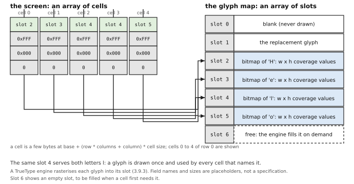


As an arithmetic example, with the chat-era cell (about 13 bytes: 4 + 4 + 4 for a character + 1 for attributes) and a 1920 by 1080 screen of 8 by 16 pixel cells, there are 240 columns and 67 rows, 16,080 cells and about 209 KB of cells; with slots of 16 by 32 coverage bytes (512 bytes) and 4,096 slots, the glyph map is 2 MB. Both are small against a 12.4 MB frame at 48 bits (3.11.2), which is the author's observation of 2026-06-18: the cells are small, and text is cheap to store. These are examples, not decisions.

### 3.10 A peek/poke program for the terminal (moved from chapter 3)

This is what the author's description would let a program do. **No register of the terminal is specified** (3.11), so the capitalised names are placeholders and any number is an example.

```
# placeholders: SCREEN is the base of the cell array, COLS its width in cells,
#               GLYPHS the base of the glyph map, GLYPH_SIZE the size of one slot

put_glyph(row, col, slot, fg, bg):                 # one cell: four stores
    cell = SCREEN + (row * COLS + col) * CELL_SIZE
    poke32(cell + GLYPH, slot)                     # which glyph (or the character code, 3.9)
    poke32(cell + FG, fg)                          # colours, modern depth: the pixel format of 3.8.2
    poke32(cell + BG, bg)
    poke8 (cell + ATTR, 0)

define_glyph(slot, font, codepoint):               # a glyph the program has just thought of
    bitmap = ttf_rasterise(font, codepoint, CELL_W, CELL_H)   # software: the TrueType engine
    copy(GLYPHS + slot * GLYPH_SIZE, bitmap, GLYPH_SIZE)      # an ordinary memory copy

put_glyph(0, 0, slot_of('A'), RED, BLACK)          # an A, red on black, top left
define_glyph(200, my_font, 0x03BB)                 # a lambda goes into slot 200
put_glyph(0, 1, 200, WHITE, BLACK)                 # and is used by naming slot 200
```

Graphics beside text, in the C64 manner, are another array and one more register set:

```
# the graphics plane: a framebuffer of FB_W by FB_H pixels; this sketch uses 32-bit pixels, as the standard device does
# (the 48-bit pixel of 3.8.2 would be 6 bytes: a different multiplier and three 16-bit stores)
put_pixel(x, y, colour):
    poke32(FB_BASE + y * FB_STRIDE + x * 4, colour)         # FB_STRIDE counts bytes, as in 3.5
# sprites, if the design has them (3.9.4: not decided):
poke(SPRITE_N + X, 100); poke(SPRITE_N + Y, 80); poke(SPRITE_N + SHAPE, shape_slot)
```

Each line is one store, so the program is as small as the C64's was. Everything is memory, so `memcpy` fills a glyph slot as it fills any buffer. Compared with the list of 3.14 there is no mode setting, no format conversion, no flush (the memory type of 3.11.1 takes its place), no atlas to pack, no shader and no command buffer. The terminal does no three-dimensional graphics; for that the standard device, virtio-gpu, remains (3.12, 3.13).

### 3.12 How the terminal drives HDMI and the other ports (moved from chapter 3)

**3.12.2** (moved from chapter 3) The video device's output side is therefore a pixel stream with horizontal and vertical sync, a clock and a data-enable, which is what every such transmitter accepts; the device's registers set the mode (width, height, blanking, pixel clock, the pixel format), the base address of the framebuffer and the display on and off. *(P)*

(3.10.2, that other standard outputs are the same shape, is in the body. That each port is one more slot or one more output of the video device is the assistant's.)

**3.12.4** (moved from chapter 3) The sound device's output is likewise a standard digital audio stream (I2S or the HDMI audio channel) into a converter or the transmitter. The processor never sees the HDMI packets, but whoever sets the mode must also program the audio clock relation: the transmitter needs N (and CTS, or a hardware CTS calculation) for each pixel clock and sample rate (an ADV7511 driver computes both; general knowledge, *unverified*). *(P)*

### 3.13 The framebuffer (moved from chapter 3)


### 3.14 virtio-gpu (moved from chapter 3)

**3.14.3** (moved from chapter 3) The framebuffer of virtio-gpu is the backing memory that the driver allocates; on the pdp64 it is ordinary memory mapped uncached (3.11.1), and the transfer command is the hand-off that tells the device to read it (the five steps of 2.5.3). *(P)*

### 3.15 A standard graphics card (moved from chapter 3)

**3.15.3** (moved from chapter 3) On the other side PCI Express is a standard enumerated bus, which suits the bus-as-a-device design (each function a slot, as each USB device is), and OpenBSD carries graphics drivers for several vendors' cards ported from Linux (*unverified*). *(P)*

### 3.16 What made graphics programming annoying: the pdp64 side (moved from chapter 3)

The goal (3.14.1) and the measure (3.14.2) are the author's and are in the body. The sketches of the pdp64's side below are the assistant's candidates for the means.

**Pair 1: getting a picture on the screen at all** (the sketch of the pdp64 side).

The pdp64 could offer **a device that already shows something**:

```
# the pdp64 way, open (a sketch)
# the device powers up with a sane default mode, in the monitor's preferred mode, with a canonical pixel format:
fb = peek(DISPLAY_BASE)            # where the picture is, always mapped
w  = peek(DISPLAY_WIDTH); h = peek(DISPLAY_HEIGHT)
poke(fb + (y * w + x) * 4, 0xFFFFFFFF)     # a white pixel: done
```

Options, with trade-offs. (a) The device **reports its mode** (a register holds the width, height and refresh rate of the mode chosen at start-up from the monitor's data; virtio-gpu's `GET_DISPLAY_INFO` already returns the width and height of each output in a `virtio_gpu_resp_display_info`); nothing to set. *Cost:* the device reads the EDID itself (a small I2C engine, which 3.10.1 already puts at the transmitter chip) and applies a policy; a program that wants another mode still has the registers. (b) A **fixed canonical pixel format** with the device converting at scanout (the repository's 48-bit RGBA pixel, errata 73, would be that format on the native device; virtio-gpu offers only 32-bit formats with eight bits per channel: `VIRTIO_GPU_FORMAT_B8G8R8A8_UNORM` and its siblings, in `virtio_gpu.h`, so the 48-bit pixel does not exist on the standard device; 3.23 lists the inconsistency). *Cost:* a conversion stage in the scanout, and memory a program wastes if it wants fewer bits. (c) **Stride equal to width** unless the program asks for padding, and the framebuffer window **always mapped**: the program has no `mmap`, no bank register, no `map_physical`; the window is in its address space from the start, a decision of the page tables and the bus (2.3.3 and 3.13.4). *Cost:* a fixed place in the address space, and a rule for what a program does that wants two framebuffers.

**Pair 2: the cache and the flush** (the open part).

A write-combining memory type for the framebuffer is a candidate improvement that the four memory types of 2.3.3 do not name; the cache rule itself is decided *(D)* and the speed is open *(P)*.

**Pair 3: drawing text** (the sketch of the pdp64 side).

The pdp64's terminal would do it as the C64 did, with one store:

```
# the pdp64 way, open (a sketch; names are placeholders)
poke(CELL(row, col).glyph, SLOT_OF('A'))     # or: poke(CELL(row, col).char, 'A')
poke(CELL(row, col).fg, RED)
# a new glyph: one library call fills a slot from the TrueType engine
font_render_into_slot(font, 'λ', slot)       # rasterises the outline and writes the bitmap into the slot
```

The author's glyph slots do the work of the atlas, and one library call replaces the first half of the boilerplate (3.9). Two candidates: (a) the cell holds the **character code**, and the device or a table maps the code to a slot, so the program never names slots (the author's c64x terminal of 2026-06-18, `c64stuff.txt`, line 5015: "each cell holds its actual data, not a reference to the data"); or (b) the cell holds the **slot number** directly, which is the simplest hardware and makes the program responsible for assigning slots. The choice is open (3.23): (a) is easier for the program and costs a lookup table in the scanout; (b) is nearly free and puts a small allocator in a library.

#### The pain points with the sugar

The table of 3.14 with its two further columns: the sugar that would remove each pain point, and where it appears in the sketches of 3.21 (S1 layers, S2 layers plus blitter, S3 command queue, S4 plain virtio-gpu with a library).

| Pain point | Typical boilerplate (illustrative) | The sugar that would remove it | Where (3.21) |
|---|---|---|---|
| Mode setting and discovering what the display supports (EDID, modes) | 15 lines (VESA) to 40 (DRM) | the device reads the monitor and starts in its preferred mode; a register reports it | S1 S2 S3 native; S4: `GET_DISPLAY_INFO` gives the size, a library the rest |
| Pixel formats | one format code to get right, and conversion code when it is not | one canonical format, the device converts at scanout | S1 S2 S3; S4 has 32-bit formats only |
| Stride and pitch | one multiply in every pixel address | stride equal to width unless asked; the address of pixel (x, y) is a register-reported formula | S1 S2 S3 |
| Endianness and colour order (RGB or BGR, alpha first or last) | a swap or a table, in every program | one defined order, little-endian (decided for the machine, errata 72); the colour field order named once | all |
| Bank switching and mapping the framebuffer | 5 to 20 lines | a window always mapped, no banks | all (3.13.4 is the rule for the type) |
| Double buffering and tearing | 10 to 30 lines, plus a frame loop | a latching base register, a fence, per-layer flip, versioned buffers (3.15) | S1 S2 per layer; S3 queue; S4 flush |
| Synchronising with the display | polling or a vblank interrupt handler | raster interrupt and a fence (3.15); decided: vblank interrupt at a fixed line (3.8.9) | all |
| Cache coherence between CPU writes and the device | 3 lines per update, forgotten once per project | decided: uncached memory type, no flush exists (2.5.2, 3.11.1); open: write-combining for speed | all |
| Device initialisation and context creation | 50 to 200 lines (Vulkan), 25 (virtio-gpu) | the device works at power-up; a single `enable` bit, a default | S1 S2 S3; S4 via a library |
| Buffer and memory management (allocate, map, upload, barriers, fences) | 20 to 100 lines | all video memory is a plain array in a window (S1 S2); no upload, nothing to map; or the device allocates (S3) | S1 S2 plain; S3 managed |
| Shader compilation and pipeline state | 50 to 300 lines | no shaders at all in S1 S2; a few fixed programs in S3, chosen by a field | S1 S2 none; S3 fixed |
| Drawing text (glyph atlases, kerning, layout) | 100 to 300 lines | a one-store put-character; glyph slots filled by a library call (3.9) | all native; S4 in a library |
| Clipping and windows | 10 to 30 lines per drawing call | a clip rectangle register per layer; a window is a layer | S2 S3 |
| Sprites and cursors | 20 lines to save, draw and restore | hardware sprites and a hardware cursor, two registers each | S1 S2 S3; S4 has the cursor queue only |
| Colour spaces and gamma | a table and a conversion, or wrong colours | one defined space (linear or sRGB, to be decided) with the device applying the transfer curve | open: S1 S2 S3 |
| Resolution changes and hot-plug | 20 to 60 lines of event handling | the bus reports a plug as an event (decided in chapter 2, 2.4); the device re-reads the monitor and signals "mode changed" | all |
| Fonts and scaling (HiDPI: screens with several pixels to a logical dot) | a scale factor threaded through every program | cells and glyph sizes defined in physical units by the device; the TrueType engine renders for the real pixel size | S1 S2 S3 |
| Input of palettes | 256 writes through ports (VGA) | a palette is an array in memory, loaded by `copy`; or none (true colour) | optional |
| Sound and video sync | a timestamp and a resampler | one clock for both devices (the audio clock relation of 3.12.4, decided as a duty of the mode setting) and a frame counter that audio can read | all |

Every item costs gates or flexibility, and the sugar column is a list of things to decide, not a recommendation. The repository has already decided the coherence rule *(D)*, the vertical-blank latch *(D)*, the uncached framebuffer *(D)* and little-endian *(D)*; every other cell in the sugar column is a candidate.

### 3.17 Anti-tearing sugar (moved from chapter 3)

The sugar is wanted (3.15.1 in the body, the author's). "So that the common program needs no more than a store" is the assistant's aim. The candidates, with what each costs, are proposals:

* **A scanout base register that latches at the vertical blank** (a page flip: the register holds the address of the picture to show and takes the new value only in the blank), with a completion **interrupt** or a **fence** (a counter that the device advances when the flip has happened, which the program can read or wait on, so it knows that the old picture is free). *Gives:* no tearing, no polling of the raster; the program writes one register and goes on. *Costs:* two pictures of memory for the program that uses it, and a rule for what the register shows if it is written twice in one frame (the first is dropped, or the second waits). *Already in 3.8.9, except the fence.*
* **Per-layer latching**, in a design with layers (3.21, sketches 1 and 2): each layer has its own base register and flips independently, so a cursor or a sprite layer can move every frame while the text layer flips only when its text changes. *Gives:* the cheapest case for text, a moving cursor with no redraw. *Costs:* one set of registers per layer.
* **An atomic commit of several registers**: several registers are staged and applied together at the blank (this is what `ARM` of 3.8.9 is for the single set; Linux calls the same idea "atomic modesetting" and offers `DRM_MODE_ATOMIC_TEST_ONLY` to ask "would this work?" and `DRM_MODE_ATOMIC_NONBLOCK` to ask for it without waiting, both in `drm_mode.h` on this machine). *Gives:* a change of mode, picture and cursor that cannot be seen half-done. *Costs:* the shadow copies of the registers, which a small device pays in flip-flops; an optional test-before-commit is more.
* **A raster-position register and a raster interrupt** (the C64 way): the program can know the row being read and be interrupted at a chosen row. *Gives:* mid-frame changes (the C64's trick of a different colour or sprite position per band) and a way to time drawing behind the beam. *Costs:* one register and an interrupt source; encourages programs that are tied to the display's timing.
* **Variable refresh** (the monitor waits for the frame instead of reading at a fixed rate: so a frame that is late is not a missed blank but a short wait; the standards are called adaptive sync, FreeSync, G-Sync and, for HDMI, VRR, variable refresh rate; unverified general knowledge). *Gives:* a late frame costs only its own delay, not a halving of the rate. *Costs:* the output must support it (the HDMI transmitter chip of 3.10.1 and the monitor), and the device's mode registers must say so.
* **Damage rectangles** (the program says which part of the picture changed and only that part is sent on): this is what virtio-gpu's `TRANSFER_TO_HOST_2D` and `RESOURCE_FLUSH` take as a `virtio_gpu_rect` (3.12). *Gives:* less memory traffic when little changes (a terminal). *Costs:* the program must track what it changed.
* **A hardware cursor and sprites**: objects that the scanout overlays at a position without touching the picture under them, so moving one never needs a redraw and never tears. *Gives:* the cursor, and in a game its moving objects, for the price of two registers each. *Costs:* gates in the scanout path and a limit on how many. (virtio-gpu has a cursor in its protocol: a separate cursor queue, `UPDATE_CURSOR` and `MOVE_CURSOR`, `virtio_gpu.h`.)
* **Versioned or copy-on-write buffers**: the device keeps the picture the scanout is reading and the program writes to a fresh version that replaces it atomically when the program says it is done, so the program can never see or show a half-drawn frame and never has to name two buffers. *Gives:* the sugar nearest to "nothing to do": a program draws and says `commit`. *Costs:* the memory and copying are the device's; a page-granular copy-on-write needs the memory-management machinery of chapter 6 or a device-side equivalent; a whole-frame version is twice the memory with a rule of who allocates it.
* **A fence or sequence counter**: a register that the device increments when each commit has been applied, which the program can read (poll) or wait for on an interrupt, to know when a buffer is free. *Gives:* synchronisation with no guess. *Costs:* a counter and a rule for wraparound.

And the same loop, in the style the pdp64 could offer, written with three of the candidates (a latching base register, a fence, and the interrupt) in the form that the program meets:

```
# 3. the flip at the blank, with the sugar: no polling of the raster, no waiting for the flip to be safe
poke(SCANOUT_BASE, front)
loop:
    draw_scene(back)
    poke(SCANOUT_BASE, back); poke(ARM, 1)    # staged now, latched by the device at the next blank (3.8.9)
    wait_until(peek(FLIP_COUNT) >= expected)  # a fence: the old picture is free (a candidate, not defined)
    swap(front, back)
```

Section 3.21 says which sketch gives which of these cheaply: the layered sketches give per-layer latching and a hardware cursor almost for free, the command-queue sketch gives the fence and the atomic commit, and the virtio-gpu route gives damage rectangles and fences and nothing about the raster. `FLIP_COUNT` and `ARM` above are placeholders; the repository defines `ARM` only as a name in 3.8.9.

### 3.18 A c64 mode: a small computer on the die that acts as the terminal (moved from chapter 3)

The c64 mode is the author's (3.16.1 and 3.16.2 in the body). This section is the assistant's explanation of how it could work, for the two readers, and states the questions it leaves open.

**What the Blit did.** The Blit (3.3) was a terminal with a computer of its own, and the host sent it **programs** instead of escape codes to interpret. The records in `docs/kernel-pain-points.md` (section 14I, from the Blit papers) say that the terminal received downloaded code over its serial line, that `mpxterm`, the terminal's program, "is 1627 lines of C" plus "204 lines of assembler" and multiplexed several host programs over the one line, and that the authors held that "an intelligent terminal is not an idiot savant, it is one that can be educated". A **terminal with its own small computer** is therefore a display, keyboard and mouse driven by a processor on the terminal's side of the cable, running a program the host loaded; the host sends it messages and the program draws. How the download worked (the protocol, the program format) is not in the records and is *unverified*. The VT52 and VT100 were the opposite: a fixed circuit obeying a fixed set of codes (3.2).

**A small core with the C64's chips is a terminal on a chip.** Take a small computer, give it the C64 family's circuits (the **VIC**, the video chip; the **SID**, the sound chip), **screen memory**, **colour RAM**, **glyph memory** (3.9) and a window towards the host, and let the host load its program. The program is the terminal's firmware: it receives bytes or messages from the host (by a mailbox), puts characters into screen memory, plays a sound, moves a sprite. The host sees a device that takes characters, as it saw a teletype, and the cleverness sits in a program the host can replace, as in the Blit.

**What "loaded by PCI Express DMA" means, mechanically.** The host puts the program image (the terminal's code and initial data) in its own memory and tells the device's **DMA engine** (the part that copies memory without the processor's help, chapter 2) the image's address, its length and the address in the small core's memory where it goes. The engine reads host memory over the PCI Express link (the bus-master read of 2.5) and writes the bytes into the core's memory. The core has been held in **reset** (a line that keeps a processor from running until it is released) since power-on, so it never executes incomplete memory; when the copy is done the host releases the reset and the core starts at its fixed start address. With placeholder names (no register of any such device exists):

```
load_terminal(image, length):                     # on the host, as a driver would
    poke(CORE_CTRL, HOLD_RESET)                   # the core is stopped
    poke(DMA_SRC,  physical_address_of(image))    # where the image is, in host memory
    poke(DMA_DST,  CORE_LOAD_ADDRESS)             # where it must go, in the core's address space
    poke(DMA_LEN,  length)
    poke(DMA_GO,   1)
    wait_until(peek(DMA_DONE) == 1)               # or an interrupt
    poke(CORE_CTRL, RELEASE_RESET)                # the core starts executing the loaded code
    # the host now talks to it through the mailbox:
    mailbox_send(PUT_TEXT, row, col, "hello")     # a message the loaded program understands
```

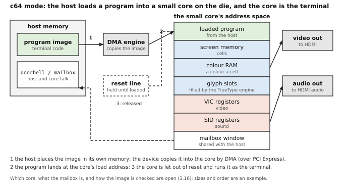

The core's address space is the C64's (3.4) with a mailbox added. Everything the loaded program needs is in one flat space, as in the 1982 machine: its own code, screen and colour memory, glyph slots, the video and sound registers, and a window the host also sees. Video goes to the display connector and audio to its audio channel (3.10); audio over HDMI brings the audio clock relation of 3.12.4 with it, which the core's program must honour or the transmitter's own calculation must supply.

The questions that the author's words leave open, and the options for the core, are in J.3.11 (the statement 3.18.3, moved from chapter 3, is that list).

#### The compositor question

The author asked, 2026-11-10: "not sure what that would look like. is there virtio-compositor?"

**What a compositor is, at more length.** A **compositor** (defined in 3.16.2) combines the pictures of several windows or sources into the one picture sent to the display, which is then scanned out as in 3.15. In a desktop window system each program draws into its own picture (its **surface**) and the compositor places the surfaces, one over another, into the frame the scanout reads. The PC's windowing systems did this in software (3.5); in the layered sketches of 3.21 the scanout hardware does it, as the C64's chip did with sprites. The PDP-11 has no antecedent; its terminal was a single stream.

**Why "takes over" is the simple case.** If the c128 owns the output outright when enabled, there is nothing to compose: the machine has one scanout and one audio path, and the only question is who drives them. The multiplexer is a single enable bit (path (a) below). The compositor case differs in one way: the core is one client among others, so its picture and sound must be handed over in a form that the host's compositor, or the display controller's layers, can place.

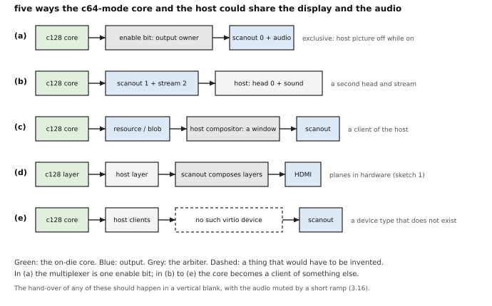

**What exists, checked.** No virtio device is called a compositor: no entry of `virtio_ids.h` on this machine names one. The display-related types are GPU (16), input (18), sound (25), video encoder and decoder (30, 31), DMA buffer (37) and audio policy (39). The nearest parts in `virtio_gpu.h` are up to 16 scanouts (`VIRTIO_GPU_MAX_SCANOUTS`); `SET_SCANOUT_BLOB`, which sets a scanout from a blob resource (a memory object shared with the host without copying); a **cursor queue** separate from the control queue (`UPDATE_CURSOR`, `MOVE_CURSOR`); and capability sets (`VIRTIO_GPU_CAPSET_VIRGL`, `VIRGL2`, `GFXSTREAM_VULKAN`, `VENUS`, `CROSS_DOMAIN`, `DRM`) selected with `context_init`, so that several rendering contexts, each with its own ordering (the "timelines" of the header comment), share the device. QEMU's `docs/system/devices/virtio/virtio-gpu.rst` describes `virtio-gpu-rutabaga`, which provides "gfxstream rendering and Wayland display passthrough", with a `cross-domain` capset for Linux guests and experimental `x-gfxstream-composer` for Android guests; it says no more about what the cross-domain path carries. That the crosvm project uses the same mechanism to show a guest's windows as windows of the host's Wayland compositor (Wayland is the Linux display protocol in which clients hand surfaces to a compositor) is general knowledge and *unverified*. **virtio-snd** and **virtio-input** exist for audio and for keyboard and mouse. Paths (b) and (c) can therefore be built from parts that exist, and path (e) is a new device type; how a type gets its number is *unverified* here.


The five compositor paths, with their gains and costs, are in J.3.12.

The author's path (c), 3.16.3 in the body, makes the core a client like any other, the way rio treats every window (3.18: a window is a buffer and a rectangle), and its parts exist (a virtio-gpu resource or blob as the surface, 3.12). The details under it are in J.3.12; the audio form of the same choice is in 3.17.

**How the switch avoids tearing and pops.** Enabling or disabling the mode changes who feeds the scanout and the audio path. A change in mid-frame tears the picture (3.15), and a sudden change of the waveform's value is heard as a pop. The remedy has the shape of 3.15: hand over at a **vertical blank**, as the latch of 3.8.9 does for registers (the enable bit is one more shadowed register that `ARM` latches), and **mute with a short ramp** (a fade of a few milliseconds down before and up after, not a cut). In path (a) the enable bit is the shadowed register and the mute belongs to the audio path; in (b) to (e) the compositor does the hand-over and the core only stops or starts its stream. The audio clock relation of 3.12.4 must stay unchanged across the switch, or the transmitter loses its lock and the sound drops.

*Commentary.* **Chain.** The PDP-11 had only the fixed terminals of 3.2. The Blit loaded its terminal program from the host. The C128 put several complete computers in one box (general knowledge, *unverified*), and the MiSTer framework runs C64 and C128 cores in programmable logic. The pdp64 proposal puts a small core on the die and loads it by DMA. **Trade-offs.** A computer of its own makes the terminal programmable and independent of the host's drawing, and makes it a second machine to load, secure and keep consistent with the first. **Impact.** *Kernel:* a driver for the loader and the mailbox. *Compiler:* none. *Hardware:* a core, memory, DMA and the C64 family's circuits, or nothing in option (d).

### 3.19 The audio of the c128 core (moved from chapter 3)

The options for the audio form of the c64-mode core are in J.3.13.

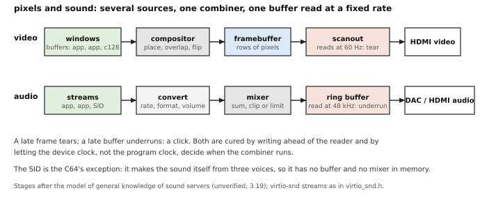

### 3.20 Windows: the goal (moved from chapter 3)

The author, 2026-11-10: "it should mention blit terminal was inspiration for the rio and NeWS windowing systems, and we'd like to bring over what we can of that simplicity also."

The goal (3.18.1) is in the body; the means are in J.3.14.

### 3.21 A design still being worked out: what a mashup of GPU, video memory, C64 and Blit could look like (moved from chapter 3)

The author, 2026-11-10: "conclude the graphics chapter: we're still figuring it out, what would a mashup of gpu, vram, c64 and blit look like." **Nothing in this section is decided.** Every statement is tagged *(P)* or *(S)*; the sketches are shapes of ideas put side by side so that the questions at the end can be answered, and the repository recommends none. The chain behind them: the PDP-11 terminal was a character stream (3.1), the Blit and the C64 put memory-mapped bitmaps, text, sprites and sound behind a processor or a few chips (3.3, 3.4), the PC split them (3.5), and the GPU turned drawing into queued commands and shaders (3.6); the sketches mix those inheritances.

**Two terms first.** **VRAM** (video memory) is memory that belongs to the display device: it sits on the device, behind a window on the bus, and the scanout reads it without crossing the bus; the processor reaches it through the window (slowly: every access is a bus transaction). The alternative is **system memory** that the device reads by DMA as a bus master, as the video device of 3.11.2 does; the framebuffer is then ordinary memory and the scanout competes with the processor for it. A GPU card has VRAM; the first board of the pdp64 has none to speak of (the block RAM is 5.5 megabits and a frame is 8.3 MB, 3.11.2), so on it every layer lives in system memory, and "VRAM" in the sketches below means "memory the device owns the use of", whichever kind it is. **Compositing** is combining several pictures into the one that is shown; the C64's sprites over text over a background were compositing in hardware, as the scanout read them out.

The device in these sketches is not specified beyond the 48-bit pixel and sample formats (errata 73 and 74). The properties the author has asked for, which each sketch is measured against: **(T)** simple peek/poke text and graphics at once; **(C)** modern colour depth and screen size; **(G)** glyph slots filled by a TrueType engine; **(S)** sprites, colour and sound in the C64's spirit; **(B)** the Blit's bit-blit and windows; **(U)** the GPU's command queue, parallel lanes and shaders. And the other two wishes of the day: anti-tearing sugar (3.15) and the boilerplate goal (3.14).

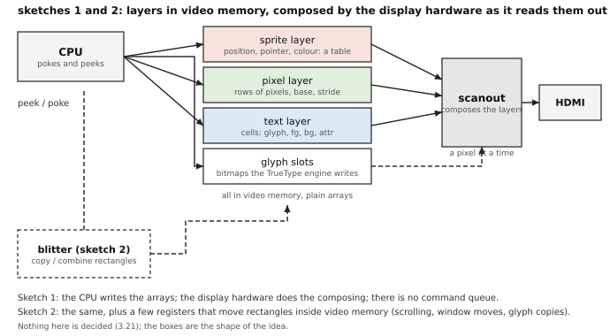

#### Sketch 1: layered scanout, no command queue

**3.21.1** (moved from chapter 3) Three **layers** (a text-cell layer, a pixel layer and a sprite layer) are plain arrays in video memory that the processor pokes; the display hardware composes them as it reads them out, one pixel at a time, and there is no command queue. *(P)*

*What the programmer sees.* Three arrays, each at a fixed place, each with a small set of registers (base, size, stride, enable). The text array is the cell array of 3.9, with its glyph slots in another array; the pixel array is a framebuffer; the sprite layer is a table of entries (x, y, shape, colour, enable). A program pokes whichever it wants, in any order. *What is in video memory:* the cells, the glyph slots, the pixels, the sprite table and the sprite shapes. *At scanout:* for each pixel the hardware asks the layers from the top down (sprites, then text, then pixels), looks the cell up to its glyph, takes the glyph's coverage and the colours, and gives the first layer that is not transparent; the sprite layer needs to know only a few entries per row. The composing is done in a **line buffer** (a small memory that holds one row), as 3.11.2 already provides for. *Costs:* a compositor of the order of the 1,500 lookup tables the repository estimates for the blitter, plus a line buffer per layer (an estimate of mine, unmeasured); scanout traffic is the pixel layer's 498 MB/s at 1920 by 1080, 4 bytes, 60 Hz (746 MB/s at 6 bytes), plus about 13 MB/s for the cells and the glyph reads (arithmetic from the examples of 3.9). *Gives up:* anything beyond what the layers can say: no scaling or rotation, no effect that is not in the compositor; every change a program wants to make to the pixel layer is the processor writing pixels. *Properties kept:* T yes (this is the C64 and the Blit's memory-mapped screen); C yes; G yes (the text layer's glyphs); S yes (sprites, and colour per cell; sound is a separate device, 3.8.3); B no (no blitter, windows are the program's job); U no. *Text and graphics split:* healed, the C64's way: a program has text and pixels at once in one frame, with no mode switch. *A game:* sprites and a scrolling text or pixel layer, moved with a few pokes a frame; the C64 game, with a modern screen. *A terminal emulator:* pokes cells (a scroll is a few stores, or, with a base register for the layer, one store); the glyph slots are filled by the TrueType engine. *Sugar:* per-layer flip and a hardware cursor for free (3.15); the fence is the vertical-blank counter. *With virtio across the board:* needs a virtio device type of its own (reading 1 of 3.9); the layers are a device's contents, not the virtio-gpu protocol.

#### Sketch 2: the same, plus a small blitter and a glyph atlas

**3.21.2** (moved from chapter 3) Sketch 1 plus a **blitter**, a few registers that copy and combine rectangles inside video memory (the Blit's RasterOp, the Amiga's blitter; the register sketch of 3.8.4), and a glyph atlas that the TrueType engine fills and the text layer indexes. *(P)*

*What the programmer sees.* Sketch 1, and a handful of blitter registers: source, destination, strides, width, height, raster operation, go. The atlas is the glyph map seen as one picture (3.7): a glyph is drawn from it by the blitter into the pixel layer when a program wants a glyph on the pixel layer at an arbitrary position, and the text layer's cells point at it directly. *In video memory:* sketch 1's contents and the atlas. *At scanout:* as sketch 1. The blitter runs beside it, in the blanking time or contending for the memory. *Costs:* the blitter and its arbitration with scanout; the repository's own estimate is about 1,500 lookup tables and a line buffer, "nearly all address arithmetic" (3.8 commentary), and a bus-master port on video memory. *Gives up:* the same as sketch 1, except that drawing, scrolling and window moves in the pixel layer no longer cost the processor the pixels. *Properties kept:* T, C, G, S as sketch 1; **B yes** (bit-blit with the raster operations of 3.8.7, and windows as layers or as rectangles in the pixel layer); U no. *Split:* healed as sketch 1, and the pixel layer gains the Blit's operations, so that text on it (a window of a program that draws its own glyphs) is cheap. *A game:* sprites for the actors and the blitter for the background tiles. *A terminal emulator:* the text layer as in sketch 1; the blitter scrolls and moves windows drawn on the pixel layer. *Sugar:* as sketch 1, plus a blit that starts at the vertical blank (the "start-at-vblank" of `architecture-recommendations.md` R-9), which stops a copy from tearing. *With virtio:* as sketch 1, the blitter a feature of the device; it would be a feature bit and a queue if its commands are descriptors rather than registers (the chat chose a three-operand `draw` command, `decisions-pending.md` E3).

```
# sketch 2: scroll the pixel layer up by one text line, then draw a glyph from the atlas (placeholders)
poke(BLT_SRC, FB + LINE_H * STRIDE);  poke(BLT_DST, FB)
poke(BLT_STRIDE, STRIDE);  poke(BLT_W, W);  poke(BLT_H, H - LINE_H)
poke(BLT_OP, STORE);  poke(BLT_GO, 1);  wait_until(peek(BLT_BUSY) == 0)
```

#### Sketch 3: a command-queue device with a peek/poke window

**3.21.3** (moved from chapter 3) A device whose main interface is a **ring of commands** in the manner of virtio-gpu, with a tiny shader-like fixed program for drawing glyphs and sprites and video memory managed by the device, and a peek/poke compatibility window on top for the programs that want to poke cells and pixels. *(P)*

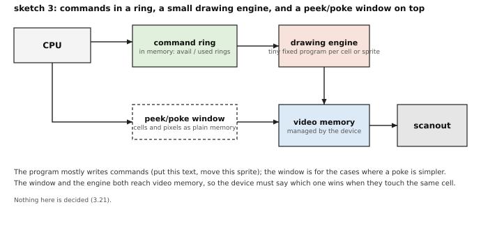

*What the programmer sees.* Mostly commands: "put this text at this cell", "move this sprite", "fill this rectangle", "present"; and, as a convenience, the window: cells and pixels as plain memory that mirrors the device's. The device allocates its own video memory, so a program does not choose addresses. *In video memory:* what the device decides; the program sees handles. *At scanout:* the device renders the commands into whatever it scans out, at its own pace, and flips at the blank by itself (the sugar is free: a commit is a command). *Costs:* a command processor (a queue engine, as the virtio devices of chapter 2 already are), a drawing engine of fixed programs (the small piece of the GPU that the terminal needs: a textured quad with a glyph and two colours, a sprite), a memory manager for video memory and a consistency rule between the window and the queue; more gates than sketches 1 and 2 by a clear margin (a judgement of mine, unmeasured), and more software in the driver. *Gives up:* the plainness of sketch 1; the program must know the device's model, and two ways to reach one cell must be reconciled. *Properties kept:* T only through the window (and only as well as the window is made); C yes; G yes (the engine reads glyph slots); S yes; B no blit, but "fill" and "copy" commands do its job; **U yes**, a command queue and parallel work, but a *fixed* program, not the general shaders of 3.6. *Split:* healed by the engine, which draws text and pixels from one queue. *A game:* a command per sprite or per tile, one "present" per frame, with little processor work. *A terminal emulator:* one command per changed run of cells; the glyph atlas as in 3.7, but made by the device. *Sugar:* the fence and atomic commit are the natural form (each command completes in order; a commit is a command); versioned buffers are the device's business. *With virtio:* the natural fit, a device with queues as in 2.7, and the closest in spirit to virtio-gpu, of which it could be a profile (reading 2 of 3.9).

#### Sketch 4: virtio-gpu 2D, the sugar in a library

**3.21.4** (moved from chapter 3) The standard virtio-gpu 2D route of 3.12, with the C64 and Blit conveniences done in software by a library (cells, glyphs, sprites and cursor, blits, flips), and no special hardware. *(P)*

*What the programmer sees.* A library that offers the peek/poke look: a cell array in memory, `put_char`, sprites as library objects, and a `present` call that does the transfer and the flush for the damaged rectangles. *In video memory:* the host's resources; on the pdp64 the program's memory is the backing (3.14.3). *At scanout:* the host reads its resource when it likes; the library cannot flip at a blank because virtio-gpu has none (3.12); tearing is the host's concern and, on an emulator, usually invisible. *Costs:* nothing in gates; the processor draws everything and a flush copies; bus traffic is the damage rectangles. The glyph slots are a library table, filled from the TrueType engine on the processor. *Gives up:* everything hardware: the hardware cursor is the cursor queue only, there are no sprites except the cursor, no blits, no layers; the C64's "the chip draws it while you do other things" is the library's loop. *Properties kept:* T only through the library (the program pokes memory the library owns, and the library presents it); C only to 32 bits (3.14.4); G yes, in software; S no (the cursor excepted); B in software; U no. *Split:* healed in the library's picture, but each screen is still one pixel framebuffer. *A game:* draws into a back buffer and flushes it, in the PC way of 3.5 (slow, but running now). *A terminal emulator:* the library draws glyphs from a cache and flushes the damaged rows. *Sugar:* damage rectangles and the fence only (3.15, 3.12). *With virtio:* it is the standard (errata 79, 95); sketches 1 to 3 would be added to it as another device or as a profile.

#### Sketch 5: a c64-mode core as the terminal (a variant)

**3.21.5** (moved from chapter 3) A small core with the C64 family's chips, into which the host loads the terminal program by DMA (3.16), as a variant or addition to any of the sketches above: it is the terminal, and the other sketches say what the display behind it does. *(P)*

*What the programmer sees.* The host programmer sees a device that takes messages (the mailbox); the programmer of the small core sees the C64: peek, poke, a screen at a fixed place, colour RAM, glyph slots, sprites and the SID, which is the author's "as simple and pleasurable as the c64 was" at its most literal. *In video memory:* the core's screen memory, colour RAM, glyph slots, sprite shapes. *At scanout:* the VIC (or its extension) composes text, bitmap and sprites as sketch 1 does; the flip is a register of the core's own. *Costs:* a core, its memory, a DMA loader and the chips (3.16, question 7); a second program to write, load and keep secure. *Gives up:* a single, standard programming model on the host's side; the host cannot poke a cell, only send a message. *Properties kept:* T yes, for the core's programmer; C if the chips are widened as the native devices were (3.8); G yes; S yes, with sound; B only if the chip family has a blitter; U no. *Split:* healed, in the core. *A game:* a C64 game, or one written for the core. *A terminal emulator:* the core *is* the terminal; the host sends text. *Sugar:* the VIC's latches and raster interrupt, which the core's program uses; nothing is hidden from it. *With virtio:* the open tension of 3.16, question 6.

#### The four main sketches side by side (sketch 5 is a variant of any of them)

| | S1 layers | S2 layers + blitter | S3 command queue + window | S4 virtio-gpu + library |
|---|---|---|---|---|
| What the program does | pokes arrays | pokes arrays, starts blits | writes commands (or pokes the window) | calls a library, which sends the commands of 3.12 |
| Who composes | display hardware, at scanout | display hardware, at scanout | the device's engine | the host, or the program |
| Where glyphs live | slot array in video memory | atlas in video memory | the device's cache of slots | the library's table, in the program's memory |
| Sprites | hardware layer | hardware layer | engine primitive | no (cursor only) |
| Blitter | no | yes | fill/copy commands | in software |
| Commands or pokes | pokes | pokes and a few registers | commands, pokes as a window | commands under a library |
| Anti-tearing sugar | per-layer latch, cursor, raster | the same plus blit at blank | commit, fence, atomic | damage and fence only |
| Cost in gates (my estimate, unmeasured) | small: a compositor and line buffers | small to medium: add a blitter | larger: a queue engine, a drawing engine, a memory manager | none |
| Bus traffic | scanout, plus the pokes | the same, less processor traffic for blits | scanout, plus commands (small) | scanout is the host's; the program writes every pixel |
| Fits virtio everywhere (errata 95) | needs its own device type | needs its own device type | a profile of virtio-gpu, or its own | is virtio-gpu |
| Properties T C G S B U | T C G S, no B U | T C G S B, no U | C G S U; T by the window; B by commands | T by library; C only 32-bit; G in software |

## H.4 Chapter 4: Boot, the BIOS, the disk label and the GPT

### 4.3 What takes the place of a BIOS (moved from chapter 4)

**4.3.1b** (moved from chapter 4) The ROM brings up the machine, loads the first block, and offers a console monitor when nothing boots. It has no resident services and nothing is called after boot. *(P)* (The first sentence of 4.3.1 is in the body, decided by errata 47.)

*Commentary (moved).* **Trade-offs.** The pdp64 returns to the PDP-11 split and drops job 3: every device speaks virtio through one transport (chapter 2), so the loader and the kernel share one driver design and the loader needs no firmware to read a disk. The cost is a driver for the boot disk in the second stage, small because a virtio device is a handful of structures. **Benefits.** There is no firmware API to specify, no compatibility layer, no resident management code and no closed blob at the bottom of the trust chain (x86 firmware also keeps resident system-management code that the operating system cannot see, unverified; arm64 and RISC-V servers need trusted firmware and usually UEFI beside it, unverified, though OpenBSD's arm64 and riscv64 ports do boot through `efiboot`, read); the failure cases reduce to one, the first block did not load, and the monitor is the recovery. **Impact.** *Kernel:* no firmware services to call or to fix. *Compiler:* builds the ROM, loader and tools. *Hardware:* a boot ROM of a few hundred bytes to a few kilobytes, with a driver per boot device (not specified more closely).

### 4.4 The reset state and the first block (moved from chapter 4)

**The ROM's details (moved; its job as pseudocode, and 4.4.1, are in the body).** The ROM does five things in order: find a boot device, read block 0 into low memory, check that it looks like a boot block (the `0x55AA` signature), set core 0's registers, and start core 0 at the block. The assistant's fuller pseudocode, with the register state:

```
    quick_memory_check()                      # a short test of the first pages (repo: `boot.md`, job 1)
    for dev in boot_order:                    # disk or flash, then SD card, then the serial line (4.4.1)
        ...
        if byte[LOAD + 510] != 0x55 or byte[LOAD + 511] != 0xAA: continue
        core0.mode = KERNEL; core0.priority = 7; core0.translation = off; core0.VBR = 0
        core0.guard = clear                   # the user-memory guard
        core0.r0 = number_of(dev); core0.r1 = info; core0.r14 = 0x10000
        core0.all_other_registers = 0
```

read_block (the standard disk: one virtio-blk request, 5.6.2): build a three-descriptor chain (request header, a 512-byte buffer at `address`, a one-byte status); FENCE; write the queue's doorbell; poll the used ring until the chain returns.

The ROM polls (checks in a loop) rather than using interrupts. Inference, not stated: the ROM runs before any software has programmed the interrupt controller (2.6.3: how the interrupt controller is programmed is not specified), so there is nothing to interrupt it; polling needs no set-up, and 2.7.8 shows the polled form. It needs a driver for each kind of boot device; for the standard disk that is the virtio-blk reader of chapter 5: find the function in the bus's configuration space, set up one queue, read one block. Which device comes first, and how the ROM names a device in `r0`, are not specified (F10 of `decisions-pending.md` leaves the order after the disk open).

**The reset state of core 0 and the load address (moved from the paragraph "The first few pages of memory").** Block 0 is loaded **above** the table, at 0x1000 in this chapter's example (the address is "to be chosen"; `docs/boot.md`), so that the first stage runs without overwriting the vectors. The stack pointer `r14` starts at the top of the first 64 KB, so the first stage has a stack before it has run an instruction. `r1` points at the **boot-information block** (4.6). The author's rule of errata 102 is that no device window is mapped in **the first few pages**, where "the boot stuff is loaded"; how many pages that is, is not decided.

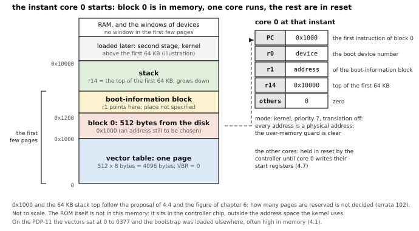

**4.4.1** (moved from chapter 4) At reset the controller brings up memory, holds every core in reset, and looks for a boot device in a fixed order: disk or flash, then SD card, then the serial line. *(P)*

**4.4.2b** (moved from chapter 4) The ROM reads block 0 of the first device that answers (for the standard disk, a virtio-blk read request), checks the `0x55AA` signature in the last two bytes, and does not parse a partition table. *(P)* (That the ROM reads block 0 and starts core 0 is in the body.)

**4.4.3** (moved from chapter 4) Core 0 starts in kernel mode at priority 7 with translation off (every address physical), `VBR` zero and the user-memory guard clear; `r0` holds the boot device number, `r1` the address of the boot-information block, `r14` the top of the first 64 KB of memory, and the other registers are zero. *(P)* The first few pages of the physical address space are reserved for the boot code and boot data, and no device window is mapped there (2.3.5, *(D)*); how many pages is not decided. *(P)*

**4.4.4** (moved from chapter 4) If a key is held at power-up, the monitor runs on the serial console. *(P)* (That the monitor runs when nothing boots is 4.10.1 in the body.)


*Commentary (moved).* **Trade-offs.** A boot ROM with a driver per boot device is more code in the controller than a "jump to a fixed flash address" scheme and much less than firmware; the first block must fit in one sector. **Benefits.** The first stage is the same on every board, and the first kernel code makes no guesses about the reset state, which earlier machines left to the console (inference: the VAX console and the PC's BIOS each defined their own). **Impact.** *Compiler:* the first block is 446 bytes of assembler. *Hardware:* the ROM reads one block and starts one core.

### 4.5 The disk: a GPT around the BSD label (moved from chapter 4)

**The first stage lives in the protective MBR.** Block 0 of a GPT disk is the protective MBR, 512 bytes: 446 bytes of code, the table (one entry, type `0xEE`), then `0xAA55` (the bytes `0x55`, `0xAA`: the `0x55AA` of 4.4.1). The first stage has 446 bytes. It cannot understand a GPT or a file system in that space and does not try: it carries a **block list**, three numbers per piece of the second stage (first block, number of blocks, load address), written into its code area by the **`installboot`** tool at installation; it reads those blocks and jumps to the first. The BSDs already do this. OpenBSD 4.6's `installboot(8)` page for the sparc says the first-stage program "loads the second stage program from a set of filesystem block numbers that have been hard-coded into it by the installboot program"; on the PC `installboot` patches `biosboot` with the location of `/boot`, and `biosboot(8)` says to re-run it whenever `boot(8)` is changed, "as its inode may change" (read). Because the boot-code bytes are the only place the pdp64 keeps block-list data, a damaged GPT cannot stop the machine reaching the second stage, which can repair it.

```
first_stage() with the block list (the assistant's sketch; the body has the general form):   # at LOAD (0x1000): 446 bytes of code plus the block list
    # entering state: kernel mode, priority 7, r0 = boot device, r1 = boot-information block, r14 = a stack
    for entry in block_list:                  # entries written by installboot: (start, count, address)
        read_blocks(r0, entry.start, entry.count, entry.address)     # (see the open question below)
        if failed: goto monitor_or_halt       # what to do on failure is not specified
    jump to block_list[0].address             # the second stage, with r0 and r1 unchanged
```

The pseudocode hides a question the repository does not answer: **how the first stage reads blocks.** 4.3.1 says the ROM offers no services after boot, and a virtio-blk read needs a queue, three descriptors, a doorbell and a poll (4.4). Whether that fits in 446 bytes beside the list is not established. The PDP-11 primary bootstrap carried its own disk driver (the `hpcs1` and `hpcs2` writes of 4.1) and the PC's called the BIOS. Three ways out, none decided: the first stage holds a small polled virtio-blk reader of its own (the PDP-11 way, consistent with 4.3.1); or the ROM leaves a read routine and tells the first stage where it is (a firmware call in miniature, against 4.3.1); or the ROM loads more than block 0, the whole 8 KB boot area of 4.5.3 for example, so the first stage has room for the reader. The question is in 4.13.

**4.5.2b** (moved from chapter 4) The first stage carries a short block list (start block, count, load address) to the second stage; neither the ROM nor the first stage parses the GPT. *(P)* (Decision B8, a proposal. That the first stage lives in the 446 bytes of the protective MBR is 4.5.2 in the body.)

From the paragraph on the superblock: The second stage can live in the boot area, in a small boot partition, or as a file in the root file system; whether a dedicated boot partition is needed is open (4.13), since the block list can point at any of them.

From the commentary: the benefit "The first stage does not depend on a GPT that may be damaged."

### 4.6 The second stage and the hand-off (moved from chapter 4)

**What the second stage is for (the fuller sketch; the general form is in the body).** The first stage put a bigger program in memory. The second stage does what the PDP-11's `boot` did, with more to read: it finds the disk, reads the partition table, reads the label, finds the root file system, finds the kernel by name in it, loads the kernel and enters it. Because it is a C program loaded from disk it can be as large as it needs and be replaced by copying a file. It has its own drivers (the virtio-blk reader, now complete) and no firmware to call. As a sketch:

```
second_stage():                               # loaded by the first stage; r0 and r1 as at reset
    dev = open_boot_device(r0)                # the same virtio-blk driver the ROM used, now complete
    gpt = read_gpt(dev)                       # header at block 1: check "EFI PART" and the CRC32;
                                              # if it is bad, use the backup at the end of the disk
    part = first entry whose type GUID is the OpenBSD type
    label = read(dev, part.start + 1)         # sector 1 of the partition (4.5.3)
    check label.magic == 0x82564557 and the label's checksum
    root = the label's root partition ('a'); mount it read-only
    cmdline = prompt("boot> ") or the default   # as the V7 ':' prompt: which kernel, which options
    elf = root.open("/bsd")                   # an ELF file, the toolchain's own object format
    for seg in elf.loadable_segments:
        copy seg.file_bytes to physical address seg.address; zero the rest of seg
    info = r1                                 # the block the ROM began; add what only we know:
    info.cmdline = cmdline
    info.video = framebuffer if we set one up (4.6.3)
    info.checksum = checksum(info)
    jump elf.entry with r0 = boot device, r1 = info     # still kernel mode, priority 7, translation off
```

**The pdp64's hand-off (moved from the hand-off paragraph).** A kernel that is to run on any pdp64 has to be told: how much memory there is and where (ranges, since memory is not always one block), how many cores, where the bus's root complex is (so that it can **enumerate**, walk the bus and list what is attached, 2.4), which device it was loaded from, where the console is, and the command line. The block is addressed by `r1`. The pdp64's hand-off is small because the bus describes its own devices: the block names memory, cores, the root complex, the boot device, the console and the screen if one was set up, and the kernel finds everything else by enumeration.

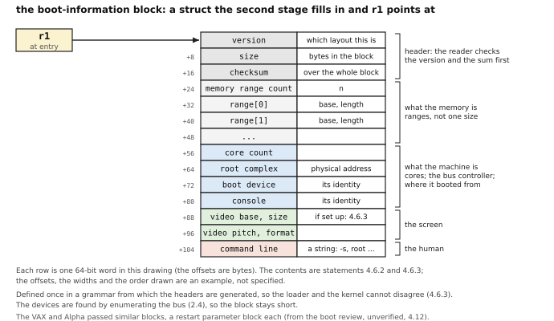

**4.6.1b** (moved from chapter 4) The second stage is a program in C that understands the root file system, reads the GPT and the label, loads `/bsd` (an ELF file) and jumps to it with `r0` and `r1` as before and a command line in the boot-information block. *(P)* (That the second stage carries its own drivers, finds the kernel and enters it is 4.6.1 in the body.)

**4.6.2b** (moved from chapter 4) The boot-information block names the memory ranges, the core count, the address of the root complex and the identity of the boot device and the console; the kernel enumerates every other device by PCI Express enumeration (section 2.4). *(P)*

**4.6.3** (moved from chapter 4) The block's layout is defined once, in a grammar from which the headers are generated, and carries a checksum and a version. *(P)*

*Commentary (moved).* **Trade-offs.** A fixed-layout block with a checksum has two failure cases (bad checksum, unknown version), against the parser a device tree or ACPI needs. OpenBSD's arm64 and riscv64 ports already parse a device tree and attach drivers from it, which could save kernel code if the port reuses many of their drivers (4.13). **Benefits.** Because the bus describes its own devices, the block shrinks to memory, cores and the bus controller's address, and the generated header cannot disagree with the loader. **Impact.** *Kernel:* reads a structure. *Compiler:* generates the header from one grammar. *Hardware:* none.

### 4.7 Starting the other cores (moved from chapter 4)

**The pdp64's rule: one register write.** A pdp64 core has no mode ladder, so it can start in its normal mode at any address. The controller holds every core but core 0 in reset; to start core *n*, the kernel writes, to a register block in the controller that belongs to core *n*, the address where the core should begin and one argument, and the controller releases the core into **kernel mode at priority 7** with its core number in `r0` and the argument in `r1`. By the kernel's convention the argument points to a structure that belongs to that core (its stack, its per-CPU data). A core that sticks is reset by a write to a core-reset register and started again.

```
start_secondary_cores():                      # core 0, in the kernel, after its tables are built
    for c in 1 .. core_count - 1:             # core_count comes from the boot-information block
        percpu[c] = allocate(percpu_size); percpu[c].stack = allocate(KSTACK)
        percpu[c].online = 0
        write(start[c].entry, secondary_entry)   # the exact registers are not specified (4.7.1)
        write(start[c].argument, percpu[c])
        write(start[c].go, 1)                    # the controller releases core c into kernel mode
        wait up to a timeout until percpu[c].online == 1
        if not online:
            write(core_reset[c], 1)              # 4.7.2: stop it, and try once more
            ... start it again, or mark core c failed and go on without it

secondary_entry():                            # core c: kernel mode, priority 7; r0 = c, r1 = percpu[c]
    set VBR and the page-table base to the kernel's, turn translation on, ISYNC    # chapter 6 (6.12)
    set the per-CPU pointer DP from r1; set R14 = percpu.stack top                 # chapter 7 (7.8.2)
    percpu.online = 1                         # core 0 is polling this word
    enable the clock; enter the scheduler's idle loop (WFE until there is work)    # chapter 6, 7.10
```

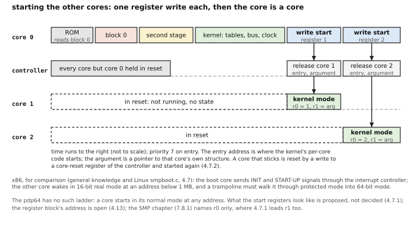

The cost is one register block in the controller, with a start register and a reset hold per core. The started core has no translation or stack of its own; the kernel's entry code sets them up in its first instructions, as the first kernel does (6.12). Whether a started core begins with translation off, and what `MMUCTL` it sees, are not specified.

**4.7.1b** (moved from chapter 4) (4.7.1 of the body says only that the controller chip provides the way to start the other cores.) The controller holds every core except core 0 in reset; a write to a core's start register in the controller gives it an entry address and an argument and releases it into kernel mode at priority 7, with its core number in `r0` and the argument in `r1`. *(P)*

**4.7.2** (moved from chapter 4) A stuck core is reset by a write to a core-reset register. *(P)*

*Other chapters.* This is option 1 of boot decision B2 and of R2 in `decisions-pending.md`, which recommend it and leave it proposed (the other options were the x86 signals, a firmware call, a spin table and a table that all cores start from). Chapter 7 stated the same rule (H.7, 7.8.1) and loaded `r0` only, where 4.7.1 loads `r1` too; the difference is to settle (4.13). Waiting uses `WFE` and `SEV` (7.10); an **inter-processor interrupt**, a signal from one core to another, is a write to a per-core register of the interrupt controller (H.7, 7.8.2).

*Commentary.* **Chain.** PDP-11: one processor, nothing to start. VAX: the console processor started the others (unverified). x86: INIT and START-UP signals and a trampoline through three modes. arm64 and RISC-V: a firmware call or a spin loop. pdp64: a register write. **Trade-offs.** With no mode ladder the whole protocol is one write, at the cost of a small register block in the controller. **Benefits.** No trampoline, no firmware call, fewer lines than any system counted, and one recovery path, a core reset. **Impact.** *Kernel:* starting a core is a register write. *Compiler:* none. *Hardware:* a start register and a reset hold per core.

### 4.8 Starting the devices (moved from chapter 4)

**The INIT bit (the sentences moved).** Statement 4.8.1 keeps `INIT` and `READY`. At boot the ROM runs the device start for the boot disk (4.4), the second stage again for the devices it uses, and each kernel driver at attach.

**Firmware for a device.** Some devices contain a small processor and need a program, **firmware**, loaded into them before they work; a network or wireless card is the usual case, a graphics device another. The PDP-11 had no such device and no way to give it one. On a PC the driver loads the blob from a file at attach time (Linux's `request_firmware`, declared in `include/linux/firmware.h`; OpenBSD's `loadfirmware(9)`, which reads the file from `/etc/firmware`; NetBSD's `firmload(9)`: all read), and the files come in a separate package. The pdp64 proposal is that such a device is given its firmware through a descriptor operation (a request on the device's queue, or a descriptor giving the address and length of an image in memory, with a small header the device checks: identifier, version, length, checksum) **once the root file system is available**, and that a device the boot depends on needs none: the boot disk, the console and the interrupt controller work from their built-in logic alone, so that no device waits for firmware that is on the disk it controls.

```
start_device(dev):                            # at boot or at attach
    init_device(dev)                          # the handshake of 2.7.3; reset first
    if dev.needs_firmware:                    # a device the boot depends on never does
        image = read_file(root_fs, firmware_name(dev))      # the file system must be up (4.6)
        check image.header: device id, version, length, checksum
        submit a descriptor chain giving dev the address and length of image
        wait for the device to answer; if it refuses, mark the device failed
```

**4.8.1b** (moved from chapter 4) A device that wants firmware is given it through a descriptor operation once the root file system is available, and a device the boot depends on needs no firmware. *(P)* (That a device is initialised by a register write behind the bus, and may be given values or a firmware image, is 4.8.1 in the body.)

*How the statement reads under virtio.* 4.8.1 is the PDP-11 form, one `INIT` bit and one `READY` bit (errata 29); under virtio (errata 95) it is the `device_status` handshake above. How a virtio device is handed firmware is not specified: virtio has no firmware operation of its own, so a request type or a separate device would have to be defined (4.13).

*Commentary.* **Chain.** PDP-11: the CSR's `INIT` bit, nothing more. PC: PCI Express devices initialised through configuration space and per-device driver code, firmware blobs loaded from files. VAX: the console and some adapters loaded microcode from storage (unverified). pdp64: the virtio handshake, firmware by descriptor. **Trade-offs.** A reset bit and a status register make the simplest device, with one failure case, a timeout. A firmware window lets a device be cheap (no flash) and makes an update a file replacement, at the cost of a header format and a device that rejects a wrong image safely; boot-critical devices are excluded because a device whose firmware is on a disk it must itself read cannot start. NVMe has a firmware-download command that needs a working queue first (unverified; not found in the QEMU headers read). **Impact.** *Kernel:* a device start is the 2.7.3 handshake. *Compiler:* none. *Hardware:* a status register per device.

### 4.9 Why UEFI is not used (moved from chapter 4: the shim's details)

Statements 4.9.1 and 4.9.2 stay in the chapter. The details of a shim are proposed.

**What a shim is, and what it is not.** The author asked, "not sure why firmware and coff are needed for uefi, with virtio native that shuld be minimal, no?" and then, "yes, state the shim's real scope." Virtio removes most of the driver mass that a full firmware carries (it ships drivers for every disk, network card and screen it might meet; the pdp64 has one device interface), and the shim needs only the drivers the second stage has. Two things stay, and they are the shim's real scope:

1. **PE/COFF.** The UEFI specification requires a UEFI application to be a PE32+ image (unverified: the specification is not here); that is a property of the **loader programs**, not of the firmware. To run an existing loader such as OpenBSD's `efiboot` it must be built as a PE/COFF image *for the pdp64*, so the toolchain has to produce one, and a **machine-type code** (a 16-bit number in the image's header that names the processor; OpenBSD's arm64 loader uses `IMAGE_FILE_MACHINE_ARM64 0xaa64`, read) would have to be assigned by the owners of the specification (unverified). It need not be a linker feature: OpenBSD's arm64 loader is linked as an ordinary ELF file and wrapped as PE32+ by a header written by hand in assembler (`start.S`, 176 lines) plus a self-relocator (`self_reloc.c`, 124 lines), with `objcopy` doing the rest (read, counted). The loader is itself a program that must be compiled for the pdp64.
2. **A small services layer.** The shim provides the few services loaders use: memory allocation and the **memory map**; reading a file from the boot partition; the console and the **graphics output protocol** (a framebuffer to draw on); **exit boot services**; a runtime clock and reset; all over virtio. It also hands the kernel a device description in the form such a loader expects, a device tree or tables.

**How many services, counted.** The three UEFI loaders in `<work>/kernel-src/openbsd/sys/arch/*/stand/efiboot` call these (counted as `BS->`, `RS->` and console calls in the `.c` files; the number is the count of call sites in the amd64 loader):

| Boot services (`BS->`) | Runtime services (`RS->`) | Console and file protocols (through a handle) |
|---|---|---|
| `HandleProtocol` 13, `AllocatePages` 7, `LocateHandle` 5, `LocateProtocol` 2, `LocateHandleBuffer` 2, `GetMemoryMap` 2, `FreePages` 2, `WaitForEvent`, `SetWatchdogTimer`, `FreePool`, `AllocatePool`, `Exit`, `ExitBootServices` (1 each); the arm64 and riscv64 loaders add `SetTimer`, `CreateEvent`, `CloseEvent` and lack the two pool calls | `ResetSystem` 3, `GetVariable` 3, `SetVariable` 2, `GetTime` 1 (called as `ST->RuntimeServices->GetTime`) | the text console (`OutputString`, `ReadKeyStroke`, `SetMode`, `QueryMode`, ...), the disk (`ReadBlocks`, `WriteBlocks`), files (`Open`, `Read`, `Write`, `Close`, `SetPosition`, `GetInfo`), the network (`Mtftp`, `Transmit`, `Receive`), the graphics output protocol, the random-number protocol |

That is 17 distinct boot and runtime calls in the amd64 loader (13 and 4) and 18 in the arm64 and riscv64 ones (14 and 4); errata 109 and `boot.md` say "about fifteen to seventeen", which this count corrects. It counts what **one** loader uses and is not a specification of what a shim must offer: another loader uses others, and whoever writes the shim reads the loader.

**A sketch of the shim (an illustration).** The shim is the second stage, loaded by block 0; it builds the services table, loads the loader's PE image, calls it, and answers its calls.

```
shim_entry():                                 # the second stage of a pdp64 that wants UEFI loaders
    info = r1; heap = free_ranges_from(info.memory_ranges)
    table = new system_table {
        boot_services = {
            allocate_pages = shim_allocate_pages,   # out of the heap; the loader asks for a page count
            free_pages     = shim_free_pages,
            get_memory_map = shim_get_memory_map,   # the ranges of `info`, plus what the heap handed out
            locate_protocol = shim_locate_protocol, # the console, the graphics output, a file volume
            exit_boot_services = shim_exit_boot_services,
            ... }                                    # the others a given loader uses; unused ones return "unsupported"
        runtime_services = { get_time = clock_register, reset_system = reset_register, ... }
        configuration_tables = [ (DEVICE_TREE_GUID, make_device_tree(info)) ]   # made from the boot-information block
    }
    image = read_file(boot_partition, loader_path)  # the path convention is not specified
    entry = pe_load(image)                          # headers, sections, relocations
    status = call entry(image_handle, &table)       # the loader runs, and calls back through the table

shim_exit_boot_services(handle, map_key):
    if map_key != current_map_key: return INVALID_PARAMETER    # the map changed since the loader read it
    stop the shim's console and timer; free the memory of the boot-services data
    keep only the runtime services: the clock and reset are register writes
    return SUCCESS                                 # the loader owns the memory and enters the kernel
```

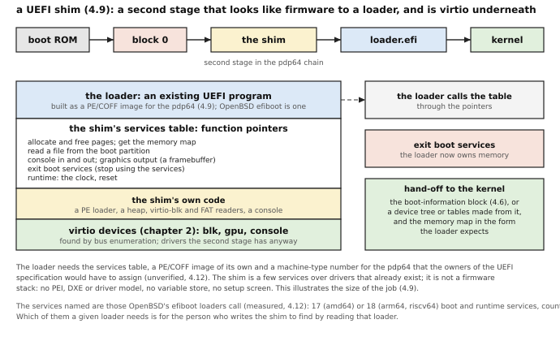

**The costs.** A shim is not a UEFI firmware stack. The boot review's figure of "hundreds of thousands to millions of lines" for a UEFI firmware (`docs/boot.md`, "Is UEFI worth it?") was never confirmed against a source, describes a full stack such as EDK II, and is not used as the cost of a shim. **No count of the shim's lines is given, because none can be measured here:** no UEFI implementation source is on this machine (the `edk2` and `u-boot` directories under the QEMU tree's `roms/` are empty). Measured are the loaders that would run on it (OpenBSD's `efiboot`: 4,593 lines for amd64, 7,195 for arm64, 4,513 for riscv64) and the 176 lines of header and 124 of relocator above. The costs that remain:

* **A PE/COFF build and a number.** The toolchain emits a PE/COFF image, and a machine-type number must be obtained (unverified).
* **A loader to port** to the pdp64 as any program is, the larger part of the work.
* **A services layer** written, tested and kept in step with the loaders it serves.
* **Code to trust before the kernel.** The shim is open source (4.3.2), runs only at boot and is not resident afterwards except for the clock and reset.
* **A platform description** (a device tree or tables) built from the boot-information block.

It does not cost a closed firmware, a variable store, a setup screen or a second boot path in the machine itself: the machine's own boot stays block 0.

*Commentary (moved).* The shim sentence: "A shim gives the first benefit without the rest, at the price of a services layer and a PE/COFF build." The impact lines: *Kernel:* a shim would translate the boot-information block. *Compiler:* no PE/COFF unless a shim is built.

### 4.10 Recovery (moved from chapter 4: what remains proposed)

**What to do when nothing boots.** A PDP-11 with a dead disk was not a dead machine: `ODT` let you examine memory and key a bootstrap in (4.1), and V7 shipped `/boot.bu`, a backup of the second stage. The pdp64 keeps the idea and gives it a place. The ROM that reads block 0 (4.4) also contains a **monitor**, a small program that runs on the serial console when no boot device answers or when a key is held at power-up and offers a few commands: examine and deposit memory and registers, load a program over the serial line, start at an address or from a named device, reset a core, reset the machine. It needs a working serial port and nothing else, so it also brings up a new board before any boot device works.

```
monitor():                                    # the ROM's console program; no interrupts, no memory but the first pages
    loop:
        print("pdp64> ")
        line = read_line(serial)
        case first word of line:
            "x" addr [n]    : print n words at addr                  # examine (the PDP-11's `addr/`)
            "d" addr value  : store value at addr                    # deposit
            "r" [name value]: print or set a register of the stopped core
            "l"             : read a program from the serial line into memory   # load
            "g" addr        : start core 0 at addr (r0, r1 as in 4.4.3)
            "b" device      : try to boot from this device
            "c" n           : write core n's reset register (4.7.2)
            "z"             : write the root complex's reset register (2.9.4; what else it resets is not specified)
            otherwise       : print("?")
```

The command letters and the prompt are an illustration. A **watchdog** is a hardware timer that counts down and restarts the machine unless software writes to it ("kicks" it) in time; a hung kernel stops kicking and is restarted. The PDP-11 had none. PC chipsets carry watchdog timers (QEMU models the ICH9 chipset's TCO timer in `hw/acpi/ich9_tco.c` and the Intel 6300ESB watchdog in `hw/watchdog/wdt_i6300esb.c`: read); whether PC firmware arms one is unverified. It needs about ten lines in the kernel. `decisions-pending.md` P7 asks for a bus-controller reset register and a watchdog **in place of** firmware calls, and the monitor's reset command writes that register.

**4.10.1b** (moved from chapter 4) The monitor is reached on the serial console and offers: examine and deposit memory and registers, load a program over the serial line, start at an address or from a named device, reset a core, reset the machine. *(P)* (That the controller's ROM includes a monitor is 4.10.1 in the body.)

**4.10.2** (moved from chapter 4) A hardware watchdog restarts the machine if the kernel hangs. *(P)*

*Commentary.* **Chain.** PDP-11: `ODT`, the front panel and `/boot.bu`. VAX: the console processor (unverified). PC and UEFI: a setup screen and rescue media (unverified). ARM and RISC-V boards: the console of U-Boot and the debug console of OpenSBI (unverified). pdp64: a monitor in ROM and a watchdog. **Trade-offs.** A monitor is a few hundred bytes of ROM (an estimate) and needs a serial port. **Benefits.** It is the recovery path that needs the least code. **Impact.** *Kernel:* the way in when nothing boots. *Compiler:* none. *Hardware:* a serial port and the ROM bytes.

### 4.13 Still open (moved from chapter 4: what is not an open item of the architecture)

The open items (a) to (i) of the former list are entries J.4.1 to J.4.8 of appendix J. The rest of the list:

**(j)** the monitor's commands, the serial speed and what is kept in non-volatile memory are now J.4.10; **(k)** the shim: the path of the loader it runs, the services it offers, the machine-type number (4.9), none to be settled until someone wants one.

**Facts still to check against their own documents:** the PDP-11 power-up behaviour and the M9312's ROM contents (only its contract with block 0 was read); the VAX console, VMB and the Alpha console's boot protocol (only the restart block was read); the C64 boot; the x86 reset vector and START-UP rules; PSCI, the SBI hart calls and the spin table as specified; what the UEFI specification requires of a loader and of firmware, including the machine-type registry; the size of a UEFI services layer, which only an implementation could give.

## H.5 Chapter 5: The device driver model

**5.3.2** (moved from chapter 5) A device's windows start on page boundaries and are whole pages. *(P)*

**5.10.2** (moved from chapter 5) A device addresses physical memory directly and the driver gives it physical addresses; until an address-translation unit for devices exists, every device must be able to address all of memory. *(P)*

**5.13.1** (moved from chapter 5) Because a device's windows are whole pages, a driver can run in user space with only those pages and its buffers mapped. *(P)*

**5.13.2** (moved from chapter 5) Until devices have an address-translation unit, a user-space driver can instruct its device to write anywhere in memory, so it is as trusted as the device. *(P)*

*In user space* (moved from 5.13). Microkernels and exokernels run drivers as ordinary programs where the hardware lets one device be mapped to one process (*unverified*); the PDP-11's Unibus gave every device a fixed address and no protection. Windows of whole pages make that possible here (5.13.1), and the IOMMU is what would make it safe: until it exists, a user-space driver is as trusted as its device (5.13.2). Linux `VFIO` and `UIO` and the DPDK libraries are the same idea and rely on an I/O translation unit (*unverified*). **Trade-offs.** A driver in user space can be tested, restarted and replaced without taking the kernel with it; its cost is a crossing for each request and the trust above. The whole-page rule also costs address space and no memory, and lets the kernel give one device to one protection domain.

**5.14** (moved from chapter 5) A virtio driver could be exercised before the machine has them by compiling its logic for the host and running it against a software model of a virtqueue. *(P)*

**5.5.4** (moved from chapter 5, the second half) A device that sets its needs-reset bit, or that stops answering, is reset and its queues reprogrammed, and the driver resubmits the chains that are not in the used ring. *(P for the resubmission rule)*

**5.11.2** (moved from chapter 5) A device that is reset leaves its queues in memory untouched; the driver reprograms the queue registers and resubmits the chains that are not in the used ring. *(P)*

**5.11.4** (moved from chapter 5) Requests are repeatable where possible (reads, writes of the same data, sends, buffer posts), so that resending an unfinished chain is safe; a request that must not run twice is tracked by its class driver, which can tell "never started" from "started, outcome unknown" only by the request's own status. *(P)*

### 5.7 Illustrations of a console and a timer (moved from chapter 5)

These illustrate the fixed devices of the open entry J.5.1; they decide nothing.

A complete tiny console driver for a KL11-style console at a fixed address, an illustration (a virtio-console version would replace the three register writes with a transmit-queue post and keep the shape):

```
# fixed address in the present machine (0x8000001000)
CON = MAP_CONSOLE
RXCS = 0;  RXDB = 8;  TXCS = 16;  TXDB = 24  # four 64-bit registers
READY = 1 << 7;  IE = 1 << 6                 # as the KL11's bits
ring txq, rxq                                # circular byte buffers: the clist's job

# vectors 33, 34: con_rxint, con_txint (6.3.3)
con_attach():
    # receive interrupts on; transmit off for now
    mmio_write64(CON + RXCS, IE)

# the boot code and a panic: no queue, no interrupt
con_putc_polled(c):
    while (mmio_read64(CON + TXCS) & READY) == 0: spin
    mmio_write64(CON + TXDB, c)

con_write(buf, n):                           # from the tty layer, as cnstart's caller
    s = spl4()                               # keep con_txint out while txq changes
    for c in buf[0..n): put(txq, c)
    # interrupts while IE is set: starts output
    mmio_write64(CON + TXCS, IE)
    splx(s)

con_txint():                                 # vector 34, level 4
    if empty(txq): mmio_write64(CON + TXCS, 0)       # nothing left: interrupt off
    else:          mmio_write64(CON + TXDB, get(txq))

con_rxint():                                 # vector 33, level 4
    tty_input(mmio_read64(CON + RXDB))       # reading RXDB clears READY
```

A timer tick handler for a fixed counter-and-compare timer: the interrupt stays asserted while the counter is at or above the compare register, so the handler moves the compare register forward by one period. An illustration:

```
timer_attach():
    mmio_write64(TIMER + COMPARE, mmio_read64(TIMER + COUNTER) + PERIOD)
    mmio_write64(TIMER + CONTROL, ENABLE)    # bit 0

timer_intr():                                # vector 32, level 6
    # drops the request
    mmio_write64(TIMER + COMPARE, mmio_read64(TIMER + COMPARE) + PERIOD)
    hardclock()                              # ticks++, due callouts, accounting
```

*Commentary.* **Chain.** PDP-11: the KL11 console has a receive and a transmit CSR with READY and IE bits and interrupts at BR4 on vectors 060 and 064; the KW11-L line clock interrupts at line frequency at BR6 on vector 0100 and `hardclock` runs on each tick; both are at fixed addresses and need no probe (`cons.c`, `scb.s`, read). VAX: an interval timer in processor registers and a console processor (*unverified*). The PC: a UART at a legacy port and a programmable timer, then per-core timers; the ARM and RISC-V systems of today describe their UART and timer to the kernel in a device tree (*unverified*; OpenBSD has the `sys/dev/fdt` bus, read, and a virtio-over-memory-mapped-registers transport `virtio_mmio.c` for machines that have a device tree and no PCI). **Trade-offs.** A fixed console works before the bus does and costs a second device model; a virtio console is one model and cannot print before the queue is set up, unless the emergency write serves; a timer in the core removes a device and a lock and adds system registers, a counter distribution and an architectural definition. **Impact.** *Kernel:* the console must work before enumeration for the boot ROM and the panic path; the timer must work before any driver. *Compiler:* none for the console and entropy; a timer in system registers adds `MTSR` and `MFSR` numbers. *Hardware:* a fixed UART or timer is a few registers; a virtio console is a queue engine; an entropy source is a physical circuit whose quality the standard would promise.

## H.6 Chapter 6: The kernel: modes, exceptions and memory management

**6.8 (moved from chapter 6, the lineage and impact of the accessed and dirty bits)** Hardware-managed accessed and dirty bits, advertised in a feature register, are a possible extension of the software-managed bits that the body decides (6.8.1): an implementation would set the bits itself by writing the page-table entry, and a feature register would tell the kernel which form the machine has. The reasoning for the decided form, which is the assistant's and *unverified* (no document in the repository names a flaw in hardware-managed accessed and dirty updates): a walker that never writes cannot damage a table, and it stays a small read-only state machine. *(P)*

**6.12 (moved from chapter 6, the first pages of physical memory)** There is no kernel yet at power-on. A boot ROM (chapter 4) reads one block into low memory and starts core 0. The assistant's sketch of the first pages of physical memory (the body states only that they hold the boot code and boot data, with the vector table; errata 102) has the vector table, the block, the information block and the stack:

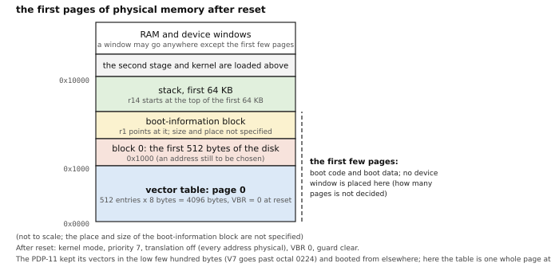

The vector table is at address 0 because `VBR` is zero at reset. The pdp64's block 0, the 512 bytes the ROM reads from the disk, goes to **0x1000**, an address still marked "to be chosen" (`docs/boot.md`), so the first stage runs above the table. The **boot-information block** (memory ranges, core count, the address of the root complex, the boot device, the console, a checksum and a version, 4.6.2) is pointed to by `r1`; its size and place are not specified. **`r14`**, the stack pointer, is the top of the first 64 KB of memory. The 64 KB of `r14` is only the stack's place. *(P)*

## H.7 Chapter 7: Multiple processors

The numbers in this fragment are labels: they are those of chapter 7 before its rewrite (errata 127 gives the map), not those of the body, and a citation of one of them reads "H.7, 7.8.1".

### 7.8 Starting and signalling the other cores (moved from chapter 7)

**7.8.1** (moved from chapter 7) The controller holds every core but core 0 in reset; a write to a per-core start register gives a core an entry address and an argument and releases it into kernel mode at priority 7, with its number in `r0`. *(P)* The same proposal is statement 4.7.1 of the boot chapter (its fragment is the one to read for the start protocol, the pseudocode and the figure); it is entered here as well because chapter 7 stated it independently.

**7.8.2** (the mechanism, moved from chapter 7) An inter-processor interrupt is a write to a per-core register in the interrupt controller; no APIC-like machinery is needed. *(P)* (That one core can interrupt another is decided, 7.10.4 of the body; how interrupts reach a core is open: [J.6.3](appendix-j-open.md#j63).)

**7.8.3** (moved from chapter 7) The routing of device interrupts to cores, and a shared second-level cache or a coherent interconnect, are device-side and unspecified. *(P)* (The routing of interrupts is the open item [J.6.3](appendix-j-open.md#j63); the cache and the interconnect are implementation choices that the architecture does not fix.)

*Commentary on 7.8.1 to 7.8.3 (moved from chapter 7).* **Precedent.** An x86 core wakes in 16-bit real mode and has to be walked through three modes by a trampoline (1,528 lines of start-up code and 1,258 of real-mode code in Linux); arm64 uses a firmware call in 124 lines or a spin table in 127; RISC-V 108 or 58; the VAX's console processor started the others. **Benefits.** A core can start in its normal mode at any address, so the whole protocol is one register write. **Modern comparables.** x86's INIT and START-UP interrupts, ARM's PSCI, RISC-V's hart-start call. **Impact.** *Kernel:* Starting a core is one register write, and a stuck core is reset by another. *Compiler:* None. *Hardware:* A start register and a reset-hold per core in the controller.

### 7.9 A kernel's view (moved from chapter 7)

**7.9.1** (the first clause, moved from chapter 7) The kernel starts a core by writing its start register. *(P)*

**7.9.4** (the last clause, moved from chapter 7) It wakes an idle core with an inter-processor interrupt. *(P)*

### 7.2 and 7.11 Commentary (moved from chapter 7)

*Total store order as the retreat.* If a large out-of-order core is ever built, total store order is the least painful retreat from sequential consistency (from the commentary of 7.2). The decision is reversible in the direction that matters: total store order can be the retreat for a large core (from the commentary of 7.11). *(P)* The smp-decisions record leans to writing the retreat down now as a one-way, announced switch for the whole machine, with no per-core or per-page weaker mode.

## H.8 Chapter 8: Vector work, AI and array languages: the device route

This fragment holds what the assistant proposed for the vector and accelerator work and the author has not accepted. The reader is the same as the chapter's: a PDP-11 programmer or a first-year student, who knows from 8.1 to 8.4 what a vector unit, a SIMD unit, a descriptor and a device on the memory bus are. The numbers are labels: a statement keeps the number it had in chapter 8 before the rewrite, and the pointer to its new place in the chapter is given where it has one.

### 8.2 Why not SIMD in the processor (moved from chapter 8)

The decision of the chapter (8.3.1) says that the processor has no vector register file and no SIMD instructions. Two further statements were attached to it as reasons, and they are the assistant's.

**8.2.3** (moved from chapter 8) A scalable design (ARM SVE, RISC-V V) avoids the fixed-width problem of 8.3.3, and is the most complex to specify and to implement; it is the only in-processor form that would suit this project's range, from a small FPGA core to a possible large one. *(P)*

A **scalable** vector design is a vector machine (8.2) in which the register width is not part of the architecture: the hardware has registers of whatever length it can build, and a program asks it how many elements it can handle at a time and loops until the array is done (strip mining, with the length chosen by the machine and not by the programmer). The same binary runs on a small and a large implementation, which a fixed-width SIMD set cannot do. The cost is the largest specification in the architecture and a compiler model that must handle a length it does not know.

**8.2.4** (moved from chapter 8) The compiled corpus shows little vectorisable code at the size-optimising setting; whether it shows more at higher optimisation is a measurement to make before any in-processor form is reconsidered. *(P)*

*Commentary (moved from chapter 8).* **Chain.** PDP-11: no vector unit. VAX: a fixed 64-element vector length with a length register for partial vectors *(unverified here: from the repository's notes on the VAX 6000 guide)*. ARM and RISC-V: a scalable form after fixed-width NEON and the x86 history. **Trade-offs.** A scalable vector extension would let one binary run on a small and a large implementation, at the price named above. **Modern comparables.** SVE and the RISC-V vector extension. (Packed lanes in the integer registers, the other in-processor form, are the open item [J.8.3](appendix-j-open.md#j83).)

### 8.3 AI and large-language-model inference: the LB64 accelerator (moved from chapter 8)

The author decided that inference is the target (8.5.1 of the chapter). The design of one accelerator for it, LB64, is the assistant's, written in `docs/pdp64-lb64-accelerator.md` after the author asked "what would a gpu look like that is optimized purely for samsung's littlebit-2 encoding" (register row R136). No decision of the author names the design, and it was written for the register model of the first device family, which errata 95 later set aside for virtio. It is kept here as a proposal; the statements below, which the chapter had tagged decided, are entered as proposed for that reason.

LB64 is for one kind of model, in which the weights are stored as one sign bit each, with a few 16-bit scale factors per row and column. With weights of plus or minus one, a multiplication of an activation by a weight is the activation itself or its negative, so a layer needs adders and a sign flip and no multipliers: the accumulator adds or subtracts each activation according to its weight bit (**sign-flip accumulation**). The device streams the weights from RAM at the memory's speed.

**8.3.1** (moved from chapter 8) The inference accelerator, LB64, evaluates the layers of a binary-weight language model as sign-flip accumulates with no multipliers, taking a chain of descriptors and writing a status back on completion. *(D in the chapter; judged proposed because no decision of the author names the device)*

**8.3.2** (moved from chapter 8) A layer is two descriptors, the second accumulating into the first's result for the residual path, and a transformer block is a chain; the processor writes the chain once and is then idle. *(D in the chapter; judged proposed, as 8.3.1)*

**8.3.3** (moved from chapter 8) The work is partitioned between small engines, each doing one thing with its own local memory: LB64 for the projections and the feed-forward layers, a floating-point multiply-accumulate engine for the attention products, a vector engine for normalisation, softmax, activation and rotary position encoding, and the processor for the descriptor chains, sampling and the tokeniser. *(P)*

**8.3.4** (moved from chapter 8) The accelerator has no instruction set: its computation has exactly one shape, so a programmable sequencer would spend its area on flexibility the work does not use. *(D in the chapter; judged proposed, as 8.3.1)*

**8.3.5** (the last clause of the old statement, moved from chapter 8) `POPCNT` and `XNORPOP` are not what the accelerator uses: its activations are 16-bit floating-point numbers, and the processor's bit instructions (8.5.2 of the chapter) serve the binary-activation case.

*Commentary (moved from chapter 8).* **Chain.** PDP-11: heavy numerical work went to an attached array processor (8.1). Neural-network engines of today: a ring of commands and data by DMA (8.2). A ring of descriptors in memory, each with an ownership bit, is how the DEUNA Ethernet controller of 4.3BSD worked (`if_de.c`, chapter 5), and the partition into small single-purpose engines fed by chains is the idea of the 144-processor GA144 chip applied to a workload that suits it *(unverified)*. **Trade-offs.** The accelerator is fast at what it does and does nothing else: attention is not helped, the element-wise work needs another engine, and a training accelerator is a different design again. The accelerator's descriptor is larger than the 16-byte virtio descriptor of chapter 5 (5.4.2), so the two must be reconciled; the proposal is that the standard descriptor's address points at a device-defined work block, which can chain, and the ring carries pointers to work blocks (the question is [J.8.2](appendix-j-open.md#j82)). **Benefits.** The lane count is set by the memory bandwidth and not by the amount of logic, so a small board can run a model the processor alone could not. **Modern comparables.** ARM's Ethos engines, Google's TPU, and the inference accelerators on small boards *(unverified)*. **Impact.** *Kernel:* a driver builds a chain and starts it; the kernel owns no model state and the only scheduling is of the device. *Compiler:* none; inference frameworks emit descriptors. *Hardware:* adders and sign-flip logic and no multipliers in LB64; the multiply-accumulate engine needs multiplier blocks; the memory interface sets the size.

### 8.4 Array languages: APL and K (moved from chapter 8)

**8.4.3** (moved from chapter 8; the length-in-the-descriptor part stayed as 8.5.4 of the chapter) The interpreter stays on the processor and sends a primitive to the device when the array is long enough to repay the setup; short arrays run on the processor. *(P)*

**8.4.5** (moved from chapter 8) A vector engine for such primitives would provide element-wise arithmetic and comparison, selection, reductions, scans, gather and scatter (read or write through an array of indices), compress (`where`: keep the elements for which a condition holds) and index generation, on integer, floating-point and bit-array types. *(P)* (The question of the operation set is [J.8.1](appendix-j-open.md#j81).)

*Commentary (moved from chapter 8).* **Trade-offs.** Offloading a primitive has a fixed cost, so the benefit is for arrays above a size threshold that has not been measured; reductions and scans carry a dependence along the array that the device must support directly; sorting and gather are limited by memory bandwidth. **Benefits.** The same device that serves the array languages serves the element-wise work of inference and the lane-wise work of graphics. **Impact.** *Hardware:* a streaming engine with a small set of element-wise, reduce, scan and gather units behind the ring engine, sized to the memory bandwidth.

### 8.5 Number formats (moved from chapter 8)

**8.5.1** (the second clause of the old statement, moved from chapter 8) Formats other than `binary64`, `binary32` and `binary16` (bfloat16, 8-bit integers with 32-bit accumulation, binary weights, 8-bit floating point) are the device's. *(P)*

**8.5.2** (moved from chapter 8) Each vector device names its operations and formats in its identification block and feature bits, so a library can choose by asking. *(P)*

*Commentary (moved from chapter 8).* **Chain.** PDP-11: single and double. VAX: four formats, F, D, G and H. x86 added half precision, bfloat16 and `VNNI` dot products (8-bit multiply and 32-bit accumulate) to the instruction set; ARM has `BF16`, `SDOT` and matrix extensions *(unverified)*. **Trade-offs.** A format fixed in the processor's instruction set cannot change when the machine-learning field changes it, as it has several times; a format in a device is replaced by replacing the device. **Impact.** *Kernel:* none. *Compiler:* only the scalar formats; the machine-learning formats are descriptor fields. *Hardware:* the devices' multiply-accumulate units, not the processor's, are built for the formats in use.

### 8.6 Driving a vector device (moved from chapter 8)

The chapter (8.4) shows the driver of an accelerator in pseudocode as an illustration. The statements below were its prose form, and the order of events they fix is a proposal until the descriptor is settled.

**8.6.1** (moved from chapter 8) A program fills a descriptor naming the operation and the arrays, executes `FENCE`, and writes the doorbell; the device processes the descriptor, writes the results and a status, and clears the ownership bit; the program polls or takes the interrupt. *(P)*

**8.6.2** (moved from chapter 8) A chain of descriptors runs without the processor, and a work block that is a chain is how a transformer layer or a sequence of array primitives is expressed. *(P)*

**8.6.3** (moved from chapter 8) The buffers are uncached, as for every device, so the processor's reads of results are slow; a large result is left in the device's memory or read back by the next descriptor. *(P)*

*Commentary (moved from chapter 8).* This is the same driver skeleton as for a disk (chapter 5), with an operation field that means "add these arrays". **Trade-offs.** The slow uncached readback is the cost of the explicit hand-off; an interpreter that needs many small results back on the processor should leave them in device memory. **Impact.** *Kernel:* one driver skeleton. *Compiler:* none. *Hardware:* one ring engine shared with every device.

## H.9 Chapter 9: The instruction set

**9.3.9** (moved from chapter 9) `R16` to `R31` in the ABI: the compiler saves `R24` to `R31` in the callee and treats `R16` to `R23` as clobbered by a call. The ABI documents call this split a draft; it is built into the compiler and the runtime of the six large programs. *(P)*

**9.20.4** (moved from chapter 9) Under consideration: separate floating-point condition flags, software-visible translation-buffer manipulation (to pin an entry for a real-time kernel). *(P)* The floating-point condition flags and the conditional select are open items now (J.9.9, J.9.1); the translation-buffer manipulation is only a proposal: an instruction that pins one translation so that a real-time kernel's interrupt path never takes a miss.

**9.2 commentary** (moved from chapter 9) Whether the extension instruction after some narrow operations costs enough to justify 32-bit forms of add and subtract is a proposal that the compiled corpus can answer; it is the proposal of appendix A.9. *(P)*

**9.18 commentary** (moved from chapter 9) A bounds-checked `INDEX` instruction for Pascal and Ada is a possible addition. *(P)*

**9.21.3** (moved from chapter 9) Not decided in the encodings: the combination `.ud` of the two load qualifiers, the stage 2 whole-buffer hash and cipher words (`MSHA256`, `MSHA512`, `MAESCTR`), and a profile-tuned variant of the encoding (not tried). In the compiler: the use of `MOVUW`, `MOVUL` and `MOVUQ`, division by 64-bit constants, loop-invariant motion and live-range splitting. *(P)*


### The instruction entries held back from chapter 9 (moved from the dictionary of chapter 9)

The entries below were in the instruction chapter, in the section named at the end of each entry. They describe instructions that the grammar of the encoding carries and that the author has not decided: each is tagged *(P)*. (The words the author did decide, with their details pending, are back in the chapter: `BSEL`, the deferred-fault and user-qualified moves, and the AES and SHA words.) The bit layouts are in the grammars `spec/pdp64-enc.hbnf` and `spec/pdp64-32/pdp64-32.hbnf`; the charts are not reproduced.

#### MOVUSERD: User-qualified deferred-fault load

**Mnemonics:** `MOVQ.UD`, `MOVL.UD`, `MOVW.UD`, `MOVB.UD`, `MOVZL.UD`, `MOVZW.UD`, `MOVZB.UD` (section 9.6 of the instruction chapter)

**Syntax**

```
MOVQ.UD d(Rn), Rd
MOVL.UD ..., MOVW.UD ..., MOVB.UD ...
MOVZL.UD ..., MOVZW.UD ..., MOVZB.UD ...
```

**Operation**

```
Rd <- M[EA], the access being both user-qualified (MOVU) and deferred (MOVD)
```

**Flags** None written.

**Exceptions** The faults of `MOVU` and `MOVD` together.

*(P)* The combination of the two qualifiers. The repository defines each qualifier alone (items 10 and 18 of `docs/study-proposals.md`) and gives the combination no text of its own: a kernel that reads a user word without wanting to fail on it (a probe of a user pointer) is the case the combination serves, and its meaning is the composition. Loads only, base and indexed operands.

**Why it is here.** See `MOVD` and `MOVUSER`. The record gives no separate reason for the combination; it is listed because both qualifiers exist and a probe of a user pointer wants both.

#### MSHA: Hash whole blocks of memory

**Mnemonics:** `MSHA256`, `MSHA512` (section 9.11 of the instruction chapter)

**Syntax**

```
MSHA256 Rd, Rs, Rn
MSHA512 Rd, Rs, Rn
```

**Operation**

```
hash the Rn bytes (whole blocks) at (Rs) into the state at (Rd)
progress is held in Rd, Rs and Rn; an interrupt or a fault restarts the instruction where it stopped
```

**Flags** None written.

**Exceptions** Memory operand: page fault, protection fault, alignment fault or bus error (a read of non-existent memory is a precise abort with cause `BUSFAULT`). Every such fault is precise and the instruction restarts after it, because the register update of an auto-increment or auto-decrement mode is held until the instruction retires.

*(P)* Stage 2 of the crypto proposal (`docs/crypto-secure-core.md` section 3.4): the whole-buffer form, in the manner of the s390 CPACF instructions, to be built "only after measurement"; the grammars reserve its encoding. The unit would need about 2,000 look-up tables and 1,000 flip-flops (the proposal's estimate).

**Why it is here.** Stage 2 of the crypto proposal, in the manner of the s390 CPACF instructions (`KIMD` and kin): one instruction hashes a buffer, the padding and chaining are done in hardware and so cannot be got wrong, and progress is held in registers, so a fault or an interrupt restarts it, as for `MCPY`. The estimate is 64 cycles for a 64-byte SHA-256 block against about 1,200 instructions, roughly 18 times; the cost is gates in proportion to the algorithms frozen into opcodes. The proposal says to build `MSHA256` first and the others only after measurement, and the author has not decided it.

#### MAESCTR: AES in counter mode over a buffer

**Mnemonics:** `MAESCTR`

**Syntax**

```
MAESCTR Rd, Rs, Rn, Rp
```

**Operation**

```
AES counter mode over the Rn bytes at (Rs), written at (Rd); the key, the counter and the number of rounds are in the parameter block at (Rp)
progress is held in the registers and the parameter block; an interrupt or a fault restarts the instruction where it stopped
```

**Flags** None written.

**Exceptions** As `MSHA`.

*(P)* Stage 2, as `MSHA`; the layout of the parameter block is not specified.

**Why it is here.** Stage 2, as `MSHA`; whole-buffer AES gains less (about 4 times: 0.6 against 2.6 instructions per byte), because the round instructions are already good, and the proposal puts it after `MSHA256` and `MSHA512`.

## H.10 Chapter 10: Conclusion: from FPGA to silicon

**10.1.2** (moved from chapter 10) The first board is the Terasic DE10-Nano (Cyclone V SE: about 110,000 logic elements, dual Cortex-A9, 1 GB of memory on the hard processor, HDMI, and the MiSTer ecosystem); the Digilent Zybo Z7-20 or the AMD Kria KV260 are the move when timing becomes the limit; the open-toolchain ULX3S is kept in view but loses the hard-core harness. The device chat staged devices first on a Zynq UltraScale+ (`decisions-pending.md` E6). *(P)*

**10.1.8** (moved from chapter 10) On the paper estimates of the SMP decisions, four cores with the floating-point unit fit only a board of the Kria KV260 class, and sixteen cores fit none of the boards of the plan; no core has been synthesised. *(E)*


**10.3.4** (moved from chapter 10) Sequential consistency is nearly free on a small in-order core and is the most expensive memory model for a large speculative one; if a large core is built it may be necessary to move to total store order, which is the least painful retreat. *(P)*

**10.1.1** (moved from chapter 10) The first implementation is a soft core on a system-on-chip FPGA whose hard ARM cores serve as the bring-up harness: they load programs, run the tests and provide the console while the pdp64 core is still being debugged, and run an instruction-set simulator beside the core to compare the architectural state after every instruction (`pdp64-fpga-plan.md`, section 6). The text of the chapter tagged this *(D)*; no decision of the author was found for the harness (the register's R24, "since the soc will have hdmi", assumes a system-on-chip and nothing more), so it is proposed. *(P)*

**10.1.4** (moved from chapter 10) The estimated clock a simple single-issue core reaches is 50 to 80 MHz on the Cyclone V, 90 to 130 MHz on a Zynq 7020 and 180 to 250 MHz on an UltraScale+; every one of those estimates is below the 200 to 300 MHz target except the upper part of the UltraScale+ range, and reaching the target means pipeline stages in the datapath. A correct machine at a lower clock comes before a fast broken one. *(E)*

**10.1.5** (moved from chapter 10) The work is staged in phases, each ending in a demonstration and a regression suite: specification and tools; an integer core; exceptions; the memory-management unit; the memory system; floating point; a booting kernel; peripherals; and, last, the other cores. The text of the chapter tagged this *(D)*; the phase plan is the assistant's (`pdp64-fpga-plan.md`, section 5) and the author has not spoken to it (`decisions-pending.md`, E6: "No erratum backs either"), so it is proposed. The decided part, the number of cores, stays in the chapter (10.1.3). *(P)*

**10.1.6** (moved from chapter 10) The second phase, the fault model, is not optional and does not move; the block operations are built with it, because their whole specification is about what state is visible when an exception arrives. *(P)*

**10.1.7** (moved from chapter 10, from 10.1.3) On the first board the block RAM is about 5.5 megabits, and the caches, the translation buffer, the framebuffer and the blitter's scratch memory compete for it. *(E)*

**10.1.9** (moved from the commentary of 10.1) A single engineer working part-time can reach a booting system with floating point in roughly 10 to 19 months, by the plan's wide-error-bar estimate (phase by phase: 5 to 9 weeks for specification and tools, 9 to 14 for the integer core, 6 to 11 for exceptions, 7 to 11 for the memory-management unit, 4 to 8 for the memory system, 4 to 7 for floating point, 8 to 16 for the kernel), with phases 2 and 3 the ones that historically double. *(E)*

**10.1.10** (moved from the commentary of 10.1) The register-transfer description is kept vendor-neutral, with every vendor primitive in one thin directory that holds the register file, block RAM and DSP wrappers and should stay under 500 lines, so that moving between boards costs that directory and nothing else; the datapath is written in SystemVerilog and the floating-point unit is bought, not written (Berkeley HardFloat). *(P)*

**10.1.11** (moved from the commentary of 10.1) A multiplier built from two to four multiplier blocks over four to eight cycles closes timing where a full combinational one will not. *(E)*

## H.A Appendix A: Improvements beyond the PDP-11

### A.4 Protecting the return address (moved from appendix A)

**A.4.1** There are four ways to protect the return address: software canaries and OpenBSD's return-address protection in the compiler, a hardware return stack, a shadow stack, and nothing. *(P)* The mirror shadow stack is approved (errata 85, study item 6); the others are the alternatives that were weighed.

*Commentary.* **Trade-offs.** A shadow stack is the strongest and brings the most recovery code (a second stack to overflow, switch and unwind), so the analysis did not recommend it by default; software detection costs a few instructions per function and no hardware. **Verdict** (the assistant's, before the decision). Start with the compiler; consider a hardware mechanism only if code size allows. **Benefits.** Detection with little or no recovery code. **Impact.** *Compiler:* The compiler adds a canary or a return-address check per function. *Hardware:* Software costs nothing; a hardware return stack costs a second stack structure and its control.

### A.9 Thirty-two-bit forms of add, subtract and shift (moved from appendix A)

**A.9.1** If the extension instructions the compiler emits after narrow arithmetic are more than a few percent of the code, 32-bit forms of the common operations in one-parcel leaves would remove them.

*Commentary.* **Precedent.** AArch64's `W` forms and RISC-V's `ADDW` family. **Trade-offs.** A second set of leaves in the table against extension instructions in the compiled code; the overhead has never been measured over the whole corpus. **Verdict.** Measure first; it is one script over the compiled corpus. **Impact.** *Kernel:* None. *Compiler:* The compiler stops emitting an extension after common 32-bit operations. *Hardware:* A second set of opcodes in the page-2 map and a little ALU decode.

### A.10 Packed-lane instructions in the integer registers (moved from appendix A)

**A.10.1** A small set of lane operations (add, subtract, saturating add, compare, minimum, maximum, average, sum of absolute differences, shuffle on 8, 16 and 32-bit lanes) in the existing registers could speed up string, codec and image loops.

*Commentary.* **Precedent.** Alpha's motion-video instructions and PA-RISC's multimedia instructions did exactly this, in integer registers. **Trade-offs.** It adds no state and little hardware, but it is 64 bits wide so the gain per instruction is modest, and compilers use it poorly. **Verdict.** Collect the evidence first: the compiler corpus was built at a size setting that hides how much vectorisable code there is (appendix B, S1). **Impact.** *Kernel:* String and checksum routines get faster. *Compiler:* Vectorisation into integer lanes is weak, so the library routines would be hand-written. *Hardware:* A lane-aware ALU: little extra hardware and no new state.

### A.12 Smaller possibilities (moved from appendix A)

* **`MULHSU`** (the high half of a signed-by-unsigned product, for a signed top limb meeting an unsigned one) is reserved in the arithmetic escape; it is one correction step in software and has one caller, a bignum library's innermost loop.
* **Hardware page zeroing**, and **guard-page states in the page-table entry that do not consume translation-buffer entries**, would make the allocator hardening of OpenBSD's `malloc` cheaper.
* **A mixed leaf size for the kernel's text** is needed if the kernel is to be write-xor-execute with one-gigabyte leaf pages.

*Commentary.* **Trade-offs.** None of these is ranked above the decisions in appendix B; the first four sections of this appendix (landing pads, the system-call page bit, the stack check and return-address protection) are the ones OpenBSD's developers have shown the most interest in. (Hardware watchpoints are approved and the sealed page bit and `pledge` mask are rejected: A.10.)

## H.B Appendix B: Decisions pending

### B.1 The instruction set and the system (moved from appendix B)

#### B.1.2 An unprivileged time counter (P3)

**B.1.2.1** The proposal is `RDTIME rd`, an unprivileged read of a free-running, constant-rate, monotonic counter. *(P)*

*Commentary.* **Precedent.** The PDP-11 and VAX kept the time in memory updated by a line clock and read it with a system call. **Trade-offs.** A user-readable counter is a timing side channel, so the kernel needs an enable bit; the counter's width and rate become architecture. **Benefits.** A clock read without a trap, which is what a fast `clock_gettime` in a shared page needs. **Modern comparables.** x86 `RDTSC`, RISC-V `rdtime`, PowerPC `mftb`, s390 `STCKF`, MIPS `RDHWR`, LoongArch `rdtime`; the x86 counter's history of unreliability is the argument for fixing monotonicity and constant rate at the start. **Use.** Timestamps, timeouts, and the fast path of every library's clock call. **Impact.** *Kernel:* A fast `clock_gettime` with no trap. *Compiler:* An intrinsic for the counter read. *Hardware:* One counter, a user-read enable bit and a `SYSX` decode.

#### B.1.3 Feature and identification registers (P4)

**B.1.3.1** The proposal is a block of read-only system registers (numbers 13 and up) giving the version, the optional features, the cache geometry, the page sizes and the address width. *(P)*

*Commentary.* **Precedent.** The VAX had a system-identification register the kernel switched on; x86 has `CPUID`, which has grown hundreds of leaves and traps under virtualisation. **Trade-offs.** Each register's layout must be written once in a grammar so it cannot drift. **Benefits.** One binary adapts to the machine, and a kernel need not patch itself per model (OpenBSD carries 75 references to its boot-time patching). **Modern comparables.** AArch64's identification registers, RISC-V's `misa`. **Impact.** *Kernel:* The kernel need not patch itself per model. *Compiler:* Runtime selection of routines by feature bits. *Hardware:* A small block of read-only registers.

#### B.1.4 TLB invalidation by address-space tag (P5)

**B.1.4.1** The proposal is one new instruction, `TLBIASID`, that invalidates every translation of one address space, broadcast like `TLBI`. *(P)*

*Commentary.* **Precedent.** The VAX flushed process translations on every context switch and kept system ones; x86 added tags (PCID) and `INVPCID` much later. **Trade-offs.** A flush-all works until the first rollover of the tag numbers, after which every process loses its translations. **Benefits.** Process exit and tag reuse become cheap. **Modern comparables.** AArch64 `TLBI ASIDE1IS`, RISC-V `sfence.vma` with an address-space operand, x86 `INVPCID`. **Impact.** *Kernel:* Process exit and tag reuse become one broadcast. *Compiler:* None. *Hardware:* A tag compare in the translation buffer's invalidate path.

#### B.1.5 What a multi-register instruction leaves behind when it faults (P12)

**B.1.5.1** The proposal is a rule and a test: every multi-access instruction (`PUSHM`, `POPM`, `PUSHX`, `POPX`, the block operations) is either all-or-nothing or safe to repeat from the start, and an emulator test interrupts each at every access and checks that a restart reaches the same state. *(P)*

*Commentary.* **Precedent.** The PDP-11 needed a status register (`MMR1`) and, on the 11/40, a kernel routine that decoded the faulting instruction to undo it; the VAX needed a first-part-done bit; ARM's load-multiple restarts with the base register restored. **Trade-offs.** The area below the stack pointer is dead memory, so a partial push is invisible; the risk is another observer (a device or core) seeing a half-written area. **Benefits.** The fault handler restarts blindly, with no instruction-specific cases, which is what recoverability means. **Modern comparables.** RISC-V has no multi-register instruction; ARM and the VAX restart as above. **Impact.** *Kernel:* The fault handler restarts every multi-access instruction blindly. *Compiler:* None. *Hardware:* Each multi-access instruction checks every address before acting, or is repeatable.

#### B.1.7 A prefetch instruction (P15)

**B.1.7.1** The proposal is none, with the shape of a non-faulting `PREFETCH` with a memory operand reserved on a free sub-opcode. *(P)*

*Commentary.* **Precedent.** Neither the PDP-11 nor the VAX had one; caches there were transparent. **Trade-offs.** The kernel survey counts over a hundred prefetch instructions across the four kernels, mostly in tuned list and copy code; an in-order core with no data cache gains nothing. **Modern comparables.** AArch64 `PRFM`, ARM `PLD`, PowerPC `DCBT`, x86 `PREFETCHT0`. **Impact.** *Kernel:* List walks and copy loops can warm the cache. *Compiler:* `PREFETCH` would need compiler heuristics. *Hardware:* A non-faulting load path with no destination; nothing on a core with no data cache.

#### B.1.8 Performance counters (P16)

**B.1.8.1** The proposal is two free-running counters, cycles and instructions retired, readable in user mode, added after the clock (P3) with the same enable bit. *(P)*

*Commentary.* **Precedent.** Unix profiled by sampling the program counter at clock ticks. **Trade-offs.** A user-readable cycle counter is a timing channel; a full counter block with event selection costs a large block and interrupt machinery. **Modern comparables.** x86 `RDPMC`, the AArch64 PMU, RISC-V's `hpm` counters. **Impact.** *Kernel:* A profiler reads counters instead of sampling at ticks. *Compiler:* Intrinsics. *Hardware:* Two counters and an enable bit.

#### B.1.10 The literal pool and execute-only code (P18)

**B.1.10.1** The proposal is an ABI rule: literal pools move out of `.text` into a read-only section beside it, so code pages hold only instructions and can be execute-only. *(P)*

*Commentary.* **Precedent.** The PDP-11's immediates sit in the instruction stream, and with separate instruction and data spaces a program could not read its own instructions as data. **Trade-offs.** The PC-relative reach limits how far the pool may be, and the linker must keep the two sections near each other. **Benefits.** Zero hardware; a memory-disclosure bug no longer reveals code. **Modern comparables.** OpenBSD makes code execute-only on amd64 and arm64; ARM compilers offer a flag to keep pools out of code. **Impact.** *Kernel:* None. *Compiler:* Pools are emitted into a read-only section beside the text. *Hardware:* None; the linker keeps the sections within PC-relative reach.

#### B.1.11 Vector and SIMD math (S1 to S6)

**B.1.11.2** Decided (errata 59, chapter 8): data-parallel work lives in memory-mapped devices, and the processor has no vector register file and no SIMD instruction set. What remains is the number formats and operations of the devices (half precision, bfloat16, 8-bit integer dot products, 8-bit floating point), the reconciliation of the device descriptors with the standard descriptor, and whether packed integer lanes are added to the integer registers (A.10). *(P)*

*Commentary.* **Precedent.** The PDP-11 sent heavy numerical work to attached array processors; the VAX had a vector extension on its 6000 series, with 16 vector registers of 64 elements, supported by VMS; neither Unix used it much. **Trade-offs.** A fixed-width vector file brings a second register file and its context-switch cost, opcodes, and a new width for every generation (the history of SSE, AVX and AVX-512); a scalable design runs one binary on a small and a large implementation at the price of the most complex specification. Lazy saving of vector state was a security hole on x86, and Linux went back to eager restore. **Benefits.** The coprocessor needs no opcodes and no processor state. **Modern comparables.** ARM SVE and RISC-V V (scalable), ARM NEON, x86 AVX, PowerPC VSX, Alpha MVI. **Use.** Neural-network inference (the LB64 accelerator), graphics, signal processing and the library's string and memory routines. The evidence needed first: compile the corpus at higher optimisation and count vectorised loops, measure the share of time in memory and string routines, and decide the target workloads. **Impact.** *Kernel:* No vector state to save. *Compiler:* No vectoriser for the processor; the runtime lowers array primitives to descriptors. *Hardware:* No register file; the devices carry the width.

### B.2 The bus, boot and devices (moved from appendix B)

#### B.2.1 Data-cache maintenance by address (P6)

**B.2.1.1** The proposal is to reserve nothing: DMA buffers are uncached, so no cache instruction is needed until a non-coherent device appears. *(P)*

*Commentary.* **Precedent.** The 11/70's cache watched DMA writes; the VAX's adapter had data paths to purge. **Trade-offs.** Uncached buffers are slow to read; cache maintenance would speed them and needs three reserved sub-opcodes. **Modern comparables.** ARM, MIPS and embedded PowerPC with non-coherent DMA wrap cache maintenance in a DMA-mapping layer; x86 DMA is coherent. **Impact.** *Kernel:* Drivers need no cache code. *Compiler:* None. *Hardware:* No cache-maintenance operations.

#### B.2.2 Firmware calls (P7)

**B.2.2.1** The proposal is none: everything goes through devices, with a required reset register and a watchdog in the bus controller. The kernel survey disagrees and would specify a firmware-call convention on reserved trap vectors. *(P)*

*Commentary.* **Precedent.** The PDP-11 kernel never called firmware; the VAX had console registers the kernel read and wrote. **Trade-offs.** No firmware means no firmware to trust and no extra privilege level, and every platform must say where its console and reset registers are, which the others get from firmware. **Modern comparables.** RISC-V's supervisor binary interface, ARM's PSCI and secure monitor calls, Alpha's PALcode, SPARC's Open Firmware. **Impact.** *Kernel:* Reboot and power-off through a device register and a watchdog. *Compiler:* None. *Hardware:* A reset register and a watchdog timer in the controller.

#### B.2.3 Double-width compare-and-swap and a random-number instruction (P8, P9)

**B.2.3.1** The proposal is to add no double-width compare-and-swap: the evidence for it is one Linux use (software can tag a pointer with the 25 spare bits instead). Random numbers come from an entropy device on the bus rather than an instruction: that is decided (errata 85, 5.7.2). *(P)*

*Commentary.* **Precedent.** The VAX solved the lock-free queue with whole-queue interlocked instructions; no machine of the period had a random-number instruction. **Modern comparables.** x86 `CMPXCHG16B`, AArch64 `CASP`, RISC-V `AMOCAS.Q`; x86 `RDRAND` and `RDSEED`, PowerPC `DARN`, s390 `PRNO`, AArch64 `RNDR`. **Impact.** *Kernel:* Entropy from a device at boot. *Compiler:* Tagged pointers in software if a double-width compare-and-swap is not wanted. *Hardware:* An entropy source device; no new opcode.

#### B.2.4 The interrupt controller and routing to cores (R1)

**B.2.4.1** The proposal is wired interrupt lines to core 0 with a per-line target register, keeping the eight priority levels, with message-signalled interrupts as an extension. *(P)*

*Commentary.* **Precedent.** The PDP-11 had no controller; a device asserted one of four request lines and supplied its vector. **Trade-offs.** The smallest design adds no new failure cases and cannot give a fast multi-queue device its own interrupt. **Modern comparables.** x86's APIC, ARM's GIC, RISC-V's PLIC and AIA. **Impact.** *Kernel:* A handler sees one interrupt model. *Compiler:* None. *Hardware:* Wired lines to one core with a target register.

#### B.2.5 Inter-processor interrupts and starting other cores (R2, B2)

**B.2.5.1** The proposal is a per-core doorbell register and a per-core start register in the bus controller (4.7), with `SEV` and `WFE` for waiting. *(P)*

*Commentary.* **Precedent.** The VAX's console processor started the other processors. **Modern comparables.** x86's INIT and START-UP sequence, ARM's PSCI and spin table, RISC-V's hart-start call. **Impact.** *Kernel:* One register write per core and one per doorbell. *Compiler:* None. *Hardware:* A start register and a doorbell per core.

#### B.2.6 How coherence scales (R3)

**B.2.6.1** The proposal is to keep snooping for the four cores of the first device; the ceiling is now sixteen or more (errata 92), and the protocol for that many is open (7.6.4). *(P)*

*Commentary.* **Trade-offs.** Directory protocols scale and are large; software coherence is cheap and fragile. **Modern comparables.** x86's snoop filters and directories across sockets, ARM's coherent interconnects. **Impact.** *Kernel:* Cache coherence is invisible to the kernel. *Compiler:* None. *Hardware:* Snooping on two to four cores.

#### B.2.8 The device layout and the descriptor (R5)

**B.2.8.1** The feature subset of each device is open. *(S)*

*Commentary.* **Precedent.** The RK11 and the DEUNA, as in chapter 5. **Trade-offs.** A standard interface gives up the freedom to shape the registers and gains every existing driver. **Modern comparables.** `virtio`, NVMe, SATA's command lists, Intel Ethernet's done bit. **Impact.** *Kernel:* One transport driver and a thin driver per class. *Compiler:* The descriptor is a generated C structure. *Hardware:* Standard devices.

#### B.2.10 Errors raised by devices and the bus (R7)

**B.2.10.1** The proposal is the precise and imprecise paths the ISA already has plus a small register block in the bus controller for the cause. *(P)*

*Commentary.* **Precedent.** A PDP-11 bus timeout trapped through vector 4 and usually ended in a panic; the VAX had a machine-check frame. **Modern comparables.** x86's machine-check banks and PCI Express error reporting, ARM's RAS extension. **Impact.** *Kernel:* One recovery path for device errors. *Compiler:* None. *Hardware:* A small error register block in the controller.

#### B.2.11 Virtualisation (R8)

**B.2.11.1** The proposal is to declare it out of scope for System v1 and fix five constraints: privileged state stays privileged or controllable, the page-table walker could be wrapped by a second level, interrupts are injectable, system-register access can trap, and the translation-enable bit and software accessed and dirty bits are reviewed for what a hypervisor would need. *(P)*

*Commentary.* **Precedent.** The PDP-11 was not designed for virtualisation and has sensitive instructions that do not trap in user mode; the VAX was not cleanly virtualisable either, and a 1991 paper described the changes needed. **Trade-offs.** Adding virtualisation late cost the VAX instruction changes; settling the constraints early costs a paragraph. **Modern comparables.** x86 VMX with nested paging, ARM exception level 2, the RISC-V hypervisor extension, IBM's trap-and-emulate machines. **Impact.** *Kernel:* A hypervisor could be added without changing a guest. *Compiler:* None. *Hardware:* Constraints on privileged state, the walker and interrupt injection.

#### B.2.12 Enumeration and hot-plug (N1 to N3)

**B.2.12.1** Enumeration by PCI Express configuration space is decided (N1, errata 80, 2.4), and so is the read of a function that is absent, which returns all ones (errata 104, 2.4.7). The proposals that remain are the placement of the windows in the physical address space, an interrupt and a rescan on a hot-plug event (N2), and the queued work left in memory when a device departs (N3). *(P)*

*Commentary.* See section 2.4 and its commentary: the VAX's nexus scan, PCI's configuration space and all-ones reads, USB's status-change endpoint. **Impact.** *Kernel:* Enumeration and hot-plug are one loop and one rescan. *Compiler:* None. *Hardware:* A standard root complex and the precise fault for an absent device.

#### B.2.13 The boot decisions (B1, B3, B4, B5, B8)

**B.2.13.1** The boot ROM that reads block 0 (B1) is decided (errata 109, 4.4). The proposals that remain are the contents of the boot-information block: memory, cores, the root complex's address and the boot device and console (B3), an `INIT` bit with an optional firmware descriptor (B4) and a block list in the protective MBR's boot code (B8). *(P)*

*Commentary.* See chapter 4 and [`boot.md`](../boot.md): the PDP-11's block 0 and `ODT`, the VAX's boot block and restart parameter block, the BIOS and UEFI (4.9 for the UEFI decision and the shim). **Impact.** *Kernel:* A boot-information struct and a core start register. *Compiler:* The loader and first block are built by the project's compiler. *Hardware:* A boot ROM, a block-0 reader and per-core start registers.

#### B.2.14 How USB attaches, and virtio first

**B.2.14.1** Whether USB is a conventional ring-based host controller driven by an existing operating-system USB stack, the proposal of chapter 5, or a controller that does the protocol itself.

*Commentary.* **Trade-offs.** A controller that does the protocol moves it into the chip and takes the stack out of the operating system; the conventional controller uses code that already exists. `virtio` reuses OpenBSD's existing drivers in the emulator and in silicon. **Modern comparables.** xHCI for the conventional controller; `virtio-mmio` on every emulated RISC-V and ARM board. **Impact.** *Kernel:* A disk driver serves a USB disk; virtio reuses the existing drivers. *Compiler:* None. *Hardware:* USB protocol in the controller costs gates; virtio costs nothing for the emulator.

## H.D Appendix D: The ABI, version 1

**D.1** (moved from appendix D, the Registers row) `R16` to `R23` are caller-saved and `R24` to `R31` callee-saved. *(P)*

**D.4.2** (moved from appendix D) The compiler treats `R16` to `R23` as clobbered by a call and `R24` to `R31` as saved by the callee, and the stand-in runtime of the six large programs saves `R24` to `R31` in `setjmp` and `longjmp`. `docs/abi.md` calls this split a draft. *(P)*
<!-- /parts:proposed -->
