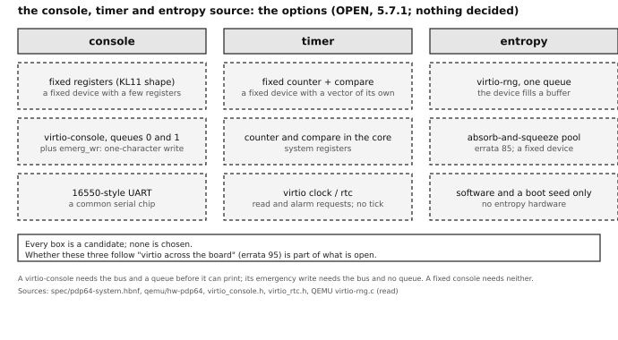

# Appendix J. Open items

[← manual index](00-index.md)

**This appendix discusses each question that the architecture must answer and has not.** In the body of the manual an open item is one short sentence with a pointer to its entry here (`Open: how many pages the first few are (J.3.2).`). The entry states the issue, why it matters, every option with its advantages and disadvantages, the precedents, the author's own words on it where he has given them, and the places in the body that refer to it. Where the assistant that wrote the entry has a leaning, it is labelled "The assistant's leaning" and is not a decision. Each section is one chapter's share, headed with the chapter's number and title (`J.3` for chapter 3, `J.D` for appendix D); the items in it are numbered `J.3.1`, `J.3.2` and so on, and a number is not reused once it has been cited. Statements that moved here from the body keep their old number as a label. What is proposed but not decided is in [appendix H](appendix-h-proposed.md); what has been put off is in [appendix I](appendix-i-deferred.md).

<!-- parts:open -->
## J.2 Chapter 2: The bus

<a id="j21"></a>
### J.2.1 Locating devices without a selecting bit

**Issue.** On the Unibus, an address whose top bits were all ones meant "a device register", so every driver knew where its device was. The pdp64 has no such bit (errata 97, 102): a device window is an ordinary range of physical addresses, and the physical address is at least 40 and at most 64 bits wide. Software must therefore learn from somewhere where each window is, and something must choose where it goes. There are three ways to do it: **enumeration** (the processor reads a small self-description from every device and assigns each one a window), a **table handed over at boot** (the first stage tells the kernel what is where), or **fixed addresses** written into the architecture. The manual's text assumes enumeration through the root complex (the chip at the top of the bus tree, which turns the processor's accesses into bus transactions) and says only that the address of the root complex arrives in the boot-information block.

**Why it matters.** The kernel cannot attach a driver before it knows a base address. With no address bit to mark a device page, the memory type of a mapping is the only marker of what a page is. The root complex must decode exactly the windows that were assigned, and must refuse a device's DMA (direct memory access: a device reading or writing memory by itself) into another device's window; the IOMMU (a unit that translates the addresses a device uses, so that a device can only reach the memory it was given) needs the same map to do that. The statement that says where the configuration space and the windows sit is unspecified.

**Options.**

1. *PCI Express enumeration, with the root complex address and a window pool in the boot-information block.* The kernel assigns each function's base-address registers (the registers by which a device states the size of a window it wants and is told where it sits) from a range of addresses that the block gives it. For: one mechanism for everything on the bus; only two numbers are passed (the base of the configuration space and the window pool); the platform may move them freely, so the architecture fixes nothing; drivers learn their base from the device. Against: the kernel must trust the pool, and a pool that overlaps RAM can be detected only by comparing ranges; the console needs a separate base before enumeration has run.
2. *A device table in the boot-information block* (kind, base, size, interrupt for each device), with no enumeration for the platform's own devices. For: suits devices that are not on PCI Express at all; needs no walk of the bus. Against: duplicates what enumeration finds, so there are two mechanisms; a device that arrives later is not in the table.
3. *A fixed platform map written in the architecture:* the root complex and a window range at fixed addresses. For: no table to trust and no problem early in boot; very simple for a small board. Against: it fixes an address below 2^40, the smallest width, and so brings back the habit of the upper half of the address space that the author dropped; a wider machine cannot put its windows high; the VAX shows that a fixed map is changed from model to model.
4. *Top-down placement:* the root-complex window ends at the top of the implemented physical address space, so it moves with the width the processor reports. For: never collides with RAM, which grows up from zero; one rule for 40 and for 64 bits. Against: depends on the width being discoverable (an open question of its own); a program that assumes a width computes a wrong address; memory sizes near the top collide with it.
5. *An address-map list handed over at boot,* each range typed as RAM, device or reserved, with the memory type of a page as the only runtime marker. For: one place says what every range is; a window can sit anywhere; the kernel can refuse to map RAM as a device and the reverse. Against: the list can be wrong; a wrong memory type on a device page is no longer caught by hardware, as the old address bit caught it; more kernel code.
6. *A self-describing window-map register block at one fixed low address,* just above the first pages, through which everything else is found. For: only one address is architectural, and it is in the reserved boot area; no block is needed. Against: a new device and a new fixed address; the reservation of the first pages must cover its page.

**Precedents.** The RISC-V virt board of QEMU gives the configuration space at 0x30000000 and the PCI Express windows at 0x40000000 and describes them to the kernel *(verified: QEMU hw/riscv/virt.c)*. The x86 ACPI table that names the configuration-space base *(unverified: general knowledge)*. The VAX had the Interconnect (the bus of the VAX-11/780) and a table that its adapter slots filled; its I/O space began at 0x20000000 with one 8 KB window per adapter slot, changing from model to model *(verified: the 4.3BSD `nexus.h` read for chapter 2)*. The PDP-11 I/O page at the top of the 16-bit space, and the extended spaces of the later models *(verified for the 16-bit page; the 18- and 22-bit extensions unverified)*. The VAX RPB and the Alpha HWRPB (restart and hardware parameter blocks that hand a device table to the operating system) and device trees on ARM and RISC-V *(unverified: general knowledge)*. The x86 PCI hole just under 4 GB and the BIOS E820 and UEFI memory maps *(unverified: general knowledge)*. The VAX nexus status registers describe each slot *(verified: the 4.3BSD `probenexi` read for chapter 2)*.

**The author's referents.** USB, enumerated over a PCI Express bus ("arbitrary buses ... can be connected to it and enumerated"); virtio "across the board"; the VAX's I/O space ("it should be noted in the book how the vax does this io space idea"); "mmio allows larger windows as needed"; and, of the old address bit, "if we are going to mmap petabytes, we need those bits".

**The assistant's leaning.** Option 1, with the memory type of the page as the safety check and a kernel rule that a device mapping is made only on an enumerated window. It is the text the manual already has, it adds no table and it works from 40 to 64 bits. It would change if the author wants platform devices without PCI Express (a timer, a console, an interrupt controller); then Option 2's table is added for those alone.

**Where the body refers to it.** Sections 2.2 and 2.4.6.

<a id="j22"></a>
### J.2.2 The bus controller

**Issue.** An early decision (errata 49) made the bus a device in its own right, with registers by which the processor could detect what is on it, ask it to map a device to a given address range, and be alerted when a device enters or leaves. The register interface was later dropped (errata 95), but the three jobs were kept: the bus **enumerates** (lists what is on it), **maps** (assigns each device a window) and **alerts** (tells the processor of arrivals and departures). Under PCI Express the three jobs already have standard mechanisms: enumeration by reading each function's configuration space through the root complex; mapping by sizing and assigning the base-address registers; alerts by the hot-plug events of the slot and the root complex's own interrupt. The question is which jobs standard PCI Express and virtio already do, which need a piece of the pdp64's own, and what, if anything, the "bus controller" now is.

**Why it matters.** The kernel needs one recursive walk of the bus (section 2.4.3) and one routine to recover from a departure; the mature PCI code of OpenBSD can be reused only if the machine presents a standard PCI Express bus. For the hardware, a root complex is a large block, and the first boards (the Cyclone V and the Zynq 7020) have no hard one, while a Zynq UltraScale+ has; a native controller would be a small custom block. The alert is decided (2.4.4, errata 49); the queued work of a departed device staying in memory is decided (2.4.5, the author's suggestion of 2026-10-22), its mechanism is not, and the precise fault for a departed device (2.4.5, appendix H.2) is a proposal, and where the configuration space and the windows sit (2.4.8) is open (J.2.1).

**Options.**

1. *Pure PCI Express.* The root complex is the bus controller; there is no pdp64 device; enumeration, window assignment, hot-plug and error reporting are the standard ones (configuration space, slot status, message-signalled interrupts, advanced error reporting); the pdp64's own rules live in how the processor treats the root complex. For: the least new design; compatible with every card; OpenBSD already enumerates PCI Express. Against: needs a root complex the cheap boards lack; the notorious configuration difficulties of PCI (about thirty boot options in the BSD and Linux kernels for bus numbers and window assignment; guessed window sizes for hot-plugged devices) come with it; a removed device reads as all ones, the opposite of the precise fault of 2.4.5, which would need extra circuitry anyway.
2. *PCI Express plus a small pdp64 root-complex function* (the shape of the proposals of appendix H.2). Enumeration and hot-plug are standard; the root complex adds a few processor-side registers and rules: a bus reset write, the departure alert, the precise bus fault and drop-and-count for a departed window, and a reset that produces no removal events. These stay invisible to cards. For: it keeps the three verbs of errata 49 and gives them to standard mechanisms; departure is detected and recoverable. Against: still needs the root complex; the extras are proposals whose detail is not specified; the precise-fault rule needs presence tracked per function, which standard PCI Express provides only for hot-plug slots.
3. *virtio-mmio devices behind a native bus controller* (errata 49 as written, with virtio devices). The controller is a small memory-mapped device with a table of present devices (type, base, size, interrupt) and an alert register; each device is a virtio-mmio transport (virtio's form for machines without PCI) in a window the controller assigned. For: no root complex, so the first boards work; it gives errata 49 exactly. Against: gives up compatibility with PCI Express and the plan to attach USB as a PCI Express function; a real card (a network adapter, a graphics card, NVMe, a USB controller) cannot be attached; the drivers carry two transports; it reverses decisions of 2026-11-03.
4. *A soft host-bridge facade.* The processor always sees a configuration space and virtio-PCI functions; on the FPGA, a small block in the fabric presents simple devices as PCI functions with no PCI Express link; on silicon, a real root complex. For: software sees one bus on every board; no hard block is needed on the first boards. Against: custom logic that must emulate enough configuration space for the kernel's PCI code to accept it, so a fault in it looks like a driver fault; no real card on that board; one more block to test.
5. *A static description for the fixed machine; hot-plug only for USB.* The boot-information block or a small device tree lists the root complex and every fixed device; the kernel enumerates once at boot; only the USB host controller reports arrivals and departures; PCI Express slot hot-plug is software only (the fault and event rules, no slot hardware) until a board has slots. For: fewest moving parts; the bus controller becomes boot data. Against: no live add or remove of anything but USB; a device tree is another artefact the boot ROM must carry and keep in step with the hardware; statement 2.4.4 would shrink to USB. It is compatible with Option 1 or 2 underneath.

**Precedents.** On x86, ARM and RISC-V servers the configuration space is reached through a memory-mapped window (ECAM, the enhanced configuration access mechanism) and hot-plug uses the slot capability and its interrupt *(unverified: general knowledge)*. PCI sizes a window by writing all ones to the base register and reading back *(not confirmed in the project's own sources)*. The VAX scanned its interconnect through an adapter on the nexus: `probenexi()` reads each slot's status register, and the UNIBUS adapter's own registers hold the map registers *(verified: the 4.3BSD sources `vaxuba/ubareg.h` and `vax/autoconf.c`, read for chapter 2)*. Amiga AutoConfig, in which each board announces itself and is told where to live *(unverified: general knowledge)*. virtio-mmio is what QEMU's virt and microVM machines use where PCI is absent *(unverified: general knowledge)*. ARM and RISC-V boards describe fixed devices in a device tree and enumerate only PCI below the root port *(unverified: general knowledge)*. A PCI-compatible host bridge in an FPGA with no transceiver is a configuration-space emulator of some hundreds of registers *(unverified: no specific design found)*.

**The author's referents.** The first idea, in his words: "the bus itself is another device with its own set of mmap registers so we can detect what is on it and request it to map a device to a particular address range, we do need some way for the bus to alert us when a device enters or leaves the bus"; the eight registers were later rejected ("forget the native 8 register devices. gone."). USB enumerated over a PCI Express bus; "we're going with pcie and nvme and usb"; and "didn't we talk about hot swap?".

**The assistant's leaning.** Option 2 as written, with Option 5's limit on hot-plug (USB live; PCI Express in software only), and two things put to the author: where the configuration space and the windows sit (for example a fixed base outside the first few pages), and a short table of the controller's registers (reset, departure alert, presence). It delivers the three verbs with standard mechanisms and costs a few registers beyond PCI Express. It would change if the first board has no PCI Express block and no budget for a soft core (then Option 4 or 3), or if the departure fault turns out not to be buildable on root-port hardware (then a presence register per function).

**Where the body refers to it.** Section 2.4.4.

<a id="j23"></a>
### J.2.3 The IOMMU: table format, place, faults and virtualization

**Issue.** The author has decided that the pdp64 has an IOMMU (a unit that translates the addresses a device uses, with a page table of its own for each device) and accepted five rules for it (errata 75, 85): translation on by default, one domain for each device, no kernel pointers in descriptors, permanent mappings for the rings, bounce buffers for small data. The leaf entry shares bits 0 to 39 with the processor's page-table entry and bits 40 to 63 are free (errata 85). Four things are not decided: the format of the table above the leaf (how many levels, how a device is found from the identity the bus gives it), where the unit sits (in the root complex, in each bridge, or beside the memory controller), how a refused access is reported (to the device, to the kernel, or both), and what happens when a guest operating system runs its own devices (virtualization, R8 of appendix B).

**Why it matters.** The kernel's mapping routines, the driver interface (a descriptor holds a device address, not a physical address) and the interrupt controller (J.6.3, which may use the same unit to check where a device's interrupt write goes) all depend on it. A unit placed at the root complex sees every device but cannot tell a device behind a bridge from the bridge; a refused write that is silently dropped is hard to debug, one that stops the machine is easy to attack.

**Options.**

1. *A device table indexed by the bus-device-function number, one page table for each entry.* For: the shape PCI Express already identifies devices with; each device its own domain falls out. Against: a large sparse table unless it is indexed in levels; functions behind a bridge may share one identity.
2. *A small table of domains, with the device-to-domain map in a register file in the root complex.* For: cheap in hardware; fits the first FPGA boards. Against: a fixed number of devices; a hot-plugged device may find the table full.
3. *Same, with a second-level table, so a guest's mapping is composed with the host's* (nested translation). For: virtualization costs no emulation. Against: two walks for every access; a larger unit.
4. *Report a fault only to the kernel, as an interrupt with a log entry* (device, address, kind), the device's access being refused or dropped. For: one path. Against: a device waiting for a read completion hangs unless the unit completes it with an error.
5. *Report a fault to the device as a failed completion and also log it.* For: the device's driver sees an error at once. Against: not every device handles it; the log can overflow under attack.

**Precedents.** x86 has the IOMMU of Intel (VT-d) and of AMD, indexed by bus, device and function, with a fault-recording ring and an interrupt *(unverified: general knowledge)*. ARM has the SMMU with stream identifiers and stage 1 and stage 2 translation *(unverified)*. The VAX Unibus adapter's map registers were per adapter, not per device *(verified: 4.3BSD `ubareg.h`)*.

**The author's referents.** "iommu will allow us to map in c64/c128" (errata 75, a later use); the five accepted recommendations (errata 85).

**The assistant's leaning.** Option 1 with a two-level device table, and Option 5 (an error completion and a log entry), because both keep the same code for boot and for a hot-added device. It would change if virtualization is wanted early (then Option 3).

**Where the body refers to it.** Section 2.11.

<a id="j24"></a>
### J.2.4 Which optional virtio features the pdp64 uses

**Issue.** virtio lets each side agree optional features by bit. Three concern the machine and not one device. `VIRTIO_RING_F_EVENT_IDX` (bit 29) replaces the two on-off flags with an index at which a side wants to be woken. `VIRTIO_F_ACCESS_PLATFORM` (bit 33) says that a device's addresses go through the platform's translation (the IOMMU). `VIRTIO_F_ORDER_PLATFORM` (bit 36) says that the device obeys the platform's ordering rules and not weaker ones. The exact feature subset of each standard device is a fourth, per-device item, set when each device is written.

**Why it matters.** A driver on a machine with an IOMMU that does not agree `ACCESS_PLATFORM` leaves the device on physical addresses and defeats the unit; a device that is not told to order its writes may let an interrupt overtake data (2.5.4). `EVENT_IDX` changes the notification test in every driver.

**Options.**

1. *Require `ACCESS_PLATFORM` and `ORDER_PLATFORM` of every device and refuse the device without them.* For: the IOMMU and the ordering rule hold for every device. Against: some emulators and old devices do not offer them.
2. *Require them on the physical machine, accept their absence under an emulator with a warning.* For: runs on QEMU as is. Against: two behaviours; the secure case is not the tested one.
3. *Do not use `EVENT_IDX`: the two flags only.* For: smaller driver, nothing to get wrong. Against: more doorbells and interrupts under load.
4. *Use `EVENT_IDX` when the device offers it.* For: fewer notifications. Against: more code and a corner case at index wrap; the polled mode needs no help from it.
5. *Declare nothing beyond `VERSION_1`, and treat translation and ordering as properties of the platform, not negotiated.* For: fewest bits. Against: a driver cannot tell that a device honours them.

**Precedents.** Linux negotiates `ACCESS_PLATFORM` and refuses translation-less operation on a platform that needs it, and uses `EVENT_IDX` when offered *(unverified: general knowledge)*. The bit numbers are in the Linux headers `virtio_config.h` and `virtio_ring.h` *(verified)*.

**The author's referents.** "virtio across the board" (errata 95).

**The assistant's leaning.** Option 1 for the first two, and Option 3 until a measurement shows a need for `EVENT_IDX`.

**Where the body refers to it.** Section 2.7.

<a id="j25"></a>
### J.2.5 The root complex's own registers and the pdp64's additions

**Issue.** Three decided rules name a register of the root complex and give no place for it: a bus reset is a write to a register (2.9.4), a read of an empty configuration position is recorded in a sticky, write-one-to-clear bit of its status register (2.4.8, errata 104), and the circuitry that the pdp64 adds to PCI Express for convenience and security is mentioned without detail (2.3.4). A fourth, where the root complex itself sits, is J.2.1. The author asked that the miss be recorded in a status register and mode flags that already exist and not in new state, and agreed to the root complex's own bit; the processor status word was ruled out because it belongs to the running thread.

**Why it matters.** The kernel cannot reset the bus, or tell a dead link from an empty slot, without an address; and a block of registers is the natural home for the later additions.

**Options.**

1. *A register block at a fixed offset from the configuration-space base.* For: one address (the base) is passed; nothing new to discover. Against: shares the address range of the functions, and an enumeration walk must skip it.
2. *A PCI Express function on bus 0 whose windows hold the registers.* For: found by enumeration like everything else; no fixed address. Against: the function needs a driver, and the reset is then a write to a device that the reset itself disturbs.
3. *A block at an address in the boot-information block.* For: free placement. Against: one more field to hand over.
4. *Bits in a system register* (the numbers from 13 up are reserved). For: no address. Against: the register is per core, so the root complex's single flag lives in a per-core place; the author did not choose it.
5. *A block in the interrupt controller's page,* if J.6.3 gives that unit its own range. For: the registers of the machine's central units together. Against: ties two decisions together.

**Precedents.** The x86 root complex registers (root control, root status) are in the configuration space of the root port *(unverified: general knowledge)*. The VAX adapter's registers (configuration and status) sit in its nexus window *(verified: 4.3BSD `ubareg.h`)*.

**The author's referents.** "don't we already have a status register and mode flags, can't you use a bit in one of those or add a bit?"; "agree root complex bit" (errata 104).

**The assistant's leaning.** Option 1 or 3: pass the base once in the boot-information block and place the block at a fixed offset from it.

**Where the body refers to it.** Sections 2.3.4, 2.4.8 and 2.9.4.

## J.3 Chapter 3: Graphics: the terminal and its devices

<a id="j31"></a>
### J.3.1 The deferred native devices

**Issue.** The first design of the graphics and sound hardware was a family of devices of the pdp64's own: a video device derived from the Commodore 64's video chip, with 48-bit pixels (12 bits for each of red, green, blue and alpha; errata 73); a sound device derived from the C64's sound chip, with voices and a general sound path of 48-bit samples (errata 74); and a blitter (an engine that copies and combines rectangles of pixels, in the manner of the Blit terminal), all three controlled through a small fixed set of registers. They were deferred (errata 78) and the register model on which they were defined was then abolished (errata 95: "virtio across the board"). The standard interfaces are now virtio-gpu (2D) and virtio-snd. What is unanswered is what the architecture should say about the native devices now: keep them as a marked future part, drop them, redefine them over virtio, or something else. Whatever the answer, the scan-out hardware (the circuit that reads the frame from memory and feeds the display) still has to be built, and the standard video device does not remove it, since virtio-gpu is a protocol, not a scan-out engine.

**Why it matters.** Each native device is one more driver for the OpenBSD port, which is exactly what errata 78 wanted to avoid. Nothing in the instruction set depends on them; the 48-bit pixel and sample matter only to software that renders or mixes for them. The author's wishes (the Blit's model, the C64's graphics and sound, 48-bit samples) have no home until this is answered. The same author also wants the standard audio and video interface to be the one that every operating system already supports.

**Options.**

1. *Keep as a marked future part.* Keep the native-device material in the deferred appendix (appendix I, chapter 3), with every statement and tag, rewrite the wording that assumes the abolished register model, and state that nothing in the standard depends on it. For: preserves the author's work and the 48-bit decisions at the least cost; the author said "planned for the future", not "dropped". Against: a body of statements that nobody implements; wording written for the old model becomes false and must be caveated; the old text may be read as current.
2. *Remove it.* Delete the material and keep the decisions only in the record; the graphics chapter then says virtio-gpu, virtio-snd, the display output and the framebuffer. For: nothing dead is specified; one source of contradiction fewer. Against: loses the Blit and C64 design record from the manual; contradicts "planned for the future"; the 48-bit pixel decision loses its home.
3. *Redefine as virtio.* Treat virtio-gpu and virtio-snd as the whole interface and carry the extras as feature bits or formats on those devices (a 48-bit pixel format, a 48-bit sample format), implemented in every model. For: one transport driver serves everything; a format is a negotiation, not a device. Against: stock hosts and drivers would reject a 48-bit format (virtio-gpu's 2D formats are, as far as is known, 8 bits for each channel, and virtio-snd's stop at 32- and 64-bit integers and floats; the lists are to be checked), so a fork is needed; none of the sprites, raster interrupts or voices survives.
4. *An optional PCI Express card outside the standard.* Publish the video, sound and blitter designs as an optional card with its own driver, defined from scratch with configuration space and message-signalled interrupts; the standard stays virtio. For: keeps the designs as real hardware someone may build, in the manner of the optional C128 of errata 77; available at any time, since any PCI Express device may be attached. Against: a full register specification must finally be written; the first boards have no PCI Express block; drivers exist only if someone writes them.
5. *Keep the Blit model as software.* Drop the three devices as hardware; keep the Blit's ideas (the framebuffer in the address space, the four primitives of bit-block transfer, texture, segment and point, half-open rectangles, layers) as a library run by a core the kernel assigns, drawing into a virtio-gpu 2D resource and flushing rectangles. For: the Blit itself had no pixel-moving hardware and did everything in software; reuses cores that exist; no new device (no core is dedicated to graphics, errata 133). Against: one core is slow at 1920 by 1080 at 48 bits (12.4 MB a frame) unless it is wide or has vector instructions; the C64 and sound personalities vanish.
6. *A pdp64 blit and sprite extension as its own virtio device type,* or as a feature of virtio-gpu, whose queue carries blit commands (source, destination, strides, rectangle, raster operation) and C64-style sprite and raster-interrupt services, so that the idea of registers plus DMA becomes a command queue. For: the virtio way to carry what registers carried; keeps the author's blit and sprite design on the standard transport. Against: no stock host implements a new device, so the device model, the hardware and the driver must all be written, which is the "bunch of device drivers" of errata 78; a new device number in the shared virtio registry needs care.

**Precedents.** The repository keeps the alternatives of errata 94 as a documented comparison and keeps the C128 as an optional device outside the standard *(verified: errata 94, 77)*. The Blit terminal (a Motorola 68000 at 8 MHz that drew every pixel itself) *(verified: chapter 3 commentary)*; Plan 9's draw device and libdraw keep the same primitives in software *(unverified: general knowledge)*. VGA-compatible PCI cards that expose a legacy register set beside a native one *(unverified: general knowledge)*; the Amiga's fixed custom chips *(unverified)*. virtio-gpu carries all its commands as structures in a control queue; whether its 2D set has a resource-to-resource blit is not known *(unverified: to check)*. NVMe and xHCI also command through queues in memory *(verified: chapter 5)*. OpenBSD has a driver for virtio-gpu *(verified from a fetched directory listing)*; whether it has one for virtio-snd is open *(errata 79)*.

**The author's referents.** The Blit ("i like the blit model", "we are basing the design not only on the c64, but also on the blit terminal"); "all the c64 graphics and audio goodies" and "48 bit sound as well, not just the sid"; "our 12 register nic and sound card and graphics card are planned for the future"; "a standard audio/video interface so there is no bullshit with supporting a bunch of device drivers, although as a pcie bus any device MAY be attached"; the C128 as "just another device on the bus; not part of the pdp64 standard"; "modern 48 bit audio and 48 bit pixels"; HDMI "like sata and usb, is standard kit".

**The assistant's leaning.** Option 1 now, with Option 5 as the intended direction: the material is kept in the deferred appendix, and the live part of the chapter is the display output (HDMI through a transmitter chip fed a pixel stream), the framebuffer and its memory type, now about virtio-gpu and virtio-snd. Removal would contradict the author's words; Options 3 and 6 need a format or device that no stock host provides; Option 4 stays available later. It would change if the author says that the 48-bit pixel and sample are required in the first iteration (Option 3 or 6), that he will not build them (Option 2), or if a measurement shows that virtio-gpu scan-out cannot reach 1080p on the first board (a native device for the FPGA alone, Option 4).

**Where the body refers to it.** Nowhere: the matter is deferred (appendix I, chapter 3: the sections 3.8 and 3.11 moved from the body), and the body does not mention the devices.

<a id="j32"></a>
### J.3.2 The form of the terminal device and its name

**Issue.** On 2026-11-10 the author described "our virtio-console device" as "an attempt to bring the nice properties of the blit terminal and c64 for doing simple and easy peek poke style display of text and also doing graphics, but with modern color depths and screen sizes" (errata 105). That there is such a device, with peek and poke text and graphics and glyph slots, is decided (3.9.1); what is open is its form and its name. No document defines a device of that name: not its identification, its queues or its registers. The real virtio-console is a serial text device (device type 3; a configuration structure of `cols`, `rows`, `max_nr_ports` and `emerg_wr`; the feature bits `SIZE`, `MULTIPORT` and `EMERG_WRITE`; control messages for ports; one receive and one transmit queue for each port). Its data are byte streams, with no cells, colours, glyphs or pixels, like the teletype of 3.1. The device the author describes has cells, colours, glyph slots and graphics, which neither the real virtio-console nor virtio-gpu 2D has. The standard video device is virtio-gpu in 2D mode (errata 79, 95).

**Why it matters.** The kernel needs one driver for the text display and one for graphics, and the author wants no more drivers than the standard demands (errata 78). Until the form is chosen, the terminal cannot be specified, the boot console cannot be named and the glyph-slot question (J.3.4) has no device to belong to.

**Options.**

1. *A new virtio device type of the pdp64's own,* with the cell array and the glyph slots as the device's memory. For: one device that matches the author's words; virtio's transport, queues and discovery are reused. Against: no stock host implements it, so the device model, the hardware and the driver must all be written; a number in the shared virtio registry needs care.
2. *virtio-gpu extended by a text layer and glyph slots.* For: one display device, not two; the host's existing virtio-gpu driver still works for the parts it knows. Against: the extension is a fork of a shared specification; stock hosts ignore the new commands, so text would fall back to pixels.
3. *The real virtio-console as the text stream for existing tty programs (3.2), beside a separate display device.* For: nothing to invent; every existing tty program works; it is the form the boot console already assumes. Against: it is a stream, so it gives none of the peek and poke the author wants; two devices must be coordinated.
4. *The native device family, renamed* (the deferred devices of J.3.1). For: the closest match to the author's description; the C64 and Blit designs are kept. Against: errata 95 abolished the register model they used; each one is one more driver.
5. *A library over virtio-gpu* that offers the peek and poke look in the program's own memory (the fourth sketch of J.3.3), as a first realisation of the device. For: no new hardware or driver; runs now. Against: not yet the "device" the author names; the chip does not draw text while the program does other things.

**Precedents.** The Linux header `virtio_console.h` and the device-type list in `virtio_ids.h` (types 3 for console, 16 for GPU, 18 for input, 25 for sound) *(verified: the headers on this machine)*. The repository mentions virtio-console only as a candidate console for the boot ROM and kernel (5.7.1). Plan 9's draw device, a stream of small commands written to a file *(unverified: general knowledge)*.

**The author's referents.** The Blit terminal and the C64; "peek poke style"; "glyph maps ... a ttf engine generate glyphs and they will go into their memory slots"; the author's earlier terminal chat of 2026-06-18, a separate project in which a cell holds colours, a character and attributes and existing tty programs run through a shim.

**The assistant's leaning.** Option 3 for the console stream and Option 5 as the first display, with Option 1 or 2 as the device the author describes.

**Where the body refers to it.** Section 3.9.1.

<a id="j33"></a>
### J.3.3 The mashup: how the display composes text, pixels and sprites

**Issue.** The author asked on 2026-11-10 "what would a mashup of gpu, vram, c64 and blit look like" (errata 105). Five shapes were drawn, all proposed (appendix H, 3.21): (S1) layers composed at scanout, with no command queue; (S2) the same plus a small blitter and a glyph atlas; (S3) a device whose main interface is a ring of commands, with a peek and poke window; (S4) virtio-gpu 2D with the conveniences in a library; (S5) a small core with the C64's chips, as a variant of any of them. **VRAM** is memory the display device owns, behind a window on the bus; on the first board there is none to speak of (the block RAM is 5.5 megabits and a frame is 8.3 MB), so every layer lives in system memory. The properties the author asked for: (T) simple peek and poke text and graphics at once; (C) modern colour depth and screen size; (G) glyph slots filled by a TrueType engine; (S) sprites, colour and sound in the C64's spirit; (B) the Blit's bit-blit and windows; (U) the GPU's command queue, parallel lanes and shaders.

**Why it matters.** It decides whether the display needs hardware beyond the standard virtio-gpu, how many drivers the kernel carries, and how much of the author's "as simple and pleasurable as the c64 was" is delivered by the machine and how much by a library.

**Options.**

1. *S1, layered scanout.* A text layer, a pixel layer and a sprite layer in memory, composed by the display hardware as it reads them out. For: keeps T, C, G and S; the C64's model with a modern screen; per-layer flip and a cursor come free. Against: no blitter, no scaling or rotation; needs a device type of its own; scanout traffic is the pixel layer's 498 MB/s at 1920 by 1080 (4 bytes, 60 Hz), plus the cells.
2. *S2, S1 plus a blitter and an atlas.* For: adds B; scrolling and window moves cost the processor no pixels; the blitter is about 1,500 lookup tables (`docs/pdp64-fpga-plan.md`). Against: a bus-master port on video memory and its arbitration with scanout; its own device type.
3. *S3, a command-queue device with a peek and poke window.* For: the natural virtio shape (queues of 2.7); fence and atomic commit are the form of a commit; U in a fixed form. Against: more gates and a memory manager; two ways to reach one cell must be reconciled; T only through the window.
4. *S4, virtio-gpu 2D with a library.* For: it is the standard (errata 79, 95); no gates. Against: no sprites, no blits, no layers; C only to 32 bits; the processor draws every pixel; the host reads the resource when it likes.
5. *S5, a small core with the C64's chips as the terminal.* For: the author's phrase at its most literal; the host sends messages only. Against: a second program to write, load and secure; see J.3.11.
6. *A combination,* for example S4 now and S2 or S3 as a second device later. For: nothing is wasted while the author decides. Against: two display models to keep consistent.

**Precedents.** The C64's text, bitmap and sprite compositing at scanout *(unverified: general knowledge)*; the Amiga's blitter *(unverified)*; the Blit, which did every pixel in software on a 68000 *(verified: the Blit papers as recorded in `docs/kernel-pain-points.md` section 14I)*; a GPU's fixed-function scanout planes *(unverified)*; virtio-gpu 2D as the first iteration *(verified: errata 79)*.

**The author's referents.** The Blit, the C64, "gpu, vram, c64 and blit"; "graphics programming should be as simple and pleasurable as the c64 was".

**The assistant's leaning.** S4 is what the standard already is. Of the hardware shapes S2 matches his words most closely, and S1 is S2 without the blitter, which can be added later because it only reads and writes video memory; S3 is nearer if he wants commands rather than pokes as the main interface.

**The questions to answer in order to choose.** Who composes the layers (the hardware, the device's engine, or software); where glyphs live; whether sprites exist; whether there is a blitter, as registers or as commands; whether commands or pokes are the main interface; which virtio shape; VRAM or system memory; what pixel format (J.3.6).

**Where the body refers to it.** Section 3.9.1.

<a id="j34"></a>
### J.3.4 Glyph slots against character codes

**Issue.** The author decided a **glyph map** (3.9.1): a table of slots, each holding the picture of one glyph, filled by a TrueType engine (software that draws a glyph from the font's outline at the display's pixel size) and used by every cell that names it. What is open, the details, is what a cell holds, a **character code** that a table maps to a slot, or the **slot number** itself; the layout of a slot (width, height, pixel format, whether a slot may span several cells for a wide glyph); and the number of slots. The author's earlier terminal chat held that "each cell holds its actual data, not a reference to the data", which suggests the code. As arithmetic only: a 1920 by 1080 screen of 8 by 16 pixel cells is 240 by 67 cells, 16,080 cells; with a cell of about 13 bytes that is 209 KB, and 4,096 slots of 16 by 32 coverage bytes are 2 MB, small against a 12.4 MB frame at 48 bits or 8.3 MB at 32.

**Why it matters.** The choice sets the program's work (naming slots against naming characters), whether the scanout needs a lookup table, and how Unicode, wide glyphs and fallback fonts are handled.

**Options.**

1. *The cell holds the character code;* a table maps code to slot. For: easy for the program, which never names slots; matches the chat-era cell. Against: a lookup table in the scanout; a policy for codes that have no slot.
2. *The cell holds the slot number.* For: nearly free in hardware. Against: the program or a library must allocate slots and keep a map from characters to slots.
3. *Both:* a cell has a flag that says which. For: ASCII by code and special glyphs by slot. Against: two paths in the scanout and the library.
4. *A glyph atlas, as one picture,* from which the cells or a blitter copy (the glyph map seen as the atlas of the GPU text path of 3.7). For: the same model as the GPU's; the blitter can draw a glyph anywhere. Against: needs the blitter of J.3.3 for the pixel layer.
5. *No slots:* the library draws glyphs into the pixel layer, as on virtio-gpu (S4). For: no hardware. Against: gives up the hardware text layer.

**Precedents.** The C64's character ROM of 8 bytes a glyph, replaceable by RAM *(verified: chapter 3, unverified numbers)*; VGA text mode's font in the adapter's memory *(unverified)*; the GPU glyph atlas of Alacritty, kitty and WezTerm *(unverified)*.

**The author's referents.** "with glyph maps we can even have a ttf engine generate glyphs and they will go into their memory slots for use"; "each cell holds its actual data, not a reference to the data" (the chat of 2026-06-18, `c64stuff.txt` line 5015).

**The assistant's leaning.** Option 1 for the program's sake, if the display is hardware; if it is the library of S4 the question disappears.

**Where the body refers to it.** Section 3.9.1.

<a id="j35"></a>
### J.3.5 Sprites and the hardware cursor

**Issue.** A **sprite** is a small picture the display hardware overlays at a position the program gives, without touching the screen memory beneath. The C64 had eight. The Blit drew its cursor in software, in exclusive-OR, at 60 Hz. The author's description of 2026-11-10 does not mention sprites; the earlier terminal chat put them on a separate plane. virtio-gpu has a cursor in its protocol (the cursor queue, `UPDATE_CURSOR`, `MOVE_CURSOR`), and no sprites.

**Why it matters.** A moving cursor or game object either costs a redraw of the picture beneath it, which tears, or costs gates and a limit on the number.

**Options.**

1. *None:* the program draws the cursor in software. For: no hardware. Against: save, draw and restore, about 20 lines a program; may tear.
2. *The virtio-gpu cursor queue only.* For: standard; nothing to build. Against: one cursor; no sprites; the host decides the timing.
3. *A hardware cursor, two registers.* For: cheap; never tears. Against: a native device.
4. *A sprite layer of several entries.* For: the C64's model; games and moving objects without redraw. Against: gates in the scanout path; a limit on the number.
5. *Sprites as library objects over the cursor queue or a layer.* For: a program sees sprites. Against: not hardware; the speed is the library's.

**Precedents.** The C64's eight sprites *(unverified: general knowledge)*; the Blit's software cursor *(verified: `kernel-pain-points.md` 14I)*; the virtio-gpu cursor queue *(verified: `virtio_gpu.h`)*.

**The author's referents.** The C64 ("the c64 did games, so it had sound and color and sprites as well"); the Blit.

**Where the body refers to it.** Section 3.9.1.

<a id="j36"></a>
### J.3.6 The 48-bit pixel against the formats of virtio-gpu

**Issue.** The author decided a 48-bit pixel, RGBA with 12 bits for each channel (errata 73), and a 48-bit sound sample (errata 74), as properties of devices that are deferred (appendix I). The standard video device, virtio-gpu 2D, has eight 32-bit formats with 8 bits for each channel (`B8G8R8A8_UNORM`, `B8G8R8X8_UNORM`, `A8R8G8B8_UNORM`, `X8R8G8B8_UNORM`, `R8G8B8A8_UNORM`, `X8B8G8R8_UNORM`, `A8B8G8R8_UNORM`, `R8G8B8X8_UNORM`), and virtio-snd's formats stop at 32-bit integers and 64-bit floats. A 48-bit pixel probably exceeds what a display connector carries (unverified), so the device that scans out would convert on the way out.

**Why it matters.** Software that renders at 48 bits has no standard device to show it on; the author's wish for 48-bit pixels and samples has no home until this is answered.

**Options.**

1. *The 48-bit formats belong only to a deferred native device.* The standard device is 32 bits. For: nothing is forked. Against: the decision of errata 73 has no standard effect.
2. *A pdp64 format added to virtio-gpu* (a 48-bit, or a 64-bit with 16 bits a channel, resource format) and likewise for virtio-snd. For: one transport; a format is a negotiation. Against: stock hosts and drivers reject it, so a fork is needed; the format lists are to be checked.
3. *Render at 48 bits in software, convert to 32 for the flush.* For: no change to the device; programs keep the precision. Against: twice the memory and a conversion on every frame.
4. *A 64-bit-per-pixel format,* 16 bits for each channel, as a power-of-two size. For: aligned; keeps all 12 bits. Against: not the author's 48; wastes 16 bits.
5. *The pixel width is a property of the scan-out hardware,* converted at the edge to what the transmitter takes. For: the standard protocol stays; the hardware keeps the precision. Against: the program cannot see it.

**Precedents.** virtio-gpu's formats, from the header *(verified: `virtio_gpu.h`)*; virtio-snd's formats *(verified: `virtio_snd.h`)*; 10- and 12-bit-per-channel deep colour over HDMI *(unverified: general knowledge)*.

**The author's referents.** "modern 48 bit audio and 48 bit pixels"; "the 48 bit is a new decision of mine, rgba format, 12 bits per color/channel"; "i want 48 bit sound as well, not just the sid".

**Where the body refers to it.** Section 3.12.1.

<a id="j37"></a>
### J.3.7 The virtio feature subset, hot-plug and the OpenBSD drivers

**Issue.** virtio-gpu has optional parts: the EDID feature (the display reports the modes it supports), the fence flag, the cursor queue, blob resources and the 3D features of the header. virtio-snd has controls such as volume and flags for shared memory, polling and period events. The pdp64 must say which of these every implementation provides. Whether OpenBSD has a virtio-snd driver is not known (errata 79: "if not, one is written"); it has one for virtio-gpu (a directory listing). The scope of hot-plug (a monitor or a device arriving while running) is also open (`decisions-pending.md` F23).

**Why it matters.** An application can use a feature only if every machine has it; the three models (QEMU, `sim64`, the FPGA) must agree.

**Options.**

1. *The minimum:* 2D, fence, display information, no cursor, no EDID. For: least to implement. Against: no cursor, no real mode list.
2. *Minimum plus the cursor queue and EDID.* For: a hardware-like cursor; a monitor's real modes. Against: more to implement.
3. *All of the 2D features, none of 3D or blob.* For: everything a 2D driver uses. Against: the blob feature for a core's surface (J.3.12) is excluded.
4. *Everything the header offers.* For: no later restriction. Against: 3D and capability sets have no use on a core with no shader hardware.
5. *Whatever the first driver (QEMU's) needs,* settled by experience. For: honest. Against: the architecture states no requirement.

**Precedents.** QEMU's `virtio-gpu.c` rejects out-of-range rectangles, and has a `refresh_rate` field *(verified: the QEMU sources)*; OpenBSD `viogpu` *(verified: a fetched listing)*.

**The author's referents.** "yeah, virtio is fine"; "the simplest to program while still being efficient".

**Where the body refers to it.** Section 3.12.1.

<a id="j38"></a>
### J.3.8 Anti-tearing conveniences

**Issue.** A **tear** is a seam in the picture when a program changes it while the scanout reads it. The author asked for "nice architectural sugar to avoid 'tearing' and all those other issues graphics programmers had to use double buffering to fix" (errata 105) and asked whether tearing is a concern with HDMI at all. It is not a property of HDMI: it happens in the display controller. A program that writes straight into the framebuffer with no operating system can still tear. Variable refresh (the monitor waits for the frame) reduces the need to flip at the blank but does not remove it. virtio-gpu defines no vertical blank and no page flip: a flush says "show this now". That the architecture offers such sugar is decided (3.15.1); which sugar, and whether a tear-free flip is worth hardware on a variable-refresh display, is the author's to say.

**Why it matters.** Every game and every compositor depends on how a flip is timed.

**Options.**

1. *A scanout base register that latches at the vertical blank,* with an interrupt or a fence. For: no tearing, no raster polling. Against: two pictures of memory; a rule for two writes in a frame.
2. *Per-layer latching.* For: a cursor moves every frame while text flips only when it changes. Against: one register set per layer; needs layers (J.3.3).
3. *Atomic commit of several registers at the blank* (Linux's "atomic modesetting"). For: a change of mode, picture and cursor cannot be seen half-done. Against: shadow copies cost flip-flops.
4. *A raster-position register and a raster interrupt.* For: the C64's mid-frame tricks. Against: ties programs to the display's timing.
5. *Versioned buffers:* the device keeps what is being read and the program writes a fresh version that replaces it atomically. For: nearest to "nothing to do". Against: memory and copying; page-granular copy-on-write needs the machinery of chapter 6.
6. *Damage rectangles and a fence only,* as virtio-gpu has. For: standard; nothing to build. Against: no timing at the blank; the host decides.

**Precedents.** The C64's raster register *(unverified)*; the VGA retrace *(unverified)*; Linux page-flip and atomic ioctls with `DRM_MODE_PAGE_FLIP_ASYNC` *(verified: `drm_mode.h`)*; "vblank evasion" in a Linux graphics driver *(verified: `kernel-pain-points.md` 0.6 #13)*; HDMI VRR and adaptive sync *(unverified)*.

**The author's referents.** "with modern hdmi is tearing even a concern?"; the C64's raster interrupt; "Flip on vsync unconditionally with an overrun interrupt instead of a barrier" (`c64stuff.txt` line 5647).

**The assistant's leaning.** Option 6 for the standard device, and Options 1 and 3 together if a native scanout engine is ever built.

**Where the body refers to it.** Section 3.15.1.

<a id="j39"></a>
### J.3.9 The graphics boilerplate sugar

**Issue.** The author's goal: "basically, anything that made graphics programming annoying or cumbersome or boiler platey, we want to sugar away to almost nothing" and "graphics programming should be as simple and pleasurable as the c64 was" (errata 105). They are goals, not designs. The candidates are in the rows of the table of 3.14: a device that powers up in a sane default mode, in the monitor's preferred mode, which a register reports; a fixed canonical pixel format; stride equal to width; a framebuffer window always mapped; one colour space with the transfer curve applied by the device; cell and glyph sizes in physical units for HiDPI; a palette as an array in memory, or none; and one clock for sound and video.

**Why it matters.** Each one costs gates or flexibility, and the standard virtio-gpu device keeps its own protocol (five commands to put a picture up).

**Options.**

1. *Nothing in the architecture;* a library over virtio-gpu sugars it. For: no hardware. Against: every system writes its own.
2. *A default mode and a mode-report register,* the device reads the monitor itself. For: nothing to set. Against: a small I2C engine and a policy.
3. *A canonical pixel format with conversion at scanout.* For: no format to get wrong. Against: a conversion stage; wasted memory for fewer bits.
4. *Stride equal to width and the framebuffer window always mapped.* For: no `mmap`, no bank register. Against: a fixed place in the address space; a rule for two framebuffers.
5. *One defined colour space (linear or sRGB).* For: no gamma code. Against: the choice is open.
6. *Physical units for cells and fonts.* For: HiDPI without a scale factor in every program. Against: the TrueType engine must know the screen.

**Precedents.** VESA mode lists; Linux DRM/KMS; Vulkan *(unverified for the line counts, which are illustrative)*; virtio-gpu's `GET_DISPLAY_INFO` *(verified)*.

**The author's referents.** The Abrash books ("800 page michael abrash books"); the C64.

**Where the body refers to it.** Section 3.14.2.

<a id="j310"></a>
### J.3.10 A write-combining memory type for the framebuffer

**Issue.** The framebuffer is mapped uncached (3.11.1). An uncached single write is slow, and a long run is no slower per byte. A **write-combining** memory type (writes are gathered and sent as one burst) would make processor drawing faster. The four memory types of 2.3.3 do not name it.

**Why it matters.** It decides how fast pixel-by-pixel drawing from the processor is, and whether a fifth memory type is added.

**Options.**

1. *Uncached only.* For: simple; no stale data. Against: slow single writes.
2. *Add a write-combining type to the page-table entry.* For: fast runs. Against: a fifth type; ordering rules for a `FENCE`.
3. *Let the display's buffer be device memory with its own merge rules.* For: the device controls it. Against: depends on the device.
4. *Draw into cached memory and copy by the device.* For: fast drawing. Against: the cache must be cleaned, which chapter 2 removes.

**Precedents.** Write-combining types on x86 and ARM *(unverified: general knowledge)*.

**The author's referents.** None.

**Where the body refers to it.** Section 3.11.3.

<a id="j311"></a>
### J.3.11 The C128 core and the c64 mode

**Issue.** The c64 mode is decided (3.16.1, 3.16.2); what follows are its details. The author, 2026-11-10: "we will have a c64 mode, where a c128 is built onto the die with sid etc, so a bit of code loaded into its address space by pcie dma will let it act as a terminal the way the blit and vt55 did"; "the mode is just enabling/disabling the c128 as a pcie device so it takes over the graphics and audio output" (errata 105). The C128 is an optional PCI Express device, not part of the standard (errata 77). Open: which core (the C128 had an 8502, a Z80, the VIC-IIe, the 8563 VDC and a SID, with a memory-management chip); whether "c64 mode" runs unmodified C64 software or only terminal firmware; how video memory is shared with the host and with virtio-gpu; how the core and the host talk (a mailbox, a virtio device, a window of memory); how the loaded image is authenticated and contained (the IOMMU of errata 75 and 85 answers this for devices that master the bus; whether the core's DMA goes through it, whether the image is signed and who holds the key); how it relates to the deferred native devices (errata 78) and to "virtio across the board" (errata 95); its cost in gates (a 6502-class core is a few thousand gates, unverified); and how its sound reaches HDMI audio.

**Why it matters.** It decides whether the die holds a second machine, and whether the terminal is a program the host can replace, as in the Blit.

**Options.**

1. *A hard core on the die,* a real 6502-family core with the chips. For: fastest and smallest per core. Against: permanent area; fixes the idea in silicon before the questions are answered.
2. *A soft core in the FPGA phase only.* For: no silicon cost; the MiSTer framework does it. Against: gone from a later chip unless made hard.
3. *Software emulation of the C64 on a pdp64 core.* For: no hardware; easy to change. Against: uses a core; loses the C64's exact timing.
4. *None: the terminal is a virtio device served by a host process.* For: the standard route of errata 95. Against: departs from the decision that the C128 is built onto the die (3.16.1); the terminal is no longer a computer of its own, which the author values in the Blit.
5. *A core of the pdp64's own instruction set with the C64's registers.* For: one instruction set. Against: no C64 software runs.

**Precedents.** The Blit loaded its terminal program from the host *(verified: `kernel-pain-points.md` 14I; the protocol is unverified)*; the C128 held several computers in one box and MiSTer runs C64 and C128 cores in programmable logic *(unverified: general knowledge)*; the earlier device chat's "8502 compatibility island" (`docs/c64-devices-from-chat.md` section 4, nothing decided).

**The author's referents.** The Blit and the VT-series terminals; "a bit of code loaded ... by pcie dma"; the C128.

**Where the body refers to it.** Section 3.16.1.

<a id="j312"></a>
### J.3.12 The compositor path

**Issue.** The author prefers path 3 below, the core drawing into a buffer that the host's compositor treats as a surface (3.16.3); the other paths show what it was preferred over, and the open part is the details of path 3. A **compositor** is the program or hardware that combines the pictures of several windows or sources into the one picture that is scanned out. The author wrote of the c128 that it "takes over the graphics and audio output... or sends them to a compositor. not sure what that would look like. is there virtio-compositor?", and later "c128 drawing into a buffer makes most sense" (errata 105, 106: a stated preference, not a decision). No virtio device is a compositor: `virtio_ids.h` lists GPU (16), input (18), sound (25), video encoder and decoder (30, 31), DMA buffer (37) and audio policy (39). The nearest parts are up to 16 scanouts, `SET_SCANOUT_BLOB`, a separate cursor queue and capability sets. Open under the preferred path: how the compositor learns that the buffer is the core's, who owns the copy or shared memory, and how the core's frame timing meets the compositor's; and how the switch avoids a tear and a pop (a hand-over at a vertical blank and a short mute ramp).

**Why it matters.** It decides whether the core is a screen of its own or a window of the host's.

**Options.**

1. *Exclusive takeover.* The core owns scanout 0 and the audio path. For: an enable bit and a mute. Against: the host shows nothing meanwhile.
2. *One more virtio-gpu scanout and virtio-snd stream.* For: nothing new; the shape of errata 95. Against: the core must speak the protocols.
3. *A surface for the host's compositor* (the author's preference). The core renders into a resource or blob. For: a window with the host's window management. Against: the compositor must know the surface is the core's; a copy or a shared blob.
4. *Layers at scanout.* For: no copy; per-layer latch. Against: needs the layered display of J.3.3.
5. *A new virtio device type for compositing.* For: one model for every client. Against: a specification to write and have accepted, and a driver for every host; it repeats what virtio-gpu says.

**Precedents.** QEMU's `virtio-gpu-rutabaga`, "gfxstream rendering and Wayland display passthrough" *(verified: `docs/system/devices/virtio/virtio-gpu.rst`)*; crosvm shows a guest's windows as windows of the host's Wayland compositor *(unverified: general knowledge)*.

**The author's referents.** "c128 drawing into a buffer makes most sense" (errata 106); rio's windows as buffers.

**Where the body refers to it.** Sections 3.16.2 and 3.16.3.

<a id="j313"></a>
### J.3.13 Audio mixing

**Issue.** A **mixer** combines the sound of several programs into the one stream a converter takes: it converts each stream to a common rate and format (resampling), applies a volume, sums and limits, balances latency against underrun and absorbs clock drift. virtio-snd defines one stream at a time, as one card, and says nothing about who mixes; QEMU mixes on the host. The pdp64 is a machine where the mixing may have no host. The author asked "what do those mixers do to combine multiple programs audio?" (errata 106). For the audio of a c64-mode core (J.3.11) the options parallel those for pixels: exclusive takeover; the core's voices as a virtio-snd stream that the host mixes (needs the 48-bit sample path of errata 74); a fixed-gain mix in the device; and a fade over a few milliseconds at hand-over so that no pop is heard.

**Why it matters.** It decides who resamples and whose clock rules, and whether two programs can play at once on the first board.

**Options.**

1. *The kernel mixes.* For: one place; programs see one stream. Against: kernel code and floating-point or fixed-point work in the kernel.
2. *A library mixes in the program* (as a sound server does). For: policy outside the kernel. Against: only one program may hold the device; a server is needed.
3. *The device mixes.* For: no CPU time. Against: gates for rate converters; a fixed policy.
4. *A mixing process with the device's clock driving it,* as PipeWire and PulseAudio do. For: a proven design. Against: a user-level server.
5. *One stream only,* no mixing at all. For: nothing to decide. Against: no two programs at once.

**Precedents.** PulseAudio, PipeWire, ALSA `dmix`, CoreAudio and WASAPI shared mode *(unverified: general knowledge; the programs `pulseaudio` and `libasound` are present on this machine)*; QEMU's mixing engine `audio/mixeng.c` *(verified: the QEMU sources)*; virtio-snd as one stream *(verified: `virtio_snd.h`)*; the SID mixes its voices inside itself *(unverified)*.

**The author's referents.** "what is the audio equivalent, what do those mixers do to combine multiple programs audio?"; the SID.

**Where the body refers to it.** Section 3.17.1.

<a id="j314"></a>
### J.3.14 Windows

**Issue.** The author: "it should mention blit terminal was inspiration for the rio and NeWS windowing systems, and we'd like to bring over what we can of that simplicity also" (errata 106). The Blit's `mux`, Plan 9's 8½ and rio, and NeWS are in 3.18. That the pdp64 brings over what it can of their simplicity is decided (3.18.1); which of their simplicities, and in what form, is open.

**Why it matters.** It decides what a program calls to put a window on the screen, and what the kernel provides.

**Options.**

1. *A window is a plain buffer and a rectangle.* For: drawing is writes to memory. Against: a buffer a window (memory); a rule for who may write whose.
2. *Drawing is writes to that buffer,* with no drawing protocol in the base system. For: no round trips. Against: every program draws for itself; a library must exist.
3. *The server composes the buffers* (a small program or the display hardware). For: one place for overlap, flip and tear. Against: a copy or a layer per window; trust.
4. *Downloadable server-side code,* as the Blit and NeWS had, here into the core of J.3.11. For: new abilities without changing the host. Against: a second program to secure; the Blit's "two halves" problem.
5. *No toolkit in the base system.* For: the size rio had. Against: every program has its own look.
6. *Windows as files, or as virtio queues.* For: the uniformity of rio and 8½. Against: a naming and permission model (chapter 6) or a queue per window.

**Precedents.** The Blit's `mux`; 8½ and rio *(verified: `kernel-pain-points.md` 14I)*; NeWS as an extensible window server *(verified as quoted from the UNIX-HATERS Handbook, `kernel-pain-points.md` 14G; that it was Sun's, in PostScript, by Gosling is unverified)*.

**The author's referents.** The Blit, rio and NeWS; "that simplicity".

**Where the body refers to it.** Section 3.18.1.

## J.4 Chapter 4: Boot, the BIOS, the disk label and the GPT

<a id="j41"></a>
### J.4.1 The first few pages

**Issue.** The author's rule (errata 102) is that device windows can go anywhere in physical space "except the first few pages where the boot stuff is loaded". How many pages are "the first few", and what exactly lives in them, is not fixed. The rule is a **reservation**: a range of physical addresses that no device window may overlap, so that the boot ROM and the first stage can assume plain memory there. What the documents already put in that range: the vector table (the table through which an exception or an interrupt finds its handler: 512 entries of 8 bytes, exactly one page of 4096 bytes at address 0, because the register `VBR` is zero at reset); block 0 (512 bytes), read to an address "to be chosen" (0x1000 is the example, which is why the load address is part of this entry); the boot-information block, whose size is not specified and which lists the memory ranges, boot device, console, core count, device table, command line, ABI version and a checksum; and the top of the first 64 KB, which register `r14` holds as the first stack.

**Why it matters.** Before translation is on, the kernel needs a known place for the vector table, the boot-information block and the early stack. The root complex must refuse to decode a window below the limit, and the boot ROM's load address and the reset value of `VBR` are tied to it. Section 4.4 and the boot sequence cannot quote an address until it is chosen.

**Options.**

1. *Two pages (8 KB).* Page 0 is the vector table; page 1 holds block 0 at 0x1000 with the boot-information block after it. For: the smallest reservation that holds what is already named; a window can start at 0x2000; the decoder compares against one constant. Against: block 0, a block of a few hundred bytes and a stack can overflow 8 KB when the device table grows; moving the limit later breaks every board that placed a window at 0x2000.
2. *64 KB (sixteen pages), matching the rule for `r14`.* Everything below the top of the first 64 KB is boot territory. For: reuses a number the reset state already defines, so the reservation, the initial stack and the load area agree; room for the vectors, block 0, the boot-information block, a first stack and the second-stage loader; costs nothing at 40 bits or more. Against: wasted if a board's RAM does not start at 0.
3. *1 MiB (256 pages), the low megabyte of the PC.* For: room for a second-stage loader, the first segment of a kernel image, a hand-off area for a frame buffer and the pages where other cores start. Against: wastes the low megabyte of a small FPGA board with tens of megabytes; invites sloppy use; invents a number.
4. *Nothing fixed by the architecture.* The platform states the limit in the boot-information block or the root complex; the architecture says only that page 0 is never a device window. For: every board picks; one page is enough for the vector table at `VBR` 0. Against: a loader and a kernel can assume nothing about low memory and must parse the block first, though `r1` itself points into the reserved area; the documents lose a number to quote.
5. *Move the boot area to the top of physical memory,* or of the implemented space. For: address 0 becomes an unmapped page, so a null pointer used as a physical address is caught; the reservation moves with the width, so no device meets low RAM. Against: `VBR` zero at reset must change; every sentence of the reset state (`r14`, the load address of block 0) is rewritten; the top depends on the width, which is itself open.
6. *Reserve by type, not by count.* The root complex refuses windows only over ranges that the memory map in the boot-information block marks as RAM or reserved; there is no "first few pages" rule. For: "a window anywhere" becomes literally true. Against: whoever enumerates the bus needs the map before placing any window, and the same code that reads the block makes the first decisions; more code than a constant.

**Precedents.** The PDP-11 kept its trap vectors in the first octal 0 to 0377 bytes of memory, with the boot ROMs elsewhere *(unverified: general knowledge)*. The RISC-V virt board of QEMU has a debug region at 0x0, the boot ROM at 0x1000 and devices from 0x2000000, and 0x1000 is the default reset vector *(verified: QEMU hw/riscv/virt.c and target/riscv/cpu_bits.h)*. The PC reserves the first megabyte of real mode for vectors, BIOS data and the boot sector loaded at 0x7C00 *(unverified: general knowledge)*. The VAX console passes a boot block and a restart parameter block that lives in low memory *(unverified: general knowledge)*. The PDP-11 I/O page sat at the very top of its address space *(verified in the project's chapter 2 commentary of the V7 drivers)*, and x86 resets at 0xFFFFFFF0, at the top of 4 GB *(unverified: general knowledge)*. The PC BIOS E820 map and the UEFI memory map type each range *(unverified: general knowledge)*.

**The author's referents.** The PDP-11 boot ("load 512 byte block 0 then jmp 0"; "not precisely true, but directionally true"); "follow the majority as far as boot block offset"; the VAX's I/O space (memory low, I/O above; "it should be noted in the book how the vax does this io space idea"); UEFI ("is it worth it at all?", since decided against); the GPT as the disk label.

**The assistant's leaning.** Option 2, 64 KB, because the reset state already defines the first 64 KB through `r14`, so no new number is invented; the vector page and block 0 fit with room; and the cost is nothing at 40 bits. It would change if a board's RAM does not start at 0, or if the boot-information block grows beyond 8 KB (then Option 3 or 4). To decide it, the author's size for the boot-information block and for the second-stage loader would help, and whether the vector table stays at 0 after boot (`VBR` can be moved).

**Where the body refers to it.** Sections 2.3.5, 4.4.1 and 6.12.


<a id="j42"></a>
### J.4.2 How the first stage reads blocks

**Issue.** The first stage is the program in block 0, one 512-byte block, and its job is to read the next stage from the disk. The ROM has done the same job once, with a virtio-blk request: a **virtqueue** (the shared ring through which a driver hands requests to a virtio device), three descriptors (a request header, a 512-byte buffer and a one-byte status), a write to the doorbell register, and a poll until the device returns the chain. The PDP-11's first stage carried its own disk driver; the PC's called the BIOS. Which of those the pdp64's first stage does is not decided. If the block is a protective MBR, only its first 446 bytes are code, which is also the space for whatever the first stage needs to know about where the second stage lies.

**Why it matters.** The size of the first stage, what the ROM must leave behind for it, and whether the ROM offers anything after boot all follow from the answer. The ROM and the first stage cannot be written until it is settled.

**Options.**

1. *A small polled virtio-blk reader inside the first stage.* The PDP-11 way. For: no dependence on the ROM; the ROM keeps no service after it has run. Against: the reader, the list of what to read and a stack-and-queue set-up may not fit in 446 bytes; it duplicates the ROM's reader.
2. *The ROM leaves a read routine in memory and tells the first stage where it is.* For: the first stage is a few instructions. Against: it is a firmware call in miniature; the routine's address and calling convention become part of the architecture and the ROM's code can then never change.
3. *The ROM loads more than block 0*, for example the whole 8 KB boot area. For: room for a reader and for more than a list. Against: the ROM must learn a size and a place, so it is no longer "read block 0 and jump"; it conflicts with a block 0 that is the protective MBR, since the rest of the 8 KB belongs to the GPT.
4. *The ROM reads the second stage itself,* from a list in block 0 that the ROM parses. For: there is no first-stage reader at all. Against: the ROM is larger and the list format is frozen in ROM; block 0 becomes data and not a program.
5. *A simple programmed-I/O read register on the boot device or the controller,* beside virtio. For: a few instructions, no queue. Against: a second device interface that every board must implement.

**Precedents.** The V7 primary bootstrap for the RM02/3 writes the disk's registers itself *(verified: `sys/mdec/hpuboot.s`)*. OpenBSD's PC first stage calls `INT 0x13` *(verified: `biosboot.S`)*. OpenBSD's `installboot` hard-codes the block numbers of the second stage into the first stage *(verified: `installboot(8)` for the sparc, and `biosboot(8)` for the PC)*. The 4.3BSD-Tahoe VAX `raboot` is documented as working with the 750's boot ROM and reading 7.5 KB *(verified for the header; how the ROM helps it is unverified)*.

**The author's referents.** The PDP-11 boot ("load 512 byte block 0 then jmp 0"); "follow the majority as far as boot block offset"; the GPT wrapper of errata 50.

**The assistant's leaning.** Option 1 if a measured reader fits, because it needs nothing from the ROM; Option 3 if it does not. A measurement of a polled virtio-blk read in assembler for the pdp64 would decide it.

**Where the body refers to it.** Section 4.5.2.

<a id="j43"></a>
### J.4.3 How the ROM finds and maps the boot device

**Issue.** Section 2.4 says that the processor assigns the windows of the bus's devices. The ROM is the first software to run, and to read block 0 it must reach the boot device's registers and queues, which lie in a window that nobody has assigned yet. It is not stated whether the ROM assigns every window or only the boot device's, where it places them, and whether it leaves them for the kernel to keep or to change. The author's rule (errata 102) keeps windows out of the first few pages ([J.4.1](appendix-j-open.md#j41)).

**Why it matters.** The kernel's own enumeration starts from the state the ROM leaves. The root complex's reset state, the ROM's size and the boot-information block's description of the root complex all depend on it.

**Options.**

1. *The ROM enumerates the whole bus and assigns every window,* as PC firmware does. For: the kernel finds a mapped machine. Against: a long program in the ROM, the largest of the options.
2. *The ROM assigns only the boot device's window,* at a fixed address, and the kernel enumerates afresh. For: a few lines; the ROM needs one function. Against: the kernel must keep that window or move it, and the second stage must be told which.
3. *The boot device's window is decoded from reset* at an address fixed by the board, so that the ROM assigns nothing. For: no ROM code for it. Against: it makes the boot device a special case beside the rule that the processor assigns windows; the address is per board.
4. *A table in the ROM lists where the boot devices are,* per board. For: no scan. Against: a port to a new board is a new ROM; the table duplicates what the bus reports.
5. *The ROM maps, reads, then unmaps everything it assigned,* and the second stage and the kernel begin clean. For: one rule for every later stage. Against: the second stage must map the device again to read the next block, so the code is written twice.

**Precedents.** PC firmware assigns the base address registers of the devices before boot *(unverified: general knowledge)*. QEMU's RISC-V virt board places its devices at fixed addresses, and 0x1000 is its reset vector *(verified: `hw/riscv/virt.c`)*. The PDP-11's I/O page was fixed by the hardware at the top of the address space *(verified in chapter 2's commentary of the V7 drivers)*.

**The author's referents.** PCI Express enumeration (2.4); the PDP-11 and VAX I/O space.

**Where the body refers to it.** Section 4.4.1.1.

<a id="j44"></a>
### J.4.4 The boot-information block: fields, who fills them, layout

**Issue.** The kernel must be told about the machine it is on: memory ranges, the number of cores, the address of the root complex, the boot device, the console, a command line, and, when the loader has set one up, the screen (decided: 4.6.3). That the kernel is told through a boot-information block, and that the bus lists the devices (so the block need not), is decided (4.6.2, errata 109 and 49). It has been assumed that the ROM fills what it knows (memory, cores, the device) and the second stage adds the command line and the screen, and that the address of the block is passed in `r1`; none of that is decided. The details that are open: the fields, and the layout (order, field widths, a checksum, a version, a header), whether the block is generated from a grammar like the rest of the specification, and whether it is replaced or joined by a device tree are open.

**Why it matters.** The ROM, the second stage and the kernel are written against it; the generated headers and the ABI appendix cannot carry it until it is fixed.

**Options.**

1. *A fixed-layout record, with a version and a checksum, generated from a grammar.* The ROM fills the fixed part; the second stage adds the rest. For: simple to read in a few instructions; the header cannot disagree with the loader. Against: a new field means a new version.
2. *A list of tagged records (tag, length, value).* For: extends without breaking old readers; a loader adds its own. Against: a parser in the kernel, though a short one.
3. *A flattened device tree built by the ROM or the second stage.* For: OpenBSD's arm64 and riscv64 drivers attach from a device tree, so reusing them would save kernel code. Against: a parser and a second description of the devices beside bus enumeration, which already lists them.
4. *A record plus a device tree* for the devices that enumeration cannot find. For: both worlds. Against: two things to build and keep consistent.
5. *Registers only,* as on the PDP-11 and VAX. For: no structure. Against: a kernel for any pdp64 needs the memory ranges, which a few registers cannot hold.
6. *A memory map alone;* everything else by enumeration. For: the smallest. Against: the console, the core count and the command line have no place.

**Precedents.** The VAX restart parameter block and the Alpha hardware restart parameter block are fixed-layout records of the machine *(verified: 4.3BSD `vax/rpb.h`, OpenBSD `alpha/include/rpb.h`)*. UEFI passes a memory map and configuration tables for ACPI or a device tree, and OpenBSD's loaders look for both *(verified: `efiboot`)*. OpenBSD's arm64 and riscv64 kernels parse a device tree *(verified through `efiboot`'s `FDT_TABLE_GUID`)*.

**The author's referents.** UEFI ("is it worth it at all?"), since decided against; "load 512 byte block 0 then jmp 0"; errata 109: the hand-off "kept simple enough that a UEFI shim could be written".

**The assistant's leaning.** Option 1, with a version field: the bus describes its own devices, so the block only has to carry what enumeration cannot (memory, cores, root complex, boot device, console, command line, screen). It changes if the OpenBSD device-tree drivers are to be reused, which would favour Option 4.

**Where the body refers to it.** Section 4.6.2.

<a id="j45"></a>
### J.4.5 Firmware for a virtio device

**Issue.** The author decided (4.8.1; R256) that device initialisation happens behind the bus, a register write telling the device to initialise itself, and that a device may also be given values or a binary firmware image to load. What is open is how. Some devices contain a small processor and need a program, **firmware**, loaded into them before they work; a network or wireless card is the usual case. The PDP-11 had no such device. Virtio has no firmware operation of its own. A device the boot depends on (the disk, the console, the interrupt controller) cannot wait for firmware that lies on the disk it controls, so it must work from built-in logic.

**Why it matters.** Without a mechanism, such a device cannot be used, or each vendor invents one.

**Options.**

1. *A firmware request type on the device's own queue.* For: one queue, the mechanism the device already has. Against: virtio would need a new request type for each device class.
2. *A descriptor that gives the address and length of an image in memory, with a small header* (identifier, version, length, checksum) that the device checks. For: the device pulls the image by DMA; the header lets it refuse a wrong image. Against: a header format to specify.
3. *A separate small virtio device for firmware loading* that other devices consult. For: one mechanism for every device. Against: a second device, and a dependency between devices.
4. *A firmware window in the device's register space,* written by the driver. For: needs no queue. Against: programmed I/O of a whole image.
5. *No loaded firmware at all:* every device carries its program in its own flash. For: nothing to specify. Against: the device is dearer, and an update is a hardware operation.

**Precedents.** Linux `request_firmware`, OpenBSD `loadfirmware(9)` (reads from `/etc/firmware`) and NetBSD `firmload(9)` load a blob from a file at attach time *(verified: read in the trees)*. NVMe has a firmware-download command *(unverified; not found in the QEMU headers read)*. The VAX console and some adapters loaded microcode from storage *(unverified)*.

**The author's referents.** "the init protocol should mostly happen behind the bus, poke a register to tell the device 'initialize yourself' and possibly have another register populated with values or a binary firmware blob for the device to load" (R256); the `INIT` and `READY` bits of the Unibus device (errata 29); virtio's `device_status` handshake (errata 95).

**Where the body refers to it.** Section 4.8.1.

<a id="j46"></a>
### J.4.6 Starting the other cores

**Issue.** At reset only core 0 runs, and the controller chip provides the way the others are started (4.7.1; the author, R256: "we'll need a way for the controller chip to 'boot' the other chips"). The open part is the mechanism. The kernel must start the others, each with its own stack and its own identity. The mechanism is not decided: how a core is given its entry address and an argument, what registers and mode it starts with (and so whether it starts with translation off, and what `MMUCTL` it sees), which registers carry its core number and the argument (chapter 7 states one rule, `r0` only, and the first design of this chapter a second, `r0` and `r1`), and how a core that sticks is reset.

**Why it matters.** The kernel's secondary-start code, the controller's register block and the boot-information block's core count are written against it.

**Options.**

1. *A register block in the controller: write an entry address and an argument to the core's start register, and the controller releases the core into kernel mode at priority 7.* A core-reset register restarts a core that sticks. For: no trampoline and no firmware call; one write. Against: a register block with a start and a reset register for every core.
2. *The x86 way: INIT and START-UP signals through the interrupt controller.* For: a known protocol. Against: the signal carries only an address below a limit; the x86 needs a trampoline because the woken core starts in a mode ladder, which the pdp64 does not have.
3. *A firmware call* (PSCI on arm64, the SBI hart start on RISC-V). For: a standard form on two architectures. Against: it needs resident firmware after boot, which the project does not otherwise have.
4. *A spin table:* every core runs from reset and waits on a word in memory until core 0 writes an address there. For: no register block. Against: the cores run before the kernel has set up memory, and they must be told where the table is.
5. *All cores start at the same address and choose a role from their number.* For: no start protocol. Against: the first stage and the ROM's hand-off must handle every core at once.
6. *An inter-processor interrupt* from core 0 carrying the entry address. For: uses the interrupt controller already needed. Against: the interrupt controller must be programmed on the started core first, a circle.

**Precedents.** Linux counted: `smpboot.c` 1,528 lines and `arch/x86/realmode` 1,258 for x86; PSCI 124 and the spin table 127 on arm64; the SBI start 108 and the spin wait 58 on RISC-V *(verified, re-counted in Linux `7be4bc52`)*. The VAX console processor started the other processors *(unverified)*.

**The author's referents.** The PDP-11, which had one processor; "we'll need a way for the controller chip to 'boot' the other chips; do a thorough review of how all the main smp systems do it, which is best/easiest" (R256). He has not chosen among the options.

**The assistant's leaning.** Option 1: it removes the trampoline and the firmware call and recovers a stuck core by one write.

**Where the body refers to it.** Sections 4.2 and 4.7.1.

<a id="j47"></a>
### J.4.7 The order of the boot media

**Issue.** The ROM must choose a boot device when more than one is present: a disk or flash, an SD card, a serial line. Which comes first, whether a key at power-up changes it, how the chosen device is named in a register for the later stages, and whether the order is kept in non-volatile memory is not decided (F10 of `decisions-pending.md` leaves the order after the virtio-blk disk open).

**Why it matters.** A board with two disks or a removable card cannot boot predictably without it, and the ROM's device list and its use of non-volatile memory follow from it.

**Options.**

1. *A fixed order wired into the ROM:* disk or flash, then SD card, then the serial line. For: no state. Against: no way to boot from the card when a disk is present, short of removing the disk.
2. *A fixed order, changed by a key held at power-up.* For: a rescue path without storage. Against: a key input every board must offer.
3. *An order kept in non-volatile memory.* For: the user chooses. Against: the memory must exist, and a bad setting leaves a machine that does not boot, so a reset to defaults is needed.
4. *The order of the bus: the first device in enumeration order that has a valid block 0.* For: no table at all. Against: the order depends on the wiring, not on the user's intent.
5. *One boot device per board,* fixed by the board's description. For: the simplest. Against: no choice and no recovery medium.

**Precedents.** The PC BIOS keeps a boot-device order in its setup memory *(unverified)*. UEFI keeps boot variables in non-volatile memory, which its loaders read and write *(verified: `GetVariable` and `SetVariable` calls in `efiboot`)*. The DEC boot ROM cards chose the device by a console command or switch *(M9312 comment verified; the command unverified)*.

**The author's referents.** The PDP-11 ROM; no statement of his on the order was found.

**Where the body refers to it.** Section 4.4.

<a id="j48"></a>
### J.4.8 Where the second stage lies, and a dedicated boot partition

**Issue.** The first stage loads the second stage from somewhere on the disk. Three places are candidates: the 8 KB boot area at the start of the BSD partition (4.5.3), a file in the root file system, and a small partition of its own with a partition type chosen for it. The second stage holds a virtio-blk driver, a GPT reader, a label reader and a file-system reader; OpenBSD's amd64 second stage is 189 lines beside a `libsa` of 6,319 lines *(counted)*, and whether such a program fits the 7.5 KB left in the boot area is not measured.

**Why it matters.** It decides whether the disk layout needs another partition type, what the installation tool writes and where, and whether the second stage has a size limit.

**Options.**

1. *The 8 KB boot area of the BSD partition.* For: the BSD tradition (sector 0 the primary bootstrap, sectors 1 to 15 the label and a secondary bootstrap); no new partition. Against: a hard size limit of 7.5 KB, and the label occupies sector 1.
2. *A file in the root file system,* its blocks written into the first stage by `installboot`. For: no size limit. Against: the list must be rewritten whenever the file moves (`biosboot(8)` says to re-run `installboot` "as its inode may change"), and a damaged root file system stops the boot before the second stage.
3. *A dedicated boot partition with its own type.* For: a place that no file system moves; room for a larger loader. Against: another partition to create, to size and to keep, and a type to assign.
4. *The EFI system partition (FAT).* For: the same disk serves a UEFI route (4.9). Against: a FAT reader in the second stage, and a partition that the pdp64's own boot does not need.
5. *The gap between the GPT and the first partition.* For: no partition entry. Against: a tool that repartitions the disk may overwrite it.

**Precedents.** 4.3BSD-Tahoe and 2.11BSD reserve 15 sectors after block 0 for the bootstraps *(verified: `disklabel.h`)*. OpenBSD on the PC patches `biosboot` with the location of `/boot` *(verified: `biosboot(8)`)*. OpenBSD defines both the OpenBSD-type and the EFI-system partition GUIDs *(verified: `disklabel.h`)*. Other systems keep a "BIOS boot partition" for a loader *(unverified)*.

**The author's referents.** The GPT wrapper (errata 50); "follow the majority as far as boot block offset" (errata 51); the 2026-11-10 choice of block 0 with a UEFI route kept possible (errata 109).

**Where the body refers to it.** Sections 4.5.2 and 4.5.4.

<a id="j49"></a>
### J.4.9 The state core 0 starts in

**Issue.** The ROM starts core 0 at block 0 (4.4.1, decided). What core 0 holds when it starts is not decided: its mode and priority, whether translation is on, `VBR`, the user-memory guard, which registers carry the boot device and the boot-information block (4.1 says the pdp64 passes `r0` and `r1`, after the PDP-11 form), and the stack.

**Why it matters.** The first stage is written against it; it must not guess.

**Options.**

1. *Kernel mode, priority 7, translation off, `VBR` zero, guard clear; `r0` the device, `r1` the boot-information block, `r14` the top of the first 64 KB, the rest zero.* For: the first stage has a stack and every fact before it runs an instruction; the PDP-11 handed on registers the same way. Against: the top of 64 KB is a number to fix with J.4.1.
2. *As option 1 but the stack is left to the first stage.* For: no stack number. Against: 446 bytes spend instructions on it.
3. *Only the boot-information block's address in one register; everything else a documented reset state of the core.* For: fewest registers. Against: the device number moves into the block.

**Precedents.** 2.11BSD passes `r0`, `r1`, `r3` and a check word in `r2` *(verified: `pdpstand/srt0.s`, `boot.c`)*; the VAX boot passes `r1` to `r5` *(verified: `raboot.c`)*.

**The author's referents.** "load 512 byte block 0 then jmp 0".

**The assistant's leaning.** Option 1.

**Where the body refers to it.** Section 4.4.1.

<a id="j410"></a>
### J.4.10 The monitor: commands, how it is reached, its console

**Issue.** The controller's ROM includes a monitor (4.10.1, decided). Open: its command set, how it is reached (when nothing boots, a key at power-up, or both), its console and speed, whether it loads a program over the serial line, and what is kept in non-volatile memory (boot order, serial speed). Whether a hardware watchdog, which restarts the machine when the kernel hangs, belongs beside it is the assistant's proposal and is in appendix H.

**Why it matters.** The monitor is the way in when nothing boots, so its ROM size and its dependence on a serial port decide how a new board is brought up.

**Options.**

1. *Examine, deposit, load over serial, start at an address, start from a device, reset a core, reset the machine.* For: the PDP-11's `ODT` plus a loader. Against: a few hundred bytes of ROM (an estimate) and a working serial port.
2. *Examine, deposit and start only, the `ODT` set.* For: the smallest. Against: no program can be loaded when the disk is dead.
3. *A boot menu (choose a device) only.* For: simple. Against: no inspection of a dead machine.

**Precedents.** `ODT` on the PDP-11 *(2.11BSD `cons(4)` read; the commands unverified)*; U-Boot and OpenSBI consoles *(unverified)*.

**The author's referents.** Errata 47: "the boot ROM and its monitor".

**The assistant's leaning.** Option 1.

**Where the body refers to it.** Section 4.10.1.

## J.5 Chapter 5: The device driver model

<a id="j51"></a>
### J.5.1 The console, the timer and the entropy source

**Issue.** What is decided is in 5.7.1 and 5.7.2: the main and secure cores take no periodic tick, and the entropy pool is one shared pool that assists the operating system's generator. What is open is the form of the console, of the timer that serves a tickless machine, and of the way the pool is reached and fed. Every standard device of the pdp64 is a virtio device, found by PCI Express enumeration, and three things the machine cannot do without are still unassigned: the **console** (the channel for text in and out, for boot messages and for the last words of a crashing kernel), the **timer** (a source of ticks or one-shot interrupts, and a counter that tells the time) and a **source of random numbers**. Virtio defines a console device and an entropy device (a device that hands out random bytes). It defines no standard timer; a real-time-clock device has been proposed (unverified). A timer can instead live in the processor, as a counter and a compare register in the system registers (the ARM generic timer and the RISC-V `time` register with its compare extension are built this way), or in a small memory-mapped block (a counter and a compare register at a fixed address, as the RISC-V machine timer and the PC's HPET are). On entropy the author has said that he is "not sure random number in hardware is a good idea", and the decided shape of the pool (errata 85, now statement 5.7.2) is one pool shared by all cores, with no per-process pool, no version register and no updatable firmware: it assists the operating system's own generator, which feeds it and draws from it.

**Why it matters.** The console must work before enumeration: the boot ROM, a kernel panic and a machine whose bus is broken all need it. The timer must work before any driver has run. A virtio console needs a queue that the boot code has set up; a fixed UART (universal asynchronous receiver-transmitter: a simple serial port with a data register and a status register) needs two registers. OpenBSD's random-number generator must work from its first call. A timer in the system registers adds registers, and possibly a `RDTIME` instruction, to the instruction set and ABI; a memory-mapped timer adds nothing to either. A fixed UART or timer costs tens of gates, a virtio console costs a queue engine, an entropy source is a physical circuit (ring oscillators and a conditioner) whose quality the standard would be promising, and per-core comparators grow with the core count. Section 5.7, the vector table of 6.3.6 and the boot hand-off of chapter 4 wait on the answer.

**Options.**

1. *Fixed console and timer, virtio-rng for entropy.* A UART-style console and a counter-and-compare timer sit at fixed addresses, found by a small device tree or by the boot-information block; entropy comes from virtio-rng in front of a physical source. For: both fixed devices work without enumeration or a queue, so the boot ROM and the panic path stay tiny; only entropy needs a virtio driver. Against: the manual then has two device models, and "virtio across the board" (the author's words) may not have meant that; one timer shared by all cores forces a lock or per-core windows; wired interrupt lines from the fixed devices need the converter of J.6.3.
2. *Timer in the core, fixed UART, virtio-rng.* A shared constant-rate counter and a per-core one-shot compare register, written with `MTSR` and read with `RDTIME`; a minimal fixed UART for boot and panic; entropy by virtio-rng. For: the timer cannot fire on the wrong core, tickless operation is one write, the secure core simply never writes its compare, and the kernel interface is what OpenBSD's clock-interrupt code needs (read the counter, set a one-shot compare, take the interrupt). Against: it adds system registers and probably `RDTIME` to the instruction set (with the side-channel switch that goes with it); the counter must reach many cores with a stated bound on skew; the architecture, not only the platform, now defines the timer; `RDTIME` needs an ordering rule for out-of-order cores; the UART is still a non-virtio device.
3. *Everything enumerated.* The console is virtio-console, found by enumeration (the boot ROM carries a small polled virtio driver, or a console private to the ROM); entropy is virtio-rng; the timer is in the core as in option 2. For: the strictest reading of "virtio across the board"; one transport driver and one enumeration walk serve console, entropy, disk, network, graphics and audio; OpenBSD already has drivers for both devices. Against: the console cannot work before the bus does, so when the queue, the IOMMU mapping or the root complex is wrong nothing prints, and the earliest boot is hardest to debug where debugging is most needed; a panic path that first needs a descriptor in uncached memory and a doorbell is longer than a store to a data register; a queue engine in hardware just for text.
4. *The absorb-and-squeeze pool as a fixed device.* A write mixes into a pool of 256 or 512 bytes and a read returns fresh randomness; one device shared by all cores, no version register, no firmware; console and timer as in option 1 or 2. For: it is the author's own proposal, accepted in errata 85 ("a read with a known and wanted effect is not a strange side effect"); it feeds the operating system's generator without replacing it; the hardware is a small pool and a mixer. Against: it would break if OpenBSD changed its randomness algorithm (the author's own remark); a read with an effect on shared state is a known hazard (the shared-buffer leaks of 2020 in x86 processors); the device is neither virtio nor standard and needs a PCI Express function or a fixed window; the author's doubt argues against putting more in silicon than a physical source.
5. *No entropy hardware.* OpenBSD's generator is used as it is: it gathers timing from interrupts, disk, network and clock, and starts from a seed file written at the last shutdown, with a flag that says whether the seed was good; no virtio-rng; console and timer as in option 1 or 2. For: it answers the author's doubt with no hardware to trust, costs no gates and is the smallest design; OpenBSD's design assumes weak seeding and copes with it. Against: the first boot with no good seed is weak, and so is a clone of a virtual disk (the seed repeats); main cores are tickless by the author's rule, so fewer timer interrupts feed the generator; address-space randomisation spends entropy, and the address space is small.
6. *Virtio-console, with its emergency write for boot and panic.* The console is virtio-console, found by enumeration; the boot ROM and the panic path use the feature `EMERG_WRITE` (feature bit 2), which lets a driver print one character by storing it in the `emerg_wr` field of the device configuration (offset 8), with no queue, no descriptor, no memory buffer and no IOMMU entry; the ordinary tty driver uses the queues. For: it keeps the console a virtio device and the panic path a store; the field is in the standard; OpenBSD's `viocon` and QEMU already carry the device. Against: the store is to a mapped window found by enumeration and not to a fixed address, so the boot ROM still needs the bus walk and the capability search before it can print; OpenBSD's `viocon.c` does not use `EMERG_WRITE`, so the panic path would be new kernel code; a device or emulator that does not offer the feature leaves no way to print.



**Precedents.** QEMU's `virt` machines for ARM and RISC-V place a UART at a fixed address, and on RISC-V a core-local timer, both described to the kernel by a device tree (a data structure the firmware passes to say what the machine contains), with virtio devices beside them *(unverified)*. The RISC-V `stimecmp` register (the supervisor timer compare register, with the Sstc extension) is written directly where present, and by a firmware call where it is not *(verified: OpenBSD riscv64 `clock.c`, lines 63 to 70)*; OpenBSD's whole riscv64 clock backend is 175 lines *(verified)*. The ARM generic timer has a shared system counter and a per-core compare *(unverified)*. x86's TSC-deadline mode (a per-core one-shot compare against the time-stamp counter) depends on an invariant counter, and the Linux maintainers' own remark on it is that "the stupid hardware is not reliable" *(verified: quoted in the repository)*. Firecracker and QEMU's microvm use virtio for the console where no UART is wanted *(unverified)*. OpenBSD has `viocon` and `viornd` drivers; `viornd` asks for 16 bytes at boot and then every 15 seconds *(verified by a fetched listing only)*. OpenBSD's generator absorbs events into a pool and draws ChaCha20 output from it *(verified)*; on machines with no hardware generator it runs the software path with a seed file read by the boot loader *(verified)*. Intel `rdrand` and `rdseed` and the AArch64 `RNDR` register are hardware sources that OpenBSD reads and mixes *(verified: source files of the local tree)*; RISC-V's Zkr extension provides a `seed` register of raw bits for the operating system to condition *(unverified)*. What virtio provides *(verified: the Linux headers, QEMU and OpenBSD sources read)*: console is device type 3, port 0 has a receive and a transmit queue (queues 0 and 1 in QEMU's `virtio-serial-bus.c`, with further control queues when `MULTIPORT` is negotiated), the configuration holds `cols`, `rows`, `max_nr_ports` and `emerg_wr`, and QEMU passes the low byte written to `emerg_wr` to the port; OpenBSD's `viocon.c` (617 lines) drives the queues through the tty layer and asks only for `SIZE`. Entropy is device type 4 with one queue: the driver posts a device-writable buffer and the device fills it with random bytes (QEMU `virtio-rng.c`, 8 entries); OpenBSD's `viornd.c` (201 lines) passes each word to `enqueue_randomness`, so the device feeds the kernel's generator, the shape of errata 85. Timer: the identifier list has `VIRTIO_ID_CLOCK` (17) and `virtio_rtc.h` defines a clock-reading request, a cross-timestamp request and an alarm (`VIRTIO_RTC_F_ALARM`, `SET_ALARM`), and QEMU has a `vhost-user-rtc` device; whether a periodic tick or a one-shot compare could be served by it is not stated by any file read. The PDP-11 had a KL11 console (a receive and a transmit register, BR4, vectors 060 and 064) and a KW11-L line clock (BR6, vector 0100) at fixed addresses with no probe *(verified: 2.11BSD `cons.c`, `scb.s`)*.

**The author's referents.** "forget the native 8 register devices. gone. virtio across the board." (chosen); for the boot console, the PDP-11's "load 512 byte block 0 then jmp 0" (considered). He named no console, timer or entropy system from elsewhere.

**The assistant's leaning.** Entropy: option 5 with virtio-rng as an optional device, no instruction and no register, and the pool of option 4 left for the author to revive only if virtio-rng proves too slow. Timer: option 2, a counter and compare in the core. Console: a minimal fixed UART kept for the boot ROM and the panic path, with virtio-console optional for ordinary use. The reason is that the earliest boot and the panic path are the author's first priority (errors must be easy to detect), and a data register that the boot ROM can write in one store works before any queue exists; the timer in the core removes a device and a lock and matches the tickless rule; the entropy doubt is respected by keeping any physical source behind virtio-rng and mixing it, never using it alone. A decision that no non-virtio device is allowed would favour option 3, at the price of a harder first boot; a need for a hardware key-generation source in the secure core would add a seed register of raw bits.

**Where the body refers to it.** Sections 5.7.1 and 5.7.2.

<a id="j52"></a>
### J.5.2 The features that the pdp64 accepts

**Issue.** Before any queue runs, a virtio driver reads the features the device offers and writes back the subset it accepts, and the device confirms it (5.4.4). The version-1 feature is required. Everything else is a choice that the architecture has not made: which features a driver accepts for the disk (flush, block size, segment limits, read-only), the network card, the display and the sound device, whether the platform declares that device addresses go through the IOMMU (`VIRTIO_F_ACCESS_PLATFORM`, feature 33) and whether it declares that the platform orders memory accesses by its own rules (the platform-ordering feature, `VIRTIO_F_ORDER_PLATFORM`, feature 36, *unverified*).

**Why it matters.** The features fix what a device may do to memory and in what order: with `ACCESS_PLATFORM` the descriptor holds a device address that the IOMMU of 2.11 translates, and without it the device is told to use physical addresses and the IOMMU has nothing to do. The ordering feature decides whether the `FENCE` of 5.3.5 and the device-side order of 5.10.3 are enough. The choice also decides how much of each virtio device the first operating system's drivers must handle.

**Options.**

1. *The minimum.* Version 1 and the features a device class cannot work without; nothing else. For: the smallest driver, the least to test, the fewest paths in hardware. Against: no flush on the disk means a write that is not known to be on the medium; no segment limit means a driver that must discover failure by an error.
2. *The set that OpenBSD's drivers already ask for.* `vioblk` asks for `RO`, `NOTIFY_ON_EMPTY`, `SIZE_MAX`, `SEG_MAX` and `FLUSH` *(verified: `vioblk.c`)*, and the other class drivers ask for their own. For: the first operating system needs no change; the devices of QEMU already offer them. Against: the set is another system's habit and not a pdp64 decision; it changes with that system.
3. *The minimum plus the platform features.* Declare `ACCESS_PLATFORM` always, so that every device address is translated, and the ordering feature, so that the order is the platform's. For: matches the IOMMU on by default (errata 85) and the one fence rule; a device that cannot work this way is refused at the handshake. Against: a device or emulator that does not offer the features cannot be used; the IOMMU must exist before the first driver runs.
4. *Option 2 plus the throughput features.* Indirect descriptors (one descriptor pointing at a table of descriptors), the event index (the device and driver tell each other when to interrupt or notify) and the packed ring (the newer queue layout of version 1.1, *unverified*). For: fewer doorbells and interrupts, longer chains. Against: more states for the driver and for the hardware queue engine to model; the packed ring is a different queue format, so all descriptors, rings and the ordering rules of chapter 2 would have two forms.

**Precedents.** Linux and OpenBSD accept a subset and ignore the rest; OpenBSD's `virtio_negotiate_features` masks what the driver does not know *(verified in `virtio.c`: the source read; the exact masking was not checked)*. `ACCESS_PLATFORM` is how a guest with an IOMMU or a secure enclave tells the device to use the platform's address translation *(unverified)*.

**The author's referents.** "forget the native 8 register devices. gone. virtio across the board" (errata 95); "we will support all the virtio devices in silicon (the ones it makes sense to support, that is)" (R359).

**The assistant's leaning.** Option 3 for the platform features, and the set of option 2 for each class (they are what the first operating system needs anyway), with indirect descriptors left out until a measurement asks for them.

**Where the body refers to it.** Sections 5.4.4 and 5.10.3.

<a id="j53"></a>
### J.5.3 Firmware for a virtio device

**Issue.** A device that contains a small processor may need a program, firmware, loaded into it before it works. A PDP-11 peripheral needed none. On a PC the driver reads a file at attach time (OpenBSD's `loadfirmware` reads `/etc/firmware/<name>`; 19 files under `sys/dev/pci` call it, counted). Virtio has no firmware operation: a search of all 29 `virtio_*.h` files and of QEMU's `hw/virtio` finds none, and each device class defines its own set of requests, so a firmware download would be a request that no class has. The pdp64 has set one precedent: the entropy pool has "no updatable firmware" (errata 85).

**Why it matters.** A network card or a GPU built as a virtio function may need its program before the first request, and the standard gives no way to send it. Whatever is chosen must leave a device the boot depends on (the disk, and the console if it is a device) free of it, since the root file system is not yet readable when the boot device is started.

**Options.**

1. *A firmware request in each class.* Each device class defines a request type that carries an image through a queue. For: uses the transport that exists; the image is checked by the device. Against: not in the standard, so every device and every class driver differs; a QEMU model needs it too.
2. *A firmware-loader device.* A separate device type, enumerated beside the function it serves, that takes the image. For: one mechanism for all classes; a device that needs nothing is not affected. Against: a new device type outside the standard; two functions to pair.
3. *A window in the device's own space.* The driver writes the image into a window of one of the function's base-address registers, as PCI devices do today. For: independent of virtio; any PCI Express function can use it. Against: every device defines its own window and command sequence; the "same driver for every device" aim of virtio is lost for those devices.
4. *No downloadable firmware.* The pdp64's standard devices carry their own program in ROM or flash; a device that needs a download is not a standard device and has its own driver. For: no mechanism to define; matches the entropy pool's rule. Against: a device that is cheap because it has no flash cannot be a standard device; an update means new hardware.

**Precedents.** PC practice: a file per device, a loader in the kernel (`loadfirmware(9)` in OpenBSD, `firmload(9)` in NetBSD) and a separate package of files *(verified for OpenBSD: `dev/firmload.c`)*; Linux's `request_firmware` is the same idea *(unverified)*. The PDP-11 had none *(verified: 4.1)*.

**The author's referents.** None named for firmware; the entropy pool "no updatable firmware" (errata 85).

**The assistant's leaning.** Option 4 for the standard devices, with option 3 left to the drivers of devices that are not standard.

**Where the body refers to it.** Section 5.12.

<a id="j54"></a>
### J.5.4 Failure, reset and departure: what happens to the queued work

**Issue.** A virtio device can fail in three ways that matter to its driver: it reports a failed request through the status byte, it sets its needs-reset bit or stops answering, or it leaves the bus (hot-plug is decided; see 2.4). In the last two the chains in the queue were handed to a device that will not finish them. What is decided is that a departed device's work is left in memory, "so it can be read, saved, resent" (R262; 2.4.5 and 5.5.5). What is not worked out is the rule: when the driver resubmits the chains that are not in the used ring, when it fails them, and whether another core takes them over. A request that must not run twice (a write to a device that took it and died, a send) cannot simply be resent.

**Why it matters.** Every class driver has a recovery routine, and the disk driver's behaviour decides whether a file system sees an error or a delay. The kernel's rule decides whether a driver has a detach routine at all (the OpenBSD `vioblk` has none) and who reads a departed device's rings.

**Options.**

1. *Fail every queued request.* After a reset or a departure the driver completes each outstanding request with an error and starts afresh. For: simple; no request is run twice; it is what OpenBSD's `vioblk_reset` does. Against: a transient hiccup becomes an I/O error for the file system; the author's wish that the work be resent is not met.
2. *Resubmit the chains that are not in the used ring.* The driver compares the available ring with the used ring, reprograms the queue and posts the unfinished chains again. For: the author's stated purpose; no error for a stall. Against: a request that already ran, or ran partly, runs twice; the driver of OpenBSD zeroes the ring memory on reinitialisation, so the chains would have to be copied out first.
3. *Resubmit only repeatable requests.* Reads, writes of the same data, sends and buffer posts are resent; any other request is failed. The class driver knows which is which. For: safe by construction; each class decides. Against: a class driver can tell "never started" from "started, outcome unknown" only by the request's own status, so some requests must fail even when they never ran.
4. *Hand the queue to another core.* The core that handles the departure event may not be the one that owns the queue; the unfinished work is handed over with the chains and their buffers. For: fits a machine of many cores and a secure core; the author's reference to a hand-over. Against: more kernel machinery; a rule is needed for what the old core may still touch.
5. *Leave it to each class driver.* The kernel gives a reset and a departure event; each driver chooses one of the above. For: a disk and a network card have different needs (a lost frame is harmless, a lost write is not). Against: no common routine, as many recoveries as classes.

**Precedents.** OpenBSD's `vioblk_reset` stops the device, completes what finished and fails every other request; its re-initialisation zeroes the ring memory and restarts both indices at 0, and `vioblk` has `{ sizeof(softc), vioblk_match, vioblk_attach, NULL }` as its `cfattach`, so it has no detach routine *(verified: `vioblk.c`, `virtio.c`)*. The VAX's `ubareset` resets the adapter and calls every driver's reset routine, so that each re-issues what was pending: resending, driver by driver *(verified: 4.3BSD `vaxuba/uba.c`)*. NVMe and virtio drivers in other systems requeue outstanding requests after a reset *(unverified)*. Linux's driver model has `probe` and `remove` *(unverified)*. Whether the virtio specification requires the ring indices to restart after a reset *(unverified: the specification is not on this computer)*.

**The author's referents.** "so it can be read, saved, resent" (R262); the precise bus fault for a departed device (2.4.9, 2.9.1).

**The assistant's leaning.** Option 3 as the kernel's common routine, with a class driver free to be stricter (option 5 above it): the file system sees no error for a repeatable request, and no request runs twice.

**Where the body refers to it.** Sections 5.5.4, 5.5.5 and 5.11.2.

<a id="j55"></a>
### J.5.5 The fence in C

**Issue.** A driver must execute `FENCE` between the last write that the device will read and the write that notifies the device (5.3.5, 5.4.3). The instruction exists. Nothing in the C language names it, and the compiler has no intrinsic (a built-in function that the compiler turns into an instruction) for it. A driver can call a function written in assembly, but then the fence is a call, with the call's cost and the compiler's assumption that registers may be changed.

**Why it matters.** Every driver of the chapter, and every lock and queue of the kernel that shares memory with a device, executes this fence on its fast path. The answer is part of the compiler and of the ABI (appendix D), and the OpenBSD port needs a spelling for its own memory-barrier macros.

**Options.**

1. *An intrinsic.* A built-in such as `__builtin_pdp64_fence()` that the compiler turns into the instruction and treats as a barrier against reordering. For: one instruction, no call, the compiler knows it is a barrier. Against: a new name that only this compiler knows; the LLVM back end needs it as well.
2. *Inline assembly.* The driver writes `asm volatile("fence" ::: "memory")`. For: needs nothing new in the compiler. Against: every driver repeats it; the compiler that has no inline assembly cannot build it.
3. *A function in assembly.* A leaf function in the runtime library. For: works with any compiler. Against: a call on every doorbell; the compiler must assume everything changed.
4. *The C11 fences.* `atomic_thread_fence` and the release and acquire orderings, mapped by the compiler to `FENCE` as needed. For: standard C; portable drivers. Against: the C11 orderings describe threads and not a device, and a mapping that is too weak or too strong is a bug that no test shows.
5. *The platform's barrier macros.* The operating system defines `membar_producer`-style macros in a header, built on one of the above. For: what OpenBSD code expects. Against: it answers only the spelling, and not how the compiler treats the fence.

**Precedents.** Linux defines `mb()`, `wmb()` and `rmb()` per architecture, and OpenBSD `membar_producer()` and `membar_consumer()` *(unverified)*. The compiler's name table (`arch/pdp64/pdp64-names.h` of the pcc tree) knows the mnemonic and nothing else *(verified: read)*.

**The author's referents.** None named; the one fence rule of the bus chapter (2.8).

**The assistant's leaning.** Option 1, with option 5 on top of it for the operating system: it is the only spelling that costs nothing at run time and that the compiler can reason about.

**Where the body refers to it.** Section 5.13.1.

<a id="j56"></a>
### J.5.6 Which virtio devices are built in silicon, and syntactic sugar for devices

**Issue.** On 2026-11-09 the author wrote that "we will support all the virtio devices in silicon (the ones it makes sense to support, that is)", and asked what "syntactic sugar" (notation that makes a thing easier to write, not new opcodes) could make devices easier to use "like the 12 register + dma thing" (R359). Both are decided in principle (statement 5.2.1). Two details are not. The standard devices are fixed (block, network, graphics, audio: errata 79, 101); virtio has others (console, entropy, balloon, SCSI, file system, socket, input) and it is not settled which count as "it makes sense". And it is not settled what the sugar is.

**Why it matters.** The list decides what the hardware contains and what OpenBSD drivers are used. The sugar decides how short a driver is, and whether the instruction set or only the assembler and the compiler change.

**Options.**

1. *Only the four standard devices.* Block, network, graphics and audio; everything else is an ordinary PCI Express device with its own driver. For: the least silicon. Against: the console and the entropy source of J.5.1 would have to be in this list or outside virtio.
2. *The four plus the console and the entropy source.* For: the machine can boot and run with virtio alone; both have OpenBSD drivers (`viocon`, `viornd`). Against: the console's form is itself open (J.5.1).
3. *Every device that QEMU and OpenBSD both have.* That adds the balloon (`viomb`) and SCSI (`vioscsi`). For: free drivers. Against: silicon for devices that few uses need.
4. *Sugar: assembler macros.* The post, fence and notify sequence of 5.4.3 as one macro, and the reap loop as another. For: no change to the instruction set, no change to the compiler. Against: only assembly programmers benefit.
5. *Sugar: a C header of inline functions.* `post` and `reap` of chapter 2 as inline functions over the intrinsic of J.5.5. For: C drivers become short; no hardware. Against: depends on J.5.5.
6. *Sugar in the device: helper registers.* The bus chapter allows "helper registers" for convenience (2.3.4); for example a doorbell that also performs the fence. For: the driver's sequence shortens. Against: not in the standard, so a driver that uses it works on the pdp64 only.

**Precedents.** The RK11's register set (a command register and a go bit) was the "12 register + dma" style the author refers to *(verified: 5.1)*. virtio drivers share `virtio_enqueue` and `virtio_alloc_vq` helpers in OpenBSD *(verified: `virtio.c`)*.

**The author's referents.** "like the 12 register + dma thing" (R359).

**The assistant's leaning.** Option 2 for the list, and options 4 and 5 together for the sugar.

**Where the body refers to it.** Section 5.2.1.

<a id="j57"></a>
### J.5.7 USB: the controller interface and the class drivers

**Issue.** USB is a standard device of the pdp64 (statement 5.8.3: the author, 2026-08-29 and 2026-11-03, "modern usb keyboard, mouse, and nvme hard drive", "pcie and nvme and usb"): a host controller that is a PCI Express function, with the operating system's USB stack enumerating what is plugged in. Two details are not worked out. The first is the controller interface, the register and memory layout that the driver programs. The one that PCI Express USB controllers have is xHCI (extensible host controller interface): the controller runs the protocol in hardware, the driver gives it lists of transfer descriptors in memory and reads an event ring, the same pattern as a virtqueue with formats of its own. The second is which class drivers are needed: the author's uses are a keyboard and a mouse (the human interface device class) and a hard drive (mass storage); that a USB-to-Ethernet adapter appears to the host as a network class device is *unverified*.

**Why it matters.** The controller interface decides the one USB driver that the kernel carries and what the hardware and the emulator model must provide; the class drivers decide whether the machine has a keyboard and a mouse at first boot.

**Options.**

1. *xHCI only.* One controller interface, a small compliance-tested subset of it. For: what real USB 3 controllers on PCI Express present; one driver. Against: a large and complex interface (many registers, rings and contexts); no older USB 1 or 2 controller works.
2. *xHCI plus a simpler controller interface for the first board.* For: a smaller first driver. Against: two drivers; a second model for the emulator.
3. *A pdp64 controller that is a virtio device.* For: "virtio across the board". Against: the virtio device types read here list no USB host controller *(unverified: not searched for)*; a bridge to real USB hardware is still needed.

**Precedents.** NVMe and xHCI both command through queues in memory *(unverified: general knowledge)*. OpenBSD drives PCI Express USB controllers through its `xhci` driver *(unverified here)*.

**The author's referents.** USB enumerated over PCI Express as the model of a bus attached to a bus ("just as usb is unuerated over a pcie bus", R292); "modern usb keyboard, mouse, and nvme hard drive. usb hard drive too" (R20). He named no controller interface.

**The assistant's leaning.** Option 1: xHCI only, as the repository's earlier lean (decisions-pending F9) said.

**Where the body refers to it.** Section 5.8.3.

## J.6 Chapter 6: The kernel: modes, exceptions and memory management

<a id="j61"></a>
### J.6.1 Discovering the implemented widths

**Issue.** An implementation chooses its physical address width (from 40 to 64 bits) and its number of page-table levels (3, 4 or 5, giving virtual addresses of 39, 48 or 57 bits). The author's requirement is that this be "discoverable easily at runtime", so that one kernel binary adapts to the machine without a build option. How software learns the two numbers is not specified: no register or field reports them. System registers 0 to 12 are defined and 13 upward are reserved. A feature register is a read-only register whose fields describe the hardware; a probe is a write of a value followed by a read of what stuck.

**Why it matters.** The kernel must choose the walk depth and the width of every page number it writes. User code that tags pointers with spare high bits needs to know which bits are free: the top bit of the virtual address, which decides the canonical test, is bit 38, 47 or 56 according to the levels (6.9.1). The hardware cost is a few flip-flops. The body of 6.6 and statement 2.3.5 each carry a pointer to this entry. The same question covers the feature and identification registers that the numbers from 13 up would hold.

**Options.**

1. *A read-only feature register read by `MFSR`* (number 13), with fields for the physical bits, the maximum levels and the set of levels supported. For: one instruction in one place, no side effect and no mode change, room for later feature bits, and a read is always safe. Against: one register number and a few gates; privileged only, so user code that needs the canonical bit must ask the kernel (or see option 5); the layout is fixed forever once code depends on it.
2. *Probe by write and read back* (the register accepts any write and holds only a legal value). The kernel writes the level count it wants into a field of `MMUCTL` and reads back; an unsupported value leaves the old one. The physical width is found by writing all ones to a field that holds a page number and reading what stuck. For: no new register, no new instruction. Against: a write with a side effect (it changes the translation mode, needs `ISYNC`, can crash if translation is on); the probe code is longer than one `MFSR`; the width probe needs a writable field of the right width, which may not exist; a probe is a place for error.
3. *Both: a read-only register for what exists, and a writable field to choose.* The register reports the maximum and the set supported, as a bit mask with one bit per level count; a field in `MMUCTL` selects the number in use, legal only if its bit is set. For: one read to learn, one write to choose; the kernel may run three levels on a five-level machine for compatibility or to save walk cost; a bad write is detectable. Against: a register and a field, the most state of any option; whether a machine must support all lower level counts becomes a rule (three levels on every machine is what the author's "System v1" form implies, errata 96, so the mask would say 3 always, 4 and 5 optional).
4. *The boot ROM states the widths in the boot-information block and the processor reports nothing.* For: the block already lists the memory ranges and the root-complex address, so the early kernel reads it with the rest; the processor is unchanged. Against: the facts do not come from the hardware itself, and a stale or wrong block gives wrong widths that cannot be detected; useless to a second-stage loader run by hand or a bare-metal program that has no block.
5. *An unprivileged read-only register or instruction* (a counterpart of x86's CPUID, readable in user mode). For: a JIT compiler or a pointer-tagging runtime learns the canonical bit without a system call; the information is not secret. Against: a new user-visible instruction, or an exception to the rule that system registers are privileged (6.2.5); a virtualiser or sandbox cannot hide it; it lets a program fingerprint the machine.
6. *A profile number instead of fields.* One read-only identification register says "profile 1 is 3 levels and 40 bits, profile 2 is 4 levels and 48 bits", and the manual defines each profile. For: a few well-tested combinations in place of the 3 by 25 that would have to be verified. Against: every new width forces a new profile; the freedom "40 to 64 anywhere" (errata 102) is lost; the kernel needs a table.

**Precedents.** x86 reports physical bits in bits 7:0 and virtual bits in bits 15:8 of CPUID leaf 0x80000008, and a 57-bit virtual address by the LA57 bit of leaf 7 *(verified: QEMU `target/i386/cpu.c`)*; CPUID is readable in user mode *(unverified)*. AArch64 reports the physical range in the PARange field of `ID_AA64MMFR0`, bits 3:0 *(verified: QEMU `target/arm/cpu-features.h`)*. LoongArch reports PALEN and VALEN in fields of `CPUCFG1` *(verified: QEMU `target/loongarch/cpu.h`)*. RISC-V's `satp` register ignores a write of an unsupported mode *(verified: QEMU `target/riscv/tcg/csr.c`)*, and QEMU keeps a bit mask of supported modes and checks the write against it *(verified: `target/riscv/cpu.c`)*; x86 turns on five-level paging by setting `CR4.LA57` only where CPUID reports it *(the CPUID bit verified, the control bit unverified)*. Linux on RISC-V and ARM learns the memory mode from the device tree the loader passes *(unverified)*; the VAX restart parameter block and the Alpha hardware restart parameter block carry machine parameters *(named in the boot chapter's sources)*. RISC-V profiles (RVA20, RVA22, RVA23) define sets of mandatory extensions *(unverified)*.

**The author's referents.** "as long as this info is discoverable easily at runtime" (chosen); "good thing we already had dmw in the design!" (chosen); of LoongArch, "looking at loongarch64, they are pragmatic; what can we learn from them and adopt" and "what other parts of the design are effected if we have 5 level tlb like loongso[n]" (both considered); "what is the largest physical ram supported right now by any cpu? how many table levels?" (considered).

**The assistant's leaning.** Option 1 first: a read-only `MMUCFG` at system register 13 with the physical bits, a mask of supported level counts and the virtual bits. It needs no probe, so a bad value cannot arise, and the number 13 is already reserved. The writable selector of option 3 is added only if the author wants a kernel to run fewer levels than the maximum. Option 2 would be the choice if the author wants no new register, and option 5 as a user-readable copy if user code needs the canonical bit.

**Where the body refers to it.** Sections 2.3.5 and 6.6.1.

<a id="j62"></a>
### J.6.2 The page-table entry for wide physical addresses

**Issue.** The page-table entry is 64 bits, with the physical page number in bits 12 to 39 (28 bits, a 40-bit physical address) and bits 10, 11 and 40 to 63 reserved and zero. The author has decided that the physical address may be anywhere from 40 to 64 bits (errata 102) and that the old rule of using bit 39 to tell device space from memory is gone, because "if we are going to mmap petabytes, we need those bits". A 64-bit physical address needs a 52-bit page number, bits 12 to 63, and that leaves no bit above bit 11 for any flag. The question is where the page number sits, how wide it may be, and where spare flag bits go. 2^52 bytes is 4 PiB and 2^64 bytes is 16 EiB.

**Why it matters.** Every `fork`, `mmap` and fault handler writes entries, so the position of the page number is shift-and-mask code on the hot path. In hardware, the width of each translation-buffer entry and of the physical tag of every cache grows with the page number: 52 bits in place of 28 is 24 more bits per translation-buffer entry, and a 32 KB cache with 64-byte lines (512 lines) would carry 24 more tag bits each, about 12,000 flip-flops (an estimate, not a measurement). Statements 6.7.1, 6.6.2 and 6.7.5 wait on the answer, and the memory type has only two bits (8 and 9) with nowhere to grow.

**Options.**

1. *The page number in place, bits 12 to 63.* For: no change for the 40-bit machine (bits 12 to 39 stay), the present text is a subset, and the hardware extracts the same field; cheapest in hardware. Against: no spare bit remains for any later flag (a no-execute extension, a wider memory type, a protection key, software bits), so any later flag forces a new format.
2. *Cap the page number at 40 bits (a physical address of 52 bits), in place at bits 12 to 51, with bits 52 to 63 for flags and software.* For: twelve spare bits and 4 PiB of reach, which already covers "petabytes"; room for protection. Against: it contradicts "up to full 64 bit" (errata 102), which becomes "40 to 52 in page tables"; a device mapped above 2^52 cannot go through a page table (see option 5).
3. *Move the page number down to bit 10, as RISC-V does.* The page number occupies bits 10 to 61 (52 bits) and bits 62 and 63 are free. For: a 64-bit address fits and two bits remain at the top. Against: the physical address is `(pte >> 10) << 12`, one more step in the walker and the kernel; every existing entry format is rewritten; only two spare bits, and a 64-bit device address still uses all of them; no gain in reach over option 2 if option 2's cap is accepted.
4. *Keep the 64-bit entry, but the page-number width equals the implemented physical width.* Bits above the implemented width are reserved and must be zero, and the spare bits are defined only as "the bits above the physical width". For: a 40-bit machine keeps bits 40 to 63 for future flags, a 64-bit machine has none; one format with varying free space; a reserved-bit fault is a good detector. Against: the position of a flag depends on the implementation, so code that uses a spare bit works on 40-bit machines and not on 64-bit ones; the detection works only above the implemented width.
5. *Page tables reach 52 bits (option 2), and everything above is reached by the direct-mapping windows* `DMW0` and `DMW1`, whose physical base is a full 64-bit field. A direct-mapping window (appendix I, 6.9.2) maps a range of virtual addresses to a range of physical addresses with no table walk. For: "good thing we already had dmw in the design!"; one window maps a petabyte-scale device or a very large memory without any entry, and the entries keep their spare bits. Against: only two windows; user processes cannot map above 2^52, because a window is kernel-only; the window format, which the author has deferred (appendix I, 6.9.2), would have to be designed now, and the registers are at present stored without effect.
6. *A 16-byte entry (128 bits).* For: no cramping; a full 64-bit address, memory type, protection key and 40 free bits. Against: 256 entries per 4 KB table, so 8 bits per level, and three levels cover only 36 bits and five levels 60; the whole 39, 48 and 57-bit design of errata 96 changes; twice the memory per walk step; larger translation-buffer entries.

**Precedents.** x86-64 addresses bits 51 to 12 in place, with the no-execute bit at 63 *(the mask verified in QEMU `target/i386/cpu.h`, the rest unverified)*, and puts protection keys in the upper bits *(unverified)*; reserved bits above the implemented physical width must be zero and fault *(unverified)*. AArch64's large-physical-address extension stops at 52 bits *(verified: QEMU `target/arm/ptw.c`, the table of sizes ends at 52)*, and output-address bits above the implemented range are reserved *(unverified)*. RISC-V puts the page number at bit 10, with up to 44 bits at 10 to 53, flag fields at 63 to 61 and bits 60 to 54 reserved *(verified: QEMU `target/riscv/cpu_bits.h`)*. LoongArch direct-mapping windows are named in the ISA text, and MIPS's KSEG0 is the older example *(MIPS behaviour unverified)*. IBM's z/Architecture has region and segment tables of another shape *(unverified)*; no common processor uses a 128-bit entry.

**The author's referents.** "if we are going to mmap petabytes, we need those bits" (chosen); "good thing we already had dmw in the design!", and his question "what are dmw registers? part of pcie?" (chosen); "what other parts of the design are effected if we have 5 level tlb like loongso[n]" (considered).

**The assistant's leaning.** Option 2 for page tables with option 5 for the rest: a 40-bit page number (a 52-bit physical address through page tables, 4 PiB) and the windows for anything above. A 64-bit page number consumes the whole entry, and every later need (protection, memory type, a no-execute bit separate from `X`) would force a new format, whereas 2^52 already covers "petabytes". If the author insists that user processes map above 2^52, option 3 (page number shifted to bit 10, two spare bits) is the alternative.

**Where the body refers to it.** Sections 6.7.1 and A.6.1.

<a id="j63"></a>
### J.6.3 Interrupt delivery and vector numbers

**Issue.** How does a device's interrupt reach one of the cores, how many vectors are there, how are they numbered and prioritised, and how is an interrupt moved from one core to another? The old bus made this trivial: each slot had a number and the vector came from it. PCI Express devices have no slot in that sense, and the author retired slot-derived vectors (errata 29, 49 and 75). The PCI Express answer is **MSI-X** (message-signalled interrupts: the device performs an ordinary memory write whose address and data say which core and which vector, and the write itself is the interrupt, with no wire). Every virtio device carries one MSI-X vector for a change of its configuration and one for each queue (2.6 and 2.7.4). What is missing is the unit on the processor side that receives the write and turns it into "core N takes vector V at level L". A second fact bounds the answer: the vector table has 512 entries, entries 32 to 255 are available to interrupts, 256 to 511 are `TRAP #n`, so only 224 vector numbers (32 to 255) can be used by interrupts.

**Why it matters.** OpenBSD needs an interrupt-controller driver and a number of vectors. Linux's complaint, on x86, is that 256 vectors per core are shared by every device class; a device with many queues (a network card, an NVMe disk) wants one vector per queue per core. In hardware, the controller needs per-core pending state, a path to receive writes and perhaps a remapping table; the rule that an interrupt entry sets priority 7 (errata 40) and the wake-up of `WFE` (7.10.2) must agree with it. The interrupt write must not overtake the data writes before it, and a moved target must be masked and read back or changed atomically (errata 71). Statements 2.6.3, 5.9, 7.10.4 and 7.10.5 and the vector table of 6.3.6 wait on the answer; the eight priority levels (6.3.7) are decided.

**Options.**

1. *A per-core interrupt file, messages only.* Each core has a 4 KB page in the controller at `base + 4096 * core`. An MSI-X write of a vector number sets that vector's pending bit in that core's file; each vector has a 3-bit level and an enable bit; the core takes the highest pending enabled vector above the priority in the status word and puts its number in `ECAUSE`. Vector *n* of the file maps to a table entry in the interrupt range (so the file has 224 vectors, 32 to 255, or entries are remapped). For: scales to any core count; the same store is the inter-processor interrupt; no claim read (one memory fetch fewer than RISC-V's PLIC or ARM's GIC); the status-word level stays the only threshold; the pending file sits outside the pipeline, which suits an out-of-order core. Against: about 1,300 bits of state per core by the estimate of the multiprocessor record (a few hundred look-up tables in an FPGA, or a small RAM); a wired legacy source needs a converter; on its own it gives no protection, because a hostile device's write can reach the wrong core (that is option 2).
2. *Option 1 plus an IOMMU interrupt-remapping table.* The device's write carries an index, not a core number; the IOMMU (the unit that translates and checks the addresses of devices) maps the index to a core, a vector and a level in a 64-bit entry; retargeting is one atomic 64-bit store; a hostile device reaches only the entries the kernel gave it. The kernel owns the vector numbers of each core, and devices see only indices. For: gives many vectors, atomic retargeting and masking during a change by construction; forged interrupts cannot arise; invisible to cards (errata 81); an IOMMU already exists for DMA (errata 85). Against: a table walk or entry cache on every interrupt write, and a structure to size (about 1,024 entries of 8 bytes per device range for the first iteration); the IOMMU becomes a dependency of interrupts, so a broken IOMMU silences them; the author must decide whether remapping belongs to the first iteration.
3. *A GIC-style distributor with an ITS.* A central block holds all state, a distributor forwards to per-core interfaces and a translation service (the ITS) turns messages into interrupts; 16 software-generated interrupts per core serve as inter-processor interrupts. For: mature and well tested; it would match ARM software; full affinity control from one place. Against: the largest block and by far the largest driver (2,166 lines in OpenBSD against 375 plus 228 for RISC-V's IMSIC and APLIC); no benefit over option 2 in a design with no legacy; more state to get wrong.
4. *Wired lines to core 0 with a per-line target register.* One wire per device into a small controller whose per-line register names a core; messages may be added later; the vector can be 32 plus the line number. For: the smallest (PDP-11 style: bus-request lines BR4 to BR7, with the device supplying its own vector); enough for a four-core machine with a UART, a timer and a few virtio devices. Against: virtio devices raise messages, not wires, so an adapter is needed anyway; every interrupt of sixteen cores goes through one front door; a per-queue vector cannot have its own target; shared level lines have the "nobody cared" interrupt storms recorded in the Linux sources.
5. *Interrupts as events in a per-core memory ring, with one doorbell per core.* The controller appends (device, queue, level) to a ring in the core's memory and raises one wake signal; the handler reads the ring; the vector is the single doorbell number. For: consistent with the choice for virtio that progress lives in memory (5.2.4); one hardware vector per core, so the 224-entry problem disappears; priority is eight rings or a field; the handler reads memory it was going to read anyway. Against: the controller becomes a bus master that writes memory on every interrupt, so it needs the IOMMU treatment; the ring can overflow, and the overflow rule is new; hardware priority arbitration is replaced by software ordering of rings; no OpenBSD driver exists to copy.

**Precedents.** RISC-V's AIA has an interrupt file per hart with enable, pending and threshold registers (the IMSIC); OpenBSD's driver is 375 lines and keeps a threshold table per priority level, and Linux has the same driver in files of 308, 390 and 977 lines plus a header *(verified: line counts and sources of the local tree)*. Intel's VT-d interrupt remapping puts a table between the device's message and its destination *(unverified)*; ARM's GICv3 ITS translates a device identifier and an event identifier to an interrupt through tables *(file existence verified, 5,903 lines in Linux; behaviour unverified)*. The ARM GIC with GICv3 redistributors and the ITS has OpenBSD's `agintc.c` of 2,166 lines *(verified)*. The PDP-11 had bus-request lines and device-supplied vectors *(verified in the repository's sources)*; RISC-V's PLIC has wired sources and a priority and threshold per context, in a 737-line OpenBSD driver *(verified)*; RISC-V's APLIC converts wired lines to messages in 228 lines *(verified)*. POWER's XIVE uses event queues with per-queue notification *(names verified, behaviour unverified)*; NVMe completion queues and virtio used rings have the same shape for completions *(verified in the repository)*. Polled-mode network and storage stacks (DPDK, SPDK) and Linux's NAPI, which turns interrupts off under load, follow the model of option 6 *(unverified)*.

**The author's referents.** "go with priority 7 on entry and document its throwback to pdp-11 design" (chosen); "what if all interrupts were suspended/defered for one instruction giving time for that spl #7" (considered); "iommu will allow us to map in c64/c128" (considered); "survey of what all major modern os and cpu do, plus vax/pdp" (considered); "virtio across the board" (chosen).

**The assistant's leaning.** Option 2 as the end state, in two steps: option 1 in the first iteration, since a four-core machine with virtio devices gains little from remapping, and the remapping table before sixteen cores or untrusted devices. For the numbering, the file's vector number is 8 bits and is delivered in `ECAUSE` at a fixed offset (entry 32 + *n* for *n* from 0 to 223, entries 224 to 255 of the file unused), or the `TRAP` range moves; the author has not yet been shown the 224-entry fact and should decide this. The fixed devices (timer and UART, J.5.1) enter through a small wired-to-message converter, as RISC-V's APLIC does. A first iteration that never exceeds a dozen vectors would favour option 6 as a stand-in; a wish for ARM-compatible software favours option 3; a finding by the OpenBSD port that a per-core threshold register is needed would add an IMSIC-style threshold to option 1.

**Where the body refers to it.** Sections 2.6.1, 5.9.1, 5.9.4, 6.3.7, 7.10.4 and 7.10.5.


<a id="j64"></a>
### J.6.4 The register number and the layout of the kernel's root table (KTBR)

**Issue.** The author accepted the split of the address space by its top bit (errata 71): the lower half is walked from `PTBR`, one table for each address space, and the upper half from a second register, `KTBR`, one table for the whole system. The system-register table (6.5.1) has no number for `KTBR`: numbers 0 to 12 are taken and 13 and up are reserved. Nothing says how the top-level tables of the two roots are laid out. With the split by the top bit, each root has 256 entries in use at the top level (the top level has 512 entries and the top bit picks the half), so a root could be a full page with half of it unused, or a half page. Nor is it settled whether the user half is the lower half in every case.

**Why it matters.** The kernel writes `KTBR` once and the walker reads it on every upper-half miss, so the number is fixed in the instruction stream of every kernel (`MTSR` takes an 8-bit constant), and the layout decides how a kernel builds its tables and whether a page can hold both roots. It also decides what a user process with two halves (a guest kernel, a library with its own privilege) could do.

**Options.**

1. *Number 13, the first free register.* For: no gap, and the numbers 0 to 12 stay as they are. Against: it takes the number that J.6.1 would use for a feature register, so one of them moves.
2. *A number in a block kept for translation (for example 16 and up), leaving 13 to 15 for identification.* For: translation registers stay together, and identification keeps its own run. Against: a gap in the numbering, and the decision about the block is itself new.
3. *Each root is a full page; `KTBR` holds the address of a 4 KB table whose upper 256 entries are used.* For: the same table shape as every level, so one walker routine serves both roots. Against: half a page of each root is unused; with one kernel root for the whole system the loss is small, with a root for each address space it is not.
4. *`PTBR` and `KTBR` each point at a half-page of 256 entries.* For: no unused entries. Against: a table that is not page-sized is an exception to the rule that every table is one page (6.6), and a page cannot be given back whole.
5. *One shared table with two roots indexed by the top bit* (what x86 kernels do when they share a table and split it by position in the top level). For: a single register, so the number question disappears. Against: the user half would see the kernel entries in the same table, which is what the split was made to avoid (the speculative read of kernel translations, 6.9.1); this is the arrangement the author's decision replaced.
6. *The upper half is selected by a field instead of the top bit* (a base and a size register). For: the kernel could choose where the halves meet. Against: it defeats the canonical test that decides the half by one bit and puts a comparator in the walker.

**Precedents.** AArch64 has two translation base registers, `TTBR0` and `TTBR1`, and selects between them by the top bits of the address *(unverified: not in the QEMU source checked here)*. RISC-V has one `satp` and no second root *(verified in the QEMU source)*. x86 kernels shared the user's tables until page-table isolation of January 2018 and have since switched the table on every entry *(repository text: `docs/kernel-pain-points.md`, row 1)*. The VAX had a base register for the process space and another for the system space *(unverified)*.

**The author's referents.** His acceptance of "all 8" of the edits of research round 7 (errata 71), of which the split is one.

**The assistant's leaning.** Option 1 with option 3: `KTBR` as number 13 if J.6.1 puts its feature register elsewhere, otherwise the first number after the feature block, and each root a full page. It costs the least new rule; the unused half is small because there is one kernel root.

**Where the body refers to it.** Section 6.9.1.


<a id="j65"></a>
### J.6.5 The system-call register convention

**Issue.** A system call is `TRAP #n` through vector 256 + n (6.10.2), and the call number and arguments "travel in registers by the ABI". Appendix D, the ABI, does not say which registers. In V7 the call number was fetched back from the user's `sys n` instruction and the arguments were read from the user's stack with `fuword`.

**Why it matters.** The first operating system (OpenBSD, 6.12.2) and its C library each hard-code the convention, and so does a system-call stub. The kernel's entry code reads the registers before it knows anything else about the process. A convention that overlaps the registers the callee-saved rule preserves costs a move on every call.

**Options.**

1. *The number in the `TRAP` vector alone, and arguments in the first argument registers of the ordinary calling convention.* The vector number is the system-call number, so the kernel dispatches in hardware. For: no register carries the number, and the dispatch is a table lookup. Against: 256 numbers (`TRAPL` reaches them), which is a limit, and an operating system with more calls than that needs a second level.
2. *The number in one register (the first argument register or a dedicated one), arguments in the following ones, and one vector (`TRAP #0`).* For: the form of Linux and of the BSDs on every architecture *(unverified)*; any number of calls; one entry point. Against: one register is spent on the number; the dispatcher reads it before using the table.
3. *The number in the `TRAP` operand and arguments in the argument registers, results in the first result register, an error in the carry flag.* For: PDP-11 Unix reported an error in the carry bit after `sys` *(unverified)* and the BSDs on x86 kept it; the result and error need no second register. Against: ties the convention to the flags, which the entry clears (6.3.2) and the exit must set.
4. *The number in a register and the arguments in memory at an address held in a register.* For: any number of arguments without a limit from the register file. Against: the kernel must read user memory with the guard open (6.10) before it can dispatch, which is the V7 cost the register form was meant to remove.
5. *Follow the platform's ordinary calling convention exactly, so the stub is a function with one `TRAP`.* For: the compiler needs no special case; a wrapper of the C library is trivial. Against: the callee-saved registers and the argument registers are the ABI's to choose first (appendix D), so this option only moves the question.

**Precedents.** V7 read the number from the user's instruction and the arguments from the user's stack *(verified: `trap.c` on this machine)*. Linux and the BSDs on x86-64 and AArch64 put the number in a register and the arguments in the first registers *(unverified)*; RISC-V Linux uses `a7` for the number and `a0` to `a5` for arguments *(unverified)*.

**The author's referents.** None recorded for the convention; the decisions are that `TRAP #n` has its own vector (6.10.2) and that the ABI names the registers.

**The assistant's leaning.** Option 2 with the error and result in registers, following the ABI's argument registers, because it matches what the first operating system's other ports do. The author or the ABI work decides it, and the decision belongs in appendix D.

**Where the body refers to it.** Section 6.10.1.


<a id="j66"></a>
### J.6.6 Enabling translation safely

**Issue.** Translation is off at reset and `MMUCTL` bit 0 turns it on (6.8.2); the write takes effect after the next `ISYNC` (6.5.2). The instruction after the `ISYNC` is fetched through the new tables. The running code was fetched at a physical address, so it continues only if the new tables map it at the same address, or if something else (a window, a trampoline, a second mapping) covers it. The architecture does not say which.

**Why it matters.** Every kernel's first page of boot code has to do this. If the architecture does not say how it is safe, each port invents a trick, and a trick that depends on the implementation (the length of an instruction queue, say) is a bug.

**Options.**

1. *The kernel maps its own boot code at the address it is running at.* The kernel builds the tables so that the virtual address of the next instruction equals its physical address (an identity mapping of the boot code), enables translation, and jumps to the real address. For: no hardware help; it is what the first OS ports to RISC-V do. Against: the kernel must build an identity mapping before it can enable anything, and tear it down after.
2. *A direct-mapping window covers physical memory at reset or at the write.* For: the kernel need not build anything first. Against: the format of the windows is deferred (appendix I, 6.9.2), and the ISA text's old rule that `DMW0` covers physical memory at reset was superseded by errata 44, so this option needs the deferred decision made.
3. *Translation enables in two steps: the write sets a bit that takes effect at the next `RTI`.* The kernel arranges `EPC` and `EPSW` so that the `RTI` jumps to the mapped address. For: one clean transition, in the same way the kernel already leaves for user mode. Against: a new rule for one bit, and `RTI` now has a second job.
4. *The write takes effect immediately and the instruction after it is fetched physical, once.* For: no mapping needed for that single instruction, and the kernel puts a jump there. Against: it breaks the rule that `ISYNC` is the point at which a change takes effect (6.5.2), and an out-of-order core cannot promise it.
5. *A bare mode: when translation is on, an address in the first page range is still taken as physical.* For: the early kernel keeps running where it is. Against: it recreates a fixed window the architecture otherwise refuses (errata 97: no address bit means "device"), and the range is another number to choose (J.4.1).
6. *The boot ROM enables translation with a ready-made identity table and hands over with translation on.* For: the kernel starts in a mapped world. Against: the reset state is then different from the decided one (translation off, 6.8.2), and the ROM carries a page table.

**Precedents.** RISC-V's `satp` has a bare mode and kernels turn paging on after an identity mapping or a jump to a mapped trampoline *(satp modes verified in QEMU; the kernel practice unverified)*. AArch64 has `SCTLR.M`, and a kernel that turns the MMU on runs from an identity-mapped page *(unverified)*. The PDP-11 enabled the memory manager by a write to `SSR0` and the V7 boot code ran with the map loaded to identity (`mov $1,SSR0` in `mch_i.s`, verified; the identity map unverified). The VAX turned on mapping with `MAPEN` and a jump to a mapped address *(unverified)*.

**The author's referents.** "good thing we already had dmw in the design!" (chosen; deferred by errata 44).

**The assistant's leaning.** Option 1, since it needs no new rule and is what a kernel already does. If a window is later specified, option 2 makes the early kernel simpler and can be added without changing option 1.

**Where the body refers to it.** Section 6.12.2.


<a id="j67"></a>
### J.6.7 Saving and restoring a thread's user `DP`

**Issue.** `DP` is the direct-page register, banked by mode (6.2.4). A user program's copy points to its thread's private data. At a thread switch the kernel must save the old thread's user `DP` and restore the new one's. `MTDP` and `MFDP` name only the copy of the current mode, and the system-register table (6.5.1) has no number for the user's `DP`, whereas `USP` and `SSP` have (numbers 6 and 7).

**Why it matters.** Every thread switch and every signal frame needs the thread pointer. Without a way to read and write the user copy from kernel mode, the kernel cannot give threads their own thread-local storage, which every C library with threads needs.

**Options.**

1. *A system register for the user's `DP`* (for example `UDP`, beside `USP`). For: the same idiom as `USP`; one `MFSR` and one `MTSR`. Against: one more register number, and the supervisor copy would want its own for symmetry.
2. *An instruction that reads or writes the previous mode's `DP`* (as `MFPI` and `MTPI` reach the previous mode's space on the PDP-11). For: no number; the previous mode field already says which. Against: a new opcode, and it works only on the way in from user mode, not for a thread other than the one that trapped.
3. *The kernel keeps the thread pointer in its own thread structure and writes it back into the trap frame.* The user's `DP` is saved on entry like any other register. For: no new hardware; `DP` becomes an ordinary register for exception handling. Against: the entry code must save a banked register that the hardware did not save for it, so the claim that entry costs one `PUSHX` and a few stores no longer holds for it.
4. *The thread pointer is an ordinary general register by the ABI, as RISC-V's `tp` is, and `DP` stays the per-CPU pointer in kernel mode only.* For: no banked user copy; the register is saved in the trap frame with the rest. Against: the user `DP` is a decided feature (6.2.4, the thread pointer is one `MOVQ d(DP), Rd`), and removing the user copy is a change of the decided design.
5. *`MTDP` and `MFDP` in kernel mode with a mode operand.* For: one pair of instructions. Against: it changes decided instructions.

**Precedents.** RISC-V keeps the thread pointer in the general register `tp` and the kernel saves it in the trap frame *(unverified)*. x86-64 reads the user's `FS` base with `rdfsbase` or writes it with `wrfsbase`, and the kernel swaps `GS` with `swapgs` *(unverified)*. AArch64 has `TPIDR_EL0` for the user thread pointer, reachable by `MRS` and `MSR` from the kernel *(unverified)*. The PDP-11 reached the other space by `MFPI` and `MTPI` *(verified: V7 source)*.

**The author's referents.** None recorded; the banked `DP` is the author's decision (6.2.4).

**The assistant's leaning.** Option 1, in the same register table as `USP`, because it repeats a pattern that is already decided.

**Where the body refers to it.** Section 6.11.


<a id="j68"></a>
### J.6.8 What a write to the translation registers flushes, and invalidating by address-space number

**Issue.** Two texts of the specification disagree. Section 6.8 (and the purpose of the address-space tags) says that a context switch is a write to `PTBR` and to `ASID` and an `ISYNC`, with the old process's entries staying in the buffer. The entry of `MFSR` in chapter 9 says that a write to `PTBR`, `ASID` or `MMUCTL` flushes the whole translation buffer. The reference executor does the latter (`docs/implementation-status.md`). A related gap: the architecture has `TLBI` (by address) and `TLBIA` (everything) but no invalidate by `ASID`, so a kernel that reuses a number, or that wraps the 16-bit counter, can only flush everything; the policy for a wrap is the kernel's.

**Why it matters.** If a write flushes, tags save nothing and every context switch pays a refill of the buffer, which is what the tags were added to avoid. If it does not flush, the hardware must keep the stale entries of a retired address space until they are replaced, and an `ASID` reused by a new process must first be invalidated, or the old entries would answer for it.

**Options.**

1. *A write to `PTBR`, `ASID` or `MMUCTL` flushes nothing; the kernel invalidates when it reuses a number.* For: the tags work, and a switch costs two register writes. Against: a reused `ASID` needs a whole-buffer flush (`TLBIA`) or an invalidate-by-ASID instruction, and a mistake in the kernel's allocator shows up as a wrong translation.
2. *A write to `MMUCTL` flushes everything, and a write to `PTBR` or `ASID` flushes nothing.* For: turning translation on or off is rare, so a flush there is cheap, and it removes stale state at the one moment when it matters. Against: one more rule to state, and an extra flush on a write that sets only a bit.
3. *Every write flushes the entries of the old tag only.* For: the old process's entries cannot answer under a reused number. Against: it is a hardware search for the tag on a write, as costly as an invalidate by ASID; the entries that survive are the ones of other tags.
4. *Add `TLBIASID rN`, an invalidate by address-space number, to option 1.* For: the cheap way to reuse one number without flushing the others; a wrap is then a loop over numbers or a `TLBIA`. Against: a new broadcast instruction (each core must search the tag), and the kernel needs the bookkeeping either way.
5. *Flush all on every write to `PTBR` or `ASID`* (the text of chapter 9 today). For: the simplest hardware, with no tag matching in the invalidate path; the buffer is always consistent with the registers. Against: the tags are then dead weight (16 bits in every buffer entry), and every switch is a full refill.
6. *The tag has the generation in it* (the high bits count the wraps). For: a wrap needs no flush because an old number never equals a new one. Against: a wider tag, and the generation is the kernel's policy, not the hardware's, so this is option 1 with the policy written in.

**Precedents.** RISC-V's `satp` carries a 16-bit address-space number and the `sfence.vma` instruction can invalidate by it *(`SATP64_ASID` verified in the QEMU source; the instruction form unverified)*. x86 has a process-context tag (`CR4.PCIDE`, verified in the QEMU source) and an instruction `invpcid` that invalidates by it *(unverified)*. AArch64 has `TLBI ASIDE1` *(unverified)*. The PDP-11 loaded all page registers at each switch and had no buffer to flush.

**The author's referents.** The ISA text takes the `ASID` and the `G` bit from the Commodore 128's memory-management unit (`docs/pdp64-isa.md` section 8.1); the purpose of the tag, a switch without a flush, is stated in 6.8.

**The assistant's leaning.** Option 1, and the entry of `MFSR` in chapter 9 corrected to match; the invalidate by number of option 4 only if the first kernel finds that `TLBIA` at each wrap is too expensive.

**Where the body refers to it.** Section 6.8.3. chapter 9 (the entry of `MFSR`).


<a id="j69"></a>
### J.6.9 Whether supervisor mode has a use

**Issue.** The status word has a mode field of two bits with kernel 0, supervisor 1 and user 3, and the value 2 reserved (6.2.2). The stack pointer and `DP` are banked for supervisor mode as for the other two (6.2.4), and the system registers include `SSP`. No code uses the mode. The mode is decided; whether it has a use is not. 2.11BSD runs its network code in supervisor mode on the PDP-11 (`trap()` tests `SUPVMODE(ps)`, verified).

**Why it matters.** A mode that nothing uses costs a third copy of two registers and a third set of mode checks (`docs/pdp64-system-design.md`, "an unresolved question, not a decision"). If it is to be used, the kernel's entry code, the page-table permission bits (`U` has no supervisor form) and the privileged-instruction set (6.2.5) would need rules for it. If it is not, the question is only whether to keep or remove it.

**What the earlier text said (restored at the author's request, errata 117).** "Three modes cost a third copy of two registers and no logic the kernel uses; supervisor mode has no user, and is included because adding a mode would change the status word and every saved copy of it." That is the assistant's inference, not the author's statement, and no document gives a reason; `docs/pdp64-system-architecture.md` (section 1) says the mode is carried from the PDP-11, whose Unix did not use it. Checked against the status word: the mode field is two bits wide, so kernel 0, supervisor 1 and user 3 fill it with the value 2 reserved. Dropping supervisor mode would not free a bit, because kernel 0 and user 3 still need both bits, so the third mode costs nothing in the word. The earlier wording is weaker than it looked: a fourth mode (the value 2) would also fit without changing the layout, so "adding a mode would change the status word" holds only for a fifth mode or a change of encoding. What the PDP-11 encoding does buy is that the values need no translation for anyone who knows the PDP-11.

**Options.**

1. *Keep it unused.* For: nothing to build or specify; a later use needs no change of the status word. Against: a third bank of two registers and a mode comparison that nothing uses.
2. *Use it for a library with its own privilege* (a user-level subsystem protected from the program that calls it). For: finer protection between the kernel and a program. Against: needs a page permission that supervisor but not user may use, a new `U`-like bit, and a way to enter and leave the mode cheaply.
3. *Use it for a hypervisor's guest kernel* (the guest runs in supervisor mode and the host in kernel mode). For: a guest kernel needs a privilege between its host and its user programs. Against: a hypervisor needs more than a mode (a second translation, virtual-machine control), which is not specified.
4. *Use it for the network stack, as 2.11BSD did.* For: the one historical use; a bug in the stack cannot reach the kernel's own data. Against: 2.11BSD gave it up in later systems *(unverified)*; the cost of the mode change on each packet.
5. *Remove the mode and reserve the value 3 for user and 2 and 1 as illegal.* For: three copies become two and the decode is simpler. Against: the status-word layout does not change, so no bit is saved (see above); loses the PDP-11 encoding's meaning; reverses a decided statement (6.2.1).
6. *Make the mode field a width that holds four modes, reserve the fourth for a hypervisor.* For: room to grow. Against: it already holds four values; the value 2 is free now.

**Precedents.** x86 has four rings of which two are used *(unverified)*; AArch64 has exception levels 0 to 3, of which a hypervisor uses level 2 *(unverified)*; RISC-V has user, supervisor and machine modes, and the hypervisor extension adds virtual versions *(unverified)*. 2.11BSD uses the PDP-11's supervisor mode for the network *(verified: `SUPVMODE` in `trap.c`)*; V7 used kernel and user only *(verified)*.

**The author's referents.** The PDP-11 encoding (kernel 0, supervisor 1, user 3), which the author kept (6.2.1).

**The assistant's leaning.** Option 1: keep the mode, since removing it saves no bit, and decide a use when the hypervisor question (option 3) is asked.

**Where the body refers to it.** Section 6.2.6.


<a id="j610"></a>
### J.6.10 The vector of `TRAPCC`

**Issue.** `TRAPCC.cc` (the word that enters the kernel when a condition holds) is a decided trap: it completes and `EPC` is the next instruction (6.13.8), and the body gives it the check vector, 16, which the study the author approved (errata 85, 86) names. What is not worked out is the number itself, which the author did not discuss (errata 88: "the vector number is the proposal's"), and what `EVA` holds (the study says the address of the `TRAPCC`). The options below are the alternatives to the study's choice.

**Why it matters.** The kernel's vector table needs the entry, a debugger and a signal layer need to know what the trap means, and a compiler that emits `TRAPCC` for a runtime check (an array bound, an arithmetic overflow) must name what the program sees.

**Options.**

1. *Vector 16, a vector of its own, with `EVA` the address of the `TRAPCC`.* For: the kernel tells a check from an illegal instruction at once; the vectors 0 to 31 are the processor's, and 16 is free. Against: a vector of the processor's block used up by an optional word of two members.
2. *The vector is 256 + n of a `TRAP` number named by the instruction.* For: no processor vector is spent, and the operating system names the check. Against: `TRAPCC` has no operand (one parcel), so it cannot carry n.
3. *The illegal-instruction vector (2).* For: nothing to add. Against: a check is not an error in the instruction; the kernel must decode to tell them apart.
4. *The breakpoint vector (15).* For: the same shape (a deliberate trap by a program). Against: the debugger and a check share a vector.
5. *One vector for each condition (fourteen vectors).* For: the handler learns the condition from the vector. Against: it uses fourteen of the thirty-two entries of the processor block, which leaves no room.
6. *The vector chosen by a system register* (a `TRAPCC` vector register). For: the operating system picks. Against: one more register and a hidden dependence between an instruction and the register.

**Precedents.** MIPS has `TEQ`, `TNE` and the other trap-on-condition instructions, which raise the trap exception with the condition in a code field *(unverified)*. PowerPC has `TW` and `TD` (trap word and doubleword on a condition) *(unverified)*. x86 has `INTO` (trap on overflow, its own vector 4) *(unverified)*; AArch64 has `BRK` with an immediate *(unverified)*; RISC-V has no trap-on-condition instruction *(unverified)*.

**The author's referents.** Errata 85 (item 9: `TRAPCC` with the fused `ADDV`, `SUBV` and `MULV` forms) and errata 86 (`TRAPCC` is a trap and not an abort); none recorded for the vector number or for `EVA`.

**The assistant's leaning.** Option 1 as the study had it, and as the body states it; a decision of the author fixes the number.

**Where the body refers to it.** Sections 6.3 and 6.13.8.


<a id="j611"></a>
### J.6.11 Hardware breakpoints and watchdogs, performance counters, machine-check reporting

**Issue.** Three groups of kernel-visible facilities are not specified: debug registers (hardware breakpoints and watchpoints), performance counters, and what a machine check reports beyond the halt of 6.4.3. A watchdog (a timer that resets the machine if the kernel does not touch it) is the fourth. None has a system-register number: 13 and up are reserved.

**Why it matters.** A kernel debugger without hardware breakpoints cannot stop on a data access, and a profiler without counters cannot count cache misses. A machine check that reports nothing leaves a kernel nothing to log. None is needed to boot; each would have to be present before the system is used for serious work.

**Options.**

1. *None in System v1.* For: smallest. Against: each is requested by a debugging and operations workflow later, and a software replacement is slow.
2. *A fixed small set* (two breakpoint registers, one cycle counter, one machine-check status register). For: enough to start a debugger and a profiler. Against: the set is then fixed forever.
3. *Adopt RISC-V's sets* (the debug trigger module, the hardware performance monitor counters and the `mcause` convention). For: ready-made specifications and software. Against: much larger than a first iteration needs.
4. *Leave them to the platform, not the architecture.* For: each implementation chooses. Against: a kernel then has no portable way to use them.
5. *The memory-mapped debug unit of the bus (PCI Express's own capabilities).* For: no new registers. Against: the processor's state is then not reachable in the processor's own terms.

**Precedents.** x86 has debug registers `DR0` to `DR7`, performance counters selected by `MSR`s and machine-check banks *(unverified)*; AArch64 has the debug, `PMU` and RAS extensions *(unverified)*; RISC-V has a trigger module, `hpmcounter` registers and a `mcause` *(unverified)*.

**The author's referents.** None recorded.

**Where the body refers to it.** Section A.10.1.


<a id="j612"></a>
### J.6.12 Recovering from a failed user copy

**Issue.** A kernel copy routine opens the guard, copies and closes it (6.10.3). Before the copy `PROBER` checks that the page is readable, but the copy may still fault (a file mapped into the process may be truncated under it, or a page may have to be brought in). The page-fault handler can bring a missing page in and restart the instruction (6.4), so a fault that the kernel can repair is not a problem. A fault that it cannot repair (an unmapped address) has to turn into an `EFAULT` return from the copy routine. The author accepted the fixup table with the `.U` qualifier (errata 86, item 18; the body, 6.10.4), so how the handler finds the place to return to is decided for the `.U` moves. What is pending is the rest: the form for the atomics (once the operand placement of `ATOM` is fixed), the full specification of the fixup table, and the recovery of a copy that does not use a `.U` move (for example in a member without the qualifier, or a block copy).

**Why it matters.** Every system call that takes a user pointer depends on it, and a kernel that cannot recover panics on a bad pointer from user mode, which is the attack that the guard exists to stop.

**Options.**

1. *A global `nofault` return address, as V6 and V7 had.* The routine stores a recovery address, the handler on a fault in kernel mode at a user address jumps there. For: already described in 6.4 and tested in V7; no new instruction. Against: a global (or per-thread) variable that the routine must reset on every path out; a fault in other kernel code at the same time would be taken for it.
2. *Address ranges of the copy routines.* The handler compares `EPC` with the start and end of the copy routines and jumps to one recovery address. For: no variable to set, no instruction change. Against: every copy routine must lie in the range, and any new copy loop must be added to it.
3. *A fixup table: the qualifier `.U` marks the instructions that touch user memory and the handler looks up `EPC` in a table of recovery addresses.* This is the decided form of 6.10.4. For: exact for each instruction, no variable, no range, and the move accesses user memory with user privilege so the guard is not needed. Against: a new qualifier on seven words, a table to build, and the specification is incomplete (the atomics).
4. *Check every page first with `PROBER` and `PROBEW`, never fault.* For: no recovery path. Against: a page can disappear between the check and the copy (a file truncated by another thread), so it is not safe for a mapped file.
5. *Run the copy with a fault handler stack: `setjmp`-style context saved at the system-call entry.* For: any depth of nesting returns to the system-call entry with an error. Against: the context save is memory traffic on every system call; it needs a new rule that unwinds kernel state.
6. *Exception tables in the manner of Linux, in a section of the kernel image.* For: the same as option 3 without a new qualifier: any instruction can be listed in the table. Against: the table is a section that the assembler and linker must support, and each use is a macro.

**Precedents.** V6 and V7 set a global `nofault` and the trap handler jumped to it *(verified: `trap.c` and `mch_i.s` on this machine)*. Linux keeps an exception table of (instruction, recovery) pairs for user access *(unverified)*; OpenBSD on x86 and ARM keeps a `pcb_onfault` address in the process control block, which the fault handler reads *(unverified)*. x86 reads user memory with `SMAP` open by `STAC` and `CLAC` and Linux uses the exception table *(unverified)*.

**The author's referents.** "pdp64 specifically designs the instructions for minimal uops, so we have minimal restart/recovery code needed, no?" (2026-11-09, on restart); the five leanings of the study that the author accepted (the fixup table, the `.U` spelling, keeping `UA`, `STUA` and `CLUA` until the OpenBSD port confirms them, bit 15 of `ECAUSE`, the atomics taking the user form).

**The assistant's leaning.** Option 3 is decided for the `.U` moves; option 1 for the first kernel's other copies, which is what the OpenBSD port will expect (`pcb_onfault`).

**Where the body refers to it.** Sections 6.10 and 6.10.4.

## J.7 Chapter 7: Multiple processors

<a id="j71"></a>
### J.7.1 The wake rule of WFE and the idle loop

**Issue.** `WFE` (wait for event) puts a core to sleep until another core executes `SEV` (send event) or an interrupt arrives (7.10.1). The idle loop of a kernel checks the run queue and then sleeps; if an interrupt arrives between the check and the sleep, it queues work, returns, and the core sleeps with work waiting (a *lost wake-up*, an event that arrives in the gap between the test and the sleep and is never seen). The PDP-11's V7 kernel had the same gap and a clock tick repaired it within one tick. A core that takes no periodic tick has no repair. The question is what ends a `WFE` sleep. The author decided (2026-10-22: "Yes, wake on pending") that `WFE` ends its sleep when an interrupt is pending even if the priority masks it, so that the idle loop is `SPL #7`, check for work, `WFE`, `SPL #0`, with no gap (7.10.2). What is open is the rest of the wake rule: whether `SEV` is sticky for one wait, and whether other events also end the sleep (options 2 to 5).

**Why it matters.** The idle loop of every kernel, and the port's `cpu_idle_cycle`, depend on it. A lock waiter that could sleep instead of spinning would save memory bandwidth on 16 cores, and the answer decides whether an unlock must execute `SEV`. A wrong rule is a hang that occurs once a week.

**Options.**

1. *The decided rule alone, with `SEV` sticky for one wait.* The loop is `SPL #7`, test, `WFE`, `SPL #0`. For: closes the gap with no new instruction; two rules in the core. Against: none beyond the decided rule: a core wakes for an interrupt it will not take until the level drops (it then takes it, as intended).
2. *Option 1, and `WFE` also ends when the reservation of a preceding `LL` is lost.* A spin wait becomes `LL r, lock; test; WFE`; the holder's ordinary release store wakes the waiter, and the unlocker executes no `SEV`. For: unlock stays one store; a waiter costs no bus bandwidth. Against: the reservation must stay armed while the core sleeps; a spurious wake is allowed, so the loop re-reads; the reservation rules (7.4.1) must say that the reservation survives the sleep.
3. *`WFE` takes a priority operand.* One instruction lowers the level and sleeps. For: no `SPL` around it. Against: a new operand form to encode; no gain where the loop is already two instructions.
4. *A timeout form with a deadline.* For: a waiter cannot sleep forever if the wake source breaks; the secure core's bounded waits. Against: an operand; a deadline needs the timer.
5. *No `WFE`; poll with the `HINT` pause.* For: nothing to specify. Against: burns power and bandwidth, and on an FPGA a spinning core takes the memory bandwidth the other cores want.

**Precedents.** ARM's `WFE` ends on `SEV`, on an interrupt and on the clearing of the exclusive monitor, which is how a lock waiter sleeps until the holder's store *(unverified: general knowledge)*. RISC-V's `wfi` ends when an interrupt is pending and enabled in its own register whatever the global enable says, and may be a no-op; `Zawrs` adds a wait on a reservation *(verified in the repository's notes)*. x86 has `HLT` after `STI` (the instruction after `STI` cannot be interrupted, which makes the pair safe) and `MONITOR`/`MWAIT` on a cache line *(unverified)*. V7's idle routine lowered the priority and executed `wait` in a loop *(verified in the repository's notes)*. OpenBSD's riscv64 idle is `intr_enable(); wfi` with a comment that doubts it *(verified)*.

**The author's referents.** "main cores tickless"; no system named for the idle loop.

**The assistant's leaning.** Option 2, which contains option 1: a lock waiter sleeps without an `SEV`.

**Where the body refers to it.** Sections 6.11 and 7.10.2.

<a id="j72"></a>
### J.7.2 Coherence beyond four cores

**Issue.** The first device has four cores that snoop (every cache watches the others' writes) with three states, modified, shared and invalid (7.6.1), and the architecture supports at least four cores, with sixteen or more as the preferred ceiling (7.6.3, errata 92). The protocol that serves more than four coherent cores has not been chosen. The architecture promises that memory is coherent and sequentially consistent (7.5.1) and says nothing of the protocol. The statement as first written: the protocol for more than four coherent cores is open; the leaning of the SMP decisions is MESI with a snoop filter inside clusters of four and a directory between clusters. *(P)*

**Why it matters.** The number of general cores sets the size of the cache controller, the FPGA that can hold the design (about 16,000 look-up tables for a core before coherence, by a paper estimate at plus or minus 40 percent; four cores fit a Kria-class board and none of the planned boards holds sixteen), and what the kernel's scheduler sees as a group. Also the line size (64 bytes), the reservation granule and the invalidate granularity hang from it.

**Options.**

1. *Keep three-state snooping for two to four cores and say so.* For: smallest; fits the first device. Against: breaks the target of sixteen or more cores; snooping traffic grows with the cores.
2. *MESI within clusters of up to four cores, a snoop filter at a shared second-level cache, and a directory between clusters.* MESI adds an exclusive state, so a write to a clean line that nobody else holds needs no bus transaction. For: four cores are one cluster and nothing is wasted; the ceiling is reached by adding the inter-cluster layer. Against: two protocols; the directory is where protocol deadlocks hide.
3. *A flat directory.* One home place per line and a bit-vector of sharers. For: simplest to reason about; scales to 64. Against: two hops for the common case, which is more than a four-core machine needs.
4. *No coherence between clusters; explicit cache operations.* For: cheapest to scale. Against: every missing flush is a race that reproduces once a week; it weakens sequential consistency to "within a cluster".

**Precedents.** PDP-11/70 caches were kept coherent by write-through and invalidation on DMA writes *(unverified: from memory)*. Bus-snooping multiprocessors (Sequent, Sun Enterprise) stopped near 16 to 64 processors *(unverified)*; directory machines (Stanford DASH, SGI Origin) scale by messaging the sharers *(unverified)*; x86 uses snoop filters inside a die and directories across sockets; ARM's coherent interconnects use filters or directories *(unverified)*.

**The author's referents.** "4 cores minimum, 16 or more preferred"; "for initial device 4 cores is enough hopefully that fits on the fpga".

**The assistant's leaning.** Option 2 as the direction, built in two steps: one cluster of four cores first, with the shared cache designed so a directory can be added; the architecture text says "coherent, sequentially consistent, line size 64 bytes" and nothing of the protocol, so more cores are an implementation and not a change.

**Where the body refers to it.** Section 7.6.4.

<a id="j73"></a>
### J.7.3 The operands of the atomic instructions

**Issue.** The atomic words (7.3.1) take three register fields in the grammar (four for `CAS`), with the address in a register and the size in the sub-opcode. The roles of the registers, the size encoding of `CAS` and any displacement are not fixed in the text. The statement as first written: the operands of the atomic words sit in three register fields (four for `CAS`), the roles are not fixed, and the study leans to fixing three register fields now, with the fourth reserved zero. *(P)*

**Why it matters.** The placement decides how many instructions an atomic costs, how many bytes it takes, and what the lock and reference-count code of the kernel compiles to. `CAS` in the four-field form fills the last four-register slots of the encoding.

**Options.**

1. *Register only, address in a register, three fields.* `rd` receives the old value, `rs` is the operand, `ra` holds the address; `CAS` has the expected value in and the old value out in `rd`; the fourth field is reserved zero. For: densest; the simplest address path; a misaligned address is detected at one place. Against: one `LEA` (load effective address) when the address is a structure field at a nonzero offset.
2. *Option 1 and a small scaled displacement in the spare field.* The address is `ra` plus `d` times the size, `d` from 0 to 15. For: removes the `LEA` for the first sixteen words of a structure, where lock owners and reference counts usually sit. Against: uses the spare field; one small adder in the atomic unit.
3. *Full memory operand modes as for loads and stores.* For: indexed atomics. Against: a general address generator in the atomic unit and side effects (auto-increment) that complicate restart after a fault.
4. *`CAS` with fixed registers, as x86.* For: frees two register fields. Against: a fixed register is a permanent constraint on the compiler in a 16-register machine.
5. *Double-width `CAS` as a register pair.* For: lock-free lists with a tag. Against: not needed while a pointer has spare bits to hold a version count.

**Precedents.** RISC-V's `AMO` words take three registers, address in `rs1` with no displacement *(unverified: from memory)*; ARM's large-system atomics take registers; x86 takes any memory operand with `LOCK` *(unverified)*. OpenBSD's mutex is one compare-and-swap on the owner word and its ticket lock one add *(verified in the local source)*.

**The author's referents.** None named beyond the PDP-11 and VAX atomics (`DATIP`/`DATO`, interlocked queue instructions).

**The assistant's leaning.** Option 1 now, with the spare field reserved, and a displacement taken only when the OpenBSD port is compiled and the `LEA` count in front of atomics is measured.

**Where the body refers to it.** Section 7.4.6.

<a id="j74"></a>
### J.7.4 Atomics on uncached memory and on device memory

**Issue.** The read-modify-write atomics are atomic with respect to every initiator, cores and devices alike (7.4.3). That is easy on cached memory, where the cache line is held exclusively. On a page of uncached memory or a device page the access goes to the bus, and a PCI Express transaction has atomic operations (`AtomicOp`) only on devices that choose to implement them. The mapping of the machine's atomics onto the bus is therefore not stated.

**Why it matters.** The rings of every virtio device sit in memory that may be uncached; a program that issues `CAS` on such a word needs either a defined result or a defined fault. The software cannot be silent about it, and a silent non-atomic update is the worst outcome.

**Options.**

1. *Abort.* An atomic to a device or uncached page raises an access fault. For: easy to detect and cheap to build. Against: a driver cannot use an atomic on a shared uncached ring.
2. *Performed at the memory controller (far atomics).* The operation travels to the memory and the result returns. For: constant cost under contention; works for uncached normal memory. Against: the memory side needs an arithmetic unit and a defined form for every word, and a clear rule for the interaction with reservations.
3. *Forwarded as PCI Express atomic operations where the device advertises them, abort otherwise.* For: uses what the bus offers. Against: only compare-and-swap, swap and fetch-and-add exist on the bus; the other words would still abort.
4. *Defined only for cached normal memory, undefined elsewhere.* For: nothing to build. Against: undefined behaviour in a place where a fault would be better.

**Precedents.** PCI Express defines `AtomicOp` for fetch-and-add, swap and compare-and-swap *(unverified)*. AXI5 has atomic transactions performed near the memory *(unverified)*. The PDP-11's `DATIP`/`DATO` pair locked the Unibus for the read-modify-write *(verified in the repository's sources)*.

**The author's referents.** None named.

**The assistant's leaning.** Option 1 for device pages and option 2 or an abort for uncached normal memory, decided with the transport of the bus (errata 80); a fault that is easy to detect is better than a silent non-atomic update.

**Where the body refers to it.** Section 7.4.5.

<a id="j75"></a>
### J.7.5 The reservation granule and how software learns its size

**Issue.** `LL` reserves a granule: a naturally aligned piece of memory of a size the implementation chooses, not smaller than 8 bytes (errata 45; 7.4.1). The text leaves the size to the implementation and says that a feature register is to report it (errata 45 lists "granule discovery in the feature registers" as still to write). Nothing says which register, nor what software may assume before it reads it. The size matters to software because two lock words in one granule make an `SC` fail whenever the neighbour is written (false sharing of the reservation), and because a constrained `LL`/`SC` sequence (7.4.2) must not touch the granule between the two instructions.

**Why it matters.** The kernel lays out its lock words and per-CPU structures with the granule in mind (padding a hot lock to a granule costs memory and saves failed `SC`s). The compiler's `LL`/`SC` loops and the C library's allocator need a safe assumption before any feature register is read. The cache controller's reservation tag, one per core, is sized by it.

**Options.**

1. *The granule is the cache line, fixed by the architecture.* One number for every implementation (the line size is itself open, J.7.2). For: software needs no discovery; one rule for locks and for padding. Against: an implementation with another line size cannot conform; it fixes the line size as a side effect.
2. *An implementation choice, reported in a feature register, with a stated minimum of 8 bytes.* This is the text as it stands. For: the implementation is free. Against: portable code must read the register or assume 8 bytes, the worst case for padding.
3. *An implementation choice between 8 bytes and a stated maximum, for example 128 bytes, reported in a register.* For: software can pad to the maximum with no register read; the implementation keeps a range. Against: a maximum is another number to commit to.
4. *A reservation on the exact word, held in a monitor at the memory controller.* For: no false sharing, whatever the lines are. Against: a monitor with an address comparator for every core, and a rule for cached lines that move between cores while a reservation is held.

**Precedents.** RISC-V lets the implementation choose the size of the reservation set and requires no minimum beyond the word *(unverified: from memory of the specification)*. Arm exposes the exclusives reservation granule size in a system register and gives a range of 8 bytes to 2 KB *(unverified)*. x86's `lock` prefix works on a cache line and has no granule to report *(unverified)*.

**The author's referents.** None named; the spec is the author's (errata 45: "a naturally aligned granule of the implementation's choice (not smaller than 8 bytes)").

**The assistant's leaning.** Option 3, with the maximum equal to the line size once J.7.2 fixes it.

**Where the body refers to it.** Section 7.4.6.

<a id="j76"></a>
### J.7.6 How block operations order their accesses

**Issue.** The block operations are `MCPY`, `MMOV` and `MSET`, which write memory, and `MCMP`, `MSCN`, `MSCNN` and `MVAL`, which only read it (9.11.3). Each keeps its progress in its registers (9.11.4) and an implementation may move more than a byte per step (9.11.5). One part of the ordering is decided: the accesses inside one block operation are unordered with respect to one another, and only the final contents of memory and the register progress are defined (7.5.8, errata 39 item 7; the text was never written into the instruction-set document, and the decision list of the ledger does not carry it). Nothing is decided about the rest: (1) the order of the elements, and the meaning of overlap for `MMOV`; (2) how far an access may tear, per byte, per aligned word or per cache line; (3) whether another core may observe an intermediate state, and which; (4) what a program must execute to publish the result, given that `FENCE` orders only device accesses (7.5.7); (5) what a fault or an interrupt leaves in memory beyond the progress in the registers (the progress category of 6.4); (6) the effect on a reservation (7.4.1 clears it on any write) and on atomics that touch the same granule; (7) uncached and device memory, where the number and size of accesses are visible. The ledger lists the block instructions themselves as in the air (no standing decision beyond the progress in registers, R362: "good" to a single move with no resume opcode).

**Why it matters.** The flag idiom (copy a buffer, then store a flag that another core polls) is the commonest use of a copy between cores, and under sequential consistency (7.5.1) it needs no barrier for ordinary stores. Whether it works for a block copy decides whether a kernel's `copyout` of a message and the C library's `memcpy` into a shared buffer need code that the rest of the machine avoids. A copy into a device queue is the other case. The out-of-order readiness review found that this is the one place where the text of the instruction set (a byte at a time, "stated as a loop") and the promise of 7.5.1 disagree.

**Options.** Options 1, 2, 4 and 5 differ in what another core sees; option 6 is about device memory and combines with 1, 2 or 4.

1. *Unordered inside, ordered as a whole.* Every access of the instruction is after all earlier accesses of the core and before all later ones, as the other cores see them; inside, any order, any intermediate state. A plain store of a flag after the instruction is safe. For: the flag idiom works with no fence; the decided rule of 7.5.8 holds. Against: the engine must finish before the next access issues, so a large copy cannot overlap later work; an interrupted copy has published part of its data.
2. *Unordered inside and with respect to later accesses; a fence after the instruction publishes.* The engine runs in the background as a DMA device does, and `FENCE` is widened to all memory. For: the cheapest hardware and the most overlap. Against: breaks the rule of 7.5.1 for the code after a copy and brings back the barrier a kernel writer must remember; `FENCE` changes meaning (7.5.7).
3. *Ordered as the loop of the instruction-set text, byte by byte.* For: nothing new to learn; the model is the PDP-11 loop. Against: contradicts the decided 7.5.8; a wide engine must hold back stores to keep the order seen by others.
4. *Option 1, and every aligned 8-byte piece is single-copy atomic.* The head and the tail that are not aligned are byte accesses. For: a reader of copied pointers or counters never sees a torn word (7.5.3 and 7.5.6 already promise this for ordinary accesses); the engine moves aligned quads. Against: an engine that moves lines must still be able to split them; `MSET` of one byte into a word needs a byte access.
5. *The block operation is atomic against other cores.* For: nothing to reason about. Against: an unbounded hold on memory against interrupts and the progress rule, and a latency no real-time claim survives (J.9.7).
6. *Device and uncached pages are accessed in element order, one access of the program's size per element, never combined or repeated.* Ordinary pages follow option 1, 2 or 4. For: a block write to a device register ring means what a loop would mean. Against: the behaviour depends on the memory type of the page, and the same instruction runs at two speeds.

**Precedents.** x86 `REP MOVS` keeps its progress in registers and, in the fast-string forms, is allowed to order its stores differently from ordinary ones; Linux's `memcpy` uses `rep movsb` where the processor has the fast form (`arch/x86/lib/memcpy_64.S`, read; the rules in the Intel manual are unverified). ARM64 `FEAT_MOPS` splits a copy and a set into prologue, main and epilogue instructions (`cpyp`, `setp` in Linux's `arch/arm64/lib/memcpy.S` and `memset.S`, read), updates the registers as it goes and leaves the order and size of the accesses to the implementation (the architectural wording is unverified). The VAX `MOVC3` and `MOVC5` were interruptible, with the registers as state and a first-part-done bit in the status word (9.11 and J.9.7; the NetBSD VAX copy routines use `movc3`, `subr.S`, read; the memory ordering is moot on a machine that was one processor in most models). The PDP-11 had no block move: a loop of `MOV (R0)+,(R1)+` makes every word its own access in program order (inference). RISC-V's Zicboz zeroes a whole aligned block with one instruction (`ZICBOZ` in Linux's `hwcap.h`, read; its ordering rule is unverified) and proposals for memcpy and memset instructions exist (unverified). A DMA engine, a virtio device, moves its data in any order and publishes it by writing the used ring last, with the driver's barrier between the two (the rule of the virtio specification, unverified here).

**The author's referents.** "rep movsb r1,r2,10;" and "how about mmov mcpy mset ? like ibm system z?" (the author, 2026-10-20); "doesn't mcmp/mmov count?"; VAX `MOVC5` as the argument against hidden state (9.11); errata 39 item 7.

**The assistant's leaning.** Option 4 with option 6: ordered as a whole against the other accesses of the core, aligned quads atomic, and element order on device pages. The leaning keeps the flag idiom free of fences, which is what the decision for sequential consistency was bought for. This is the assistant's view, not a decision.

**Where the body refers to it.** Sections 7.5.8, 7.5.9 and 9.11.

<a id="j77"></a>
### J.7.7 Secure mode on every core, or one secure core

**Issue.** The author decided on 2026-11-10 (errata 132): "at least one core that can be in 'secure' mode; if it doesn't take too many gates, let that be a mode for all the cores, but if it slows things down too much then return to a single secure core" (7.11.3). Two things are not decided: what counts as "too many gates" and "too much slowdown", and how the two are measured. Secure mode here is the whole of 7.11.3 to 7.11.5: constant-time instructions and cache fetches, private cache lines, no periodic tick, stop and preemption by an inter-processor interrupt, constant-time AES and SHA instructions, the private fixed-latency window, the locked translation buffer, no speculation, a fixed clock, and the clear at a domain switch. The status-word bit `DIT` (9.3.7) is already decided for every core; it makes the data-dependent timing of instructions, of the clock and of prefetch disappear while set, and leaves out the private window, the locked buffer, the absence of speculation and the clear.

**Why it matters.** A mode of every core means every core carries the extra logic and a kernel may place a secret-handling process anywhere; one secure core means a smaller, simpler design for the rest and a scheduling rule that sends secret work to one core. On four cores, one secure core is a quarter of the first device. The choice sets the class register's fields (7.11.1), the instruction set of 9.9.7 on every core or one, the kernel's affinity rule, and what the first device's FPGA must hold (10.1.3).

**The measurement plan.** *Gates:* synthesise one core twice for the FPGA of the plan, with and without the mode, and compare the lookup-table counts (and block RAMs) of the logic the mode adds: the fixed-latency window, the locked translation buffer, the clear engine, the clock hold, the speculation disable and the AES and SHA datapaths. *Slowdown:* with the mode's circuitry present but unused, measure the instructions per cycle of ordinary mode on the benchmark set and the critical path (the clock the core reaches), the extra multiplexers in the memory path and the cache arrangement the private lines need; separately measure the performance while in secure mode, which is allowed to be slow. *Threshold:* a number for each, set by the author (for example a percentage of the core's lookup tables, a percentage of the clock); nothing is measured yet, and no core has been synthesised (10.1.8).

**Options.**

1. *One dedicated secure core.* The design of `crypto-secure-core.md`: a small in-order core with the window, the clear engine and the bus slot, and no mode on the other cores. For: the other cores pay nothing; the guarantee is by construction (no speculation, no sharing); the design is already approved (errata 86). Against: a core that general work cannot use; secret work must move to it, and a process that needs more than the window does not fit.
2. *A secure mode on every core, entered by a privileged instruction or by a status-word bit.* The mode relates to `DIT` (9.3.7): `DIT` makes ordinary instructions constant-time, and secure mode adds the private window, the locked buffer, a fixed clock and no speculation. For: any core can run a secure domain; no core is set aside. Against: every core carries the logic; an out-of-order core must turn speculation off and drain its predictors on entry (a cost in time); the critical path may lengthen.
3. *Secure mode on a subset of cores (a core class).* The class register of 7.11.1 says which. For: a middle way: more than one secure core without the cost on all. Against: a scheduling rule that depends on the machine; the subset size is another number to choose.
4. *Secure mode as a core class chosen at build time.* A configuration parameter of the die, a number of secure cores from none to all. For: one design serves every product; the first device can have one and a larger die more. Against: the kernel must read the class and plan for any count; more variants to test.
5. *A time-shared secure domain on any core, with the clear-on-switch rule only.* The kernel clears the core's state when it enters and leaves a secure domain, and the core has no other mode logic. For: the least hardware. Against: a shared cache, translation buffer and predictors cannot all be cleared at a cost that hides the leak; it removes no channel that a clear does not reach.
6. *No secure mode, only `DIT`.* For: nothing added; `DIT` (9.3.7) covers constant-time instructions. Against: leaves table lookups indexed by secrets exposed to the cache and the translation buffer, which the private window and locked buffer exist to close; contradicts the decided 7.11.3.

**Precedents.** Arm TrustZone gives every core a secure state (*unverified*; Linux's `PSR_DIT_BIT` in `arch/arm64/include/uapi/asm/ptrace.h` and `PSTATE_DIT` in `sysreg.h` show the data-independent-timing bit on Arm, *read*). Intel SGX and TDX are modes of every core (*unverified* as designs; Linux has an SGX driver, `arch/x86/kernel/cpu/sgx`, and TDX configuration in `arch/x86/Kconfig`, *read*); the repository records that enclaves on a shared core suffer every microarchitectural channel (`hardware-vulnerabilities.md`, the SGX and TEE attacks row, and rule C15 against enclave claims without partitioned hardware, *read*). The RISC-V physical memory protection registers (Linux `arch/riscv/include/asm/csr.h`, `PMP_R`, *read*) and the security extensions are modes of every core (*unverified* beyond the register names). Arm CCA realms are a state of every core (*unverified*). Apple's Secure Enclave and AMD's platform security processor are separate cores (*unverified*); OpenTitan is a separate security chip (*unverified*). The repository's own design (`crypto-secure-core.md`) is a separate core class, and its section 1.4 makes `DIT` constant on it (*read*).

**The author's referents.** "i like your design. approved." (errata 86); "constant-time AES and SHA instructions" (errata 85); the decision of 2026-11-10 above; `DIT` (9.3.7).

**The assistant's leaning.** Option 4: build the mode as a class that a die parameter sets, measure the gates and the slowdown on the first device, and let the author's threshold decide between one and all. The gate figures should come before the leaning is trusted. This is the assistant's view, not a decision.

**Where the body refers to it.** Sections 7.11 and 7.11.3, and 10.4.3.

## J.8 Chapter 8: Vector work, AI and array languages: the device route

<a id="j81"></a>
### J.8.1 The operations and the number formats of the engine

**Issue.** The engine is a standard part of the architecture (8.4.1), so the architecture has to say what it does: its operations, its number formats, and how software learns what a given engine implements (8.4.2). The processor has `binary64`, `binary32` and `binary16` as scalar types (8.6.1) and nothing else; the engine is where `bfloat16`, 8-bit floating point, integers of 8 and 4 bits and one-bit weights would live, if they live anywhere. Three families of work make different demands.

* *Array languages* (APL and K, 8.5) want element-wise arithmetic and comparison, reductions (sum, minimum, maximum), scans (running sums), and index operations: gather, scatter (read or write through an array of indices) and compress (keep the elements for which a condition holds), over integers, bits and floating-point numbers.
* *Numerical libraries* are written on the BLAS (basic linear algebra subprograms), three levels of routines that date from 1979, 1988 and 1990 *(unverified)*: level 1 is vector with vector (`axpy`, `dot`), level 2 is matrix with vector (`gemv`), level 3 is matrix with matrix (`gemm`).
* *Machine learning* wants matrix multiply and convolution, normalisation, softmax, activation functions and gather.

What decides which operations repay an engine is how many arithmetic operations each byte moved supports (the **arithmetic intensity**). The figures below are computed for `binary64` and 8-bit data.

| Operation | Operations per byte moved | Why |
|---|---|---|
| `binary64` add of two arrays | 1 per 24 bytes, 0.042 | two reads and one write of 8 bytes for each add |
| matrix times vector (`gemv`, batch of one), 8-bit weights | 1 multiply-accumulate per weight byte | every weight is read once and used once |
| matrix times matrix (`gemm`) of 4096 by 4096, all 8-bit | about 1,365 multiply-accumulates per byte | 4096 cubed is 68,719,476,736 multiply-accumulates over 3 x 16,777,216 bytes |

An element-wise operation is limited by memory bandwidth whoever executes it: at the 2 GB/s that the LB64 proposal assumes (H.8), a `binary64` add stream moves 83 million elements a second (2,000,000,000 divided by 24 bytes) on the processor or on the engine alike; the loop of 8.1 at four instructions an element and one instruction per cycle at 200 MHz (errata 99) manages 50 million. A single element-wise pass is therefore not what the engine is for. It pays on fused chains of operations, on operations with reuse (matrix multiply), and on offloading the processor.

**The number formats.** The sizes are for one matrix of 4096 by 4096 elements (16,777,216 elements), computed.

| Format | Bits | What it is | Largest finite value | Bytes for the matrix |
|---|---|---|---|---|
| `binary64` | 64 | IEEE double | about 1.8e308 | 134,217,728 |
| `binary32` | 32 | IEEE single | about 3.4e38 | 67,108,864 |
| `binary16` | 16 | IEEE half: 5 exponent bits, 10 fraction bits | 65,504 | 33,554,432 |
| `bfloat16` | 16 | 8 exponent bits, 7 fraction bits: the range of `binary32` with less precision | about 3.39e38 | 33,554,432 |
| FP8 E4M3 | 8 | 4 exponent bits, 3 fraction bits | 448 | 16,777,216 |
| FP8 E5M2 | 8 | 5 exponent bits, 2 fraction bits | 57,344 | 16,777,216 |
| INT8 | 8 | signed integer, usually with a scale | 127 | 16,777,216 |
| INT4 | 4 | signed integer, usually with a scale | 7 | 8,388,608 |
| ternary | about 1.585 | the values -1, 0 and 1 (the base-2 logarithm of 3 is 1.585; five of them fit a byte, so 1.6 bits) | 1 | 3,323,907 (3,355,443 packed five to a byte) |
| binary | 1 | the sign alone: -1 or +1 | 1 | 2,097,152 |
| binary, 0.1 bit a weight | 0.1 | the LittleBit-2 form: low-rank sign factors with 16-bit scales (the LB64 document: 209 KB for the layer, signs and scales together) | | about 209,715 |

The largest values of the two 8-bit formats follow from their definitions: E5M2 follows the IEEE rules and tops out at 1.75 x 2 to the 15 = 57,344; E4M3 as the machine-learning formats define it tops out at 1.75 x 2 to the 8 = 448 *(the definitions are unverified here)*. Two more families have no entry above. **Posits** (a floating-point format with a variable split between exponent and fraction, giving more precision near one and less at the extremes) *(unverified)*. **Block floating point** and its standardised form, the **MX formats** (a block of 32 elements of 8, 6 or 4 bits that share one 8-bit exponent, which costs 8.25 bits an element for 8-bit elements and 4.25 for 4-bit ones; for the matrix 17,301,504 and 8,912,896 bytes, computed): the names `e2m1`, `e2m3`, `e3m2`, `e4m3`, `e5m2` and `ue8m0` appear in LLVM's NVIDIA intrinsic definitions (read), which is the evidence that the family is in hardware.

**Accumulate widths.** A dot product adds many products, so the sum needs more bits than the factors. Two 8-bit signed integers multiply to at most 128 x 128 = 16,384 (2 to the 14); a sum of n such products fits a signed 32-bit integer for any n up to 131,071 (131,072 x 16,384 is exactly 2 to the 31), so an 8-bit dot product accumulates in 32 bits without overflow over any realistic layer. Floating-point products of 8-bit and 16-bit formats are summed in `binary32` (24 significant bits), and a sum of thousands of terms in `binary16` loses its low-order bits. A count of agreeing bits (the binary case, 9.9.3) needs 13 bits for 4,096 terms.

**Why it matters.** The operation set decides what an array-language interpreter can hand to the engine and what stays on the processor, and so whether the engine repays its setup. The formats decide whether a model published in one of them runs. Because the engine is standard, a library and a program are written against the operation set and the list of formats as against `FADD`, and a later change costs a revision of the architecture and not of one device. A library must also be able to ask what a given engine supports.

**Options.**

1. *The array-language set: element-wise, reduce, scan, index.* About 50 operations in the assistant's count of the primitives of APL and K: 16 binary element-wise (add, subtract, multiply, divide, remainder, minimum, maximum, and, or, exclusive-or, the shifts, power), 12 unary (negate, absolute value, not, square root, reciprocal, floor, convert), 6 comparisons, 7 reductions and 7 scans (sum, product, minimum, maximum, and, or, exclusive-or), gather, scatter, compress, index generation and select; over integers of 8 to 64 bits, `binary16`, `binary32`, `binary64` and bit arrays. *Effect:* the processor is unchanged; the engine is streaming units behind the ring engine; the driver builds one kind of request. For: it is what the author named (APL and K, R277), it is small, and each operation maps to one descriptor (8.5.3). Against: no matrix operation, so inference gets only its element-wise parts; by the figures above a single pass is memory-bound, so the benefit is fusing a short expression into one descriptor, which this option does not specify.
2. *BLAS levels 1 to 3 over the floating-point formats.* About a dozen routines of levels 1 and 2 (`axpy`, `dot`, `scal`, `gemv`, `ger`, ...) and `gemm` (and its relatives `syrk` and `trsm`) at `binary16`, `binary32` and `binary64`, accumulating in the wider format. *Effect:* processor unchanged; the engine needs floating-point multiply-accumulate units, `binary64` ones being the largest; the driver passes matrix shapes, strides and scalars (`alpha`, `beta`). For: the software of numerical computing is written against the BLAS (`LAPACK` is built on it, *unverified*), so it ports; its numerical behaviour is well understood. Against: no integer, bit or index operations (nothing for APL's `where`), no convolution, softmax or normalisation; levels 1 and 2 are memory-bound like option 1.
3. *The machine-learning operator set, whole-tensor, at the level of TOSA.* The MLIR dialect that implements TOSA (the Tensor Operator Set Architecture) defines 71 operations (read, in the LLVM sources): 10 tensor operators (matrix multiply, three convolutions, depthwise convolution, two pooling operators, two Fourier transforms, argmax), 4 activations, 17 element-wise binary operators, 13 unary, 4 selection and comparison, 6 reductions, 7 layout operators (concatenate, pad, reshape, reverse, slice, tile, transpose), gather and scatter, resize, cast and rescale, and five helpers (constant, identity, custom, `if`, `while`). The dialect describes the set as meant "to enable a variety of implementations running on a diverse range of processors, with the results at the TOSA level consistent across those implementations", and defines profiles (supported subsets) and integer types down to 4 bits. ONNX's operator set is larger, about two hundred operators *(unverified)*. *Effect:* processor unchanged; the engine implements tensor operators with shape, stride, dilation and padding attributes; the descriptor carries those. For: a ready-made, reviewed operator set that frameworks already lower to, with a conformance idea (profiles). Against: 71 operators each with shape rules is a large specification to verify, and a small engine cannot do convolution and `while`; the control operators (`if`, `while`) are beyond a streaming unit.
4. *One matrix multiply-accumulate on tiles, plus a few element-wise helpers.* This is the tensor-core family. NVIDIA's matrix operations take fragments in `binary16`, `bfloat16`, TF32, 4-bit integers and single bits (with `xor.popc` and `and.popc`, the binary dot product that `XNORPOP` is), and the 8-bit floating-point and MX element types (read in LLVM's NVVM intrinsics). Intel AMX has 8 tile registers of 1 KiB (read: 8,192 bits each in LLVM, so 8 KiB in all) and instructions for 8-bit integer (four sign combinations), `bfloat16` and `binary16` products (29 definitions in `X86InstrAMX.td`, pseudo-instructions included). ARM's SME has outer-product accumulates, including a bitwise one (`BMOPA`) and `BFMOPA` for `bfloat16` (read). SiFive's `Xsfvqmaccdod` and `Xsfmm` are 8-bit matrix products for RISC-V (read). Google's TPU is a 256 by 256 array of 8-bit multiply-accumulate units with a command set of about a dozen instructions, and Apple has a matrix coprocessor (AMX) and a neural engine (ANE) *(unverified)*. *Effect:* processor unchanged; the engine is a multiply-accumulate array; the tile shape is part of the operation. For: it covers nearly all the arithmetic of inference and training. Against: nothing for the array languages; element-wise work needs another unit; the tile geometry must be fixed or reported, and a matrix unit starved by memory does not help batch-one inference (J.8.4 computes this).
5. *A narrow binary or ternary kernel: sign-flip accumulate and population-count dot product.* The five steps of a LittleBit layer (the LB64 document: scale the activations, accumulate or subtract them by weight bit, scale, accumulate again, scale) on one-bit weights and 16-bit activations. *Effect:* processor unchanged; the engine is adders and sign flips with no multipliers; the driver builds a chain of descriptors per layer. For: the author's referent (LittleBit-2); 160 times less weight traffic than `binary16` for a 4096 by 4096 layer (33,554,432 bytes against about 209,715, computed). Against: a standard part that serves one family of models is stranded if the field moves, as it has moved before (ternary models, *unverified*); it does nothing for the array languages.
6. *A small mandatory core and named optional sets, found by asking.* The core is option 1 plus `gemm`, at the integer formats, `binary16`, `binary32` and `binary64`; optional sets are named in a capability block that the program reads: further formats (`bfloat16`, FP8, 4-bit integers, binary, MX), further operators (convolution, softmax, normalisation). *Effect:* processor unchanged; every engine implements the core, which a small system may implement in firmware (J.8.4, option 5); the driver reads the capability block with the virtio feature words (5.4.4) and the device-specific configuration. For: standard (the core is always present, 8.4.2) and still extensible; the sets can follow the field. Against: a library must handle engines of different capability; conformance tests grow with the sets.

**Precedents.** *Verified in sources on this machine.* LLVM's NVVM intrinsics name the formats `f16`, `bf16`, `tf32`, `s4`, `u4`, `b1`, `e4m3`, `e5m2`, `e2m1`, `e2m3`, `e3m2` and `ue8m0`. LLVM's x86 target defines AMX tiles (8 of 8,192 bits) and the `VPDPBUSD` dot products; its AArch64 target defines `SDOT` and `UDOT` (92 definitions with their variants), `BFMLALB`, `BMOPA` and `BFMOPA`. The QEMU decoder for the RISC-V vector extension has the `bfloat16` forms (`vfwmaccbf16`, `vfncvtbf16`, `vfwcvtbf16`) and ordered and unordered floating-point sum reductions (`vfredosum`, `vfredusum`: the order of a floating-point sum changes the result, so the architecture names both). LLVM's RISC-V target has `Zvqdotq` (quad widening dot product), `Xsfvqmaccdod` and `Xsfmm`. LLVM's Hexagon target defines the HVX vector unit: 32 registers of 64 or 128 bytes and 992 definitions named `V6_`. MLIR defines TOSA (71 operations, profiles). The Linux accelerator documentation (`Documentation/accel`) sorts compute accelerators into edge inference, data-centre inference and data-centre training, and describes the AMD NPU, the Qualcomm Cloud AI accelerators and the Rockchip NPU, each with its own driver and its own user-space stack. *Unverified.* The TPU, Apple's AMX and ANE, ARM's Ethos engines, Tenstorrent (small RISC-V cores beside matrix and vector units), the RISC-V matrix extension group (IME), the Cray-1 (eight vector registers of 64 elements) and the VAX vector facility (sixteen registers of 64 elements; the repository's notes cite the VAX 6000 programmer's guide), the BLAS dates, the ONNX operator count, posits and the MX standard. The PDP-11's attached array processors took library calls with a fixed function list *(one brochure, unverified here)*.

**The author's referents.** "mmap device arm style route" (R277); APL and K "easier to support and more efficient" (R277); "just optimize inference whether in cpu or gpu whatever makes most sense" (R139); "the simd/avax stuff" (R136); the LittleBit-2 encoding (R136); and, 2026-11-10 (errata 131): "I want all the best options with rationale and precedents for each of those items. even if it doesn't involve specific opcodes 'in the cpu' still it must be built in as a standard part of the architecture, just as the fpu mmu and iommu are."

**The assistant's leaning.** Option 6, with the core of options 1 and 2 (the element-wise, reduce, scan and index set, and `gemm`, with 8-bit integers accumulating in 32 bits) and the field's moving formats as named sets. It makes the engine standard without freezing a format list that has changed every few years, and it lets the smallest system implement the core in software.

**Where the body refers to it.** Statements 8.4.1, 8.4.2, 8.5.5 and 8.6.2.

<a id="j82"></a>
### J.8.2 The descriptor of the engine and the virtio descriptor

**Issue.** Chapter 5 puts every standard device on virtio queues (5.4.2): a descriptor is 16 bytes (a 64-bit address, a 32-bit length, flags, and a `next` index), and descriptors chain with `NEXT`. The engine needs a request that names an operation, several arrays with lengths and strides, formats and a place for the status. Two sizes follow by computation (an illustration, not a layout). An element-wise request fits 64 bytes: operation (2), format (2), flags (4), length (8), three addresses (24), completion address (8), three strides (12), cookie (4). A matrix request fits 128: header (8), three dimensions (24), three addresses (24), three leading strides (12), scale and bias addresses (16), completion address (8), four formats (8), cookie (4), with 24 bytes to spare. The architecture must say how such a request travels on a virtio queue, or say that the engine does not use one. The sizes of the requests of other devices:

| System | Entry | Bytes | Source |
|---|---|---|---|
| virtio split ring | descriptor (address, length, flags, next) | 16 | `linux/virtio_ring.h`, read |
| virtio packed ring | descriptor (address, length, id, flags) | 16 | the same header, read |
| virtio-blk | request header (type, priority, sector), then data buffers, then one status byte | 16 | `linux/virtio_blk.h`, read |
| virtio-net | header before each frame | 10 (12 with the buffer count) | `linux/virtio_net.h`, read |
| virtio-gpu | control header (type, flags, fence, context, ring), then the command body; `SUBMIT_3D` is a 32-byte header followed by a buffer of commands | 24 | `linux/virtio_gpu.h`, read |
| NVMe | submission queue entry (opcode, flags, command id, namespace, two pointers, six command words) | 64 | `include/block/nvme.h`, QEMU, read |
| io_uring | submission queue entry, with 65 operations | 64 | `linux/io_uring.h`, read; size from the compiler |
| Intel DSA | hardware descriptor, with 17 opcodes (no-op, batch, drain, move, fill, compare, compare with pattern, create and apply delta, dual cast, CRC, copy with CRC, four data-integrity operations, cache flush) and a 32-byte completion record | 64 | `linux/idxd.h`, read |
| Arm SMMU | command queue entry, with at least 25 commands | 16 | `hw/arm/smmuv3-internal.h`, QEMU, read |
| e1000 | transmit descriptor (address, length, command, status) | 16 | `hw/net/e1000_regs.h`, QEMU, read |
| DEUNA, 4.3BSD | ring entry (length, address low and high, flags, errors, request id) | 10 | `sys/vaxif/if_dereg.h`, read |
| RK11, PDP-11 | no entry: the bus address, word count and disk address are registers (`RKBA`, `RKWC`, `RKDA`) | 0 | chapter 5, read |

The DSA batch descriptor is the nearest relative of a chain of operations: its address field points to a list of descriptors and its count says how many (the fields `desc_list_addr` and `desc_count` in `idxd.h`). Virtio itself already carries commands in its first buffer: the virtio-blk request header and the virtio-gpu control header are device-defined blocks that the 16-byte descriptors point to.

**Why it matters.** If the engine does not fit the virtio queue it needs a ring engine, a driver skeleton and an IOMMU story of its own, which is the cost that errata 95 removed. A chain, one operation following another with no processor between, is how a layer of a network or an array expression is expressed. Each pointer in a request is an address the device will use, so the rule of 2.11 (descriptors hold device addresses, no kernel pointers) has to reach every pointer in the request, wherever it sits.

**Options.** For every option the processor is unchanged (`FENCE` and a doorbell, 8.4.6), apart from the instruction named in option 3.

1. *The virtio form: the command header is the first buffer, the operands are the next buffers of the chain, the status is the last.* This is the shape of virtio-blk and virtio-gpu. An element-wise request is five 16-byte descriptors (header, two inputs, one output, status) plus a header block of, say, 32 bytes: about 112 bytes of fetches against 64 for a fixed descriptor (computed); a virtio indirect descriptor (`VRING_DESC_F_INDIRECT`, read) puts the five in one ring slot. *Device and driver:* the engine is a virtio device with one queue engine shared with the disk; the driver is the generic transport skeleton plus a request builder. For: nothing new in the transport; the IOMMU validates every operand because each is in a descriptor; the `IN_ORDER` feature (35, read) lets a sequence of requests complete in order. Against: five fetches for one operation; "the next operation uses this one's result" is two requests and a buffer in RAM between them.
2. *One descriptor points at a device-defined work block that holds the operands and can chain.* This was the previous leaning of this entry. The ring carries one 16-byte descriptor to a block of 64 or 128 bytes with a `next` field, as the DSA batch does. *Device and driver:* one ring, a block format in the engine's specification; the driver fills blocks. For: one fetch for the block, any size, a chain in the block. Against: the operand addresses are inside the block, outside the descriptors the transport and its tools understand; the IOMMU rule has to be written for the block's contents; the status of a chain is the block's business.
3. *A fixed 64-byte descriptor in a ring of the engine's own.* This is the NVMe, io_uring and DSA form. *Device and driver:* a second ring structure beside virtio; its own driver skeleton and its own IOMMU hooks; optionally one processor instruction that stores 64 bytes to the doorbell in one atomic write (x86 has `ENQCMD` and `MOVDIR64B`, which LLVM defines; their exact semantics *unverified*). For: one fetch per operation, a size that suits one cache line, the simplest engine. Against: it leaves virtio (errata 95 said every device is virtio); a 128-byte matrix request needs two entries; a second contract to keep correct.
4. *A 16-byte head followed by extension descriptors in the same chain.* The head says which operation and how many descriptors follow; some of those carry values (operation, format, stride) in place of an address, marked by a flag. *Device and driver:* the engine is virtio-like; a new descriptor kind is a change to what virtio means by a descriptor. For: all in 16-byte units on the existing ring, with the IOMMU applying to the pointer descriptors. Against: the engine must walk the chain to find its parameters; a "value descriptor" is not virtio.
5. *Commands that name objects held by the device: handles.* This is the virtio-gpu pattern: create a resource, attach its backing memory (once), then send small commands that name resources by number; the SMMU command queue is the same idea with 16-byte commands. Engine commands would be `ALLOC`, `ATTACH`, `EXEC(op, handle, handle, handle)` and `FREE`; results stay on the device between operations. *Device and driver:* the engine has memory it manages (allocation, lifetime, exhaustion); the driver tracks handles. For: weights are attached once and each layer is a small command; the IOMMU is consulted at `ATTACH`, not at every operation; no uncached readback between layers (8.4). Against: the device carries an allocator, which is operating-system work inside the device; on an engine that uses only host RAM the handles add a layer for nothing.
6. *Registers, as the RK11 had.* A few device registers hold the operation and the addresses, one request at a time. *Device and driver:* the native register model that errata 95 removed. For: the simplest hardware. Against: one operation at a time, an uncached store for each field, no queue and no chain. It is listed as the ancestor and not as a candidate.

**Precedents.** Verified: the table above. Virtio's own use of the first buffer for a device-defined header (blk, net, gpu) and its indirect descriptors are in the Linux headers. The Linux headers define no virtio device type for compute: the identifiers in `virtio_ids.h` run from `VIRTIO_ID_NET` (1) to `VIRTIO_ID_SPI` (45), with a GPU (16) whose `SUBMIT_3D` command carries an opaque command stream in a buffer, and none for a neural-network or vector engine; the engine would need an identifier of its own *(the allocation procedure is unverified)*. Unverified: the PDP-11 attached array processors took library calls and device registers.

**The author's referents.** "virtio across the board" (errata 95); "descriptors" (R277); the PDP-11 RK11 and the DEUNA ring as the ancestors in chapter 5.

**The assistant's leaning.** Option 1, refined: the engine is a virtio device whose requests have a command header in the first buffer, as virtio-blk and virtio-gpu do, and that header may itself hold a short chain of operations (option 2's list) so that fused expressions are one request; handles (option 5) only if the engine has memory of its own. No change to virtio is needed.

**Where the body refers to it.** Statements 8.4.2 and 8.4.7.

<a id="j83"></a>
### J.8.3 Packed integer lanes in the ordinary registers

**Issue.** The processor has no vector register file (8.3.1). A smaller question remains: whether instructions should treat a 64-bit integer register as eight bytes, four halves or two words (a **lane** is one of those slots), adding, comparing or taking the minimum in every lane at once. The technique without such instructions is **SIMD within a register** (SWAR): ordinary instructions with masks that stop a carry crossing a lane boundary. Adding eight bytes at a time, with `H` the constant `0x8080808080808080`:

```
sum = ((a & ~H) + (b & ~H)) ^ ((a ^ b) & H)       # six operations, one add: each byte added modulo 256
```

Clearing the top bit of every byte leaves room for the carry; the exclusive-or puts the top bits back. The test for a zero byte in a word, `((x - 0x0101010101010101) & ~x & H) != 0`, is four operations. Both were checked against a byte-at-a-time loop on random 64-bit values. So a packed instruction saves a factor of about six on an add, and more on saturating forms. What the pdp64 already has bears on how much a packed set would add: `POPCNT`, `XNORPOP`, `CLZ`, `CTZ`, `BSWAP` and `BSEL` (9.9), and the block operations `MSCN`, `MSCNN`, `MCMP` and `MVAL` (9.11, 9.18.2), which already do the loops of `strlen`, `memchr`, `memcmp` and UTF-8 validation with no packed instruction.

**Why it matters.** The opcode map has room for few words; the compiler would need to recognise the loops; and the gain is a measurement that nobody has made. The cases that remain after the block operations are hashing, checksums, pixel arithmetic (a 48-bit pixel, errata 73, is three 16-bit lanes), base-64 and similar byte-parallel work, and, for inference on the processor, the 8-bit dot product.

**Options.**

1. *None.* *Processor:* no change. For: no opcodes; the processor stays small; the block operations already serve the string cases. Against: byte-parallel loops run one byte at a time or in SWAR sequences of four to six operations.
2. *SWAR helpers only: a zero-byte marker and its relatives.* `ORCB` (each byte becomes `0xFF` if nonzero and `0x00` if zero; RISC-V's `Zbb` extension has it as `orc.b`, read in LLVM) makes the zero-byte test two operations, and a few lane-wise selects are of similar size. *Processor:* 1 to 3 instructions. For: the smallest set that speeds hand-written scanners and is near `POPCNT` in cost. Against: little over what `MSCN` does; no arithmetic.
3. *A full packed integer set.* Add, subtract, saturating add and subtract (signed and unsigned), minimum and maximum (signed and unsigned), average, compare for equality and for greater-than (signed and unsigned) and shifts, on 8, 16 and 32 bits: about 14 operations times 3 widths = 42 mnemonics, which is one leaf with a 6-bit sub-opcode (9.1.2; the encoding is being re-optimised, so the cost is measured again then). *Processor:* an instruction-set extension, with lane-masking in the adder. For: serves every byte-parallel loop and pixel operation. Against: 42 opcodes, assembler and compiler support, and a width fixed at 64 bits; the vectoriser must find the loops. Precedents are mixed: ARM's A32 instruction set has packed operations in the general registers (`SADD8`, `UADD8`, `QADD8`, `USAD8`, `SEL` are defined in LLVM's ARM target, read) and its A64 set dropped them for NEON (no such definition in LLVM's AArch64 target, read); Alpha's MVI is 13 instructions (read in QEMU: `minub8`, `maxsb8`, `perr`, `pkwb` and others); PA-RISC's MAX-2 has 17 halfword patterns (`hadd`, `havg`, `hshl`, `mixh`, `permh`, ..., read in QEMU); SPARC's VIS has 39 helper functions in QEMU (`fpmerge`, `pdist`, `fmul8x16`, `fpack16`, the lane compares `fcmpgt16`, array addressing); the RISC-V `P` extension is in LLVM as an experimental extension at version 0.14 with a partial definition (read). MMX began as packed integers in the floating-point registers, MDMX is MIPS's, and TI's C6x has packed halfword and byte operations *(unverified)*.
4. *Only the integer dot product.* `DOT8S`, `DOT8U`, `DOT8SU` and `DOT16S`: multiply eight bytes of one register by eight of another and add the eight products into a 64-bit accumulator (four mnemonics, a 2-bit sub-opcode). *Processor:* 4 instructions. For: it is the packed operation that inference needs, the 8-bit counterpart of `XNORPOP`, which does 64 one-bit multiply-accumulates per instruction. A 4096 by 4096 layer of 8-bit weights is 16,777,216 multiply-accumulates; with a scalar load, multiply and add at about 3 instructions each, 50.3 million instructions, 252 ms at 200 MHz and one instruction a cycle; with `DOT8S` and two loads per 8 products, 6.3 million instructions, 31 ms; memory at 2 GB/s needs 8.4 ms (all computed under those assumptions), so the processor would be within a factor of four of memory-bound. Against: 8 multiply-accumulates an instruction is still two orders below a matrix engine; the accumulator and the sign variants add four opcodes for one workload. Precedent: x86 `VPDPBUSD` (VNNI) and ARM `SDOT` and `UDOT` are in LLVM's targets (read); RISC-V `Zvqdotq` (read).
5. *Packed lanes on the engine only.* *Processor:* no change. For: nothing in the processor. Against: the setup cost (a descriptor, a doorbell, uncached readback) is far above the cost of a short string or a pixel row (8.4).
6. *A lane prefix: one prefix over the existing ALU operations.* The prefix names the lane width and the next instruction (`ADD`, `SUB`, `MIN`, `MAX`, the compares, the shifts) runs once per lane; this is the closest thing to "normal operations with a SIMD bit" (J.8.5). *Processor:* one prefix leaf in the prefix code (9.1.3) and lane-masking in the ALU. For: the smallest opcode cost; the operations keep their names. Against: every ALU operation must define its behaviour per lane (carry, overflow, saturation, and what a flag-writing instruction does when there are eight results); the decoder pairs a prefix with the next instruction. x86's VEX and EVEX prefixes are the large precedent (unverified in detail).

**Precedents.** Verified in the sources named above: ARM A32 against A64; Alpha MVI (13), PA-RISC MAX-2 (17), SPARC VIS (39 helpers), RISC-V `P` (experimental), `orc.b`, `SDOT`, `VPDPBUSD`, `Zvqdotq`. Unverified: MMX, MDMX, C6x. The PDP-11 had none.

**The author's referents.** "the simd/avax stuff" as the thing to settle by the device route (R136); the bit instructions that exist (9.9) were his.

**The assistant's leaning.** Decide by measurement, as before: compile the corpus at higher optimisation and count the loops that would vectorise, measure the share of time in byte-parallel loops after the block operations, and estimate the cost in block RAM before any opcode is spent. Of the options, 4 is the one with an inference argument behind it (R139, inference "in cpu or gpu whatever makes most sense"); 2 and 3 add little over `MSCN` and `MCMP`.

**Where the body refers to it.** Statement 8.3.4.

<a id="j84"></a>
### J.8.4 Which engine is built first

**Issue.** The engine is standard (8.4.1) and the architecture says what it must do (J.8.1, J.8.2); what remains is what the first implementation is. The author's words point two ways. On 2026-10-20 (R136) he asked what "a gpu ... optimized purely for samsung's littlebit-2 encoding" would look like, which points to an engine for one family of binary-weight models. On 2026-10-23 (R278) he wrote "if we can plug a regular card into the bus, why not", and on 2026-11-04 (R315) "for now we will have a standard pcie set of audio/video devices", which point to cards from the field. On 2026-11-10 (errata 131) he said the engine is a standard part of the architecture like the FPU, the MMU and the IOMMU. A first engine needs a transport (J.8.2), operations and formats (J.8.1) and a driver. The numbers that separate the candidates are the time to stream the weights of one layer of 4096 by 4096 weights at the 2 GB/s that the LB64 proposal assumes (computed: bytes divided by 2 x 10 to the 9):

| Weights | Bytes | Time at 2 GB/s |
|---|---|---|
| `binary16` | 33,554,432 | 16.8 ms |
| 8-bit | 16,777,216 | 8.4 ms |
| 4-bit | 8,388,608 | 4.2 ms |
| ternary | 3,323,907 | 1.7 ms |
| binary | 2,097,152 | 1.05 ms |
| LittleBit, 0.1 bit a weight | about 209,715 | 105 microseconds |

A matrix engine of 16 by 16 multiply-accumulate units at 200 MHz does 256 x 200,000,000 = 51.2 billion multiply-accumulates a second, which at batch one (one multiply-accumulate per weight byte) needs 51.2 GB/s of weights; at 2 GB/s it is used 3.9% of the time, and it reaches full use only when each weight byte serves about 26 products (the batch or the reuse in a convolution). An element-wise engine is memory-bound already (J.8.1): one adder at 100 MHz exceeds the 83 million elements a second that 2 GB/s allows.

**Why it matters.** The first engine sets the first descriptor format, which every later one copies, and the first operation set that libraries are written against. An engine built for one model family is fast on it and idle on the rest. Until one is chosen, "inference on the engine" (8.5.1) has nothing to run on.

**Options.**

1. *The LittleBit-style binary inference engine (LB64).* Sign-flip accumulate with no multipliers, driven by chains of descriptors, one chain per transformer block (H.8). The LB64 document computes 1,409,024 sign-flip accumulates for one 4096 by 4096 layer at 0.1 bit a weight: 11,008 cycles with 128 lanes, 110 microseconds at 100 MHz, in step with the 105 microseconds of streaming. *Processor:* no change. *Device and driver:* a small device (adders and sign flips), a chain-building driver. For: the strongest fit to the workload the author named; the best use of memory bandwidth by a factor of 80 against 8-bit weights (8.4 ms against 105 microseconds); small logic. Against: one model family; no help for the array languages or for attention (activations against activations: the LB64 document says so); a standard part that serves one family is a poor standard.
2. *A general matrix engine.* A tile or systolic array with accumulate, over 8-bit and 16-bit formats (J.8.1, option 4). *Processor:* no change. *Device and driver:* a multiply-accumulate array with local tile memory; tile-shape-aware descriptors. For: serves all dense inference and training; the form of the TPU, tensor cores, AMX and SME. Against: by the arithmetic above it is starved at batch one on a 2 GB/s memory; multipliers cost the most in an FPGA; nothing for the array languages.
3. *A general element-wise vector engine.* The array-language set (J.8.1, option 1) with fused short expressions in one descriptor. *Processor:* no change. *Device and driver:* streaming units behind the ring engine, one request kind. For: serves APL and K, graphics work and the element-wise parts of inference; the cheapest hardware; it is the engine the author's R277 describes. Against: a single pass is memory-bound, so the processor loop is within a factor of two of it (50 against 83 million elements a second, J.8.1), and the benefit depends on fusion and on offloading the processor, not on speed.
4. *A standard PCI Express GPU or NPU card driven through virtio, and no engine of the pdp64's own.* The accelerator is whatever card has a driver (R278). *Processor:* no change. *Device and driver:* the card's own command formats. For: no hardware to design. Against: it contradicts 8.4.1, because a card is optional and its command set is its maker's, not the architecture's, unless the card implements the architecture's engine interface (a possibility only if it speaks the descriptor of J.8.2); the Linux accelerator subsystem shows each such card with its own driver and its own user-space stack (AMD, Qualcomm and Rockchip accelerators are documented in `Documentation/accel`, read), and the virtio headers define no compute device (J.8.2), so the card is not driven through virtio today.
5. *No silicon yet: the architecture specifies the engine, and the first implementation is software.* A core assigned by the kernel or the processor itself runs the operation set behind the same descriptors and the same virtio queue; hardware engines follow when a measurement justifies one. *Processor:* no change. *Device and driver:* a virtio device implemented in software; the driver is the same as for hardware. For: the interface is settled and exercised before any silicon is committed; it satisfies "every system has the engine" at once; QEMU already implements devices of other classes as software behind virtio (read). Against: no accelerator to measure the decision against; a software engine is no faster than the loop it replaces and may be slower.

**Precedents.** Verified: the Linux accelerator documentation and its three categories; the LB64 numbers (the proposal's own); QEMU's software virtio devices. Unverified: ARM systems attach Ethos and Mali engines as memory-mapped devices; Google's TPU is a PCI Express card; the PDP-11's attached array processors took library calls and a fixed function list.

**The author's referents.** "what would a gpu look like that is optimized purely for samsung's littlebit-2 encoding" (R136); "if we can plug a regular card into the bus, why not?" (R278); "for now we will have a standard pcie set of audio/video devices" (R315); "just optimize inference whether in cpu or gpu whatever makes most sense" (R139); and the 2026-11-10 words on the standard part (errata 131).

**The assistant's leaning.** Option 5 first, then option 3: specify the engine and implement it in software, so that the descriptor and the operation set are exercised by programs, then build the element-wise engine with fusion as the first hardware, with LB64 (option 1) as an optional set of J.8.1's option 6 and the matrix engine when a batch workload exists to feed it.

**Where the body refers to it.** Statement 8.4.8.

<a id="j85"></a>
### J.8.5 Operations on regions of memory in the instruction set

**How SIMD works.** *The idea.* A **SIMD** instruction (single instruction, multiple data) applies one operation to several numbers at once. The numbers sit side by side in one wide register; each slot is a **lane**. A 128-bit register holds four 32-bit lanes, and one `paddd` instruction of x86 adds four pairs, cutting the carry at every lane boundary:

```
reg a:    | 7 | 250 | 3 | 100 |      four 32-bit lanes (shown as small numbers)
reg b:    | 1 |   5 | 3 |  28 |
a + b:    | 8 | 255 | 6 | 128 |      one instruction, four additions, no carry between lanes
```

*The parts.* A SIMD design has a **register file** of wide registers (SSE: 16 of 16 bytes; AVX-512: 32 of 64 bytes, with 8 mask registers, read in LLVM); **element widths** (the same register read as 16 bytes, 8 halves, 4 words or 2 doublewords, chosen by the instruction or by a state register); **masks** or **predicates** (a bit for each lane saying whether it takes part: AVX-512's `k` registers, ARM SVE's predicate registers, the vector mask `v0` of RISC-V); **shuffles** (a lane moved to another position: `vrgather` of RISC-V, `TBL` of ARM, `vpermd` of x86); **widening and narrowing** forms (`vwadd` adds 8-bit lanes into 16-bit results, `vnsrl` goes the other way); **saturating** forms (clamp at the largest value instead of wrapping); **reductions** (add all the lanes into one number); and loads and stores that are contiguous, strided or indexed (`vle`, `vlse` and `vlxei` in the RISC-V decoder).

*Why the families differ.* The question each answers is where the register width lives. **SSE, AVX and AVX-512** (x86), **NEON** (ARM) and **AltiVec** (PowerPC) put the width in the instruction set: 128, 256 or 512 bits, so a wider generation is new instructions, new state and new kernel code, and an old binary cannot use the new width (8.2). **ARM SVE** and the **RISC-V vector extension** make the width the machine's choice and the program's question: the program asks how many elements it can do this round and loops (**vector-length agnostic**, VLA); SVE's registers are multiples of 128 bits (Linux `sve.rst`, read), RISC-V's width is `VLEN`, fixed by the implementation. **Cray-1 and the VAX vector facility** had a fixed 64 elements and a length register *(unverified; the repository's notes cite the VAX 6000 programmer's guide)*.

*How many instructions there are.* Each operation, times each element width, times signed and unsigned, times saturating or wrapping, times register forms (vector with vector, with scalar, with immediate, masked or not) multiplies. The counts below were made from sources on this machine; the unit differs between sources, and each is stated.

| Instruction set | Count | Unit and source |
|---|---|---|
| RISC-V vector extension | 407 patterns, 235 distinct operations; 362 patterns and 205 operations without the crypto, bit-manipulation and `bfloat16` additions | patterns in QEMU 11.1.2 `insn32.decode` whose names begin with `v`; for comparison, 370 patterns in the same file for everything else (integer, multiply, atomics, floating point, bit manipulation, crypto, scalar) |
| ARM SVE | 790 distinct pattern names (903 patterns) | QEMU `sve.decode` |
| ARM SME | 349 distinct pattern names (610 patterns) | QEMU `sme.decode` |
| ARM A64, all of it (integer, floating point, Advanced SIMD) | 702 distinct pattern names; 1,546 distinct mnemonics and 9,002 instruction definitions in LLVM | QEMU `a64.decode`; LLVM `AArch64.td` read with `llvm-tblgen` (a definition is one form of an instruction, pseudo-instructions included) |
| x86, all of it | 1,800 distinct mnemonics; 22,371 instruction definitions | LLVM `X86.td`, read the same way |
| x86, AVX family (VEX and EVEX forms) | 925 mnemonics; of the 1,800, about 270 are SSE and MMX by name pattern (approximate) | the same file |
| Hexagon HVX | 992 definitions | LLVM `HexagonDepInstrInfo.td`, names beginning `V6_` |
| Intel AMX | 8 tile registers of 1 KiB; 29 definitions | LLVM `X86InstrAMX.td` |
| Alpha MVI | 13 | QEMU `translate.c` |
| PA-RISC MAX-2 | 17 patterns | QEMU `hppa/insns.decode` |
| SPARC VIS | 39 helper functions | QEMU `sparc/vis_helper.c` |
| MMX, MDMX, TI C6x, Cray-1, VAX vector facility, CDC STAR-100 | unverified | no source on this machine; the order of magnitude of the early sets is tens |

The explosion is shown by one operation, the integer add of vectors. LLVM's x86 target has 194 definitions whose names begin `VPADD`: eight mnemonics (`vpaddb`, `vpaddw`, `vpaddd`, `vpaddq` and the four saturating forms `vpaddsb`, `vpaddsw`, `vpaddusb`, `vpaddusw`), each at 128, 256 and 512 bits, each from registers or from memory, and each plain, merge-masked or zero-masked, with a broadcast form for the 32- and 64-bit widths. The RISC-V decoder has three patterns for the same add: `vadd_vv`, `vadd_vx`, `vadd_vi` (vector with vector, with a scalar register, with a 5-bit immediate); the element width is in the state register `vtype` and the mask is one bit of the instruction. LLVM's AArch64 target has 8 `ADDv` definitions for the NEON add (arrangements of 8, 16, 32 and 64 bits) and 18 `ADD_Z...` definitions for the SVE add.

*Is SIMD "the normal operations with a SIMD bit"?* Not in any real design, with one partial exception; each design differs in precisely this respect.

* **RISC-V V** has its own major opcode (`1010111`, the same for all, read in the decoder) and its own operation fields, with names that echo the scalar ones (`vadd`, `vand`, `vsll`). Three forms (`vv`, `vx`, `vi`) and one mask bit. The element width and the vector length are not in the instruction: they are state set by `vsetvli`. So it is separate vector instructions that share the scalar names, with width as state.
* **AVX and AVX-512** are the nearest to "ordinary operations plus modifier bits": a prefix (VEX or EVEX) in front of the legacy opcode (`paddd` becomes `vpaddd`) carrying the register width, the mask register, a zeroing bit and a broadcast bit *(the encoding is unverified here; the names are read in LLVM)*. The operation is the legacy opcode and the vector shape is the prefix.
* **ARM SVE** has the element size in the instruction (`ADD_ZPmZ_B`, `_H`, `_S`, `_D`), a predicate register named by the instruction, and the vector length unnamed (hardware). **NEON** has the arrangement in the instruction (`ADDv8i8`, `ADDv16i8`, ...).
* **Cray-1 and the VAX vector facility** have separate vector opcodes, a length register and a mask register *(unverified)*.

So the answer to the author's question is: partly, in x86, where a prefix reuses the opcode map; elsewhere the vector operations are a separate group with their own opcodes. A lane prefix is possible in the pdp64's prefix code (J.8.3, option 6).

**Issue.** The author asked (2026-11-10, errata 131): "how does simd work, how many instructions are there, is simd just normal ops fused with a 'simd' bit or something like that? would it make sense to have simd ops that work on regions of memory instead of register files, since we'd be load/storing register files anyways? I guess then we'd be invisibly load/storing into a specialized register file of a size which user code doesn't need to worry about." Already decided: the processor has no vector register file and no SIMD instruction set (errata 59, 8.3.1), and the wide work goes to the standard engine (8.4.1). This item asks whether to add, besides, instructions that operate on regions of memory with no register named. The precedent for the idea is old (memory-to-memory vector machines) and the pdp64 already has the mechanism for it: the block operations `MCPY`, `MMOV` and `MSET` take a destination, a source and a count in registers, keep their progress in those registers, and restart after a fault (9.11, 6.4: the **progress** category). A region operation would be a block operation with arithmetic: `c[i] = a[i] + b[i]` for a count in a register.

**Why it matters.** The answer decides whether the instruction set gains a group of instructions (opcodes, restartability, a rule for hidden state, an addition to the progress category of 6.4.1) or the engine stays the only path for wide work, and whether short arrays, which the engine's setup cost makes slow (8.4), have a fast path on the processor. One number frames it: a chain of k binary operations over `binary64` arrays moves 8 x (k + 2) bytes an element when the intermediates stay in registers (k + 1 inputs read, one result written) and 24 x k bytes when every operation goes memory to memory (two reads and one write each). For k = 1 they are equal (24 and 24); for k = 2, 32 against 48; for k = 4, 48 against 96; for k = 8, 80 against 192 (computed). The register file exists to keep intermediates; a region operation gives that up unless it fuses a chain inside one instruction.

**Options.** The five options of the author's brief, with what user code sees and what each costs. "Opcodes" counts mnemonics in the pdp64's terms: a leaf with a sub-opcode field of n bits holds up to 2 to the n of them (9.1.2), and the encoding is being re-optimised, so each count is measured again then.

1. *(a) Memory-to-memory vector instructions with a hidden internal buffer, restartable, with the progress in registers.* One instruction takes destination, source and count in registers, for example `VADD rd, rs, rt, rn`; the processor streams the data through an internal buffer that no program can name and that lives only inside the instruction. *User code sees:* a block operation that does arithmetic; no vector register, no state across instructions. *Context switch and faults:* nothing to save beyond the registers, since the buffer is dead between instructions; a page fault stops it as `MCPY` stops, with the pointers and the count showing the position (progress, 6.4.1, 9.11.4), and an interrupt does the same. A reduction (a sum) keeps its partial result in a general register; floating-point sums depend on the order, so the architecture must name the order, as RISC-V names ordered and unordered sums (`vfredosum`, `vfredusum`, read). *Precise exceptions:* as for the block operations, consistent with element-at-a-time progress wherever an exception is taken (9.11.5). *Memory ordering with other cores (chapter 7):* each element access is an ordinary access in the single order (7.5.1); an implementation may read ahead only if it replays when a store from another core touches the data (7.7.3), and the rule for overlapping source and destination must say which element goes first (`MMOV` is overlap-safe; the forward-only rule is the cheaper). *Caches and IOMMU:* the accesses go through the processor's data cache and MMU, so they are coherent, and the IOMMU is not involved; a streaming operation pollutes the cache, which is the matter of J.9.8. *Cost in opcodes:* with the operation and format in the mnemonic, about 24 operations times 7 formats (four integer widths, `binary16`, `binary32`, `binary64`) is 168 mnemonics, an 8-bit sub-opcode; with the format in a 3-bit field, 24 mnemonics and a 5-bit sub-opcode; with one instruction `VEXEC rd` that executes a descriptor in memory (the engine's descriptor, J.8.2), 1 or 2 mnemonics; Intel's `LDTILECFG` also loads a block of configuration from memory *(its size is unverified)*. *Compiler:* a library or an intrinsic lowers to it, as `memcpy` lowers to `MCPY`; a loop-recognising vectoriser is easier than for SIMD because the count is a register (no tail loop, no alignment, no width). *Processor:* an instruction-set extension plus a sequencer and a buffer. *Device and driver:* none. For: no architectural state; short arrays have a fast path with no setup; uses the progress mechanism already decided. Against: the byte traffic above for chains; a long-running instruction (the question of J.9.7, the worst-case latency of a block operation, applies); the progress category grows.
2. *(b) The same operations executed by the standard engine through the descriptor route, with an instruction that submits and waits.* The operations of J.8.1 run on the engine (decided direction, 8.4.4); the processor gets at most two conveniences: an atomic submit (`ENQCMD`-like: one 64-byte store to the doorbell with a success flag) and a wait (the `WFE` of 7.10 already waits for an event). *User code sees:* a library call; or an instruction `VSUBMIT` and the existing wait. *Context switch and faults:* no processor state; the engine cannot take a page fault, so the buffers are pinned and mapped for the device (5.10, 2.11) and a process's pending requests need the kernel's attention at exit. *Precise exceptions:* none involved; completion is by status. *Memory ordering:* by `FENCE` and the doorbell (7.5.7); the buffers are uncached (5.10.1), so data the processor produced in cached memory is not what the engine reads unless it was written to uncached memory, and a result is read back slowly. *Caches and IOMMU:* device addresses through the IOMMU (2.11), each device its own domain. *Cost in opcodes:* 0, or 1 for the atomic submit. *Compiler:* none; runtime and library. *Processor:* no change, or one instruction. *Device and driver:* the engine of J.8.4. For: no change to the processor; it is the decided path; nothing hidden. Against: the setup and the uncached hand-off make short arrays slower than a scalar loop; the processor cannot use it from a signal handler or the kernel without the driver.
3. *(c) A vector register file of implementation-defined size, behind an instruction set that never names its length.* This is what the author's last sentence describes: loads and stores into a hidden register file whose size the program need not know, the VLA idea applied to memory regions. Instructions `VLOAD` (region into the hidden file), `VOP` (operate in the file), `VSTORE`, and a length query. *User code sees:* vectors of unknown length, a loop that asks how many elements it may do (strip mining, 8.2); the registers themselves are still architectural state, though unnamed in length. *Context switch and faults:* the hidden file is live across instructions, so it must be saved, which needs an instruction to save and restore it and a way to ask its size. The precedents show the price: ARM SVE's registers go up to 256 bytes each (32 of them, 8,192 bytes plus predicates; QEMU's limit, read); SME's `ZA` array is up to 256 by 256 bytes, 64 KiB (read); Intel AMX's tiles are 8 KiB, and Linux does not enable them by default: the first use traps, because the 2 KB minimum signal stack that old programs compile in is too small for the state (`xstate.rst`, read); RISC-V made vector use an opt-in per thread (`prctl`, `vector.rst`, read); for comparison the FP11's state is 50 bytes (8.1) and a 32-register file of 16 bytes is 512. Interrupts must save or defer the file; a page fault in `VLOAD` or `VSTORE` must restart without corrupting it. *Precise exceptions:* the file is a visible state after every instruction, so each instruction must be precise; a long `VOP` needs progress too. *Memory ordering:* as option 1 for each load and store. *Caches and IOMMU:* as option 1. *Cost in opcodes:* RISC-V's vector set is 362 patterns without extensions (read); a restricted design is 40 to 60 (loads, stores, 20 operations, reductions, shuffles, the length and the save). *Compiler:* LLVM already vectorises for RISC-V V and SVE (their targets are in the LLVM sources, read); the ABI needs a rule for the hidden file in calls and signals. *Processor:* a second register file in hardware, the thing 8.3.2 declined. For: the standard shape of modern vector machines; keeps intermediates in registers. Against: it is the decision of errata 59 reversed in all but name (a register file the program cannot size but must save), with the kernel and ABI work that decision avoided. Whether a file that is "invisible" counts as a vector register file in the sense of errata 59 is the author's to say.
4. *(d) Fixed-width SIMD.* 128-bit or 256-bit lanes in a register file, as SSE, AVX2 and NEON. *Cost in opcodes:* 925 in the AVX family of x86 and 1,546 mnemonics in all of A64 (LLVM, read); a width in every instruction. *Context switch:* 256 bytes (SSE) to 2,112 bytes (AVX-512: 32 registers of 64 bytes and 8 mask registers). Rejected by the author's decision (errata 59, 8.3.3); listed for completeness. For: no setup, the largest installed base of software. Against: all of 8.3.2 and 8.3.3.
5. *(e) None: scalar loops and the engine only.* *User code sees:* loops, `MCPY` and its kin, the bit instructions (9.9), and the engine for wide work. *Cost in opcodes:* 0. For: nothing to build; the decision stands as it is. Against: short arrays are scalar loops, and every wide operation pays the engine's setup.

**Precedents.** *Verified in sources on this machine.* Memory-to-memory data movement by descriptor: Intel DSA's 17 operations (`idxd.h`). The pdp64's own block operations and x86 `REP MOVS` with fast-string microcode, and ARM's `CPYP`, `CPYM` and `CPYE` (LLVM AArch64 defines the `CPYE` family; chapter 9 cites `FEAT_MOPS`). Register groups: RISC-V `LMUL` (the whole-register forms for 1, 2, 4 and 8 registers: `vl1re8`, `vl2re8`, `vl4re8`, `vl8re8`, read). Hidden state and its price: AMX tiles (8 KiB, `xstate.rst`), SME's `ZA` (up to 64 KiB, QEMU), SVE's registers, RISC-V's opt-in, the lazy-switch leak of x86 recorded in 8.2. *Unverified.* The CDC STAR-100 (1974) and Cyber 205 were memory-to-memory vector machines, with vectors up to tens of thousands of elements and a start-up cost per instruction that made short vectors slower than scalar code; the TI ASC was another (the repository's notes mention the STAR-100 and the ASC as memory-to-memory, "not confirmed in the sources read"). The Cray-1 chose vector registers and was faster on short vectors, which is the usual account of why memory-to-memory vector machines gave way.

**The author's referents.** "how does simd work, how many instructions are there ... would it make sense to have simd ops that work on regions of memory instead of register files" (errata 131); "the simd/avax stuff" (R136); "mmap device arm style route" (R277). The block operations and their progress rule are the decided statements 9.11.3 to 9.11.5.

**The assistant's leaning.** Option 2 (b) stays the path for wide work, as decided. Region operations are a sound idea and a real design (the STAR-100 was one, and the pdp64's block operations are the same mechanism without arithmetic), but their weakness is the 24 bytes an element and operation, which fusion cures only by turning the instruction into a small program, and at that point it is the engine's descriptor executed by the processor. If the author wants a fast path for short arrays without the engine's setup, the form to consider is `VEXEC` of option 1 (one instruction, a descriptor in memory, progress in registers), measured against the loops of J.8.3's corpus count first. Options 3 and 4 are the register file that errata 59 declined.

**Where the body refers to it.** Statement 8.3.5.

## J.9 Chapter 9: The instruction set

<a id="j91"></a>
### J.9.1 The conditional select and the expansions of ABS, MIN, MINU, MAX and MAXU

**Issue.** A conditional select is an instruction that picks one of two values by a condition, with no branch (x86 `CMOV`, ARM64 `CSEL`). The pdp64 has none, except the pair `MASKEQZ` and `MASKNEZ` (each tests one register against zero and gives either zero or the other operand: `rd = rc == 0 ? 0 : ra`, and the opposite), and `SET cc, rd`, which turns a flag condition into 0 or 1. The author has decided that `ABS`, `MIN`, `MINU`, `MAX` and `MAXU` are assembler aliases (words the assembler expands into other instructions), not native instructions, and that the manual entry of each shows the alias (errata 98). He said he was happy for them to be aliases on top of a select ("`cmov`, `csel`, `fsel`"), but nothing yet says which select, or what each alias expands to. The flags the five words promise are fixed: `ABS` sets `N` and `Z` from the result, sets `V` when the operand is the most negative number, and leaves `C`; `MIN`, `MINU`, `MAX` and `MAXU` set `N` and `Z` from the result, clear `V` and leave `C`. Any expansion that starts with `CMP` or `SUB` overwrites `C`, and `TST` on the result restores `N` and `Z` and clears `V` but not `C`; so the real choice is to change the flags and say so, or to spend an extra instruction.

**Why it matters.** Until the expansion is fixed the entries of the five words cannot show it (section 9.7.6). Kernel code uses clamps and minimum and maximum in size computations, and a constant-time select is wanted for checking message-authentication codes and handling keys. A compiler must know whether a comparison used as a value may become a select, and an optimizer that is free to turn a select back into a branch would break the constant-time promise (J.9.2), so the ABI needs a rule. In hardware, a select that reads flags needs the flag file read by a data instruction (in an out-of-order core, renamed flags read at the select); `MASKEQZ` reads only registers. A 64-bit select is estimated at about 100 LUTs for the mask pair, and a native `ABS`, `MIN` and `MAX` at 150 to 250 LUTs. How often the words matter is measured on the compiled corpus (amd64, optimized for size): 18 `abs` sites, 5 unsigned, 171 `min` and 52 `max` in 95 files, under 0.1% of code.

**Counting convention.** `CMP`, `MOVQ`, `BIS` and `NEG` between registers are 2 bytes; `SET cc`, `MASKEQZ`, `MASKNEZ`, `BSEL` and any new select are 4 bytes. A native `MIN` is 1 instruction of 4 bytes. These are estimates to be checked against the assembler.

**Options.**

1. *A flag-reading select, `CSEL cc, ra, rb, rd`.* One new 4-byte instruction that reads `N`, `Z`, `C` and `V` and picks `ra` or `rb`. `MIN` is `CMP a,b ; CSEL lt,a,b,d` (2 instructions, 6 bytes); `ABS` is `NEG a,t ; CSEL mi,a,t,d` (2 or 3 instructions). One select also serves floating-point values, which live in the general registers. For: the natural select for a machine with flags; the shortest alias of the real options; 15 condition words fit in the 7-bit sub-opcode space of the three-register group (51 of 128 used). Against: after `CMP` the flags describe the comparison, not the result, so `N` and `Z` are wrong and `V` and `C` are the comparison's: the flag rule above breaks unless a `TST` is added (3 instructions, 8 bytes); needs a flag read on the select unit; a second select beside `MASKEQZ` multiplies entities (Ockham, the author's rule: do not multiply entities without benefit); effort in the assembler, simulator, compilers and both manuals; 250 LUTs or less (estimate).
2. *`SET` plus `MASKEQZ` and `MASKNEZ`, no new instruction.* The aliases expand over what the author already adopted (errata 85). `MIN a,b,d` is `CMP a,b ; SET lt,c ; MASKEQZ a,c,t ; MASKNEZ b,c,d ; BIS t,d` (5 instructions, 16 bytes, two scratch registers). `ABS` needs no select: `ASR a,#63,m ; XOR m,a,d ; SUB m,d` (3 instructions, about 6 bytes, `V` not set at the minimum). For: no new opcode or flag reader; one select for everything; constant time by construction; no gates. Against: 4 more instructions and 12 more bytes per `MIN` or `MAX` site (on the corpus about 890 instructions and 2.7 KB, about 0.3% of instructions, an estimate from amd64 counts); `C` is changed; the assembler needs scratch registers and nothing is reserved except `R12`, which is the linker's, so an alias that silently uses a register is a strange side effect; five hidden instructions behind one word.
3. *A register-conditioned select, `SELECT rc, ra, rb, rd`.* `rd = rc != 0 ? ra : rb`, three source registers in one instruction (the four-register 4-byte form exists: `FMADD` has four register fields). `MIN` is `CMP a,b ; SET lt,c ; SELECT c,a,b,d` (3 instructions, 10 bytes); `MASKEQZ(a,c)` is `SELECT c,a,zero`, so it replaces the two mask instructions or sits beside them. For: a constant-time select in 1 instruction instead of 3; no flag read. Against: it reopens the adoption of `MASKEQZ` (errata 85) or adds a third entity; `MIN` still costs 3 instructions and the flags of the sequence are the comparison's.
4. *Bit select, `BSEL rm, ra, rb, rd`, as the only select.* `BSEL` is decided (9.9.6, 9.20.4); this option is to use it also as the select for the aliases and drop the mask pair's role in them. `rd = (rm & ra) | (~rm & rb)`, with the mask made from the condition. `MIN` is `CMP a,b ; SET lt,c ; NEG c,m ; BSEL m,a,b,d` (4 instructions, about 14 bytes). For: nothing new, since the instruction is adopted (it is the Ch and Maj functions of SHA-2 and the constant-time swap); selects any width and bit pattern. Against: the scalar select is long, with a comparison, a `SET` and a negate before it; a four-register form.
5. *A two-operand conditional move, `CMOVcc rs, rd`.* 2 bytes, destructive, reads flags (the x86 shape). `MIN a,b,d` is `MOVQ a,d ; CMP d,b ; CMOVgt b,d` (3 instructions, 6 bytes, no scratch register). For: the smallest code of any select; the shape compilers know. Against: needs a 2-byte slot, and the last spare slot in the arithmetic group would be spent (a 2-byte form writes flags); a read-modify-write destination makes the instruction depend on the old `rd` even when it moves nothing, which out-of-order machines dislike; the flags after it are the comparison's.
6. *No select: a compare and a short branch over a move.* `MOVQ a,d ; CMP d,b ; Bgt over ; MOVQ b,d`. A core may fuse a forward branch over one instruction into a single micro-operation, so the sequence costs nothing on cores that fuse and is promised nothing on cores that do not. For: nothing new in the architecture; 3 or 4 instructions. Against: it branches on data, so `MIN`, `MAX` and `ABS` cannot stay on the list of always-constant-time instructions, which contradicts the secure core of errata 85 and the author's "no timing channel attacks"; a data-dependent branch mispredicts at a rate that depends on the data; the flags are the comparison's.

**Precedents.**

* ARM64 `CSEL`, `CSINC`, `CSINV`, `CSNEG` select by flags, and Arm's data-independent-timing guarantee lists conditional select among the instructions covered *(verified)*; the architecture's own reserved slot for a flag-based `CSEL` in the secure-core proposal *(verified)*.
* x86 `CMOVcc`, SPARC V9 `MOVcc`, s390x `LOCR`, Alpha `CMOVxx` *(unverified: general knowledge)*.
* LoongArch `maskeqz` and `masknez` and RISC-V Zicond `czero.eqz` and `czero.nez` are exactly the mask pair; RISC-V's base set has no select *(unverified: general knowledge)*. RISC-V Zbb has native `min`, `minu`, `max`, `maxu` and no `abs` *(unverified)*.
* MIPS `MOVN` and `MOVZ`, and Alpha `CMOVxx` (which tests a register against zero), are register-conditioned selects *(unverified)*.
* ARM NEON `BSL`, `BIT`, `BIF` and the x86 ternary-logic instruction `VPTERNLOG` are bit selects *(unverified)*; `BSEL` in the secure-core design *(verified)*.
* The PDP-11 and the VAX have no select and compilers emit a branch; a few high-performance RISC-V cores fuse a short forward branch with the instruction after it *(unverified: general knowledge)*.

**The author's referents.** `cmov`, `csel`, `fsel` (no source machine named): "I am interested in the cmov/csel/fsel ... am happy for abs/min/max to be aliases on top of it in the assembler". On `ABS`, `MIN` and `MAX` as opcodes: "add them. and if we have to teach the front end about abs/min/max nodes that is fine ... surely other cpus have these opcodes", and later "why do them as single opcodes instead of as an opcode that takes a flag?" Ockham's rule: "don't multiply entities without benefit" and "no weird side effects, no bumping other opcodes in a way that makes code size increase". The PDP-11 `ROL` as an alias of `ROR` ("the assembler could take rol and map it to ror"). Floats live in the general registers. "No timing channel attacks."

**The assistant's leaning.** Option 2 for the architecture: `MASKEQZ` and `MASKNEZ` stay the one select (errata 85), `ABS` expands without a select (`ASR`, `XOR`, `SUB`), and the manual says plainly that the five words change `C` and that the assembler needs a reserved temporary register. If `MIN` and `MAX` in hot loops prove to matter, Option 1 can be added later in the same sub-opcode block and the same aliases then shrink from 5 instructions to 2 without anyone rewriting source. This is the assistant's view, not a decision. It would change if a compile showed `MIN` or `MAX` inside hot loops, or if the author wants the alias as short as the native form (then Option 1 now).

**Where the body refers to it.** Sections 9.7.6, 9.20.3 and 9.21.1; and the dictionary entries of `ABS`, `MIN`, `MINU`, `MAX`, `MAXU` and `MASKEQZ`.

<a id="j92"></a>
### J.9.2 Constant-time execution: what holds while `DIT` is clear, and where `DIT` lives

**Issue.** A timing channel is a leak of secret data through how long an instruction takes, when the time depends on the operand values. "Constant-time" means that the architecture promises that an instruction takes the same time whatever the data (data-independent timing, the property that cryptographic code needs). It is necessary but not sufficient: a secret-dependent branch, address or table index still leaks through the branch predictor and the cache. The author wants "a constant time flag or something so instructions always take an equal amount of time no matter the input"; on 2026-11-04 he decided that add and divide need not take the same time as each other, "only they are timing independent of their data", and that "for non-sensitive things, constant time isn't a priority". Two things are decided. Section 9.3.7 states a bit `DIT` in the status word, set by the program, that promises data-independent timing while it is set (the author took the contract of the architecture recommendations, errata 71; a mode bit that is saved with the status word is what he called a freebie, errata 83). And errata 85 decided that at least one secure core has every timing channel removed. Two things are open. **First, what is promised while `DIT` is clear:** nothing, a published list of instructions that never vary, or every integer instruction. **Second, the position of the bit:** bit 12 of the 16-bit status word is `UA`, bits 13 to 15 are free and read as zero, and the saved status word of an exception frame carries whichever bit is chosen.

**Why it matters.** The fast paths (an early exit from divide, from the block scan `MSCN`, from a multiplier) are gates and speed, and a fixed-latency multiplier is smaller than an early-out one. A core must be able to disable each fast path while `DIT` is set. The compiler must not reorder, replace or turn into branches the instructions that are promised to be constant-time, and the manual must list them; no instruction timing is stated in the instruction set today. Measured on 827 compiled files (370,115 instructions): divide 149 (0.040%), block copy 154, floating-point divide 10, multiply 2,204 (0.595%), `MSCN` none. A fixed worst-case divide is estimated to slow a whole program by about 1% (assuming 64 cycles worst and 30 average; an estimate, not run time data). The position of the bit fixes the format of the saved status word that the kernel, the debugger and the signal frame share.

**Options** (for what holds while `DIT` is clear).

1. *Nothing: `DIT` is the only promise.* Every instruction may have fast paths, and code that needs constant time sets the bit. For: nothing more to specify; fast paths stay for normal code. Against: software forgets to set it, and a default of "insecure" is the one that a 2026 kernel post calls unacceptable; an out-of-order core has to hold the promise through the whole pipeline and not only in the arithmetic unit.
2. *A published core list that is always constant-time, with `DIT` for the rest.* The architecture lists the instructions that always take data-independent time (add, subtract, logic, shifts and rotates, `MUL`, `MULH`, `MULHU`, `CLMUL`, `POPCNT`, `CLZ`, `BSWAP`, `BITREV`, `SET`, `MASKEQZ`, `MASKNEZ`, and the expansions of `ABS`, `MIN` and `MAX` once J.9.1 fixes them); `DIV`, `MOD`, floating point, `MCMP`, `MSCN`, `MSCNN` and `MVAL` need the bit. For: the common case is free, the rare instructions are covered when asked, and software may rely on the list on every core; a fixed multiplier needs fewer gates. Against: two things to specify and test; the list must be kept as instructions are added; any expansion in J.9.1 that branches on data is off it.
3. *Every integer instruction always constant-time, a prohibition list, `DIT` for floating point and the scanners only.* `DIV` always takes its worst-case time. For: the simplest to specify and verify; fewest gates in the fast-path logic. Against: an average divide is slower (about 1% over a program, and loops that divide on every iteration weigh many times more); `MSCN` loses its early exit; it contradicts "not a priority" for non-sensitive code.
4. *The promise on a class of core.* The strong promise lives on the secure class of errata 85 (identified by a class register; `DIT` reads 1 and is fixed on it; every instruction fixed-latency, caches private, speculation absent). On general cores `DIT` is a promise of the instructions in the list of option 2, and a core says in a feature register what it cannot hold. For: the strongest guarantee where it is needed, covering the cache and the bus that a mode bit cannot reach; the general cores stay fast. Against: a second core design to build and verify; general cores that run secrets have no promise beyond the list.

**The position.** Bit 13, the next free bit above `UA`, keeps the used bits together; bit 15 leaves 13 and 14 for later. For bit 13: no gap in the status word, and the save and restore is one mask. Against: a later mode bit that the kernel wants next to `UA` will not have the place.

**Precedents.**

* Arm's `DIT` bit in the processor state, which Linux on arm64 enables in the kernel "to be cautious" *(verified)*.
* Intel's `DOITM`, with the vendor saying it does not recommend enabling it globally and kernel posts (July 2026) saying it is best left on *(verified)*.
* RISC-V scalar crypto extension Zkt: an implementer declares a subset of instructions with latency independent of the data values, a promise and not a mode *(verified)*.
* x86 before `DOITM`: Intel published a guidance list and later found that AES-NI and `ADD` and `XOR` varied on later parts, so the drift is the precedent against a list that is only published *(verified)*.
* The repository's own secure class, with `DIT` reading 1 and fixed on it, a class register, a reserved bus slot and a private window *(verified)*.
* Small cryptographic microcontrollers with a fixed-cycle multiplier and divider, such as the Cortex-M0+ with its single-cycle multiplier option *(unverified: general knowledge)*.

**The author's referents.** The failures to avoid: "no hammer-row, no spectre, no timing channel attacks; there should be constant time flag or something so instructions always take an equal amount of time no matter the input". On cost: "I wonder how much that would slow a processor down ... for non-sensitive things, constant time isn't a priority". "Mode bits are case by case, but in general should be visible, not hidden state. putting modes in bits that are saved anyway sounds like a freebie." Cryptography on separate devices on the PCI bus, "so they can pay the price of constant time computation".

**The assistant's leaning.** Option 2 with the secure class of option 4 as the strong form, the published list written into the manual now, `DIT` saved with the status word and the compiler treating the list as untouchable; and bit 13. This is the assistant's view, not a decision. It would change if a cycle measurement showed divide in hot loops (option 2 stays, option 3 is dropped), or if hardware cannot cheaply disable a fast path (the instruction goes off the list).

**Where the body refers to it.** Sections 9.3.7 and 9.21.1.

<a id="j93"></a>
### J.9.3 The atomic group: where the operands go, and the size of `CAS`

**Issue.** The atomic group holds `CAS`, `SWAP`, `XADD`, `XAND`, `XOR_`, `XXOR`, `XMAX`, `XMIN`, `XMAXU`, `XMINU`, `LL` and `SC`, each with a `_DB` variant that adds a barrier (9.13.1). Their semantics, ordering and the reservation monitor are decided (chapter 7). Not decided is the shape of the instruction: each names an address, an operand and a place for the old value, and `CAS` also an expected value. The grammar of the encoding takes three registers for all but `CAS` and `CASDB` (four), with the address in a register, in the order written (errata 87, assumption 4), and the text has not confirmed that. `SC` has to say where its success flag goes. And `CAS` works on 4 or 8 bytes (9.13.2): how a 4-byte and an 8-byte form are told apart is not fixed. The rule that an instruction has at most one memory operand (9.2.2) and the refusal of implicit registers (9.17.3) are decided.

**Why it matters.** The assembler syntax, the compiler's lock and reference-count sequences, the operating system's lock code and every disassembler depend on the order of the operands, and a mistake is a lock that corrupts memory and not a fault.

**Options** (the placement).

1. *Address in a register, three registers, a separate destination; four for `CAS`.* `XADD Ra, Rb, Rd`: the old word at `(Ra)` goes to `Rd`, and `Rb` is added. `CAS` names expected, new, address and the destination of the old value. For: no operand is destroyed; one leaf shape for the group; the assumption of the grammars. Against: `CAS` needs a four-register leaf, which is six bytes.
2. *Three registers throughout; the expected value is also the destination of `CAS`.* `CAS Rd, Rb, (Ra)`: `Rd` holds the expected value and receives the old value. For: three registers for every member of the group; the form of RISC-V's `AMOCAS` and of ARM's `CAS`. Against: the expected value is destroyed, so a retry loop reloads it; one more rule to remember.
3. *Two registers, destructive.* `XADD (Ra), Rd`: `Rd` is the operand and receives the old value. For: the shortest form, two or four bytes; the shape of x86's `XADD`. Against: `CAS` has no room for four values without an implicit register (refused, 9.17.3); the operand is destroyed.
4. *The address as the ordinary memory operand `rm`.* For: reuses the addressing forms of the rest of the instruction set; the same shape as `ADDM`. Against: allows modes with side effects (auto-increment) that an atomic must refuse, and the forms are longer.

**The size of `CAS`** (4 or 8 bytes). (a) *Two words, `CASL` and `CASQ`*, spelled like `MOVL` and `MOVQ`: For: the size is in the mnemonic, as for the moves; Against: two sub-opcodes, and the `_DB` variants double again. (b) *A size bit in the sub-opcode or leaf*, one mnemonic with a suffix: For: one entry; Against: the assembler must carry the suffix, which no other instruction of the group does. (c) *`CAS` is always 8 bytes, and a 4-byte compare-and-swap is a `CAS` of an aligned pair that includes the neighbour*: For: nothing to encode; Against: it makes a 4-byte lock word a 8-byte critical value, and the span-two-fields case of 9.13.2 would have to be written differently.

**Precedents.** RISC-V `AMO` instructions take `rd, rs2, (rs1)` and `AMOCAS` takes the expected value in `rd` *(unverified: general knowledge)*; ARM64 `LDADD` and `CAS` take the compare value in a register that is overwritten with the old value *(unverified)*; x86 `LOCK XADD` is destructive and `CMPXCHG` has the accumulator as an implicit operand *(unverified)*; the VAX interlocked instructions (`BBSSI`, `ADAWI`, `INSQHI`) use memory operands *(unverified)*.

**The author's referents.** "Only one memory operand per instruction" and no implicit registers as rules of the instruction set (9.2.2, 9.17.3); the author has not spoken on the order of the operands.

**The assistant's leaning.** Option 1, which is what the grammars already assume, with the size as two words (a). This is the assistant's view, not a decision.

**Where the body refers to it.** Sections 9.13.2 and 9.21.1; the atomic entries of section 9.13.

<a id="j94"></a>
### J.9.4 The checked arithmetic: the number of the `CHECK` vector and the register form

**Issue.** `ADDV`, `SUBV` and `MULV` abort at the instruction, with `EPC` at it and the destination unwritten, when the signed result does not fit in 64 bits; `TRAPCC` takes the same `CHECK` vector as a trap (errata 85). Two things are not fixed. The vector table has no vector of that name: numbers 16 to 31 are free between `bpt` (15) and the interrupt base (32). And the grammars give the two-register form (`Rd <- Rd op Rs`, like `ADD`), where the reason for the fused forms was one non-destructive instruction in place of `ADD` and `TRAPCC`, which a three-register form (`Rd <- Ra op Rb`) serves.

**Why it matters.** The vector number is the index of the handler in the table that the kernel writes; software that handles an overflow (a language runtime that promotes an integer to a bignum) names it. The register form decides how long the instruction is and whether a copy is needed before it.

**Options** (the vector).

1. *Vector 16, the first free number.* For: keeps the fault group together; matches the number the study used. Against: a later fault of the same group has no number before the interrupt base without a gap rule.
2. *A number at the top of the free range (31).* For: leaves 16 to 30 for faults not yet defined. Against: an arbitrary number that the first reader will ask about.
3. *No new vector: a `TRAP`-range number.* The overflow enters as `TRAP #n` would. For: no hardware vector to define. Against: the hardware has to synthesise a system call for a fault, and a handler cannot tell an overflow from a real `TRAP`.

**Options** (the form).

4. *Two registers, destructive (the grammars).* For: the shape of `ADD`; two parcels. Against: the operand is destroyed, so a check that needs the old value copies it first.
5. *Three registers.* For: non-destructive; the reason the fused forms exist. Against: a longer leaf (three register fields), where `ADD` and `TRAPCC` is four plus two bytes.
6. *Both.* For: the compiler chooses. Against: two leaves for one idea.

**Precedents.** x86 `INTO` traps on the overflow flag and is not in 64-bit mode; MIPS `ADD` and `ADDI` trap on signed overflow while `ADDU` does not; the VAX has an integer-overflow trap enabled by a bit in the status word *(all unverified: general knowledge)*.

**The author's referents.** Errata 85: `TRAPCC` is a trap and not an abort, and the fused `ADDV`, `SUBV` and `MULV` carry the register-only cases; errata 84 item 9, "overflow-trapping arithmetic (leaning yes)".

**The assistant's leaning.** Vector 16 and the three-register form, because the fused forms were accepted as the non-destructive case. This is the assistant's view, not a decision.

**Where the body refers to it.** Section 9.21.3; the entries of `OVF` and `TRAPCC` in section 9.7 and 9.14.

<a id="j95"></a>
### J.9.5 Addressing-mode gaps: the scaled-index displacement and a store through `d(DP)`

**Issue.** The scaled-index mode `d(Rn)(Rx*s)` exists for the array of structures. Its shortest form (two parcels) has a displacement of 6 or 8 bits, so ±32 to ±128 bytes before it takes three parcels and a 22-bit displacement (9.5.1). The mode `d(DP)`, the direct page that serves the thread pointer and the per-CPU pointer, has a load form of six bytes and no store form in the grammars (9.3.5).

**Why it matters.** Code that walks an array of records touches fields beyond 32 bytes and pays two more bytes for each; a thread-local store needs a separate address computation.

**Options.**

1. *Leave both as they are.* For: nothing changes; the three-parcel forms exist. Against: the cost is paid in the hot loop of the array of structures and in every thread-local store.
2. *Reduce the scale to one bit (x1 or x8) and give the bit to the displacement.* For: one more bit of displacement. Against: the scales 2 and 4, which index 16- and 32-bit arrays, are lost; the compiler's best case (`bs_ec`'s inner loop, 31% fewer instructions) uses the scaled index.
3. *Add a two-parcel scaled-index leaf with hot registers for the base and the index.* The register fields shrink, so the displacement grows. For: serves the common case with the registers the allocator prefers. Against: a prefix spent on one leaf; a compiler rule for which registers qualify.
4. *Add a store form through `d(DP)`, six bytes, one word for each size.* For: symmetrical with the load; one instruction for a thread-local store. Against: spends prefix space on a form that the compiler may use rarely.
5. *Add two-parcel `d(DP)` forms with a 12-bit displacement for loads and stores.* For: most thread-local and per-CPU blocks are small; four bytes instead of six. Against: the 28-bit load form still stands beside it.

**Precedents.** x86 scaled index with a 32-bit displacement; AArch64 scaled register offset with no displacement and an unsigned scaled 12-bit offset; the VAX index mode that follows any other mode *(all unverified: general knowledge)*. The 6502's zero page is the ancestor of `DP` *(stated in chapter 9)*.

**The author's referents.** The PDP-11 as the base ("update and refresh of the pdp-11 instruction set and architecture"); Ockham's rule: "don't multiply entities without benefit".

**The assistant's leaning.** Option 1 until a compiled corpus shows how many array accesses lie beyond 32 bytes. This is the assistant's view, not a decision.

**Where the body refers to it.** Sections 9.5.3 and 9.21.1.

<a id="j96"></a>
### J.9.6 The page-bit mechanisms and the six reserved system words

**Issue.** The author approved three mechanisms "to be specified" (errata 84): a page bit that gates landing pads, so that an indirect transfer that does not land on `LPAD` faults, with the fault attributed to the branch (item 5); a page bit that says a system call may be made from this page (item 8); and a stack-limit register checked when a system call or a fault is taken (item 4). The grammar of the encoding reserves six system words, `SYSPG0` to `SYSPG5`, for these mechanisms, and the retire-stage study found that they need no opcode. What the words do, or whether they are released, is not said; the page-table entry has no bit for either page bit (the entry is full below bit 40 and the format for wide physical addresses is open, J.6.2).

**Why it matters.** The bits and registers must be in the page-table entry and the system-register list before the kernel and the linker are written, and software must be told not to use the six words until they mean something.

**Options.**

1. *No opcodes: enable bits in a system register and enforcement bits in the page-table entry.* The words stay reserved and abort as illegal. For: nothing to execute; matches the retire-stage study. Against: needs two page-table bits, which compete with the wide-physical-address format.
2. *One system word for each mechanism.* `SYSPG0` and the others set or clear the mechanism for the current address space. For: explicit, and a privileged instruction is easy to trap. Against: a mode that an instruction changes (the rule of 9.2.5 is that modes are visible state).
3. *A page-attribute instruction that sets bits of the entry for an address.* For: the kernel need not walk the table to change an attribute. Against: an instruction with a translation-buffer side effect, and the format of the entry must have room.
4. *Release the six words.* For: the opcode space is freed. Against: the mechanisms approved by the author are still to be specified.

**Precedents.** Intel's indirect-branch tracking is enabled by a bit in a model-specific register and ends a branch on a missing `ENDBR`; ARM's branch-target identification is a page attribute in the translation-table entry *(both unverified: general knowledge)*; OpenBSD's `msyscall` and `pinsyscalls` check where a system call comes from in software, and OpenBSD enforces landing pads by default where the hardware has them (appendix A, from the reports).

**The author's referents.** "Do it, no delay" for the colours of memory; landing pads gated by a page bit, "with the fault attributed to the branch"; "minimize recovery code".

**The assistant's leaning.** Option 1, since the study found no opcode is needed, and the words released only when the mechanisms are specified. This is the assistant's view, not a decision.

**Where the body refers to it.** Sections 9.21.1, A.1.2, A.2.2 and A.3.2. The schedule of landing pads in the ABI is J.D.2.

<a id="j97"></a>
### J.9.7 The worst-case latency of the block operations

**Issue.** An ordinary instruction is bounded: at most six bytes of fetch across two pages and one memory operand across two pages. A block operation (`MCPY`, `MSET`, `MCMP`, `MSCN` and the rest, 9.11.3 is not bounded by its definition; it keeps its progress in registers and may be interrupted between steps, and an implementation may move more than a byte per step provided the registers are consistent where an exception can be taken (9.11.5). So an interrupt-latency figure depends on the step.

**Why it matters.** A claim of real-time response rests on a bound. Until the step is stated, the claim is an argument and not a number.

**Options.**

1. *No architectural bound: each implementation states its granularity.* For: freedom to move a line or a page at a time. Against: software cannot rely on a latency.
2. *An architectural maximum between interrupt checks (one cache line, 64 bytes).* For: a bound that holds on every core. Against: ties a fast engine to a small step.
3. *An architectural maximum of one page between checks (4 KiB).* For: the largest unit with a single translation; bulk engines work at full speed. Against: tens of microseconds of latency on a slow memory.
4. *A feature register that reports the granularity.* For: software reads the figure. Against: it is information and not a promise.

**Precedents.** x86 `REP MOVS` is interruptible between iterations and its progress is in registers; ARM's `FEAT_MOPS` leaves the progress in registers; the VAX `MOVC` kept a first-part-done bit in the status word *(all unverified: general knowledge)*.

**The author's referents.** The VAX `MOVC5` as the argument against hidden state (9.11); the registers as the only progress.

**The assistant's leaning.** Options 1 and 4 together: no bound in the architecture, the granularity reported in a register. This is the assistant's view, not a decision.

**Where the body refers to it.** Sections 9.11.5 and 9.21.1.

<a id="j98"></a>
### J.9.8 The block operations and the data cache

**Issue.** A one-megabyte `MCPY` evicts the whole data cache for data that is never read again; it shows at once on a cache of 8 KiB. Every real `memcpy` on a machine with non-temporal stores uses them for this reason. An inference workload that moves tens of megabytes through a cache of a few kilobytes is the extreme case.

**Why it matters.** The kernel's working set is what a large copy destroys; and the fix is an opcode, a memory type or a rule inside the core, and only the first two are visible to software.

**Options.**

1. *Do nothing: leave the cache alone.* For: no new opcode or memory-type value. Against: the eviction is real.
2. *A non-temporal variant of the block operations.* For: the program says that the data will not be read again. Against: a new sub-opcode and a rule that the data may not be cached.
3. *A streaming value of the memory-type field of the page-table entry.* For: no opcode; a buffer is declared streaming once, and every access to it, by the block operations or not, follows. Against: the kernel must set it per mapping; a wrong type slows ordinary access.
4. *The implementation decides by length.* For: invisible to software. Against: a performance cliff with no architectural visibility, the worst of the options.

**Precedents.** x86 non-temporal stores (`MOVNT*`) and fast-string moves that avoid the cache above a threshold; ARM non-temporal load and store pairs *(all unverified: general knowledge)*.

**The author's referents.** The memory type as a page attribute (adopted from LoongArch, 9.20.2).

**The assistant's leaning.** Option 3, because the streaming workload is known by buffer, not by instruction. This is the assistant's view, not a decision.

**Where the body refers to it.** Sections 9.11.5, 9.21.1 and A.9.

<a id="j99"></a>
### J.9.9 The floating-point condition flags

**Issue.** `FCMP` writes the integer flags: `N` if the first operand is less than the second, `Z` if they are equal, `V` if they are unordered (either is a NaN), `C` cleared. The signed branches do not treat the unordered case as false: `BLT` after an unordered compare takes `N xor V`, which is 1. The compiler must therefore avoid `BLT` and `BLE` for floating point. A reading of the flag rules by the assistant, not checked against the compiler: `BGT` (`Z` clear and `N` equal to `V`) and `BGE` (`N` equal to `V`) are false for an unordered pair, so `a < b` can be tested as `b > a` with the operands swapped, `a <= b` as `b >= a`, `a == b` with `BEQ` and `a != b` with `BNE`; the swap needs the second operand in a register. A second problem is that `FCMP` writes the one set of integer flags, so two independent floating-point comparisons depend on the same resource and floating-point compares serialise against integer work.

**Why it matters.** The compiler's rules for `<` and `<=` on floating point; the number of flag copies an out-of-order core must rename; the status word that is saved and restored.

**Options.**

1. *Keep the integer flags and the swap rule.* For: no change; the existing branches suffice. Against: the swap needs a register for the second operand; the shared flags stay a dependence.
2. *Two floating-point condition bits in the status word.* For: separates floating-point compares from integer flags. Against: two more bits to save and restore, and a second set of branches or a condition mapping.
3. *Eight one-bit condition registers (LoongArch `FCC`).* For: many independent comparisons. Against: new state to save at a context switch.
4. *A compare that writes 0 or 1 into a general register (RISC-V `feq`, `flt`, `fle`).* For: no flags at all; the result feeds the one-parcel compare-and-branch against zero; fits floating point in the general registers. Against: a compare and a branch are two instructions, as `FCMP` and a branch are now.
5. *A fused floating-point compare-and-branch.* For: one instruction; no flags. Against: a leaf with two registers and a displacement, six bytes in the common case.

**Precedents.** LoongArch has eight `FCC` registers *(stated in the instruction-set text; unverified here)*; RISC-V's floating-point comparisons write an integer register *(unverified: general knowledge)*; ARM64 sets `NZCV` from `FCMP` so that unordered makes the ordered conditions false *(unverified: general knowledge)*.

**The author's referents.** "Floating point is done in the general registers" (9.2.7); the rule that no instruction writes part of `{N, Z, V}` (9.3.4).

**The assistant's leaning.** Option 1 now, as it costs nothing, with option 4 the one to take if the flag dependence is measured to matter. This is the assistant's view, not a decision.

**Where the body refers to it.** Sections 9.12.6, 9.20.3 and 9.21.1; the entry of `FCMP`.

<a id="j910"></a>
### J.9.10 Directed rounding and the remaining half-precision operations

**Issue.** *Directed rounding.* IEEE 754 requires rounding toward positive infinity, toward negative infinity and toward zero, as well as to nearest, for add, subtract, multiply, divide, square root, fused multiply-add and the conversions. The manual decides that there is no rounding-mode register or bit and that the rounding is in the opcode wherever it is not nearest-even (9.12.5); but no arithmetic opcode takes a rounding mode, only the `FRINT` family does. A conforming C library keeps the dynamic mode of `fesetround` in thread-local storage and dispatches on it. *Half precision.* `binary16` has seventeen operations and conversions; the maximum and minimum, the roundings, negation and absolute value of half, conversions to and from 64-bit integers, and `bfloat16` are not defined. The costs are unmeasured (conversions 500 to 1,000 lookup tables, full arithmetic 2,000 to 3,500).

**Why it matters.** Interval arithmetic and the C99 `<fenv.h>` conformance depend on directed rounding; machine-learning code on `bfloat16`.

**Options** (directed rounding).

1. *None: software emulates the modes.* For: nothing to add; the library's dispatch is the present answer. Against: it is slow, and the letter of the C standard is not met by hardware.
2. *A two-bit static rounding field in the instruction.* The `FESC` two-register forms have a free nibble; the four top-level operations have none. For: the mode is in the opcode as 9.12.5 says. Against: only the escape forms can carry it.
3. *Extra opcodes for the six core operations* (add, subtract, multiply, divide, square root, fused multiply-add) *in each of the three directions.* For: no field. Against: eighteen opcodes.

**Options** (half precision).

4. *Nothing more: the existing conversions and arithmetic.* For: no cost. Against: the library does the rest through `binary32`.
5. *The missing half operations except `bfloat16`.* For: a complete `binary16` set. Against: tables for a format little used outside machine learning.
6. *Add `bfloat16` conversions, or the arithmetic as well.* For: the machine-learning format. Against: another format, and the accelerator of chapter 8 does the volume work.

**Precedents.** RISC-V's floating-point instructions carry a static rounding-mode field with a dynamic value; ARM has a rounding-mode field in `FPCR`; x86 `AVX-512` has embedded rounding control; ARM and x86 have `bfloat16` conversions and dot products *(all unverified: general knowledge)*.

**The author's referents.** "No rounding-mode or precision mode bits" (9.12.5), the rule that a mode bit is by default visible state set by an instruction that names it (9.2.5).

**The assistant's leaning.** Option 1 for directed rounding until a libm port asks, and option 4 for half precision. This is the assistant's view, not a decision.

**Where the body refers to it.** Sections 9.12.6 and 9.21.1; the entry of the half-precision conversions.

<a id="j911"></a>
### J.9.11 The coherence protocol beyond four cores, and the verification of the memory model

**Issue.** The memory model is sequentially consistent (9.2.8, decided), and the machine has at least four cores with sixteen or more as the preferred ceiling that no decision may preclude (errata 92). The protocol chosen for two to four cores is snooping (invalidation by watching a shared bus, the simplest protocol); at eight or more cores a snooping bus is the wrong protocol, and the one for sixteen is not chosen. Separately, a declaration of sequential consistency is not an implementation: it is easy to violate by a store buffer that forwards wrongly or a cache that reorders fills, and the litmus tests of the published suites must be run before a second core exists.

**Why it matters.** The cache and its protocol must be chosen before the cache is built, not retrofitted; the litmus testing is a verification task that belongs in the plan before silicon.

**Options** (the protocol).

1. *Snooping up to four cores, and the ceiling is four.* For: the smallest design. Against: contradicts the sixteen of errata 92.
2. *Snoop filters or a directory per cache slice.* For: scales to sixteen and beyond; the usual answer. Against: a large structure and a protocol with many states.
3. *Clusters of four that snoop, joined by a directory.* For: small clusters stay simple. Against: two protocols to verify.
4. *Software coherence between clusters.* For: cheap in hardware. Against: fragile, and it breaks the sequentially consistent model across clusters.

**Precedents.** x86 snoop filters and directories across sockets, ARM coherent interconnects *(unverified: general knowledge)*.

**The author's referents.** "yeah let's have 4 cores minimum, 16 or more preferred" (errata 92).

**The assistant's leaning.** Option 3 or option 2, decided before the cache is designed; the litmus tests run on the model first. This is the assistant's view, not a decision.

**Where the body refers to it.** Section 9.21.1.

<a id="j912"></a>
### J.9.12 The poison bit, the user-qualified moves and the cryptographic words: what is not yet specified

**Issue.** The author decided these instructions and left their details: the deferred-fault and user-qualified loads and stores (`.D` and `.U`: the three leanings of item 10 and the five of item 18 of `docs/study-proposals.md`, accepted in errata 86), the AES and SHA words of the secure core (errata 85: "or whichever opcodes would speed up and enable aes and sha"; the design approved in errata 86), and `BSEL`. What is not written down: where the poison of a deferred load lives and how it travels (the author leans to a poison bit per register, errata 84 item 10, and the study does not say how it is saved and restored, or how it moves through a store); the full text of the user-qualified moves (the operand placement of the atomics that take the `.U` form, errata 86, waits on that of `ATOM`, J.9.3); whether `STUA` and `CLUA` remain once the port confirms the qualified moves (the author kept them until then); whether the result of `SHA256SIG0` and its kin is zero-extended, as the crypto study has it, or sign-extended like every other 32-bit result of the machine; and the check of the AES and SHA definitions against FIPS 197 and FIPS 180-4.

**Why it matters.** The kernel's copy routines, the dispatcher's test of argument registers for poison, the compiler's hoisting of loads and the crypto library each depend on the exact semantics; an instruction in the grammar whose behaviour differs between the manual, the assembler and the hardware is a security bug of the kind the priority list puts first.

**Options** (the result of the 32-bit SHA words).

1. *Zero-extended (the study).* For: the value is a hash word, not a signed number, and a following 64-bit add of two such words does not need a mask. Against: it breaks the rule that every 32-bit result is sign-extended, so a compiler special-cases the words.
2. *Sign-extended, like `RORI32`.* For: one rule for every 32-bit result. Against: a 32-bit hash word that is later used as a 64-bit unsigned value needs `MOVZL` first.

**Options** (the poison of a deferred load).

3. *A poison bit beside each register, saved with it.* For: precise and deterministic, as the author asked of the taint item ("no false positives"); the register file is small. Against: a bit for each register in the context switch and the exception frame; a store of a poisoned register must fault or carry it.
4. *A reserved value in the register.* For: no new state. Against: the value cannot be a data value any more; a data-dependent condition that the author refused (a strange side effect).

**Precedents.** RISC-V's scalar cryptography extension (`aes64es`, `sha256sig0`, the zero-extended 32-bit result) and the Itanium deferred-exception token (`NaT`) with `ld.s`, which is exactly a poison bit per register *(unverified: general knowledge)*; Arm's `LDTR` and `STTR` for the user-qualified access *(unverified)*.

**The author's referents.** "Constant-time AES and SHA instructions" for the secure core (errata 85); "i like your design. approved." and, of the select instructions, "looks good" (errata 86); of item 10, the three leanings accepted; of item 18, the five leanings accepted; of the secure core, "no timing channel attacks".

**The assistant's leaning.** Option 1, because the study chose it and the words feed 32-bit additions in any case, and option 3, because the author already leans to it (errata 84, item 10). This is the assistant's view, not a decision.

**Where the body refers to it.** Sections 9.6.7, 9.9.7 and 9.21.3; the dictionary entries of `MOVD`, `MOVUSER`, `AESR`, `AESK` and `SHA256`.

<a id="j913"></a>
### J.9.13 Range checks on a register value: trap, sticky flag, clamp, mask or nothing

**Issue.** A range check (or bounds check) tests that a value lies in an interval: an array index `i` in `0 <= i < n`, a length that fits a buffer, a result that fits a field. Pascal, Ada, Java, Rust, Go and Swift insert one on every checked subscript; the Linux kernel has `array_index_nospec` and the bounds sanitizer of its own tests. A check is used in one of three ways, and they want different machinery. A *guard* stops the program before a bad value is used as an address, a length or a divisor: the memory-safe use. An *accumulation* lets a stretch of computation run and asks afterwards whether any step went out of range (saturating arithmetic, the overflow of a checksum loop); a flag that stays set once raised serves it, as the five IEEE flags of `FPSR` do (9.12.3: no floating-point operation traps; `FSFLAGS` reads and clears them). A *repair* replaces the bad value by a safe one: a clamp to the limits, or a mask that turns the index into zero. The author asked (errata 138) for "some instructions or easy way to do range checks on a register value, a trap on out of range, similar to overflow, or set a bit in a sticky register, exception register", worked out for coding efficiency, and whether this beats the select instructions `MIN` and `MAX`.

**What the full design already has.** Each of these was read in the grammar and in chapter 9.
- `CBCC` (9.10.4), compare and branch, writes no flags: one parcel against zero for `CBEQ` and `CBNE`; two parcels against an immediate or a second register. The unsigned test `i >= n` is `CBHIS i, n, fail`, and because a negative index is a huge unsigned number, one unsigned compare checks `0 <= i < n`.
- `TRAPCC.cc` (9.14): fourteen words, one parcel each, no operand; trap if the flag condition holds; the vector is open (J.6.10, J.9.4). `CMP i, n` followed by `TRAPCC.cc` is the same check as a trap. Errata 85 decided `TRAPCC` as a trap, with the fused `ADDV`, `SUBV` and `MULV` (abort on signed overflow, J.9.4), and recorded "no compare-and-trap form" (the study's reason: four bytes for what `CMP; TRAPCC` does in four).
- `SET cc, Rd`, `MASKEQZ` and `MASKNEZ` (9.20.4) and `BSEL`, all decided; `MIN`, `MINU`, `MAX`, `MAXU` and `ABS` are assembler aliases whose expansion is open (9.7.6, J.9.1).
- Not present: an instruction that raises an error from a range, a sticky bit for ranges, a clamp.
- Proposed, not decided: a bounds-checked `INDEX` for Pascal and Ada (9.18 commentary, `docs/pdp64-isa.md`, the VAX `INDEX`); option 3 below would replace it.

**Why it matters.** Memory safety by bounds check is the commonest security check in compiled code, and each language that makes it the default puts it in front of every access. Its price in instructions, bytes and speed is paid at every subscript, so a design that saves one instruction per check is felt in the whole program. The opcodes it takes belong in the encoding that the optimiser will be run on after the open items are settled.

**The analysis (the assistant's reasoning, not a decision).**
- *Guard.* The bad index must not reach the load, so execution must stop or divert before it. A trap or a branch does that. A sticky bit does not: execution continues with the bad index, and the load that follows it has already happened. The floating-point analogy holds for pure computation, where a not-a-number (NaN) never becomes an address; an integer that fails a range check is exactly the value that does.
- *Accumulation.* Here a sticky bit is right: no branch in the inner loop, one test after the loop, as with the floating-point flags. It is a check of a computation, not a guard of an access.
- *Repair by clamp* (`MIN` then `MAX`) hides the bug: a wrong index silently becomes the nearest limit, and the program reads the wrong element and goes on. It also puts one or two dependent operations on the critical path of every access, because the loaded address is computed from the clamped value, whereas a never-taken guard is predicted and adds an issue slot and no latency (the second statement is general knowledge of branch prediction, unverified for this machine).
- *Repair by mask to zero* is the Spectre-style index hardening of the kernel: `array_index_nospec` yields `index & mask`, where the mask is all ones when `index < size` and zero otherwise, computed with no branch so that a mis-speculated branch cannot be steered past it (`include/linux/nospec.h`; the x86 form is `cmp; sbb`, `arch/x86/include/asm/barrier.h`; both read on this machine). It is a defence against speculation, used after an ordinary bounds check, and not a substitute for one. `MASKEQZ` and `MASKNEZ` already give it.

**Counts from the current grammar** (sizes from the encoding of the grammar, registers among the hot ones unless said; the access `movq (r3)(r1*8),r4` is one instruction of 4 bytes and is not counted). Added per checked access:
- `cbhis r1, r2, fail`: 1 instruction, 4 bytes; flags untouched; 4 bytes for `r17, r18`; with an immediate bound of 100, 4 bytes for `r1` and 6 bytes for `r17`. `fail` is one stub shared by the function (it loses the source line).
- `cmp r1, r2` and `trapcc.cc`: 2 instructions, 4 bytes (6 bytes for `r17, r18` or for `cmp r1, #100`); writes the flags; no stub; the location comes from a table of check sites mapped from `EVA`, which is the address of the `TRAPCC` (study item 9).
- Range `lo <= i < hi`: `lea -100(r1), r5` and `cbhis r5, #50, fail`: 2 instructions, 8 bytes, flags untouched, one scratch register; with `movq`, `sub` and `cbhis`: 3 instructions, 10 bytes.
- Mask to zero: `cmp r1, r2`, `set lo, r5`, `maskeqz`: 3 instructions, 10 bytes; or `cmp`, `clr`, `sbc`, `and`, the x86 idiom: 4 instructions, 8 bytes (`SBC` subtracts the carry, 9.7.4; the mask is all ones when the compare borrows). Both write the flags.
- Clamp to `[lo, hi]` with the aliases of J.9.1, option 2 (`MIN` is 5 instructions and 16 bytes there): 10 instructions, 32 bytes, with a dependency chain of 8 or more. With the flag-reading select of J.9.1, option 1 (estimates from J.9.1's convention, not assembled): 4 instructions, 12 bytes.
- New options: `CHK` (below) 1 instruction, 4 bytes (a one-parcel form, 2 bytes, only in the hot registers); `RANGE` (sticky) 1 instruction, 4 bytes per check, and once per block a read of the sticky word (4 bytes, a word of the shape of `FSFLAGS`) and a branch on zero (2 bytes), 2 instructions and 6 bytes (the last two are estimates from existing shapes).
- The compiler's emission. A branch to a stub keeps the failing site (the stub loads the source location and calls the panic routine: about 3 instructions and 12 to 16 bytes a site if per-site; estimate), and costs a branch-predictor entry. A trap needs the table of check sites and the handler's search of it (a binary search of a sorted table, as exception tables work; general knowledge), and costs no code at the site.

**Opcode cost.** A leaf with prefix length `L` takes `2^(16-L)` of the 65,536 first-parcel patterns (`docs/encoding-work/optimizer.md`; the lengths are in `spec/pdp64/tables.md`). Existing leaves of the same shape give the prices. `CBCC` register-register, the leaf `CBR8/c`: prefix 12, 16 patterns for its four conditions, 4 each (`CBR8H/c`, prefix 14: 1 each). The register-register group `R2` (prefix 12: 16 patterns) holds 67 words in a 10-bit sub-opcode, so a new two-register word in it takes no pattern; `R3` (three registers, prefix 10: 64 patterns) holds 51 of 128. `R4` (four registers) is full: its 4-bit sub-opcode has 16 words. A one-parcel form with two 4-bit hot registers and no sub-opcode, as in the `RRF` leaves, has prefix 8 and costs 256 patterns (0.39%) for the one word. A register and a 12-bit immediate, the shape of `CMI12/a` (`CMP`), is prefix 15: 2 patterns (1 with a hot register, `CMI12H/a`). Two immediates and a register, 5 + 16 + 16 bits in three parcels: prefix 11, 32 patterns.

**Options.**

1. *Nothing new: `CBCC` and `TRAPCC`, with the aliases.* 0 patterns. For: the guard is already one instruction (`cbhis`, 4 bytes, flags untouched) or two (`cmp; trapcc`, 4 bytes); nothing to specify or verify; errata 85 recorded no compare-and-trap form. Against: `CBHIS` needs a stub; `CMP; TRAPCC` writes the flags and is two instructions; there is no sticky form, so an accumulation costs a branch per step; the clamp is 10 instructions.
2. *A compare-and-trap `CHK rs, rb` (unsigned, register or 12-bit immediate bound), with its own vector.* 0 patterns in the `R2` shape (4 bytes), 256 for a one-parcel hot form (2 bytes), 2 for the immediate form. For: one instruction in place of two; flags untouched, so it can sit between a compare and its branch; the compare runs in the branch unit's comparator (inference). Against: errata 85 decided the other way, and in the usual case it saves an instruction and no bytes (4 against 4); only the one-parcel form saves bytes, and that spends 0.39% of the code space on one word; one more vector. Precedents: 68000 `CHK` (an emulator's decoder has it, `target/m68k/translate.c`, verified), PowerPC `tw`, `twi`, `td`, `tdi` (`target/ppc/insn32.decode` of the same source, verified), MIPS `TLT`, `TGEU` and the other trap-compares (`target/mips/tcg/micromips_translate.c.inc`, verified), SPARC `Tcc` (`target/sparc/insns.decode`, verified), x86 `BOUND`, which is illegal in 64-bit mode (the decoder marks it so, `target/i386/tcg/decode-new.c.inc`, verified); the VAX `INDEX` *(unverified)*.
3. *A two-bound `CHK2 rs, rlo, rhi`.* 0 patterns in the `R3` shape (4 bytes, 1 instruction against 8 bytes and 2); 32 for a form with two immediates. For: the Pascal and Ada subscript with a lower bound other than zero is one instruction; replaces the `INDEX` of the proposals. Against: in C, Rust and Go the lower bound is zero and the unsigned compare of option 1 already does it; three register fields; the same reversal of errata 85. Precedents: 68020 `CHK2` and `CMP2` (the emulator source gates `chk2` on the 68020 feature, `target/m68k/translate.c`, verified), x86 `BOUND` (verified, above), VAX `INDEX` *(unverified)*.
4. *A sticky range flag: `RANGE rs, rlo, rhi` sets a bit in a status register that is read and cleared like `FSFLAGS`, with the rule that it guards computation only.* 0 patterns (`R3` and `R2` words), plus a system register or a bit in `FPSR` (details open). For: no branch in an inner loop; one test after the block; the model the floating-point flags already use. Against: execution goes on with the bad value, so a use as an address is not stopped (the rule must be enforced by the compiler); a new piece of saved state; the compiler must place the test, and a lost test is a silent error. Precedents: the ARM `Q` flag (`QF` in `target/arm/cpu.h`, `PSR_Q_BIT` in `arch/arm/include/uapi/asm/ptrace.h`, verified), the PowerPC summary-overflow bit `XER[SO]` (`XER_SO`, `target/ppc/cpu.h`, verified), the MIPS DSP control register (`DSPControl` in `target/mips/cpu.h`, verified to exist; the flag field *unverified*), the x86 `MXCSR` sticky flags (`mxcsr` in `target/i386/cpu.h`, verified to exist; the flag meanings *unverified*) and the IEEE 754 flags *(unverified)*.
5. *Clamp and mask forms: a `CLAMP rd, lo, hi` or the aliases.* 0 patterns in the `R3` shape. For: the repair is wanted where a value must be forced into range (a colour component, a volume); constant time (J.9.2). Against: hides the bug when used as a check; one or two dependent operations on every use; the select instructions already serve (J.9.1, which decides how `MIN` and `MAX` expand, and the cost of the alias above: 10 instructions and 32 bytes against 4 and 12 with a flag-reading select). The mask needs nothing new (3 instructions, 10 bytes, or 4 and 8). Precedent: `array_index_nospec` (verified, above).
6. *One instruction with a mode in its sub-opcode: trap, sticky, mask, clamp.* 0 patterns (four words in `R3`, or one name in the assembler over four words). For: one mnemonic to learn; the compiler picks the use. Against: four behaviours under one name; a mode that lives in a register instead of the sub-opcode would be state that changes what the instruction does, which is the strange side effect the author has refused (J.9.12); the same flag and trap questions as options 2 and 4.

**The author's referents.** "new design features from another linux kernel developer: make some instructions or easy way to do range checks on a register value, a trap on out of range, similar to overflow, or set a bit in a sticky register, exception register, etc. same thing as on floating point math when you have nan/inf etc, you don't trap you set bits in a status register. figure out what is most efficient from a coding point of view. would this be more efficient than using the cse select min/max functions?" (errata 138); errata 84 item 9 (overflow-trapping arithmetic, "leaning yes") and errata 85 (`TRAPCC` a trap, no compare-and-trap form); errata 98 (`MIN` and `MAX` are aliases).

**The answer to the author's last question** (the assistant's reasoning, with the counts above). As a check, a guard (`CBHIS` or `CMP; TRAPCC`) is more efficient than a clamp: it is 1 or 2 instructions and 4 bytes against 4 to 10 instructions and 12 to 32 bytes, and it is off the critical path. As a computed repair, `MIN` and `MAX` stay, with the cost J.9.1 sets.

**The assistant's leaning.** Options 1 and 4 together: keep `CBHIS` and `TRAPCC` for guards, and add the sticky `RANGE` only for accumulation, if a compiler wants it; do not add the compare-and-trap of options 2 and 3 without a measurement of sanitiser-built code, since they save an instruction and no bytes. This is the assistant's view, not a decision.

**Where the body refers to it.** Section 9.7.7 and section 9.21.1.

<a id="j914"></a>
### J.9.14 Provenance and taint tags: input taint of the Perl kind, tag bits in RAM

**Issue.** Perl's taint mode marks data that comes from outside the program (the command line, the environment, files, the network) as *tainted*. Operations propagate the mark: a string built from a tainted string is tainted. Using a tainted value in a dangerous place (`exec`, `open` for writing, `system`, `eval`, a database query) is an error, unless the program *launders* the value, which in Perl means extracting it with a pattern the programmer has checked. The author asked (errata 138) for "perl taint mode, bits for each word in ram, to mark where the bytes came from, tagging", whether the design has something like it, and (errata 138) how hard it would be with the current opcodes. This item answers both and asks whether to add an input-taint (integrity) lane and a tag per word of memory.

**What is decided already, and what is not.** Decided, read in `docs/study-proposals.md`, errata 84, 85 and 86, `docs/retire-stage-candidates.md` and the manual:
- *Poison* (study item 10; errata 84 and 86): a bit per register, set by a failed deferred load, propagated by OR through register operations, a fault when a poisoned register writes the flags, is a base, an index or the data of a store; saved in `EPSW`. It marks failure, not origin. Details open (J.9.12).
- *Secret taint* (study item 11; errata 84, 85, 86: the leanings followed, "no false positives, precise and deterministic"): a bit per register (`SMASK`), set by `SECRET` or a load from a `SEC` page, propagated by OR, cleared only by `DECLASSIFY`; with `DIT` on, a secret register used as an address, a branch condition, a jump target, the length of a block operation or a divisor faults. Memory: stage 1 faults a store of a secret register to a page that is not `SEC`, so the taint of memory is page-level; stage 2, a bit per 8-byte word, shares the side band of the tag below. It is a confidentiality check, with timing sinks.
- *Valid-pointer tag* (study item 3, stage 1, kept in errata 86): a bit per register and per naturally aligned 8-byte word of memory (a side band like ECC, or a tag table with a cache; 1 bit per 8 bytes is 1.6% of memory), set only by pointer-producing operations, cleared by an ordinary store and by a DMA write.
- *Granule colouring and the reserved colours* (errata 84, items 1 and 2: "do it, no delay", to be specified; the pointer-bit rule is open, J.A.1): a colour in the pointer and in the memory granule, compared on an access; it does not propagate through operations.
- The `NS` and `SEC` page bits (errata 86), independent of each other, and `PROBER` and `PROBEW`, which tell a program whether an address is readable or writable in the previous mode (6.2.5, 6.10).
- Not present: an *integrity* taint for untrusted input, propagated through loads, stores and ALU operations, with a policy at the sinks. The `EPSW` masks are 16 bits a lane (study); with 32 registers each lane is 32 bits (`docs/layout-fit-analysis.md`, item 16, open).

**Why it matters.** Injection (a command, a path, a format string, a query built from input) is the commonest class of software vulnerability, and an application cannot easily check it everywhere. A hardware tag would make the check systematic, at a cost in state, in opcodes and in the context switch, and at the risk that, as with every dynamic taint system, a precise propagation rule is either too weak (missed flows) or too strong (false alarms).

**How hard is this with the current opcodes** (the assistant's analysis, labelled; counts from the encoding of the grammar).

(a) *In an interpreter or a language runtime, as Perl does it: no architecture is needed.* Perl keeps the mark in the value: a scalar has taint magic (`PERL_MAGIC_taint`, `SvTAINTED`, `sv.h`, `mg_vtable.h`) and a global `PL_tainted` says that the operation in progress touched tainted data; the sinks call `TAINT_PROPER`, which croaks (`perl.h`; all read in the Perl headers on this machine). The pdp64 runs this as any machine does.

(b) *A compiler-inserted shadow memory scheme (LLVM `DataFlowSanitizer` style) on the current opcodes.* A shadow byte for each byte of memory (or for each 8 bytes) lives at a fixed offset from the data. Per memory access: with a shadow byte for each byte, one extra instruction, `movzb (r9)(r1*1), r5` for a load and `movb r5, (r9)(r1*1)` for a store, 4 bytes each (the scaled-index form with a dedicated base register `r9`); a shadow byte for each 8 bytes needs the shift as well: `movq r1, r5`, `shr #3, r5` and the load or store: 3 extra instructions and 8 bytes. Per ALU operation: the OR of the two shadows, `bis`, 2 bytes, if the shadows are kept in a parallel register set; the machine has 32 registers, so a parallel set is not available, and either shadows are spilled or they are packed into one mask register and moved with `EXTZB` and `INSB` (6 bytes each, 9.9.2), which makes one ALU operation 4 instructions and 20 bytes (two `EXTZB`, one `BIS`, one `INSB`). Per sink: a test of the shadow and a branch (`cbne`, 2 to 4 bytes). The block operations `MCPY` and `MSET` copy and clear shadow ranges in bulk. A bit shadow needs the atomic `XOR_` (fetch-or) of the `ATOM` group (4 bytes) for a store, because two threads share a shadow byte; byte shadows need none. *Cost, an estimate:* in a mix of about 30% loads and stores and 40% ALU operations, the added instructions are about 0.3 x 1 to 3 plus 0.4 x 4 per original instruction, 2 to 3 more instructions for each one, and a slowdown of 2 to 4 times and a memory cost of 100% (byte shadow) or 12.5% (an 8-to-1 shadow); that matches the general experience of published dynamic taint tools (libdft, DFSan, TaintCheck) *(unverified: general knowledge)*. *What it takes (an estimate):* a compiler pass (LLVM already has the framework; about 20 to 40 agent-hours to run on this target), a runtime for the shadow region and the wrappers of the C library functions that move data (about 10 to 20 agent-hours), and kernel support for the shadow pages and for the system calls as sinks (about 10 to 20 agent-hours), 40 to 80 agent-hours in all, assuming the LLVM port exists first (errata 137); no new instruction.

(c) *A kernel-enforced coarse scheme with the page bits that exist.* A page class for input buffers, and `PROBER` and `PROBEW` to test the pages of the arguments of a system call. 0 opcodes; page granularity, so a tainted page taints everything on it (false alarms); a copy from a tainted page to a clean one escapes unless laundered; cheap, weak.

(d) *Colours as provenance.* A colour for "from outside". The colour check compares the pointer's colour with the memory's and does not propagate; and no instruction reads a colour yet (items 1 and 2 are to be specified), so it needs that first. It tells where a buffer came from, not what a value computed from it is.

(e) *The secret-taint lane for integrity.* The same propagation rule with different sinks (system call arguments, `exec` paths), by a second set of masks or a mode flag. Possible; but the secrecy sinks are timing sinks, and the integrity sinks are system calls and addresses of the kernel, so the enforcement logic differs and the lane is not reusable as it is.

(f) *A full hardware scheme.* A fourth lane per register beside poison, secret and valid-pointer (32 bits more in a saved word at 32 registers), a tag bit per word of memory shared with the pointer tag (2 bits per 8 bytes: 3.1% of memory), a tag cache, `TAINT` and `UNTAINT` words in the shape of `SECRET` and `DECLASSIFY` (2 words, 0 patterns in `R2`, with a sink mask in `EPSW` or in a system register), tag-set on input by the I/O memory-management unit or the memory controller for device writes, and the context-switch state. At the heavy end, programmable metadata hardware (a rule cache that applies a software policy to each instruction, the Draper PUMP and SDMP *(unverified)*) replaces the fixed rule. Opcode cost: 2 to 4 words in `R2` (free), a sink-mask register (a system register number), and no new prefix leaf. Gates: an OR gate per lane per ALU result (the propagation), a tag-cache port, and a comparator at each sink (estimates, general knowledge).

**Options.**

1. *None in hardware: runtime taint as in Perl, and a compiler shadow scheme on the current opcodes.* 0 patterns. For: nothing to specify, verify or save; works now; the 40 to 80 agent-hour estimate above. Against: the 2 to 4 times slowdown and the memory cost make it a testing tool and not an always-on defence; no protection against code outside the compiled program.
2. *Page-level taint with the page bits and the probe instruction.* 0 patterns, kernel work only. For: cheap; the kernel can refuse a tainted page as a system call argument. Against: page granularity; false alarms; copies need laundering; weak.
3. *Provenance by colour.* 0 patterns beyond what items 1 and 2 already take, plus one instruction to read a colour. For: reuses a decided mechanism. Against: it does not propagate, so it marks buffers and not values; needs the colour specification first.
4. *A fourth lane (untrusted) beside poison, secret and valid-pointer, with per-word memory tags shared with the pointer tag.* 2 to 4 words in `R2` (0 patterns); the saved word grows by a lane; the tag side band doubles to 2 bits per 8 bytes. For: Perl's model for compiled code at the cost of one OR per ALU result; deterministic like the secret lane; shared tag storage. Against: more state in the context switch and the exception frame; DMA and device writes must set tags; a policy at the sinks needs the kernel and compiler to agree; the over-tainting problems of every dynamic taint system; it widens the memory path.
5. *The full programmable metadata unit.* Words: a handful; gates: large. For: any policy, including integrity, secrecy and colour, in one mechanism. Against: heaviest in gates and verification; the research hardware that has it is not in a product *(unverified)*.
6. *Taint only for secrecy, as item 11: no integrity taint.* 0 patterns. For: nothing more to specify; matches the decisions; the kernel and the language runtimes keep the integrity checks they have. Against: no hardware help for injection.

**Precedents.** Perl's own implementation (verified in `perl.h`, `sv.h` and `mg_vtable.h` of the installed headers). OpenBSD `pledge` and `unveil` as the policy alternative: they restrict what a process may do, not where a value came from (`sys/kern/kern_pledge.c`, `kern_unveil.c` exist in the OpenBSD tree on this machine; verified). The Linux kernel's "tainted" flags (`TAINT_*` in `include/linux/panic.h`, read) are a different thing: they record that the kernel as a whole has run in an unsupported state (a proprietary module, a forced module, an out-of-spec CPU), not the origin of data. Unverified, from general knowledge: SPARC M7 Application Data Integrity, ARM Memory Tagging Extension, the CHERI tag bit, the Intel iAPX 432, Burroughs and Lisp-machine tagged memory, the dynamic information-flow tracking papers of Suh and others (2004), RIFLE, Raksha, FlexiTaint, and the libdft, DFSan and TaintCheck software tools.

**The author's referents.** "also perl taint mode, bits for each word in ram, to mark where the bytes came from, tagging.... do we have something like that already?" and "so right now, tell me how hard this would be to do with current opcodes (as per the full design), the taint thing as in perl" (errata 138); errata 84 items 3, 10 and 11, errata 85 and 86 (the poison, secret and valid-pointer lanes decided in outline).

**The assistant's leaning.** Option 1 now, because the machine can run it today and the estimate is 40 to 80 agent-hours; keep options 4 and 6 open until the poison and secret lanes (J.9.12) are specified, since a fourth lane shares their design and the tag side band; do not take option 5. This item asks whether to add an input-taint lane and per-word tags; the mechanisms of poison, secret taint, the valid-pointer tag, colours and the page bits stand as decided. This is the assistant's view, not a decision.

**Where the body refers to it.** Section 6.4.4 and section 9.21.1.

## J.10 Chapter 10: Conclusion: from FPGA to silicon

<a id="j101"></a>
### J.10.1 Which rules keep a faster core from the speculative and timing flaws

**Issue.** The author decided (errata 85; 2026-10-22: "no hammer-row, no spectre, no timing channel attacks") that the architecture does not repeat the flaws of the last decade, and that a secure core has every timing channel removed (10.4.1, 10.4.3). What is not yet chosen is the exact rule set for a future out-of-order core, and the mechanism that makes execution time independent of data.

**Why it matters.** A rule fixed while the specification is being written costs little; one retrofitted after silicon costs a respin.

**Options.**

1. *Rules in the report only.* The rules (for example: no speculation across protection domains; no predictor state shared across a privilege boundary without a flush) stay advice in the hardware-vulnerabilities report. For: nothing to implement now. Against: nothing makes an implementer follow them.
2. *Rules in the architecture text.* They are stated as requirements of the specification, with a declared set of instructions whose timing is independent of operand values. For: testable. Against: the declared set and a data-independent-timing control (a mode bit or a core class) are not chosen (proposal P17).

**Where the body refers to it.** Section 10.4.1.

## J.A Appendix A: Improvements beyond the PDP-11

<a id="ja1"></a>
### J.A.1 The canonical-address rule and the pointer bits that colours spend

**Issue.** A virtual address is canonical when its bits above the translated width repeat the top translated bit (39, 48 or 57 bits of address, 9.2.10); a non-canonical address aborts. A 64-bit pointer therefore has 25 spare bits with three levels of page table, fewer with four or five, and the rule today refuses software any use of them. The author approved granule colouring and reserved colours for uninitialised and freed memory (errata 84, items 1 and 2), and "to be specified": a colour travels in the pointer, so the hardware, not software, must define and check those bits.

**Why it matters.** The rule is stated in the architecture, in the kernel's address-space layout, in the compiler's pointer arithmetic and in the debugger; a colour that software may set changes all four. The tag trick of the instruction set (a pointer tag in the low three bits, checked by the quad alignment abort) is a separate use and is not affected.

**Options.**

1. *Keep the canonical rule; colours live outside the pointer.* The colour of a granule is a table in memory, indexed by address, and a check compares the table entry against a colour register. For: the rule stands; no pointer bits spent. Against: a table lookup on every access that is checked; more memory traffic.
2. *The colour travels in a fixed field of the spare bits, ignored by translation and checked by the hardware.* For: no table; the check is a compare. Against: every pointer use must mask (the hardware, as on ARM, can ignore the field in the address path); the canonical rule is restated; the field shrinks with each level of page table added.
3. *The colour field depends on the translation width.* Three levels leave the 25-bit field, five levels fewer, and the width is read from a register (J.6.1). For: uses what each configuration has. Against: software that depends on the field must read the width first.
4. *Choose the field with the page-table level, once: the smallest field that every configuration has.* For: one rule. Against: wastes the extra bits of the narrow configurations.

**Precedents.** ARM's top-byte-ignore, pointer authentication and the memory tagging extension *(unverified: general knowledge)*; SPARC's application data integrity colours the pointer and the memory *(unverified)*; the study of item 3 of the retire-stage candidates, which considered the same bits for a capability bit *(verified: docs/retire-stage-candidates.md, cited in errata 84)*.

**The author's referents.** "Do it, no delay" for granule colouring; the capability bit "asked whether it can be done with 64-bit pointers and flags outside the 64 usable bits" (errata 84, item 3).

**The assistant's leaning.** Option 3, because the width is read anyway for the address space (J.6.1). This is the assistant's view, not a decision.

**Where the body refers to it.** Section A.5.2.

## J.D Appendix D: The ABI, version 1

<a id="jd1"></a>
### J.D.1 Stack alignment

**Issue.** The stack pointer `R14` must be kept at some multiple, so that pushes and locals land at addresses a quad (8-byte) access can use. Version 1 of the ABI says the stack pointer is a multiple of 8 at all times (D.1). The author asked: "why not 2 bytes instead of 8?" Two is the right number only when the machine pushes 16-bit words, as the PDP-11 does. Here a push, a return address and an argument slot are each 8 bytes (a call pushes the return address), and a quad access to an address that is not a multiple of 8 aborts with `ALIGN` (section 7.4 of the instruction set: natural alignment is required and "may not be relaxed"); a stack pointer at 2 modulo 8 would make the first push abort. Two would work only if quads were pushed with the explicit unaligned forms `MOVUQ`, which cost two memory accesses. The open question is which number the ABI states, and whether any function may ask for more.

**Why it matters.** In hardware, the 8-byte rule is checked by the existing `ALIGN` abort and costs no gates; a stricter rule (16) could be checked when `R14` is written or left to the first access. In the compiler, frame layout, `alloca`, variable-length arrays and spill slots must keep the alignment, and the compiler either assumes it or realigns in a prologue for types that need more. In the kernel, the exception and signal frame start on a stack of the same alignment, a context switch saves `R14` unchanged, and `setjmp` and `longjmp` restore `R14` whole and so preserve whatever alignment it has. For C, `max_align_t` is 8 here (`long double` is `double` and no type is wider than a quad), and `malloc` alignment follows it; a larger stack alignment is wanted only for a type with larger alignment (a 128-bit type or a vector, none planned). The variadic convention (D.2) pops the return address, pushes `r5` to `r0` and pushes the return address again, so the six-slot register save area (48 bytes) lies directly below the stack arguments and `va_list` is a pointer that runs on into them; a rule of 16 would break that contiguity.

**Options.**

1. *8 at all times, checked by the quad `ALIGN` abort (the present ABI).* For: the smallest number that every push and spill obeys; no padding beyond rounding frames to 8; a violation is caught by the first quad access. Against: a future 128-bit type or vector needs a declared realignment (option 6) or an ABI version change.
2. *2 (what the author asked).* The stack pointer is a multiple of 2, so a byte-sized local is not rounded to 8. For: saves on average 4 bytes per frame on a machine with little memory (the PDP-11's reason); matches the 2-byte parcel of instructions. Against: pushes of quads would land at misaligned addresses and abort, so each push becomes two accesses (`MOVUQ`) or the compiler rounds every frame anyway and nothing is saved; `PUSHM`, `CALL` and exception entry would be unaligned stores; the pointer-tag trick of the instruction set depends on quad alignment; any frame with a quad local needs rounding.
3. *4 (long alignment).* For: a halfway number that matches `int`; no padding for a frame of 32-bit data only. Against: the same problem as option 2 for every quad push; the save area stays 8-aligned only by luck; any quad local needs 8, so there is no gain.
4. *16 at all times.* The usual hardware-friendly number. For: room for a 128-bit pair (`R0:R1`) and future vectors without an ABI change; the same as the three most used ABIs, so ported code and compilers assume it. Against: on average 8 bytes of padding per frame and about one extra instruction in some prologues; the variadic save area plus the return address needs 8 padding bytes to keep `va_list` contiguous, so D.2 would change; every exception frame must round; a stronger constraint than the one the author called horrible.
5. *8 at all times, 16 at calls only.* The caller guarantees 16 when it executes the call; the callee may move the stack pointer by pushes. For: only functions that use a 16-aligned object pay; leaf frames keep 8-byte steps. Against: a callee cannot know the alignment at an arbitrary point unless it tracks the parity of its own pushes; interrupt and signal handlers have no guarantee; hand-written assembly is harder; it adds a rule hidden in the parity of the stack pointer.
6. *8 is the ABI, and a function that needs more declares it.* Its prologue realigns the stack pointer and keeps the old one in the frame pointer. For: pay only where needed; no ABI version change when a wider type arrives; `longjmp` is still correct because it restores `R14` whole. Against: makes `R13`, optional today, mandatory in those functions; breaks `alloca` and unwinding unless the unwinder knows; a compiler feature used only once something wider exists.

**Precedents.**

* The ABI of version 1 itself: 8 at all times *(verified)*.
* The PDP-11 kept the stack pointer even (a word) and trapped on an odd one *(unverified: general knowledge)*; the VAX stack pointer is longword-aligned by convention *(unverified)*.
* 32-bit ARM before its EABI and early i386 ABIs used 4 *(unverified)*.
* x86-64 System V: 16 at the call instruction, 8 after the return address is pushed; AArch64 AAPCS64: 16, enforced by hardware at stack-pointer-based accesses if enabled; RISC-V psABI: 16 *(all unverified: general knowledge)*.
* gcc `-mstackrealign` and `__attribute__((force_align_arg_pointer))`, with the `AND SP,#-16` prologue *(unverified)*.

**The author's referents.** The PDP-11 as the base ("update and refresh of the pdp-11 instruction set and architecture", "upgrade it to 32/64 bit keeping nice properties"). On alignment: "only 2 byte memory alignment; don't put 8 byte memory alignment constraints that would be horrible", and later "align 64 bit values the natural way; as long as we have circuitry to access individual bytes i'm ok with loading in 64 bits". "Stack alignment why not 2 bytes instead of 8?" The VAX-11 register roles ("SP is R14 and FP is R13 to match it"). Ockham: "don't multiply entities without benefit".

**The assistant's leaning.** Option 1, keeping 8, and answering the author's question in the ABI text: 2 would be right only if a push were a 16-bit word, and every push here is a quad while a misaligned quad access aborts. Option 6 is reserved for the first type that needs more. This is the assistant's view, not a decision. It would change if a 128-bit type, a vector or a 128-bit `long double` enters the language ABI, or if unmodified third-party code that assumes 16 is to run.

**Where the body refers to it.** Sections D.1 and D.4.2.

<a id="jd2"></a>
### J.D.2 Binding, landing pads and the PLT stub after version 1

**Issue.** Three matters of the ABI are version 1 decisions with a question behind them. *Landing pads:* `LPAD` marks a legal target of an indirect jump or call; version 1 leaves enforcement off and the assembler provides `.lpad`; the author approved a page bit that enforces them (errata 84, item 5). When enforcement is mandatory, and whether it is optional first, is not decided: a tagged function pointer reached by `JMP -k(Rn)` must still land on an `LPAD`, and `JTAG`, which jumps through a table, would need a pad at each entry. *Binding:* imports are called through `CALLI got_slot(PC)` with no PLT stub (decided, 9.16.2). Lazy binding (resolving a symbol on its first call) needs something that runs on the first call and knows which symbol it is; eager binding resolves every import when the program loads. Which one is open. *The PLT stub beyond version 1:* whether imports are always called without a stub.

**Why it matters.** Every binary built before landing pads become mandatory lacks the pads, so the later the decision the more binaries break; a linker, a loader and a compiler must agree on the binding rule; the page-bit mechanism of J.9.6 enforces whatever is chosen.

**Options** (landing pads).

1. *Mandatory from version 1.* For: no binary ever lacks the pads. Against: two bytes at every address-taken function and indirect call target, now, before the hardware enforces anything.
2. *Optional in version 1, mandatory in version 2, enforced per page by the page bit.* For: the ABI version number exists for this; a binary opts in. Against: binaries built in the meantime must be rebuilt.
3. *Optional for ever, enforced only for the pages that carry the bit.* For: no flag day. Against: a binary that does not opt in is unprotected, and the attack surface is the part that does not.

**Options** (binding).

4. *Eager binding only.* All imports resolved at load, the table made read-only afterwards. For: no resolver in the program; the table is read-only after load. Against: the load time grows with the number of imports.
5. *Lazy binding by a stub per import.* The table entry points at a stub that identifies the symbol and calls the resolver. For: fast start. Against: reintroduces the stub that the one-instruction call avoids, and a writable table.
6. *Lazy binding through a resolver that finds the symbol from the return address.* For: no per-import stub. Against: the resolver must decode the call site; the table stays writable.

**Precedents.** Intel's indirect-branch tracking and ARM's branch target identification are enforced by OpenBSD where the hardware has them (appendix A); `ld.so` with `LD_BIND_NOW` and `-z now` against lazy binding, and RELRO, which makes the table read-only after load *(unverified: general knowledge)*; the i386 position-independent executable that kept a register for the table base (9.16 commentary).

**The author's referents.** Landing pads gated by a page bit, "with the fault attributed to the branch" (errata 84); "minimize recovery code".

**The assistant's leaning.** Option 2 for landing pads, and eager binding with a read-only table (option 4), because the call is then one instruction with no stub and there is no writable table to attack. This is the assistant's view, not a decision.

**Where the body refers to it.** Sections 9.16.6, 9.21.1, A.1.2, D.1 and D.4.2.
<!-- /parts:open -->
