# The bit layouts of every opcode

[← dictionary index](index.md)

Every leaf of the encoding has a chart here. A leaf is a prefix of 3 to 16 bits of the first parcel, a sub-opcode that selects one of its mnemonics, and the pieces of its operands; there is no `len` field, because the prefix decides the length. The charts are generated by `tools/mkmanual.py` from the grammar `spec/pdp64/pdp64.hbnf` (the parts of `spec/grammars.d/`), read by `tools/encgram.py`; changing a field in a grammar changes the chart.

**How to read a chart.** Each row is one 16-bit parcel, bit 15 on the left, the bit numbers above the boxes. A shaded box has a fixed value, written in it; a white box is a field of the instruction. Fields are named `opN.part` for the part of the Nth operand of the assembly syntax (`op1.d` is the displacement of the first operand); a field the layout splits is `name[1]`, `name[2]` from the top. A register field of 3 or 4 bits holds an index into the hot-register table of the ABI, not a register number.

## The hot-register tables

The part of the ABI on which the encoding depends: a 3-bit register field holds, in order, `R0 R1 R8 R2 SP R3 R9 R10`; a 4-bit field holds `R0 R1 R8 R2 SP R3 R9 R10 R11 R4 R15 R5 R24 R25 R26 R6`. The fused instructions of the encoding are `movcall`, `popmret`, `popret`, `mov2`.

## The operand shapes

The widths and the reach of the immediates and displacements of each shape the forms use (the shapes are rules of the grammar):

| Shape | Meaning |
|---|---|
| `abs32` | absolute address, 32 bits |
| `b3d1u-xsz` | memory at base register, 3 bits (an index into the hot-register table) + unsigned 1-bit displacement times the size of the access |
| `b3d3u-xsz` | memory at base register, 3 bits (an index into the hot-register table) + unsigned 3-bit displacement times the size of the access |
| `b4d10u-xsz` | memory at base register, 4 bits (an index into the hot-register table) + unsigned 10-bit displacement times the size of the access |
| `b4d12u-xsz` | memory at base register, 4 bits (an index into the hot-register table) + unsigned 12-bit displacement times the size of the access |
| `b4d8s-xsz` | memory at base register, 4 bits (an index into the hot-register table) + signed 8-bit displacement times the size of the access |
| `b5d0s-x1` | memory at (base register, 5 bits) |
| `b5d10s-xsz` | memory at base register, 5 bits + signed 10-bit displacement times the size of the access |
| `b5d12s-x1` | memory at base register, 5 bits + signed 12-bit displacement times 1, -2048 to 2047 bytes |
| `b5d12s-xsz` | memory at base register, 5 bits + signed 12-bit displacement times the size of the access |
| `b5d12u-xsz` | memory at base register, 5 bits + unsigned 12-bit displacement times the size of the access |
| `b5d28s-x1` | memory at base register, 5 bits + signed 28-bit displacement times 1, -134217728 to 134217727 bytes |
| `b5d6s-xsz` | memory at base register, 5 bits + signed 6-bit displacement times the size of the access |
| `b5d6u-xsz` | memory at base register, 5 bits + unsigned 6-bit displacement times the size of the access |
| `b5d8s-xsz` | memory at base register, 5 bits + signed 8-bit displacement times the size of the access |
| `b5d8u-xsz` | memory at base register, 5 bits + unsigned 8-bit displacement times the size of the access |
| `dpd28s-x1` | memory at dp + signed 28-bit displacement times 1, -134217728 to 134217727 bytes |
| `imm10s` | signed 10-bit immediate, -512 to 511 |
| `imm12s` | signed 12-bit immediate, -2048 to 2047 |
| `imm12u` | unsigned 12-bit immediate, 0 to 4095 |
| `imm14s` | signed 14-bit immediate, -8192 to 8191 |
| `imm16s` | signed 16-bit immediate, -32768 to 32767 |
| `imm18s` | signed 18-bit immediate, -131072 to 131071 |
| `imm24u-x256` | unsigned 24-bit immediate times 256, 0 to 4294967040 |
| `imm32s` | signed 32-bit immediate, -2147483648 to 2147483647 |
| `imm32u` | unsigned 32-bit immediate, 0 to 4294967295 |
| `imm3s` | signed 3-bit immediate, -4 to 3 |
| `imm3u` | unsigned 3-bit immediate, 0 to 7 |
| `imm4s` | signed 4-bit immediate, -8 to 7 |
| `imm4u` | unsigned 4-bit immediate, 0 to 15 |
| `imm5s` | signed 5-bit immediate, -16 to 15 |
| `imm64s` | signed 64-bit immediate, -9223372036854775808 to 9223372036854775807 |
| `imm6u` | unsigned 6-bit immediate, 0 to 63 |
| `imm6u-x8` | unsigned 6-bit immediate times 8, 0 to 504 |
| `imm7s` | signed 7-bit immediate, -64 to 63 |
| `imm8s` | signed 8-bit immediate, -128 to 127 |
| `imm8u` | unsigned 8-bit immediate, 0 to 255 |
| `imm8u-x256` | unsigned 8-bit immediate times 256, 0 to 65280 |
| `k-imm0` | implicit constant 0 |
| `k-sp` | implicit register r14 |
| `pc10-u2` | pc-relative, 10 bits counted in 2-byte units (-1024 to 1022 bytes) |
| `pc12-u1` | pc-relative, 12 bits counted in 1-byte units (-2048 to 2047 bytes) |
| `pc12-u2` | pc-relative, 12 bits counted in 2-byte units (-4096 to 4094 bytes) |
| `pc13-u2` | pc-relative, 13 bits counted in 2-byte units (-8192 to 8190 bytes) |
| `pc14-u1` | pc-relative, 14 bits counted in 1-byte units (-8192 to 8191 bytes) |
| `pc14-u2` | pc-relative, 14 bits counted in 2-byte units (-16384 to 16382 bytes) |
| `pc16-u1` | pc-relative, 16 bits counted in 1-byte units (-32768 to 32767 bytes) |
| `pc16-u2` | pc-relative, 16 bits counted in 2-byte units (-65536 to 65534 bytes) |
| `pc20-u2` | pc-relative, 20 bits counted in 2-byte units (-1048576 to 1048574 bytes) |
| `pc24-u2` | pc-relative, 24 bits counted in 2-byte units (-16777216 to 16777214 bytes) |
| `pc32-u1` | pc-relative, 32 bits counted in 1-byte units (-2147483648 to 2147483647 bytes) |
| `pc32-u2` | pc-relative, 32 bits counted in 2-byte units (-4294967296 to 4294967294 bytes) |
| `pc5-u2` | pc-relative, 5 bits counted in 2-byte units (-32 to 30 bytes) |
| `pc6-u2` | pc-relative, 6 bits counted in 2-byte units (-64 to 62 bytes) |
| `pc7-u2` | pc-relative, 7 bits counted in 2-byte units (-128 to 126 bytes) |
| `pc8-u2` | pc-relative, 8 bits counted in 2-byte units (-256 to 254 bytes) |
| `pc9-u2` | pc-relative, 9 bits counted in 2-byte units (-512 to 510 bytes) |
| `pd5-s12` | pre-decrement of a base register (register, 5 bits), 12-bit stride (0: the size of the access) |
| `pi5-s0` | post-increment of a base register (register, 5 bits) |
| `pi5-s12` | post-increment of a base register (register, 5 bits), 12-bit stride (0: the size of the access) |
| `reg3` | register, 3 bits (an index into the hot-register table) |
| `reg4` | register, 4 bits (an index into the hot-register table) |
| `reg5` | register, 5 bits |
| `spd12u-x8` | memory at sp + unsigned 12-bit displacement times 8, 0 to 32760 bytes |
| `spd4u-xsz` | memory at sp + unsigned 4-bit displacement times the size of the access |
| `spd5u-x8` | memory at sp + unsigned 5-bit displacement times 8, 0 to 248 bytes |
| `spd5u-xsz` | memory at sp + unsigned 5-bit displacement times the size of the access |
| `vreg4` | vector register, 4 bits (v0 to v15) |
| `x4-4d4s` | memory at base + (index << scale) + signed 4-bit displacement; base register, 4 bits (an index into the hot-register table), index register, 4 bits (an index into the hot-register table) |
| `x4-4d6s` | memory at base + (index << scale) + signed 6-bit displacement; base register, 4 bits (an index into the hot-register table), index register, 4 bits (an index into the hot-register table) |
| `x5-5d0s` | memory at base + (index << scale); base register, 5 bits, index register, 5 bits |
| `x5-5d22s` | memory at base + (index << scale) + signed 22-bit displacement; base register, 5 bits, index register, 5 bits |
| `x5-5d4s` | memory at base + (index << scale) + signed 4-bit displacement; base register, 5 bits, index register, 5 bits |
| `x5-5d6s` | memory at base + (index << scale) + signed 6-bit displacement; base register, 5 bits, index register, 5 bits |

## The charts

### Instructions of 1 parcel (2 bytes)

#### RR5-1: RR5, prefix `000`

`op1` is `reg5`: register, 5 bits.

`op2` is `reg5`: register, 5 bits.

`sub` (3 bits) selects the mnemonic: `movq` 000, `movl` 001, `add` 010, `sub` 011, `xor` 100, `and` 101, `bis` 110, `shl` 111.

Fields: `sub=p0[12:10]` `op1.r=p0[9:5]` `op2.r=p0[4:0]`

#### RRF-1: RRF, prefix `0010`

`op1` is `reg4`: register, 4 bits (an index into the hot-register table).

`op2` is `reg4`: register, 4 bits (an index into the hot-register table).

`sub` (4 bits) selects the mnemonic: `movq` 0000, `movl` 0001, `movw` 0010, `movb` 0011, `movzl` 0100, `movzw` 0101, `movzb` 0110, `add` 0111, `sub` 1000, `bic` 1001, `bis` 1010, `xor` 1011, `and` 1100, `mul` 1101, `mulh` 1110, `shl` 1111.

Fields: `sub=p0[11:8]` `op1.r=p0[7:4]` `op2.r=p0[3:0]`

#### FX-MOV2-1: FX.MOV2, prefix `0011`

`op1` is `reg3`: register, 3 bits (an index into the hot-register table).

`op2` is `reg3`: register, 3 bits (an index into the hot-register table).

`op3` is `reg3`: register, 3 bits (an index into the hot-register table).

`op4` is `reg3`: register, 3 bits (an index into the hot-register table).

Fields: `op1.r=p0[11:9]` `op2.r=p0[8:6]` `op3.r=p0[5:3]` `op4.r=p0[2:0]`

#### RRF-2: RRF, prefix `01001`

`op1` is `reg4`: register, 4 bits (an index into the hot-register table).

`op2` is `reg4`: register, 4 bits (an index into the hot-register table).

`sub` (3 bits) selects the mnemonic: `shr` 000, `sar` 001, `fadd` 010, `fsub` 011, `fmul` 100, `bit` 101, `cmp` 110, `fcmp` 111.

Fields: `sub=p0[10:8]` `op1.r=p0[7:4]` `op2.r=p0[3:0]`

#### LDHHH3-a-1: LDHHH3/a, prefix `01010`

`op1` is `b3d3u-xsz`: memory at base register, 3 bits (an index into the hot-register table) + unsigned 3-bit displacement times the size of the access.

`op2` is `reg3`: register, 3 bits (an index into the hot-register table).

`sub` (2 bits) selects the mnemonic: `movq` 00, `movl` 01, `movzb` 10, `lea` 11.

Fields: `sub=p0[10:9]` `op1.d=p0[8:6]` `op1.base=p0[5:3]` `op2.r=p0[2:0]`

#### LDSPh5-a-1: LDSPh5/a, prefix `01011`

`op1` is `spd5u-xsz`: memory at sp + unsigned 5-bit displacement times the size of the access.

`op2` is `reg4`: register, 4 bits (an index into the hot-register table).

`sub` (2 bits) selects the mnemonic: `movq` 00, `movl` 01, `movzb` 10, `lea` 11.

Fields: `sub=p0[10:9]` `op1.d=p0[8:4]` `op2.r=p0[3:0]`

#### IMMh47-a-1: IMMh47/a, prefix `01100`

`op1` is `imm7s`: signed 7-bit immediate, -64 to 63.

`op2` is `reg4`: register, 4 bits (an index into the hot-register table).

Fields: `op1.imm=p0[10:4]` `op2.r=p0[3:0]`

#### CBZ1-5-a-1: CBZ1_5/a, prefix `01101`

`op1` is `reg5`: register, 5 bits.

`op2` is `k-imm0`: implicit constant 0.

`op3` is `pc5-u2`: pc-relative, 5 bits counted in 2-byte units (-32 to 30 bytes).

`sub` (1 bit) selects the mnemonic: `cbeq` 0, `cbne` 1.

Fields: `sub=p0[10]` `op3.pcrel=p0[9:5]` `op1.r=p0[4:0]`

#### STHHH3-a-1: STHHH3/a, prefix `100010`

`op1` is `reg3`: register, 3 bits (an index into the hot-register table).

`op2` is `b3d3u-xsz`: memory at base register, 3 bits (an index into the hot-register table) + unsigned 3-bit displacement times the size of the access.

`sub` (1 bit) selects the mnemonic: `movq` 0, `movl` 1.

Fields: `sub=p0[9]` `op2.d=p0[8:6]` `op1.r=p0[5:3]` `op2.base=p0[2:0]`

#### SHIh44-a-1: SHIh44/a, prefix `100011`

`op1` is `imm4u`: unsigned 4-bit immediate, 0 to 15.

`op2` is `reg4`: register, 4 bits (an index into the hot-register table).

`sub` (2 bits) selects the mnemonic: `shl` 00, `shr` 01, `sar` 10, `rol` 11.

Fields: `sub=p0[9:8]` `op1.imm=p0[7:4]` `op2.r=p0[3:0]`

#### SYSI-1: SYSI, prefix `1001000`

`op1` is `imm8u`: unsigned 8-bit immediate, 0 to 255.

`sub` (1 bit) selects the mnemonic: `spl` 0, `trap` 1.

Fields: `sub=p0[8]` `op1.imm=p0[7:0]`

#### BR1-6-c-1: BR1_6/c, prefix `1010011`

`op1` is `pc6-u2`: pc-relative, 6 bits counted in 2-byte units (-64 to 62 bytes).

`sub` (3 bits) selects the mnemonic: `bpl` 000, `bmi` 001, `bvc` 010, `bvs` 011, `bcc` 100, `bcs` 101, `bge` 110, `blt` 111.

Fields: `sub=p0[8:6]` `op1.pcrel=p0[5:0]`

#### BR1-9-a-1: BR1_9/a, prefix `1010100`

`op1` is `pc9-u2`: pc-relative, 9 bits counted in 2-byte units (-512 to 510 bytes).

Fields: `op1.pcrel=p0[8:0]`

#### STSPh4-a-1: STSPh4/a, prefix `1010101`

`op1` is `reg4`: register, 4 bits (an index into the hot-register table).

`op2` is `spd4u-xsz`: memory at sp + unsigned 4-bit displacement times the size of the access.

`sub` (1 bit) selects the mnemonic: `movq` 0, `movl` 1.

Fields: `sub=p0[8]` `op2.d=p0[7:4]` `op1.r=p0[3:0]`

#### LEASPh5-a-1: LEASPh5/a, prefix `1010110`

`op1` is `spd5u-x8`: memory at sp + unsigned 5-bit displacement times 8, 0 to 248 bytes.

`op2` is `reg4`: register, 4 bits (an index into the hot-register table).

Fields: `op1.d=p0[8:4]` `op2.r=p0[3:0]`

#### IMMh44-b-1: IMMh44/b, prefix `1010111`

`op1` is `imm4s`: signed 4-bit immediate, -8 to 7.

`op2` is `reg4`: register, 4 bits (an index into the hot-register table).

`sub` (1 bit) selects the mnemonic: `add` 0, `sub` 1.

Fields: `sub=p0[8]` `op1.imm=p0[7:4]` `op2.r=p0[3:0]`

#### PUSHM8-a-1: PUSHM8/a, prefix `1011000`

`op1` is `imm8u-x256`: unsigned 8-bit immediate times 256, 0 to 65280.

`sub` (1 bit) selects the mnemonic: `pushm` 0, `popm` 1.

Fields: `sub=p0[8]` `op1.imm=p0[7:0]`

#### SYSI-2: SYSI, prefix `10110100`

`op1` is `imm8u`: unsigned 8-bit immediate, 0 to 255.

Fields: `op1.imm=p0[7:0]`

#### SOPR-1: SOPR, prefix `11000011`

`op1` is `reg5`: register, 5 bits.

`sub` (3 bits) selects the mnemonic: `clr` 000, `com` 001, `inc` 010, `dec` 011, `neg` 100, `tst` 101, `adc` 110, `sbc` 111.

Fields: `sub=p0[7:5]` `op1.r=p0[4:0]`

#### FX-POPMRET-1: FX.POPMRET, prefix `11000100`

`op1` is `imm8u-x256`: unsigned 8-bit immediate times 256, 0 to 65280.

Fields: `op1.imm=p0[7:0]`

#### BR1-6-c-2: BR1_6/c, prefix `11000101`

`op1` is `pc6-u2`: pc-relative, 6 bits counted in 2-byte units (-64 to 62 bytes).

`sub` (2 bits) selects the mnemonic: `bgt` 00, `ble` 01, `bhi` 10, `blos` 11.

Fields: `sub=p0[7:6]` `op1.pcrel=p0[5:0]`

#### BR1-7-b-1: BR1_7/b, prefix `11000110`

`op1` is `pc7-u2`: pc-relative, 7 bits counted in 2-byte units (-128 to 126 bytes).

`sub` (1 bit) selects the mnemonic: `beq` 0, `bne` 1.

Fields: `sub=p0[7]` `op1.pcrel=p0[6:0]`

#### STHHH1-b-1: STHHH1/b, prefix `11000111`

`op1` is `reg3`: register, 3 bits (an index into the hot-register table).

`op2` is `b3d1u-xsz`: memory at base register, 3 bits (an index into the hot-register table) + unsigned 1-bit displacement times the size of the access.

`sub` (1 bit) selects the mnemonic: `movw` 0, `movb` 1.

Fields: `sub=p0[7]` `op2.d=p0[6]` `op1.r=p0[5:3]` `op2.base=p0[2:0]`

#### IMMh44-b-2: IMMh44/b, prefix `11001000`

`op1` is `imm4s`: signed 4-bit immediate, -8 to 7.

`op2` is `reg4`: register, 4 bits (an index into the hot-register table).

Fields: `op1.imm=p0[7:4]` `op2.r=p0[3:0]`

#### SYSR-1: SYSR, prefix `110010010`

`op1` is `reg5`: register, 5 bits.

`sub` (2 bits) selects the mnemonic: `mtps` 00, `mfps` 01, `tlbi` 10, `mtdp` 11.

Fields: `sub=p0[6:5]` `op1.r=p0[4:0]`

#### SOPR-2: SOPR, prefix `110100000`

`op1` is `reg5`: register, 5 bits.

`sub` (2 bits) selects the mnemonic: `asl` 00, `asr` 01, `push` 10, `pop` 11.

Fields: `sub=p0[6:5]` `op1.r=p0[4:0]`

#### SPADJ6-a-1: SPADJ6/a, prefix `110100001`

`op1` is `imm6u-x8`: unsigned 6-bit immediate times 8, 0 to 504.

`op2` is `k-sp`: implicit register r14.

`sub` (1 bit) selects the mnemonic: `add` 0, `sub` 1.

Fields: `sub=p0[6]` `op1.imm=p0[5:0]`

#### SYSR-2: SYSR, prefix `1101010000`

`op1` is `reg5`: register, 5 bits.

`sub` (1 bit) selects the mnemonic: `mfdp` 0, `icinv` 1.

Fields: `sub=p0[5]` `op1.r=p0[4:0]`

#### CT1-1: CT1, prefix `1101010001`

`op1` is `reg5`: register, 5 bits.

`sub` (1 bit) selects the mnemonic: `cteq` 0, `ctne` 1.

Fields: `sub=p0[5]` `op1.r=p0[4:0]`

#### SOPR-3: SOPR, prefix `1101011111`

`op1` is `reg5`: register, 5 bits.

`sub` (1 bit) selects the mnemonic: `jmp` 0, `call` 1.

Fields: `sub=p0[5]` `op1.r=p0[4:0]`

#### TLBX-1: TLBX, prefix `1101111110`

`op1` is `reg5`: register, 5 bits.

`sub` (1 bit) selects the mnemonic: `tlbias` 0, `tlbigp` 1.

Fields: `sub=p0[5]` `op1.r=p0[4:0]`

#### FX-POPRET-1: FX.POPRET, prefix `11011011111`

`op1` is `reg5`: register, 5 bits.

Fields: `op1.r=p0[4:0]`

#### SYS0-1: SYS0, prefix `1101110111010`

`sub` (3 bits) selects the mnemonic: `nop` 000, `ret` 001, `halt` 010, `bpt` 011, `fence` 100, `wfe` 101, `sev` 110, `lpad` 111.

Fields: `sub=p0[2:0]`

#### SYS0-2: SYS0, prefix `11011110101010`

`sub` (2 bits) selects the mnemonic: `tlbia` 00, `tlbsync` 01, `icinva` 10, `pushx` 11.

Fields: `sub=p0[1:0]`

#### SYS0-3: SYS0, prefix `110111110000000`

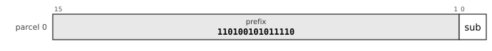

`sub` (1 bit) selects the mnemonic: `popx` 0, `isync` 1.

Fields: `sub=p0[0]`

### Instructions of 2 parcels (4 bytes)

#### LDF-PI12-1: LDF.PI12, prefix `011101`

`op1` is `pi5-s12`: post-increment of a base register (register, 5 bits), 12-bit stride (0: the size of the access).

`op2` is `reg5`: register, 5 bits.

`sub` (4 bits) selects the mnemonic: `movq` 0000, `movl` 0001, `movw` 0010, `movb` 0011, `movzl` 0100, `movzw` 0101, `movzb` 0110, `add` 0111, `sub` 1000, `bic` 1001, `bis` 1010, `xor` 1011, `and` 1100, `mul` 1101, `mulh` 1110, `shl` 1111.

Fields: `sub=p0[9:6]` `op1.base-1=p0[5]` `op2.r=p0[4:0]` `op1.base-2=p1[15:12]` `op1.stride=p1[11:0]`

#### LDF-PD12-1: LDF.PD12, prefix `011110`

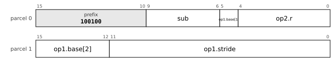

`op1` is `pd5-s12`: pre-decrement of a base register (register, 5 bits), 12-bit stride (0: the size of the access).

`op2` is `reg5`: register, 5 bits.

`sub` (4 bits) selects the mnemonic: `movq` 0000, `movl` 0001, `movw` 0010, `movb` 0011, `movzl` 0100, `movzw` 0101, `movzb` 0110, `add` 0111, `sub` 1000, `bic` 1001, `bis` 1010, `xor` 1011, `and` 1100, `mul` 1101, `mulh` 1110, `shl` 1111.

Fields: `sub=p0[9:6]` `op1.base-1=p0[5]` `op2.r=p0[4:0]` `op1.base-2=p1[15:12]` `op1.stride=p1[11:0]`

#### FX-MOVCALL2-1: FX.MOVCALL2, prefix `100001`

`op1` is `reg5`: register, 5 bits.

`op2` is `reg5`: register, 5 bits.

`op3` is `pc16-u2`: pc-relative, 16 bits counted in 2-byte units (-65536 to 65534 bytes).

Fields: `op1.r=p0[9:5]` `op2.r=p0[4:0]` `op3.pcrel=p1[15:0]`

#### LDU-X6-1: LDU.X6, prefix `1001010`

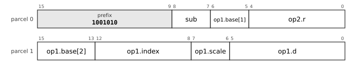

`op1` is `x5-5d6s`: memory at base + (index << scale) + signed 6-bit displacement; base register, 5 bits, index register, 5 bits.

`op2` is `reg5`: register, 5 bits.

`sub` (2 bits) selects the mnemonic: `movq.u` 00, `movl.u` 01, `movw.u` 10, `movb.u` 11.

Fields: `sub=p0[8:7]` `op1.base-1=p0[6:5]` `op2.r=p0[4:0]` `op1.base-2=p1[15:13]` `op1.index=p1[12:8]` `op1.scale=p1[7:6]` `op1.d=p1[5:0]`

#### STU-X6-1: STU.X6, prefix `1001011`

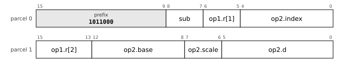

`op1` is `reg5`: register, 5 bits.

`op2` is `x5-5d6s`: memory at base + (index << scale) + signed 6-bit displacement; base register, 5 bits, index register, 5 bits.

`sub` (2 bits) selects the mnemonic: `movq.u` 00, `movl.u` 01, `movw.u` 10, `movb.u` 11.

Fields: `sub=p0[8:7]` `op1.r-1=p0[6:5]` `op2.index=p0[4:0]` `op1.r-2=p1[15:13]` `op2.base=p1[12:8]` `op2.scale=p1[7:6]` `op2.d=p1[5:0]`

#### STF-PI12-1: STF.PI12, prefix `1010001`

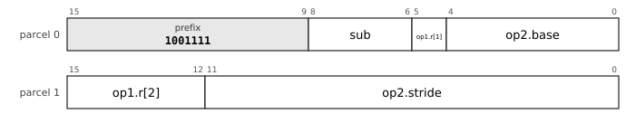

`op1` is `reg5`: register, 5 bits.

`op2` is `pi5-s12`: post-increment of a base register (register, 5 bits), 12-bit stride (0: the size of the access).

`sub` (3 bits) selects the mnemonic: `movq` 000, `movl` 001, `movw` 010, `movb` 011, `addm` 100, `subm` 101, `bicm` 110, `bism` 111.

Fields: `sub=p0[8:6]` `op1.r-1=p0[5]` `op2.base=p0[4:0]` `op1.r-2=p1[15:12]` `op2.stride=p1[11:0]`

#### STF-PD12-1: STF.PD12, prefix `1010010`

`op1` is `reg5`: register, 5 bits.

`op2` is `pd5-s12`: pre-decrement of a base register (register, 5 bits), 12-bit stride (0: the size of the access).

`sub` (3 bits) selects the mnemonic: `movq` 000, `movl` 001, `movw` 010, `movb` 011, `addm` 100, `subm` 101, `bicm` 110, `bism` 111.

Fields: `sub=p0[8:6]` `op1.r-1=p0[5]` `op2.base=p0[4:0]` `op1.r-2=p1[15:12]` `op2.stride=p1[11:0]`

#### PUSHM24-a-1: PUSHM24/a, prefix `1011001`

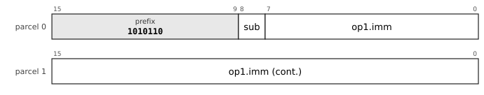

`op1` is `imm24u-x256`: unsigned 24-bit immediate times 256, 0 to 4294967040.

`sub` (1 bit) selects the mnemonic: `pushm` 0, `popm` 1.

Fields: `sub=p0[8]` `op1.imm=p0[7:0]+p1[15:0]`

#### R4-1: R4, prefix `10110101`

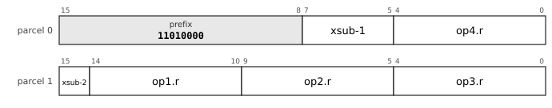

`op1` is `reg5`: register, 5 bits.

`op2` is `reg5`: register, 5 bits.

`op3` is `reg5`: register, 5 bits.

`op4` is `reg5`: register, 5 bits.

`xsub` selects the mnemonic.

Fields: `xsub-1=p0[7:5]` `op4.r=p0[4:0]` `xsub-2=p1[15]` `op1.r=p1[14:10]` `op2.r=p1[9:5]` `op3.r=p1[4:0]`

#### LDU-B12-1: LDU.B12, prefix `10111001`

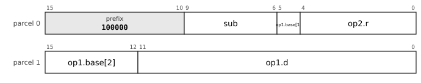

`op1` is `b5d12s-x1`: memory at base register, 5 bits + signed 12-bit displacement times 1, -2048 to 2047 bytes.

`op2` is `reg5`: register, 5 bits.

`sub` (2 bits) selects the mnemonic: `movq.u` 00, `movl.u` 01, `movw.u` 10, `movb.u` 11.

Fields: `sub=p0[7:6]` `op1.base-1=p0[5]` `op2.r=p0[4:0]` `op1.base-2=p1[15:12]` `op1.d=p1[11:0]`

#### STU-B12-1: STU.B12, prefix `10111010`

`op1` is `reg5`: register, 5 bits.

`op2` is `b5d12s-x1`: memory at base register, 5 bits + signed 12-bit displacement times 1, -2048 to 2047 bytes.

`sub` (2 bits) selects the mnemonic: `movq.u` 00, `movl.u` 01, `movw.u` 10, `movb.u` 11.

Fields: `sub=p0[7:6]` `op1.r-1=p0[5]` `op2.base=p0[4:0]` `op1.r-2=p1[15:12]` `op2.d=p1[11:0]`

#### LDU-X6-2: LDU.X6, prefix `10111011`

`op1` is `x5-5d6s`: memory at base + (index << scale) + signed 6-bit displacement; base register, 5 bits, index register, 5 bits.

`op2` is `reg5`: register, 5 bits.

`sub` (1 bit) selects the mnemonic: `movzl.u` 0, `movzw.u` 1.

Fields: `sub=p0[7]` `op1.base-1=p0[6:5]` `op2.r=p0[4:0]` `op1.base-2=p1[15:13]` `op1.index=p1[12:8]` `op1.scale=p1[7:6]` `op1.d=p1[5:0]`

#### LDF-PI12-2: LDF.PI12, prefix `10111110`

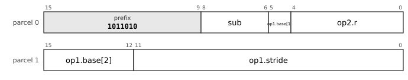

`op1` is `pi5-s12`: post-increment of a base register (register, 5 bits), 12-bit stride (0: the size of the access).

`op2` is `reg5`: register, 5 bits.

`sub` (2 bits) selects the mnemonic: `shr` 00, `sar` 01, `fadd` 10, `fsub` 11.

Fields: `sub=p0[7:6]` `op1.base-1=p0[5]` `op2.r=p0[4:0]` `op1.base-2=p1[15:12]` `op1.stride=p1[11:0]`

#### LDF-PD12-2: LDF.PD12, prefix `10111111`

`op1` is `pd5-s12`: pre-decrement of a base register (register, 5 bits), 12-bit stride (0: the size of the access).

`op2` is `reg5`: register, 5 bits.

`sub` (2 bits) selects the mnemonic: `shr` 00, `sar` 01, `fadd` 10, `fsub` 11.

Fields: `sub=p0[7:6]` `op1.base-1=p0[5]` `op2.r=p0[4:0]` `op1.base-2=p1[15:12]` `op1.stride=p1[11:0]`

#### LDU-B12-2: LDU.B12, prefix `110010100`

`op1` is `b5d12s-x1`: memory at base register, 5 bits + signed 12-bit displacement times 1, -2048 to 2047 bytes.

`op2` is `reg5`: register, 5 bits.

`sub` (1 bit) selects the mnemonic: `movzl.u` 0, `movzw.u` 1.

Fields: `sub=p0[6]` `op1.base-1=p0[5]` `op2.r=p0[4:0]` `op1.base-2=p1[15:12]` `op1.d=p1[11:0]`

#### LDU-X6-3: LDU.X6, prefix `110010101`

`op1` is `x5-5d6s`: memory at base + (index << scale) + signed 6-bit displacement; base register, 5 bits, index register, 5 bits.

`op2` is `reg5`: register, 5 bits.

Fields: `op1.base-1=p0[6:5]` `op2.r=p0[4:0]` `op1.base-2=p1[15:13]` `op1.index=p1[12:8]` `op1.scale=p1[7:6]` `op1.d=p1[5:0]`

#### LDF-PI12-3: LDF.PI12, prefix `110011000`

`op1` is `pi5-s12`: post-increment of a base register (register, 5 bits), 12-bit stride (0: the size of the access).

`op2` is `reg5`: register, 5 bits.

`sub` (1 bit) selects the mnemonic: `fmul` 0, `bit` 1.

Fields: `sub=p0[6]` `op1.base-1=p0[5]` `op2.r=p0[4:0]` `op1.base-2=p1[15:12]` `op1.stride=p1[11:0]`

#### LDF-PD12-3: LDF.PD12, prefix `110011001`

`op1` is `pd5-s12`: pre-decrement of a base register (register, 5 bits), 12-bit stride (0: the size of the access).

`op2` is `reg5`: register, 5 bits.

`sub` (1 bit) selects the mnemonic: `fmul` 0, `bit` 1.

Fields: `sub=p0[6]` `op1.base-1=p0[5]` `op2.r=p0[4:0]` `op1.base-2=p1[15:12]` `op1.stride=p1[11:0]`

#### CMF-PI12-1: CMF.PI12, prefix `110011110`

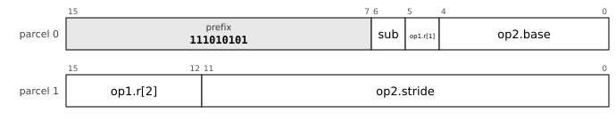

`op1` is `reg5`: register, 5 bits.

`op2` is `pi5-s12`: post-increment of a base register (register, 5 bits), 12-bit stride (0: the size of the access).

`sub` (1 bit) selects the mnemonic: `cmp` 0, `fcmp` 1.

Fields: `sub=p0[6]` `op1.r-1=p0[5]` `op2.base=p0[4:0]` `op1.r-2=p1[15:12]` `op2.stride=p1[11:0]`

#### CMF-PD12-1: CMF.PD12, prefix `110011111`

`op1` is `reg5`: register, 5 bits.

`op2` is `pd5-s12`: pre-decrement of a base register (register, 5 bits), 12-bit stride (0: the size of the access).

`sub` (1 bit) selects the mnemonic: `cmp` 0, `fcmp` 1.

Fields: `sub=p0[6]` `op1.r-1=p0[5]` `op2.base=p0[4:0]` `op1.r-2=p1[15:12]` `op2.stride=p1[11:0]`

#### LDBu12H-a-1: LDBu12H/a, prefix `110100010`

`op1` is `b4d12u-xsz`: memory at base register, 4 bits (an index into the hot-register table) + unsigned 12-bit displacement times the size of the access.

`op2` is `reg5`: register, 5 bits.

`sub` (2 bits) selects the mnemonic: `movq` 00, `movl` 01, `movzb` 10, `lea` 11.

Fields: `sub=p0[6:5]` `op2.r=p0[4:0]` `op1.base=p1[15:12]` `op1.d=p1[11:0]`

#### LDBu12H-b-1: LDBu12H/b, prefix `110100011`

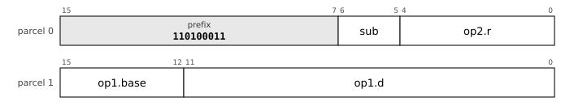

`op1` is `b4d12u-xsz`: memory at base register, 4 bits (an index into the hot-register table) + unsigned 12-bit displacement times the size of the access.

`op2` is `reg5`: register, 5 bits.

`sub` (2 bits) selects the mnemonic: `movw` 00, `movb` 01, `movzl` 10, `movzw` 11.

Fields: `sub=p0[6:5]` `op2.r=p0[4:0]` `op1.base=p1[15:12]` `op1.d=p1[11:0]`

#### LDX6H-a-1: LDX6H/a, prefix `110100100`

`op1` is `x4-4d6s`: memory at base + (index << scale) + signed 6-bit displacement; base register, 4 bits (an index into the hot-register table), index register, 4 bits (an index into the hot-register table).

`op2` is `reg5`: register, 5 bits.

`sub` (2 bits) selects the mnemonic: `movq` 00, `movl` 01, `movzb` 10, `lea` 11.

Fields: `sub=p0[6:5]` `op2.r=p0[4:0]` `op1.base=p1[15:12]` `op1.index=p1[11:8]` `op1.scale=p1[7:6]` `op1.d=p1[5:0]`

#### LDI18H-b-1: LDI18H/b, prefix `110100101`

`op1` is `imm18s`: signed 18-bit immediate, -131072 to 131071.

`op2` is `reg4`: register, 4 bits (an index into the hot-register table).

`sub` (1 bit) selects the mnemonic: `add` 0, `sub` 1.

Fields: `sub=p0[6]` `op1.imm-1=p0[5:4]` `op2.r=p0[3:0]` `op1.imm-2=p1[15:0]`

#### CBI8-10H-a-1: CBI8_10H/a, prefix `110100110`

`op1` is `reg4`: register, 4 bits (an index into the hot-register table).

`op2` is `imm8s`: signed 8-bit immediate, -128 to 127.

`op3` is `pc10-u2`: pc-relative, 10 bits counted in 2-byte units (-1024 to 1022 bytes).

`sub` (1 bit) selects the mnemonic: `cbeq` 0, `cbne` 1.

Fields: `sub=p0[6]` `op2.imm-1=p0[5:4]` `op1.r=p0[3:0]` `op2.imm-2=p1[15:10]` `op3.pcrel=p1[9:0]`

#### CBI10-8H-a-1: CBI10_8H/a, prefix `110100111`

`op1` is `reg4`: register, 4 bits (an index into the hot-register table).

`op2` is `imm10s`: signed 10-bit immediate, -512 to 511.

`op3` is `pc8-u2`: pc-relative, 8 bits counted in 2-byte units (-256 to 254 bytes).

`sub` (1 bit) selects the mnemonic: `cbeq` 0, `cbne` 1.

Fields: `sub=p0[6]` `op2.imm-1=p0[5:4]` `op1.r=p0[3:0]` `op2.imm-2=p1[15:8]` `op3.pcrel=p1[7:0]`

#### R3-1: R3, prefix `1101010010`

`op1` is `reg5`: register, 5 bits.

`op2` is `reg5`: register, 5 bits.

`op3` is `reg5`: register, 5 bits.

`xsub` selects the mnemonic.

Fields: `xsub-1=p0[5]` `op3.r=p0[4:0]` `xsub-2=p1[15:10]` `op1.r=p1[9:5]` `op2.r=p1[4:0]`

#### LDU-B12-3: LDU.B12, prefix `1101010100`

`op1` is `b5d12s-x1`: memory at base register, 5 bits + signed 12-bit displacement times 1, -2048 to 2047 bytes.

`op2` is `reg5`: register, 5 bits.

Fields: `op1.base-1=p0[5]` `op2.r=p0[4:0]` `op1.base-2=p1[15:12]` `op1.d=p1[11:0]`

#### LDF-PI12-4: LDF.PI12, prefix `1101010110`

`op1` is `pi5-s12`: post-increment of a base register (register, 5 bits), 12-bit stride (0: the size of the access).

`op2` is `reg5`: register, 5 bits.

Fields: `op1.base-1=p0[5]` `op2.r=p0[4:0]` `op1.base-2=p1[15:12]` `op1.stride=p1[11:0]`

#### LDF-PD12-4: LDF.PD12, prefix `1101010111`

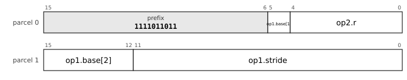

`op1` is `pd5-s12`: pre-decrement of a base register (register, 5 bits), 12-bit stride (0: the size of the access).

`op2` is `reg5`: register, 5 bits.

Fields: `op1.base-1=p0[5]` `op2.r=p0[4:0]` `op1.base-2=p1[15:12]` `op1.stride=p1[11:0]`

#### TAG-1: TAG, prefix `1101100000`

`op1` is `reg5`: register, 5 bits.

`op2` is `imm3u`: unsigned 3-bit immediate, 0 to 7.

`op3` is `pc13-u2`: pc-relative, 13 bits counted in 2-byte units (-8192 to 8190 bytes).

`sub` (1 bit) selects the mnemonic: `btag` 0, `bntag` 1.

Fields: `sub=p0[5]` `op1.r=p0[4:0]` `op2.imm=p1[15:13]` `op3.pcrel=p1[12:0]`

#### LDBs10-a-1: LDBs10/a, prefix `1101100001`

`op1` is `b5d10s-xsz`: memory at base register, 5 bits + signed 10-bit displacement times the size of the access.

`op2` is `reg5`: register, 5 bits.

`sub` (2 bits) selects the mnemonic: `movq` 00, `movl` 01, `movzb` 10, `lea` 11.

Fields: `sub=p0[5:4]` `op1.base=p0[3:0]+p1[15]` `op2.r=p1[14:10]` `op1.d=p1[9:0]`

#### STX6H-a-1: STX6H/a, prefix `1101100010`

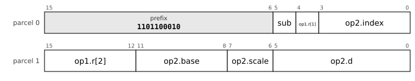

`op1` is `reg5`: register, 5 bits.

`op2` is `x4-4d6s`: memory at base + (index << scale) + signed 6-bit displacement; base register, 4 bits (an index into the hot-register table), index register, 4 bits (an index into the hot-register table).

`sub` (1 bit) selects the mnemonic: `movq` 0, `movl` 1.

Fields: `sub=p0[5]` `op1.r-1=p0[4]` `op2.index=p0[3:0]` `op1.r-2=p1[15:12]` `op2.base=p1[11:8]` `op2.scale=p1[7:6]` `op2.d=p1[5:0]`

#### STX6H-b-1: STX6H/b, prefix `1101100011`

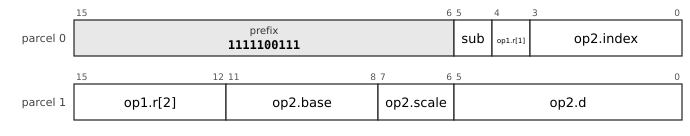

`op1` is `reg5`: register, 5 bits.

`op2` is `x4-4d6s`: memory at base + (index << scale) + signed 6-bit displacement; base register, 4 bits (an index into the hot-register table), index register, 4 bits (an index into the hot-register table).

`sub` (1 bit) selects the mnemonic: `movw` 0, `movb` 1.

Fields: `sub=p0[5]` `op1.r-1=p0[4]` `op2.index=p0[3:0]` `op1.r-2=p1[15:12]` `op2.base=p1[11:8]` `op2.scale=p1[7:6]` `op2.d=p1[5:0]`

#### LDPC16H-a-1: LDPC16H/a, prefix `1101100100`

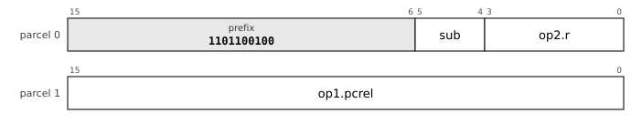

`op1` is `pc16-u1`: pc-relative, 16 bits counted in 1-byte units (-32768 to 32767 bytes).

`op2` is `reg4`: register, 4 bits (an index into the hot-register table).

`sub` (2 bits) selects the mnemonic: `movq` 00, `movl` 01, `movzb` 10, `lea` 11.

Fields: `sub=p0[5:4]` `op2.r=p0[3:0]` `op1.pcrel=p1[15:0]`

#### LDPC16H-c-1: LDPC16H/c, prefix `1101100101`

`op1` is `pc16-u1`: pc-relative, 16 bits counted in 1-byte units (-32768 to 32767 bytes).

`op2` is `reg4`: register, 4 bits (an index into the hot-register table).

`sub` (2 bits) selects the mnemonic: `add` 00, `sub` 01, `and` 10, `bis` 11.

Fields: `sub=p0[5:4]` `op2.r=p0[3:0]` `op1.pcrel=p1[15:0]`

#### LDI18H-a-1: LDI18H/a, prefix `1101100110`

`op1` is `imm18s`: signed 18-bit immediate, -131072 to 131071.

`op2` is `reg4`: register, 4 bits (an index into the hot-register table).

Fields: `op1.imm-1=p0[5:4]` `op2.r=p0[3:0]` `op1.imm-2=p1[15:0]`

#### LDI18H-b-2: LDI18H/b, prefix `1101100111`

`op1` is `imm18s`: signed 18-bit immediate, -131072 to 131071.

`op2` is `reg4`: register, 4 bits (an index into the hot-register table).

Fields: `op1.imm-1=p0[5:4]` `op2.r=p0[3:0]` `op1.imm-2=p1[15:0]`

#### CMI18H-a-1: CMI18H/a, prefix `1101101000`

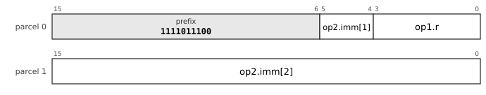

`op1` is `reg4`: register, 4 bits (an index into the hot-register table).

`op2` is `imm18s`: signed 18-bit immediate, -131072 to 131071.

Fields: `op2.imm-1=p0[5:4]` `op1.r=p0[3:0]` `op2.imm-2=p1[15:0]`

#### CBI8-8H-b-1: CBI8_8H/b, prefix `1101101001`

`op1` is `reg4`: register, 4 bits (an index into the hot-register table).

`op2` is `imm8s`: signed 8-bit immediate, -128 to 127.

`op3` is `pc8-u2`: pc-relative, 8 bits counted in 2-byte units (-256 to 254 bytes).

`sub` (2 bits) selects the mnemonic: `cblt` 00, `cbge` 01, `cbgt` 10, `cble` 11.

Fields: `sub=p0[5:4]` `op1.r=p0[3:0]` `op2.imm=p1[15:8]` `op3.pcrel=p1[7:0]`

#### CBI8-8H-c-1: CBI8_8H/c, prefix `1101101010`

`op1` is `reg4`: register, 4 bits (an index into the hot-register table).

`op2` is `imm8s`: signed 8-bit immediate, -128 to 127.

`op3` is `pc8-u2`: pc-relative, 8 bits counted in 2-byte units (-256 to 254 bytes).

`sub` (2 bits) selects the mnemonic: `cbcs` 00, `cbcc` 01, `cbhi` 10, `cblos` 11.

Fields: `sub=p0[5:4]` `op1.r=p0[3:0]` `op2.imm=p1[15:8]` `op3.pcrel=p1[7:0]`

#### SETF-1: SETF, prefix `11011010110`

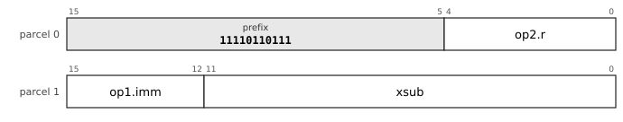

`op1` is `imm4u`: unsigned 4-bit immediate, 0 to 15.

`op2` is `reg5`: register, 5 bits.

`xsub` selects the mnemonic.

Fields: `op2.r=p0[4:0]` `op1.imm=p1[15:12]` `xsub=p1[11:0]`

#### SOF-PI12-1: SOF.PI12, prefix `11011011011`

`op1` is `pi5-s12`: post-increment of a base register (register, 5 bits), 12-bit stride (0: the size of the access).

`sub` (4 bits) selects the mnemonic: `clr` 0000, `com` 0001, `inc` 0010, `dec` 0011, `neg` 0100, `tst` 0101, `adc` 0110, `sbc` 0111, `asl` 1000, `asr` 1001, `push` 1010, `pop` 1011, `jmp` 1100, `call` 1101, `jmpi` 1110, `calli` 1111.

Fields: `sub=p0[4:1]` `op1.base=p0[0]+p1[15:12]` `op1.stride=p1[11:0]`

#### SOF-PD12-1: SOF.PD12, prefix `11011011100`

`op1` is `pd5-s12`: pre-decrement of a base register (register, 5 bits), 12-bit stride (0: the size of the access).

`sub` (4 bits) selects the mnemonic: `clr` 0000, `com` 0001, `inc` 0010, `dec` 0011, `neg` 0100, `tst` 0101, `adc` 0110, `sbc` 0111, `asl` 1000, `asr` 1001, `push` 1010, `pop` 1011, `jmp` 1100, `call` 1101, `jmpi` 1110, `calli` 1111.

Fields: `sub=p0[4:1]` `op1.base=p0[0]+p1[15:12]` `op1.stride=p1[11:0]`

#### SOB-1: SOB, prefix `11011011110`

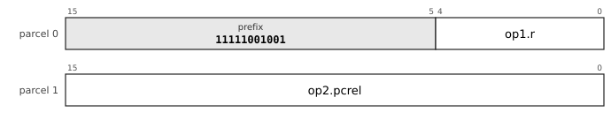

`op1` is `reg5`: register, 5 bits.

`op2` is `pc16-u2`: pc-relative, 16 bits counted in 2-byte units (-65536 to 65534 bytes).

Fields: `op1.r=p0[4:0]` `op2.pcrel=p1[15:0]`

#### LDPC14-a-1: LDPC14/a, prefix `11011100000`

`op1` is `pc14-u1`: pc-relative, 14 bits counted in 1-byte units (-8192 to 8191 bytes).

`op2` is `reg5`: register, 5 bits.

`sub` (2 bits) selects the mnemonic: `movq` 00, `movl` 01, `movzb` 10, `lea` 11.

Fields: `sub=p0[4:3]` `op2.r=p0[2:0]+p1[15:14]` `op1.pcrel=p1[13:0]`

#### LDBu10H-c-1: LDBu10H/c, prefix `11011100001`

`op1` is `b4d10u-xsz`: memory at base register, 4 bits (an index into the hot-register table) + unsigned 10-bit displacement times the size of the access.

`op2` is `reg5`: register, 5 bits.

`sub` (2 bits) selects the mnemonic: `add` 00, `sub` 01, `and` 10, `bis` 11.

Fields: `sub=p0[4:3]` `op1.base=p0[2:0]+p1[15]` `op2.r=p1[14:10]` `op1.d=p1[9:0]`

#### STBu12H-a-1: STBu12H/a, prefix `11011100010`

`op1` is `reg4`: register, 4 bits (an index into the hot-register table).

`op2` is `b4d12u-xsz`: memory at base register, 4 bits (an index into the hot-register table) + unsigned 12-bit displacement times the size of the access.

`sub` (1 bit) selects the mnemonic: `movq` 0, `movl` 1.

Fields: `sub=p0[4]` `op2.base=p0[3:0]` `op1.r=p1[15:12]` `op2.d=p1[11:0]`

#### STBu12H-b-1: STBu12H/b, prefix `11011100011`

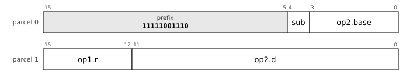

`op1` is `reg4`: register, 4 bits (an index into the hot-register table).

`op2` is `b4d12u-xsz`: memory at base register, 4 bits (an index into the hot-register table) + unsigned 12-bit displacement times the size of the access.

`sub` (1 bit) selects the mnemonic: `movw` 0, `movb` 1.

Fields: `sub=p0[4]` `op2.base=p0[3:0]` `op1.r=p1[15:12]` `op2.d=p1[11:0]`

#### LDX4H-b-1: LDX4H/b, prefix `11011100100`

`op1` is `x4-4d4s`: memory at base + (index << scale) + signed 4-bit displacement; base register, 4 bits (an index into the hot-register table), index register, 4 bits (an index into the hot-register table).

`op2` is `reg5`: register, 5 bits.

`sub` (2 bits) selects the mnemonic: `movw` 00, `movb` 01, `movzl` 10, `movzw` 11.

Fields: `sub=p0[4:3]` `op1.base=p0[2:0]+p1[15]` `op1.index=p1[14:11]` `op1.scale=p1[10:9]` `op1.d=p1[8:5]` `op2.r=p1[4:0]`

#### R2-1: R2, prefix `110111001100`

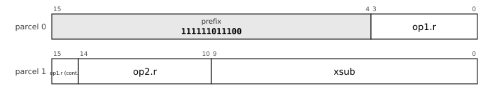

`op1` is `reg5`: register, 5 bits.

`op2` is `reg5`: register, 5 bits.

`xsub` selects the mnemonic.

Fields: `op1.r=p0[3:0]+p1[15]` `op2.r=p1[14:10]` `xsub=p1[9:0]`

#### RRI-1: RRI, prefix `110111001101`

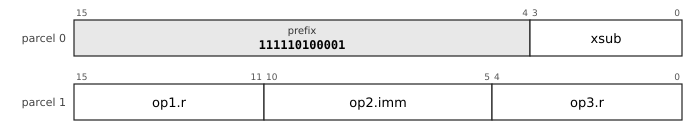

`op1` is `reg5`: register, 5 bits.

`op2` is `imm6u`: unsigned 6-bit immediate, 0 to 63.

`op3` is `reg5`: register, 5 bits.

`xsub` selects the mnemonic.

Fields: `xsub=p0[3:0]` `op1.r=p1[15:11]` `op2.imm=p1[10:5]` `op3.r=p1[4:0]`

#### LDBu8-c-1: LDBu8/c, prefix `110111010000`

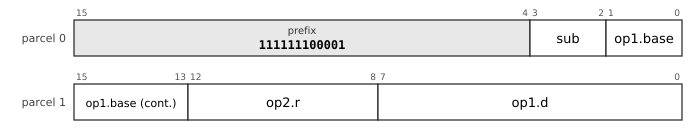

`op1` is `b5d8u-xsz`: memory at base register, 5 bits + unsigned 8-bit displacement times the size of the access.

`op2` is `reg5`: register, 5 bits.

`sub` (2 bits) selects the mnemonic: `add` 00, `sub` 01, `and` 10, `bis` 11.

Fields: `sub=p0[3:2]` `op1.base=p0[1:0]+p1[15:13]` `op2.r=p1[12:8]` `op1.d=p1[7:0]`

#### CALL2-20-c-1: CALL2_20/c, prefix `110111010001`

`op1` is `pc20-u2`: pc-relative, 20 bits counted in 2-byte units (-1048576 to 1048574 bytes).

Fields: `op1.pcrel=p0[3:0]+p1[15:0]`

#### CBR8-b-1: CBR8/b, prefix `110111010010`

`op1` is `reg5`: register, 5 bits.

`op2` is `reg5`: register, 5 bits.

`op3` is `pc8-u2`: pc-relative, 8 bits counted in 2-byte units (-256 to 254 bytes).

`sub` (2 bits) selects the mnemonic: `cblt` 00, `cbge` 01, `cbgt` 10, `cble` 11.

Fields: `sub=p0[3:2]` `op1.r=p0[1:0]+p1[15:13]` `op2.r=p1[12:8]` `op3.pcrel=p1[7:0]`

#### CBR8-c-1: CBR8/c, prefix `110111010011`

`op1` is `reg5`: register, 5 bits.

`op2` is `reg5`: register, 5 bits.

`op3` is `pc8-u2`: pc-relative, 8 bits counted in 2-byte units (-256 to 254 bytes).

`sub` (2 bits) selects the mnemonic: `cbcs` 00, `cbcc` 01, `cbhi` 10, `cblos` 11.

Fields: `sub=p0[3:2]` `op1.r=p0[1:0]+p1[15:13]` `op2.r=p1[12:8]` `op3.pcrel=p1[7:0]`

#### CMBu12H-a-1: CMBu12H/a, prefix `110111010100`

`op1` is `reg4`: register, 4 bits (an index into the hot-register table).

`op2` is `b4d12u-xsz`: memory at base register, 4 bits (an index into the hot-register table) + unsigned 12-bit displacement times the size of the access.

Fields: `op2.base=p0[3:0]` `op1.r=p1[15:12]` `op2.d=p1[11:0]`

#### LDPC14H-b-1: LDPC14H/b, prefix `110111010101`

`op1` is `pc14-u1`: pc-relative, 14 bits counted in 1-byte units (-8192 to 8191 bytes).

`op2` is `reg4`: register, 4 bits (an index into the hot-register table).

`sub` (2 bits) selects the mnemonic: `movw` 00, `movb` 01, `movzl` 10, `movzw` 11.

Fields: `sub=p0[3:2]` `op2.r=p0[1:0]+p1[15:14]` `op1.pcrel=p1[13:0]`

#### LDPC16H-c-2: LDPC16H/c, prefix `110111010110`

`op1` is `pc16-u1`: pc-relative, 16 bits counted in 1-byte units (-32768 to 32767 bytes).

`op2` is `reg4`: register, 4 bits (an index into the hot-register table).

Fields: `op2.r=p0[3:0]` `op1.pcrel=p1[15:0]`

#### CMPC16H-a-1: CMPC16H/a, prefix `110111010111`

`op1` is `reg4`: register, 4 bits (an index into the hot-register table).

`op2` is `pc16-u1`: pc-relative, 16 bits counted in 1-byte units (-32768 to 32767 bytes).

Fields: `op1.r=p0[3:0]` `op2.pcrel=p1[15:0]`

#### LDI14H-c-1: LDI14H/c, prefix `110111011000`

`op1` is `imm14s`: signed 14-bit immediate, -8192 to 8191.

`op2` is `reg4`: register, 4 bits (an index into the hot-register table).

`sub` (2 bits) selects the mnemonic: `bis` 00, `xor` 01, `mul` 10, `bic` 11.

Fields: `sub=p0[3:2]` `op2.r=p0[1:0]+p1[15:14]` `op1.imm=p1[13:0]`

#### CBR10H-c-1: CBR10H/c, prefix `110111011001`

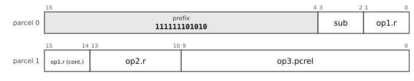

`op1` is `reg4`: register, 4 bits (an index into the hot-register table).

`op2` is `reg4`: register, 4 bits (an index into the hot-register table).

`op3` is `pc10-u2`: pc-relative, 10 bits counted in 2-byte units (-1024 to 1022 bytes).

`sub` (2 bits) selects the mnemonic: `cbcs` 00, `cbcc` 01, `cbhi` 10, `cblos` 11.

Fields: `sub=p0[3:2]` `op1.r=p0[1:0]+p1[15:14]` `op2.r=p1[13:10]` `op3.pcrel=p1[9:0]`

#### CBI3-12H-a-1: CBI3_12H/a, prefix `110111011010`

`op1` is `reg4`: register, 4 bits (an index into the hot-register table).

`op2` is `imm3s`: signed 3-bit immediate, -4 to 3.

`op3` is `pc12-u2`: pc-relative, 12 bits counted in 2-byte units (-4096 to 4094 bytes).

`sub` (1 bit) selects the mnemonic: `cbeq` 0, `cbne` 1.

Fields: `sub=p0[3]` `op1.r=p0[2:0]+p1[15]` `op2.imm=p1[14:12]` `op3.pcrel=p1[11:0]`

#### ATOM-1: ATOM, prefix `110111110101`

`op1` is `reg5`: register, 5 bits.

`op2` is `reg5`: register, 5 bits.

`op3` is `b5d0s-x1`: memory at (base register, 5 bits).

`xsub` selects the mnemonic.

Fields: `xsub=p0[3:0]+p1[15]` `op1.r=p1[14:10]` `op2.r=p1[9:5]` `op3.base=p1[4:0]`

#### STBs8-a-1: STBs8/a, prefix `1101110111101`

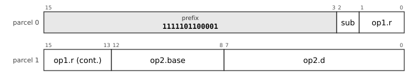

`op1` is `reg5`: register, 5 bits.

`op2` is `b5d8s-xsz`: memory at base register, 5 bits + signed 8-bit displacement times the size of the access.

`sub` (1 bit) selects the mnemonic: `movq` 0, `movl` 1.

Fields: `sub=p0[2]` `op1.r=p0[1:0]+p1[15:13]` `op2.base=p1[12:8]` `op2.d=p1[7:0]`

#### SOBs12-a-1: SOBs12/a, prefix `1101110111110`

`op1` is `b5d12s-xsz`: memory at base register, 5 bits + signed 12-bit displacement times the size of the access.

`sub` (2 bits) selects the mnemonic: `clr` 00, `inc` 01, `dec` 10, `tst` 11.

Fields: `sub=p0[2:1]` `op1.base=p0[0]+p1[15:12]` `op1.d=p1[11:0]`

#### SOBu12-x-1: SOBu12/x, prefix `1101110111111`

`op1` is `b5d12u-xsz`: memory at base register, 5 bits + unsigned 12-bit displacement times the size of the access.

`sub` (2 bits) selects the mnemonic: `jmp` 00, `call` 01, `jmpi` 10, `calli` 11.

Fields: `sub=p0[2:1]` `op1.base=p0[0]+p1[15:12]` `op1.d=p1[11:0]`

#### LDX0-a-1: LDX0/a, prefix `1101111000000`

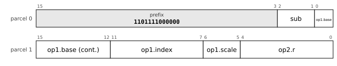

`op1` is `x5-5d0s`: memory at base + (index << scale); base register, 5 bits, index register, 5 bits.

`op2` is `reg5`: register, 5 bits.

`sub` (2 bits) selects the mnemonic: `movq` 00, `movl` 01, `movzb` 10, `lea` 11.

Fields: `sub=p0[2:1]` `op1.base=p0[0]+p1[15:12]` `op1.index=p1[11:7]` `op1.scale=p1[6:5]` `op2.r=p1[4:0]`

#### LDX0-b-1: LDX0/b, prefix `1101111000001`

`op1` is `x5-5d0s`: memory at base + (index << scale); base register, 5 bits, index register, 5 bits.

`op2` is `reg5`: register, 5 bits.

`sub` (2 bits) selects the mnemonic: `movw` 00, `movb` 01, `movzl` 10, `movzw` 11.

Fields: `sub=p0[2:1]` `op1.base=p0[0]+p1[15:12]` `op1.index=p1[11:7]` `op1.scale=p1[6:5]` `op2.r=p1[4:0]`

#### LDX0-c-1: LDX0/c, prefix `1101111000010`

`op1` is `x5-5d0s`: memory at base + (index << scale); base register, 5 bits, index register, 5 bits.

`op2` is `reg5`: register, 5 bits.

`sub` (2 bits) selects the mnemonic: `add` 00, `sub` 01, `and` 10, `bis` 11.

Fields: `sub=p0[2:1]` `op1.base=p0[0]+p1[15:12]` `op1.index=p1[11:7]` `op1.scale=p1[6:5]` `op2.r=p1[4:0]`

#### LDI12-d-1: LDI12/d, prefix `1101111000011`

`op1` is `imm12s`: signed 12-bit immediate, -2048 to 2047.

`op2` is `reg5`: register, 5 bits.

`sub` (2 bits) selects the mnemonic: `shl` 00, `shr` 01, `sar` 10, `mul` 11.

Fields: `sub=p0[2:1]` `op2.r=p0[0]+p1[15:12]` `op1.imm=p1[11:0]`

#### CTM12-a-1: CTM12/a, prefix `1101111000100`

`op1` is `reg5`: register, 5 bits.

`op2` is `imm12u`: unsigned 12-bit immediate, 0 to 4095.

`sub` (2 bits) selects the mnemonic: `ctcc` 00, `cthi` 01, `cteq` 10, `ctne` 11.

Fields: `sub=p0[2:1]` `op1.r=p0[0]+p1[15:12]` `op2.imm=p1[11:0]`

#### BR2-16-c-1: BR2_16/c, prefix `1101111000101`

`op1` is `pc16-u2`: pc-relative, 16 bits counted in 2-byte units (-65536 to 65534 bytes).

`sub` (3 bits) selects the mnemonic: `bpl` 000, `bmi` 001, `bvc` 010, `bvs` 011, `bcc` 100, `bcs` 101, `bge` 110, `blt` 111.

Fields: `sub=p0[2:0]` `op1.pcrel=p1[15:0]`

#### CBR8-a-1: CBR8/a, prefix `1101111000110`

`op1` is `reg5`: register, 5 bits.

`op2` is `reg5`: register, 5 bits.

`op3` is `pc8-u2`: pc-relative, 8 bits counted in 2-byte units (-256 to 254 bytes).

`sub` (1 bit) selects the mnemonic: `cbeq` 0, `cbne` 1.

Fields: `sub=p0[2]` `op1.r=p0[1:0]+p1[15:13]` `op2.r=p1[12:8]` `op3.pcrel=p1[7:0]`

#### CBI3-10-a-1: CBI3_10/a, prefix `1101111001010`

`op1` is `reg5`: register, 5 bits.

`op2` is `imm3s`: signed 3-bit immediate, -4 to 3.

`op3` is `pc10-u2`: pc-relative, 10 bits counted in 2-byte units (-1024 to 1022 bytes).

`sub` (1 bit) selects the mnemonic: `cbeq` 0, `cbne` 1.

Fields: `sub=p0[2]` `op1.r=p0[1:0]+p1[15:13]` `op2.imm=p1[12:10]` `op3.pcrel=p1[9:0]`

#### CBI4-8-b-1: CBI4_8/b, prefix `1101111001011`

`op1` is `reg5`: register, 5 bits.

`op2` is `imm4s`: signed 4-bit immediate, -8 to 7.

`op3` is `pc8-u2`: pc-relative, 8 bits counted in 2-byte units (-256 to 254 bytes).

`sub` (2 bits) selects the mnemonic: `cblt` 00, `cbge` 01, `cbgt` 10, `cble` 11.

Fields: `sub=p0[2:1]` `op1.r=p0[0]+p1[15:12]` `op2.imm=p1[11:8]` `op3.pcrel=p1[7:0]`

#### CBI5-8-a-1: CBI5_8/a, prefix `1101111001100`

`op1` is `reg5`: register, 5 bits.

`op2` is `imm5s`: signed 5-bit immediate, -16 to 15.

`op3` is `pc8-u2`: pc-relative, 8 bits counted in 2-byte units (-256 to 254 bytes).

`sub` (1 bit) selects the mnemonic: `cbeq` 0, `cbne` 1.

Fields: `sub=p0[2]` `op1.r=p0[1:0]+p1[15:13]` `op2.imm=p1[12:8]` `op3.pcrel=p1[7:0]`

#### LDBu10H-c-2: LDBu10H/c, prefix `1101111001101`

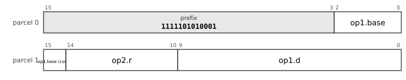

`op1` is `b4d10u-xsz`: memory at base register, 4 bits (an index into the hot-register table) + unsigned 10-bit displacement times the size of the access.

`op2` is `reg5`: register, 5 bits.

Fields: `op1.base=p0[2:0]+p1[15]` `op2.r=p1[14:10]` `op1.d=p1[9:0]`

#### LDPC12H-d-1: LDPC12H/d, prefix `1101111001110`

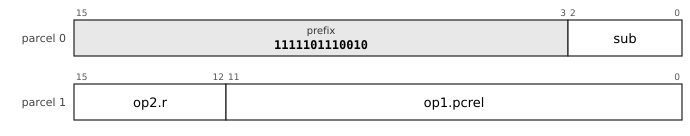

`op1` is `pc12-u1`: pc-relative, 12 bits counted in 1-byte units (-2048 to 2047 bytes).

`op2` is `reg4`: register, 4 bits (an index into the hot-register table).

`sub` (3 bits) selects the mnemonic: `bic` 000, `mul` 001, `mulh` 010, `shl` 011, `shr` 100, `sar` 101, `fadd` 110, `fsub` 111.

Fields: `sub=p0[2:0]` `op2.r=p1[15:12]` `op1.pcrel=p1[11:0]`

#### CBR10H-a-1: CBR10H/a, prefix `1101111001111`

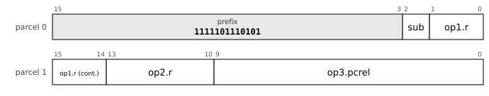

`op1` is `reg4`: register, 4 bits (an index into the hot-register table).

`op2` is `reg4`: register, 4 bits (an index into the hot-register table).

`op3` is `pc10-u2`: pc-relative, 10 bits counted in 2-byte units (-1024 to 1022 bytes).

`sub` (1 bit) selects the mnemonic: `cbeq` 0, `cbne` 1.

Fields: `sub=p0[2]` `op1.r=p0[1:0]+p1[15:14]` `op2.r=p1[13:10]` `op3.pcrel=p1[9:0]`

#### CBZ2-14H-a-1: CBZ2_14H/a, prefix `1101111010000`

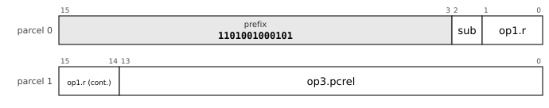

`op1` is `reg4`: register, 4 bits (an index into the hot-register table).

`op2` is `k-imm0`: implicit constant 0.

`op3` is `pc14-u2`: pc-relative, 14 bits counted in 2-byte units (-16384 to 16382 bytes).

`sub` (1 bit) selects the mnemonic: `cbeq` 0, `cbne` 1.

Fields: `sub=p0[2]` `op1.r=p0[1:0]+p1[15:14]` `op3.pcrel=p1[13:0]`

#### CBI3-10H-b-1: CBI3_10H/b, prefix `1101111010001`

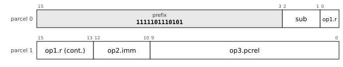

`op1` is `reg4`: register, 4 bits (an index into the hot-register table).

`op2` is `imm3s`: signed 3-bit immediate, -4 to 3.

`op3` is `pc10-u2`: pc-relative, 10 bits counted in 2-byte units (-1024 to 1022 bytes).

`sub` (2 bits) selects the mnemonic: `cblt` 00, `cbge` 01, `cbgt` 10, `cble` 11.

Fields: `sub=p0[2:1]` `op1.r=p0[0]+p1[15:13]` `op2.imm=p1[12:10]` `op3.pcrel=p1[9:0]`

#### CBI3-10H-c-1: CBI3_10H/c, prefix `1101111010010`

`op1` is `reg4`: register, 4 bits (an index into the hot-register table).

`op2` is `imm3s`: signed 3-bit immediate, -4 to 3.

`op3` is `pc10-u2`: pc-relative, 10 bits counted in 2-byte units (-1024 to 1022 bytes).

`sub` (2 bits) selects the mnemonic: `cbcs` 00, `cbcc` 01, `cbhi` 10, `cblos` 11.

Fields: `sub=p0[2:1]` `op1.r=p0[0]+p1[15:13]` `op2.imm=p1[12:10]` `op3.pcrel=p1[9:0]`

#### JTAG2-1: JTAG2, prefix `11011110101110`

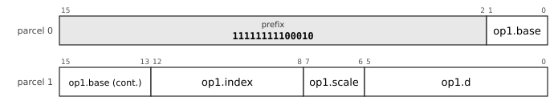

`op1` is `x5-5d6s`: memory at base + (index << scale) + signed 6-bit displacement; base register, 5 bits, index register, 5 bits.

Fields: `op1.base=p0[1:0]+p1[15:13]` `op1.index=p1[12:8]` `op1.scale=p1[7:6]` `op1.d=p1[5:0]`

#### LDBs6-b-1: LDBs6/b, prefix `11011110101111`

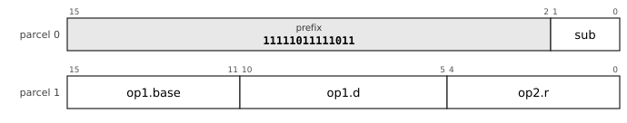

`op1` is `b5d6s-xsz`: memory at base register, 5 bits + signed 6-bit displacement times the size of the access.

`op2` is `reg5`: register, 5 bits.

`sub` (2 bits) selects the mnemonic: `movw` 00, `movb` 01, `movzl` 10, `movzw` 11.

Fields: `sub=p0[1:0]` `op1.base=p1[15:11]` `op1.d=p1[10:5]` `op2.r=p1[4:0]`

#### LDBu6-b-1: LDBu6/b, prefix `11011110110000`

`op1` is `b5d6u-xsz`: memory at base register, 5 bits + unsigned 6-bit displacement times the size of the access.

`op2` is `reg5`: register, 5 bits.

`sub` (2 bits) selects the mnemonic: `movw` 00, `movb` 01, `movzl` 10, `movzw` 11.

Fields: `sub=p0[1:0]` `op1.base=p1[15:11]` `op1.d=p1[10:5]` `op2.r=p1[4:0]`

#### LDBu8-c-2: LDBu8/c, prefix `11011110110001`

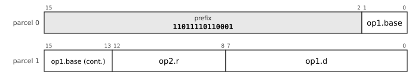

`op1` is `b5d8u-xsz`: memory at base register, 5 bits + unsigned 8-bit displacement times the size of the access.

`op2` is `reg5`: register, 5 bits.

Fields: `op1.base=p0[1:0]+p1[15:13]` `op2.r=p1[12:8]` `op1.d=p1[7:0]`

#### CMBu8-a-1: CMBu8/a, prefix `11011110110010`

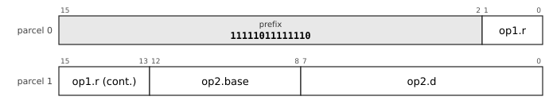

`op1` is `reg5`: register, 5 bits.

`op2` is `b5d8u-xsz`: memory at base register, 5 bits + unsigned 8-bit displacement times the size of the access.

Fields: `op1.r=p0[1:0]+p1[15:13]` `op2.base=p1[12:8]` `op2.d=p1[7:0]`

#### SOBs12-a-2: SOBs12/a, prefix `11011110110011`

`op1` is `b5d12s-xsz`: memory at base register, 5 bits + signed 12-bit displacement times the size of the access.

`sub` (1 bit) selects the mnemonic: `push` 0, `pop` 1.

Fields: `sub=p0[1]` `op1.base=p0[0]+p1[15:12]` `op1.d=p1[11:0]`

#### STX0-a-1: STX0/a, prefix `11011110110100`

`op1` is `reg5`: register, 5 bits.

`op2` is `x5-5d0s`: memory at base + (index << scale); base register, 5 bits, index register, 5 bits.

`sub` (1 bit) selects the mnemonic: `movq` 0, `movl` 1.

Fields: `sub=p0[1]` `op1.r=p0[0]+p1[15:12]` `op2.base=p1[11:7]` `op2.index=p1[6:2]` `op2.scale=p1[1:0]`

#### STX0-b-1: STX0/b, prefix `11011110110101`

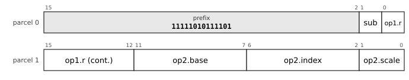

`op1` is `reg5`: register, 5 bits.

`op2` is `x5-5d0s`: memory at base + (index << scale); base register, 5 bits, index register, 5 bits.

`sub` (1 bit) selects the mnemonic: `movw` 0, `movb` 1.

Fields: `sub=p0[1]` `op1.r=p0[0]+p1[15:12]` `op2.base=p1[11:7]` `op2.index=p1[6:2]` `op2.scale=p1[1:0]`

#### SOX4-a-1: SOX4/a, prefix `11011110110110`

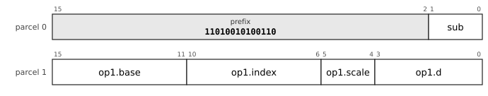

`op1` is `x5-5d4s`: memory at base + (index << scale) + signed 4-bit displacement; base register, 5 bits, index register, 5 bits.

`sub` (2 bits) selects the mnemonic: `clr` 00, `inc` 01, `dec` 10, `tst` 11.

Fields: `sub=p0[1:0]` `op1.base=p1[15:11]` `op1.index=p1[10:6]` `op1.scale=p1[5:4]` `op1.d=p1[3:0]`

#### SOX4-x-1: SOX4/x, prefix `11011110110111`

`op1` is `x5-5d4s`: memory at base + (index << scale) + signed 4-bit displacement; base register, 5 bits, index register, 5 bits.

`sub` (2 bits) selects the mnemonic: `jmp` 00, `call` 01, `jmpi` 10, `calli` 11.

Fields: `sub=p0[1:0]` `op1.base=p1[15:11]` `op1.index=p1[10:6]` `op1.scale=p1[5:4]` `op1.d=p1[3:0]`

#### LDI12-b-1: LDI12/b, prefix `11011110111000`

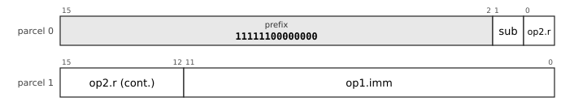

`op1` is `imm12s`: signed 12-bit immediate, -2048 to 2047.

`op2` is `reg5`: register, 5 bits.

`sub` (1 bit) selects the mnemonic: `add` 0, `sub` 1.

Fields: `sub=p0[1]` `op2.r=p0[0]+p1[15:12]` `op1.imm=p1[11:0]`

#### LDI12-d-2: LDI12/d, prefix `11011110111001`

`op1` is `imm12s`: signed 12-bit immediate, -2048 to 2047.

`op2` is `reg5`: register, 5 bits.

`sub` (1 bit) selects the mnemonic: `bic` 0, `movb` 1.

Fields: `sub=p0[1]` `op2.r=p0[0]+p1[15:12]` `op1.imm=p1[11:0]`

#### BR2-16-c-2: BR2_16/c, prefix `11011110111010`

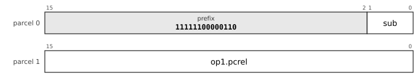

`op1` is `pc16-u2`: pc-relative, 16 bits counted in 2-byte units (-65536 to 65534 bytes).

`sub` (2 bits) selects the mnemonic: `bgt` 00, `ble` 01, `bhi` 10, `blos` 11.

Fields: `sub=p0[1:0]` `op1.pcrel=p1[15:0]`

#### SOBu12H-a-1: SOBu12H/a, prefix `11011110111100`

`op1` is `b4d12u-xsz`: memory at base register, 4 bits (an index into the hot-register table) + unsigned 12-bit displacement times the size of the access.

`sub` (2 bits) selects the mnemonic: `clr` 00, `inc` 01, `dec` 10, `tst` 11.

Fields: `sub=p0[1:0]` `op1.base=p1[15:12]` `op1.d=p1[11:0]`

#### CBZ2-12H-b-1: CBZ2_12H/b, prefix `11011110111101`

`op1` is `reg4`: register, 4 bits (an index into the hot-register table).

`op2` is `k-imm0`: implicit constant 0.

`op3` is `pc12-u2`: pc-relative, 12 bits counted in 2-byte units (-4096 to 4094 bytes).

`sub` (2 bits) selects the mnemonic: `cblt` 00, `cbge` 01, `cbgt` 10, `cble` 11.

Fields: `sub=p0[1:0]` `op1.r=p1[15:12]` `op3.pcrel=p1[11:0]`

#### MFSR-1: MFSR, prefix `110111110000001`

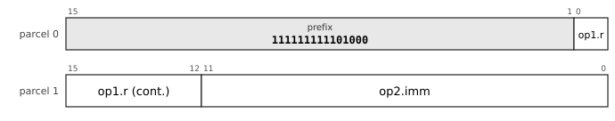

`op1` is `reg5`: register, 5 bits.

`op2` is `imm12u`: unsigned 12-bit immediate, 0 to 4095.

Fields: `op1.r=p0[0]+p1[15:12]` `op2.imm=p1[11:0]`

#### MTSR-1: MTSR, prefix `110111110000010`

`op1` is `imm12u`: unsigned 12-bit immediate, 0 to 4095.

`op2` is `reg5`: register, 5 bits.

Fields: `op2.r=p0[0]+p1[15:12]` `op1.imm=p1[11:0]`

#### STBs6-b-1: STBs6/b, prefix `110111110000111`

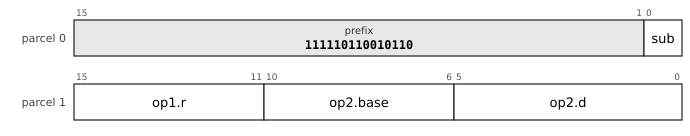

`op1` is `reg5`: register, 5 bits.

`op2` is `b5d6s-xsz`: memory at base register, 5 bits + signed 6-bit displacement times the size of the access.

`sub` (1 bit) selects the mnemonic: `movw` 0, `movb` 1.

Fields: `sub=p0[0]` `op1.r=p1[15:11]` `op2.base=p1[10:6]` `op2.d=p1[5:0]`

#### LDX0-c-2: LDX0/c, prefix `110111110001000`

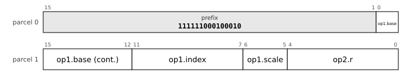

`op1` is `x5-5d0s`: memory at base + (index << scale); base register, 5 bits, index register, 5 bits.

`op2` is `reg5`: register, 5 bits.

Fields: `op1.base=p0[0]+p1[15:12]` `op1.index=p1[11:7]` `op1.scale=p1[6:5]` `op2.r=p1[4:0]`

#### CMX0-a-1: CMX0/a, prefix `110111110001001`

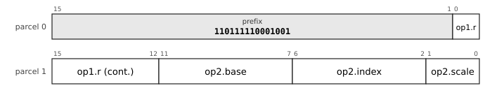

`op1` is `reg5`: register, 5 bits.

`op2` is `x5-5d0s`: memory at base + (index << scale); base register, 5 bits, index register, 5 bits.

Fields: `op1.r=p0[0]+p1[15:12]` `op2.base=p1[11:7]` `op2.index=p1[6:2]` `op2.scale=p1[1:0]`

#### SOX4-a-2: SOX4/a, prefix `110111110001010`

`op1` is `x5-5d4s`: memory at base + (index << scale) + signed 4-bit displacement; base register, 5 bits, index register, 5 bits.

`sub` (1 bit) selects the mnemonic: `push` 0, `pop` 1.

Fields: `sub=p0[0]` `op1.base=p1[15:11]` `op1.index=p1[10:6]` `op1.scale=p1[5:4]` `op1.d=p1[3:0]`

#### LDI12-a-1: LDI12/a, prefix `110111110001011`

`op1` is `imm12s`: signed 12-bit immediate, -2048 to 2047.

`op2` is `reg5`: register, 5 bits.

Fields: `op2.r=p0[0]+p1[15:12]` `op1.imm=p1[11:0]`

#### LDI12-b-2: LDI12/b, prefix `110111110001100`

`op1` is `imm12s`: signed 12-bit immediate, -2048 to 2047.

`op2` is `reg5`: register, 5 bits.

Fields: `op2.r=p0[0]+p1[15:12]` `op1.imm=p1[11:0]`

#### LDI12-d-3: LDI12/d, prefix `110111110001101`

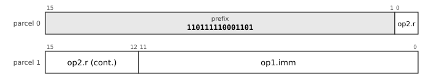

`op1` is `imm12s`: signed 12-bit immediate, -2048 to 2047.

`op2` is `reg5`: register, 5 bits.

Fields: `op2.r=p0[0]+p1[15:12]` `op1.imm=p1[11:0]`

#### CMI12-a-1: CMI12/a, prefix `110111110001110`

`op1` is `reg5`: register, 5 bits.

`op2` is `imm12s`: signed 12-bit immediate, -2048 to 2047.

Fields: `op1.r=p0[0]+p1[15:12]` `op2.imm=p1[11:0]`

#### BR2-16-b-1: BR2_16/b, prefix `110111110001111`

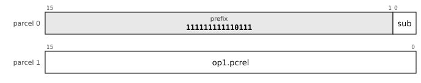

`op1` is `pc16-u2`: pc-relative, 16 bits counted in 2-byte units (-65536 to 65534 bytes).

`sub` (1 bit) selects the mnemonic: `beq` 0, `bne` 1.

Fields: `sub=p0[0]` `op1.pcrel=p1[15:0]`

#### STBs8H-b-1: STBs8H/b, prefix `110111110010000`

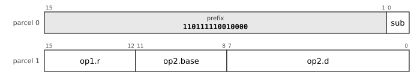

`op1` is `reg4`: register, 4 bits (an index into the hot-register table).

`op2` is `b4d8s-xsz`: memory at base register, 4 bits (an index into the hot-register table) + signed 8-bit displacement times the size of the access.

`sub` (1 bit) selects the mnemonic: `movw` 0, `movb` 1.

Fields: `sub=p0[0]` `op1.r=p1[15:12]` `op2.base=p1[11:8]` `op2.d=p1[7:0]`

#### SOBu12H-a-2: SOBu12H/a, prefix `110111110010001`

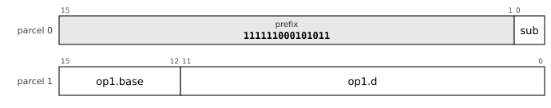

`op1` is `b4d12u-xsz`: memory at base register, 4 bits (an index into the hot-register table) + unsigned 12-bit displacement times the size of the access.

`sub` (1 bit) selects the mnemonic: `push` 0, `pop` 1.

Fields: `sub=p0[0]` `op1.base=p1[15:12]` `op1.d=p1[11:0]`

#### LDPC12H-d-2: LDPC12H/d, prefix `110111110010010`

`op1` is `pc12-u1`: pc-relative, 12 bits counted in 1-byte units (-2048 to 2047 bytes).

`op2` is `reg4`: register, 4 bits (an index into the hot-register table).

`sub` (1 bit) selects the mnemonic: `fmul` 0, `bit` 1.

Fields: `sub=p0[0]` `op2.r=p1[15:12]` `op1.pcrel=p1[11:0]`

#### PUSHI2-1: PUSHI2, prefix `1101111100101011`

`op1` is `imm16s`: signed 16-bit immediate, -32768 to 32767.

Fields: `op1.imm=p1[15:0]`

#### RRF5-1: RRF5, prefix `1101111100101100`

`op1` is `reg5`: register, 5 bits.

`op2` is `reg5`: register, 5 bits.

`xsub` selects the mnemonic.

Fields: `xsub=p1[15:10]` `op1.r=p1[9:5]` `op2.r=p1[4:0]`

#### BR2-16-a-1: BR2_16/a, prefix `1101111100101101`

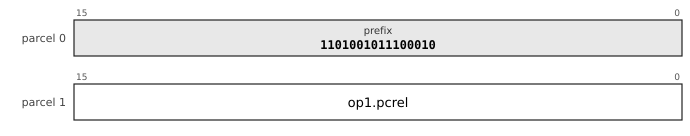

`op1` is `pc16-u2`: pc-relative, 16 bits counted in 2-byte units (-65536 to 65534 bytes).

Fields: `op1.pcrel=p1[15:0]`

#### LEAS12H-a-1: LEAS12H/a, prefix `1101111100101110`

`op1` is `spd12u-x8`: memory at sp + unsigned 12-bit displacement times 8, 0 to 32760 bytes.

`op2` is `reg4`: register, 4 bits (an index into the hot-register table).

Fields: `op2.r=p1[15:12]` `op1.d=p1[11:0]`

#### ATOML-1: ATOML, prefix `1101111101000010`

`op1` is `reg5`: register, 5 bits.

`op2` is `b5d0s-x1`: memory at (base register, 5 bits).

`xsub` selects the mnemonic.

Fields: `xsub=p1[15:10]` `op1.r=p1[9:5]` `op2.base=p1[4:0]`

### Instructions of 3 parcels (6 bytes)

#### LDF-X22-1: LDF.X22, prefix `01000`

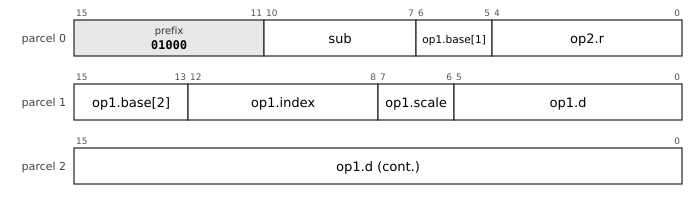

`op1` is `x5-5d22s`: memory at base + (index << scale) + signed 22-bit displacement; base register, 5 bits, index register, 5 bits.

`op2` is `reg5`: register, 5 bits.

`sub` (4 bits) selects the mnemonic: `movq` 0000, `movl` 0001, `movw` 0010, `movb` 0011, `movzl` 0100, `movzw` 0101, `movzb` 0110, `add` 0111, `sub` 1000, `bic` 1001, `bis` 1010, `xor` 1011, `and` 1100, `mul` 1101, `mulh` 1110, `shl` 1111.

Fields: `sub=p0[10:7]` `op1.base-1=p0[6:5]` `op2.r=p0[4:0]` `op1.base-2=p1[15:13]` `op1.index=p1[12:8]` `op1.scale=p1[7:6]` `op1.d=p1[5:0]+p2[15:0]`

#### LDF-B28-1: LDF.B28, prefix `011100`

`op1` is `b5d28s-x1`: memory at base register, 5 bits + signed 28-bit displacement times 1, -134217728 to 134217727 bytes.

`op2` is `reg5`: register, 5 bits.

`sub` (4 bits) selects the mnemonic: `movq` 0000, `movl` 0001, `movw` 0010, `movb` 0011, `movzl` 0100, `movzw` 0101, `movzb` 0110, `add` 0111, `sub` 1000, `bic` 1001, `bis` 1010, `xor` 1011, `and` 1100, `mul` 1101, `mulh` 1110, `shl` 1111.

Fields: `sub=p0[9:6]` `op1.base-1=p0[5]` `op2.r=p0[4:0]` `op1.base-2=p1[15:12]` `op1.d=p1[11:0]+p2[15:0]`

#### STF-X22-1: STF.X22, prefix `011111`

`op1` is `reg5`: register, 5 bits.

`op2` is `x5-5d22s`: memory at base + (index << scale) + signed 22-bit displacement; base register, 5 bits, index register, 5 bits.

`sub` (3 bits) selects the mnemonic: `movq` 000, `movl` 001, `movw` 010, `movb` 011, `addm` 100, `subm` 101, `bicm` 110, `bism` 111.

Fields: `sub=p0[9:7]` `op1.r-1=p0[6:5]` `op2.index=p0[4:0]` `op1.r-2=p1[15:13]` `op2.base=p1[12:8]` `op2.scale=p1[7:6]` `op2.d=p1[5:0]+p2[15:0]`

#### FX-MOVCALL3-1: FX.MOVCALL3, prefix `100000`

`op1` is `reg5`: register, 5 bits.

`op2` is `reg5`: register, 5 bits.

`op3` is `pc32-u2`: pc-relative, 32 bits counted in 2-byte units (-4294967296 to 4294967294 bytes).

Fields: `op1.r=p0[9:5]` `op2.r=p0[4:0]` `op3.pcrel=p1[15:0]+p2[15:0]`

#### BFx-1: BFx, prefix `1001001`

`op1` is `reg5`: register, 5 bits.

`op2` is `reg5`: register, 5 bits.

`op3` is `imm6u`: unsigned 6-bit immediate, 0 to 63.

`op4` is `reg5`: register, 5 bits.

`xsub` selects the mnemonic.

Fields: `op1.r-1=p0[8:5]` `op4.r=p0[4:0]` `op1.r-2=p1[15]` `op2.r=p1[14:10]` `op3.imm=p1[9:4]` `xsub=p1[3:0]+p2[15:0]`

#### LDF-X22-2: LDF.X22, prefix `1001100`

`op1` is `x5-5d22s`: memory at base + (index << scale) + signed 22-bit displacement; base register, 5 bits, index register, 5 bits.

`op2` is `reg5`: register, 5 bits.

`sub` (2 bits) selects the mnemonic: `shr` 00, `sar` 01, `fadd` 10, `fsub` 11.

Fields: `sub=p0[8:7]` `op1.base-1=p0[6:5]` `op2.r=p0[4:0]` `op1.base-2=p1[15:13]` `op1.index=p1[12:8]` `op1.scale=p1[7:6]` `op1.d=p1[5:0]+p2[15:0]`

#### LDF-PC32-1: LDF.PC32, prefix `1001101`

`op1` is `pc32-u1`: pc-relative, 32 bits counted in 1-byte units (-2147483648 to 2147483647 bytes).

`op2` is `reg5`: register, 5 bits.

`sub` (4 bits) selects the mnemonic: `movq` 0000, `movl` 0001, `movw` 0010, `movb` 0011, `movzl` 0100, `movzw` 0101, `movzb` 0110, `add` 0111, `sub` 1000, `bic` 1001, `bis` 1010, `xor` 1011, `and` 1100, `mul` 1101, `mulh` 1110, `shl` 1111.

Fields: `sub=p0[8:5]` `op2.r=p0[4:0]` `op1.pcrel=p1[15:0]+p2[15:0]`

#### LDF-A32-1: LDF.A32, prefix `1001110`

`op1` is `abs32`: absolute address, 32 bits.

`op2` is `reg5`: register, 5 bits.

`sub` (4 bits) selects the mnemonic: `movq` 0000, `movl` 0001, `movw` 0010, `movb` 0011, `movzl` 0100, `movzw` 0101, `movzb` 0110, `add` 0111, `sub` 1000, `bic` 1001, `bis` 1010, `xor` 1011, `and` 1100, `mul` 1101, `mulh` 1110, `shl` 1111.

Fields: `sub=p0[8:5]` `op2.r=p0[4:0]` `op1.abs=p1[15:0]+p2[15:0]`

#### LDFI-I32-1: LDFI.I32, prefix `1001111`

`op1` is `imm32s`: signed 32-bit immediate, -2147483648 to 2147483647.

`op2` is `reg5`: register, 5 bits.

`sub` (4 bits) selects the mnemonic: `add` 0000, `sub` 0001, `bic` 0010, `bis` 0011, `xor` 0100, `and` 0101, `mul` 0110, `mulh` 0111, `shl` 1000, `shr` 1001, `sar` 1010, `fadd` 1011, `fsub` 1100, `fmul` 1101, `bit` 1110, `movq` 1111.

Fields: `sub=p0[8:5]` `op2.r=p0[4:0]` `op1.imm=p1[15:0]+p2[15:0]`

#### STF-B28-1: STF.B28, prefix `1010000`

`op1` is `reg5`: register, 5 bits.

`op2` is `b5d28s-x1`: memory at base register, 5 bits + signed 28-bit displacement times 1, -134217728 to 134217727 bytes.

`sub` (3 bits) selects the mnemonic: `movq` 000, `movl` 001, `movw` 010, `movb` 011, `addm` 100, `subm` 101, `bicm` 110, `bism` 111.

Fields: `sub=p0[8:6]` `op1.r-1=p0[5]` `op2.base=p0[4:0]` `op1.r-2=p1[15:12]` `op2.d=p1[11:0]+p2[15:0]`

#### BFy-1: BFy, prefix `10110110`

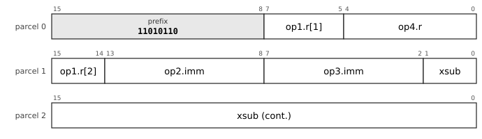

`op1` is `reg5`: register, 5 bits.

`op2` is `imm6u`: unsigned 6-bit immediate, 0 to 63.

`op3` is `imm6u`: unsigned 6-bit immediate, 0 to 63.

`op4` is `reg5`: register, 5 bits.

`xsub` selects the mnemonic.

Fields: `op1.r-1=p0[7:5]` `op4.r=p0[4:0]` `op1.r-2=p1[15:14]` `op2.imm=p1[13:8]` `op3.imm=p1[7:2]` `xsub=p1[1:0]+p2[15:0]`

#### LDU-B28-1: LDU.B28, prefix `10110111`

`op1` is `b5d28s-x1`: memory at base register, 5 bits + signed 28-bit displacement times 1, -134217728 to 134217727 bytes.

`op2` is `reg5`: register, 5 bits.

`sub` (2 bits) selects the mnemonic: `movq.u` 00, `movl.u` 01, `movw.u` 10, `movb.u` 11.

Fields: `sub=p0[7:6]` `op1.base-1=p0[5]` `op2.r=p0[4:0]` `op1.base-2=p1[15:12]` `op1.d=p1[11:0]+p2[15:0]`

#### STU-B28-1: STU.B28, prefix `10111000`

`op1` is `reg5`: register, 5 bits.

`op2` is `b5d28s-x1`: memory at base register, 5 bits + signed 28-bit displacement times 1, -134217728 to 134217727 bytes.

`sub` (2 bits) selects the mnemonic: `movq.u` 00, `movl.u` 01, `movw.u` 10, `movb.u` 11.

Fields: `sub=p0[7:6]` `op1.r-1=p0[5]` `op2.base=p0[4:0]` `op1.r-2=p1[15:12]` `op2.d=p1[11:0]+p2[15:0]`

#### LDF-B28-2: LDF.B28, prefix `10111100`

`op1` is `b5d28s-x1`: memory at base register, 5 bits + signed 28-bit displacement times 1, -134217728 to 134217727 bytes.

`op2` is `reg5`: register, 5 bits.

`sub` (2 bits) selects the mnemonic: `shr` 00, `sar` 01, `fadd` 10, `fsub` 11.

Fields: `sub=p0[7:6]` `op1.base-1=p0[5]` `op2.r=p0[4:0]` `op1.base-2=p1[15:12]` `op1.d=p1[11:0]+p2[15:0]`

#### LDF-X22-3: LDF.X22, prefix `10111101`

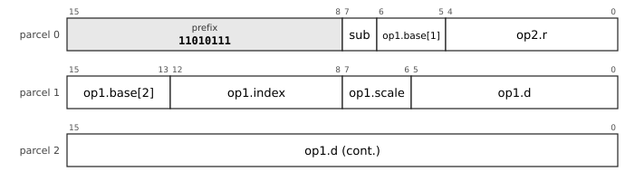

`op1` is `x5-5d22s`: memory at base + (index << scale) + signed 22-bit displacement; base register, 5 bits, index register, 5 bits.

`op2` is `reg5`: register, 5 bits.

`sub` (1 bit) selects the mnemonic: `fmul` 0, `bit` 1.

Fields: `sub=p0[7]` `op1.base-1=p0[6:5]` `op2.r=p0[4:0]` `op1.base-2=p1[15:13]` `op1.index=p1[12:8]` `op1.scale=p1[7:6]` `op1.d=p1[5:0]+p2[15:0]`

#### STF-PC32-1: STF.PC32, prefix `11000000`

`op1` is `reg5`: register, 5 bits.

`op2` is `pc32-u1`: pc-relative, 32 bits counted in 1-byte units (-2147483648 to 2147483647 bytes).

`sub` (3 bits) selects the mnemonic: `movq` 000, `movl` 001, `movw` 010, `movb` 011, `addm` 100, `subm` 101, `bicm` 110, `bism` 111.

Fields: `sub=p0[7:5]` `op1.r=p0[4:0]` `op2.pcrel=p1[15:0]+p2[15:0]`

#### STF-A32-1: STF.A32, prefix `11000001`

`op1` is `reg5`: register, 5 bits.

`op2` is `abs32`: absolute address, 32 bits.

`sub` (3 bits) selects the mnemonic: `movq` 000, `movl` 001, `movw` 010, `movb` 011, `addm` 100, `subm` 101, `bicm` 110, `bism` 111.

Fields: `sub=p0[7:5]` `op1.r=p0[4:0]` `op2.abs=p1[15:0]+p2[15:0]`

#### CMF-X22-1: CMF.X22, prefix `11000010`

`op1` is `reg5`: register, 5 bits.

`op2` is `x5-5d22s`: memory at base + (index << scale) + signed 22-bit displacement; base register, 5 bits, index register, 5 bits.

`sub` (1 bit) selects the mnemonic: `cmp` 0, `fcmp` 1.

Fields: `sub=p0[7]` `op1.r-1=p0[6:5]` `op2.index=p0[4:0]` `op1.r-2=p1[15:13]` `op2.base=p1[12:8]` `op2.scale=p1[7:6]` `op2.d=p1[5:0]+p2[15:0]`

#### LDU-B28-2: LDU.B28, prefix `110010011`

`op1` is `b5d28s-x1`: memory at base register, 5 bits + signed 28-bit displacement times 1, -134217728 to 134217727 bytes.

`op2` is `reg5`: register, 5 bits.

`sub` (1 bit) selects the mnemonic: `movzl.u` 0, `movzw.u` 1.

Fields: `sub=p0[6]` `op1.base-1=p0[5]` `op2.r=p0[4:0]` `op1.base-2=p1[15:12]` `op1.d=p1[11:0]+p2[15:0]`

#### LDF-B28-3: LDF.B28, prefix `110010110`

`op1` is `b5d28s-x1`: memory at base register, 5 bits + signed 28-bit displacement times 1, -134217728 to 134217727 bytes.

`op2` is `reg5`: register, 5 bits.

`sub` (1 bit) selects the mnemonic: `fmul` 0, `bit` 1.

Fields: `sub=p0[6]` `op1.base-1=p0[5]` `op2.r=p0[4:0]` `op1.base-2=p1[15:12]` `op1.d=p1[11:0]+p2[15:0]`

#### LDF-X22-4: LDF.X22, prefix `110010111`

`op1` is `x5-5d22s`: memory at base + (index << scale) + signed 22-bit displacement; base register, 5 bits, index register, 5 bits.

`op2` is `reg5`: register, 5 bits.

Fields: `op1.base-1=p0[6:5]` `op2.r=p0[4:0]` `op1.base-2=p1[15:13]` `op1.index=p1[12:8]` `op1.scale=p1[7:6]` `op1.d=p1[5:0]+p2[15:0]`

#### LDF-PC32-2: LDF.PC32, prefix `110011010`

`op1` is `pc32-u1`: pc-relative, 32 bits counted in 1-byte units (-2147483648 to 2147483647 bytes).

`op2` is `reg5`: register, 5 bits.

`sub` (2 bits) selects the mnemonic: `shr` 00, `sar` 01, `fadd` 10, `fsub` 11.

Fields: `sub=p0[6:5]` `op2.r=p0[4:0]` `op1.pcrel=p1[15:0]+p2[15:0]`

#### LDF-A32-2: LDF.A32, prefix `110011011`

`op1` is `abs32`: absolute address, 32 bits.

`op2` is `reg5`: register, 5 bits.

`sub` (2 bits) selects the mnemonic: `shr` 00, `sar` 01, `fadd` 10, `fsub` 11.

Fields: `sub=p0[6:5]` `op2.r=p0[4:0]` `op1.abs=p1[15:0]+p2[15:0]`

#### LDFI-I32-2: LDFI.I32, prefix `110011100`

`op1` is `imm32s`: signed 32-bit immediate, -2147483648 to 2147483647.

`op2` is `reg5`: register, 5 bits.

`sub` (2 bits) selects the mnemonic: `movl` 00, `movw` 01, `movb` 10, `movzl` 11.

Fields: `sub=p0[6:5]` `op2.r=p0[4:0]` `op1.imm=p1[15:0]+p2[15:0]`

#### CMF-B28-1: CMF.B28, prefix `110011101`

`op1` is `reg5`: register, 5 bits.

`op2` is `b5d28s-x1`: memory at base register, 5 bits + signed 28-bit displacement times 1, -134217728 to 134217727 bytes.

`sub` (1 bit) selects the mnemonic: `cmp` 0, `fcmp` 1.

Fields: `sub=p0[6]` `op1.r-1=p0[5]` `op2.base=p0[4:0]` `op1.r-2=p1[15:12]` `op2.d=p1[11:0]+p2[15:0]`

#### LDU-B28-3: LDU.B28, prefix `1101010011`

`op1` is `b5d28s-x1`: memory at base register, 5 bits + signed 28-bit displacement times 1, -134217728 to 134217727 bytes.

`op2` is `reg5`: register, 5 bits.

Fields: `op1.base-1=p0[5]` `op2.r=p0[4:0]` `op1.base-2=p1[15:12]` `op1.d=p1[11:0]+p2[15:0]`

#### LDF-B28-4: LDF.B28, prefix `1101010101`

`op1` is `b5d28s-x1`: memory at base register, 5 bits + signed 28-bit displacement times 1, -134217728 to 134217727 bytes.

`op2` is `reg5`: register, 5 bits.

Fields: `op1.base-1=p0[5]` `op2.r=p0[4:0]` `op1.base-2=p1[15:12]` `op1.d=p1[11:0]+p2[15:0]`

#### LDF-PC32-3: LDF.PC32, prefix `1101011000`

`op1` is `pc32-u1`: pc-relative, 32 bits counted in 1-byte units (-2147483648 to 2147483647 bytes).

`op2` is `reg5`: register, 5 bits.

`sub` (1 bit) selects the mnemonic: `fmul` 0, `bit` 1.

Fields: `sub=p0[5]` `op2.r=p0[4:0]` `op1.pcrel=p1[15:0]+p2[15:0]`

#### LDF-A32-3: LDF.A32, prefix `1101011001`

`op1` is `abs32`: absolute address, 32 bits.

`op2` is `reg5`: register, 5 bits.

`sub` (1 bit) selects the mnemonic: `fmul` 0, `bit` 1.

Fields: `sub=p0[5]` `op2.r=p0[4:0]` `op1.abs=p1[15:0]+p2[15:0]`

#### LDFI-I32-3: LDFI.I32, prefix `1101011010`

`op1` is `imm32s`: signed 32-bit immediate, -2147483648 to 2147483647.

`op2` is `reg5`: register, 5 bits.

`sub` (1 bit) selects the mnemonic: `movzw` 0, `movzb` 1.

Fields: `sub=p0[5]` `op2.r=p0[4:0]` `op1.imm=p1[15:0]+p2[15:0]`

#### CMF-PC32-1: CMF.PC32, prefix `1101011011`

`op1` is `reg5`: register, 5 bits.

`op2` is `pc32-u1`: pc-relative, 32 bits counted in 1-byte units (-2147483648 to 2147483647 bytes).

`sub` (1 bit) selects the mnemonic: `cmp` 0, `fcmp` 1.

Fields: `sub=p0[5]` `op1.r=p0[4:0]` `op2.pcrel=p1[15:0]+p2[15:0]`

#### CMF-A32-1: CMF.A32, prefix `1101011100`

`op1` is `reg5`: register, 5 bits.

`op2` is `abs32`: absolute address, 32 bits.

`sub` (1 bit) selects the mnemonic: `cmp` 0, `fcmp` 1.

Fields: `sub=p0[5]` `op1.r=p0[4:0]` `op2.abs=p1[15:0]+p2[15:0]`

#### CMF-I32-1: CMF.I32, prefix `1101011101`

`op1` is `reg5`: register, 5 bits.

`op2` is `imm32s`: signed 32-bit immediate, -2147483648 to 2147483647.

`sub` (1 bit) selects the mnemonic: `cmp` 0, `fcmp` 1.

Fields: `sub=p0[5]` `op1.r=p0[4:0]` `op2.imm=p1[15:0]+p2[15:0]`

#### SOF-X22-1: SOF.X22, prefix `1101011110`

`op1` is `x5-5d22s`: memory at base + (index << scale) + signed 22-bit displacement; base register, 5 bits, index register, 5 bits.

`sub` (4 bits) selects the mnemonic: `clr` 0000, `com` 0001, `inc` 0010, `dec` 0011, `neg` 0100, `tst` 0101, `adc` 0110, `sbc` 0111, `asl` 1000, `asr` 1001, `push` 1010, `pop` 1011, `jmp` 1100, `call` 1101, `jmpi` 1110, `calli` 1111.

Fields: `sub=p0[5:2]` `op1.base=p0[1:0]+p1[15:13]` `op1.index=p1[12:8]` `op1.scale=p1[7:6]` `op1.d=p1[5:0]+p2[15:0]`

#### LDF-PC32-4: LDF.PC32, prefix `11011011000`

`op1` is `pc32-u1`: pc-relative, 32 bits counted in 1-byte units (-2147483648 to 2147483647 bytes).

`op2` is `reg5`: register, 5 bits.

Fields: `op2.r=p0[4:0]` `op1.pcrel=p1[15:0]+p2[15:0]`

#### LDF-A32-4: LDF.A32, prefix `11011011001`

`op1` is `abs32`: absolute address, 32 bits.

`op2` is `reg5`: register, 5 bits.

Fields: `op2.r=p0[4:0]` `op1.abs=p1[15:0]+p2[15:0]`

#### SOF-B28-1: SOF.B28, prefix `11011011010`

`op1` is `b5d28s-x1`: memory at base register, 5 bits + signed 28-bit displacement times 1, -134217728 to 134217727 bytes.

`sub` (4 bits) selects the mnemonic: `clr` 0000, `com` 0001, `inc` 0010, `dec` 0011, `neg` 0100, `tst` 0101, `adc` 0110, `sbc` 0111, `asl` 1000, `asr` 1001, `push` 1010, `pop` 1011, `jmp` 1100, `call` 1101, `jmpi` 1110, `calli` 1111.

Fields: `sub=p0[4:1]` `op1.base=p0[0]+p1[15:12]` `op1.d=p1[11:0]+p2[15:0]`

#### DPF-D28-1: DPF.D28, prefix `11011011101`

`op1` is `dpd28s-x1`: memory at dp + signed 28-bit displacement times 1, -134217728 to 134217727 bytes.

`op2` is `reg5`: register, 5 bits.

`sub` (4 bits) selects the mnemonic: `movq` 0000, `movl` 0001, `movw` 0010, `movb` 0011, `movzl` 0100, `movzw` 0101, `movzb` 0110, `add` 0111, `sub` 1000, `bic` 1001, `bis` 1010, `xor` 1011, `and` 1100, `mul` 1101, `mulh` 1110, `shl` 1111.

Fields: `sub=p0[4:1]` `op2.r=p0[0]+p1[15:12]` `op1.d=p1[11:0]+p2[15:0]`

#### SOF-PC32-1: SOF.PC32, prefix `110111001110`

`op1` is `pc32-u1`: pc-relative, 32 bits counted in 1-byte units (-2147483648 to 2147483647 bytes).

`sub` (4 bits) selects the mnemonic: `clr` 0000, `com` 0001, `inc` 0010, `dec` 0011, `neg` 0100, `tst` 0101, `adc` 0110, `sbc` 0111, `asl` 1000, `asr` 1001, `push` 1010, `pop` 1011, `jmp` 1100, `call` 1101, `jmpi` 1110, `calli` 1111.

Fields: `sub=p0[3:0]` `op1.pcrel=p1[15:0]+p2[15:0]`

#### SOF-A32-1: SOF.A32, prefix `110111001111`

`op1` is `abs32`: absolute address, 32 bits.

`sub` (4 bits) selects the mnemonic: `clr` 0000, `com` 0001, `inc` 0010, `dec` 0011, `neg` 0100, `tst` 0101, `adc` 0110, `sbc` 0111, `asl` 1000, `asr` 1001, `push` 1010, `pop` 1011, `jmp` 1100, `call` 1101, `jmpi` 1110, `calli` 1111.

Fields: `sub=p0[3:0]` `op1.abs=p1[15:0]+p2[15:0]`

#### DPF-D28-2: DPF.D28, prefix `1101110111011`

`op1` is `dpd28s-x1`: memory at dp + signed 28-bit displacement times 1, -134217728 to 134217727 bytes.

`op2` is `reg5`: register, 5 bits.

`sub` (2 bits) selects the mnemonic: `shr` 00, `sar` 01, `fadd` 10, `fsub` 11.

Fields: `sub=p0[2:1]` `op2.r=p0[0]+p1[15:12]` `op1.d=p1[11:0]+p2[15:0]`

#### BRF-1: BRF, prefix `1101110111100`

`op1` is `pc32-u2`: pc-relative, 32 bits counted in 2-byte units (-4294967296 to 4294967294 bytes).

`sub` (3 bits) selects the mnemonic: `br` 000, `bne` 001, `beq` 010, `bpl` 011, `bmi` 100, `bvc` 101, `bvs` 110, `bcc` 111.

Fields: `sub=p0[2:0]` `op1.pcrel=p1[15:0]+p2[15:0]`

#### CB3I12-16-b-1: CB3I12_16/b, prefix `1101111000111`

`op1` is `reg5`: register, 5 bits.

`op2` is `imm12s`: signed 12-bit immediate, -2048 to 2047.

`op3` is `pc16-u2`: pc-relative, 16 bits counted in 2-byte units (-65536 to 65534 bytes).

`sub` (2 bits) selects the mnemonic: `cblt` 00, `cbge` 01, `cbgt` 10, `cble` 11.

Fields: `sub=p0[2:1]` `op1.r=p0[0]+p1[15:12]` `op2.imm=p1[11:0]` `op3.pcrel=p2[15:0]`

#### CB3I16-12-c-1: CB3I16_12/c, prefix `1101111001000`

`op1` is `reg5`: register, 5 bits.

`op2` is `imm16s`: signed 16-bit immediate, -32768 to 32767.

`op3` is `pc12-u2`: pc-relative, 12 bits counted in 2-byte units (-4096 to 4094 bytes).

`sub` (2 bits) selects the mnemonic: `cbcs` 00, `cbcc` 01, `cbhi` 10, `cblos` 11.

Fields: `sub=p0[2:1]` `op1.r=p0[0]+p1[15:12]` `op2.imm=p1[11:0]+p2[15:12]` `op3.pcrel=p2[11:0]`

#### CB3R24-a-1: CB3R24/a, prefix `1101111001001`

`op1` is `reg5`: register, 5 bits.

`op2` is `reg5`: register, 5 bits.

`op3` is `pc24-u2`: pc-relative, 24 bits counted in 2-byte units (-16777216 to 16777214 bytes).

`sub` (1 bit) selects the mnemonic: `cbeq` 0, `cbne` 1.

Fields: `sub=p0[2]` `op1.r=p0[1:0]+p1[15:13]` `op2.r=p1[12:8]` `op3.pcrel=p1[7:0]+p2[15:0]`

#### DPF-D28-3: DPF.D28, prefix `11011110101011`

`op1` is `dpd28s-x1`: memory at dp + signed 28-bit displacement times 1, -134217728 to 134217727 bytes.

`op2` is `reg5`: register, 5 bits.

`sub` (1 bit) selects the mnemonic: `fmul` 0, `bit` 1.

Fields: `sub=p0[1]` `op2.r=p0[0]+p1[15:12]` `op1.d=p1[11:0]+p2[15:0]`

#### BRF-2: BRF, prefix `11011110101100`

`op1` is `pc32-u2`: pc-relative, 32 bits counted in 2-byte units (-4294967296 to 4294967294 bytes).

`sub` (2 bits) selects the mnemonic: `bcs` 00, `bge` 01, `blt` 10, `bgt` 11.

Fields: `sub=p0[1:0]` `op1.pcrel=p1[15:0]+p2[15:0]`

#### JTAG3-1: JTAG3, prefix `11011110101101`

`op1` is `x5-5d22s`: memory at base + (index << scale) + signed 22-bit displacement; base register, 5 bits, index register, 5 bits.

Fields: `op1.base=p0[1:0]+p1[15:13]` `op1.index=p1[12:8]` `op1.scale=p1[7:6]` `op1.d=p1[5:0]+p2[15:0]`

#### CB3I16-12-a-1: CB3I16_12/a, prefix `11011110111011`

`op1` is `reg5`: register, 5 bits.

`op2` is `imm16s`: signed 16-bit immediate, -32768 to 32767.

`op3` is `pc12-u2`: pc-relative, 12 bits counted in 2-byte units (-4096 to 4094 bytes).

`sub` (1 bit) selects the mnemonic: `cbeq` 0, `cbne` 1.

Fields: `sub=p0[1]` `op1.r=p0[0]+p1[15:12]` `op2.imm=p1[11:0]+p2[15:12]` `op3.pcrel=p2[11:0]`

#### CB3I16-12H-b-1: CB3I16_12H/b, prefix `11011110111110`

`op1` is `reg4`: register, 4 bits (an index into the hot-register table).

`op2` is `imm16s`: signed 16-bit immediate, -32768 to 32767.

`op3` is `pc12-u2`: pc-relative, 12 bits counted in 2-byte units (-4096 to 4094 bytes).

`sub` (2 bits) selects the mnemonic: `cblt` 00, `cbge` 01, `cbgt` 10, `cble` 11.

Fields: `sub=p0[1:0]` `op1.r=p1[15:12]` `op2.imm=p1[11:0]+p2[15:12]` `op3.pcrel=p2[11:0]`

#### CB3R24H-b-1: CB3R24H/b, prefix `11011110111111`

`op1` is `reg4`: register, 4 bits (an index into the hot-register table).

`op2` is `reg4`: register, 4 bits (an index into the hot-register table).

`op3` is `pc24-u2`: pc-relative, 24 bits counted in 2-byte units (-16777216 to 16777214 bytes).

`sub` (2 bits) selects the mnemonic: `cblt` 00, `cbge` 01, `cbgt` 10, `cble` 11.

Fields: `sub=p0[1:0]` `op1.r=p1[15:12]` `op2.r=p1[11:8]` `op3.pcrel=p1[7:0]+p2[15:0]`

#### RETM-1: RETM, prefix `11011111010001`

`op1` is `imm32u`: unsigned 32-bit immediate, 0 to 4294967295.

`xsub` selects the mnemonic.

Fields: `xsub=p0[1:0]` `op1.imm=p1[15:0]+p2[15:0]`

#### DPF-D28-4: DPF.D28, prefix `110111110000011`

`op1` is `dpd28s-x1`: memory at dp + signed 28-bit displacement times 1, -134217728 to 134217727 bytes.

`op2` is `reg5`: register, 5 bits.

Fields: `op2.r=p0[0]+p1[15:12]` `op1.d=p1[11:0]+p2[15:0]`

#### BRF-3: BRF, prefix `110111110000100`

`op1` is `pc32-u2`: pc-relative, 32 bits counted in 2-byte units (-4294967296 to 4294967294 bytes).

`sub` (1 bit) selects the mnemonic: `ble` 0, `bhi` 1.

Fields: `sub=p0[0]` `op1.pcrel=p1[15:0]+p2[15:0]`

#### PUSHMF-1: PUSHMF, prefix `110111110000101`

`op1` is `imm32u`: unsigned 32-bit immediate, 0 to 4294967295.

`sub` (1 bit) selects the mnemonic: `pushm` 0, `popm` 1.

Fields: `sub=p0[0]` `op1.imm=p1[15:0]+p2[15:0]`

#### SPADJF-1: SPADJF, prefix `110111110000110`

`op1` is `imm32s`: signed 32-bit immediate, -2147483648 to 2147483647.

`op2` is `k-sp`: implicit register r14.

`sub` (1 bit) selects the mnemonic: `add` 0, `sub` 1.

Fields: `sub=p0[0]` `op1.imm=p1[15:0]+p2[15:0]`

#### CB3I12-16H-a-1: CB3I12_16H/a, prefix `110111110010011`

`op1` is `reg4`: register, 4 bits (an index into the hot-register table).

`op2` is `imm12s`: signed 12-bit immediate, -2048 to 2047.

`op3` is `pc16-u2`: pc-relative, 16 bits counted in 2-byte units (-65536 to 65534 bytes).

`sub` (1 bit) selects the mnemonic: `cbeq` 0, `cbne` 1.

Fields: `sub=p0[0]` `op1.r=p1[15:12]` `op2.imm=p1[11:0]` `op3.pcrel=p2[15:0]`

#### BRF-4: BRF, prefix `1101111100101000`

`op1` is `pc32-u2`: pc-relative, 32 bits counted in 2-byte units (-4294967296 to 4294967294 bytes).

Fields: `op1.pcrel=p1[15:0]+p2[15:0]`

#### CALLF-1: CALLF, prefix `1101111100101001`

`op1` is `pc32-u2`: pc-relative, 32 bits counted in 2-byte units (-4294967296 to 4294967294 bytes).

Fields: `op1.pcrel=p1[15:0]+p2[15:0]`

#### PUSHI3-1: PUSHI3, prefix `1101111100101010`

`op1` is `imm32s`: signed 32-bit immediate, -2147483648 to 2147483647.

Fields: `op1.imm=p1[15:0]+p2[15:0]`

### Instructions of 5 parcels (10 bytes)

#### MOVQ64-1: MOVQ64, prefix `11011010111`

`op1` is `imm64s`: signed 64-bit immediate, -9223372036854775808 to 9223372036854775807.

`op2` is `reg5`: register, 5 bits.

Fields: `op2.r=p0[4:0]` `op1.imm=p1[15:0]+p2[15:0]+p3[15:0]+p4[15:0]`

## The index of the mnemonics

For every mnemonic, the charts in which it is a sub-opcode or the whole leaf.

* `ABS`: [R2-1](#R2-1)
* `ADC`: [SOF-B28-1](#SOF-B28-1), [SOF-X22-1](#SOF-X22-1), [SOF-PI12-1](#SOF-PI12-1), [SOF-PD12-1](#SOF-PD12-1), [SOF-PC32-1](#SOF-PC32-1), [SOF-A32-1](#SOF-A32-1), [SOPR-1](#SOPR-1)
* `ADD`: [LDF-B28-1](#LDF-B28-1), [LDF-X22-1](#LDF-X22-1), [LDF-PI12-1](#LDF-PI12-1), [LDF-PD12-1](#LDF-PD12-1), [LDF-PC32-1](#LDF-PC32-1), [LDF-A32-1](#LDF-A32-1), [LDFI-I32-1](#LDFI-I32-1), [DPF-D28-1](#DPF-D28-1), [RRF-1](#RRF-1), [RRF5-1](#RRF5-1), [SPADJF-1](#SPADJF-1), [RR5-1](#RR5-1), [IMMh44-b-1](#IMMh44-b-1), [SPADJ6-a-1](#SPADJ6-a-1), [LDBu8-c-1](#LDBu8-c-1), [LDX0-c-1](#LDX0-c-1), [LDI12-b-1](#LDI12-b-1), [LDBu10H-c-1](#LDBu10H-c-1), [LDPC16H-c-1](#LDPC16H-c-1), [LDI18H-b-1](#LDI18H-b-1)
* `ADDM`: [STF-B28-1](#STF-B28-1), [STF-X22-1](#STF-X22-1), [STF-PI12-1](#STF-PI12-1), [STF-PD12-1](#STF-PD12-1), [STF-PC32-1](#STF-PC32-1), [STF-A32-1](#STF-A32-1)
* `ADDV`: [R2-1](#R2-1)
* `AESDS`: [R3-1](#R3-1)
* `AESDSM`: [R3-1](#R3-1)
* `AESES`: [R3-1](#R3-1)
* `AESESM`: [R3-1](#R3-1)
* `AESIM`: [R2-1](#R2-1)
* `AESKS1`: [RRI-1](#RRI-1)
* `AESKS2`: [R3-1](#R3-1)
* `AND`: [LDF-B28-1](#LDF-B28-1), [LDF-X22-1](#LDF-X22-1), [LDF-PI12-1](#LDF-PI12-1), [LDF-PD12-1](#LDF-PD12-1), [LDF-PC32-1](#LDF-PC32-1), [LDF-A32-1](#LDF-A32-1), [LDFI-I32-1](#LDFI-I32-1), [DPF-D28-1](#DPF-D28-1), [RRF-1](#RRF-1), [RRF5-1](#RRF5-1), [RR5-1](#RR5-1), [IMMh44-b-2](#IMMh44-b-2), [LDBu8-c-1](#LDBu8-c-1), [LDX0-c-1](#LDX0-c-1), [LDI12-b-2](#LDI12-b-2), [LDBu10H-c-1](#LDBu10H-c-1), [LDPC16H-c-1](#LDPC16H-c-1), [LDI18H-b-2](#LDI18H-b-2)
* `ASL`: [SOF-B28-1](#SOF-B28-1), [SOF-X22-1](#SOF-X22-1), [SOF-PI12-1](#SOF-PI12-1), [SOF-PD12-1](#SOF-PD12-1), [SOF-PC32-1](#SOF-PC32-1), [SOF-A32-1](#SOF-A32-1), [SOPR-2](#SOPR-2)
* `ASR`: [SOF-B28-1](#SOF-B28-1), [SOF-X22-1](#SOF-X22-1), [SOF-PI12-1](#SOF-PI12-1), [SOF-PD12-1](#SOF-PD12-1), [SOF-PC32-1](#SOF-PC32-1), [SOF-A32-1](#SOF-A32-1), [SOPR-2](#SOPR-2)
* `BCC`: [BRF-1](#BRF-1), [BR1-6-c-1](#BR1-6-c-1), [BR2-16-c-1](#BR2-16-c-1)
* `BCS`: [BRF-2](#BRF-2), [BR1-6-c-1](#BR1-6-c-1), [BR2-16-c-1](#BR2-16-c-1)
* `BEQ`: [BRF-1](#BRF-1), [BR1-7-b-1](#BR1-7-b-1), [BR2-16-b-1](#BR2-16-b-1)
* `BGE`: [BRF-2](#BRF-2), [BR1-6-c-1](#BR1-6-c-1), [BR2-16-c-1](#BR2-16-c-1)
* `BGT`: [BRF-2](#BRF-2), [BR1-6-c-2](#BR1-6-c-2), [BR2-16-c-2](#BR2-16-c-2)
* `BHI`: [BRF-3](#BRF-3), [BR1-6-c-2](#BR1-6-c-2), [BR2-16-c-2](#BR2-16-c-2)
* `BIC`: [LDF-B28-1](#LDF-B28-1), [LDF-X22-1](#LDF-X22-1), [LDF-PI12-1](#LDF-PI12-1), [LDF-PD12-1](#LDF-PD12-1), [LDF-PC32-1](#LDF-PC32-1), [LDF-A32-1](#LDF-A32-1), [LDFI-I32-1](#LDFI-I32-1), [DPF-D28-1](#DPF-D28-1), [RRF-1](#RRF-1), [RRF5-1](#RRF5-1), [LDI12-d-2](#LDI12-d-2), [LDPC12H-d-1](#LDPC12H-d-1), [LDI14H-c-1](#LDI14H-c-1)
* `BICM`: [STF-B28-1](#STF-B28-1), [STF-X22-1](#STF-X22-1), [STF-PI12-1](#STF-PI12-1), [STF-PD12-1](#STF-PD12-1), [STF-PC32-1](#STF-PC32-1), [STF-A32-1](#STF-A32-1)
* `BIS`: [LDF-B28-1](#LDF-B28-1), [LDF-X22-1](#LDF-X22-1), [LDF-PI12-1](#LDF-PI12-1), [LDF-PD12-1](#LDF-PD12-1), [LDF-PC32-1](#LDF-PC32-1), [LDF-A32-1](#LDF-A32-1), [LDFI-I32-1](#LDFI-I32-1), [DPF-D28-1](#DPF-D28-1), [RRF-1](#RRF-1), [RRF5-1](#RRF5-1), [RR5-1](#RR5-1), [LDBu8-c-1](#LDBu8-c-1), [LDX0-c-1](#LDX0-c-1), [LDBu10H-c-1](#LDBu10H-c-1), [LDPC16H-c-1](#LDPC16H-c-1), [LDI14H-c-1](#LDI14H-c-1)
* `BISM`: [STF-B28-1](#STF-B28-1), [STF-X22-1](#STF-X22-1), [STF-PI12-1](#STF-PI12-1), [STF-PD12-1](#STF-PD12-1), [STF-PC32-1](#STF-PC32-1), [STF-A32-1](#STF-A32-1)
* `BIT`: [LDF-B28-3](#LDF-B28-3), [LDF-X22-3](#LDF-X22-3), [LDF-PI12-3](#LDF-PI12-3), [LDF-PD12-3](#LDF-PD12-3), [LDF-PC32-3](#LDF-PC32-3), [LDF-A32-3](#LDF-A32-3), [LDFI-I32-1](#LDFI-I32-1), [DPF-D28-3](#DPF-D28-3), [RRF-2](#RRF-2), [RRF5-1](#RRF5-1), [LDI12-d-3](#LDI12-d-3), [LDPC12H-d-2](#LDPC12H-d-2)
* `BITREV`: [R2-1](#R2-1)
* `BLE`: [BRF-3](#BRF-3), [BR1-6-c-2](#BR1-6-c-2), [BR2-16-c-2](#BR2-16-c-2)
* `BLOS`: [BRF-4](#BRF-4), [BR1-6-c-2](#BR1-6-c-2), [BR2-16-c-2](#BR2-16-c-2)
* `BLT`: [BRF-2](#BRF-2), [BR1-6-c-1](#BR1-6-c-1), [BR2-16-c-1](#BR2-16-c-1)
* `BMI`: [BRF-1](#BRF-1), [BR1-6-c-1](#BR1-6-c-1), [BR2-16-c-1](#BR2-16-c-1)
* `BNE`: [BRF-1](#BRF-1), [BR1-7-b-1](#BR1-7-b-1), [BR2-16-b-1](#BR2-16-b-1)
* `BNTAG`: [TAG-1](#TAG-1)
* `BPL`: [BRF-1](#BRF-1), [BR1-6-c-1](#BR1-6-c-1), [BR2-16-c-1](#BR2-16-c-1)
* `BPT`: [SYS0-1](#SYS0-1)
* `BR`: [BRF-1](#BRF-1), [BR1-9-a-1](#BR1-9-a-1), [BR2-16-a-1](#BR2-16-a-1)
* `BSEL`: [R4-1](#R4-1)
* `BSWAP`: [R2-1](#R2-1)
* `BSWAPL`: [R2-1](#R2-1)
* `BSWAPW`: [R2-1](#R2-1)
* `BTAG`: [TAG-1](#TAG-1)
* `BVC`: [BRF-1](#BRF-1), [BR1-6-c-1](#BR1-6-c-1), [BR2-16-c-1](#BR2-16-c-1)
* `BVS`: [BRF-1](#BRF-1), [BR1-6-c-1](#BR1-6-c-1), [BR2-16-c-1](#BR2-16-c-1)
* `CALL`: [SOF-B28-1](#SOF-B28-1), [SOF-X22-1](#SOF-X22-1), [SOF-PI12-1](#SOF-PI12-1), [SOF-PD12-1](#SOF-PD12-1), [SOF-PC32-1](#SOF-PC32-1), [SOF-A32-1](#SOF-A32-1), [CALLF-1](#CALLF-1), [SOPR-3](#SOPR-3), [SOBu12-x-1](#SOBu12-x-1), [SOX4-x-1](#SOX4-x-1), [CALL2-20-c-1](#CALL2-20-c-1)
* `CALLI`: [SOF-B28-1](#SOF-B28-1), [SOF-X22-1](#SOF-X22-1), [SOF-PI12-1](#SOF-PI12-1), [SOF-PD12-1](#SOF-PD12-1), [SOF-PC32-1](#SOF-PC32-1), [SOF-A32-1](#SOF-A32-1), [SOBu12-x-1](#SOBu12-x-1), [SOX4-x-1](#SOX4-x-1)
* `CAS`: [ATOM-1](#ATOM-1)
* `CASL`: [ATOM-1](#ATOM-1)
* `CBCC`: [CBR8-c-1](#CBR8-c-1), [CB3I16-12-c-1](#CB3I16-12-c-1), [CBR10H-c-1](#CBR10H-c-1), [CBI3-10H-c-1](#CBI3-10H-c-1), [CBI8-8H-c-1](#CBI8-8H-c-1)
* `CBCS`: [CBR8-c-1](#CBR8-c-1), [CB3I16-12-c-1](#CB3I16-12-c-1), [CBR10H-c-1](#CBR10H-c-1), [CBI3-10H-c-1](#CBI3-10H-c-1), [CBI8-8H-c-1](#CBI8-8H-c-1)
* `CBEQ`: [CBZ1-5-a-1](#CBZ1-5-a-1), [CBR8-a-1](#CBR8-a-1), [CB3I16-12-a-1](#CB3I16-12-a-1), [CB3R24-a-1](#CB3R24-a-1), [CBI3-10-a-1](#CBI3-10-a-1), [CBI5-8-a-1](#CBI5-8-a-1), [CBR10H-a-1](#CBR10H-a-1), [CBZ2-14H-a-1](#CBZ2-14H-a-1), [CB3I12-16H-a-1](#CB3I12-16H-a-1), [CBI3-12H-a-1](#CBI3-12H-a-1), [CBI8-10H-a-1](#CBI8-10H-a-1), [CBI10-8H-a-1](#CBI10-8H-a-1)
* `CBGE`: [CBR8-b-1](#CBR8-b-1), [CB3I12-16-b-1](#CB3I12-16-b-1), [CBI4-8-b-1](#CBI4-8-b-1), [CBZ2-12H-b-1](#CBZ2-12H-b-1), [CB3I16-12H-b-1](#CB3I16-12H-b-1), [CB3R24H-b-1](#CB3R24H-b-1), [CBI3-10H-b-1](#CBI3-10H-b-1), [CBI8-8H-b-1](#CBI8-8H-b-1)
* `CBGT`: [CBR8-b-1](#CBR8-b-1), [CB3I12-16-b-1](#CB3I12-16-b-1), [CBI4-8-b-1](#CBI4-8-b-1), [CBZ2-12H-b-1](#CBZ2-12H-b-1), [CB3I16-12H-b-1](#CB3I16-12H-b-1), [CB3R24H-b-1](#CB3R24H-b-1), [CBI3-10H-b-1](#CBI3-10H-b-1), [CBI8-8H-b-1](#CBI8-8H-b-1)
* `CBHI`: [CBR8-c-1](#CBR8-c-1), [CB3I16-12-c-1](#CB3I16-12-c-1), [CBR10H-c-1](#CBR10H-c-1), [CBI3-10H-c-1](#CBI3-10H-c-1), [CBI8-8H-c-1](#CBI8-8H-c-1)
* `CBLE`: [CBR8-b-1](#CBR8-b-1), [CB3I12-16-b-1](#CB3I12-16-b-1), [CBI4-8-b-1](#CBI4-8-b-1), [CBZ2-12H-b-1](#CBZ2-12H-b-1), [CB3I16-12H-b-1](#CB3I16-12H-b-1), [CB3R24H-b-1](#CB3R24H-b-1), [CBI3-10H-b-1](#CBI3-10H-b-1), [CBI8-8H-b-1](#CBI8-8H-b-1)
* `CBLOS`: [CBR8-c-1](#CBR8-c-1), [CB3I16-12-c-1](#CB3I16-12-c-1), [CBR10H-c-1](#CBR10H-c-1), [CBI3-10H-c-1](#CBI3-10H-c-1), [CBI8-8H-c-1](#CBI8-8H-c-1)
* `CBLT`: [CBR8-b-1](#CBR8-b-1), [CB3I12-16-b-1](#CB3I12-16-b-1), [CBI4-8-b-1](#CBI4-8-b-1), [CBZ2-12H-b-1](#CBZ2-12H-b-1), [CB3I16-12H-b-1](#CB3I16-12H-b-1), [CB3R24H-b-1](#CB3R24H-b-1), [CBI3-10H-b-1](#CBI3-10H-b-1), [CBI8-8H-b-1](#CBI8-8H-b-1)
* `CBNE`: [CBZ1-5-a-1](#CBZ1-5-a-1), [CBR8-a-1](#CBR8-a-1), [CB3I16-12-a-1](#CB3I16-12-a-1), [CB3R24-a-1](#CB3R24-a-1), [CBI3-10-a-1](#CBI3-10-a-1), [CBI5-8-a-1](#CBI5-8-a-1), [CBR10H-a-1](#CBR10H-a-1), [CBZ2-14H-a-1](#CBZ2-14H-a-1), [CB3I12-16H-a-1](#CB3I12-16H-a-1), [CBI3-12H-a-1](#CBI3-12H-a-1), [CBI8-10H-a-1](#CBI8-10H-a-1), [CBI10-8H-a-1](#CBI10-8H-a-1)
* `CHK2`: [R3-1](#R3-1)
* `CLMULH`: [R3-1](#R3-1)
* `CLMULL`: [R3-1](#R3-1)
* `CLO`: [R2-1](#R2-1)
* `CLR`: [SOF-B28-1](#SOF-B28-1), [SOF-X22-1](#SOF-X22-1), [SOF-PI12-1](#SOF-PI12-1), [SOF-PD12-1](#SOF-PD12-1), [SOF-PC32-1](#SOF-PC32-1), [SOF-A32-1](#SOF-A32-1), [SOPR-1](#SOPR-1), [SOBs12-a-1](#SOBs12-a-1), [SOX4-a-1](#SOX4-a-1), [SOBu12H-a-1](#SOBu12H-a-1)
* `CLZ`: [R2-1](#R2-1)
* `CMP`: [CMF-B28-1](#CMF-B28-1), [CMF-X22-1](#CMF-X22-1), [CMF-PI12-1](#CMF-PI12-1), [CMF-PD12-1](#CMF-PD12-1), [CMF-PC32-1](#CMF-PC32-1), [CMF-A32-1](#CMF-A32-1), [CMF-I32-1](#CMF-I32-1), [RRF-2](#RRF-2), [RRF5-1](#RRF5-1), [CMBu8-a-1](#CMBu8-a-1), [CMX0-a-1](#CMX0-a-1), [CMI12-a-1](#CMI12-a-1), [CMBu12H-a-1](#CMBu12H-a-1), [CMPC16H-a-1](#CMPC16H-a-1), [CMI18H-a-1](#CMI18H-a-1)
* `COM`: [SOF-B28-1](#SOF-B28-1), [SOF-X22-1](#SOF-X22-1), [SOF-PI12-1](#SOF-PI12-1), [SOF-PD12-1](#SOF-PD12-1), [SOF-PC32-1](#SOF-PC32-1), [SOF-A32-1](#SOF-A32-1), [SOPR-1](#SOPR-1)
* `CTCC`: [R2-1](#R2-1), [CTM12-a-1](#CTM12-a-1)
* `CTCS`: [R2-1](#R2-1)
* `CTEQ`: [CT1-1](#CT1-1), [R2-1](#R2-1), [CTM12-a-1](#CTM12-a-1)
* `CTGE`: [R2-1](#R2-1)
* `CTGT`: [R2-1](#R2-1)
* `CTHI`: [R2-1](#R2-1), [CTM12-a-1](#CTM12-a-1)
* `CTLE`: [R2-1](#R2-1)
* `CTLOS`: [R2-1](#R2-1)
* `CTLT`: [R2-1](#R2-1)
* `CTMI`: [R2-1](#R2-1)
* `CTNE`: [CT1-1](#CT1-1), [R2-1](#R2-1), [CTM12-a-1](#CTM12-a-1)
* `CTO`: [R2-1](#R2-1)
* `CTPL`: [R2-1](#R2-1)
* `CTVC`: [R2-1](#R2-1)
* `CTVS`: [R2-1](#R2-1)
* `CTZ`: [R2-1](#R2-1)
* `DEC`: [SOF-B28-1](#SOF-B28-1), [SOF-X22-1](#SOF-X22-1), [SOF-PI12-1](#SOF-PI12-1), [SOF-PD12-1](#SOF-PD12-1), [SOF-PC32-1](#SOF-PC32-1), [SOF-A32-1](#SOF-A32-1), [SOPR-1](#SOPR-1), [SOBs12-a-1](#SOBs12-a-1), [SOX4-a-1](#SOX4-a-1), [SOBu12H-a-1](#SOBu12H-a-1)
* `DIV`: [R3-1](#R3-1)
* `DIVU`: [R3-1](#R3-1)
* `DSHR`: [BFx-1](#BFx-1)
* `EXTB`: [BFy-1](#BFy-1)
* `EXTZB`: [BFy-1](#BFy-1)
* `FABS`: [R2-1](#R2-1)
* `FADD`: [LDF-B28-2](#LDF-B28-2), [LDF-X22-2](#LDF-X22-2), [LDF-PI12-2](#LDF-PI12-2), [LDF-PD12-2](#LDF-PD12-2), [LDF-PC32-2](#LDF-PC32-2), [LDF-A32-2](#LDF-A32-2), [LDFI-I32-1](#LDFI-I32-1), [DPF-D28-2](#DPF-D28-2), [RRF-2](#RRF-2), [RRF5-1](#RRF5-1), [LDPC12H-d-1](#LDPC12H-d-1)
* `FADD32`: [R2-1](#R2-1)
* `FCLASS`: [R2-1](#R2-1)
* `FCLASS32`: [R2-1](#R2-1)
* `FCMP`: [CMF-B28-1](#CMF-B28-1), [CMF-X22-1](#CMF-X22-1), [CMF-PI12-1](#CMF-PI12-1), [CMF-PD12-1](#CMF-PD12-1), [CMF-PC32-1](#CMF-PC32-1), [CMF-A32-1](#CMF-A32-1), [CMF-I32-1](#CMF-I32-1), [RRF-2](#RRF-2), [RRF5-1](#RRF5-1)
* `FCMP32`: [R2-1](#R2-1)
* `FCOPYSIGN`: [R3-1](#R3-1)
* `FCVTDH`: [R2-1](#R2-1)
* `FCVTDQ`: [R2-1](#R2-1)
* `FCVTDQU`: [R2-1](#R2-1)
* `FCVTDS`: [R2-1](#R2-1)
* `FCVTHD`: [R2-1](#R2-1)
* `FCVTHL`: [R2-1](#R2-1)
* `FCVTHS`: [R2-1](#R2-1)
* `FCVTLH`: [R2-1](#R2-1)
* `FCVTLS`: [R2-1](#R2-1)
* `FCVTQD`: [R2-1](#R2-1)
* `FCVTQUD`: [R2-1](#R2-1)
* `FCVTSD`: [R2-1](#R2-1)
* `FCVTSH`: [R2-1](#R2-1)
* `FCVTSL`: [R2-1](#R2-1)
* `FDIV`: [R2-1](#R2-1)
* `FDIV32`: [R2-1](#R2-1)
* `FENCE`: [SYS0-1](#SYS0-1)
* `FMADD`: [R4-1](#R4-1)
* `FMADD32`: [R4-1](#R4-1)
* `FMAX`: [R3-1](#R3-1)
* `FMIN`: [R3-1](#R3-1)
* `FMUL`: [LDF-B28-3](#LDF-B28-3), [LDF-X22-3](#LDF-X22-3), [LDF-PI12-3](#LDF-PI12-3), [LDF-PD12-3](#LDF-PD12-3), [LDF-PC32-3](#LDF-PC32-3), [LDF-A32-3](#LDF-A32-3), [LDFI-I32-1](#LDFI-I32-1), [DPF-D28-3](#DPF-D28-3), [RRF-2](#RRF-2), [RRF5-1](#RRF5-1), [LDPC12H-d-2](#LDPC12H-d-2)
* `FMUL32`: [R2-1](#R2-1)
* `FNEG`: [R2-1](#R2-1)
* `FNMSUB`: [R4-1](#R4-1)
* `FNMSUB32`: [R4-1](#R4-1)
* `FRINT`: [R2-1](#R2-1)
* `FRINTA`: [R2-1](#R2-1)
* `FRINTM`: [R2-1](#R2-1)
* `FRINTP`: [R2-1](#R2-1)
* `FRINTZ`: [R2-1](#R2-1)
* `FSFLAGS`: [R2-1](#R2-1)
* `FSQRT`: [R2-1](#R2-1)
* `FSQRT32`: [R2-1](#R2-1)
* `FSUB`: [LDF-B28-2](#LDF-B28-2), [LDF-X22-2](#LDF-X22-2), [LDF-PI12-2](#LDF-PI12-2), [LDF-PD12-2](#LDF-PD12-2), [LDF-PC32-2](#LDF-PC32-2), [LDF-A32-2](#LDF-A32-2), [LDFI-I32-1](#LDFI-I32-1), [DPF-D28-2](#DPF-D28-2), [RRF-2](#RRF-2), [RRF5-1](#RRF5-1), [LDPC12H-d-1](#LDPC12H-d-1)
* `FSUB32`: [R2-1](#R2-1)
* `GENTER`: [RETM-1](#RETM-1)
* `HALT`: [SYS0-1](#SYS0-1)
* `HINT`: [SYSI-2](#SYSI-2)
* `ICINV`: [SYSR-2](#SYSR-2)
* `ICINVA`: [SYS0-2](#SYS0-2)
* `INC`: [SOF-B28-1](#SOF-B28-1), [SOF-X22-1](#SOF-X22-1), [SOF-PI12-1](#SOF-PI12-1), [SOF-PD12-1](#SOF-PD12-1), [SOF-PC32-1](#SOF-PC32-1), [SOF-A32-1](#SOF-A32-1), [SOPR-1](#SOPR-1), [SOBs12-a-1](#SOBs12-a-1), [SOX4-a-1](#SOX4-a-1), [SOBu12H-a-1](#SOBu12H-a-1)
* `INSB`: [BFy-1](#BFy-1)
* `ISYNC`: [SYS0-3](#SYS0-3)
* `JMP`: [SOF-B28-1](#SOF-B28-1), [SOF-X22-1](#SOF-X22-1), [SOF-PI12-1](#SOF-PI12-1), [SOF-PD12-1](#SOF-PD12-1), [SOF-PC32-1](#SOF-PC32-1), [SOF-A32-1](#SOF-A32-1), [SOPR-3](#SOPR-3), [SOBu12-x-1](#SOBu12-x-1), [SOX4-x-1](#SOX4-x-1)
* `JMPI`: [SOF-B28-1](#SOF-B28-1), [SOF-X22-1](#SOF-X22-1), [SOF-PI12-1](#SOF-PI12-1), [SOF-PD12-1](#SOF-PD12-1), [SOF-PC32-1](#SOF-PC32-1), [SOF-A32-1](#SOF-A32-1), [SOBu12-x-1](#SOBu12-x-1), [SOX4-x-1](#SOX4-x-1)
* `JTAG`: [JTAG3-1](#JTAG3-1), [JTAG2-1](#JTAG2-1)
* `LEA`: [LDF-B28-4](#LDF-B28-4), [LDF-X22-4](#LDF-X22-4), [LDF-PI12-4](#LDF-PI12-4), [LDF-PD12-4](#LDF-PD12-4), [LDF-PC32-4](#LDF-PC32-4), [LDF-A32-4](#LDF-A32-4), [DPF-D28-4](#DPF-D28-4), [LDHHH3-a-1](#LDHHH3-a-1), [LDSPh5-a-1](#LDSPh5-a-1), [LEASPh5-a-1](#LEASPh5-a-1), [LDBs10-a-1](#LDBs10-a-1), [LDX0-a-1](#LDX0-a-1), [LDPC14-a-1](#LDPC14-a-1), [LDBu12H-a-1](#LDBu12H-a-1), [LEAS12H-a-1](#LEAS12H-a-1), [LDX6H-a-1](#LDX6H-a-1), [LDPC16H-a-1](#LDPC16H-a-1)
* `LL`: [ATOML-1](#ATOML-1)
* `LLL`: [ATOML-1](#ATOML-1)
* `LPAD`: [SYS0-1](#SYS0-1)
* `MASKEQZ`: [R3-1](#R3-1)
* `MASKNEZ`: [R3-1](#R3-1)
* `MAX`: [R3-1](#R3-1)
* `MAXU`: [R3-1](#R3-1)
* `MCMP`: [R3-1](#R3-1)
* `MCPY`: [R3-1](#R3-1)
* `MCPY.UR`: [R3-1](#R3-1)
* `MCPY.UW`: [R3-1](#R3-1)
* `MFDP`: [SYSR-2](#SYSR-2)
* `MFPS`: [SYSR-1](#SYSR-1)
* `MFSR`: [MFSR-1](#MFSR-1)
* `MIN`: [R3-1](#R3-1)
* `MINU`: [R3-1](#R3-1)
* `MMOV`: [R3-1](#R3-1)
* `MOD`: [R3-1](#R3-1)
* `MODU`: [R3-1](#R3-1)
* `MOV2`: [FX-MOV2-1](#FX-MOV2-1)
* `MOVB`: [LDF-B28-1](#LDF-B28-1), [LDF-X22-1](#LDF-X22-1), [LDF-PI12-1](#LDF-PI12-1), [LDF-PD12-1](#LDF-PD12-1), [LDF-PC32-1](#LDF-PC32-1), [LDF-A32-1](#LDF-A32-1), [LDFI-I32-2](#LDFI-I32-2), [STF-B28-1](#STF-B28-1), [STF-X22-1](#STF-X22-1), [STF-PI12-1](#STF-PI12-1), [STF-PD12-1](#STF-PD12-1), [STF-PC32-1](#STF-PC32-1), [STF-A32-1](#STF-A32-1), [DPF-D28-1](#DPF-D28-1), [RRF-1](#RRF-1), [RRF5-1](#RRF5-1), [STHHH1-b-1](#STHHH1-b-1), [LDBs6-b-1](#LDBs6-b-1), [STBs6-b-1](#STBs6-b-1), [LDBu6-b-1](#LDBu6-b-1), [LDX0-b-1](#LDX0-b-1), [STX0-b-1](#STX0-b-1), [LDI12-d-2](#LDI12-d-2), [STBs8H-b-1](#STBs8H-b-1), [LDBu12H-b-1](#LDBu12H-b-1), [STBu12H-b-1](#STBu12H-b-1), [LDX4H-b-1](#LDX4H-b-1), [STX6H-b-1](#STX6H-b-1), [LDPC14H-b-1](#LDPC14H-b-1)
* `MOVB.U`: [LDU-B28-1](#LDU-B28-1), [STU-B28-1](#STU-B28-1), [LDU-B12-1](#LDU-B12-1), [STU-B12-1](#STU-B12-1), [LDU-X6-1](#LDU-X6-1), [STU-X6-1](#STU-X6-1)
* `MOVCALL`: [FX-MOVCALL3-1](#FX-MOVCALL3-1), [FX-MOVCALL2-1](#FX-MOVCALL2-1)
* `MOVL`: [LDF-B28-1](#LDF-B28-1), [LDF-X22-1](#LDF-X22-1), [LDF-PI12-1](#LDF-PI12-1), [LDF-PD12-1](#LDF-PD12-1), [LDF-PC32-1](#LDF-PC32-1), [LDF-A32-1](#LDF-A32-1), [LDFI-I32-2](#LDFI-I32-2), [STF-B28-1](#STF-B28-1), [STF-X22-1](#STF-X22-1), [STF-PI12-1](#STF-PI12-1), [STF-PD12-1](#STF-PD12-1), [STF-PC32-1](#STF-PC32-1), [STF-A32-1](#STF-A32-1), [DPF-D28-1](#DPF-D28-1), [RRF-1](#RRF-1), [RRF5-1](#RRF5-1), [RR5-1](#RR5-1), [LDHHH3-a-1](#LDHHH3-a-1), [STHHH3-a-1](#STHHH3-a-1), [STSPh4-a-1](#STSPh4-a-1), [LDSPh5-a-1](#LDSPh5-a-1), [STBs8-a-1](#STBs8-a-1), [LDBs10-a-1](#LDBs10-a-1), [LDX0-a-1](#LDX0-a-1), [STX0-a-1](#STX0-a-1), [LDPC14-a-1](#LDPC14-a-1), [LDBu12H-a-1](#LDBu12H-a-1), [STBu12H-a-1](#STBu12H-a-1), [LDX6H-a-1](#LDX6H-a-1), [STX6H-a-1](#STX6H-a-1), [LDPC16H-a-1](#LDPC16H-a-1)
* `MOVL.U`: [LDU-B28-1](#LDU-B28-1), [STU-B28-1](#STU-B28-1), [LDU-B12-1](#LDU-B12-1), [STU-B12-1](#STU-B12-1), [LDU-X6-1](#LDU-X6-1), [STU-X6-1](#STU-X6-1)
* `MOVQ`: [MOVQ64-1](#MOVQ64-1), [LDF-B28-1](#LDF-B28-1), [LDF-X22-1](#LDF-X22-1), [LDF-PI12-1](#LDF-PI12-1), [LDF-PD12-1](#LDF-PD12-1), [LDF-PC32-1](#LDF-PC32-1), [LDF-A32-1](#LDF-A32-1), [LDFI-I32-1](#LDFI-I32-1), [STF-B28-1](#STF-B28-1), [STF-X22-1](#STF-X22-1), [STF-PI12-1](#STF-PI12-1), [STF-PD12-1](#STF-PD12-1), [STF-PC32-1](#STF-PC32-1), [STF-A32-1](#STF-A32-1), [DPF-D28-1](#DPF-D28-1), [RRF-1](#RRF-1), [RRF5-1](#RRF5-1), [RR5-1](#RR5-1), [LDHHH3-a-1](#LDHHH3-a-1), [STHHH3-a-1](#STHHH3-a-1), [STSPh4-a-1](#STSPh4-a-1), [LDSPh5-a-1](#LDSPh5-a-1), [IMMh47-a-1](#IMMh47-a-1), [STBs8-a-1](#STBs8-a-1), [LDBs10-a-1](#LDBs10-a-1), [LDX0-a-1](#LDX0-a-1), [STX0-a-1](#STX0-a-1), [LDPC14-a-1](#LDPC14-a-1), [LDI12-a-1](#LDI12-a-1), [LDBu12H-a-1](#LDBu12H-a-1), [STBu12H-a-1](#STBu12H-a-1), [LDX6H-a-1](#LDX6H-a-1), [STX6H-a-1](#STX6H-a-1), [LDPC16H-a-1](#LDPC16H-a-1), [LDI18H-a-1](#LDI18H-a-1)
* `MOVQ.U`: [LDU-B28-1](#LDU-B28-1), [STU-B28-1](#STU-B28-1), [LDU-B12-1](#LDU-B12-1), [STU-B12-1](#STU-B12-1), [LDU-X6-1](#LDU-X6-1), [STU-X6-1](#STU-X6-1)
* `MOVW`: [LDF-B28-1](#LDF-B28-1), [LDF-X22-1](#LDF-X22-1), [LDF-PI12-1](#LDF-PI12-1), [LDF-PD12-1](#LDF-PD12-1), [LDF-PC32-1](#LDF-PC32-1), [LDF-A32-1](#LDF-A32-1), [LDFI-I32-2](#LDFI-I32-2), [STF-B28-1](#STF-B28-1), [STF-X22-1](#STF-X22-1), [STF-PI12-1](#STF-PI12-1), [STF-PD12-1](#STF-PD12-1), [STF-PC32-1](#STF-PC32-1), [STF-A32-1](#STF-A32-1), [DPF-D28-1](#DPF-D28-1), [RRF-1](#RRF-1), [RRF5-1](#RRF5-1), [STHHH1-b-1](#STHHH1-b-1), [LDBs6-b-1](#LDBs6-b-1), [STBs6-b-1](#STBs6-b-1), [LDBu6-b-1](#LDBu6-b-1), [LDX0-b-1](#LDX0-b-1), [STX0-b-1](#STX0-b-1), [STBs8H-b-1](#STBs8H-b-1), [LDBu12H-b-1](#LDBu12H-b-1), [STBu12H-b-1](#STBu12H-b-1), [LDX4H-b-1](#LDX4H-b-1), [STX6H-b-1](#STX6H-b-1), [LDPC14H-b-1](#LDPC14H-b-1)
* `MOVW.U`: [LDU-B28-1](#LDU-B28-1), [STU-B28-1](#STU-B28-1), [LDU-B12-1](#LDU-B12-1), [STU-B12-1](#STU-B12-1), [LDU-X6-1](#LDU-X6-1), [STU-X6-1](#STU-X6-1)
* `MOVZB`: [LDF-B28-1](#LDF-B28-1), [LDF-X22-1](#LDF-X22-1), [LDF-PI12-1](#LDF-PI12-1), [LDF-PD12-1](#LDF-PD12-1), [LDF-PC32-1](#LDF-PC32-1), [LDF-A32-1](#LDF-A32-1), [LDFI-I32-3](#LDFI-I32-3), [DPF-D28-1](#DPF-D28-1), [RRF-1](#RRF-1), [RRF5-1](#RRF5-1), [LDHHH3-a-1](#LDHHH3-a-1), [LDSPh5-a-1](#LDSPh5-a-1), [LDBs10-a-1](#LDBs10-a-1), [LDX0-a-1](#LDX0-a-1), [LDPC14-a-1](#LDPC14-a-1), [LDBu12H-a-1](#LDBu12H-a-1), [LDX6H-a-1](#LDX6H-a-1), [LDPC16H-a-1](#LDPC16H-a-1)
* `MOVZB.U`: [LDU-B28-3](#LDU-B28-3), [LDU-B12-3](#LDU-B12-3), [LDU-X6-3](#LDU-X6-3)
* `MOVZL`: [LDF-B28-1](#LDF-B28-1), [LDF-X22-1](#LDF-X22-1), [LDF-PI12-1](#LDF-PI12-1), [LDF-PD12-1](#LDF-PD12-1), [LDF-PC32-1](#LDF-PC32-1), [LDF-A32-1](#LDF-A32-1), [LDFI-I32-2](#LDFI-I32-2), [DPF-D28-1](#DPF-D28-1), [RRF-1](#RRF-1), [RRF5-1](#RRF5-1), [LDBs6-b-1](#LDBs6-b-1), [LDBu6-b-1](#LDBu6-b-1), [LDX0-b-1](#LDX0-b-1), [LDBu12H-b-1](#LDBu12H-b-1), [LDX4H-b-1](#LDX4H-b-1), [LDPC14H-b-1](#LDPC14H-b-1)
* `MOVZL.U`: [LDU-B28-2](#LDU-B28-2), [LDU-B12-2](#LDU-B12-2), [LDU-X6-2](#LDU-X6-2)
* `MOVZW`: [LDF-B28-1](#LDF-B28-1), [LDF-X22-1](#LDF-X22-1), [LDF-PI12-1](#LDF-PI12-1), [LDF-PD12-1](#LDF-PD12-1), [LDF-PC32-1](#LDF-PC32-1), [LDF-A32-1](#LDF-A32-1), [LDFI-I32-3](#LDFI-I32-3), [DPF-D28-1](#DPF-D28-1), [RRF-1](#RRF-1), [RRF5-1](#RRF5-1), [LDBs6-b-1](#LDBs6-b-1), [LDBu6-b-1](#LDBu6-b-1), [LDX0-b-1](#LDX0-b-1), [LDBu12H-b-1](#LDBu12H-b-1), [LDX4H-b-1](#LDX4H-b-1), [LDPC14H-b-1](#LDPC14H-b-1)
* `MOVZW.U`: [LDU-B28-2](#LDU-B28-2), [LDU-B12-2](#LDU-B12-2), [LDU-X6-2](#LDU-X6-2)
* `MSCN`: [R3-1](#R3-1)
* `MSCNN`: [R3-1](#R3-1)
* `MSET`: [R3-1](#R3-1)
* `MTDP`: [SYSR-1](#SYSR-1)
* `MTPS`: [SYSR-1](#SYSR-1)
* `MTSR`: [MTSR-1](#MTSR-1)
* `MUL`: [LDF-B28-1](#LDF-B28-1), [LDF-X22-1](#LDF-X22-1), [LDF-PI12-1](#LDF-PI12-1), [LDF-PD12-1](#LDF-PD12-1), [LDF-PC32-1](#LDF-PC32-1), [LDF-A32-1](#LDF-A32-1), [LDFI-I32-1](#LDFI-I32-1), [DPF-D28-1](#DPF-D28-1), [RRF-1](#RRF-1), [RRF5-1](#RRF5-1), [LDI12-d-1](#LDI12-d-1), [LDPC12H-d-1](#LDPC12H-d-1), [LDI14H-c-1](#LDI14H-c-1)
* `MULH`: [LDF-B28-1](#LDF-B28-1), [LDF-X22-1](#LDF-X22-1), [LDF-PI12-1](#LDF-PI12-1), [LDF-PD12-1](#LDF-PD12-1), [LDF-PC32-1](#LDF-PC32-1), [LDF-A32-1](#LDF-A32-1), [LDFI-I32-1](#LDFI-I32-1), [DPF-D28-1](#DPF-D28-1), [RRF-1](#RRF-1), [RRF5-1](#RRF5-1), [LDPC12H-d-1](#LDPC12H-d-1)
* `MULHU`: [R3-1](#R3-1)
* `MULV`: [R2-1](#R2-1)
* `MVAL`: [R2-1](#R2-1)
* `NEG`: [SOF-B28-1](#SOF-B28-1), [SOF-X22-1](#SOF-X22-1), [SOF-PI12-1](#SOF-PI12-1), [SOF-PD12-1](#SOF-PD12-1), [SOF-PC32-1](#SOF-PC32-1), [SOF-A32-1](#SOF-A32-1), [SOPR-1](#SOPR-1)
* `NOP`: [SYS0-1](#SYS0-1)
* `POP`: [SOF-B28-1](#SOF-B28-1), [SOF-X22-1](#SOF-X22-1), [SOF-PI12-1](#SOF-PI12-1), [SOF-PD12-1](#SOF-PD12-1), [SOF-PC32-1](#SOF-PC32-1), [SOF-A32-1](#SOF-A32-1), [SOPR-2](#SOPR-2), [SOBs12-a-2](#SOBs12-a-2), [SOX4-a-2](#SOX4-a-2), [SOBu12H-a-2](#SOBu12H-a-2)
* `POPCNT`: [R2-1](#R2-1)
* `POPM`: [PUSHMF-1](#PUSHMF-1), [PUSHM8-a-1](#PUSHM8-a-1), [PUSHM24-a-1](#PUSHM24-a-1)
* `POPMRET`: [FX-POPMRET-1](#FX-POPMRET-1)
* `POPRET`: [FX-POPRET-1](#FX-POPRET-1)
* `POPX`: [SYS0-3](#SYS0-3)
* `PROBER`: [R2-1](#R2-1)
* `PROBEW`: [R2-1](#R2-1)
* `PUSH`: [SOF-B28-1](#SOF-B28-1), [SOF-X22-1](#SOF-X22-1), [SOF-PI12-1](#SOF-PI12-1), [SOF-PD12-1](#SOF-PD12-1), [SOF-PC32-1](#SOF-PC32-1), [SOF-A32-1](#SOF-A32-1), [SOPR-2](#SOPR-2), [PUSHI3-1](#PUSHI3-1), [PUSHI2-1](#PUSHI2-1), [SOBs12-a-2](#SOBs12-a-2), [SOX4-a-2](#SOX4-a-2), [SOBu12H-a-2](#SOBu12H-a-2)
* `PUSHM`: [PUSHMF-1](#PUSHMF-1), [PUSHM8-a-1](#PUSHM8-a-1), [PUSHM24-a-1](#PUSHM24-a-1)
* `PUSHX`: [SYS0-2](#SYS0-2)
* `RET`: [SYS0-1](#SYS0-1)
* `ROL`: [RRI-1](#RRI-1), [SHIh44-a-1](#SHIh44-a-1)
* `ROR`: [R3-1](#R3-1), [RRI-1](#RRI-1)
* `ROR32`: [RRI-1](#RRI-1)
* `RTI`: [RETM-1](#RETM-1)
* `RTT`: [RETM-1](#RETM-1)
* `SAR`: [LDF-B28-2](#LDF-B28-2), [LDF-X22-2](#LDF-X22-2), [LDF-PI12-2](#LDF-PI12-2), [LDF-PD12-2](#LDF-PD12-2), [LDF-PC32-2](#LDF-PC32-2), [LDF-A32-2](#LDF-A32-2), [LDFI-I32-1](#LDFI-I32-1), [DPF-D28-2](#DPF-D28-2), [RRF-2](#RRF-2), [RRF5-1](#RRF5-1), [SHIh44-a-1](#SHIh44-a-1), [LDI12-d-1](#LDI12-d-1), [LDPC12H-d-1](#LDPC12H-d-1)
* `SBC`: [SOF-B28-1](#SOF-B28-1), [SOF-X22-1](#SOF-X22-1), [SOF-PI12-1](#SOF-PI12-1), [SOF-PD12-1](#SOF-PD12-1), [SOF-PC32-1](#SOF-PC32-1), [SOF-A32-1](#SOF-A32-1), [SOPR-1](#SOPR-1)
* `SC`: [ATOM-1](#ATOM-1)
* `SCL`: [ATOM-1](#ATOM-1)
* `SET`: [SETF-1](#SETF-1)
* `SEV`: [SYS0-1](#SYS0-1)
* `SHA256SIG0`: [R2-1](#R2-1)
* `SHA256SIG1`: [R2-1](#R2-1)
* `SHA256SUM0`: [R2-1](#R2-1)
* `SHA256SUM1`: [R2-1](#R2-1)
* `SHA512SIG0`: [R2-1](#R2-1)
* `SHA512SIG1`: [R2-1](#R2-1)
* `SHA512SUM0`: [R2-1](#R2-1)
* `SHA512SUM1`: [R2-1](#R2-1)
* `SHL`: [LDF-B28-1](#LDF-B28-1), [LDF-X22-1](#LDF-X22-1), [LDF-PI12-1](#LDF-PI12-1), [LDF-PD12-1](#LDF-PD12-1), [LDF-PC32-1](#LDF-PC32-1), [LDF-A32-1](#LDF-A32-1), [LDFI-I32-1](#LDFI-I32-1), [DPF-D28-1](#DPF-D28-1), [RRF-1](#RRF-1), [RRF5-1](#RRF5-1), [RR5-1](#RR5-1), [SHIh44-a-1](#SHIh44-a-1), [LDI12-d-1](#LDI12-d-1), [LDPC12H-d-1](#LDPC12H-d-1)
* `SHR`: [LDF-B28-2](#LDF-B28-2), [LDF-X22-2](#LDF-X22-2), [LDF-PI12-2](#LDF-PI12-2), [LDF-PD12-2](#LDF-PD12-2), [LDF-PC32-2](#LDF-PC32-2), [LDF-A32-2](#LDF-A32-2), [LDFI-I32-1](#LDFI-I32-1), [DPF-D28-2](#DPF-D28-2), [RRF-2](#RRF-2), [RRF5-1](#RRF5-1), [SHIh44-a-1](#SHIh44-a-1), [LDI12-d-1](#LDI12-d-1), [LDPC12H-d-1](#LDPC12H-d-1)
* `SOB`: [SOB-1](#SOB-1)
* `SPL`: [SYSI-1](#SYSI-1)
* `SUB`: [LDF-B28-1](#LDF-B28-1), [LDF-X22-1](#LDF-X22-1), [LDF-PI12-1](#LDF-PI12-1), [LDF-PD12-1](#LDF-PD12-1), [LDF-PC32-1](#LDF-PC32-1), [LDF-A32-1](#LDF-A32-1), [LDFI-I32-1](#LDFI-I32-1), [DPF-D28-1](#DPF-D28-1), [RRF-1](#RRF-1), [RRF5-1](#RRF5-1), [SPADJF-1](#SPADJF-1), [RR5-1](#RR5-1), [IMMh44-b-1](#IMMh44-b-1), [SPADJ6-a-1](#SPADJ6-a-1), [LDBu8-c-1](#LDBu8-c-1), [LDX0-c-1](#LDX0-c-1), [LDI12-b-1](#LDI12-b-1), [LDBu10H-c-1](#LDBu10H-c-1), [LDPC16H-c-1](#LDPC16H-c-1), [LDI18H-b-1](#LDI18H-b-1)
* `SUBM`: [STF-B28-1](#STF-B28-1), [STF-X22-1](#STF-X22-1), [STF-PI12-1](#STF-PI12-1), [STF-PD12-1](#STF-PD12-1), [STF-PC32-1](#STF-PC32-1), [STF-A32-1](#STF-A32-1)
* `SUBV`: [R2-1](#R2-1)
* `SWAP`: [ATOM-1](#ATOM-1)
* `SWAPL`: [ATOM-1](#ATOM-1)
* `TLBI`: [SYSR-1](#SYSR-1)
* `TLBIA`: [SYS0-2](#SYS0-2)
* `TLBIAS`: [TLBX-1](#TLBX-1)
* `TLBIGP`: [TLBX-1](#TLBX-1)
* `TLBSYNC`: [SYS0-2](#SYS0-2)
* `TRAP`: [SYSI-1](#SYSI-1)
* `TST`: [SOF-B28-1](#SOF-B28-1), [SOF-X22-1](#SOF-X22-1), [SOF-PI12-1](#SOF-PI12-1), [SOF-PD12-1](#SOF-PD12-1), [SOF-PC32-1](#SOF-PC32-1), [SOF-A32-1](#SOF-A32-1), [SOPR-1](#SOPR-1), [SOBs12-a-1](#SOBs12-a-1), [SOX4-a-1](#SOX4-a-1), [SOBu12H-a-1](#SOBu12H-a-1)
* `UTF8DEC`: [R2-1](#R2-1)
* `UTF8ENC`: [R2-1](#R2-1)
* `UTF8LEN`: [R2-1](#R2-1)
* `WFE`: [SYS0-1](#SYS0-1)
* `XADD`: [ATOM-1](#ATOM-1)
* `XADDL`: [ATOM-1](#ATOM-1)
* `XAND`: [ATOM-1](#ATOM-1)
* `XANDL`: [ATOM-1](#ATOM-1)
* `XMAX`: [ATOM-1](#ATOM-1)
* `XMAXL`: [ATOM-1](#ATOM-1)
* `XMAXU`: [ATOM-1](#ATOM-1)
* `XMAXUL`: [ATOM-1](#ATOM-1)
* `XMIN`: [ATOM-1](#ATOM-1)
* `XMINL`: [ATOM-1](#ATOM-1)
* `XMINU`: [ATOM-1](#ATOM-1)
* `XMINUL`: [ATOM-1](#ATOM-1)
* `XNORPOP`: [R3-1](#R3-1)
* `XOR`: [LDF-B28-1](#LDF-B28-1), [LDF-X22-1](#LDF-X22-1), [LDF-PI12-1](#LDF-PI12-1), [LDF-PD12-1](#LDF-PD12-1), [LDF-PC32-1](#LDF-PC32-1), [LDF-A32-1](#LDF-A32-1), [LDFI-I32-1](#LDFI-I32-1), [DPF-D28-1](#DPF-D28-1), [RRF-1](#RRF-1), [RRF5-1](#RRF5-1), [RR5-1](#RR5-1), [LDBu8-c-2](#LDBu8-c-2), [LDX0-c-2](#LDX0-c-2), [LDBu10H-c-2](#LDBu10H-c-2), [LDPC16H-c-2](#LDPC16H-c-2), [LDI14H-c-1](#LDI14H-c-1)
* `XOR_`: [ATOM-1](#ATOM-1)
* `XOR_L`: [ATOM-1](#ATOM-1)
* `XXOR`: [ATOM-1](#ATOM-1)
* `XXORL`: [ATOM-1](#ATOM-1)

*Generated by `tools/mkmanual.py`; do not edit.*
