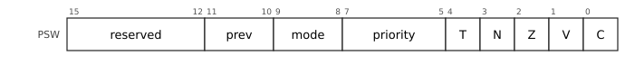
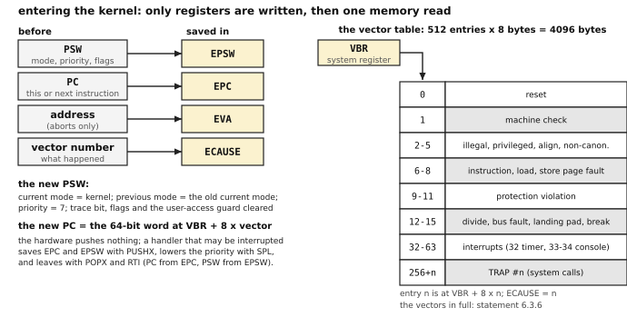
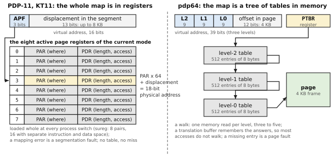
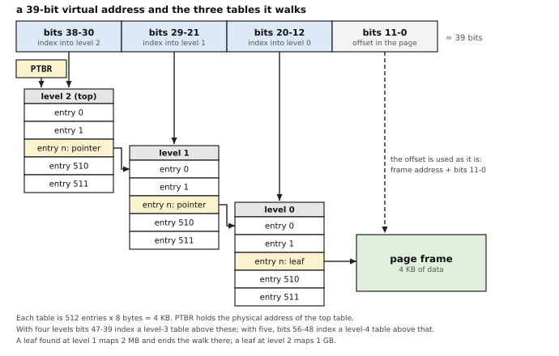
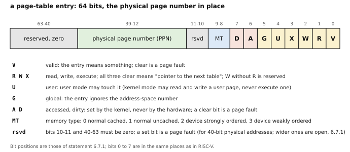
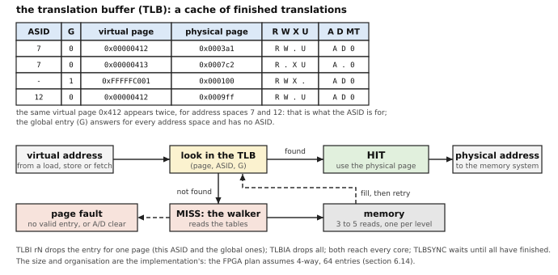
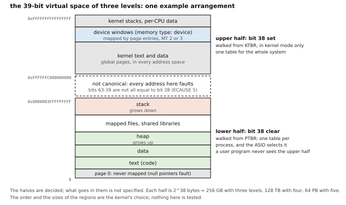
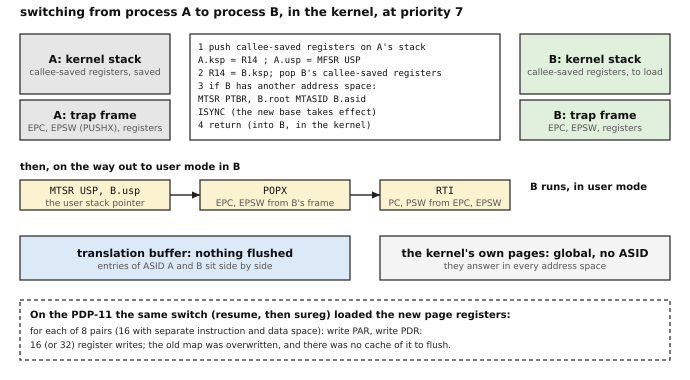
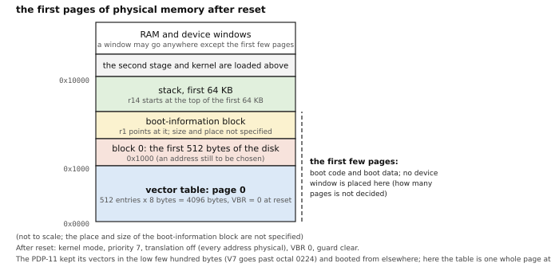

# 6. The kernel: modes, exceptions and memory management

[← manual index](00-index.md)

**An operating system on the pdp64 sees three things: a status word with a mode and a priority, an exception mechanism that writes only registers, and a page table of three, four or five levels with software-managed accessed and dirty bits.** This chapter is written for a reader who has written or read the kernel of Unix Version 6 or 7 on the PDP-11, or who is learning computing from the start, and who has not met anything that was invented after the 1970s: it begins with what that kernel did (the status word, the vectors, `trap()`, the memory-management unit with its eight page registers per mode, `mfpi` and `mtpi`, swapping), explains each modern idea by contrast with it (precise exceptions, system registers, page tables, the translation buffer, address-space numbers, direct-mapping windows), walks a system call, a page fault, a timer interrupt, a context switch and the idle loop through in pseudocode, and gives the decisions as numbered statements along the way. It is the design called System v1; the options and the comparisons with other architectures are in [`../pdp64-system-architecture.md`](../../pdp64-system-architecture.md) (section 15) and [`../pdp64-system-design.md`](../../pdp64-system-design.md). Tags: *(D)* decided; *(P)* proposed; *(S)* unspecified; a fact about an older or another machine that could not be checked on this computer is marked *unverified* and listed in section 6.14.

*How to read this chapter.* A term is defined where it first appears, as the technical word followed by a plain restatement. Boxes-and-arrows pictures are the kind a textbook draws for a linked list: a box is a piece of memory or a register, an arrow is an address stored in it. Code blocks are pseudocode (C-like, `#` starts a comment) unless the text says they are PDP-11 assembly or pdp64 assembly; the PDP-11 code is quoted from the V7 and 2.11BSD kernels on this machine (section 6.14), and the pdp64 code is **an illustration written for this chapter**: no pdp64 kernel exists yet (the first operating system is OpenBSD, 6.12.3, and nothing of it is written), so none of it is tested. The decisions are the numbered statements; the rest is explanation, and where the repository does not say, the text says *not specified*.

## 6.1 What you already know: the kernel of a PDP-11

Think of Unix Version 7 (or 2.11BSD, which is the same kernel grown up) on a PDP-11/45, 70 or 73. Six things about it matter here, because every modern idea in this chapter is one of them, kept or replaced.

**The status word and the modes.** A PDP-11 has a **processor status word** (PS, also called PSW: one 16-bit register holding the flags, the interrupt priority and the mode of the running program; it sits at the fixed address 0177776, section 6.14). Bits 15-14 are the **current mode** (which privilege the program runs with: kernel, supervisor or user), bits 13-12 the **previous mode** (the mode that was running before the last trap), bits 7-5 the **priority** (the level below which interrupts are held back), bit 4 the **trace** bit (take a trap after every instruction), and bits 3-0 the flags N, Z, V and C. The 2.11BSD header says the same in C (`psl.h`: `PSL_CURMOD` 0xc000, `PSL_PRVMOD` 0x3000, `PSL_IPL` 0xe0, `PSL_T` 0x10, the condition codes in 0xf). In user mode the program may not execute the privileged instructions (`halt`, `reset`, `wait`, a write to the PS priority); each mode has its **own stack pointer** (R6 means a different register in each mode), so a trap that arrives in user mode finds a kernel stack waiting.

**Vectors in low memory.** A **trap** (the machine transferring control to the kernel because something happened) goes through a **vector**: two words at a fixed low address, the new program counter and the new PS. The hardware pushes the old PS and the old PC on the new mode's stack and loads the pair. This is the V7 table, `l.s` (the octal addresses are added here):

```
        . = ZERO+4
        trap;  br7+0.           / 004  bus error
        trap;  br7+1.           / 010  illegal instruction
        trap;  br7+2.           / 014  bpt, trace
        trap;  br7+3.           / 020  iot
        trap;  br7+4.           / 024  power fail
        trap;  br7+5.           / 030  emulator trap (emt)
        start; br7+6.           / 034  "sys": the system call
        . = ZERO+60
        klin;  br4              / 060  console keyboard
        klou;  br4              / 064  console printer
        . = ZERO+100
        kwlp;  br6              / 100  line clock
```

The first word of each pair is the address of the handler; the second is the new PS, which is `br7` (priority 7: nothing may interrupt) plus a small number that the handler passes on to `trap()` to say which trap it was. The device vectors (the console at 060 and 064, the clock at 0100) carry the device's priority, 4 and 6. A handler ends with `rti` (return from interrupt: pop the PC and PS) or `rtt` (the same, but a pending trace trap is not taken at the first instruction).

**`trap()`.** The assembly code at the vector (`call` in the V7 `mch` file) saves the registers and calls one C function, `trap(dev, sp, r1, nps, r0, pc, ps)`: its arguments, in the words of the V7 comment, are "the words saved on the system stack by the hardware and software during the trap processing". A system call is one of these traps: the user program executes `sys n` (the instruction `0104400` plus the call number in its low six bits), and `trap()` fetches that instruction back from user memory and uses it as an index (`callp = &sysent[fuiword(pc-1)&077]`).

**The memory-management unit.** A PDP-11 program uses 16-bit addresses (64 KB), but the physical memory is bigger (18 bits, 256 KB, on the machines of the Unibus; 22 bits on the Q-bus machines and the later ones, section 6.14). The **KT11** (the PDP-11's memory-management unit: the hardware between the processor and memory that turns the program's addresses into memory addresses, a process called **translation**) does it with registers. It has, for each mode, **eight pairs** of **page registers**: a **PAR** (page address register: where the segment starts in physical memory, in units of 64 bytes) and a **PDR** (page descriptor register: how long it is, up to 8 KB, and whether it may be read or written). The top three bits of a program's address pick one of the eight pairs; the other thirteen are the offset into that 8 KB piece. The kernel names the user's registers `UISA` and `UISD` (at 0177640 and 0177600) and has a whole set of its own (`KISA0` at 0172340); with **separate instruction and data space** (a model in which code and data have separate 64 KB address spaces) there are sixteen pairs, eight for each. The V7 function `sureg()` copies a process's eight (or sixteen) saved pairs into the hardware registers at every context switch, and the function `estabur()` fills in the saved pairs from the sizes of the program's text, data and stack, and gives up with `ENOMEM` if they need more than eight segments. A page register describes **base and length** (a start and a size, the oldest form of memory protection); a program's text, data and stack are each one **contiguous** run of memory, handed out by a first-fit allocator on a map (`malloc.c`: "the core map unit is 64 bytes").

**Reaching the other space.** The kernel's own address space is separate from the user's, so a kernel pointer to user memory means nothing. The instructions `mfpi` and `mtpi` (move from and to the **previous** instruction space; `mfpd` and `mtpd` for data space) take the address from the kernel's registers but use the previous mode's page registers; the copy-in routines of 2.11BSD (`fubyte`, `subyte`) are built from them, with a global named `nofault` set so that an error in the access returns -1 instead of panicking.

**Swapping.** A process image was one block of memory; when memory ran short, the whole image was written out to the **swap device** (`swapout()`, called from the scheduler loop `sched()`), and read back whole to run again. There was no concept of part of a program being in memory.

**What did not change in the pdp64**, and what is new. The pdp64 keeps three modes with a status word you would recognise, a stack pointer per mode, vectors, `RTI`, a priority that the kernel raises and lowers, a previous-mode notion, and an idle instruction. What is new is eight things, each explained where it first matters: the status word and trap entry are stored in **registers** and not pushed on a stack (6.3); an exception is **precise** (6.4); the control registers are not at fixed addresses but are reached by number with `MFSR` and `MTSR` (6.5); the eight page registers become a **tree of page tables in memory** that the hardware **walks** (6.6, 6.7); the answers of the walk are cached in a **translation buffer** that must be kept honest (6.8); that buffer is **tagged with an address-space number** so that a context switch need not empty it (6.8); the upper half of the address space is the kernel's and is reached through its own table, with **direct-mapping windows** for memory and devices (6.9); and `R7` is an ordinary register (errata 100): the PC is not a register at all, and R6 is replaced by `R14`.

## 6.2 Modes and the status word

The PDP-11's three modes are kept, with the same values: kernel 0, supervisor 1, user 3 (2 is reserved, and loading it into the status word is an illegal instruction). Their positions in the word moved down to make room, and one bit was added. The two layouts side by side:

| | PDP-11 (`psl.h`) | pdp64 |
|---|---|---|
| flags (four bits) | 3-0 | 3-0 |
| trace | 4 | 4 |
| priority | 7-5 | 7-5 |
| current mode | 15-14 | 9-8 |
| previous mode | 13-12 | 11-10 |
| user-memory guard | none | 12 |



The **user-memory guard** (a status bit that says whether the kernel may touch user memory by accident: section 6.10) is the added bit. The **previous mode** exists for the same reason as on the PDP-11: after a trap from user mode it says where the kernel came from, and the instructions that act on behalf of the previous mode (`PROBER` and `PROBEW`, section 6.10) use it. A **privileged instruction** (one that only the kernel may execute, because it could break the protection between programs) outside kernel mode **aborts** (is cancelled before it changes anything, section 6.4) with the privileged-instruction vector, as `halt` and `reset` did on the PDP-11.

**6.2.1** There are three modes, with the PDP-11's encoding: kernel 0, supervisor 1, user 3. The supervisor mode exists in the status word and in the banked registers, and no code uses it. *(D)*

**6.2.2** The status word holds the flags in bits 0 to 3, the trace bit in bit 4, the interrupt priority in bits 5 to 7, the current mode in bits 8 and 9, the previous mode in bits 10 and 11, and the user-access guard in bit 12; the other bits are zero. *(D)*

**6.2.3** `MTPS` in user mode writes only the flags; in kernel mode it writes every writable bit. `SPL #n` is kernel-only. *(D)*

**6.2.4** The stack pointer `R14` and the direct-page register `DP` each have one copy per mode; the mode selects which one an instruction names. *(D)*

**6.2.5** These instructions abort with the privileged-instruction vector outside kernel mode: `RTI`, `RTT`, `HALT`, `SPL`, `MTASID`, `MFASID`, `TLBI`, `TLBIA`, `TLBSYNC`, `MTDMW`, `MFSR`, `MTSR`, `PROBER`, `PROBEW`, `WFE`, `ISYNC`, `STUA`, `CLUA`, `PUSHX`, `POPX`. *(D)*

**6.2.6** These are not privileged: `MTDP` and `MFDP` (in user mode, the thread pointer), `ICINV` and `ICINVA` (a JIT needs them), `FENCE`, `SEV`, `HINT`, `TRAP`, `BPT`, `NOP`, and `MTPS` and `MFPS` with the restriction above. *(D)*

*Commentary.* **Precedent.** The PDP-11 had kernel, supervisor and user modes, with a status word whose priority and mode fields the pdp64 keeps, and a stack pointer per mode so that a trap arriving in user mode finds a kernel stack without searching for one. In practice the third mode was little used: the 2.11BSD kernel runs its network code in supervisor mode (its `trap()` tests `SUPVMODE(ps)`, checked), and V7 never did. **Trade-offs.** Three modes cost a third copy of two registers and no logic the kernel uses; supervisor mode has no user, and is included because adding a mode would change the status word and every saved copy of it. **Benefits.** Entry from user mode needs no stack switch code; a threaded program's pointer and a kernel's per-CPU pointer are the same register in different modes. `DP` is new to a PDP-11 reader: it is the **direct-page register** (a base register that makes one 4 KB-or-larger region addressable with a short displacement, descended from the 6502's zero page); the kernel uses its copy as a pointer to the structure of the core it is running on (the **per-CPU pointer**: which core am I, and where is its private data), and a user program uses its copy as the pointer to its thread's private data. **Modern comparables.** x86 has four rings of which two are used; AArch64 has exception levels 0 to 3; RISC-V has user, supervisor and machine modes. **Use.** `MFSR` and `MTSR` are the whole of system control (6.5); `PROBER` and `PROBEW` do the work of the `nofault` idiom of V6 and V7. **Impact.** *Kernel:* Banked stack pointers mean a trap from user mode needs no stack switch, and the direct-page copies give a per-CPU pointer in the kernel and a thread pointer in user mode. *Compiler:* User-mode thread-local storage is one `MOVQ d(DP), Rd`. *Hardware:* Three copies of two registers, selected by the mode, and a mode comparison on privileged decode.

## 6.3 Exceptions, interrupts and traps: how the machine enters the kernel

Three words are used for what the PDP-11 called by the single word "trap", and the pdp64 keeps them apart. An **exception** is the machine stopping an instruction because it cannot carry it out (a page that is not in memory, an illegal instruction, a divide by zero): it belongs to the instruction. An **interrupt** is a device asking for attention: it belongs to no instruction, and is taken between two of them. A **trap**, in the narrow sense used here, is a deliberate entry by an instruction that succeeds (`TRAP #n`, the system call). All three enter the kernel the same way.

**The PDP-11's way.** The hardware read the new PC and PS from the vector, pushed the old pair on the kernel stack, and ran the handler. That is **entry through memory**: it writes two words to the stack before a single handler instruction runs.

**The pdp64's way.** Entry writes **only registers**, and then reads one word. Four **system registers** (registers that are not among the general ones and are reached with `MFSR` and `MTSR`, section 6.5) receive the facts: `EPC` (the exception program counter, where to resume), `EPSW` (the old status word), `EVA` (the exception virtual address: the address that caused a fault) and `ECAUSE` (what happened: the vector number). Then the new status word is made, and the new program counter is read from the **vector table**: an array of 8-byte entries, 512 of them, 4096 bytes in all, whose base is held in the register `VBR` (vector base register). In pseudocode, with `kind` saying which of the families of 6.4 this is:

```
enter(vector, kind):
    EPC    = (kind is abort or progress) ? address of this instruction
                                         : address of the next instruction
    EPSW   = PSW
    EVA    = (kind is abort) ? the faulting address : 0
    ECAUSE = vector
    PSW.previous_mode = PSW.current_mode
    PSW.current_mode  = kernel
    PSW.priority      = 7
    PSW.trace = 0 ; PSW.flags = 0 ; PSW.guard = 0         # the guard: section 6.10
    PC = load64_physical(VBR + 8 * vector)                # a bus error here is a machine check
```



Entry differs from the PDP-11's in three ways that a kernel writer feels. **It cannot fault**: writing registers cannot run into a page that is missing, which a push on a kernel stack could (a fault while entering a fault). **It leaves the handler to save what it needs**: the hardware pushes nothing, so a handler that may itself be interrupted saves `EPC` and `EPSW` first (one instruction, `PUSHX`) and a handler that cannot be interrupted need not save them at all. **It is the same for every cause**: the PDP-11 let each vector choose its own priority (V7's trap vectors say `br7` and its device vectors `br4`, `br6`); the pdp64 always enters at priority 7, and the handler lowers it. Because a second exception inside a handler, before it has saved `EPC` and `EPSW`, would overwrite them, the first instructions of every handler and the memory they touch must be such that they cannot fault: this is the reason the kernel's own text and stacks are in pages every address space shares or in a direct-mapping window (6.9), never in pages that may be absent. (That sentence is a consequence of the rules drawn by the author of this chapter; the architecture does not state it as a rule.)

**The table.** The entries are indexed by the number of the vector, and `ECAUSE` receives that number, so one handler can serve several vectors and tell them apart. They are laid out as follows (the first thirty-two are for the processor itself, thirty-two to sixty-three for interrupts, and the last 256 are one for each `TRAP` number; compare V7, where every `sys n` shared the single vector at 034 and the number was fetched from the instruction):

**6.3.1** Entry to an exception or an interrupt writes only registers: `EPC` receives the address of the faulting instruction (for an abort or a progress exception) or of the next instruction (for a trap or an interrupt), `EPSW` the old status word, `EVA` the faulting address (zero except for aborts), `ECAUSE` the vector number. *(D)*

**6.3.2** The new status word has the current mode kernel, the previous mode the old current mode, priority 7, and the trace bit and the flags cleared. *(D)*

**6.3.3** The new program counter is the 64-bit word at the physical address `VBR + 8 × vector`; a bus error on that fetch is a machine check that halts. *(D)*

**6.3.4** The hardware pushes nothing. A handler that can be interrupted saves `EPC` and `EPSW` with `PUSHX`, lowers the priority with `SPL`, and before returning restores them with `POPX` and executes `RTI`. *(D)*

**6.3.5** `RTI` loads the program counter from `EPC` and the status word from `EPSW`; `RTT` does the same and sets the trace bit after the return. *(D)*

**6.3.6** The vector table has 512 entries and `ECAUSE` equals the vector number. *(D)*

| Vectors | Meaning |
|---|---|
| 0 | reset (not used by the QEMU machine) |
| 1 | machine check |
| 2, 3, 4, 5 | illegal instruction, privileged instruction, misaligned access, non-canonical address |
| 6, 7, 8 | instruction, load and store page fault |
| 9, 10, 11 | protection violation on instruction, load and store |
| 12, 13 | divide by zero, bus fault |
| 14, 15 | landing-pad violation, breakpoint |
| 16 | check, taken by `TRAPCC` *(P)* |
| 17 to 31 | reserved |
| 32 to 63 | interrupts (in the virt machine, 32 timer, 33 console input, 34 console output) |
| 64 to 255 | reserved (device interrupts are message-signalled, section 5.7) |
| 256 + n | `TRAP #n` and `TRAPL #n`, n from 0 to 255 |

**6.3.7** There are eight interrupt priority levels; the processor takes an interrupt between instructions when its level is greater than the priority in the status word; the timer is at level 6 and the console at level 4. *(D)*

(The two levels are the PDP-11's: V7 and 2.11BSD vector the line clock at priority 6 and the console at priority 4, checked in `scb.s`.) A **message-signalled interrupt** is a device that raises an interrupt by writing a word to a memory address, so that no interrupt wire is needed (section 2.7). How such a write becomes a vector number, and which core receives it, is **not specified** (2.7.3, the interrupt-controller decision R1 of appendix B); the vectors 64 to 255 are reserved for it.

*Commentary.* **Precedent.** The PDP-11 pushed the program counter and the status word on a stack and loaded new ones from a two-word vector, and its trap vectors conventionally held priority 7, so a PDP-11 handler began with interrupts masked and chose when to lower them (checked in V7 `l.s` and 2.11BSD `scb.s`: every trap vector is `br7+code`); its interrupts took the priority of their device from the vector. The VAX pushed the program counter and the processor status longword and raised the priority to the interrupt's level for an interrupt, leaving it unchanged for an exception. **Trade-offs.** Entering in registers is short and cannot itself fault (no memory is written), and costs the handler an explicit save; it needs the priority raised on entry, because a higher-level interrupt could otherwise arrive before the handler had stored the pair and overwrite it, which is why the entry sets priority 7 for every exception and interrupt, a fixed choice where the PDP-11 let each vector choose. **Improvements.** `PUSHX` and `POPX` make the save and restore one instruction each; the aborts are precise, so a page-fault handler repairs the mapping and executes `RTI` to run the instruction again. **Benefits.** The kernel survey estimates a system-call entry at four or five instructions on paper, against 45 to 70 on RISC kernels; no entry code is needed to find a stack. **Modern comparables.** AArch64 and RISC-V latch the return address and status in registers; x86 pushes five words on the stack; every one of them masks interrupts on entry. **Impact.** *Kernel:* Entry is four or five instructions on paper; priority 7 on entry removes the code that would otherwise guard the saved state. *Compiler:* Handlers written in C need a short assembler stub to save and restore; no other code generation is affected. *Hardware:* Entry writes registers only, so it cannot fault, and the vector fetch is one 64-bit read.

## 6.4 Faults and restart: what "precise" means

When an instruction cannot finish (its page is absent, say), the machine must stop it, tell the kernel, and later, when the kernel has fixed the cause, **restart** it (run it again from the start). Whether that works depends on what the instruction did before it stopped.

**On the PDP-11** it did not always work. An instruction such as `cmp -(sp),-(sp)` changes a register (`sp` goes down by 2, twice) as part of working out its operands, and may then fault on the second operand: if the kernel simply reran it, `sp` would be 4 too low. The hardware therefore kept a small journal of the register changes (the register `MMR1`, on the machines that had it), and the kernel's `backup()` routine read it and undid the changes before restarting; the 2.11BSD `trap()` says that on the 11/40, which had no such register, "the routine backup/mch.s may fail" and the automatic growth of the user stack, which depends on restarting, can then fail too. Floating-point errors were worse: V7 says "the floating exception is an imprecise trap", meaning that by the time it was taken the processor had gone on to later instructions and the saved PC no longer named the instruction at fault.

**On the pdp64** the instruction set promises that every exception that belongs to an instruction is **precise**. A **precise exception** (one taken so that the machine looks as if it ran one instruction at a time, in order: every earlier instruction has completed, and the faulting instruction and every later one have changed nothing) is the property that lets the kernel treat a page fault as a subroutine call that the program never noticed. It matters on this machine, and not only as a convenience, because the pdp64 is meant to be implemented both as a simple in-order core (one that runs instructions one after the other, as the PDP-11 did) and as an **out-of-order core** (one that looks ahead in the program, starts later instructions whose inputs are ready before earlier ones have finished, and keeps the results in a buffer until it is certain the earlier instructions did not fault; errata 68). On the second kind, "the instruction that faulted" is, inside the chip, one of dozens in flight at once, some of them later in the program and already half done; the machine has to throw their results away and report the fault as if none of them had started. The architecture is written so that this can be done without a journal: the instruction set has at most one memory operand, and the register update of an auto-increment or auto-decrement mode is held until the instruction **retires** (is certain to complete) and discarded if the instruction aborts, so a handler never undoes anything (6.4.2; `docs/pdp64-isa.md` section 7.2 has the argument, and 7.3 the table of every reference an instruction can make that can fault).

**Four families.** The kernel sees the cases that the PDP-11 mixed together separately:

| Family | The instruction | `EPC` on entry | Restartable |
|---|---|---|---|
| **trap** | completes | the next instruction | not applicable |
| **abort** | annulled, as if it had not begun | the faulting instruction | yes, by `RTI` |
| **progress** | partly done, the progress is in registers | the faulting instruction | yes, by `RTI` |
| **machine check** | indeterminate | best effort | no |

A **progress** exception belongs to the block instructions (`MCPY` and the others of the `MBLK` group, section 9.7): a copy of a megabyte may take 256 page faults, and the instruction keeps its position in its own registers, so that `RTI` re-executes it and it carries on from where it was. A **machine check** is the descendant of the PDP-11's bus error at vector 004: something happened that the machine cannot repair or locate exactly (an uncorrectable memory error, a posted write that timed out), and the kernel's only choice is to stop the process or the machine. The **posted write** (a store that the processor has handed on and no longer waits for) is why: by the time the bus reports the failure the instruction has long since retired.

**6.4.1** Faults fall in four categories: traps (the instruction completes), aborts (it is annulled and restarted), progress (a block operation stopped part-way, restarted from its registers) and machine checks (not restartable). *(D)*

**6.4.2** The register update of an auto-increment or auto-decrement mode is held until the instruction retires and discarded by an abort, so a handler never undoes anything. *(D)*

**6.4.3** A read of non-existent memory is a precise abort with cause `BUSFAULT`; a posted write that times out and an uncorrectable memory error are machine checks. *(D)*

**6.4.4** A deferred load (`MOVQ.D` and the six other `.D` words) does not fault at the load: a faulting load leaves a poison mark on its destination register and the fault is taken at the first instruction that writes the flags from a poisoned source; the kernel decides the fault of a deferred load, and the kernel dispatcher, not the hardware, tests the argument registers for poison. The combination `.UD` of the two qualifiers has no text of its own, and the poison bit is not decided. *(P)*

*Commentary.* **Precedent.** The PDP-11 recorded its register side effects in `MMR1` and left the undo to software; the VAX needed resumable microstate and a status-word bit; the 68000 had no restart path. **Trade-offs.** Software-managed accessed and dirty bits (6.8) cost an extra fault on first touch and first write, which precise exceptions make cheap. The price of precision is in the implementation, not in the kernel: an out-of-order core needs the buffer that holds its results until retirement. **Improvements.** The one-memory-operand rule makes the undo buffer a single entry and row 3 of the fault matrix provably empty, so there is no journal and no undo protocol. **Benefits.** A page-fault handler is the same code for first touch, first write and demand paging; the `nofault` idiom of V6 and V7 `trap.c` (set the global, do the probe, `longjmp` out of the handler instead of panicking) remains the correct pattern for hardware probing, though `PROBER` and `PROBEW` cover the address-validation case. **Modern comparables.** Current architectures promise precise exceptions for page faults and, for the most part, leave some floating-point and bus errors imprecise as the PDP-11 did (*unverified*); the pdp64 makes the floating-point exceptions flags that never trap. **Use.** A read of a configuration position that held no device is not a fault at all (it returns all ones, 2.4.9), so a bus scan does not take a `BUSFAULT` for every empty slot. **Impact.** *Kernel:* One small page-fault handler for first touch, first write and demand paging; no `backup()` routine and no `MMR1`. *Compiler:* No scheduling restriction arises from faults, because the register update of an addressing mode is held until retirement. *Hardware:* A single-entry undo buffer, a result buffer for the out-of-order implementation, and a retirement stage that decides.

## 6.5 System registers: `MFSR` and `MTSR`

The PDP-11 reached its control registers by address: the KT11's page registers, the status word and the other control and status registers sit in the top 8 KB of the address space, the I/O page (`KISA6` at 0172354, `UISD` at 0177600, the PS at 0177776), and the kernel used ordinary `mov` instructions to them. The pdp64 cannot do this: its address space is translated (6.6), a load or store to a control register would itself be translated, and an instruction that changes the translation would be changing the mapping of the very access that reads it. Control registers are therefore **system registers**, numbered 0 to 255, and the two instructions `MFSR Rd, name` (move from system register) and `MTSR name, Rs` (move to system register) read and write them. Both are privileged (6.2.5). The names the assembler knows:

**6.5.1** The system registers are reached by `MFSR` and `MTSR` with an 8-bit register number. *(D)*

| Number | Register | Meaning |
|---|---|---|
| 0 | `PTBR` | physical address of the level-2 page table |
| 1 | `EPC` | exception program counter |
| 2 | `EVA` | exception virtual address |
| 3 | `ECAUSE` | exception cause (the vector number) |
| 4, 5 | `DMW0`, `DMW1` | direct-mapping windows (stored; the format is unspecified) |
| 6, 7 | `USP`, `SSP` | the user and supervisor stack pointers |
| 8 | `EPSW` | exception status word |
| 9 | `VBR` | vector base register |
| 10 | `MMUCTL` | memory-management control (bit 0 enables translation) |
| 11 | `ASID` | address-space identifier |
| 12 | `CPUID` | the core number (read-only) |
| 13 and up | | reserved (feature and identification registers are proposed here) |

(`EVA` and `ECAUSE` are read only, as is `CPUID`; the rest read and write. `PTBR` is called a level-2 table for the three-level form; it holds the top table of whichever number of levels the machine has, 6.6. `USP` is the user's stack pointer, which the kernel needs because in kernel mode `R14` is the kernel's: it takes the place of the PDP-11 idiom `mfpd sp`, and the kernel must read and write it to build a signal frame, copy a process or switch context. `SSP` is the supervisor's and nothing uses it. The register that the proposal of 6.9.1 calls `KTBR` has no number in this table.)

**6.5.2** A write to `PTBR`, `ASID` or `MMUCTL`, or an `ICINV`, is guaranteed to take effect only after the next `ISYNC`. *(D)*

`ISYNC` (instruction synchronisation) is the instruction that makes this safe on a machine that has more than one instruction in progress. A pipelined or out-of-order core has already fetched and started the instructions after the `MTSR`, using the old translation; `ISYNC` waits until every earlier instruction has finished, throws away everything fetched after it, and fetches again under the new rules. The PDP-11 did not need it: an instruction was fetched after the previous one had finished.

*Commentary.* **Precedent.** The VAX had `MTPR` and `MFPR` with an internal-register number, the same design. The PDP-11 kept its control registers at fixed high addresses and reached them with ordinary moves. **Trade-offs.** A general pair of instructions with 243 free numbers costs two opcodes and no decoding as the registers are added; separate instructions per register would have spent opcode space with every register. **Benefits.** A new register is a number, not an instruction. **Modern comparables.** AArch64's `MRS` and `MSR`, RISC-V's `CSRR` and `CSRW`, PowerPC's `MFSPR` and `MTSPR`; the kernel survey found privileged-register access to be 48% of all the compiler-invisible instructions in four kernels. **Impact.** *Kernel:* A single pair of instructions reaches every system register, so adding a register adds a number and no instruction. *Compiler:* The compiler reaches them through an intrinsic with a constant register number. *Hardware:* A control-register file addressed by an 8-bit number, with a read-only decode for the identification registers.

## 6.6 From segments to pages: virtual memory

**Two kinds of address.** A **virtual address** is the number a program uses; a **physical address** is the number the memory chips answer to. The PDP-11 had both, 16 bits against 18 or 22, and the KT11 translated one into the other. A pdp64 program uses 64-bit pointers (stored in 64-bit registers), but only some of the bits count (below), and the physical address is 40 to 64 bits wide (errata 102): 40 bits is one terabyte, and the maximum, 2^64, is sixteen exabytes.

**What the KT11 did, and what it cost.** The figure puts the PDP-11's scheme (left) beside the pdp64's (right). On the left, the three top bits of a 16-bit address pick one of eight page registers, which says where an 8 KB piece starts and how long it is; there is nothing to look up, because the whole map for the running program is in the eight pairs. That costs three things. A process could have at most 64 KB (eight pieces of 8 KB, 128 KB with separate instruction and data space): in 2.11BSD, `estabur()` returns `ENOMEM` for a program that needs a ninth segment. Each of its pieces was one **contiguous** block of physical memory, so memory fragmented, and the allocator found a hole big enough or the kernel swapped something out to make one. And since the map was only eight registers, there was no way to leave a hole in the middle of a program unmapped, to share half a segment, to start running a program before all of it was in memory, or to notice which part of it had been used.



**Pages.** The remedy, which the VAX had and every machine since has copied, is to cut both address spaces into equal pieces and let any piece of the virtual space sit in any piece of the physical. The virtual piece is a **page** and the physical piece a **frame** (the same size: here 4 KB, 4096 bytes); a virtual address is a **page number** and an **offset** within the page, and translation replaces the page number by a frame number and leaves the offset alone. The map from page numbers to frame numbers is a **page table**: an array indexed by the page number, each element (a **page-table entry**, or PTE, section 6.7) saying where the frame is, who may touch it and whether it is there at all. With pages, a program's memory need not be contiguous; a page can be absent (to be fetched from disk when the program touches it, which is **demand paging**) or shared by two programs; and the kernel can tell which pages are in use.

**The tree.** A single page table is too large. A 39-bit virtual address with 4 KB pages has 2^27 pages (134 million); at 8 bytes an entry that is a 1 GB table for every process, nearly all of it empty. The answer is to make the table a **tree**: a table that is exactly one page long, so 4096/8 = 512 entries, which is nine bits of index; some of its entries point at tables of the next level and not at frames. A virtual address is then cut into fields of nine bits, one for each level, over the 12-bit offset: with **three levels** the address has 9 + 9 + 9 + 12 = 39 bits, and the translation is a **walk**:



```
translate(va, access, mode):                        # three, four or five levels
    if va is not canonical:  fault NONCANONICAL     # bits above the top one must equal it
    table = PTBR                                    # physical address of the top table
    for level = LEVELS-1 down to 0:
        index = (va >> (12 + 9*level)) & 511
        pte   = load64_physical(table + 8*index)    # one memory read per level
        if not pte.V or pte has a reserved bit set: fault PAGE_FAULT
        if pte.R or pte.W or pte.X:                 # a leaf: the walk ends here
            break
        if level == 0:       fault PAGE_FAULT       # a pointer where nothing is left to point to
        table = pte.PPN << 12                       # follow the pointer to the next table
    check the leaf (6.7): permissions for this mode, accessed and dirty (6.8)
    size  = 4 KB << (9*level)                       # level 0: 4 KB; level 1: 2 MB; level 2: 1 GB
    return (pte.PPN << 12) | (va & (size - 1))
```

(The pseudocode is this chapter's rendering of statements 6.6.1, 6.7.1 and 6.7.2, checked against the walker of the QEMU model, `qemu/target-pdp64/mmu.c`; a leaf that is not aligned to its size is also a page fault there.) The cost is plain from the loop: **one memory read per level**, three to five. A program that touches only a few megabytes has a handful of tables, and the **sparse** address space (most of the 512 GB unused) costs nothing, because an entry that is not valid has no table under it. A leaf found above level 0 maps a larger piece (2 MB at level 1, 1 GB at level 2): the **large page** (a page of many times the basic size, mapped by one entry, used for the kernel's own mapping and for big buffers). A leaf above level 0 therefore needs a frame address aligned to its size.

**Three, four or five.** The author's decision (errata 96) is that the walk may have three levels (39 virtual bits, what System v1 specifies and what the simulator and the emulator implement), four (48 bits) or five (57 bits), with the number of levels discoverable at run time. Each extra level adds nine bits and one more memory read per miss. The author's own referent was the Loongson five-level table (his question, errata 96); RISC-V's Sv39, Sv48 and Sv57 and the VAX are the repository's precedents, named in the commentary. A **canonical** address is one in which all the bits above the top virtual bit equal that bit (so a 39-bit machine accepts a 64-bit pointer only if bits 63 to 38 are all the same): this makes the upper half of the space a copy of the lower half's sign, and rules out a program storing a tag in the unused high bits, which would stop working on a machine with more levels.

**6.6.1** Virtual addresses are translated by three, four or five levels of nine bits over 4 KB pages, which gives virtual addresses of 39, 48 or 57 bits. With three levels, address bits 38 to 30 index level 2, 29 to 21 level 1 and 20 to 12 level 0; with four, bits 47 to 39 index level 3 above them; with five, bits 56 to 48 index level 4 above that; `PTBR` holds the physical address of the table of the top level. *(D)*

**6.6.1a** Software can find the number of levels of the machine at run time, so that a kernel adapts to the implementation without a build option; the register or field that reports it is not specified. *(S)* The simulator and the emulator implement three levels.

*What is open about 6.6.1a.* The repository's briefing of this question (`docs/decision-log/data/shared/oq/A.md`, item Q2) lists the ways other machines let software find out, each verified in the QEMU source on this machine: x86's `CPUID` leaf 0x80000008 (physical and virtual widths) and the `LA57` bit for five levels; AArch64's `ID_AA64MMFR0` field `PARange`; LoongArch's `CPUCFG1` fields `PALEN` and `VALEN`; and RISC-V's `satp` register, in which software tries to write the mode it wants and reads back whether it stuck. The options it sets out for the pdp64 are a read-only feature register at system register 13 (one `MFSR`, nothing to probe), a write-and-read-back probe in `MMUCTL`, both, a field in the boot-information block (4.6.2) and a user-readable copy. **None of them is decided**, and the briefing's leaning is the assistant's, not the author's; the physical width has the same problem (errata 102(b)).

**6.6.2** Virtual addresses are 39, 48 or 57 bits, translated by three, four or five levels of nine bits over 4 KB pages (6.6.1) to a physical address of 40 to 64 bits, 40 in the present implementation (section 2.3.6). *(D)*

*Commentary.* **Precedent.** The PDP-11 had eight segments per mode, each with a base and a length, and no page tables; the VAX had a linear page table per region with a hardware modify bit and no reference bit, so 4.3BSD emulated reference bits in software. **Trade-offs.** Thirty-nine bits is 512 GB, what a three-level table indexes with nine bits per level; each further level adds nine bits (48, then 57) at the price of a longer walk on every TLB miss, and the kernel chooses what the implementation offers. **Improvements.** A leaf at any level makes large pages free to use for the kernel's own mapping. **Benefits.** A walker that only reads is small. **Modern comparables.** The three-level geometry is RISC-V's Sv39 (the modes 8, 9 and 10 of `satp` are Sv39, Sv48 and Sv57, checked in the QEMU source), and x86-64 and AArch64 use four levels (x86-64 five on newer parts, the `LA57` bit); LoongArch describes the width of each level in a register (`PWCL`, checked), and the author asked what a Loongson five-level table would affect (errata 96 and the message it answers). **Impact.** *Kernel:* The same walk code serves three, four and five levels, with the level count read at run time (once the register exists). *Compiler:* Position-independent code uses PC-relative addressing; the canonical form means pointers need no masking and must not carry tags in the high bits. *Hardware:* A walk is one read per level, three to five; the walker is a small state machine that never writes.

## 6.7 The page-table entry

Each entry is one 64-bit word. The diagram shows every bit, the table says what each does:



An entry has two shapes. A **leaf** is an entry that maps: at least one of `R`, `W`, `X` is set, and the physical page number is the frame the page lives in. A **pointer** is an entry that says "the next table is here": `V` is set, `R`, `W` and `X` are all clear, and the page number is the next table's. A **valid** bit of zero says "nothing is mapped here", and then the other 63 bits are the kernel's to use for anything, such as the place on the swap device where the page now lives.

**Permissions and modes.** `R`, `W` and `X` allow reads, writes and instruction fetches. `U` says user mode may use the page: **user mode needs `U`**; kernel mode may read and write a user page (that is what lets the kernel copy to and from user memory directly, section 6.10) but may never **execute** one, so a kernel that has been tricked into jumping to user memory takes a fault instead of running the attacker's code. `W` without `R` is not a valid combination and is a fault. `G` (global) marks a translation the hardware keeps whatever the address space (6.8). Any bit that is not defined must be zero in a valid entry, and a set reserved bit is a page fault: this lets the format grow and catches a kernel that wrote a wild value.

**Memory types.** Each page also says how the memory system may treat accesses to it: `MT`. **Normal cached** (value 0) is ordinary memory: reads and writes may be kept in the **caches** (small fast memories near the processor that hold copies of recently used memory). **Normal uncached** (1) is memory that must not be cached: a frame buffer that the display hardware reads and the processor writes. The two device types are for the registers of devices: **device strongly ordered** (2) means that every access goes to the device in exactly the order the program wrote it, one at a time, never combined; **device weakly ordered** (3) allows the machine to combine or reorder accesses to the page, for the memory of a device where only the final result matters. (The architecture text gives the four names and their numbers; the glosses of the last two are the usual meanings of the terms and are marked *unverified* in 6.14.) On the PDP-11 the memory type was the address: everything at the top of the address space was a device. The pdp64 has **no address bit that says "device"** (errata 97), so the memory type of the page is what a driver sets when it maps a device, and the window of a device can be anywhere in the physical address space except the first few pages (errata 102, section 2.3.6).

**6.7.1** A page-table entry is 64 bits: `V` (valid) in bit 0, `R`, `W`, `X`, `U` and `G` (global) in bits 1 to 5, `A` (accessed) and `D` (dirty) in bits 6 and 7, the memory type `MT` in bits 8 and 9, and the physical page number in bits 12 to 39, in place in the present implementation; all other bits are zero, and a set reserved bit is a page fault. *(D)* The format of the entry for a physical address of up to 64 bits (2.3.6) is open: a page number of 52 bits in place would take bits 12 to 63 and leave no bit above bit 11 for anything else, and whether the entry keeps that shape or changes is the author's question. *(S)*

**6.7.2** A non-leaf entry has `V` set and `R`, `W` and `X` clear and points to the next table; a leaf at level 2 maps 1 GB, at level 1 maps 2 MB and at level 0 maps 4 KB, and where the levels exist a leaf at level 3 maps 512 GB and at level 4 maps 256 TB. *(D)*

**6.7.3** A user-mode access needs `U`; kernel mode may read and write user pages but may not execute them; `W` without `R` is reserved. *(D)*

**6.7.4** The memory type of a page is one of normal cached, normal uncached, device strongly ordered and device weakly ordered. *(D)*

**6.7.5** A page-table entry carries the physical page number in place and read, write, execute and user permission bits; accessed and dirty bits are managed by software; one memory type per page selects cached, uncached, strongly ordered or weakly ordered. *(D)*

*What is open about 6.7.1.* The physical address is 40 to 64 bits (errata 102), and a page number for a 64-bit address needs 52 bits (bits 12 to 63): in place, that takes every bit of the entry above bit 11, and leaves nowhere for a later flag (a protection key, a wider memory type, a no-execute bit separate from `X`). The repository's briefing (`A.md`, item Q3) sets out six shapes, from keeping the page number in place to bit 63, to capping it at 40 bits (a 52-bit physical address, four petabytes through page tables, with the 12 bits above for flags and the windows of 6.9 for anything higher), to shifting the page number down to bit 10 as RISC-V does (checked: RISC-V's number is in bits 10 to 53, flags `N` and `PBMT` in bits 63 to 61), to a 16-byte entry (which would change the nine bits per level, and with them the 39, 48 and 57). **No format is chosen.** The simulator, the QEMU model and `spec/pdp64-system.hbnf` use 40 bits, which is the minimum and fits. They also still compare the memory type of a page with bit 39 of its physical address (the rule of errata 60 and 65, which errata 97 removed): that check belongs to the present implementation, and goes when the implementation catches up.

*Commentary.* **Precedent.** The VAX entry carried a hardware modify bit and a protection field of four bits; RISC-V's low eight bits are exactly `V`, `R`, `W`, `X`, `U`, `G`, `A` and `D` in the same places (checked in `cpu_bits.h`), which the pdp64's entry shares. **Trade-offs.** One entry shape at every level makes the walker simple; an unaligned large page is rejected as a fault, which costs a check and saves the walker from reasoning about partial frames. A memory type per page, not per access, means the code that writes a frame buffer needs no cooperation to be uncached. **Improvements.** The entry has the physical address in place, so no shifting; a leaf at any level makes large pages free to use for the kernel's own mapping. **Benefits.** A kernel's page-fault handler is the same code for first touch, first write and demand paging, differing only in the bits it sets. **Use.** The memory type on a page lets a driver map a device register uncached and strongly ordered without a special instruction. **Impact.** *Kernel:* The entry is built and read with shifts and masks that are the same for every level; leaves at any level let the kernel map itself with 1 GB pages. *Compiler:* None. *Hardware:* The physical page number is in place, so no shifting; a translation-buffer entry holds a page number as wide as the implemented physical address, 28 bits at 40.

## 6.8 Accessed, dirty, the translation buffer and address-space numbers

**Accessed and dirty.** A kernel that wants to run programs larger than memory must choose pages to throw out. The two facts it needs are whether a page has been used lately (**accessed**, `A`) and whether it has been written since it was brought in (**dirty**, `D`: a dirty page must be written to disk before its frame is reused; a clean one can simply be dropped). On the VAX the hardware set a modify bit and the kernel emulated the reference bit; most modern machines have the **walker** (the part of the memory-management hardware that reads the tables) set both bits itself, writing the page-table entry. The pdp64's walker **never writes a page table**: an access to a page with `A` clear, or a write to a page with `D` clear, takes the page fault of its kind, and the kernel sets the bit and runs the instruction again. That is **software-managed** accessed and dirty bits (an operating system's own page-fault handler keeps them). The reasons are given in the commentary; the cost is one extra fault the first time each page is touched and one the first time it is written.

**6.8.1** The accessed and dirty bits are managed by software: an access to a page with `A` clear, or a write to a page with `D` clear, raises the page fault of its kind and the kernel sets the bit; the hardware walker never writes a page table. *(D)*

**The translation buffer.** The walk costs a memory read for each level, three to five reads for every load, store and instruction fetch: unaffordable. Every machine with a walk therefore has a **translation buffer** (the TLB, translation lookaside buffer: a small, very fast memory in the processor that keeps the results of recent translations, so that a repeated access to the same page needs no walk). It is a **cache** (a small copy of a larger store, kept for speed) of translations. The PDP-11 had no such thing: its eight page registers *were* the translation, loaded wholesale at each switch, and there was no table to be slow.



An access looks in the buffer first, by virtual page number and address-space number (below). If an entry matches (a **hit**), the physical page and the permissions come straight out and the access goes on with no memory read for the translation. If none does (a **miss**), the walker reads the tables, and if the walk ends in a valid leaf with the right permissions and the right `A` and `D` it **fills** the buffer with the result and the access is retried; if not, the access takes the page fault of 6.3. A miss costs one memory read per level; a program that does not touch more pages than the buffer holds pays only for its first touches. The size and organisation are the implementation's choice; the FPGA plan (section 6.14) assumes a four-way set-associative buffer of 64 entries (**set-associative**: an entry may live in any of a few places selected by the low bits of the page number, which is cheaper than a buffer that can put an entry anywhere).

**Keeping it honest.** The buffer holds copies. When the kernel changes a page-table entry it must see to it that no stale copy remains, or the old translation will keep working: a page the kernel has unmapped, or made read-only, would still be reachable. An **invalidate** (a flush, in the older word: removing entries from the buffer) is `TLBI rN`, which drops the translation of the page containing the address in `rN` for the current address space and the global entries, or `TLBIA`, which drops everything. On a machine with several cores each core has its own buffer, so the invalidate must reach all of them: on the pdp64 both instructions are **broadcast** (sent to every core by the hardware) and `TLBSYNC` waits until every core has finished, so that the kernel knows that nobody holds the old translation. Other architectures leave this to software, which sends an inter-processor interrupt to every other core and waits for them to answer (a **shootdown**: a source of deadlocks in the kernels of the BSDs, according to the pain-points report, `docs/kernel-pain-points.md`). Unmapping a page is then three lines, as chapter 7 says (7.9.2):

```
unmap_page(space, va):
    pte_of(space, va) = 0           # change the entry in memory first
    TLBI va                         # drop the old translation, on every core
    TLBSYNC                         # wait until every core has done so
    # now the frame may be reused
```

**6.8.2** Translation is off at reset (`MMUCTL` is zero and every address is physical) and is enabled by bit 0 of `MMUCTL`; the `ASID` selects non-global entries. *(D)*

**6.8.3** `TLBI rN` invalidates the translation of the page containing the address in `rN` for the current address space and the global entries; `TLBIA` invalidates all; both broadcast to every core and `TLBSYNC` waits for the broadcast to finish. *(D)*

**Address-space numbers.** When the kernel switches from one process to another the page tables change. If the translation buffer cannot tell which process an entry belongs to, every entry of the old process would answer for the new one, so the whole buffer must be emptied at every switch, and the new process begins with all misses. On the PDP-11 the corresponding cost was `sureg()`, which wrote the new process's eight (or sixteen) pairs into the page registers: sixteen (or thirty-two) register writes at every switch, with nothing to flush. For a table walked from memory the cost is worse, because the emptied buffer must be refilled one miss at a time. The remedy is to **tag** every buffer entry with the number of the address space it came from, the **address-space identifier** (ASID, 16 bits on the pdp64, set with `MTASID`): an entry matches only if its tag equals the current ASID or it is **global** (`G` set, so it answers in every address space, as the kernel's own pages do). Switching is then a write to `PTBR` and to `ASID` and an `ISYNC` (6.5.2): the old process's entries stay in the buffer, harmless, and answer again if that process runs again soon. (The reference executor does not yet do this: its `MTASID` flushes the whole buffer, and the entry of `MFSR` in chapter 9 says that a write to `PTBR`, `ASID` or `MMUCTL` flushes it. That is at odds with the purpose of the tags, and is listed in 6.15; the saving described here is what the tags allow.) The picture of the whole switch is in 6.11.

There are 65,536 numbers, so when they run out the kernel must start again: allocate them in order, and when the counter wraps, invalidate everything (`TLBIA`) and note a new **generation** so that processes that held a number from before are given a fresh one when they next run. That policy is the kernel's; the architecture offers no invalidate by ASID, which is listed as open (6.15).

*Commentary.* **Precedent.** The VAX had a linear page table per region with a hardware modify bit and no reference bit, so 4.3BSD emulated reference bits in software; x86 added a process-context tag late (the `PCIDE` bit of control register 4, checked in the QEMU source; its width is *unverified*); RISC-V's `satp` carries a 16-bit address-space number (`SATP64_ASID`, checked) and software flushes other cores' buffers; AArch64 has a broadcast invalidate. The ASID and the `G` bit come, in the ISA text, from the Commodore 128's memory-management unit: four sets of map registers selected by one store, and a common region that no map set could hide (`docs/pdp64-isa.md` section 8.1). **Trade-offs.** Software-managed bits cost one extra fault on the first touch of each page and one on the first write, and they make the walker small and make it safe against the chip bugs of hardware management that other architectures have had; a hardware-managed option, advertised in a feature register, is a possible extension. **Benefits.** A walker that only reads is small; an FPGA walker is a state machine of a few states, and a core with no speculation has no page-table side channels. **Modern comparables.** x86-64 and AArch64 use hardware-managed accessed and dirty bits; MIPS refills its translation buffer in software. **Impact.** *Kernel:* The handler sets accessed and dirty bits; `TLBI` broadcasts so there is no shootdown code; a context switch writes two registers. *Compiler:* None. *Hardware:* The walker only reads; a translation-buffer entry carries an ASID tag and a global bit, a comparison on lookup, and (on the FPGA) the buffer is four-way set-associative rather than content-addressable.

## 6.9 Splitting the space, direct-mapping windows and the layout of an address space

**One space or two.** On the PDP-11 the kernel had its own address space (its own eight page registers), and the user could not see it at all. A modern kernel instead sits **in the upper part of every process's own address space**, so that it can reach the process's memory directly, and the permission bits keep the user out. That arrangement had a hole: a processor that **speculates** (one that, to go faster, runs instructions ahead before it knows they are allowed, discarding the results if it turns out they were not) could, on some designs, read the kernel's memory before the permission check had caught up, and leave a trace of what it read in the caches where a user program could measure it. (This is the class of flaw that became public in 2018 and is general knowledge here, *unverified*; the repository's reason is stated only as in statement 6.9.1.) The pdp64's answer is that **the user does not walk the kernel's tables at all**:

**6.9.1** The translation is split by the top bit of the virtual address (bit 38 with three levels, 47 with four, 56 with five): clear selects the lower half, translated from the table at `PTBR` (one per address space), and set selects the upper half, translated from the table at the system register `KTBR` (one for the whole system, the kernel's). In user mode the upper half is never walked: an access to it takes a translation fault without consulting any page table, so no kernel translation is present for a speculating core to read around a permission check. In kernel mode both halves are walked, so the copy routines of 6.10 need no change of root. Entry to an exception changes the mode in hardware and so changes the halves walked; no entry trampoline is mapped in user space. Translation-buffer entries carry the half they came from, and a mode change flushes nothing. The register number of `KTBR` and the layout of the top-level tables of the two roots are unspecified. *(D)*

(This is the proposal of research round 7 that the author accepted, errata 71. It is **not yet implemented**: the simulator and the QEMU model have one table base, `PTBR`, and test only that the high bits equal bit 38; the work needed is a system-register number, the walker and the tests, as the project's hand-over notes say.)

**Direct-mapping windows.** A kernel must also reach all of physical memory (to write a page it has just allocated, a DMA descriptor, a page table), and the memory of devices. Walking tables for that is slow and uses up translation-buffer entries. A **direct-mapping window** (DMW: a range of virtual addresses that the hardware maps to a range of physical addresses by one addition, with no page table and no buffer entry) does it. The instruction-set text sketches two windows, `DMW0` and `DMW1`, each with a virtual base, a size and a memory type, kernel only, translating as `PA = VA − VirtualBase + PhysicalBase`. Three reasons it gives: the kernel stops taking translation misses on its own text and data; physical memory is reachable without mapping it; and early boot becomes trivial (`docs/pdp64-isa.md` section 8.3). The idea is LoongArch's `DMW` registers (named in that text), a tidier descendant of MIPS's fixed `KSEG0` region (whose behaviour on the real machine is *unverified* here). It is what the author meant by "good thing we already had dmw in the design" (errata 96, 2026-11-09): the answer to petabytes of physical memory and to a deep table is that the kernel need not walk anything to reach them. **The format of the registers is not specified**: the manual stores them and does nothing with them (6.9.2), so the sketch is a sketch, and the statement of the architecture document that the machine comes up with `DMW0` covering physical memory is at odds with 6.8.2 (translation is off at reset); the manual follows 6.8.2.

**6.9.2** Two direct-mapping windows, `DMW0` and `DMW1`, are stored and their format is unspecified; `MMUCTL` bit 0 enables translation and is zero at reset, so every address is physical until the kernel turns it on. *(D)*

**The layout of a process's address space.** Putting the pieces together, a process on a three-level machine sees the picture below. The two halves and the windows are the architecture's; what goes where in each half is the kernel's to choose, and the figure is one example.



The **user half** holds the program's text, data, heap and stack, in pages with `U` set, reached through the process's own tree (`PTBR`, selected by the `ASID`); address zero is left unmapped so that a null pointer faults. The **kernel half** holds the kernel's text and data (global pages: one copy of the entries answers in every address space), the per-CPU structures (the kernel's `DP` points at them), the kernel stacks, the direct-mapping windows, and the windows of **devices**: a device's registers are mapped by page entries with the device memory type (6.7), at the physical address that PCI Express enumeration found for them (chapter 2); no address bit and no fixed page says "this is a device". Between the two halves lie the addresses that are not canonical; any access to one takes the non-canonical-address fault (vector 5).

*Commentary.* **Precedent.** The PDP-11 had separate kernel and user spaces and `mfpi`/`mtpi` to cross; the VAX divided its address space into a process half and a system half, the same shape as the split here (unverified: the VAX manual is not on this machine; the 4.3BSD sources are). **Trade-offs.** A kernel table separate from the user's costs a second root register and a second walk to cache; it removes the kernel from the translation that a user program's speculation can reach. Two windows is the number the ISA text sketches; a kernel that wants more regions maps them with large pages. **Improvements.** The kernel stops taking translation misses on its own text and data; physical memory and a petabyte-scale device are reachable with no page table; the first page table is easy to build. **Benefits.** An entry trampoline (the page of kernel code that some architectures map into user space so that an exception has somewhere to land) is not needed. **Modern comparables.** x86 kernels dropped the kernel half from the user's page tables only after 2018 and pay a table switch on every entry; RISC-V and AArch64 offer a second table base register (AArch64 `TTBR0` and `TTBR1`: unverified here). **Use.** The windows serve the copy of a page, a DMA buffer, a page-table page and early boot. **Impact.** *Kernel:* The kernel maps itself once, global, and runs without misses on its own code; physical memory is reachable by addition. *Compiler:* None. *Hardware:* One comparator pair and one adder per window, a second root register, and a half bit in each translation-buffer entry.

## 6.10 The user-memory guard and system calls

**Reaching the user's memory.** On the PDP-11 the kernel's pointers and the user's pointers were in different spaces, so reaching user memory took the special instructions `mfpi` and `mtpi` (from the first section), and an accidental use of a user pointer in kernel code failed on its own, because the same number meant something else. On the pdp64 the kernel and user pages share one address space, so a kernel pointer and a user pointer are the same kind of number: the kernel can copy from a user buffer with an ordinary load, and a **buggy kernel** (one that follows a user-supplied pointer without checking) can do it by mistake, which is how many attacks work. The guard is a status-word bit, `UA`: with it clear, a kernel-mode data access to a user page faults; the kernel sets it (`STUA`) only around the copy and clears it (`CLUA`) after, and entry to every exception clears it.

**6.10.1** With the guard bit `UA` clear, a kernel-mode data access to a user page faults; `STUA` sets it and `CLUA` clears it; exception entry clears it and `EPSW` keeps the old value. *(D)*

**System calls.** A system call is `TRAP #n`, or `TRAPL #n` for the long form; it enters through the vector `256 + n`, the next instruction becomes `EPC`, and the call number and arguments travel in registers named by the ABI (appendix D; which registers is not specified there for the system-call convention, and this chapter does not invent it). Compare V7, where `sys n` entered one vector and `trap()` fetched the number back from the user's instruction with `fuiword`, and the arguments were read from the user's stack by `fuword`.

**6.10.2** `TRAP #n` and `TRAPL #n` (n up to 255, two bytes each: one word with an 8-bit vector number) enter the kernel through vector 256 + n; the system-call number and arguments travel in registers by the ABI. *(D)*

**6.10.3** A copy routine opens the guard, copies, and closes it; every error path out of the copy must close it, and entry clearing it bounds the damage if one does not. *(D)*

A copy routine in pseudocode, for the case that a user address is bad:

```
copyin(user_src, kernel_dst, n):
    if PROBER(user_src) == 0 or PROBER(user_src + n - 1) == 0:   # readable in the previous mode?
        return EFAULT                      # PROBER tests, and takes no fault
    STUA                                   # open the guard
    memcpy(kernel_dst, user_src, n)        # may still fault, if the file was truncated under us
    CLUA                                   # close it, on every path out
    return 0
```

**6.10.4** A move with the qualifier `.U` (`MOVQ.U`, `MOVL.U` and the others, seven words) accesses its memory operand with user privilege, so that a copy-in or copy-out routine needs no window in the status word: a fault on that operand is attributed to the instruction and recovered through a fixup table. The five leanings of the study (the fixup table, the `.U` spelling, keeping `UA`, `STUA` and `CLUA` until the OpenBSD port confirms them, bit 15 of `ECAUSE`, the atomics taking the user form once their operand placement is fixed) are accepted; the specification is not complete, and the reference executor treats the qualified move as a plain move. *(P)*

*Commentary.* **Precedent.** The PDP-11 reached user memory with the explicit instructions `MFPI` and `MTPI`, since its kernel and user address spaces were separate, so accidental access was impossible; the VAX read user addresses directly after a `PROBER` check. **Trade-offs.** The guard is a mode bit, accepted because it lives in the status word, which is saved anyway; it makes a stray kernel pointer a clean fault at the cost of an open and a close around every user copy. **Benefits.** A kernel bug that dereferences a user pointer by mistake does not succeed silently. **Modern comparables.** x86 `SMAP` with `STAC` and `CLAC`, AArch64 `PAN` and RISC-V `SUM`. **Use.** The user copy routines (`copyin`, `copyout`, `copyinstr`). **Impact.** *Kernel:* Every user copy opens and closes the guard; every error path must close it, and entry clearing it bounds the damage of one that does not. *Compiler:* The copy routines are written in assembler or inline assembler; system-call stubs are one `TRAP`. *Hardware:* One status-word bit and one check on a kernel-mode data access to a user page.

## 6.11 The kernel at work: five walks in pseudocode

Everything above is machinery; this section runs it. The pseudocode is **an illustration written for this chapter**, in the style of a V7 kernel, from the statements of this chapter; it is not from a pdp64 kernel (there is none), is not tested, and where it names a table or a function (`find_region`, `alloc_frame`, `tick`) these are the sort of thing any Unix kernel has and are not specified by the architecture. The assembly mnemonics (`PUSHX`, `POPX`, `SPL`, `MFSR`, `MTSR`, `TLBI`, `TLBSYNC`, `MTASID`, `ISYNC`, `WFE`, `RTI`) are the real ones.

**A system call.** The user program puts the call number and the arguments in the registers the ABI names and executes `TRAP #0` (or whichever number the system uses); the processor does `enter(256 + n, trap)` of 6.3, which makes `EPC` the instruction after the `TRAP`:

```
vector 256+n  ->  syscall_entry:        # kernel mode, priority 7, R14 is the kernel stack
    PUSHX                               # save EPC and EPSW: one instruction
    save the registers the C code will clobber on the kernel stack
    SPL #0                              # let interrupts in: a system call may take a while
    number = the register the ABI names
    result = sysent[number].handler(args from the registers)     # copyin/copyout use STUA, CLUA
    put result and error in the registers the ABI names
    restore the registers
    SPL #7
    POPX                                # EPC and EPSW back
    RTI                                 # PC = EPC (the instruction after TRAP); PSW = EPSW: user mode again
```

The kernel survey estimates the entry itself (up to the call of the handler) at four or five instructions on paper, against 45 to 70 on the RISC kernels it examined: a paper estimate, not a measurement.

**A page fault.** A load, store or instruction fetch whose translation is not valid, or whose `A` or `D` bit is clear, aborts with vector 7, 8 or 6 (6.3.6). `EVA` holds the address, `EPC` the faulting instruction, `ECAUSE` the kind:

```
page_fault:                               # vectors 6, 7, 8 (instruction, load, store)
    PUSHX
    save the registers the C code will clobber
    va    = MFSR EVA
    cause = MFSR ECAUSE
    SPL #0                                # we may sleep, reading the page from disk
    region = find_region(current_process, va)
    if region is none:                    # a wild pointer
        send SIGSEGV; goto leave          # (leave delivers the signal on the way out)
    if cause == STORE_FAULT and not region.writable:
        send SIGSEGV; goto leave
    pte = find_pte(current_process.space, va)         # the kernel walks the tree in software, too
    if pte is invalid:                                 # the first touch
        frame = alloc_frame()
        fill frame from the file or with zeroes        # may sleep
        pte = make_pte(frame, region.permissions, A = 1, D = (cause == STORE_FAULT))
    else:                                              # valid, but A or D was clear
        pte.A = 1
        if cause == STORE_FAULT: pte.D = 1
    store pte
    TLBI va ; TLBSYNC                                  # no stale copy of the old entry on any core
leave:
    SPL #7
    restore the registers
    POPX
    RTI                                                # EPC is the faulting instruction: it runs again
```

The same handler serves first touch, first write and paging in: the only differences are the bits it sets. The faulting instruction is restarted because the abort was precise (6.4). A page fault of the kernel itself on a user address is the case the copy routines of 6.10 expect: under the proposal of 6.10.4 the handler looks up a **fixup** (a recovery address kept in a table, for each instruction that may fault) for the faulting `EPC` and the copy returns an error.

**A timer interrupt.** The timer is vector 32 at level 6 (6.3.6, 6.3.7). It is the pdp64's `hardclock`:

```
timer_interrupt:                          # vector 32; entered at priority 7
    PUSHX
    save the registers the C code will clobber
    SPL #6                                # at the device's own level: only a higher one may interrupt
    tick()                                # advance time; charge the running process; run due timeouts
    if --current.time_slice <= 0: need_resched = 1
    SPL #7
    restore the registers
    if need_resched and the interrupted mode (EPSW) was user:
        call switch()                     # V7: "runrun"; see below
    POPX
    RTI
```

(The V7 `call` routine does the same test, `previous mode = user` and `_runrun`, and makes an artificial trap number 12, "give up the cpu", before it returns; checked in `conf/mch_i.s`.)

**A context switch.** The kernel has decided to run another process. The registers the user program had are already saved in the trap frame on its own kernel stack, so the switch deals only with the kernel's state. The picture shows what is touched, and the code does it in four steps (the V7 equivalent is `swtch()`, `resume()` and `sureg()`):



```
switch_to(old, new):                      # kernel mode, priority 7
    push the callee-saved registers (appendix D) on old's kernel stack
    old.ksp = R14                         # R14 in kernel mode is the kernel stack pointer
    R14     = new.ksp                     # one ordinary move: the stack changes here
    pop the callee-saved registers from new's kernel stack
    if new.space != old.space:
        MTSR PTBR, new.space.root         # the new top-level table
        MTASID new.space.asid             # the new address-space number
        ISYNC                             # both take effect now (6.5.2)
    return                                # to wherever new was when it called switch_to
                                          # (the return address was on the stack just loaded)

return_to_user(p):
    MTSR USP, p.user_sp                   # the user's own stack pointer; R14 is the kernel's
    POPX                                  # EPC and EPSW from p's trap frame
    RTI                                   # user mode, user PC
```

No entry in the translation buffer is touched: the entries of the process that has just stopped stay, tagged with its ASID, and are used again if it is run again soon; the kernel's own entries are global and are used by both. How the kernel saves and restores a thread's **user** `DP` (the thread pointer, a banked register of user mode) when it switches threads is **not specified**: the system-register table (6.5.1) has no number for it, and `MTDP` and `MFDP` name only the current mode's copy. This is listed as open in 6.15.

**The idle loop.** When no process is runnable the kernel waits for an interrupt. The PDP-11 did it with `wait`, after lowering the priority so that an interrupt could be taken (the V7 and 2.11BSD `idle` routine does exactly that: `SPLLOW`, `wait`, restore). The pdp64's `WFE` (wait for event) is the idle instruction (7.6.3), with the sequence of the proposal 7.6.2, in which `WFE` ends its sleep for an interrupt that is pending even though it is masked, so that there is no gap between testing for work and sleeping:

```
idle():
    loop:
        SPL #7                            # mask everything while we look
        if run_queue is not empty:  SPL #0 ; return
        WFE                               # sleep until an event or an interrupt, masked or not
        SPL #0                            # now take the interrupt that woke us
```

## 6.12 Reset, the first pages and the first kernel

**What the machine contains at power-on.** There is no kernel yet; there is a boot ROM (chapter 4) that reads one block into low memory and starts core 0. The architecture fixes that state, and the first few pages of physical memory are laid out as follows (the vector table, the block, the information block and the stack):



The **vector table** is 512 × 8 = 4096 bytes: exactly one page, at address 0, because `VBR` is zero at reset; the kernel moves it by writing `VBR` (and `ISYNC`). That is where the PDP-11 also had its vectors, but it was a fixed table of a few hundred bytes (V7's `l.s` runs to octal 0114 and beyond with devices), and the boot ROMs lived elsewhere; the pdp64's block 0, the 512 bytes the ROM reads from the disk, goes to **0x1000**, an address still marked "to be chosen" (`docs/boot.md`), so the first stage can run above the table. The **boot-information block** (memory ranges, core count, the address of the root complex, the boot device, the console, a checksum and a version, 4.6.2) is pointed to by `r1`; its size and place are not specified. **`r14`**, the stack pointer, is the top of the first 64 KB of memory. The rule of errata 102 is that no device window is mapped in **the first few pages**; how many that is, is not decided (the briefing, `A.md` item Q1, sets out six options from one page to a megabyte and leaves it to the author), and the 64 KB of `r14` is only the stack's place.

**6.12.1** At reset core 0 starts in kernel mode at priority 7 with translation off, the guard clear and `VBR` zero; the kernel sets `VBR`, builds page tables, writes `PTBR`, sets `MMUCTL` bit 0 and executes `ISYNC`. *(D for the QEMU machine; P for the architectural reset, chapter 4)*

**6.12.2** The QEMU machine starts at the entry point of the ELF given with `-kernel`, with the kernel stack at the top of memory; the option `kernel-mode=on` turns off the system-call stand-in of user-mode programs so that `TRAP` enters the kernel. *(D)*

**6.12.3** The first operating system is OpenBSD, with Unix/32V as the fallback if OpenBSD proves too hard. *(D)*

The first kernel, in outline (illustration):

```
kernel_entry:                              # core 0, kernel mode, priority 7, translation off
    R14 is already a stack (the top of the first 64 KB)
    MTSR VBR, kernel_vector_table          # the table the kernel built or linked
    ISYNC
    read the boot-information block at r1 : memory ranges, core count, root complex
    build the kernel's page tables (the upper half, global pages; section 6.9)
    MTSR PTBR, user_root_for_process_0     # the lower half; ASID 0
    MTSR MMUCTL, 1                         # bit 0: translation on
    ISYNC                                  # from here every address is virtual (see below)
    enumerate the bus (section 2.4); start the other cores (7.8); start the clock; run init
```

*What is not settled.* The instruction after `ISYNC` is fetched through the new tables, so the code that is running must already be reachable at its virtual address; the repository does not say how. The older text said the boot code "runs at physical addresses until the kernel is ready, with no identity-map trampoline"; that is true up to the enabling write, and afterwards only if either the kernel maps its own code at the address it is running at, for that moment, or a direct-mapping window covers physical memory. The format of the windows is open (6.9.2), so the second way cannot be relied on yet. The question is in 6.15.

*Commentary.* **Precedent.** The PDP-11 and VAX turned the memory manager on with a bit in a status register and a jump to a mapped address, each needing a transition in the boot code. **Trade-offs.** Translation-off at reset is the same arrangement, and the single bit is a machine-wide mode bit accepted for that reason. **Benefits.** The boot code runs at physical addresses until the kernel is ready. **Modern comparables.** RISC-V's `satp` with a bare mode, AArch64's `SCTLR.M`. **Impact.** *Kernel:* Boot code runs at physical addresses until the kernel is ready; the transition into translation is one write and one `ISYNC`, and what covers the next fetch is the question above. *Compiler:* The first kernel code is position-independent and uses no virtual address until translation is on. *Hardware:* Translation-enable is one bit.

## 6.13 System instructions, exceptions and interrupts

The statements of 6.2 to 6.8 summarised once more as the vocabulary of the kernel; the entries of the instructions are in chapter 9. This section keeps the statements that the earlier text gave in one place.

**6.13.1** There are three modes (kernel, supervisor, user); supervisor is defined and unused. System instructions executed outside kernel mode abort with the privileged-instruction vector. *(D)*

**6.13.2** `TRAP #n` and `TRAPL #n` (vectors 0 to 255, two bytes each) enter the kernel; `RTI` returns, and `RTT` returns and sets the trace bit after. *(D)*

**6.13.3** An exception or interrupt writes only registers: `EPC` receives the address of the faulting instruction (or the next one, for a trap or interrupt), `EPSW` the old status word, `EVA` the faulting address and `ECAUSE` the vector number; the new program counter is the 64-bit word at `VBR + 8 × vector`. *(D)*

**6.13.4** Entry sets the priority to 7 for every exception and every interrupt; the handler lowers it. *(D)*

**6.13.5** There are eight interrupt priority levels; `SPL #n` sets the priority without touching the flags. *(D)*

**6.13.6** `MFSR` and `MTSR` read and write the system registers by number; `TLBI`, `TLBIA` and `TLBSYNC` invalidate translations (broadcast to other cores); `MTASID` and `MFASID` set the address-space tag; `ICINV` and `ICINVA` invalidate the instruction cache; `PROBER` and `PROBEW` test an address; `MFCPUID` identifies the processor. *(D)*

**6.13.7** `UA` in the status word guards user memory: with it clear, a kernel-mode data access to a user page faults; `STUA` sets it and `CLUA` clears it; entry clears it. *(D)*

**6.13.8** `TRAPCC.cc` (fourteen words, one for each condition; one parcel, no operand) enters the kernel when its condition holds; it is a trap and not an abort, so the instruction completes and `EPC` is the next instruction. *(D)* The reference executor takes vector 16 (the check vector of the study) with `EVA` the address of the `TRAPCC`; both are assumptions and the vector number is a proposal. `ADDV`, `SUBV` and `MULV` take the same vector on signed overflow, in the two-register form of the grammar, as an abort that writes nothing. *(P)*

*Commentary.* The modes and exceptions are sections 6.2 to 6.4 and the multiprocessor instructions are chapter 7. **Precedent.** The PDP-11 pushed the program counter and status word on a stack and loaded new ones from a two-word vector; its trap vectors conventionally held priority 7. **Trade-offs.** Entering in registers is short and cannot fault, and costs the handler an explicit save; raising the priority on entry closes the window in which an interrupt could overwrite the saved state. **Improvements.** `PUSHX` and `POPX` save the pair in one instruction, and the user-memory guard turns a stray kernel pointer into a clean fault. **Benefits.** The kernel survey estimates system-call entry at four or five instructions against 45 to 70 on RISC kernels (a paper estimate, not a measurement). **Modern comparables.** AArch64 and RISC-V save the return address and status in registers on exception entry; x86 pushes five words; x86's `SMAP` with `STAC`/`CLAC`, AArch64's `PAN` and RISC-V's `SUM` are the user-memory guards. **Use.** `PROBER` and `PROBEW` replace the `nofault` idiom of V6 and V7; `ISYNC` follows a write to the page-table base or the vector base. **Impact.** *Kernel:* This is the kernel's whole instruction vocabulary: `MFSR`, `MTSR`, `TLBI`, `RTI`, `SPL`, `ISYNC`, the probes. *Compiler:* The compiler never emits them except through intrinsics. *Hardware:* The system group takes its sub-opcode from the register field, and the privilege check is one comparison on the current mode.

<!-- entries:6.13 -->
**The instruction entries for this section are in chapter 9, section 9.14:** each entry there is complete (syntax, encoding diagram, operation, flags, exceptions, status); the commentary above gives the reasons and the use.

| Entry | Mnemonics |
|---|---|
| [No operation and landing pad](09-isa.md#nop-no-operation-and-landing-pad) | `NOP`, `LPAD` |
| [Return from interrupt or exception](09-isa.md#rti-return-from-interrupt-or-exception) | `RTI`, `RTT` |
| [Return from subroutine](09-isa.md#ret-return-from-subroutine) | `RET` |
| [Halt the processor](09-isa.md#halt-halt-the-processor) | `HALT` |
| [Breakpoint](09-isa.md#bpt-breakpoint) | `BPT` |
| [Memory fence](09-isa.md#fence-memory-fence) | `FENCE` |
| [Wait for an event](09-isa.md#wfe-wait-for-an-event) | `WFE` |
| [Send an event](09-isa.md#sev-send-an-event) | `SEV` |
| [Invalidate all translations; wait for translation invalidations; invalidate the whole instruction cache](09-isa.md#tlba-invalidate-all-translations-wait-for-translation-invalidations-invalidate-the-whole-instruction-cache) | `TLBIA`, `TLBSYNC`, `ICINVA` |
| [Push and pop the exception state](09-isa.md#pushx-push-and-pop-the-exception-state) | `PUSHX`, `POPX` |
| [Instruction synchronisation](09-isa.md#isync-instruction-synchronisation) | `ISYNC` |
| [Hint](09-isa.md#hint-hint) | `HINT` |
| [Move from and to a system register](09-isa.md#mfsr-move-from-and-to-a-system-register) | `MFSR`, `MTSR` |
| [Move to and from the processor status word](09-isa.md#mtps-move-to-and-from-the-processor-status-word) | `MTPS`, `MFPS` |
| [Set the interrupt priority level](09-isa.md#spl-set-the-interrupt-priority-level) | `SPL` |
| [System call and trap](09-isa.md#trap-system-call-and-trap) | `TRAP`, `TRAPL` |
| [Invalidate a translation](09-isa.md#tlbi-invalidate-a-translation) | `TLBI` |
| [Move to and from the address-space identifier](09-isa.md#mtasid-move-to-and-from-the-address-space-identifier) | `MTASID`, `MFASID` |
| [Move to and from the direct pointer](09-isa.md#mtdp-move-to-and-from-the-direct-pointer) | `MTDP`, `MFDP` |
| [Move to a direct-mapping window](09-isa.md#mtdmw-move-to-a-direct-mapping-window) | `MTDMW` |
| [Read the processor identifier](09-isa.md#mfcpuid-read-the-processor-identifier) | `MFCPUID` |
| [Invalidate the instruction cache for an address](09-isa.md#icinv-invalidate-the-instruction-cache-for-an-address) | `ICINV` |
| [Probe an address for read or write access](09-isa.md#probe-probe-an-address-for-read-or-write-access) | `PROBER`, `PROBEW` |
| [Trap on condition](09-isa.md#trapcc-trap-on-condition) | `TRAPCC.NE`, `TRAPCC.EQ`, `TRAPCC.PL`, `TRAPCC.MI`, `TRAPCC.VC`, `TRAPCC.VS`, `TRAPCC.CC`, `TRAPCC.CS`, `TRAPCC.GE`, `TRAPCC.LT`, `TRAPCC.GT`, `TRAPCC.LE`, `TRAPCC.HI`, `TRAPCC.LOS` |
| [Reserved system words](09-isa.md#syspg-reserved-system-words) | `SYSPG0`, `SYSPG1`, `SYSPG2`, `SYSPG3`, `SYSPG4`, `SYSPG5` |
<!-- /entries:6.13 -->

## 6.14 What was checked, and what was not

The rule of the project is: check, do not guess. For the facts of this chapter about older and other machines, the handbooks themselves are not on this machine. What was available, and what each fact rests on:

* **Checked against the Unix sources on this machine** (`/home/david/claude/facetlang/unixtree`: the V7M kernel under `V7M/sys` and 2.11BSD under `2.11BSD/sys`): the V7 vector table (`conf/l.s`: the pairs `trap; br7+n`, the console at 060 and 064 at `br4`, the clock at 0100 at `br6`) and the 2.11BSD table (`pdp/scb.s`); `trap(dev, sp, r1, nps, r0, pc, ps)` and its comment; the system-call dispatch through `sysent[fuiword(pc-1)&077]`; the KT11 register addresses and the processor-status fields in `pdp/seg.h` and `pdp/psl.h` (`UISA`, `UISD`, `KISA0`, `PSL_CURMOD`, `PSL_PRVMOD`, `PSL_IPL`, `PSL_T`); `estabur()` and `sureg()` (eight page-register pairs per mode, sixteen with separate instruction and data space; `ENOMEM` for a ninth segment; the block of 64 bytes and the segment of at most 128 blocks); the first-fit core allocator (`malloc.c`); `swtch()`, `resume()` and `setjmp()`; `mfpi`, `mtpi`, `mfpd`, `mtpd` in `fubyte` and `subyte`, with the `nofault` global; the `wait` of the idle routine; the artificial `T_SWITCHTRAP` of the interrupt exit when `_runrun` is set; the comment that the floating exception is an imprecise trap and that `backup()` may fail on the 11/40; supervisor mode used by the 2.11BSD network (`SUPVMODE`); `sched()`, `swapout()` and `swapin()`.
* **Checked against the QEMU sources** (`/home/david/claude/qemu-src`): RISC-V's `satp` modes 8, 9 and 10 (Sv39, Sv48, Sv57), its 16-bit address-space field, its page-table-entry bits `V R W X U G A D` in bits 0 to 7 and its page number at bit 10; x86's `CPUID` leaf 0x80000008 and the `PCIDE` bit of `CR4`; AArch64's `ID_AA64MMFR0` field `PARange`; LoongArch's `CPUCFG1` fields and `PWCL` register.
* **Checked against the repository:** the statements of this chapter against `docs/pdp64-isa.md` sections 7 and 8, `docs/pdp64-system-architecture.md`, `docs/errata.md` (60, 65, 71, 96, 97, 100, 102, 103) and the walker of the QEMU model (`qemu/target-pdp64/mmu.c`), which implements the walk of 6.6 with three levels, the reserved-bit and alignment checks, and software accessed and dirty bits, and does not implement the split of 6.9.1 or the windows.
* **The repository's sizing, not measured:** the plan for the translation buffer on the FPGA, four-way and 64 entries (`docs/pdp64-system-architecture.md`).
* **Unverified** (general knowledge, the handbooks not being on this machine): the names **APF** and the layouts of the **PAR** and **PDR** (the 2.11BSD code shows the length field and the access and extension bits, not the names); that the KT11 on the original models gave 18-bit physical addresses and 22 bits on the later ones (the 2.11BSD source speaks of "18 bit controllers present in 22-bit q-bus systems", and the Unibus width of 18 bits is in the repository's text); that the I/O page is the top 8 KB of the physical space; the bit positions of the status word apart from those 2.11BSD's header gives (the fixed address 0177776 was checked for the bus chapter, 2.12); `MMR1` as the register that recorded the auto-increment changes (the repository's text says so; the 2.11BSD `backup()` routine is the user of it); the VAX's regions, its modify bit and the absence of a reference bit (repository text); that the VAX divided its address space into a process half and a system half; that MIPS `KSEG0` is a fixed unmapped region; the width of x86's process-context tag; AArch64's two translation-base registers; that the speculative-execution flaw of 2018 is the reason for the split of 6.9.1; the usual meanings of "strongly ordered" and "weakly ordered" for device memory; which instructions the PDP-11 forbade in user mode (`halt`, `reset`, `wait`, writes to the priority); that x86 kernels removed the kernel half from the user's tables only after 2018 (the switch on every entry); that current architectures keep exceptions precise for page faults.
* **Decided by the author and recorded in `errata.md`**: everything stated as a decision with a tag *(D)*; the illustrations in 6.11 and 6.12 are not decisions.

## 6.15 Still open

**Decisions the author has asked for, or that follow from the author's, and that are not made:** (a) the register or field that tells software how many levels the machine has and how wide its physical address is (6.6.1a; errata 96, 102(b)); (b) the format of the page-table entry for a physical address wider than 40 bits (6.7.1; errata 102(c)); (c) `KTBR`: its system-register number and the layout of the top-level tables of the two roots, and whether the user half is the lower half in every case (6.9.1); (d) the format of the direct-mapping windows `DMW0` and `DMW1`, which are stored and have no effect (6.9.2); (e) how many pages "the first few" are, and the address of block 0 (6.12; errata 102(a)); (f) what covers the fetch after the write that turns translation on (6.12).

**Smaller items, from the older text and from writing this chapter:** the use of supervisor mode; hardware breakpoints and watchdogs; performance counters; machine-check reporting beyond halting; feature and identification registers from register 13 up; a translation-buffer invalidate by address-space tag, and the policy when the 16-bit tags run out; how a thread's user `DP` is saved and restored by the kernel (6.11); which registers carry the system-call number and arguments (6.10.2: "by the ABI", and appendix D does not give the convention); whether the software-managed accessed and dirty bits are to be joined by a hardware-managed option advertised in a feature register (6.8); and the flush of the whole translation buffer on a write to `PTBR`, `ASID` or `MMUCTL` that the entry of `MFSR` states and the reference executor performs, against the purpose of the ASID (6.8); and the check of the memory type against bit 39 that the implementation still performs (6.7), which errata 97 removed from the architecture (appendix B).
