# The bit layouts of every opcode (pdp64/16)

[← dictionary index](index.md)

Every leaf of the encoding of pdp64/16 has a chart here. A leaf is a prefix of 3 to 16 bits of the first parcel, a sub-opcode that selects one of its mnemonics, and the pieces of its operands; there is no `len` field, because the prefix decides the length. The charts are generated by `tools/mkmanual.py` from the grammars `spec/pdp64-enc.hbnf` and `spec/pdp64-16/pdp64-16.hbnf`, read by `tools/encgram.py`; changing a field in a grammar changes the chart.

**How to read a chart.** Each row is one 16-bit parcel, bit 15 on the left, the bit numbers above the boxes. A shaded box has a fixed value, written in it; a white box is a field of the instruction. Fields are named `opN.part` for the part of the Nth operand of the assembly syntax (`op1.d` is the displacement of the first operand); a field the layout splits is `name[1]`, `name[2]` from the top. A register field of 3 or 4 bits holds an index into the hot-register table of the ABI, not a register number.

## The hot-register tables

The part of the ABI on which the encoding depends: a 3-bit register field holds, in order, `R0 R1 R8 R2 SP R3 R9 R10`. The fused instructions of the encoding are `movcall`, `popmret`, `popret`, `mov2`.

## The operand shapes

The widths and the reach of the immediates and displacements of each shape the forms use (the shapes are rules of the grammar):

| Shape | Meaning |
|---|---|
| `abs32` | absolute address, 32 bits |
| `b3d1u-xsz` | memory at base register, 3 bits (an index into the hot-register table) + unsigned 1-bit displacement times the size of the access |
| `b3d2u-xsz` | memory at base register, 3 bits (an index into the hot-register table) + unsigned 2-bit displacement times the size of the access |
| `b3d3u-xsz` | memory at base register, 3 bits (an index into the hot-register table) + unsigned 3-bit displacement times the size of the access |
| `b4d0s-xsz` | memory at (base register, 4 bits) |
| `b4d10s-xsz` | memory at base register, 4 bits + signed 10-bit displacement times the size of the access |
| `b4d10u-xsz` | memory at base register, 4 bits + unsigned 10-bit displacement times the size of the access |
| `b4d12s-x1` | memory at base register, 4 bits + signed 12-bit displacement times 1, -2048 to 2047 bytes |
| `b4d12s-xsz` | memory at base register, 4 bits + signed 12-bit displacement times the size of the access |
| `b4d12u-xsz` | memory at base register, 4 bits + unsigned 12-bit displacement times the size of the access |
| `b4d14s-xsz` | memory at base register, 4 bits + signed 14-bit displacement times the size of the access |
| `b4d28s-x1` | memory at base register, 4 bits + signed 28-bit displacement times 1, -134217728 to 134217727 bytes |
| `b4d2u-xsz` | memory at base register, 4 bits + unsigned 2-bit displacement times the size of the access |
| `b4d8s-xsz` | memory at base register, 4 bits + signed 8-bit displacement times the size of the access |
| `b4d8u-xsz` | memory at base register, 4 bits + unsigned 8-bit displacement times the size of the access |
| `dpd28s-x1` | memory at dp + signed 28-bit displacement times 1, -134217728 to 134217727 bytes |
| `imm10s` | signed 10-bit immediate, -512 to 511 |
| `imm12s` | signed 12-bit immediate, -2048 to 2047 |
| `imm12u` | unsigned 12-bit immediate, 0 to 4095 |
| `imm14s` | signed 14-bit immediate, -8192 to 8191 |
| `imm16s` | signed 16-bit immediate, -32768 to 32767 |
| `imm16u` | unsigned 16-bit immediate, 0 to 65535 |
| `imm18s` | signed 18-bit immediate, -131072 to 131071 |
| `imm32s` | signed 32-bit immediate, -2147483648 to 2147483647 |
| `imm32u` | unsigned 32-bit immediate, 0 to 4294967295 |
| `imm3s` | signed 3-bit immediate, -4 to 3 |
| `imm3u` | unsigned 3-bit immediate, 0 to 7 |
| `imm4s` | signed 4-bit immediate, -8 to 7 |
| `imm4u` | unsigned 4-bit immediate, 0 to 15 |
| `imm5s` | signed 5-bit immediate, -16 to 15 |
| `imm5u` | unsigned 5-bit immediate, 0 to 31 |
| `imm64s` | signed 64-bit immediate, -9223372036854775808 to 9223372036854775807 |
| `imm6s` | signed 6-bit immediate, -32 to 31 |
| `imm6u` | unsigned 6-bit immediate, 0 to 63 |
| `imm6u-x8` | unsigned 6-bit immediate times 8, 0 to 504 |
| `imm7s` | signed 7-bit immediate, -64 to 63 |
| `imm8s` | signed 8-bit immediate, -128 to 127 |
| `imm8u` | unsigned 8-bit immediate, 0 to 255 |
| `imm8u-x256` | unsigned 8-bit immediate times 256, 0 to 65280 |
| `imm8u-x8` | unsigned 8-bit immediate times 8, 0 to 2040 |
| `k-imm0` | implicit constant 0 |
| `k-sp` | implicit register r14 |
| `pc10-u2` | pc-relative, 10 bits counted in 2-byte units (-1024 to 1022 bytes) |
| `pc12-u1` | pc-relative, 12 bits counted in 1-byte units (-2048 to 2047 bytes) |
| `pc12-u2` | pc-relative, 12 bits counted in 2-byte units (-4096 to 4094 bytes) |
| `pc13-u2` | pc-relative, 13 bits counted in 2-byte units (-8192 to 8190 bytes) |
| `pc14-u1` | pc-relative, 14 bits counted in 1-byte units (-8192 to 8191 bytes) |
| `pc14-u2` | pc-relative, 14 bits counted in 2-byte units (-16384 to 16382 bytes) |
| `pc16-u1` | pc-relative, 16 bits counted in 1-byte units (-32768 to 32767 bytes) |
| `pc16-u2` | pc-relative, 16 bits counted in 2-byte units (-65536 to 65534 bytes) |
| `pc18-u2` | pc-relative, 18 bits counted in 2-byte units (-262144 to 262142 bytes) |
| `pc20-u2` | pc-relative, 20 bits counted in 2-byte units (-1048576 to 1048574 bytes) |
| `pc24-u2` | pc-relative, 24 bits counted in 2-byte units (-16777216 to 16777214 bytes) |
| `pc32-u1` | pc-relative, 32 bits counted in 1-byte units (-2147483648 to 2147483647 bytes) |
| `pc32-u2` | pc-relative, 32 bits counted in 2-byte units (-4294967296 to 4294967294 bytes) |
| `pc4-u2` | pc-relative, 4 bits counted in 2-byte units (-16 to 14 bytes) |
| `pc5-u2` | pc-relative, 5 bits counted in 2-byte units (-32 to 30 bytes) |
| `pc6-u2` | pc-relative, 6 bits counted in 2-byte units (-64 to 62 bytes) |
| `pc7-u2` | pc-relative, 7 bits counted in 2-byte units (-128 to 126 bytes) |
| `pc8-u2` | pc-relative, 8 bits counted in 2-byte units (-256 to 254 bytes) |
| `pc9-u2` | pc-relative, 9 bits counted in 2-byte units (-512 to 510 bytes) |
| `pd4-s12` | pre-decrement of a base register (register, 4 bits), 12-bit stride (0: the size of the access) |
| `pi4-s12` | post-increment of a base register (register, 4 bits), 12-bit stride (0: the size of the access) |
| `reg3` | register, 3 bits (an index into the hot-register table) |
| `reg4` | register, 4 bits |
| `spd12s-x1` | memory at sp + signed 12-bit displacement times 1, -2048 to 2047 bytes |
| `spd12u-x8` | memory at sp + unsigned 12-bit displacement times 8, 0 to 32760 bytes |
| `spd12u-xsz` | memory at sp + unsigned 12-bit displacement times the size of the access |
| `spd14u-x8` | memory at sp + unsigned 14-bit displacement times 8, 0 to 131064 bytes |
| `spd4u-x8` | memory at sp + unsigned 4-bit displacement times 8, 0 to 120 bytes |
| `spd4u-xsz` | memory at sp + unsigned 4-bit displacement times the size of the access |
| `spd5u-xsz` | memory at sp + unsigned 5-bit displacement times the size of the access |
| `spd6u-x8` | memory at sp + unsigned 6-bit displacement times 8, 0 to 504 bytes |
| `spd7u-xsz` | memory at sp + unsigned 7-bit displacement times the size of the access |
| `x4-4d22s` | memory at base + (index << scale) + signed 22-bit displacement; base register, 4 bits, index register, 4 bits |
| `x4-4d2s` | memory at base + (index << scale) + signed 2-bit displacement; base register, 4 bits, index register, 4 bits |
| `x4-4d4s` | memory at base + (index << scale) + signed 4-bit displacement; base register, 4 bits, index register, 4 bits |
| `x4-4d6s` | memory at base + (index << scale) + signed 6-bit displacement; base register, 4 bits, index register, 4 bits |
| `x4-4d8s` | memory at base + (index << scale) + signed 8-bit displacement; base register, 4 bits, index register, 4 bits |

## The charts

### Instructions of 1 parcel (2 bytes)

#### 16-LDSP7-a-1: LDSP7/a, prefix `000`

`op1` is `spd7u-xsz`: memory at sp + unsigned 7-bit displacement times the size of the access.

`op2` is `reg4`: register, 4 bits.

`sub` (2 bits) selects the mnemonic: `movq` 00, `movl` 01, `movzb` 10, `lea` 11.

Fields: `sub=p0[12:11]` `op1.d=p0[10:4]` `op2.r=p0[3:0]`

#### 16-RRF-1: RRF, prefix `0010`

`op1` is `reg4`: register, 4 bits.

`op2` is `reg4`: register, 4 bits.

`sub` (4 bits) selects the mnemonic: `movq` 0000, `movl` 0001, `movw` 0010, `movb` 0011, `movzl` 0100, `movzw` 0101, `movzb` 0110, `add` 0111, `sub` 1000, `bic` 1001, `bis` 1010, `xor` 1011, `and` 1100, `mul` 1101, `mulh` 1110, `shl` 1111.

Fields: `sub=p0[11:8]` `op1.r=p0[7:4]` `op2.r=p0[3:0]`

#### 16-FX-MOV2-1: FX.MOV2, prefix `0011`

`op1` is `reg3`: register, 3 bits (an index into the hot-register table).

`op2` is `reg3`: register, 3 bits (an index into the hot-register table).

`op3` is `reg3`: register, 3 bits (an index into the hot-register table).

`op4` is `reg3`: register, 3 bits (an index into the hot-register table).

Fields: `op1.r=p0[11:9]` `op2.r=p0[8:6]` `op3.r=p0[5:3]` `op4.r=p0[2:0]`

#### 16-CBZ1-7-a-1: CBZ1_7/a, prefix `0100`

`op1` is `reg4`: register, 4 bits.

`op2` is `k-imm0`: implicit constant 0.

`op3` is `pc7-u2`: pc-relative, 7 bits counted in 2-byte units (-128 to 126 bytes).

`sub` (1 bit) selects the mnemonic: `cbeq` 0, `cbne` 1.

Fields: `sub=p0[11]` `op3.pcrel=p0[10:4]` `op1.r=p0[3:0]`

#### 16-RRF-2: RRF, prefix `01010`

`op1` is `reg4`: register, 4 bits.

`op2` is `reg4`: register, 4 bits.

`sub` (3 bits) selects the mnemonic: `shr` 000, `sar` 001, `fadd` 010, `fsub` 011, `fmul` 100, `bit` 101, `cmp` 110, `fcmp` 111.

Fields: `sub=p0[10:8]` `op1.r=p0[7:4]` `op2.r=p0[3:0]`

#### 16-LDHHH3-a-1: LDHHH3/a, prefix `01011`

`op1` is `b3d3u-xsz`: memory at base register, 3 bits (an index into the hot-register table) + unsigned 3-bit displacement times the size of the access.

`op2` is `reg3`: register, 3 bits (an index into the hot-register table).

`sub` (2 bits) selects the mnemonic: `movq` 00, `movl` 01, `movzb` 10, `lea` 11.

Fields: `sub=p0[10:9]` `op1.d=p0[8:6]` `op1.base=p0[5:3]` `op2.r=p0[2:0]`

#### 16-IMM7-a-1: IMM7/a, prefix `01100`

`op1` is `imm7s`: signed 7-bit immediate, -64 to 63.

`op2` is `reg4`: register, 4 bits.

Fields: `op1.imm=p0[10:4]` `op2.r=p0[3:0]`

#### 16-SHI5-a-1: SHI5/a, prefix `01101`

`op1` is `imm5u`: unsigned 5-bit immediate, 0 to 31.

`op2` is `reg4`: register, 4 bits.

`sub` (2 bits) selects the mnemonic: `shl` 00, `shr` 01, `sar` 10, `rol` 11.

Fields: `sub=p0[10:9]` `op1.imm=p0[8:4]` `op2.r=p0[3:0]`

#### 16-LDSP5-a-1: LDSP5/a, prefix `01110`

`op1` is `spd5u-xsz`: memory at sp + unsigned 5-bit displacement times the size of the access.

`op2` is `reg4`: register, 4 bits.

`sub` (2 bits) selects the mnemonic: `movq` 00, `movl` 01, `movzb` 10, `lea` 11.

Fields: `sub=p0[10:9]` `op1.d=p0[8:4]` `op2.r=p0[3:0]`

#### 16-LDHRH2-a-1: LDHRH2/a, prefix `01111`

`op1` is `b4d2u-xsz`: memory at base register, 4 bits + unsigned 2-bit displacement times the size of the access.

`op2` is `reg3`: register, 3 bits (an index into the hot-register table).

`sub` (2 bits) selects the mnemonic: `movq` 00, `movl` 01, `movzb` 10, `lea` 11.

Fields: `sub=p0[10:9]` `op1.d=p0[8:7]` `op1.base=p0[6:3]` `op2.r=p0[2:0]`

#### 16-LDHHR2-a-1: LDHHR2/a, prefix `10000`

`op1` is `b3d2u-xsz`: memory at base register, 3 bits (an index into the hot-register table) + unsigned 2-bit displacement times the size of the access.

`op2` is `reg4`: register, 4 bits.

`sub` (2 bits) selects the mnemonic: `movq` 00, `movl` 01, `movzb` 10, `lea` 11.

Fields: `sub=p0[10:9]` `op1.d=p0[8:7]` `op1.base=p0[6:4]` `op2.r=p0[3:0]`

#### 16-SYSI-1: SYSI, prefix `100010`

`op1` is `imm8u`: unsigned 8-bit immediate, 0 to 255.

`sub` (2 bits) selects the mnemonic: `spl` 00, `trap` 01, `trapl` 10, `hint` 11.

Fields: `sub=p0[9:8]` `op1.imm=p0[7:0]`

#### 16-LDSP4-a-1: LDSP4/a, prefix `100011`

`op1` is `spd4u-xsz`: memory at sp + unsigned 4-bit displacement times the size of the access.

`op2` is `reg4`: register, 4 bits.

`sub` (2 bits) selects the mnemonic: `movq` 00, `movl` 01, `movzb` 10, `lea` 11.

Fields: `sub=p0[9:8]` `op1.d=p0[7:4]` `op2.r=p0[3:0]`

#### 16-CBZ1-5-a-1: CBZ1_5/a, prefix `100100`

`op1` is `reg4`: register, 4 bits.

`op2` is `k-imm0`: implicit constant 0.

`op3` is `pc5-u2`: pc-relative, 5 bits counted in 2-byte units (-32 to 30 bytes).

`sub` (1 bit) selects the mnemonic: `cbeq` 0, `cbne` 1.

Fields: `sub=p0[9]` `op3.pcrel=p0[8:4]` `op1.r=p0[3:0]`

#### 16-STHHH3-a-1: STHHH3/a, prefix `100101`

`op1` is `reg3`: register, 3 bits (an index into the hot-register table).

`op2` is `b3d3u-xsz`: memory at base register, 3 bits (an index into the hot-register table) + unsigned 3-bit displacement times the size of the access.

`sub` (1 bit) selects the mnemonic: `movq` 0, `movl` 1.

Fields: `sub=p0[9]` `op2.d=p0[8:6]` `op1.r=p0[5:3]` `op2.base=p0[2:0]`

#### 16-LD0-a-1: LD0/a, prefix `100110`

`op1` is `b4d0s-xsz`: memory at (base register, 4 bits).

`op2` is `reg4`: register, 4 bits.

`sub` (2 bits) selects the mnemonic: `movq` 00, `movl` 01, `movzb` 10, `lea` 11.

Fields: `sub=p0[9:8]` `op1.base=p0[7:4]` `op2.r=p0[3:0]`

#### 16-STSP5-a-1: STSP5/a, prefix `100111`

`op1` is `reg4`: register, 4 bits.

`op2` is `spd5u-xsz`: memory at sp + unsigned 5-bit displacement times the size of the access.

`sub` (1 bit) selects the mnemonic: `movq` 0, `movl` 1.

Fields: `sub=p0[9]` `op2.d=p0[8:4]` `op1.r=p0[3:0]`

#### 16-LEASP6-a-1: LEASP6/a, prefix `101000`

`op1` is `spd6u-x8`: memory at sp + unsigned 6-bit displacement times 8, 0 to 504 bytes.

`op2` is `reg4`: register, 4 bits.

Fields: `op1.d=p0[9:4]` `op2.r=p0[3:0]`

#### 16-LDHHH1-a-1: LDHHH1/a, prefix `1010010`

`op1` is `b3d1u-xsz`: memory at base register, 3 bits (an index into the hot-register table) + unsigned 1-bit displacement times the size of the access.

`op2` is `reg3`: register, 3 bits (an index into the hot-register table).

`sub` (2 bits) selects the mnemonic: `movq` 00, `movl` 01, `movzb` 10, `lea` 11.

Fields: `sub=p0[8:7]` `op1.d=p0[6]` `op1.base=p0[5:3]` `op2.r=p0[2:0]`

#### 16-CBZ1-4-a-1: CBZ1_4/a, prefix `1010011`

`op1` is `reg4`: register, 4 bits.

`op2` is `k-imm0`: implicit constant 0.

`op3` is `pc4-u2`: pc-relative, 4 bits counted in 2-byte units (-16 to 14 bytes).

`sub` (1 bit) selects the mnemonic: `cbeq` 0, `cbne` 1.

Fields: `sub=p0[8]` `op3.pcrel=p0[7:4]` `op1.r=p0[3:0]`

#### 16-STSP4-a-1: STSP4/a, prefix `1010100`

`op1` is `reg4`: register, 4 bits.

`op2` is `spd4u-xsz`: memory at sp + unsigned 4-bit displacement times the size of the access.

`sub` (1 bit) selects the mnemonic: `movq` 0, `movl` 1.

Fields: `sub=p0[8]` `op2.d=p0[7:4]` `op1.r=p0[3:0]`

#### 16-SHI3-a-1: SHI3/a, prefix `1010101`

`op1` is `imm3u`: unsigned 3-bit immediate, 0 to 7.

`op2` is `reg4`: register, 4 bits.

`sub` (2 bits) selects the mnemonic: `shl` 00, `shr` 01, `sar` 10, `rol` 11.

Fields: `sub=p0[8:7]` `op1.imm=p0[6:4]` `op2.r=p0[3:0]`

#### 16-PUSHM8-a-1: PUSHM8/a, prefix `1010110`

`op1` is `imm8u-x256`: unsigned 8-bit immediate times 256, 0 to 65280.

`sub` (1 bit) selects the mnemonic: `pushm` 0, `popm` 1.

Fields: `sub=p0[8]` `op1.imm=p0[7:0]`

#### 16-IMM5-a-1: IMM5/a, prefix `1010111`

`op1` is `imm5s`: signed 5-bit immediate, -16 to 15.

`op2` is `reg4`: register, 4 bits.

Fields: `op1.imm=p0[8:4]` `op2.r=p0[3:0]`

#### 16-BR1-9-a-1: BR1_9/a, prefix `1011000`

`op1` is `pc9-u2`: pc-relative, 9 bits counted in 2-byte units (-512 to 510 bytes).

Fields: `op1.pcrel=p0[8:0]`

#### 16-LDHHH1-b-1: LDHHH1/b, prefix `1011001`

`op1` is `b3d1u-xsz`: memory at base register, 3 bits (an index into the hot-register table) + unsigned 1-bit displacement times the size of the access.

`op2` is `reg3`: register, 3 bits (an index into the hot-register table).

`sub` (2 bits) selects the mnemonic: `movw` 00, `movb` 01, `movzl` 10, `movzw` 11.

Fields: `sub=p0[8:7]` `op1.d=p0[6]` `op1.base=p0[5:3]` `op2.r=p0[2:0]`

#### 16-IMM4-b-1: IMM4/b, prefix `1011010`

`op1` is `imm4s`: signed 4-bit immediate, -8 to 7.

`op2` is `reg4`: register, 4 bits.

`sub` (1 bit) selects the mnemonic: `add` 0, `sub` 1.

Fields: `sub=p0[8]` `op1.imm=p0[7:4]` `op2.r=p0[3:0]`

#### 16-ST0-a-1: ST0/a, prefix `1011011`

`op1` is `reg4`: register, 4 bits.

`op2` is `b4d0s-xsz`: memory at (base register, 4 bits).

`sub` (1 bit) selects the mnemonic: `movq` 0, `movl` 1.

Fields: `sub=p0[8]` `op1.r=p0[7:4]` `op2.base=p0[3:0]`

#### 16-BR1-6-c-1: BR1_6/c, prefix `1011100`

`op1` is `pc6-u2`: pc-relative, 6 bits counted in 2-byte units (-64 to 62 bytes).

`sub` (3 bits) selects the mnemonic: `bpl` 000, `bmi` 001, `bvc` 010, `bvs` 011, `bcc` 100, `bcs` 101, `bge` 110, `blt` 111.

Fields: `sub=p0[8:6]` `op1.pcrel=p0[5:0]`

#### 16-STSP4-b-1: STSP4/b, prefix `1011101`

`op1` is `reg4`: register, 4 bits.

`op2` is `spd4u-xsz`: memory at sp + unsigned 4-bit displacement times the size of the access.

`sub` (1 bit) selects the mnemonic: `movw` 0, `movb` 1.

Fields: `sub=p0[8]` `op2.d=p0[7:4]` `op1.r=p0[3:0]`

#### 16-SPADJ8-a-1: SPADJ8/a, prefix `1011110`

`op1` is `imm8u-x8`: unsigned 8-bit immediate times 8, 0 to 2040.

`op2` is `k-sp`: implicit register r14.

`sub` (1 bit) selects the mnemonic: `add` 0, `sub` 1.

Fields: `sub=p0[8]` `op1.imm=p0[7:0]`

#### 16-IMM3-c-1: IMM3/c, prefix `1011111`

`op1` is `imm3s`: signed 3-bit immediate, -4 to 3.

`op2` is `reg4`: register, 4 bits.

`sub` (2 bits) selects the mnemonic: `bis` 00, `xor` 01, `mul` 10, `bic` 11.

Fields: `sub=p0[8:7]` `op1.imm=p0[6:4]` `op2.r=p0[3:0]`

#### 16-STHHH2-b-1: STHHH2/b, prefix `1100000`

`op1` is `reg3`: register, 3 bits (an index into the hot-register table).

`op2` is `b3d2u-xsz`: memory at base register, 3 bits (an index into the hot-register table) + unsigned 2-bit displacement times the size of the access.

`sub` (1 bit) selects the mnemonic: `movw` 0, `movb` 1.

Fields: `sub=p0[8]` `op2.d=p0[7:6]` `op1.r=p0[5:3]` `op2.base=p0[2:0]`

#### 16-FX-POPMRET-1: FX.POPMRET, prefix `11001110`

`op1` is `imm8u-x256`: unsigned 8-bit immediate times 256, 0 to 65280.

Fields: `op1.imm=p0[7:0]`

#### 16-STHHH1-a-1: STHHH1/a, prefix `11001111`

`op1` is `reg3`: register, 3 bits (an index into the hot-register table).

`op2` is `b3d1u-xsz`: memory at base register, 3 bits (an index into the hot-register table) + unsigned 1-bit displacement times the size of the access.

`sub` (1 bit) selects the mnemonic: `movq` 0, `movl` 1.

Fields: `sub=p0[7]` `op2.d=p0[6]` `op1.r=p0[5:3]` `op2.base=p0[2:0]`

#### 16-LEASP4-a-1: LEASP4/a, prefix `11010000`

`op1` is `spd4u-x8`: memory at sp + unsigned 4-bit displacement times 8, 0 to 120 bytes.

`op2` is `reg4`: register, 4 bits.

Fields: `op1.d=p0[7:4]` `op2.r=p0[3:0]`

#### 16-BR1-8-a-1: BR1_8/a, prefix `11010001`

`op1` is `pc8-u2`: pc-relative, 8 bits counted in 2-byte units (-256 to 254 bytes).

Fields: `op1.pcrel=p0[7:0]`

#### 16-IMM3-b-1: IMM3/b, prefix `11010010`

`op1` is `imm3s`: signed 3-bit immediate, -4 to 3.

`op2` is `reg4`: register, 4 bits.

`sub` (1 bit) selects the mnemonic: `add` 0, `sub` 1.

Fields: `sub=p0[7]` `op1.imm=p0[6:4]` `op2.r=p0[3:0]`

#### 16-STHHH1-b-1: STHHH1/b, prefix `11010011`

`op1` is `reg3`: register, 3 bits (an index into the hot-register table).

`op2` is `b3d1u-xsz`: memory at base register, 3 bits (an index into the hot-register table) + unsigned 1-bit displacement times the size of the access.

`sub` (1 bit) selects the mnemonic: `movw` 0, `movb` 1.

Fields: `sub=p0[7]` `op2.d=p0[6]` `op1.r=p0[5:3]` `op2.base=p0[2:0]`

#### 16-IMM4-b-2: IMM4/b, prefix `11010100`

`op1` is `imm4s`: signed 4-bit immediate, -8 to 7.

`op2` is `reg4`: register, 4 bits.

Fields: `op1.imm=p0[7:4]` `op2.r=p0[3:0]`

#### 16-BR1-6-c-2: BR1_6/c, prefix `11010101`

`op1` is `pc6-u2`: pc-relative, 6 bits counted in 2-byte units (-64 to 62 bytes).

`sub` (2 bits) selects the mnemonic: `bgt` 00, `ble` 01, `bhi` 10, `blos` 11.

Fields: `sub=p0[7:6]` `op1.pcrel=p0[5:0]`

#### 16-BR1-7-b-1: BR1_7/b, prefix `11010111`

`op1` is `pc7-u2`: pc-relative, 7 bits counted in 2-byte units (-128 to 126 bytes).

`sub` (1 bit) selects the mnemonic: `beq` 0, `bne` 1.

Fields: `sub=p0[7]` `op1.pcrel=p0[6:0]`

#### 16-SYSR-1: SYSR, prefix `110110100`

`op1` is `reg4`: register, 4 bits.

`sub` (3 bits) selects the mnemonic: `mtps` 000, `mfps` 001, `tlbi` 010, `mtasid` 011, `mfasid` 100, `mtdp` 101, `mfdp` 110, `mtdmw` 111.

Fields: `sub=p0[6:4]` `op1.r=p0[3:0]`

#### 16-SOPR-1: SOPR, prefix `111000001`

`op1` is `reg4`: register, 4 bits.

`sub` (3 bits) selects the mnemonic: `clr` 000, `com` 001, `inc` 010, `dec` 011, `neg` 100, `tst` 101, `adc` 110, `sbc` 111.

Fields: `sub=p0[6:4]` `op1.r=p0[3:0]`

#### 16-IMM3-a-1: IMM3/a, prefix `111000010`

`op1` is `imm3s`: signed 3-bit immediate, -4 to 3.

`op2` is `reg4`: register, 4 bits.

Fields: `op1.imm=p0[6:4]` `op2.r=p0[3:0]`

#### 16-SPADJ6-a-1: SPADJ6/a, prefix `111000100`

`op1` is `imm6u-x8`: unsigned 6-bit immediate times 8, 0 to 504.

`op2` is `k-sp`: implicit register r14.

`sub` (1 bit) selects the mnemonic: `add` 0, `sub` 1.

Fields: `sub=p0[6]` `op1.imm=p0[5:0]`

#### 16-BR1-6-b-1: BR1_6/b, prefix `111000101`

`op1` is `pc6-u2`: pc-relative, 6 bits counted in 2-byte units (-64 to 62 bytes).

`sub` (1 bit) selects the mnemonic: `beq` 0, `bne` 1.

Fields: `sub=p0[6]` `op1.pcrel=p0[5:0]`

#### 16-IMM3-b-2: IMM3/b, prefix `111000110`

`op1` is `imm3s`: signed 3-bit immediate, -4 to 3.

`op2` is `reg4`: register, 4 bits.

Fields: `op1.imm=p0[6:4]` `op2.r=p0[3:0]`

#### 16-SOPR-2: SOPR, prefix `1110100011`

`op1` is `reg4`: register, 4 bits.

`sub` (2 bits) selects the mnemonic: `asl` 00, `asr` 01, `push` 10, `pop` 11.

Fields: `sub=p0[5:4]` `op1.r=p0[3:0]`

#### 16-BR1-6-a-1: BR1_6/a, prefix `1110100110`

`op1` is `pc6-u2`: pc-relative, 6 bits counted in 2-byte units (-64 to 62 bytes).

Fields: `op1.pcrel=p0[5:0]`

#### 16-SYS0-1: SYS0, prefix `11101100100`

`sub` (5 bits) selects the mnemonic: `nop` 00000, `rti` 00001, `rtt` 00010, `ret` 00011, `halt` 00100, `bpt` 00101, `fence` 00110, `wfe` 00111, `sev` 01000, `lpad` 01001, `tlbia` 01010, `tlbsync` 01011, `icinva` 01100, `pushx` 01101, `popx` 01110, `isync` 01111, `trapcc.ne` 10000, `trapcc.eq` 10001, `trapcc.pl` 10010, `trapcc.mi` 10011, `trapcc.vc` 10100, `trapcc.vs` 10101, `trapcc.cc` 10110, `trapcc.cs` 10111, `trapcc.ge` 11000, `trapcc.lt` 11001, `trapcc.gt` 11010, `trapcc.le` 11011, `trapcc.hi` 11100, `trapcc.los` 11101, `syspg0` 11110, `syspg1` 11111.

Fields: `sub=p0[4:0]`

#### 16-SYSR-2: SYSR, prefix `11101100101`

`op1` is `reg4`: register, 4 bits.

`sub` (1 bit) selects the mnemonic: `mfcpuid` 0, `icinv` 1.

Fields: `sub=p0[4]` `op1.r=p0[3:0]`

#### 16-SOPR-3: SOPR, prefix `11101110100`

`op1` is `reg4`: register, 4 bits.

`sub` (1 bit) selects the mnemonic: `jmp` 0, `call` 1.

Fields: `sub=p0[4]` `op1.r=p0[3:0]`

#### 16-FX-POPRET-1: FX.POPRET, prefix `111100001101`

`op1` is `reg4`: register, 4 bits.

Fields: `op1.r=p0[3:0]`

### Instructions of 2 parcels (4 bytes)

#### 16-LDU-B12-1: LDU.B12, prefix `11000011`

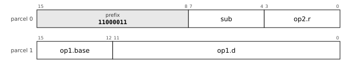

`op1` is `b4d12s-x1`: memory at base register, 4 bits + signed 12-bit displacement times 1, -2048 to 2047 bytes.

`op2` is `reg4`: register, 4 bits.

`sub` (4 bits) selects the mnemonic: `movq.u` 0000, `movl.u` 0001, `movw.u` 0010, `movb.u` 0011, `movzl.u` 0100, `movzw.u` 0101, `movzb.u` 0110, `movq.d` 0111, `movl.d` 1000, `movw.d` 1001, `movb.d` 1010, `movzl.d` 1011, `movzw.d` 1100, `movzb.d` 1101, `movq.ud` 1110, `movl.ud` 1111.

Fields: `sub=p0[7:4]` `op2.r=p0[3:0]` `op1.base=p1[15:12]` `op1.d=p1[11:0]`

#### 16-LDU-X6-1: LDU.X6, prefix `11000100`

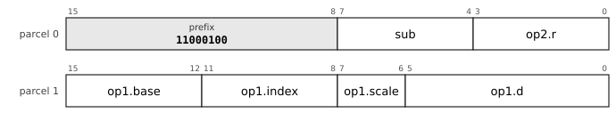

`op1` is `x4-4d6s`: memory at base + (index << scale) + signed 6-bit displacement; base register, 4 bits, index register, 4 bits.

`op2` is `reg4`: register, 4 bits.

`sub` (4 bits) selects the mnemonic: `movq.u` 0000, `movl.u` 0001, `movw.u` 0010, `movb.u` 0011, `movzl.u` 0100, `movzw.u` 0101, `movzb.u` 0110, `movq.d` 0111, `movl.d` 1000, `movw.d` 1001, `movb.d` 1010, `movzl.d` 1011, `movzw.d` 1100, `movzb.d` 1101, `movq.ud` 1110, `movl.ud` 1111.

Fields: `sub=p0[7:4]` `op2.r=p0[3:0]` `op1.base=p1[15:12]` `op1.index=p1[11:8]` `op1.scale=p1[7:6]` `op1.d=p1[5:0]`

#### 16-LDF-PI12-1: LDF.PI12, prefix `11000111`

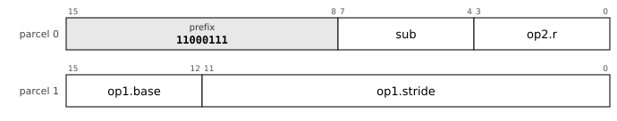

`op1` is `pi4-s12`: post-increment of a base register (register, 4 bits), 12-bit stride (0: the size of the access).

`op2` is `reg4`: register, 4 bits.

`sub` (4 bits) selects the mnemonic: `movq` 0000, `movl` 0001, `movw` 0010, `movb` 0011, `movzl` 0100, `movzw` 0101, `movzb` 0110, `add` 0111, `sub` 1000, `bic` 1001, `bis` 1010, `xor` 1011, `and` 1100, `mul` 1101, `mulh` 1110, `shl` 1111.

Fields: `sub=p0[7:4]` `op2.r=p0[3:0]` `op1.base=p1[15:12]` `op1.stride=p1[11:0]`

#### 16-LDF-PD12-1: LDF.PD12, prefix `11001000`

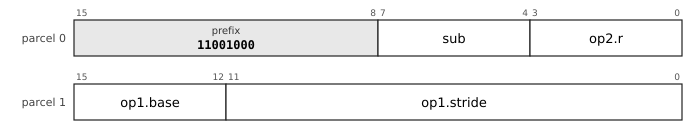

`op1` is `pd4-s12`: pre-decrement of a base register (register, 4 bits), 12-bit stride (0: the size of the access).

`op2` is `reg4`: register, 4 bits.

`sub` (4 bits) selects the mnemonic: `movq` 0000, `movl` 0001, `movw` 0010, `movb` 0011, `movzl` 0100, `movzw` 0101, `movzb` 0110, `add` 0111, `sub` 1000, `bic` 1001, `bis` 1010, `xor` 1011, `and` 1100, `mul` 1101, `mulh` 1110, `shl` 1111.

Fields: `sub=p0[7:4]` `op2.r=p0[3:0]` `op1.base=p1[15:12]` `op1.stride=p1[11:0]`

#### 16-FX-MOVCALL2-1: FX.MOVCALL2, prefix `11001101`

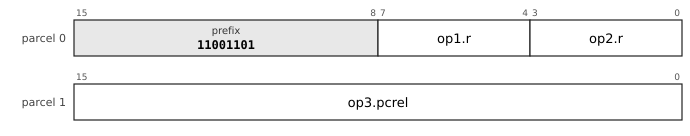

`op1` is `reg4`: register, 4 bits.

`op2` is `reg4`: register, 4 bits.

`op3` is `pc16-u2`: pc-relative, 16 bits counted in 2-byte units (-65536 to 65534 bytes).

Fields: `op1.r=p0[7:4]` `op2.r=p0[3:0]` `op3.pcrel=p1[15:0]`

#### 16-LDBs14-a-1: LDBs14/a, prefix `11010110`

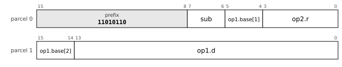

`op1` is `b4d14s-xsz`: memory at base register, 4 bits + signed 14-bit displacement times the size of the access.

`op2` is `reg4`: register, 4 bits.

`sub` (2 bits) selects the mnemonic: `movq` 00, `movl` 01, `movzb` 10, `lea` 11.

Fields: `sub=p0[7:6]` `op1.base-1=p0[5:4]` `op2.r=p0[3:0]` `op1.base-2=p1[15:14]` `op1.d=p1[13:0]`

#### 16-CBI10-8-c-1: CBI10_8/c, prefix `11011000`

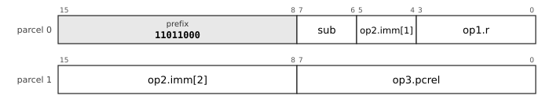

`op1` is `reg4`: register, 4 bits.

`op2` is `imm10s`: signed 10-bit immediate, -512 to 511.

`op3` is `pc8-u2`: pc-relative, 8 bits counted in 2-byte units (-256 to 254 bytes).

`sub` (2 bits) selects the mnemonic: `cbcs` 00, `cbcc` 01, `cbhi` 10, `cblos` 11.

Fields: `sub=p0[7:6]` `op2.imm-1=p0[5:4]` `op1.r=p0[3:0]` `op2.imm-2=p1[15:8]` `op3.pcrel=p1[7:0]`

#### 16-LDX8-a-1: LDX8/a, prefix `11011001`

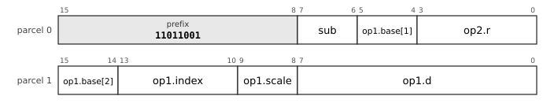

`op1` is `x4-4d8s`: memory at base + (index << scale) + signed 8-bit displacement; base register, 4 bits, index register, 4 bits.

`op2` is `reg4`: register, 4 bits.

`sub` (2 bits) selects the mnemonic: `movq` 00, `movl` 01, `movzb` 10, `lea` 11.

Fields: `sub=p0[7:6]` `op1.base-1=p0[5:4]` `op2.r=p0[3:0]` `op1.base-2=p1[15:14]` `op1.index=p1[13:10]` `op1.scale=p1[9:8]` `op1.d=p1[7:0]`

#### 16-LDF-PI12-2: LDF.PI12, prefix `110110111`

`op1` is `pi4-s12`: post-increment of a base register (register, 4 bits), 12-bit stride (0: the size of the access).

`op2` is `reg4`: register, 4 bits.

`sub` (3 bits) selects the mnemonic: `shr` 000, `sar` 001, `fadd` 010, `fsub` 011, `fmul` 100, `bit` 101, `lea` 110, `movub` 111.

Fields: `sub=p0[6:4]` `op2.r=p0[3:0]` `op1.base=p1[15:12]` `op1.stride=p1[11:0]`

#### 16-LDF-PD12-2: LDF.PD12, prefix `110111000`

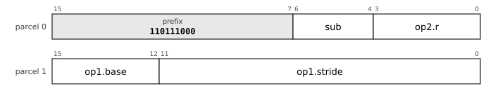

`op1` is `pd4-s12`: pre-decrement of a base register (register, 4 bits), 12-bit stride (0: the size of the access).

`op2` is `reg4`: register, 4 bits.

`sub` (3 bits) selects the mnemonic: `shr` 000, `sar` 001, `fadd` 010, `fsub` 011, `fmul` 100, `bit` 101, `lea` 110, `movub` 111.

Fields: `sub=p0[6:4]` `op2.r=p0[3:0]` `op1.base=p1[15:12]` `op1.stride=p1[11:0]`

#### 16-STF-PI12-1: STF.PI12, prefix `110111101`

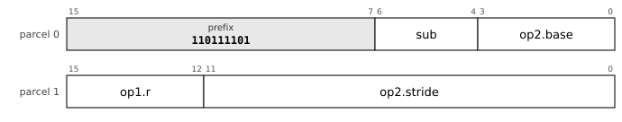

`op1` is `reg4`: register, 4 bits.

`op2` is `pi4-s12`: post-increment of a base register (register, 4 bits), 12-bit stride (0: the size of the access).

`sub` (3 bits) selects the mnemonic: `movq` 000, `movl` 001, `movw` 010, `movb` 011, `movub` 100, `movuw` 101, `movul` 110, `movuq` 111.

Fields: `sub=p0[6:4]` `op2.base=p0[3:0]` `op1.r=p1[15:12]` `op2.stride=p1[11:0]`

#### 16-STF-PD12-1: STF.PD12, prefix `110111110`

`op1` is `reg4`: register, 4 bits.

`op2` is `pd4-s12`: pre-decrement of a base register (register, 4 bits), 12-bit stride (0: the size of the access).

`sub` (3 bits) selects the mnemonic: `movq` 000, `movl` 001, `movw` 010, `movb` 011, `movub` 100, `movuw` 101, `movul` 110, `movuq` 111.

Fields: `sub=p0[6:4]` `op2.base=p0[3:0]` `op1.r=p1[15:12]` `op2.stride=p1[11:0]`

#### 16-CBI10-8-a-1: CBI10_8/a, prefix `111000011`

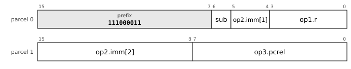

`op1` is `reg4`: register, 4 bits.

`op2` is `imm10s`: signed 10-bit immediate, -512 to 511.

`op3` is `pc8-u2`: pc-relative, 8 bits counted in 2-byte units (-256 to 254 bytes).

`sub` (1 bit) selects the mnemonic: `cbeq` 0, `cbne` 1.

Fields: `sub=p0[6]` `op2.imm-1=p0[5:4]` `op1.r=p0[3:0]` `op2.imm-2=p1[15:8]` `op3.pcrel=p1[7:0]`

#### 16-LDI18-b-1: LDI18/b, prefix `111000111`

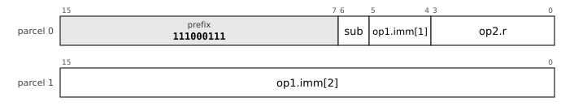

`op1` is `imm18s`: signed 18-bit immediate, -131072 to 131071.

`op2` is `reg4`: register, 4 bits.

`sub` (1 bit) selects the mnemonic: `add` 0, `sub` 1.

Fields: `sub=p0[6]` `op1.imm-1=p0[5:4]` `op2.r=p0[3:0]` `op1.imm-2=p1[15:0]`

#### 16-CBI8-10-a-1: CBI8_10/a, prefix `111001000`

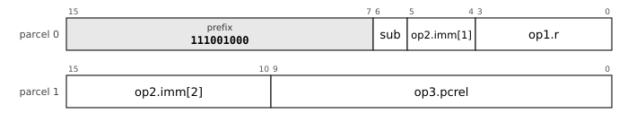

`op1` is `reg4`: register, 4 bits.

`op2` is `imm8s`: signed 8-bit immediate, -128 to 127.

`op3` is `pc10-u2`: pc-relative, 10 bits counted in 2-byte units (-1024 to 1022 bytes).

`sub` (1 bit) selects the mnemonic: `cbeq` 0, `cbne` 1.

Fields: `sub=p0[6]` `op2.imm-1=p0[5:4]` `op1.r=p0[3:0]` `op2.imm-2=p1[15:10]` `op3.pcrel=p1[9:0]`

#### 16-CBI6-12-a-1: CBI6_12/a, prefix `111001001`

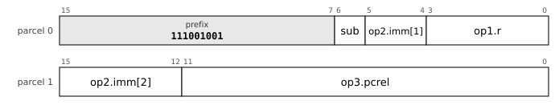

`op1` is `reg4`: register, 4 bits.

`op2` is `imm6s`: signed 6-bit immediate, -32 to 31.

`op3` is `pc12-u2`: pc-relative, 12 bits counted in 2-byte units (-4096 to 4094 bytes).

`sub` (1 bit) selects the mnemonic: `cbeq` 0, `cbne` 1.

Fields: `sub=p0[6]` `op2.imm-1=p0[5:4]` `op1.r=p0[3:0]` `op2.imm-2=p1[15:12]` `op3.pcrel=p1[11:0]`

#### 16-STU-B12-1: STU.B12, prefix `1110011001`

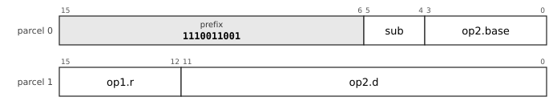

`op1` is `reg4`: register, 4 bits.

`op2` is `b4d12s-x1`: memory at base register, 4 bits + signed 12-bit displacement times 1, -2048 to 2047 bytes.

`sub` (2 bits) selects the mnemonic: `movq.u` 00, `movl.u` 01, `movw.u` 10, `movb.u` 11.

Fields: `sub=p0[5:4]` `op2.base=p0[3:0]` `op1.r=p1[15:12]` `op2.d=p1[11:0]`

#### 16-STU-X6-1: STU.X6, prefix `1110011011`

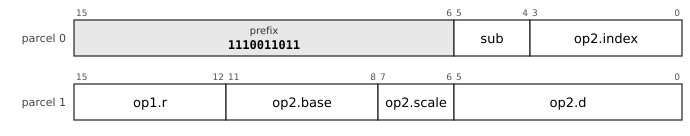

`op1` is `reg4`: register, 4 bits.

`op2` is `x4-4d6s`: memory at base + (index << scale) + signed 6-bit displacement; base register, 4 bits, index register, 4 bits.

`sub` (2 bits) selects the mnemonic: `movq.u` 00, `movl.u` 01, `movw.u` 10, `movb.u` 11.

Fields: `sub=p0[5:4]` `op2.index=p0[3:0]` `op1.r=p1[15:12]` `op2.base=p1[11:8]` `op2.scale=p1[7:6]` `op2.d=p1[5:0]`

#### 16-STF-PI12-2: STF.PI12, prefix `1110011111`

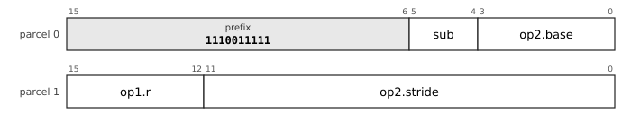

`op1` is `reg4`: register, 4 bits.

`op2` is `pi4-s12`: post-increment of a base register (register, 4 bits), 12-bit stride (0: the size of the access).

`sub` (2 bits) selects the mnemonic: `addm` 00, `subm` 01, `bicm` 10, `bism` 11.

Fields: `sub=p0[5:4]` `op2.base=p0[3:0]` `op1.r=p1[15:12]` `op2.stride=p1[11:0]`

#### 16-STF-PD12-2: STF.PD12, prefix `1110100000`

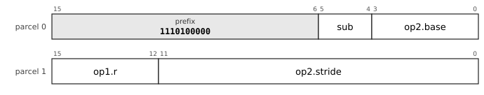

`op1` is `reg4`: register, 4 bits.

`op2` is `pd4-s12`: pre-decrement of a base register (register, 4 bits), 12-bit stride (0: the size of the access).

`sub` (2 bits) selects the mnemonic: `addm` 00, `subm` 01, `bicm` 10, `bism` 11.

Fields: `sub=p0[5:4]` `op2.base=p0[3:0]` `op1.r=p1[15:12]` `op2.stride=p1[11:0]`

#### 16-CBDI-1: CBDI, prefix `1110100100`

`op1` is `reg4`: register, 4 bits.

`op2` is `imm6s`: signed 6-bit immediate, -32 to 31.

`op3` is `pc10-u2`: pc-relative, 10 bits counted in 2-byte units (-1024 to 1022 bytes).

`sub` (2 bits) selects the mnemonic: `cbpl` 00, `cbmi` 01, `cbvc` 10, `cbvs` 11.

Fields: `sub=p0[5:4]` `op1.r=p0[3:0]` `op2.imm=p1[15:10]` `op3.pcrel=p1[9:0]`

#### 16-CBDR-1: CBDR, prefix `1110100101`

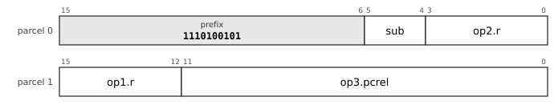

`op1` is `reg4`: register, 4 bits.

`op2` is `reg4`: register, 4 bits.

`op3` is `pc12-u2`: pc-relative, 12 bits counted in 2-byte units (-4096 to 4094 bytes).

`sub` (2 bits) selects the mnemonic: `cbpl` 00, `cbmi` 01, `cbvc` 10, `cbvs` 11.

Fields: `sub=p0[5:4]` `op2.r=p0[3:0]` `op1.r=p1[15:12]` `op3.pcrel=p1[11:0]`

#### 16-CBI8-8-b-1: CBI8_8/b, prefix `1110100111`

`op1` is `reg4`: register, 4 bits.

`op2` is `imm8s`: signed 8-bit immediate, -128 to 127.

`op3` is `pc8-u2`: pc-relative, 8 bits counted in 2-byte units (-256 to 254 bytes).

`sub` (2 bits) selects the mnemonic: `cblt` 00, `cbge` 01, `cbgt` 10, `cble` 11.

Fields: `sub=p0[5:4]` `op1.r=p0[3:0]` `op2.imm=p1[15:8]` `op3.pcrel=p1[7:0]`

#### 16-LDPC16-a-1: LDPC16/a, prefix `1110101000`

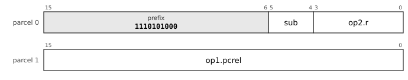

`op1` is `pc16-u1`: pc-relative, 16 bits counted in 1-byte units (-32768 to 32767 bytes).

`op2` is `reg4`: register, 4 bits.

`sub` (2 bits) selects the mnemonic: `movq` 00, `movl` 01, `movzb` 10, `lea` 11.

Fields: `sub=p0[5:4]` `op2.r=p0[3:0]` `op1.pcrel=p1[15:0]`

#### 16-LDBu12-a-1: LDBu12/a, prefix `1110101001`

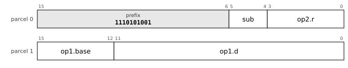

`op1` is `b4d12u-xsz`: memory at base register, 4 bits + unsigned 12-bit displacement times the size of the access.

`op2` is `reg4`: register, 4 bits.

`sub` (2 bits) selects the mnemonic: `movq` 00, `movl` 01, `movzb` 10, `lea` 11.

Fields: `sub=p0[5:4]` `op2.r=p0[3:0]` `op1.base=p1[15:12]` `op1.d=p1[11:0]`

#### 16-LDX6-a-1: LDX6/a, prefix `1110101010`

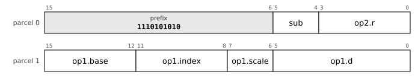

`op1` is `x4-4d6s`: memory at base + (index << scale) + signed 6-bit displacement; base register, 4 bits, index register, 4 bits.

`op2` is `reg4`: register, 4 bits.

`sub` (2 bits) selects the mnemonic: `movq` 00, `movl` 01, `movzb` 10, `lea` 11.

Fields: `sub=p0[5:4]` `op2.r=p0[3:0]` `op1.base=p1[15:12]` `op1.index=p1[11:8]` `op1.scale=p1[7:6]` `op1.d=p1[5:0]`

#### 16-LDI18-b-2: LDI18/b, prefix `1110101011`

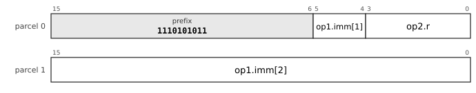

`op1` is `imm18s`: signed 18-bit immediate, -131072 to 131071.

`op2` is `reg4`: register, 4 bits.

Fields: `op1.imm-1=p0[5:4]` `op2.r=p0[3:0]` `op1.imm-2=p1[15:0]`

#### 16-CBI8-8-c-1: CBI8_8/c, prefix `1110101100`

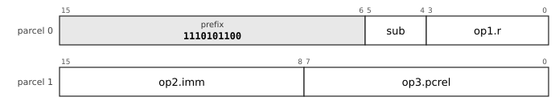

`op1` is `reg4`: register, 4 bits.

`op2` is `imm8s`: signed 8-bit immediate, -128 to 127.

`op3` is `pc8-u2`: pc-relative, 8 bits counted in 2-byte units (-256 to 254 bytes).

`sub` (2 bits) selects the mnemonic: `cbcs` 00, `cbcc` 01, `cbhi` 10, `cblos` 11.

Fields: `sub=p0[5:4]` `op1.r=p0[3:0]` `op2.imm=p1[15:8]` `op3.pcrel=p1[7:0]`

#### 16-LDPC16-c-1: LDPC16/c, prefix `1110101101`

`op1` is `pc16-u1`: pc-relative, 16 bits counted in 1-byte units (-32768 to 32767 bytes).

`op2` is `reg4`: register, 4 bits.

`sub` (2 bits) selects the mnemonic: `add` 00, `sub` 01, `and` 10, `bis` 11.

Fields: `sub=p0[5:4]` `op2.r=p0[3:0]` `op1.pcrel=p1[15:0]`

#### 16-LDBu12-b-1: LDBu12/b, prefix `1110101110`

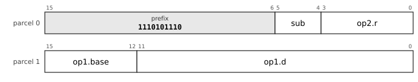

`op1` is `b4d12u-xsz`: memory at base register, 4 bits + unsigned 12-bit displacement times the size of the access.

`op2` is `reg4`: register, 4 bits.

`sub` (2 bits) selects the mnemonic: `movw` 00, `movb` 01, `movzl` 10, `movzw` 11.

Fields: `sub=p0[5:4]` `op2.r=p0[3:0]` `op1.base=p1[15:12]` `op1.d=p1[11:0]`

#### 16-CMI18-a-1: CMI18/a, prefix `1110101111`

`op1` is `reg4`: register, 4 bits.

`op2` is `imm18s`: signed 18-bit immediate, -131072 to 131071.

Fields: `op2.imm-1=p0[5:4]` `op1.r=p0[3:0]` `op2.imm-2=p1[15:0]`

#### 16-LDI18-a-1: LDI18/a, prefix `1110110000`

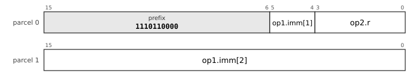

`op1` is `imm18s`: signed 18-bit immediate, -131072 to 131071.

`op2` is `reg4`: register, 4 bits.

Fields: `op1.imm-1=p0[5:4]` `op2.r=p0[3:0]` `op1.imm-2=p1[15:0]`

#### 16-CBI6-10-c-1: CBI6_10/c, prefix `1110110001`

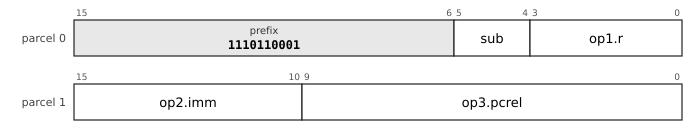

`op1` is `reg4`: register, 4 bits.

`op2` is `imm6s`: signed 6-bit immediate, -32 to 31.

`op3` is `pc10-u2`: pc-relative, 10 bits counted in 2-byte units (-1024 to 1022 bytes).

`sub` (2 bits) selects the mnemonic: `cbcs` 00, `cbcc` 01, `cbhi` 10, `cblos` 11.

Fields: `sub=p0[5:4]` `op1.r=p0[3:0]` `op2.imm=p1[15:10]` `op3.pcrel=p1[9:0]`

#### 16-LDF-PI12-3: LDF.PI12, prefix `11101101000`

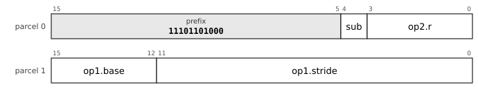

`op1` is `pi4-s12`: post-increment of a base register (register, 4 bits), 12-bit stride (0: the size of the access).

`op2` is `reg4`: register, 4 bits.

`sub` (1 bit) selects the mnemonic: `movuw` 0, `movul` 1.

Fields: `sub=p0[4]` `op2.r=p0[3:0]` `op1.base=p1[15:12]` `op1.stride=p1[11:0]`

#### 16-LDF-PD12-3: LDF.PD12, prefix `11101101001`

`op1` is `pd4-s12`: pre-decrement of a base register (register, 4 bits), 12-bit stride (0: the size of the access).

`op2` is `reg4`: register, 4 bits.

`sub` (1 bit) selects the mnemonic: `movuw` 0, `movul` 1.

Fields: `sub=p0[4]` `op2.r=p0[3:0]` `op1.base=p1[15:12]` `op1.stride=p1[11:0]`

#### 16-CMF-PI12-1: CMF.PI12, prefix `11101101111`

`op1` is `reg4`: register, 4 bits.

`op2` is `pi4-s12`: post-increment of a base register (register, 4 bits), 12-bit stride (0: the size of the access).

`sub` (1 bit) selects the mnemonic: `cmp` 0, `fcmp` 1.

Fields: `sub=p0[4]` `op2.base=p0[3:0]` `op1.r=p1[15:12]` `op2.stride=p1[11:0]`

#### 16-CMF-PD12-1: CMF.PD12, prefix `11101110000`

`op1` is `reg4`: register, 4 bits.

`op2` is `pd4-s12`: pre-decrement of a base register (register, 4 bits), 12-bit stride (0: the size of the access).

`sub` (1 bit) selects the mnemonic: `cmp` 0, `fcmp` 1.

Fields: `sub=p0[4]` `op2.base=p0[3:0]` `op1.r=p1[15:12]` `op2.stride=p1[11:0]`

#### 16-TAG-1: TAG, prefix `11101110101`

`op1` is `reg4`: register, 4 bits.

`op2` is `imm3u`: unsigned 3-bit immediate, 0 to 7.

`op3` is `pc13-u2`: pc-relative, 13 bits counted in 2-byte units (-8192 to 8190 bytes).

`sub` (1 bit) selects the mnemonic: `btag` 0, `bntag` 1.

Fields: `sub=p0[4]` `op1.r=p0[3:0]` `op2.imm=p1[15:13]` `op3.pcrel=p1[12:0]`

#### 16-STBu12-a-1: STBu12/a, prefix `11101110110`

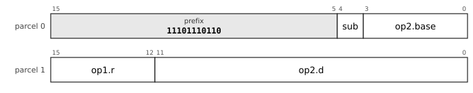

`op1` is `reg4`: register, 4 bits.

`op2` is `b4d12u-xsz`: memory at base register, 4 bits + unsigned 12-bit displacement times the size of the access.

`sub` (1 bit) selects the mnemonic: `movq` 0, `movl` 1.

Fields: `sub=p0[4]` `op2.base=p0[3:0]` `op1.r=p1[15:12]` `op2.d=p1[11:0]`

#### 16-STX6-a-1: STX6/a, prefix `11101110111`

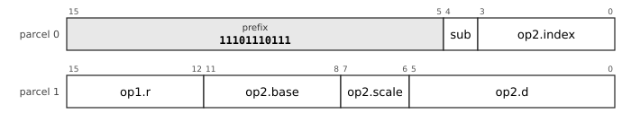

`op1` is `reg4`: register, 4 bits.

`op2` is `x4-4d6s`: memory at base + (index << scale) + signed 6-bit displacement; base register, 4 bits, index register, 4 bits.

`sub` (1 bit) selects the mnemonic: `movq` 0, `movl` 1.

Fields: `sub=p0[4]` `op2.index=p0[3:0]` `op1.r=p1[15:12]` `op2.base=p1[11:8]` `op2.scale=p1[7:6]` `op2.d=p1[5:0]`

#### 16-STBu12-b-1: STBu12/b, prefix `11101111000`

`op1` is `reg4`: register, 4 bits.

`op2` is `b4d12u-xsz`: memory at base register, 4 bits + unsigned 12-bit displacement times the size of the access.

`sub` (1 bit) selects the mnemonic: `movw` 0, `movb` 1.

Fields: `sub=p0[4]` `op2.base=p0[3:0]` `op1.r=p1[15:12]` `op2.d=p1[11:0]`

#### 16-STX6-b-1: STX6/b, prefix `11101111001`

`op1` is `reg4`: register, 4 bits.

`op2` is `x4-4d6s`: memory at base + (index << scale) + signed 6-bit displacement; base register, 4 bits, index register, 4 bits.

`sub` (1 bit) selects the mnemonic: `movw` 0, `movb` 1.

Fields: `sub=p0[4]` `op2.index=p0[3:0]` `op1.r=p1[15:12]` `op2.base=p1[11:8]` `op2.scale=p1[7:6]` `op2.d=p1[5:0]`

#### 16-CBI4-12-a-1: CBI4_12/a, prefix `11101111010`

`op1` is `reg4`: register, 4 bits.

`op2` is `imm4s`: signed 4-bit immediate, -8 to 7.

`op3` is `pc12-u2`: pc-relative, 12 bits counted in 2-byte units (-4096 to 4094 bytes).

`sub` (1 bit) selects the mnemonic: `cbeq` 0, `cbne` 1.

Fields: `sub=p0[4]` `op1.r=p0[3:0]` `op2.imm=p1[15:12]` `op3.pcrel=p1[11:0]`

#### 16-SETF-1: SETF, prefix `111011110110`

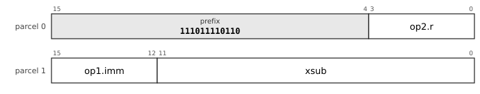

`op1` is `imm4u`: unsigned 4-bit immediate, 0 to 15.

`op2` is `reg4`: register, 4 bits.

`xsub` selects the mnemonic.

Fields: `op2.r=p0[3:0]` `op1.imm=p1[15:12]` `xsub=p1[11:0]`

#### 16-R2-1: R2, prefix `111011110111`

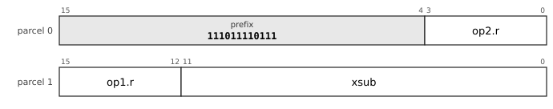

`op1` is `reg4`: register, 4 bits.

`op2` is `reg4`: register, 4 bits.

`xsub` selects the mnemonic.

Fields: `op2.r=p0[3:0]` `op1.r=p1[15:12]` `xsub=p1[11:0]`

#### 16-R3-1: R3, prefix `111011111000`

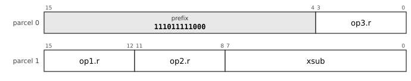

`op1` is `reg4`: register, 4 bits.

`op2` is `reg4`: register, 4 bits.

`op3` is `reg4`: register, 4 bits.

`xsub` selects the mnemonic.

Fields: `op3.r=p0[3:0]` `op1.r=p1[15:12]` `op2.r=p1[11:8]` `xsub=p1[7:0]`

#### 16-R4-1: R4, prefix `111011111001`

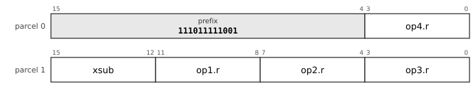

`op1` is `reg4`: register, 4 bits.

`op2` is `reg4`: register, 4 bits.

`op3` is `reg4`: register, 4 bits.

`op4` is `reg4`: register, 4 bits.

`xsub` selects the mnemonic.

Fields: `op4.r=p0[3:0]` `xsub=p1[15:12]` `op1.r=p1[11:8]` `op2.r=p1[7:4]` `op3.r=p1[3:0]`

#### 16-RRI-1: RRI, prefix `111011111010`

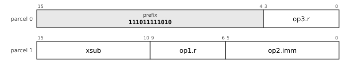

`op1` is `reg4`: register, 4 bits.

`op2` is `imm6u`: unsigned 6-bit immediate, 0 to 63.

`op3` is `reg4`: register, 4 bits.

`xsub` selects the mnemonic.

Fields: `op3.r=p0[3:0]` `xsub=p1[15:10]` `op1.r=p1[9:6]` `op2.imm=p1[5:0]`

#### 16-LDF-PI12-4: LDF.PI12, prefix `111100000001`

`op1` is `pi4-s12`: post-increment of a base register (register, 4 bits), 12-bit stride (0: the size of the access).

`op2` is `reg4`: register, 4 bits.

Fields: `op2.r=p0[3:0]` `op1.base=p1[15:12]` `op1.stride=p1[11:0]`

#### 16-LDF-PD12-4: LDF.PD12, prefix `111100000010`

`op1` is `pd4-s12`: pre-decrement of a base register (register, 4 bits), 12-bit stride (0: the size of the access).

`op2` is `reg4`: register, 4 bits.

Fields: `op2.r=p0[3:0]` `op1.base=p1[15:12]` `op1.stride=p1[11:0]`

#### 16-SOF-PI12-1: SOF.PI12, prefix `111100000111`

`op1` is `pi4-s12`: post-increment of a base register (register, 4 bits), 12-bit stride (0: the size of the access).

`sub` (4 bits) selects the mnemonic: `clr` 0000, `com` 0001, `inc` 0010, `dec` 0011, `neg` 0100, `tst` 0101, `adc` 0110, `sbc` 0111, `asl` 1000, `asr` 1001, `push` 1010, `pop` 1011, `jmp` 1100, `call` 1101, `jmpi` 1110, `calli` 1111.

Fields: `sub=p0[3:0]` `op1.base=p1[15:12]` `op1.stride=p1[11:0]`

#### 16-SOF-PD12-1: SOF.PD12, prefix `111100001000`

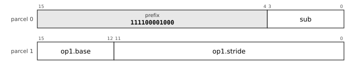

`op1` is `pd4-s12`: pre-decrement of a base register (register, 4 bits), 12-bit stride (0: the size of the access).

`sub` (4 bits) selects the mnemonic: `clr` 0000, `com` 0001, `inc` 0010, `dec` 0011, `neg` 0100, `tst` 0101, `adc` 0110, `sbc` 0111, `asl` 1000, `asr` 1001, `push` 1010, `pop` 1011, `jmp` 1100, `call` 1101, `jmpi` 1110, `calli` 1111.

Fields: `sub=p0[3:0]` `op1.base=p1[15:12]` `op1.stride=p1[11:0]`

#### 16-SOB-1: SOB, prefix `111100001100`

`op1` is `reg4`: register, 4 bits.

`op2` is `pc16-u2`: pc-relative, 16 bits counted in 2-byte units (-65536 to 65534 bytes).

Fields: `op1.r=p0[3:0]` `op2.pcrel=p1[15:0]`

#### 16-LDPC14-a-1: LDPC14/a, prefix `111100001110`

`op1` is `pc14-u1`: pc-relative, 14 bits counted in 1-byte units (-8192 to 8191 bytes).

`op2` is `reg4`: register, 4 bits.

`sub` (2 bits) selects the mnemonic: `movq` 00, `movl` 01, `movzb` 10, `lea` 11.

Fields: `sub=p0[3:2]` `op2.r=p0[1:0]+p1[15:14]` `op1.pcrel=p1[13:0]`

#### 16-LDI16-a-1: LDI16/a, prefix `111100001111`

`op1` is `imm16s`: signed 16-bit immediate, -32768 to 32767.

`op2` is `reg4`: register, 4 bits.

Fields: `op2.r=p0[3:0]` `op1.imm=p1[15:0]`

#### 16-LDBu10-a-1: LDBu10/a, prefix `111100010000`

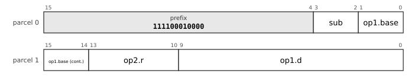

`op1` is `b4d10u-xsz`: memory at base register, 4 bits + unsigned 10-bit displacement times the size of the access.

`op2` is `reg4`: register, 4 bits.

`sub` (2 bits) selects the mnemonic: `movq` 00, `movl` 01, `movzb` 10, `lea` 11.

Fields: `sub=p0[3:2]` `op1.base=p0[1:0]+p1[15:14]` `op2.r=p1[13:10]` `op1.d=p1[9:0]`

#### 16-CBI6-8-c-1: CBI6_8/c, prefix `111100010001`

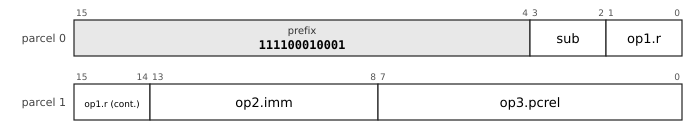

`op1` is `reg4`: register, 4 bits.

`op2` is `imm6s`: signed 6-bit immediate, -32 to 31.

`op3` is `pc8-u2`: pc-relative, 8 bits counted in 2-byte units (-256 to 254 bytes).

`sub` (2 bits) selects the mnemonic: `cbcs` 00, `cbcc` 01, `cbhi` 10, `cblos` 11.

Fields: `sub=p0[3:2]` `op1.r=p0[1:0]+p1[15:14]` `op2.imm=p1[13:8]` `op3.pcrel=p1[7:0]`

#### 16-CBI5-10-a-1: CBI5_10/a, prefix `111100010010`

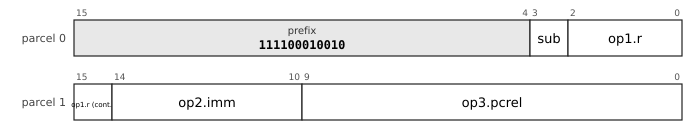

`op1` is `reg4`: register, 4 bits.

`op2` is `imm5s`: signed 5-bit immediate, -16 to 15.

`op3` is `pc10-u2`: pc-relative, 10 bits counted in 2-byte units (-1024 to 1022 bytes).

`sub` (1 bit) selects the mnemonic: `cbeq` 0, `cbne` 1.

Fields: `sub=p0[3]` `op1.r=p0[2:0]+p1[15]` `op2.imm=p1[14:10]` `op3.pcrel=p1[9:0]`

#### 16-CBR10-c-1: CBR10/c, prefix `111100010011`

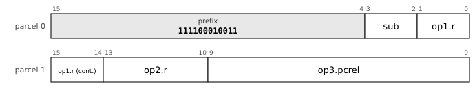

`op1` is `reg4`: register, 4 bits.

`op2` is `reg4`: register, 4 bits.

`op3` is `pc10-u2`: pc-relative, 10 bits counted in 2-byte units (-1024 to 1022 bytes).

`sub` (2 bits) selects the mnemonic: `cbcs` 00, `cbcc` 01, `cbhi` 10, `cblos` 11.

Fields: `sub=p0[3:2]` `op1.r=p0[1:0]+p1[15:14]` `op2.r=p1[13:10]` `op3.pcrel=p1[9:0]`

#### 16-LDBu10-b-1: LDBu10/b, prefix `111100010100`

`op1` is `b4d10u-xsz`: memory at base register, 4 bits + unsigned 10-bit displacement times the size of the access.

`op2` is `reg4`: register, 4 bits.

`sub` (2 bits) selects the mnemonic: `movw` 00, `movb` 01, `movzl` 10, `movzw` 11.

Fields: `sub=p0[3:2]` `op1.base=p0[1:0]+p1[15:14]` `op2.r=p1[13:10]` `op1.d=p1[9:0]`

#### 16-LDBs10-a-1: LDBs10/a, prefix `111100010101`

`op1` is `b4d10s-xsz`: memory at base register, 4 bits + signed 10-bit displacement times the size of the access.

`op2` is `reg4`: register, 4 bits.

`sub` (2 bits) selects the mnemonic: `movq` 00, `movl` 01, `movzb` 10, `lea` 11.

Fields: `sub=p0[3:2]` `op1.base=p0[1:0]+p1[15:14]` `op2.r=p1[13:10]` `op1.d=p1[9:0]`

#### 16-LDPC16-c-2: LDPC16/c, prefix `111100010110`

`op1` is `pc16-u1`: pc-relative, 16 bits counted in 1-byte units (-32768 to 32767 bytes).

`op2` is `reg4`: register, 4 bits.

Fields: `op2.r=p0[3:0]` `op1.pcrel=p1[15:0]`

#### 16-LDBs10-c-1: LDBs10/c, prefix `111100010111`

`op1` is `b4d10s-xsz`: memory at base register, 4 bits + signed 10-bit displacement times the size of the access.

`op2` is `reg4`: register, 4 bits.

`sub` (2 bits) selects the mnemonic: `add` 00, `sub` 01, `and` 10, `bis` 11.

Fields: `sub=p0[3:2]` `op1.base=p0[1:0]+p1[15:14]` `op2.r=p1[13:10]` `op1.d=p1[9:0]`

#### 16-CMPC16-a-1: CMPC16/a, prefix `111100011000`

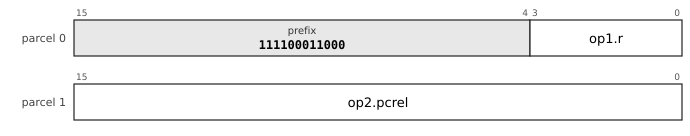

`op1` is `reg4`: register, 4 bits.

`op2` is `pc16-u1`: pc-relative, 16 bits counted in 1-byte units (-32768 to 32767 bytes).

Fields: `op1.r=p0[3:0]` `op2.pcrel=p1[15:0]`

#### 16-CBI4-10-c-1: CBI4_10/c, prefix `111100011001`

`op1` is `reg4`: register, 4 bits.

`op2` is `imm4s`: signed 4-bit immediate, -8 to 7.

`op3` is `pc10-u2`: pc-relative, 10 bits counted in 2-byte units (-1024 to 1022 bytes).

`sub` (2 bits) selects the mnemonic: `cbcs` 00, `cbcc` 01, `cbhi` 10, `cblos` 11.

Fields: `sub=p0[3:2]` `op1.r=p0[1:0]+p1[15:14]` `op2.imm=p1[13:10]` `op3.pcrel=p1[9:0]`

#### 16-CBI4-10-b-1: CBI4_10/b, prefix `111100011010`

`op1` is `reg4`: register, 4 bits.

`op2` is `imm4s`: signed 4-bit immediate, -8 to 7.

`op3` is `pc10-u2`: pc-relative, 10 bits counted in 2-byte units (-1024 to 1022 bytes).

`sub` (2 bits) selects the mnemonic: `cblt` 00, `cbge` 01, `cbgt` 10, `cble` 11.

Fields: `sub=p0[3:2]` `op1.r=p0[1:0]+p1[15:14]` `op2.imm=p1[13:10]` `op3.pcrel=p1[9:0]`

#### 16-LDX4-b-1: LDX4/b, prefix `111100011011`

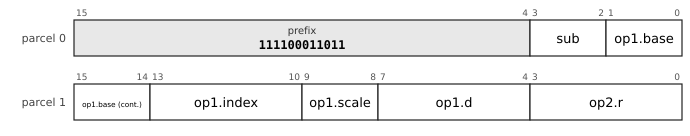

`op1` is `x4-4d4s`: memory at base + (index << scale) + signed 4-bit displacement; base register, 4 bits, index register, 4 bits.

`op2` is `reg4`: register, 4 bits.

`sub` (2 bits) selects the mnemonic: `movw` 00, `movb` 01, `movzl` 10, `movzw` 11.

Fields: `sub=p0[3:2]` `op1.base=p0[1:0]+p1[15:14]` `op1.index=p1[13:10]` `op1.scale=p1[9:8]` `op1.d=p1[7:4]` `op2.r=p1[3:0]`

#### 16-LDPC14-b-1: LDPC14/b, prefix `111100011100`

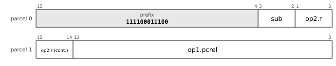

`op1` is `pc14-u1`: pc-relative, 14 bits counted in 1-byte units (-8192 to 8191 bytes).

`op2` is `reg4`: register, 4 bits.

`sub` (2 bits) selects the mnemonic: `movw` 00, `movb` 01, `movzl` 10, `movzw` 11.

Fields: `sub=p0[3:2]` `op2.r=p0[1:0]+p1[15:14]` `op1.pcrel=p1[13:0]`

#### 16-CMBu12-a-1: CMBu12/a, prefix `111100011101`

`op1` is `reg4`: register, 4 bits.

`op2` is `b4d12u-xsz`: memory at base register, 4 bits + unsigned 12-bit displacement times the size of the access.

Fields: `op2.base=p0[3:0]` `op1.r=p1[15:12]` `op2.d=p1[11:0]`

#### 16-LDI14-c-1: LDI14/c, prefix `111100011110`

`op1` is `imm14s`: signed 14-bit immediate, -8192 to 8191.

`op2` is `reg4`: register, 4 bits.

`sub` (2 bits) selects the mnemonic: `bis` 00, `xor` 01, `mul` 10, `bic` 11.

Fields: `sub=p0[3:2]` `op2.r=p0[1:0]+p1[15:14]` `op1.imm=p1[13:0]`

#### 16-CBI6-8-a-1: CBI6_8/a, prefix `1111001000000`

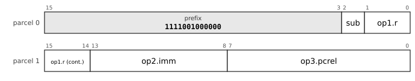

`op1` is `reg4`: register, 4 bits.

`op2` is `imm6s`: signed 6-bit immediate, -32 to 31.

`op3` is `pc8-u2`: pc-relative, 8 bits counted in 2-byte units (-256 to 254 bytes).

`sub` (1 bit) selects the mnemonic: `cbeq` 0, `cbne` 1.

Fields: `sub=p0[2]` `op1.r=p0[1:0]+p1[15:14]` `op2.imm=p1[13:8]` `op3.pcrel=p1[7:0]`

#### 16-BR2-16-c-1: BR2_16/c, prefix `1111001000001`

`op1` is `pc16-u2`: pc-relative, 16 bits counted in 2-byte units (-65536 to 65534 bytes).

`sub` (3 bits) selects the mnemonic: `bpl` 000, `bmi` 001, `bvc` 010, `bvs` 011, `bcc` 100, `bcs` 101, `bge` 110, `blt` 111.

Fields: `sub=p0[2:0]` `op1.pcrel=p1[15:0]`

#### 16-STBu10-a-1: STBu10/a, prefix `1111001000010`

`op1` is `reg4`: register, 4 bits.

`op2` is `b4d10u-xsz`: memory at base register, 4 bits + unsigned 10-bit displacement times the size of the access.

`sub` (1 bit) selects the mnemonic: `movq` 0, `movl` 1.

Fields: `sub=p0[2]` `op1.r=p0[1:0]+p1[15:14]` `op2.base=p1[13:10]` `op2.d=p1[9:0]`

#### 16-LDI14-b-1: LDI14/b, prefix `1111001000011`

`op1` is `imm14s`: signed 14-bit immediate, -8192 to 8191.

`op2` is `reg4`: register, 4 bits.

`sub` (1 bit) selects the mnemonic: `add` 0, `sub` 1.

Fields: `sub=p0[2]` `op2.r=p0[1:0]+p1[15:14]` `op1.imm=p1[13:0]`

#### 16-STBu10-b-1: STBu10/b, prefix `1111001000100`

`op1` is `reg4`: register, 4 bits.

`op2` is `b4d10u-xsz`: memory at base register, 4 bits + unsigned 10-bit displacement times the size of the access.

`sub` (1 bit) selects the mnemonic: `movw` 0, `movb` 1.

Fields: `sub=p0[2]` `op1.r=p0[1:0]+p1[15:14]` `op2.base=p1[13:10]` `op2.d=p1[9:0]`

#### 16-CBR10-a-1: CBR10/a, prefix `1111001000101`

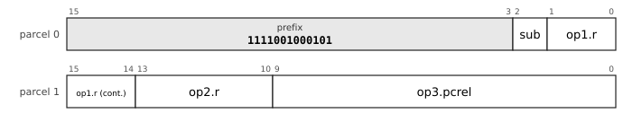

`op1` is `reg4`: register, 4 bits.

`op2` is `reg4`: register, 4 bits.

`op3` is `pc10-u2`: pc-relative, 10 bits counted in 2-byte units (-1024 to 1022 bytes).

`sub` (1 bit) selects the mnemonic: `cbeq` 0, `cbne` 1.

Fields: `sub=p0[2]` `op1.r=p0[1:0]+p1[15:14]` `op2.r=p1[13:10]` `op3.pcrel=p1[9:0]`

#### 16-CBZ2-14-a-1: CBZ2_14/a, prefix `1111001000110`

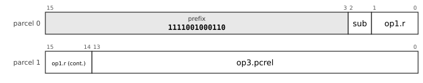

`op1` is `reg4`: register, 4 bits.

`op2` is `k-imm0`: implicit constant 0.

`op3` is `pc14-u2`: pc-relative, 14 bits counted in 2-byte units (-16384 to 16382 bytes).

`sub` (1 bit) selects the mnemonic: `cbeq` 0, `cbne` 1.

Fields: `sub=p0[2]` `op1.r=p0[1:0]+p1[15:14]` `op3.pcrel=p1[13:0]`

#### 16-LDPC12-d-1: LDPC12/d, prefix `1111001000111`

`op1` is `pc12-u1`: pc-relative, 12 bits counted in 1-byte units (-2048 to 2047 bytes).

`op2` is `reg4`: register, 4 bits.

`sub` (3 bits) selects the mnemonic: `bic` 000, `mul` 001, `mulh` 010, `shl` 011, `shr` 100, `sar` 101, `fadd` 110, `fsub` 111.

Fields: `sub=p0[2:0]` `op2.r=p1[15:12]` `op1.pcrel=p1[11:0]`

#### 16-STBs10-a-1: STBs10/a, prefix `1111001001000`

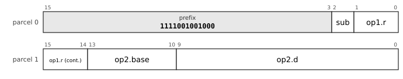

`op1` is `reg4`: register, 4 bits.

`op2` is `b4d10s-xsz`: memory at base register, 4 bits + signed 10-bit displacement times the size of the access.

`sub` (1 bit) selects the mnemonic: `movq` 0, `movl` 1.

Fields: `sub=p0[2]` `op1.r=p0[1:0]+p1[15:14]` `op2.base=p1[13:10]` `op2.d=p1[9:0]`

#### 16-LDBs8-d-1: LDBs8/d, prefix `1111001001001`

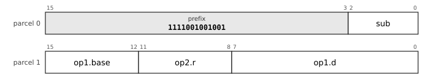

`op1` is `b4d8s-xsz`: memory at base register, 4 bits + signed 8-bit displacement times the size of the access.

`op2` is `reg4`: register, 4 bits.

`sub` (3 bits) selects the mnemonic: `bic` 000, `mul` 001, `mulh` 010, `shl` 011, `shr` 100, `sar` 101, `fadd` 110, `fsub` 111.

Fields: `sub=p0[2:0]` `op1.base=p1[15:12]` `op2.r=p1[11:8]` `op1.d=p1[7:0]`

#### 16-STBs10-b-1: STBs10/b, prefix `1111001001010`

`op1` is `reg4`: register, 4 bits.

`op2` is `b4d10s-xsz`: memory at base register, 4 bits + signed 10-bit displacement times the size of the access.

`sub` (1 bit) selects the mnemonic: `movw` 0, `movb` 1.

Fields: `sub=p0[2]` `op1.r=p0[1:0]+p1[15:14]` `op2.base=p1[13:10]` `op2.d=p1[9:0]`

#### 16-LDI12-d-1: LDI12/d, prefix `11110010011001`

`op1` is `imm12s`: signed 12-bit immediate, -2048 to 2047.

`op2` is `reg4`: register, 4 bits.

`sub` (2 bits) selects the mnemonic: `shl` 00, `shr` 01, `sar` 10, `mul` 11.

Fields: `sub=p0[1:0]` `op2.r=p1[15:12]` `op1.imm=p1[11:0]`

#### 16-LDPC12-a-1: LDPC12/a, prefix `11110010011010`

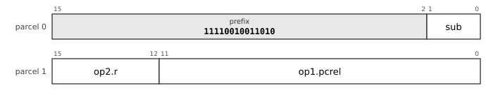

`op1` is `pc12-u1`: pc-relative, 12 bits counted in 1-byte units (-2048 to 2047 bytes).

`op2` is `reg4`: register, 4 bits.

`sub` (2 bits) selects the mnemonic: `movq` 00, `movl` 01, `movzb` 10, `lea` 11.

Fields: `sub=p0[1:0]` `op2.r=p1[15:12]` `op1.pcrel=p1[11:0]`

#### 16-LDBu8-b-1: LDBu8/b, prefix `11110010011011`

`op1` is `b4d8u-xsz`: memory at base register, 4 bits + unsigned 8-bit displacement times the size of the access.

`op2` is `reg4`: register, 4 bits.

`sub` (2 bits) selects the mnemonic: `movw` 00, `movb` 01, `movzl` 10, `movzw` 11.

Fields: `sub=p0[1:0]` `op1.base=p1[15:12]` `op2.r=p1[11:8]` `op1.d=p1[7:0]`

#### 16-CALL2-18-c-1: CALL2_18/c, prefix `11110010011100`

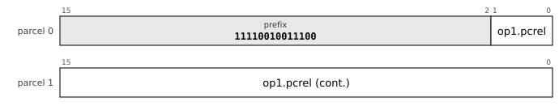

`op1` is `pc18-u2`: pc-relative, 18 bits counted in 2-byte units (-262144 to 262142 bytes).

Fields: `op1.pcrel=p0[1:0]+p1[15:0]`

#### 16-CBR8-c-1: CBR8/c, prefix `11110010011101`

`op1` is `reg4`: register, 4 bits.

`op2` is `reg4`: register, 4 bits.

`op3` is `pc8-u2`: pc-relative, 8 bits counted in 2-byte units (-256 to 254 bytes).

`sub` (2 bits) selects the mnemonic: `cbcs` 00, `cbcc` 01, `cbhi` 10, `cblos` 11.

Fields: `sub=p0[1:0]` `op1.r=p1[15:12]` `op2.r=p1[11:8]` `op3.pcrel=p1[7:0]`

#### 16-LDBs8-a-1: LDBs8/a, prefix `11110010011111`

`op1` is `b4d8s-xsz`: memory at base register, 4 bits + signed 8-bit displacement times the size of the access.

`op2` is `reg4`: register, 4 bits.

`sub` (2 bits) selects the mnemonic: `movq` 00, `movl` 01, `movzb` 10, `lea` 11.

Fields: `sub=p0[1:0]` `op1.base=p1[15:12]` `op2.r=p1[11:8]` `op1.d=p1[7:0]`

#### 16-LDBu8-c-1: LDBu8/c, prefix `11110010100000`

`op1` is `b4d8u-xsz`: memory at base register, 4 bits + unsigned 8-bit displacement times the size of the access.

`op2` is `reg4`: register, 4 bits.

`sub` (2 bits) selects the mnemonic: `add` 00, `sub` 01, `and` 10, `bis` 11.

Fields: `sub=p0[1:0]` `op1.base=p1[15:12]` `op2.r=p1[11:8]` `op1.d=p1[7:0]`

#### 16-CBI5-8-a-1: CBI5_8/a, prefix `11110010100001`

`op1` is `reg4`: register, 4 bits.

`op2` is `imm5s`: signed 5-bit immediate, -16 to 15.

`op3` is `pc8-u2`: pc-relative, 8 bits counted in 2-byte units (-256 to 254 bytes).

`sub` (1 bit) selects the mnemonic: `cbeq` 0, `cbne` 1.

Fields: `sub=p0[1]` `op1.r=p0[0]+p1[15:13]` `op2.imm=p1[12:8]` `op3.pcrel=p1[7:0]`

#### 16-LDI14-a-1: LDI14/a, prefix `11110010100010`

`op1` is `imm14s`: signed 14-bit immediate, -8192 to 8191.

`op2` is `reg4`: register, 4 bits.

Fields: `op2.r=p0[1:0]+p1[15:14]` `op1.imm=p1[13:0]`

#### 16-SOBu12-a-1: SOBu12/a, prefix `11110010100011`

`op1` is `b4d12u-xsz`: memory at base register, 4 bits + unsigned 12-bit displacement times the size of the access.

`sub` (2 bits) selects the mnemonic: `clr` 00, `inc` 01, `dec` 10, `tst` 11.

Fields: `sub=p0[1:0]` `op1.base=p1[15:12]` `op1.d=p1[11:0]`

#### 16-CBR8-b-1: CBR8/b, prefix `11110010100100`

`op1` is `reg4`: register, 4 bits.

`op2` is `reg4`: register, 4 bits.

`op3` is `pc8-u2`: pc-relative, 8 bits counted in 2-byte units (-256 to 254 bytes).

`sub` (2 bits) selects the mnemonic: `cblt` 00, `cbge` 01, `cbgt` 10, `cble` 11.

Fields: `sub=p0[1:0]` `op1.r=p1[15:12]` `op2.r=p1[11:8]` `op3.pcrel=p1[7:0]`

#### 16-SOBu12-x-1: SOBu12/x, prefix `11110010100101`

`op1` is `b4d12u-xsz`: memory at base register, 4 bits + unsigned 12-bit displacement times the size of the access.

`sub` (2 bits) selects the mnemonic: `jmp` 00, `call` 01, `jmpi` 10, `calli` 11.

Fields: `sub=p0[1:0]` `op1.base=p1[15:12]` `op1.d=p1[11:0]`

#### 16-LDI12-c-1: LDI12/c, prefix `11110010100110`

`op1` is `imm12s`: signed 12-bit immediate, -2048 to 2047.

`op2` is `reg4`: register, 4 bits.

`sub` (2 bits) selects the mnemonic: `bis` 00, `xor` 01, `mul` 10, `bic` 11.

Fields: `sub=p0[1:0]` `op2.r=p1[15:12]` `op1.imm=p1[11:0]`

#### 16-LDX2-b-1: LDX2/b, prefix `11110010100111`

`op1` is `x4-4d2s`: memory at base + (index << scale) + signed 2-bit displacement; base register, 4 bits, index register, 4 bits.

`op2` is `reg4`: register, 4 bits.

`sub` (2 bits) selects the mnemonic: `movw` 00, `movb` 01, `movzl` 10, `movzw` 11.

Fields: `sub=p0[1:0]` `op1.base=p1[15:12]` `op1.index=p1[11:8]` `op1.scale=p1[7:6]` `op1.d=p1[5:4]` `op2.r=p1[3:0]`

#### 16-BR2-16-c-2: BR2_16/c, prefix `11110010101000`

`op1` is `pc16-u2`: pc-relative, 16 bits counted in 2-byte units (-65536 to 65534 bytes).

`sub` (2 bits) selects the mnemonic: `bgt` 00, `ble` 01, `bhi` 10, `blos` 11.

Fields: `sub=p0[1:0]` `op1.pcrel=p1[15:0]`

#### 16-CBI4-8-c-1: CBI4_8/c, prefix `11110010101001`

`op1` is `reg4`: register, 4 bits.

`op2` is `imm4s`: signed 4-bit immediate, -8 to 7.

`op3` is `pc8-u2`: pc-relative, 8 bits counted in 2-byte units (-256 to 254 bytes).

`sub` (2 bits) selects the mnemonic: `cbcs` 00, `cbcc` 01, `cbhi` 10, `cblos` 11.

Fields: `sub=p0[1:0]` `op1.r=p1[15:12]` `op2.imm=p1[11:8]` `op3.pcrel=p1[7:0]`

#### 16-CBZ2-12-b-1: CBZ2_12/b, prefix `11110010101010`

`op1` is `reg4`: register, 4 bits.

`op2` is `k-imm0`: implicit constant 0.

`op3` is `pc12-u2`: pc-relative, 12 bits counted in 2-byte units (-4096 to 4094 bytes).

`sub` (2 bits) selects the mnemonic: `cblt` 00, `cbge` 01, `cbgt` 10, `cble` 11.

Fields: `sub=p0[1:0]` `op1.r=p1[15:12]` `op3.pcrel=p1[11:0]`

#### 16-LDI14-b-2: LDI14/b, prefix `11110010101011`

`op1` is `imm14s`: signed 14-bit immediate, -8192 to 8191.

`op2` is `reg4`: register, 4 bits.

Fields: `op2.r=p0[1:0]+p1[15:14]` `op1.imm=p1[13:0]`

#### 16-CMBu10-a-1: CMBu10/a, prefix `11110010101101`

`op1` is `reg4`: register, 4 bits.

`op2` is `b4d10u-xsz`: memory at base register, 4 bits + unsigned 10-bit displacement times the size of the access.

Fields: `op1.r=p0[1:0]+p1[15:14]` `op2.base=p1[13:10]` `op2.d=p1[9:0]`

#### 16-LDX2-c-1: LDX2/c, prefix `11110010101110`

`op1` is `x4-4d2s`: memory at base + (index << scale) + signed 2-bit displacement; base register, 4 bits, index register, 4 bits.

`op2` is `reg4`: register, 4 bits.

`sub` (2 bits) selects the mnemonic: `add` 00, `sub` 01, `and` 10, `bis` 11.

Fields: `sub=p0[1:0]` `op1.base=p1[15:12]` `op1.index=p1[11:8]` `op1.scale=p1[7:6]` `op1.d=p1[5:4]` `op2.r=p1[3:0]`

#### 16-LDS12-c-1: LDS12/c, prefix `11110010101111`

`op1` is `spd12u-xsz`: memory at sp + unsigned 12-bit displacement times the size of the access.

`op2` is `reg4`: register, 4 bits.

`sub` (2 bits) selects the mnemonic: `add` 00, `sub` 01, `and` 10, `bis` 11.

Fields: `sub=p0[1:0]` `op2.r=p1[15:12]` `op1.d=p1[11:0]`

#### 16-LDBs10-c-2: LDBs10/c, prefix `11110010110000`

`op1` is `b4d10s-xsz`: memory at base register, 4 bits + signed 10-bit displacement times the size of the access.

`op2` is `reg4`: register, 4 bits.

Fields: `op1.base=p0[1:0]+p1[15:14]` `op2.r=p1[13:10]` `op1.d=p1[9:0]`

#### 16-LDPC12-b-1: LDPC12/b, prefix `11110010110010`

`op1` is `pc12-u1`: pc-relative, 12 bits counted in 1-byte units (-2048 to 2047 bytes).

`op2` is `reg4`: register, 4 bits.

`sub` (2 bits) selects the mnemonic: `movw` 00, `movb` 01, `movzl` 10, `movzw` 11.

Fields: `sub=p0[1:0]` `op2.r=p1[15:12]` `op1.pcrel=p1[11:0]`

#### 16-SOX6-a-1: SOX6/a, prefix `11110010110100`

`op1` is `x4-4d6s`: memory at base + (index << scale) + signed 6-bit displacement; base register, 4 bits, index register, 4 bits.

`sub` (2 bits) selects the mnemonic: `clr` 00, `inc` 01, `dec` 10, `tst` 11.

Fields: `sub=p0[1:0]` `op1.base=p1[15:12]` `op1.index=p1[11:8]` `op1.scale=p1[7:6]` `op1.d=p1[5:0]`

#### 16-LDBs8-b-1: LDBs8/b, prefix `11110010110110`

`op1` is `b4d8s-xsz`: memory at base register, 4 bits + signed 8-bit displacement times the size of the access.

`op2` is `reg4`: register, 4 bits.

`sub` (2 bits) selects the mnemonic: `movw` 00, `movb` 01, `movzl` 10, `movzw` 11.

Fields: `sub=p0[1:0]` `op1.base=p1[15:12]` `op2.r=p1[11:8]` `op1.d=p1[7:0]`

#### 16-SOBs12-a-1: SOBs12/a, prefix `11110010110111`

`op1` is `b4d12s-xsz`: memory at base register, 4 bits + signed 12-bit displacement times the size of the access.

`sub` (2 bits) selects the mnemonic: `clr` 00, `inc` 01, `dec` 10, `tst` 11.

Fields: `sub=p0[1:0]` `op1.base=p1[15:12]` `op1.d=p1[11:0]`

#### 16-SOX6-x-1: SOX6/x, prefix `11110010111000`

`op1` is `x4-4d6s`: memory at base + (index << scale) + signed 6-bit displacement; base register, 4 bits, index register, 4 bits.

`sub` (2 bits) selects the mnemonic: `jmp` 00, `call` 01, `jmpi` 10, `calli` 11.

Fields: `sub=p0[1:0]` `op1.base=p1[15:12]` `op1.index=p1[11:8]` `op1.scale=p1[7:6]` `op1.d=p1[5:0]`

#### 16-CMBs10-a-1: CMBs10/a, prefix `11110010111001`

`op1` is `reg4`: register, 4 bits.

`op2` is `b4d10s-xsz`: memory at base register, 4 bits + signed 10-bit displacement times the size of the access.

Fields: `op1.r=p0[1:0]+p1[15:14]` `op2.base=p1[13:10]` `op2.d=p1[9:0]`

#### 16-LEAS14-a-1: LEAS14/a, prefix `11110010111010`

`op1` is `spd14u-x8`: memory at sp + unsigned 14-bit displacement times 8, 0 to 131064 bytes.

`op2` is `reg4`: register, 4 bits.

Fields: `op2.r=p0[1:0]+p1[15:14]` `op1.d=p1[13:0]`

#### 16-STBs8-a-1: STBs8/a, prefix `111100101111011`

`op1` is `reg4`: register, 4 bits.

`op2` is `b4d8s-xsz`: memory at base register, 4 bits + signed 8-bit displacement times the size of the access.

`sub` (1 bit) selects the mnemonic: `movq` 0, `movl` 1.

Fields: `sub=p0[0]` `op1.r=p1[15:12]` `op2.base=p1[11:8]` `op2.d=p1[7:0]`

#### 16-LDI12-b-1: LDI12/b, prefix `111100101111101`

`op1` is `imm12s`: signed 12-bit immediate, -2048 to 2047.

`op2` is `reg4`: register, 4 bits.

`sub` (1 bit) selects the mnemonic: `add` 0, `sub` 1.

Fields: `sub=p0[0]` `op2.r=p1[15:12]` `op1.imm=p1[11:0]`

#### 16-CBR8-a-1: CBR8/a, prefix `111100101111110`

`op1` is `reg4`: register, 4 bits.

`op2` is `reg4`: register, 4 bits.

`op3` is `pc8-u2`: pc-relative, 8 bits counted in 2-byte units (-256 to 254 bytes).

`sub` (1 bit) selects the mnemonic: `cbeq` 0, `cbne` 1.

Fields: `sub=p0[0]` `op1.r=p1[15:12]` `op2.r=p1[11:8]` `op3.pcrel=p1[7:0]`

#### 16-PUSHM16a-a-1: PUSHM16a/a, prefix `111100101111111`

`op1` is `imm16u`: unsigned 16-bit immediate, 0 to 65535.

`sub` (1 bit) selects the mnemonic: `pushm` 0, `popm` 1.

Fields: `sub=p0[0]` `op1.imm=p1[15:0]`

#### 16-STBu8-b-1: STBu8/b, prefix `111100110000000`

`op1` is `reg4`: register, 4 bits.

`op2` is `b4d8u-xsz`: memory at base register, 4 bits + unsigned 8-bit displacement times the size of the access.

`sub` (1 bit) selects the mnemonic: `movw` 0, `movb` 1.

Fields: `sub=p0[0]` `op1.r=p1[15:12]` `op2.base=p1[11:8]` `op2.d=p1[7:0]`

#### 16-LDI12-d-2: LDI12/d, prefix `111100110000001`

`op1` is `imm12s`: signed 12-bit immediate, -2048 to 2047.

`op2` is `reg4`: register, 4 bits.

`sub` (1 bit) selects the mnemonic: `bic` 0, `movb` 1.

Fields: `sub=p0[0]` `op2.r=p1[15:12]` `op1.imm=p1[11:0]`

#### 16-BR2-16-b-1: BR2_16/b, prefix `111100110000010`

`op1` is `pc16-u2`: pc-relative, 16 bits counted in 2-byte units (-65536 to 65534 bytes).

`sub` (1 bit) selects the mnemonic: `beq` 0, `bne` 1.

Fields: `sub=p0[0]` `op1.pcrel=p1[15:0]`

#### 16-CBZ2-12-a-1: CBZ2_12/a, prefix `111100110000011`

`op1` is `reg4`: register, 4 bits.

`op2` is `k-imm0`: implicit constant 0.

`op3` is `pc12-u2`: pc-relative, 12 bits counted in 2-byte units (-4096 to 4094 bytes).

`sub` (1 bit) selects the mnemonic: `cbeq` 0, `cbne` 1.

Fields: `sub=p0[0]` `op1.r=p1[15:12]` `op3.pcrel=p1[11:0]`

#### 16-SOBu12-a-2: SOBu12/a, prefix `111100110000100`

`op1` is `b4d12u-xsz`: memory at base register, 4 bits + unsigned 12-bit displacement times the size of the access.

`sub` (1 bit) selects the mnemonic: `push` 0, `pop` 1.

Fields: `sub=p0[0]` `op1.base=p1[15:12]` `op1.d=p1[11:0]`

#### 16-STX2-b-1: STX2/b, prefix `111100110000101`

`op1` is `reg4`: register, 4 bits.

`op2` is `x4-4d2s`: memory at base + (index << scale) + signed 2-bit displacement; base register, 4 bits, index register, 4 bits.

`sub` (1 bit) selects the mnemonic: `movw` 0, `movb` 1.

Fields: `sub=p0[0]` `op1.r=p1[15:12]` `op2.base=p1[11:8]` `op2.index=p1[7:4]` `op2.scale=p1[3:2]` `op2.d=p1[1:0]`

#### 16-STX2-a-1: STX2/a, prefix `111100110000110`

`op1` is `reg4`: register, 4 bits.

`op2` is `x4-4d2s`: memory at base + (index << scale) + signed 2-bit displacement; base register, 4 bits, index register, 4 bits.

`sub` (1 bit) selects the mnemonic: `movq` 0, `movl` 1.

Fields: `sub=p0[0]` `op1.r=p1[15:12]` `op2.base=p1[11:8]` `op2.index=p1[7:4]` `op2.scale=p1[3:2]` `op2.d=p1[1:0]`

#### 16-STBs8-b-1: STBs8/b, prefix `111100110001001`

`op1` is `reg4`: register, 4 bits.

`op2` is `b4d8s-xsz`: memory at base register, 4 bits + signed 8-bit displacement times the size of the access.

`sub` (1 bit) selects the mnemonic: `movw` 0, `movb` 1.

Fields: `sub=p0[0]` `op1.r=p1[15:12]` `op2.base=p1[11:8]` `op2.d=p1[7:0]`

#### 16-SOX6-a-2: SOX6/a, prefix `111100110001010`

`op1` is `x4-4d6s`: memory at base + (index << scale) + signed 6-bit displacement; base register, 4 bits, index register, 4 bits.

`sub` (1 bit) selects the mnemonic: `push` 0, `pop` 1.

Fields: `sub=p0[0]` `op1.base=p1[15:12]` `op1.index=p1[11:8]` `op1.scale=p1[7:6]` `op1.d=p1[5:0]`

#### 16-LDPC12-d-2: LDPC12/d, prefix `111100110001011`

`op1` is `pc12-u1`: pc-relative, 12 bits counted in 1-byte units (-2048 to 2047 bytes).

`op2` is `reg4`: register, 4 bits.

`sub` (1 bit) selects the mnemonic: `fmul` 0, `bit` 1.

Fields: `sub=p0[0]` `op2.r=p1[15:12]` `op1.pcrel=p1[11:0]`

#### 16-SOBs12-a-2: SOBs12/a, prefix `111100110001100`

`op1` is `b4d12s-xsz`: memory at base register, 4 bits + signed 12-bit displacement times the size of the access.

`sub` (1 bit) selects the mnemonic: `push` 0, `pop` 1.

Fields: `sub=p0[0]` `op1.base=p1[15:12]` `op1.d=p1[11:0]`

#### 16-LDBs8-d-2: LDBs8/d, prefix `111100110001101`

`op1` is `b4d8s-xsz`: memory at base register, 4 bits + signed 8-bit displacement times the size of the access.

`op2` is `reg4`: register, 4 bits.

`sub` (1 bit) selects the mnemonic: `fmul` 0, `bit` 1.

Fields: `sub=p0[0]` `op1.base=p1[15:12]` `op2.r=p1[11:8]` `op1.d=p1[7:0]`

#### 16-MFSR-1: MFSR, prefix `1111001100011100`

`op1` is `reg4`: register, 4 bits.

`op2` is `imm12u`: unsigned 12-bit immediate, 0 to 4095.

Fields: `op1.r=p1[15:12]` `op2.imm=p1[11:0]`

#### 16-MTSR-1: MTSR, prefix `1111001100011101`

`op1` is `imm12u`: unsigned 12-bit immediate, 0 to 4095.

`op2` is `reg4`: register, 4 bits.

Fields: `op2.r=p1[15:12]` `op1.imm=p1[11:0]`

#### 16-PUSHI2-1: PUSHI2, prefix `1111001100100001`

`op1` is `imm16s`: signed 16-bit immediate, -32768 to 32767.

Fields: `op1.imm=p1[15:0]`

#### 16-JTAG2-1: JTAG2, prefix `1111001100100011`

`op1` is `x4-4d6s`: memory at base + (index << scale) + signed 6-bit displacement; base register, 4 bits, index register, 4 bits.

Fields: `op1.base=p1[15:12]` `op1.index=p1[11:8]` `op1.scale=p1[7:6]` `op1.d=p1[5:0]`

#### 16-BR2-16-a-1: BR2_16/a, prefix `1111001100100100`

`op1` is `pc16-u2`: pc-relative, 16 bits counted in 2-byte units (-65536 to 65534 bytes).

Fields: `op1.pcrel=p1[15:0]`

#### 16-LDI12-a-1: LDI12/a, prefix `1111001100100101`

`op1` is `imm12s`: signed 12-bit immediate, -2048 to 2047.

`op2` is `reg4`: register, 4 bits.

Fields: `op2.r=p1[15:12]` `op1.imm=p1[11:0]`

#### 16-CALL2-16-c-1: CALL2_16/c, prefix `1111001100100110`

`op1` is `pc16-u2`: pc-relative, 16 bits counted in 2-byte units (-65536 to 65534 bytes).

Fields: `op1.pcrel=p1[15:0]`

#### 16-LDI12-b-2: LDI12/b, prefix `1111001100100111`

`op1` is `imm12s`: signed 12-bit immediate, -2048 to 2047.

`op2` is `reg4`: register, 4 bits.

Fields: `op2.r=p1[15:12]` `op1.imm=p1[11:0]`

#### 16-LDI12-d-3: LDI12/d, prefix `1111001100101000`

`op1` is `imm12s`: signed 12-bit immediate, -2048 to 2047.

`op2` is `reg4`: register, 4 bits.

Fields: `op2.r=p1[15:12]` `op1.imm=p1[11:0]`

#### 16-LEASx12-a-1: LEASx12/a, prefix `1111001100101001`

`op1` is `spd12s-x1`: memory at sp + signed 12-bit displacement times 1, -2048 to 2047 bytes.

`op2` is `reg4`: register, 4 bits.

Fields: `op2.r=p1[15:12]` `op1.d=p1[11:0]`

#### 16-CMBu8-a-1: CMBu8/a, prefix `1111001100101010`

`op1` is `reg4`: register, 4 bits.

`op2` is `b4d8u-xsz`: memory at base register, 4 bits + unsigned 8-bit displacement times the size of the access.

Fields: `op1.r=p1[15:12]` `op2.base=p1[11:8]` `op2.d=p1[7:0]`

#### 16-CALL2-16-j-1: CALL2_16/j, prefix `1111001100101011`

`op1` is `pc16-u2`: pc-relative, 16 bits counted in 2-byte units (-65536 to 65534 bytes).

Fields: `op1.pcrel=p1[15:0]`

#### 16-LDBu8-c-2: LDBu8/c, prefix `1111001100101100`

`op1` is `b4d8u-xsz`: memory at base register, 4 bits + unsigned 8-bit displacement times the size of the access.

`op2` is `reg4`: register, 4 bits.

Fields: `op1.base=p1[15:12]` `op2.r=p1[11:8]` `op1.d=p1[7:0]`

#### 16-CMI12-a-1: CMI12/a, prefix `1111001100101101`

`op1` is `reg4`: register, 4 bits.

`op2` is `imm12s`: signed 12-bit immediate, -2048 to 2047.

Fields: `op1.r=p1[15:12]` `op2.imm=p1[11:0]`

#### 16-LDX2-c-2: LDX2/c, prefix `1111001100101110`

`op1` is `x4-4d2s`: memory at base + (index << scale) + signed 2-bit displacement; base register, 4 bits, index register, 4 bits.

`op2` is `reg4`: register, 4 bits.

Fields: `op1.base=p1[15:12]` `op1.index=p1[11:8]` `op1.scale=p1[7:6]` `op1.d=p1[5:4]` `op2.r=p1[3:0]`

#### 16-LDS12-c-2: LDS12/c, prefix `1111001100101111`

`op1` is `spd12u-xsz`: memory at sp + unsigned 12-bit displacement times the size of the access.

`op2` is `reg4`: register, 4 bits.

Fields: `op2.r=p1[15:12]` `op1.d=p1[11:0]`

#### 16-LEAS12-a-1: LEAS12/a, prefix `1111001100110000`

`op1` is `spd12u-x8`: memory at sp + unsigned 12-bit displacement times 8, 0 to 32760 bytes.

`op2` is `reg4`: register, 4 bits.

Fields: `op2.r=p1[15:12]` `op1.d=p1[11:0]`

#### 16-CMX2-a-1: CMX2/a, prefix `1111001100110001`

`op1` is `reg4`: register, 4 bits.

`op2` is `x4-4d2s`: memory at base + (index << scale) + signed 2-bit displacement; base register, 4 bits, index register, 4 bits.

Fields: `op1.r=p1[15:12]` `op2.base=p1[11:8]` `op2.index=p1[7:4]` `op2.scale=p1[3:2]` `op2.d=p1[1:0]`

#### 16-CMS12-a-1: CMS12/a, prefix `1111001100110010`

`op1` is `reg4`: register, 4 bits.

`op2` is `spd12u-xsz`: memory at sp + unsigned 12-bit displacement times the size of the access.

Fields: `op1.r=p1[15:12]` `op2.d=p1[11:0]`

### Instructions of 3 parcels (6 bytes)

#### 16-LDU-B28-1: LDU.B28, prefix `11000010`

`op1` is `b4d28s-x1`: memory at base register, 4 bits + signed 28-bit displacement times 1, -134217728 to 134217727 bytes.

`op2` is `reg4`: register, 4 bits.

`sub` (4 bits) selects the mnemonic: `movq.u` 0000, `movl.u` 0001, `movw.u` 0010, `movb.u` 0011, `movzl.u` 0100, `movzw.u` 0101, `movzb.u` 0110, `movq.d` 0111, `movl.d` 1000, `movw.d` 1001, `movb.d` 1010, `movzl.d` 1011, `movzw.d` 1100, `movzb.d` 1101, `movq.ud` 1110, `movl.ud` 1111.

Fields: `sub=p0[7:4]` `op2.r=p0[3:0]` `op1.base=p1[15:12]` `op1.d=p1[11:0]+p2[15:0]`

#### 16-LDF-B28-1: LDF.B28, prefix `11000101`

`op1` is `b4d28s-x1`: memory at base register, 4 bits + signed 28-bit displacement times 1, -134217728 to 134217727 bytes.

`op2` is `reg4`: register, 4 bits.

`sub` (4 bits) selects the mnemonic: `movq` 0000, `movl` 0001, `movw` 0010, `movb` 0011, `movzl` 0100, `movzw` 0101, `movzb` 0110, `add` 0111, `sub` 1000, `bic` 1001, `bis` 1010, `xor` 1011, `and` 1100, `mul` 1101, `mulh` 1110, `shl` 1111.

Fields: `sub=p0[7:4]` `op2.r=p0[3:0]` `op1.base=p1[15:12]` `op1.d=p1[11:0]+p2[15:0]`

#### 16-LDF-X22-1: LDF.X22, prefix `11000110`

`op1` is `x4-4d22s`: memory at base + (index << scale) + signed 22-bit displacement; base register, 4 bits, index register, 4 bits.

`op2` is `reg4`: register, 4 bits.

`sub` (4 bits) selects the mnemonic: `movq` 0000, `movl` 0001, `movw` 0010, `movb` 0011, `movzl` 0100, `movzw` 0101, `movzb` 0110, `add` 0111, `sub` 1000, `bic` 1001, `bis` 1010, `xor` 1011, `and` 1100, `mul` 1101, `mulh` 1110, `shl` 1111.

Fields: `sub=p0[7:4]` `op2.r=p0[3:0]` `op1.base=p1[15:12]` `op1.index=p1[11:8]` `op1.scale=p1[7:6]` `op1.d=p1[5:0]+p2[15:0]`

#### 16-LDF-PC32-1: LDF.PC32, prefix `11001001`

`op1` is `pc32-u1`: pc-relative, 32 bits counted in 1-byte units (-2147483648 to 2147483647 bytes).

`op2` is `reg4`: register, 4 bits.

`sub` (4 bits) selects the mnemonic: `movq` 0000, `movl` 0001, `movw` 0010, `movb` 0011, `movzl` 0100, `movzw` 0101, `movzb` 0110, `add` 0111, `sub` 1000, `bic` 1001, `bis` 1010, `xor` 1011, `and` 1100, `mul` 1101, `mulh` 1110, `shl` 1111.

Fields: `sub=p0[7:4]` `op2.r=p0[3:0]` `op1.pcrel=p1[15:0]+p2[15:0]`

#### 16-LDF-A32-1: LDF.A32, prefix `11001010`

`op1` is `abs32`: absolute address, 32 bits.

`op2` is `reg4`: register, 4 bits.

`sub` (4 bits) selects the mnemonic: `movq` 0000, `movl` 0001, `movw` 0010, `movb` 0011, `movzl` 0100, `movzw` 0101, `movzb` 0110, `add` 0111, `sub` 1000, `bic` 1001, `bis` 1010, `xor` 1011, `and` 1100, `mul` 1101, `mulh` 1110, `shl` 1111.

Fields: `sub=p0[7:4]` `op2.r=p0[3:0]` `op1.abs=p1[15:0]+p2[15:0]`

#### 16-LDFI-I32-1: LDFI.I32, prefix `11001011`

`op1` is `imm32s`: signed 32-bit immediate, -2147483648 to 2147483647.

`op2` is `reg4`: register, 4 bits.

`sub` (4 bits) selects the mnemonic: `add` 0000, `sub` 0001, `bic` 0010, `bis` 0011, `xor` 0100, `and` 0101, `mul` 0110, `mulh` 0111, `shl` 1000, `shr` 1001, `sar` 1010, `fadd` 1011, `fsub` 1100, `fmul` 1101, `bit` 1110, `movq` 1111.

Fields: `sub=p0[7:4]` `op2.r=p0[3:0]` `op1.imm=p1[15:0]+p2[15:0]`

#### 16-FX-MOVCALL3-1: FX.MOVCALL3, prefix `11001100`

`op1` is `reg4`: register, 4 bits.

`op2` is `reg4`: register, 4 bits.

`op3` is `pc32-u2`: pc-relative, 32 bits counted in 2-byte units (-4294967296 to 4294967294 bytes).

Fields: `op1.r=p0[7:4]` `op2.r=p0[3:0]` `op3.pcrel=p1[15:0]+p2[15:0]`

#### 16-LDF-B28-2: LDF.B28, prefix `110110101`

`op1` is `b4d28s-x1`: memory at base register, 4 bits + signed 28-bit displacement times 1, -134217728 to 134217727 bytes.

`op2` is `reg4`: register, 4 bits.

`sub` (3 bits) selects the mnemonic: `shr` 000, `sar` 001, `fadd` 010, `fsub` 011, `fmul` 100, `bit` 101, `lea` 110, `movub` 111.

Fields: `sub=p0[6:4]` `op2.r=p0[3:0]` `op1.base=p1[15:12]` `op1.d=p1[11:0]+p2[15:0]`

#### 16-LDF-X22-2: LDF.X22, prefix `110110110`

`op1` is `x4-4d22s`: memory at base + (index << scale) + signed 22-bit displacement; base register, 4 bits, index register, 4 bits.

`op2` is `reg4`: register, 4 bits.

`sub` (3 bits) selects the mnemonic: `shr` 000, `sar` 001, `fadd` 010, `fsub` 011, `fmul` 100, `bit` 101, `lea` 110, `movub` 111.

Fields: `sub=p0[6:4]` `op2.r=p0[3:0]` `op1.base=p1[15:12]` `op1.index=p1[11:8]` `op1.scale=p1[7:6]` `op1.d=p1[5:0]+p2[15:0]`

#### 16-LDF-PC32-2: LDF.PC32, prefix `110111001`

`op1` is `pc32-u1`: pc-relative, 32 bits counted in 1-byte units (-2147483648 to 2147483647 bytes).

`op2` is `reg4`: register, 4 bits.

`sub` (3 bits) selects the mnemonic: `shr` 000, `sar` 001, `fadd` 010, `fsub` 011, `fmul` 100, `bit` 101, `lea` 110, `movub` 111.

Fields: `sub=p0[6:4]` `op2.r=p0[3:0]` `op1.pcrel=p1[15:0]+p2[15:0]`

#### 16-LDF-A32-2: LDF.A32, prefix `110111010`

`op1` is `abs32`: absolute address, 32 bits.

`op2` is `reg4`: register, 4 bits.

`sub` (3 bits) selects the mnemonic: `shr` 000, `sar` 001, `fadd` 010, `fsub` 011, `fmul` 100, `bit` 101, `lea` 110, `movub` 111.

Fields: `sub=p0[6:4]` `op2.r=p0[3:0]` `op1.abs=p1[15:0]+p2[15:0]`

#### 16-STF-B28-1: STF.B28, prefix `110111011`

`op1` is `reg4`: register, 4 bits.

`op2` is `b4d28s-x1`: memory at base register, 4 bits + signed 28-bit displacement times 1, -134217728 to 134217727 bytes.

`sub` (3 bits) selects the mnemonic: `movq` 000, `movl` 001, `movw` 010, `movb` 011, `movub` 100, `movuw` 101, `movul` 110, `movuq` 111.

Fields: `sub=p0[6:4]` `op2.base=p0[3:0]` `op1.r=p1[15:12]` `op2.d=p1[11:0]+p2[15:0]`

#### 16-STF-X22-1: STF.X22, prefix `110111100`

`op1` is `reg4`: register, 4 bits.

`op2` is `x4-4d22s`: memory at base + (index << scale) + signed 22-bit displacement; base register, 4 bits, index register, 4 bits.

`sub` (3 bits) selects the mnemonic: `movq` 000, `movl` 001, `movw` 010, `movb` 011, `movub` 100, `movuw` 101, `movul` 110, `movuq` 111.

Fields: `sub=p0[6:4]` `op2.index=p0[3:0]` `op1.r=p1[15:12]` `op2.base=p1[11:8]` `op2.scale=p1[7:6]` `op2.d=p1[5:0]+p2[15:0]`

#### 16-STF-PC32-1: STF.PC32, prefix `110111111`

`op1` is `reg4`: register, 4 bits.

`op2` is `pc32-u1`: pc-relative, 32 bits counted in 1-byte units (-2147483648 to 2147483647 bytes).

`sub` (3 bits) selects the mnemonic: `movq` 000, `movl` 001, `movw` 010, `movb` 011, `movub` 100, `movuw` 101, `movul` 110, `movuq` 111.

Fields: `sub=p0[6:4]` `op1.r=p0[3:0]` `op2.pcrel=p1[15:0]+p2[15:0]`

#### 16-STF-A32-1: STF.A32, prefix `111000000`

`op1` is `reg4`: register, 4 bits.

`op2` is `abs32`: absolute address, 32 bits.

`sub` (3 bits) selects the mnemonic: `movq` 000, `movl` 001, `movw` 010, `movb` 011, `movub` 100, `movuw` 101, `movul` 110, `movuq` 111.

Fields: `sub=p0[6:4]` `op1.r=p0[3:0]` `op2.abs=p1[15:0]+p2[15:0]`

#### 16-BFx-1: BFx, prefix `1110010100`

`op1` is `reg4`: register, 4 bits.

`op2` is `reg4`: register, 4 bits.

`op3` is `imm6u`: unsigned 6-bit immediate, 0 to 63.

`op4` is `reg4`: register, 4 bits.

`xsub` selects the mnemonic.

Fields: `op1.r-1=p0[5:4]` `op4.r=p0[3:0]` `op1.r-2=p1[15:14]` `op2.r=p1[13:10]` `op3.imm=p1[9:4]` `xsub=p1[3:0]+p2[15:0]`

#### 16-BFy-1: BFy, prefix `1110010101`

`op1` is `reg4`: register, 4 bits.

`op2` is `imm6u`: unsigned 6-bit immediate, 0 to 63.

`op3` is `imm6u`: unsigned 6-bit immediate, 0 to 63.

`op4` is `reg4`: register, 4 bits.

`xsub` selects the mnemonic.

Fields: `op1.r-1=p0[5:4]` `op4.r=p0[3:0]` `op1.r-2=p1[15:14]` `op2.imm=p1[13:8]` `op3.imm=p1[7:2]` `xsub=p1[1:0]+p2[15:0]`

#### 16-STU-B28-1: STU.B28, prefix `1110010111`

`op1` is `reg4`: register, 4 bits.

`op2` is `b4d28s-x1`: memory at base register, 4 bits + signed 28-bit displacement times 1, -134217728 to 134217727 bytes.

`sub` (2 bits) selects the mnemonic: `movq.u` 00, `movl.u` 01, `movw.u` 10, `movb.u` 11.

Fields: `sub=p0[5:4]` `op2.base=p0[3:0]` `op1.r=p1[15:12]` `op2.d=p1[11:0]+p2[15:0]`

#### 16-LDFI-I32-2: LDFI.I32, prefix `1110011100`

`op1` is `imm32s`: signed 32-bit immediate, -2147483648 to 2147483647.

`op2` is `reg4`: register, 4 bits.

`sub` (2 bits) selects the mnemonic: `movl` 00, `movw` 01, `movb` 10, `movzl` 11.

Fields: `sub=p0[5:4]` `op2.r=p0[3:0]` `op1.imm=p1[15:0]+p2[15:0]`

#### 16-STF-B28-2: STF.B28, prefix `1110011101`

`op1` is `reg4`: register, 4 bits.

`op2` is `b4d28s-x1`: memory at base register, 4 bits + signed 28-bit displacement times 1, -134217728 to 134217727 bytes.

`sub` (2 bits) selects the mnemonic: `addm` 00, `subm` 01, `bicm` 10, `bism` 11.

Fields: `sub=p0[5:4]` `op2.base=p0[3:0]` `op1.r=p1[15:12]` `op2.d=p1[11:0]+p2[15:0]`

#### 16-STF-X22-2: STF.X22, prefix `1110011110`

`op1` is `reg4`: register, 4 bits.

`op2` is `x4-4d22s`: memory at base + (index << scale) + signed 22-bit displacement; base register, 4 bits, index register, 4 bits.

`sub` (2 bits) selects the mnemonic: `addm` 00, `subm` 01, `bicm` 10, `bism` 11.

Fields: `sub=p0[5:4]` `op2.index=p0[3:0]` `op1.r=p1[15:12]` `op2.base=p1[11:8]` `op2.scale=p1[7:6]` `op2.d=p1[5:0]+p2[15:0]`

#### 16-STF-PC32-2: STF.PC32, prefix `1110100001`

`op1` is `reg4`: register, 4 bits.

`op2` is `pc32-u1`: pc-relative, 32 bits counted in 1-byte units (-2147483648 to 2147483647 bytes).

`sub` (2 bits) selects the mnemonic: `addm` 00, `subm` 01, `bicm` 10, `bism` 11.

Fields: `sub=p0[5:4]` `op1.r=p0[3:0]` `op2.pcrel=p1[15:0]+p2[15:0]`

#### 16-STF-A32-2: STF.A32, prefix `1110100010`

`op1` is `reg4`: register, 4 bits.

`op2` is `abs32`: absolute address, 32 bits.

`sub` (2 bits) selects the mnemonic: `addm` 00, `subm` 01, `bicm` 10, `bism` 11.

Fields: `sub=p0[5:4]` `op1.r=p0[3:0]` `op2.abs=p1[15:0]+p2[15:0]`

#### 16-LDF-B28-3: LDF.B28, prefix `11101100110`

`op1` is `b4d28s-x1`: memory at base register, 4 bits + signed 28-bit displacement times 1, -134217728 to 134217727 bytes.

`op2` is `reg4`: register, 4 bits.

`sub` (1 bit) selects the mnemonic: `movuw` 0, `movul` 1.

Fields: `sub=p0[4]` `op2.r=p0[3:0]` `op1.base=p1[15:12]` `op1.d=p1[11:0]+p2[15:0]`

#### 16-LDF-X22-3: LDF.X22, prefix `11101100111`

`op1` is `x4-4d22s`: memory at base + (index << scale) + signed 22-bit displacement; base register, 4 bits, index register, 4 bits.

`op2` is `reg4`: register, 4 bits.

`sub` (1 bit) selects the mnemonic: `movuw` 0, `movul` 1.

Fields: `sub=p0[4]` `op2.r=p0[3:0]` `op1.base=p1[15:12]` `op1.index=p1[11:8]` `op1.scale=p1[7:6]` `op1.d=p1[5:0]+p2[15:0]`

#### 16-LDF-PC32-3: LDF.PC32, prefix `11101101010`

`op1` is `pc32-u1`: pc-relative, 32 bits counted in 1-byte units (-2147483648 to 2147483647 bytes).

`op2` is `reg4`: register, 4 bits.

`sub` (1 bit) selects the mnemonic: `movuw` 0, `movul` 1.

Fields: `sub=p0[4]` `op2.r=p0[3:0]` `op1.pcrel=p1[15:0]+p2[15:0]`

#### 16-LDF-A32-3: LDF.A32, prefix `11101101011`

`op1` is `abs32`: absolute address, 32 bits.

`op2` is `reg4`: register, 4 bits.

`sub` (1 bit) selects the mnemonic: `movuw` 0, `movul` 1.

Fields: `sub=p0[4]` `op2.r=p0[3:0]` `op1.abs=p1[15:0]+p2[15:0]`

#### 16-LDFI-I32-3: LDFI.I32, prefix `11101101100`

`op1` is `imm32s`: signed 32-bit immediate, -2147483648 to 2147483647.

`op2` is `reg4`: register, 4 bits.

`sub` (1 bit) selects the mnemonic: `movzw` 0, `movzb` 1.

Fields: `sub=p0[4]` `op2.r=p0[3:0]` `op1.imm=p1[15:0]+p2[15:0]`

#### 16-CMF-B28-1: CMF.B28, prefix `11101101101`

`op1` is `reg4`: register, 4 bits.

`op2` is `b4d28s-x1`: memory at base register, 4 bits + signed 28-bit displacement times 1, -134217728 to 134217727 bytes.

`sub` (1 bit) selects the mnemonic: `cmp` 0, `fcmp` 1.

Fields: `sub=p0[4]` `op2.base=p0[3:0]` `op1.r=p1[15:12]` `op2.d=p1[11:0]+p2[15:0]`

#### 16-CMF-X22-1: CMF.X22, prefix `11101101110`

`op1` is `reg4`: register, 4 bits.

`op2` is `x4-4d22s`: memory at base + (index << scale) + signed 22-bit displacement; base register, 4 bits, index register, 4 bits.

`sub` (1 bit) selects the mnemonic: `cmp` 0, `fcmp` 1.

Fields: `sub=p0[4]` `op2.index=p0[3:0]` `op1.r=p1[15:12]` `op2.base=p1[11:8]` `op2.scale=p1[7:6]` `op2.d=p1[5:0]+p2[15:0]`

#### 16-CMF-PC32-1: CMF.PC32, prefix `11101110001`

`op1` is `reg4`: register, 4 bits.

`op2` is `pc32-u1`: pc-relative, 32 bits counted in 1-byte units (-2147483648 to 2147483647 bytes).

`sub` (1 bit) selects the mnemonic: `cmp` 0, `fcmp` 1.

Fields: `sub=p0[4]` `op1.r=p0[3:0]` `op2.pcrel=p1[15:0]+p2[15:0]`

#### 16-CMF-A32-1: CMF.A32, prefix `11101110010`

`op1` is `reg4`: register, 4 bits.

`op2` is `abs32`: absolute address, 32 bits.

`sub` (1 bit) selects the mnemonic: `cmp` 0, `fcmp` 1.

Fields: `sub=p0[4]` `op1.r=p0[3:0]` `op2.abs=p1[15:0]+p2[15:0]`

#### 16-CMF-I32-1: CMF.I32, prefix `11101110011`

`op1` is `reg4`: register, 4 bits.

`op2` is `imm32s`: signed 32-bit immediate, -2147483648 to 2147483647.

`sub` (1 bit) selects the mnemonic: `cmp` 0, `fcmp` 1.

Fields: `sub=p0[4]` `op1.r=p0[3:0]` `op2.imm=p1[15:0]+p2[15:0]`

#### 16-LDF-B28-4: LDF.B28, prefix `111011111111`

`op1` is `b4d28s-x1`: memory at base register, 4 bits + signed 28-bit displacement times 1, -134217728 to 134217727 bytes.

`op2` is `reg4`: register, 4 bits.

Fields: `op2.r=p0[3:0]` `op1.base=p1[15:12]` `op1.d=p1[11:0]+p2[15:0]`

#### 16-LDF-X22-4: LDF.X22, prefix `111100000000`

`op1` is `x4-4d22s`: memory at base + (index << scale) + signed 22-bit displacement; base register, 4 bits, index register, 4 bits.

`op2` is `reg4`: register, 4 bits.

Fields: `op2.r=p0[3:0]` `op1.base=p1[15:12]` `op1.index=p1[11:8]` `op1.scale=p1[7:6]` `op1.d=p1[5:0]+p2[15:0]`

#### 16-LDF-PC32-4: LDF.PC32, prefix `111100000011`

`op1` is `pc32-u1`: pc-relative, 32 bits counted in 1-byte units (-2147483648 to 2147483647 bytes).

`op2` is `reg4`: register, 4 bits.

Fields: `op2.r=p0[3:0]` `op1.pcrel=p1[15:0]+p2[15:0]`

#### 16-LDF-A32-4: LDF.A32, prefix `111100000100`

`op1` is `abs32`: absolute address, 32 bits.

`op2` is `reg4`: register, 4 bits.

Fields: `op2.r=p0[3:0]` `op1.abs=p1[15:0]+p2[15:0]`

#### 16-SOF-B28-1: SOF.B28, prefix `111100000101`

`op1` is `b4d28s-x1`: memory at base register, 4 bits + signed 28-bit displacement times 1, -134217728 to 134217727 bytes.

`sub` (4 bits) selects the mnemonic: `clr` 0000, `com` 0001, `inc` 0010, `dec` 0011, `neg` 0100, `tst` 0101, `adc` 0110, `sbc` 0111, `asl` 1000, `asr` 1001, `push` 1010, `pop` 1011, `jmp` 1100, `call` 1101, `jmpi` 1110, `calli` 1111.

Fields: `sub=p0[3:0]` `op1.base=p1[15:12]` `op1.d=p1[11:0]+p2[15:0]`

#### 16-SOF-X22-1: SOF.X22, prefix `111100000110`

`op1` is `x4-4d22s`: memory at base + (index << scale) + signed 22-bit displacement; base register, 4 bits, index register, 4 bits.

`sub` (4 bits) selects the mnemonic: `clr` 0000, `com` 0001, `inc` 0010, `dec` 0011, `neg` 0100, `tst` 0101, `adc` 0110, `sbc` 0111, `asl` 1000, `asr` 1001, `push` 1010, `pop` 1011, `jmp` 1100, `call` 1101, `jmpi` 1110, `calli` 1111.

Fields: `sub=p0[3:0]` `op1.base=p1[15:12]` `op1.index=p1[11:8]` `op1.scale=p1[7:6]` `op1.d=p1[5:0]+p2[15:0]`

#### 16-SOF-PC32-1: SOF.PC32, prefix `111100001001`

`op1` is `pc32-u1`: pc-relative, 32 bits counted in 1-byte units (-2147483648 to 2147483647 bytes).

`sub` (4 bits) selects the mnemonic: `clr` 0000, `com` 0001, `inc` 0010, `dec` 0011, `neg` 0100, `tst` 0101, `adc` 0110, `sbc` 0111, `asl` 1000, `asr` 1001, `push` 1010, `pop` 1011, `jmp` 1100, `call` 1101, `jmpi` 1110, `calli` 1111.

Fields: `sub=p0[3:0]` `op1.pcrel=p1[15:0]+p2[15:0]`

#### 16-SOF-A32-1: SOF.A32, prefix `111100001010`

`op1` is `abs32`: absolute address, 32 bits.

`sub` (4 bits) selects the mnemonic: `clr` 0000, `com` 0001, `inc` 0010, `dec` 0011, `neg` 0100, `tst` 0101, `adc` 0110, `sbc` 0111, `asl` 1000, `asr` 1001, `push` 1010, `pop` 1011, `jmp` 1100, `call` 1101, `jmpi` 1110, `calli` 1111.

Fields: `sub=p0[3:0]` `op1.abs=p1[15:0]+p2[15:0]`

#### 16-DPF-D28-1: DPF.D28, prefix `111100001011`

`op1` is `dpd28s-x1`: memory at dp + signed 28-bit displacement times 1, -134217728 to 134217727 bytes.

`op2` is `reg4`: register, 4 bits.

`sub` (4 bits) selects the mnemonic: `movq` 0000, `movl` 0001, `movw` 0010, `movb` 0011, `movzl` 0100, `movzw` 0101, `movzb` 0110, `add` 0111, `sub` 1000, `bic` 1001, `bis` 1010, `xor` 1011, `and` 1100, `mul` 1101, `mulh` 1110, `shl` 1111.

Fields: `sub=p0[3:0]` `op2.r=p1[15:12]` `op1.d=p1[11:0]+p2[15:0]`

#### 16-DPF-D28-2: DPF.D28, prefix `1111000111110`

`op1` is `dpd28s-x1`: memory at dp + signed 28-bit displacement times 1, -134217728 to 134217727 bytes.

`op2` is `reg4`: register, 4 bits.

`sub` (3 bits) selects the mnemonic: `shr` 000, `sar` 001, `fadd` 010, `fsub` 011, `fmul` 100, `bit` 101, `lea` 110, `movub` 111.

Fields: `sub=p0[2:0]` `op2.r=p1[15:12]` `op1.d=p1[11:0]+p2[15:0]`

#### 16-BRF-1: BRF, prefix `1111000111111`

`op1` is `pc32-u2`: pc-relative, 32 bits counted in 2-byte units (-4294967296 to 4294967294 bytes).

`sub` (3 bits) selects the mnemonic: `br` 000, `bne` 001, `beq` 010, `bpl` 011, `bmi` 100, `bvc` 101, `bvs` 110, `bcc` 111.

Fields: `sub=p0[2:0]` `op1.pcrel=p1[15:0]+p2[15:0]`

#### 16-BRF-2: BRF, prefix `11110010010111`

`op1` is `pc32-u2`: pc-relative, 32 bits counted in 2-byte units (-4294967296 to 4294967294 bytes).

`sub` (2 bits) selects the mnemonic: `bcs` 00, `bge` 01, `blt` 10, `bgt` 11.

Fields: `sub=p0[1:0]` `op1.pcrel=p1[15:0]+p2[15:0]`

#### 16-CB3I16-12-b-1: CB3I16_12/b, prefix `11110010011000`

`op1` is `reg4`: register, 4 bits.

`op2` is `imm16s`: signed 16-bit immediate, -32768 to 32767.

`op3` is `pc12-u2`: pc-relative, 12 bits counted in 2-byte units (-4096 to 4094 bytes).

`sub` (2 bits) selects the mnemonic: `cblt` 00, `cbge` 01, `cbgt` 10, `cble` 11.

Fields: `sub=p0[1:0]` `op1.r=p1[15:12]` `op2.imm=p1[11:0]+p2[15:12]` `op3.pcrel=p2[11:0]`

#### 16-CB3I16-12-c-1: CB3I16_12/c, prefix `11110010011110`

`op1` is `reg4`: register, 4 bits.

`op2` is `imm16s`: signed 16-bit immediate, -32768 to 32767.

`op3` is `pc12-u2`: pc-relative, 12 bits counted in 2-byte units (-4096 to 4094 bytes).

`sub` (2 bits) selects the mnemonic: `cbcs` 00, `cbcc` 01, `cbhi` 10, `cblos` 11.

Fields: `sub=p0[1:0]` `op1.r=p1[15:12]` `op2.imm=p1[11:0]+p2[15:12]` `op3.pcrel=p2[11:0]`

#### 16-CB3R24-c-1: CB3R24/c, prefix `11110010101100`

`op1` is `reg4`: register, 4 bits.

`op2` is `reg4`: register, 4 bits.

`op3` is `pc24-u2`: pc-relative, 24 bits counted in 2-byte units (-16777216 to 16777214 bytes).

`sub` (2 bits) selects the mnemonic: `cbcs` 00, `cbcc` 01, `cbhi` 10, `cblos` 11.

Fields: `sub=p0[1:0]` `op1.r=p1[15:12]` `op2.r=p1[11:8]` `op3.pcrel=p1[7:0]+p2[15:0]`

#### 16-CB3I8-20-b-1: CB3I8_20/b, prefix `11110010110001`

`op1` is `reg4`: register, 4 bits.

`op2` is `imm8s`: signed 8-bit immediate, -128 to 127.

`op3` is `pc20-u2`: pc-relative, 20 bits counted in 2-byte units (-1048576 to 1048574 bytes).

`sub` (2 bits) selects the mnemonic: `cblt` 00, `cbge` 01, `cbgt` 10, `cble` 11.

Fields: `sub=p0[1:0]` `op1.r=p1[15:12]` `op2.imm=p1[11:4]` `op3.pcrel=p1[3:0]+p2[15:0]`

#### 16-CB3R24-b-1: CB3R24/b, prefix `11110010110011`

`op1` is `reg4`: register, 4 bits.

`op2` is `reg4`: register, 4 bits.

`op3` is `pc24-u2`: pc-relative, 24 bits counted in 2-byte units (-16777216 to 16777214 bytes).

`sub` (2 bits) selects the mnemonic: `cblt` 00, `cbge` 01, `cbgt` 10, `cble` 11.

Fields: `sub=p0[1:0]` `op1.r=p1[15:12]` `op2.r=p1[11:8]` `op3.pcrel=p1[7:0]+p2[15:0]`

#### 16-CB3I8-20-c-1: CB3I8_20/c, prefix `11110010110101`

`op1` is `reg4`: register, 4 bits.

`op2` is `imm8s`: signed 8-bit immediate, -128 to 127.

`op3` is `pc20-u2`: pc-relative, 20 bits counted in 2-byte units (-1048576 to 1048574 bytes).

`sub` (2 bits) selects the mnemonic: `cbcs` 00, `cbcc` 01, `cbhi` 10, `cblos` 11.

Fields: `sub=p0[1:0]` `op1.r=p1[15:12]` `op2.imm=p1[11:4]` `op3.pcrel=p1[3:0]+p2[15:0]`

#### 16-DPF-D28-3: DPF.D28, prefix `111100101110110`

`op1` is `dpd28s-x1`: memory at dp + signed 28-bit displacement times 1, -134217728 to 134217727 bytes.

`op2` is `reg4`: register, 4 bits.

`sub` (1 bit) selects the mnemonic: `movuw` 0, `movul` 1.

Fields: `sub=p0[0]` `op2.r=p1[15:12]` `op1.d=p1[11:0]+p2[15:0]`

#### 16-BRF-3: BRF, prefix `111100101110111`

`op1` is `pc32-u2`: pc-relative, 32 bits counted in 2-byte units (-4294967296 to 4294967294 bytes).

`sub` (1 bit) selects the mnemonic: `ble` 0, `bhi` 1.

Fields: `sub=p0[0]` `op1.pcrel=p1[15:0]+p2[15:0]`

#### 16-CALLF-1: CALLF, prefix `111100101111000`

`op1` is `pc32-u2`: pc-relative, 32 bits counted in 2-byte units (-4294967296 to 4294967294 bytes).

`sub` (1 bit) selects the mnemonic: `call` 0, `jmp` 1.

Fields: `sub=p0[0]` `op1.pcrel=p1[15:0]+p2[15:0]`

#### 16-PUSHMF-1: PUSHMF, prefix `111100101111001`

`op1` is `imm32u`: unsigned 32-bit immediate, 0 to 4294967295.

`sub` (1 bit) selects the mnemonic: `pushm` 0, `popm` 1.

Fields: `sub=p0[0]` `op1.imm=p1[15:0]+p2[15:0]`

#### 16-SPADJF-1: SPADJF, prefix `111100101111010`

`op1` is `imm32s`: signed 32-bit immediate, -2147483648 to 2147483647.

`op2` is `k-sp`: implicit register r14.

`sub` (1 bit) selects the mnemonic: `add` 0, `sub` 1.

Fields: `sub=p0[0]` `op1.imm=p1[15:0]+p2[15:0]`

#### 16-CB3I16-12-a-1: CB3I16_12/a, prefix `111100101111100`

`op1` is `reg4`: register, 4 bits.

`op2` is `imm16s`: signed 16-bit immediate, -32768 to 32767.

`op3` is `pc12-u2`: pc-relative, 12 bits counted in 2-byte units (-4096 to 4094 bytes).

`sub` (1 bit) selects the mnemonic: `cbeq` 0, `cbne` 1.

Fields: `sub=p0[0]` `op1.r=p1[15:12]` `op2.imm=p1[11:0]+p2[15:12]` `op3.pcrel=p2[11:0]`

#### 16-CB3I8-20-a-1: CB3I8_20/a, prefix `111100110000111`

`op1` is `reg4`: register, 4 bits.

`op2` is `imm8s`: signed 8-bit immediate, -128 to 127.

`op3` is `pc20-u2`: pc-relative, 20 bits counted in 2-byte units (-1048576 to 1048574 bytes).

`sub` (1 bit) selects the mnemonic: `cbeq` 0, `cbne` 1.

Fields: `sub=p0[0]` `op1.r=p1[15:12]` `op2.imm=p1[11:4]` `op3.pcrel=p1[3:0]+p2[15:0]`

#### 16-CB3R24-a-1: CB3R24/a, prefix `111100110001000`

`op1` is `reg4`: register, 4 bits.

`op2` is `reg4`: register, 4 bits.

`op3` is `pc24-u2`: pc-relative, 24 bits counted in 2-byte units (-16777216 to 16777214 bytes).

`sub` (1 bit) selects the mnemonic: `cbeq` 0, `cbne` 1.

Fields: `sub=p0[0]` `op1.r=p1[15:12]` `op2.r=p1[11:8]` `op3.pcrel=p1[7:0]+p2[15:0]`

#### 16-DPF-D28-4: DPF.D28, prefix `1111001100011110`

`op1` is `dpd28s-x1`: memory at dp + signed 28-bit displacement times 1, -134217728 to 134217727 bytes.

`op2` is `reg4`: register, 4 bits.

Fields: `op2.r=p1[15:12]` `op1.d=p1[11:0]+p2[15:0]`

#### 16-BRF-4: BRF, prefix `1111001100011111`

`op1` is `pc32-u2`: pc-relative, 32 bits counted in 2-byte units (-4294967296 to 4294967294 bytes).

Fields: `op1.pcrel=p1[15:0]+p2[15:0]`

#### 16-PUSHI3-1: PUSHI3, prefix `1111001100100000`

`op1` is `imm32s`: signed 32-bit immediate, -2147483648 to 2147483647.

Fields: `op1.imm=p1[15:0]+p2[15:0]`

#### 16-JTAG3-1: JTAG3, prefix `1111001100100010`

`op1` is `x4-4d22s`: memory at base + (index << scale) + signed 22-bit displacement; base register, 4 bits, index register, 4 bits.

Fields: `op1.base=p1[15:12]` `op1.index=p1[11:8]` `op1.scale=p1[7:6]` `op1.d=p1[5:0]+p2[15:0]`

### Instructions of 5 parcels (10 bytes)

#### 16-MOVQL-1: MOVQL, prefix `111011111011`

`op1` is `imm64s`: signed 64-bit immediate, -9223372036854775808 to 9223372036854775807.

`op2` is `reg4`: register, 4 bits.

Fields: `op2.r=p0[3:0]` `op1.imm=p1[15:0]+p2[15:0]+p3[15:0]+p4[15:0]`

## The index of the mnemonics

For every mnemonic, the charts in which it is a sub-opcode or the whole leaf.

* `ABS`: [16-R2-1](#16-R2-1)
* `ADC`: [16-SOF-B28-1](#16-SOF-B28-1), [16-SOF-X22-1](#16-SOF-X22-1), [16-SOF-PI12-1](#16-SOF-PI12-1), [16-SOF-PD12-1](#16-SOF-PD12-1), [16-SOF-PC32-1](#16-SOF-PC32-1), [16-SOF-A32-1](#16-SOF-A32-1), [16-SOPR-1](#16-SOPR-1)
* `ADD`: [16-LDF-B28-1](#16-LDF-B28-1), [16-LDF-X22-1](#16-LDF-X22-1), [16-LDF-PI12-1](#16-LDF-PI12-1), [16-LDF-PD12-1](#16-LDF-PD12-1), [16-LDF-PC32-1](#16-LDF-PC32-1), [16-LDF-A32-1](#16-LDF-A32-1), [16-LDFI-I32-1](#16-LDFI-I32-1), [16-DPF-D28-1](#16-DPF-D28-1), [16-RRF-1](#16-RRF-1), [16-SPADJF-1](#16-SPADJF-1), [16-LDI12-b-1](#16-LDI12-b-1), [16-LDBu8-c-1](#16-LDBu8-c-1), [16-SPADJ6-a-1](#16-SPADJ6-a-1), [16-LDI14-b-1](#16-LDI14-b-1), [16-LDX2-c-1](#16-LDX2-c-1), [16-IMM3-b-1](#16-IMM3-b-1), [16-LDS12-c-1](#16-LDS12-c-1), [16-LDI18-b-1](#16-LDI18-b-1), [16-LDPC16-c-1](#16-LDPC16-c-1), [16-LDBs10-c-1](#16-LDBs10-c-1), [16-IMM4-b-1](#16-IMM4-b-1), [16-SPADJ8-a-1](#16-SPADJ8-a-1)
* `ADDM`: [16-STF-B28-2](#16-STF-B28-2), [16-STF-X22-2](#16-STF-X22-2), [16-STF-PI12-2](#16-STF-PI12-2), [16-STF-PD12-2](#16-STF-PD12-2), [16-STF-PC32-2](#16-STF-PC32-2), [16-STF-A32-2](#16-STF-A32-2)
* `ADDV`: [16-R2-1](#16-R2-1)
* `AESDS`: [16-R3-1](#16-R3-1)
* `AESDSM`: [16-R3-1](#16-R3-1)
* `AESES`: [16-R3-1](#16-R3-1)
* `AESESM`: [16-R3-1](#16-R3-1)
* `AESIM`: [16-R2-1](#16-R2-1)
* `AESKS1`: [16-RRI-1](#16-RRI-1)
* `AESKS2`: [16-R3-1](#16-R3-1)
* `AND`: [16-LDF-B28-1](#16-LDF-B28-1), [16-LDF-X22-1](#16-LDF-X22-1), [16-LDF-PI12-1](#16-LDF-PI12-1), [16-LDF-PD12-1](#16-LDF-PD12-1), [16-LDF-PC32-1](#16-LDF-PC32-1), [16-LDF-A32-1](#16-LDF-A32-1), [16-LDFI-I32-1](#16-LDFI-I32-1), [16-DPF-D28-1](#16-DPF-D28-1), [16-RRF-1](#16-RRF-1), [16-LDI12-b-2](#16-LDI12-b-2), [16-LDBu8-c-1](#16-LDBu8-c-1), [16-LDI14-b-2](#16-LDI14-b-2), [16-LDX2-c-1](#16-LDX2-c-1), [16-IMM3-b-2](#16-IMM3-b-2), [16-LDS12-c-1](#16-LDS12-c-1), [16-LDI18-b-2](#16-LDI18-b-2), [16-LDPC16-c-1](#16-LDPC16-c-1), [16-LDBs10-c-1](#16-LDBs10-c-1), [16-IMM4-b-2](#16-IMM4-b-2)
* `ASL`: [16-SOF-B28-1](#16-SOF-B28-1), [16-SOF-X22-1](#16-SOF-X22-1), [16-SOF-PI12-1](#16-SOF-PI12-1), [16-SOF-PD12-1](#16-SOF-PD12-1), [16-SOF-PC32-1](#16-SOF-PC32-1), [16-SOF-A32-1](#16-SOF-A32-1), [16-SOPR-2](#16-SOPR-2)
* `ASR`: [16-SOF-B28-1](#16-SOF-B28-1), [16-SOF-X22-1](#16-SOF-X22-1), [16-SOF-PI12-1](#16-SOF-PI12-1), [16-SOF-PD12-1](#16-SOF-PD12-1), [16-SOF-PC32-1](#16-SOF-PC32-1), [16-SOF-A32-1](#16-SOF-A32-1), [16-SOPR-2](#16-SOPR-2)
* `BCC`: [16-BRF-1](#16-BRF-1), [16-BR2-16-c-1](#16-BR2-16-c-1), [16-BR1-6-c-1](#16-BR1-6-c-1)
* `BCS`: [16-BRF-2](#16-BRF-2), [16-BR2-16-c-1](#16-BR2-16-c-1), [16-BR1-6-c-1](#16-BR1-6-c-1)
* `BEQ`: [16-BRF-1](#16-BRF-1), [16-BR2-16-b-1](#16-BR2-16-b-1), [16-BR1-6-b-1](#16-BR1-6-b-1), [16-BR1-7-b-1](#16-BR1-7-b-1)
* `BGE`: [16-BRF-2](#16-BRF-2), [16-BR2-16-c-1](#16-BR2-16-c-1), [16-BR1-6-c-1](#16-BR1-6-c-1)
* `BGT`: [16-BRF-2](#16-BRF-2), [16-BR2-16-c-2](#16-BR2-16-c-2), [16-BR1-6-c-2](#16-BR1-6-c-2)
* `BHI`: [16-BRF-3](#16-BRF-3), [16-BR2-16-c-2](#16-BR2-16-c-2), [16-BR1-6-c-2](#16-BR1-6-c-2)
* `BIC`: [16-LDF-B28-1](#16-LDF-B28-1), [16-LDF-X22-1](#16-LDF-X22-1), [16-LDF-PI12-1](#16-LDF-PI12-1), [16-LDF-PD12-1](#16-LDF-PD12-1), [16-LDF-PC32-1](#16-LDF-PC32-1), [16-LDF-A32-1](#16-LDF-A32-1), [16-LDFI-I32-1](#16-LDFI-I32-1), [16-DPF-D28-1](#16-DPF-D28-1), [16-RRF-1](#16-RRF-1), [16-LDI12-d-2](#16-LDI12-d-2), [16-LDI12-c-1](#16-LDI12-c-1), [16-LDPC12-d-1](#16-LDPC12-d-1), [16-IMM3-c-1](#16-IMM3-c-1), [16-LDI14-c-1](#16-LDI14-c-1), [16-LDBs8-d-1](#16-LDBs8-d-1)
* `BICM`: [16-STF-B28-2](#16-STF-B28-2), [16-STF-X22-2](#16-STF-X22-2), [16-STF-PI12-2](#16-STF-PI12-2), [16-STF-PD12-2](#16-STF-PD12-2), [16-STF-PC32-2](#16-STF-PC32-2), [16-STF-A32-2](#16-STF-A32-2)
* `BIS`: [16-LDF-B28-1](#16-LDF-B28-1), [16-LDF-X22-1](#16-LDF-X22-1), [16-LDF-PI12-1](#16-LDF-PI12-1), [16-LDF-PD12-1](#16-LDF-PD12-1), [16-LDF-PC32-1](#16-LDF-PC32-1), [16-LDF-A32-1](#16-LDF-A32-1), [16-LDFI-I32-1](#16-LDFI-I32-1), [16-DPF-D28-1](#16-DPF-D28-1), [16-RRF-1](#16-RRF-1), [16-LDBu8-c-1](#16-LDBu8-c-1), [16-LDI12-c-1](#16-LDI12-c-1), [16-LDX2-c-1](#16-LDX2-c-1), [16-LDS12-c-1](#16-LDS12-c-1), [16-LDPC16-c-1](#16-LDPC16-c-1), [16-LDBs10-c-1](#16-LDBs10-c-1), [16-IMM3-c-1](#16-IMM3-c-1), [16-LDI14-c-1](#16-LDI14-c-1)
* `BISM`: [16-STF-B28-2](#16-STF-B28-2), [16-STF-X22-2](#16-STF-X22-2), [16-STF-PI12-2](#16-STF-PI12-2), [16-STF-PD12-2](#16-STF-PD12-2), [16-STF-PC32-2](#16-STF-PC32-2), [16-STF-A32-2](#16-STF-A32-2)
* `BIT`: [16-LDF-B28-2](#16-LDF-B28-2), [16-LDF-X22-2](#16-LDF-X22-2), [16-LDF-PI12-2](#16-LDF-PI12-2), [16-LDF-PD12-2](#16-LDF-PD12-2), [16-LDF-PC32-2](#16-LDF-PC32-2), [16-LDF-A32-2](#16-LDF-A32-2), [16-LDFI-I32-1](#16-LDFI-I32-1), [16-DPF-D28-2](#16-DPF-D28-2), [16-RRF-2](#16-RRF-2), [16-LDI12-d-3](#16-LDI12-d-3), [16-LDPC12-d-2](#16-LDPC12-d-2), [16-LDBs8-d-2](#16-LDBs8-d-2)
* `BITREV`: [16-R2-1](#16-R2-1)
* `BLE`: [16-BRF-3](#16-BRF-3), [16-BR2-16-c-2](#16-BR2-16-c-2), [16-BR1-6-c-2](#16-BR1-6-c-2)
* `BLOS`: [16-BRF-4](#16-BRF-4), [16-BR2-16-c-2](#16-BR2-16-c-2), [16-BR1-6-c-2](#16-BR1-6-c-2)
* `BLT`: [16-BRF-2](#16-BRF-2), [16-BR2-16-c-1](#16-BR2-16-c-1), [16-BR1-6-c-1](#16-BR1-6-c-1)
* `BMI`: [16-BRF-1](#16-BRF-1), [16-BR2-16-c-1](#16-BR2-16-c-1), [16-BR1-6-c-1](#16-BR1-6-c-1)
* `BNE`: [16-BRF-1](#16-BRF-1), [16-BR2-16-b-1](#16-BR2-16-b-1), [16-BR1-6-b-1](#16-BR1-6-b-1), [16-BR1-7-b-1](#16-BR1-7-b-1)
* `BNTAG`: [16-TAG-1](#16-TAG-1)
* `BPL`: [16-BRF-1](#16-BRF-1), [16-BR2-16-c-1](#16-BR2-16-c-1), [16-BR1-6-c-1](#16-BR1-6-c-1)
* `BPT`: [16-SYS0-1](#16-SYS0-1)
* `BR`: [16-BRF-1](#16-BRF-1), [16-BR2-16-a-1](#16-BR2-16-a-1), [16-BR1-6-a-1](#16-BR1-6-a-1), [16-BR1-8-a-1](#16-BR1-8-a-1), [16-BR1-9-a-1](#16-BR1-9-a-1)
* `BSEL`: [16-R4-1](#16-R4-1)
* `BSWAP`: [16-R2-1](#16-R2-1)
* `BSWAPL`: [16-R2-1](#16-R2-1)
* `BSWAPW`: [16-R2-1](#16-R2-1)
* `BTAG`: [16-TAG-1](#16-TAG-1)
* `BVC`: [16-BRF-1](#16-BRF-1), [16-BR2-16-c-1](#16-BR2-16-c-1), [16-BR1-6-c-1](#16-BR1-6-c-1)
* `BVS`: [16-BRF-1](#16-BRF-1), [16-BR2-16-c-1](#16-BR2-16-c-1), [16-BR1-6-c-1](#16-BR1-6-c-1)
* `CALL`: [16-SOF-B28-1](#16-SOF-B28-1), [16-SOF-X22-1](#16-SOF-X22-1), [16-SOF-PI12-1](#16-SOF-PI12-1), [16-SOF-PD12-1](#16-SOF-PD12-1), [16-SOF-PC32-1](#16-SOF-PC32-1), [16-SOF-A32-1](#16-SOF-A32-1), [16-CALLF-1](#16-CALLF-1), [16-SOPR-3](#16-SOPR-3), [16-CALL2-16-c-1](#16-CALL2-16-c-1), [16-CALL2-18-c-1](#16-CALL2-18-c-1), [16-SOBu12-x-1](#16-SOBu12-x-1), [16-SOX6-x-1](#16-SOX6-x-1)
* `CALLI`: [16-SOF-B28-1](#16-SOF-B28-1), [16-SOF-X22-1](#16-SOF-X22-1), [16-SOF-PI12-1](#16-SOF-PI12-1), [16-SOF-PD12-1](#16-SOF-PD12-1), [16-SOF-PC32-1](#16-SOF-PC32-1), [16-SOF-A32-1](#16-SOF-A32-1), [16-SOBu12-x-1](#16-SOBu12-x-1), [16-SOX6-x-1](#16-SOX6-x-1)
* `CAS`: [16-R4-1](#16-R4-1)
* `CASDB`: [16-R4-1](#16-R4-1)
* `CBCC`: [16-CBR8-c-1](#16-CBR8-c-1), [16-CB3I16-12-c-1](#16-CB3I16-12-c-1), [16-CBI4-8-c-1](#16-CBI4-8-c-1), [16-CBI6-8-c-1](#16-CBI6-8-c-1), [16-CB3R24-c-1](#16-CB3R24-c-1), [16-CBR10-c-1](#16-CBR10-c-1), [16-CBI8-8-c-1](#16-CBI8-8-c-1), [16-CBI4-10-c-1](#16-CBI4-10-c-1), [16-CB3I8-20-c-1](#16-CB3I8-20-c-1), [16-CBI10-8-c-1](#16-CBI10-8-c-1), [16-CBI6-10-c-1](#16-CBI6-10-c-1)
* `CBCS`: [16-CBR8-c-1](#16-CBR8-c-1), [16-CB3I16-12-c-1](#16-CB3I16-12-c-1), [16-CBI4-8-c-1](#16-CBI4-8-c-1), [16-CBI6-8-c-1](#16-CBI6-8-c-1), [16-CB3R24-c-1](#16-CB3R24-c-1), [16-CBR10-c-1](#16-CBR10-c-1), [16-CBI8-8-c-1](#16-CBI8-8-c-1), [16-CBI4-10-c-1](#16-CBI4-10-c-1), [16-CB3I8-20-c-1](#16-CB3I8-20-c-1), [16-CBI10-8-c-1](#16-CBI10-8-c-1), [16-CBI6-10-c-1](#16-CBI6-10-c-1)
* `CBEQ`: [16-CB3I16-12-a-1](#16-CB3I16-12-a-1), [16-CBR8-a-1](#16-CBR8-a-1), [16-CBZ2-12-a-1](#16-CBZ2-12-a-1), [16-CBI5-8-a-1](#16-CBI5-8-a-1), [16-CBI6-8-a-1](#16-CBI6-8-a-1), [16-CBI10-8-a-1](#16-CBI10-8-a-1), [16-CB3I8-20-a-1](#16-CB3I8-20-a-1), [16-CBZ1-4-a-1](#16-CBZ1-4-a-1), [16-CBI5-10-a-1](#16-CBI5-10-a-1), [16-CB3R24-a-1](#16-CB3R24-a-1), [16-CBZ1-5-a-1](#16-CBZ1-5-a-1), [16-CBI8-10-a-1](#16-CBI8-10-a-1), [16-CBR10-a-1](#16-CBR10-a-1), [16-CBI4-12-a-1](#16-CBI4-12-a-1), [16-CBZ1-7-a-1](#16-CBZ1-7-a-1), [16-CBZ2-14-a-1](#16-CBZ2-14-a-1), [16-CBI6-12-a-1](#16-CBI6-12-a-1)
* `CBGE`: [16-CB3I16-12-b-1](#16-CB3I16-12-b-1), [16-CBR8-b-1](#16-CBR8-b-1), [16-CBI8-8-b-1](#16-CBI8-8-b-1), [16-CBZ2-12-b-1](#16-CBZ2-12-b-1), [16-CB3I8-20-b-1](#16-CB3I8-20-b-1), [16-CB3R24-b-1](#16-CB3R24-b-1), [16-CBI4-10-b-1](#16-CBI4-10-b-1)
* `CBGT`: [16-CB3I16-12-b-1](#16-CB3I16-12-b-1), [16-CBR8-b-1](#16-CBR8-b-1), [16-CBI8-8-b-1](#16-CBI8-8-b-1), [16-CBZ2-12-b-1](#16-CBZ2-12-b-1), [16-CB3I8-20-b-1](#16-CB3I8-20-b-1), [16-CB3R24-b-1](#16-CB3R24-b-1), [16-CBI4-10-b-1](#16-CBI4-10-b-1)
* `CBHI`: [16-CBR8-c-1](#16-CBR8-c-1), [16-CB3I16-12-c-1](#16-CB3I16-12-c-1), [16-CBI4-8-c-1](#16-CBI4-8-c-1), [16-CBI6-8-c-1](#16-CBI6-8-c-1), [16-CB3R24-c-1](#16-CB3R24-c-1), [16-CBR10-c-1](#16-CBR10-c-1), [16-CBI8-8-c-1](#16-CBI8-8-c-1), [16-CBI4-10-c-1](#16-CBI4-10-c-1), [16-CB3I8-20-c-1](#16-CB3I8-20-c-1), [16-CBI10-8-c-1](#16-CBI10-8-c-1), [16-CBI6-10-c-1](#16-CBI6-10-c-1)
* `CBLE`: [16-CB3I16-12-b-1](#16-CB3I16-12-b-1), [16-CBR8-b-1](#16-CBR8-b-1), [16-CBI8-8-b-1](#16-CBI8-8-b-1), [16-CBZ2-12-b-1](#16-CBZ2-12-b-1), [16-CB3I8-20-b-1](#16-CB3I8-20-b-1), [16-CB3R24-b-1](#16-CB3R24-b-1), [16-CBI4-10-b-1](#16-CBI4-10-b-1)
* `CBLOS`: [16-CBR8-c-1](#16-CBR8-c-1), [16-CB3I16-12-c-1](#16-CB3I16-12-c-1), [16-CBI4-8-c-1](#16-CBI4-8-c-1), [16-CBI6-8-c-1](#16-CBI6-8-c-1), [16-CB3R24-c-1](#16-CB3R24-c-1), [16-CBR10-c-1](#16-CBR10-c-1), [16-CBI8-8-c-1](#16-CBI8-8-c-1), [16-CBI4-10-c-1](#16-CBI4-10-c-1), [16-CB3I8-20-c-1](#16-CB3I8-20-c-1), [16-CBI10-8-c-1](#16-CBI10-8-c-1), [16-CBI6-10-c-1](#16-CBI6-10-c-1)
* `CBLT`: [16-CB3I16-12-b-1](#16-CB3I16-12-b-1), [16-CBR8-b-1](#16-CBR8-b-1), [16-CBI8-8-b-1](#16-CBI8-8-b-1), [16-CBZ2-12-b-1](#16-CBZ2-12-b-1), [16-CB3I8-20-b-1](#16-CB3I8-20-b-1), [16-CB3R24-b-1](#16-CB3R24-b-1), [16-CBI4-10-b-1](#16-CBI4-10-b-1)
* `CBMI`: [16-CBDI-1](#16-CBDI-1), [16-CBDR-1](#16-CBDR-1)
* `CBNE`: [16-CB3I16-12-a-1](#16-CB3I16-12-a-1), [16-CBR8-a-1](#16-CBR8-a-1), [16-CBZ2-12-a-1](#16-CBZ2-12-a-1), [16-CBI5-8-a-1](#16-CBI5-8-a-1), [16-CBI6-8-a-1](#16-CBI6-8-a-1), [16-CBI10-8-a-1](#16-CBI10-8-a-1), [16-CB3I8-20-a-1](#16-CB3I8-20-a-1), [16-CBZ1-4-a-1](#16-CBZ1-4-a-1), [16-CBI5-10-a-1](#16-CBI5-10-a-1), [16-CB3R24-a-1](#16-CB3R24-a-1), [16-CBZ1-5-a-1](#16-CBZ1-5-a-1), [16-CBI8-10-a-1](#16-CBI8-10-a-1), [16-CBR10-a-1](#16-CBR10-a-1), [16-CBI4-12-a-1](#16-CBI4-12-a-1), [16-CBZ1-7-a-1](#16-CBZ1-7-a-1), [16-CBZ2-14-a-1](#16-CBZ2-14-a-1), [16-CBI6-12-a-1](#16-CBI6-12-a-1)
* `CBPL`: [16-CBDI-1](#16-CBDI-1), [16-CBDR-1](#16-CBDR-1)
* `CBVC`: [16-CBDI-1](#16-CBDI-1), [16-CBDR-1](#16-CBDR-1)
* `CBVS`: [16-CBDI-1](#16-CBDI-1), [16-CBDR-1](#16-CBDR-1)
* `CLMULH`: [16-R3-1](#16-R3-1)
* `CLMULL`: [16-R3-1](#16-R3-1)
* `CLO`: [16-R2-1](#16-R2-1)
* `CLR`: [16-SOF-B28-1](#16-SOF-B28-1), [16-SOF-X22-1](#16-SOF-X22-1), [16-SOF-PI12-1](#16-SOF-PI12-1), [16-SOF-PD12-1](#16-SOF-PD12-1), [16-SOF-PC32-1](#16-SOF-PC32-1), [16-SOF-A32-1](#16-SOF-A32-1), [16-SOPR-1](#16-SOPR-1), [16-SOBu12-a-1](#16-SOBu12-a-1), [16-SOX6-a-1](#16-SOX6-a-1), [16-SOBs12-a-1](#16-SOBs12-a-1)
* `CLZ`: [16-R2-1](#16-R2-1)
* `CMP`: [16-CMF-B28-1](#16-CMF-B28-1), [16-CMF-X22-1](#16-CMF-X22-1), [16-CMF-PI12-1](#16-CMF-PI12-1), [16-CMF-PD12-1](#16-CMF-PD12-1), [16-CMF-PC32-1](#16-CMF-PC32-1), [16-CMF-A32-1](#16-CMF-A32-1), [16-CMF-I32-1](#16-CMF-I32-1), [16-RRF-2](#16-RRF-2), [16-CMBu8-a-1](#16-CMBu8-a-1), [16-CMI12-a-1](#16-CMI12-a-1), [16-CMBu10-a-1](#16-CMBu10-a-1), [16-CMI18-a-1](#16-CMI18-a-1), [16-CMPC16-a-1](#16-CMPC16-a-1), [16-CMX2-a-1](#16-CMX2-a-1), [16-CMS12-a-1](#16-CMS12-a-1), [16-CMBu12-a-1](#16-CMBu12-a-1), [16-CMBs10-a-1](#16-CMBs10-a-1)
* `COM`: [16-SOF-B28-1](#16-SOF-B28-1), [16-SOF-X22-1](#16-SOF-X22-1), [16-SOF-PI12-1](#16-SOF-PI12-1), [16-SOF-PD12-1](#16-SOF-PD12-1), [16-SOF-PC32-1](#16-SOF-PC32-1), [16-SOF-A32-1](#16-SOF-A32-1), [16-SOPR-1](#16-SOPR-1)
* `CTO`: [16-R2-1](#16-R2-1)
* `CTZ`: [16-R2-1](#16-R2-1)
* `DEC`: [16-SOF-B28-1](#16-SOF-B28-1), [16-SOF-X22-1](#16-SOF-X22-1), [16-SOF-PI12-1](#16-SOF-PI12-1), [16-SOF-PD12-1](#16-SOF-PD12-1), [16-SOF-PC32-1](#16-SOF-PC32-1), [16-SOF-A32-1](#16-SOF-A32-1), [16-SOPR-1](#16-SOPR-1), [16-SOBu12-a-1](#16-SOBu12-a-1), [16-SOX6-a-1](#16-SOX6-a-1), [16-SOBs12-a-1](#16-SOBs12-a-1)
* `DIV`: [16-R3-1](#16-R3-1)
* `DIVU`: [16-R3-1](#16-R3-1)
* `DSHR`: [16-BFx-1](#16-BFx-1)
* `EXTB`: [16-BFy-1](#16-BFy-1)
* `EXTZB`: [16-BFy-1](#16-BFy-1)
* `FABS`: [16-R2-1](#16-R2-1)
* `FADD`: [16-LDF-B28-2](#16-LDF-B28-2), [16-LDF-X22-2](#16-LDF-X22-2), [16-LDF-PI12-2](#16-LDF-PI12-2), [16-LDF-PD12-2](#16-LDF-PD12-2), [16-LDF-PC32-2](#16-LDF-PC32-2), [16-LDF-A32-2](#16-LDF-A32-2), [16-LDFI-I32-1](#16-LDFI-I32-1), [16-DPF-D28-2](#16-DPF-D28-2), [16-RRF-2](#16-RRF-2), [16-LDPC12-d-1](#16-LDPC12-d-1), [16-LDBs8-d-1](#16-LDBs8-d-1)
* `FADD16`: [16-R2-1](#16-R2-1)
* `FADD32`: [16-R2-1](#16-R2-1)
* `FCLASS`: [16-R2-1](#16-R2-1)
* `FCLASS16`: [16-R2-1](#16-R2-1)
* `FCLASS32`: [16-R2-1](#16-R2-1)
* `FCMP`: [16-CMF-B28-1](#16-CMF-B28-1), [16-CMF-X22-1](#16-CMF-X22-1), [16-CMF-PI12-1](#16-CMF-PI12-1), [16-CMF-PD12-1](#16-CMF-PD12-1), [16-CMF-PC32-1](#16-CMF-PC32-1), [16-CMF-A32-1](#16-CMF-A32-1), [16-CMF-I32-1](#16-CMF-I32-1), [16-RRF-2](#16-RRF-2)
* `FCMP16`: [16-R2-1](#16-R2-1)
* `FCMP32`: [16-R2-1](#16-R2-1)
* `FCOPYSIGN`: [16-R3-1](#16-R3-1)
* `FCVTDH`: [16-R2-1](#16-R2-1)
* `FCVTDQ`: [16-R2-1](#16-R2-1)
* `FCVTDQU`: [16-R2-1](#16-R2-1)
* `FCVTDS`: [16-R2-1](#16-R2-1)
* `FCVTHD`: [16-R2-1](#16-R2-1)
* `FCVTHL`: [16-R2-1](#16-R2-1)
* `FCVTHS`: [16-R2-1](#16-R2-1)
* `FCVTLH`: [16-R2-1](#16-R2-1)
* `FCVTLS`: [16-R2-1](#16-R2-1)
* `FCVTQD`: [16-R2-1](#16-R2-1)
* `FCVTQUD`: [16-R2-1](#16-R2-1)
* `FCVTSD`: [16-R2-1](#16-R2-1)
* `FCVTSH`: [16-R2-1](#16-R2-1)
* `FCVTSL`: [16-R2-1](#16-R2-1)
* `FDIV`: [16-R2-1](#16-R2-1)
* `FDIV16`: [16-R2-1](#16-R2-1)
* `FDIV32`: [16-R2-1](#16-R2-1)
* `FENCE`: [16-SYS0-1](#16-SYS0-1)
* `FMADD`: [16-R4-1](#16-R4-1)
* `FMADD16`: [16-R4-1](#16-R4-1)
* `FMADD32`: [16-R4-1](#16-R4-1)
* `FMAX`: [16-R3-1](#16-R3-1)
* `FMIN`: [16-R3-1](#16-R3-1)
* `FMSUB`: [16-R4-1](#16-R4-1)
* `FMSUB16`: [16-R4-1](#16-R4-1)
* `FMSUB32`: [16-R4-1](#16-R4-1)
* `FMUL`: [16-LDF-B28-2](#16-LDF-B28-2), [16-LDF-X22-2](#16-LDF-X22-2), [16-LDF-PI12-2](#16-LDF-PI12-2), [16-LDF-PD12-2](#16-LDF-PD12-2), [16-LDF-PC32-2](#16-LDF-PC32-2), [16-LDF-A32-2](#16-LDF-A32-2), [16-LDFI-I32-1](#16-LDFI-I32-1), [16-DPF-D28-2](#16-DPF-D28-2), [16-RRF-2](#16-RRF-2), [16-LDPC12-d-2](#16-LDPC12-d-2), [16-LDBs8-d-2](#16-LDBs8-d-2)
* `FMUL16`: [16-R2-1](#16-R2-1)
* `FMUL32`: [16-R2-1](#16-R2-1)
* `FNEG`: [16-R2-1](#16-R2-1)
* `FNMADD`: [16-R4-1](#16-R4-1)
* `FNMADD16`: [16-R4-1](#16-R4-1)
* `FNMADD32`: [16-R4-1](#16-R4-1)
* `FNMSUB`: [16-R4-1](#16-R4-1)
* `FNMSUB16`: [16-R4-1](#16-R4-1)
* `FNMSUB32`: [16-R4-1](#16-R4-1)
* `FRINT`: [16-R2-1](#16-R2-1)
* `FRINTA`: [16-R2-1](#16-R2-1)
* `FRINTM`: [16-R2-1](#16-R2-1)
* `FRINTP`: [16-R2-1](#16-R2-1)
* `FRINTZ`: [16-R2-1](#16-R2-1)
* `FSFLAGS`: [16-R2-1](#16-R2-1)
* `FSQRT`: [16-R2-1](#16-R2-1)
* `FSQRT16`: [16-R2-1](#16-R2-1)
* `FSQRT32`: [16-R2-1](#16-R2-1)
* `FSUB`: [16-LDF-B28-2](#16-LDF-B28-2), [16-LDF-X22-2](#16-LDF-X22-2), [16-LDF-PI12-2](#16-LDF-PI12-2), [16-LDF-PD12-2](#16-LDF-PD12-2), [16-LDF-PC32-2](#16-LDF-PC32-2), [16-LDF-A32-2](#16-LDF-A32-2), [16-LDFI-I32-1](#16-LDFI-I32-1), [16-DPF-D28-2](#16-DPF-D28-2), [16-RRF-2](#16-RRF-2), [16-LDPC12-d-1](#16-LDPC12-d-1), [16-LDBs8-d-1](#16-LDBs8-d-1)
* `FSUB16`: [16-R2-1](#16-R2-1)
* `FSUB32`: [16-R2-1](#16-R2-1)
* `HALT`: [16-SYS0-1](#16-SYS0-1)
* `HINT`: [16-SYSI-1](#16-SYSI-1)
* `ICINV`: [16-SYSR-2](#16-SYSR-2)
* `ICINVA`: [16-SYS0-1](#16-SYS0-1)
* `INC`: [16-SOF-B28-1](#16-SOF-B28-1), [16-SOF-X22-1](#16-SOF-X22-1), [16-SOF-PI12-1](#16-SOF-PI12-1), [16-SOF-PD12-1](#16-SOF-PD12-1), [16-SOF-PC32-1](#16-SOF-PC32-1), [16-SOF-A32-1](#16-SOF-A32-1), [16-SOPR-1](#16-SOPR-1), [16-SOBu12-a-1](#16-SOBu12-a-1), [16-SOX6-a-1](#16-SOX6-a-1), [16-SOBs12-a-1](#16-SOBs12-a-1)
* `INSB`: [16-BFy-1](#16-BFy-1)
* `ISYNC`: [16-SYS0-1](#16-SYS0-1)
* `JMP`: [16-SOF-B28-1](#16-SOF-B28-1), [16-SOF-X22-1](#16-SOF-X22-1), [16-SOF-PI12-1](#16-SOF-PI12-1), [16-SOF-PD12-1](#16-SOF-PD12-1), [16-SOF-PC32-1](#16-SOF-PC32-1), [16-SOF-A32-1](#16-SOF-A32-1), [16-CALLF-1](#16-CALLF-1), [16-SOPR-3](#16-SOPR-3), [16-CALL2-16-j-1](#16-CALL2-16-j-1), [16-SOBu12-x-1](#16-SOBu12-x-1), [16-SOX6-x-1](#16-SOX6-x-1)
* `JMPI`: [16-SOF-B28-1](#16-SOF-B28-1), [16-SOF-X22-1](#16-SOF-X22-1), [16-SOF-PI12-1](#16-SOF-PI12-1), [16-SOF-PD12-1](#16-SOF-PD12-1), [16-SOF-PC32-1](#16-SOF-PC32-1), [16-SOF-A32-1](#16-SOF-A32-1), [16-SOBu12-x-1](#16-SOBu12-x-1), [16-SOX6-x-1](#16-SOX6-x-1)
* `JTAG`: [16-JTAG3-1](#16-JTAG3-1), [16-JTAG2-1](#16-JTAG2-1)
* `LEA`: [16-LDF-B28-2](#16-LDF-B28-2), [16-LDF-X22-2](#16-LDF-X22-2), [16-LDF-PI12-2](#16-LDF-PI12-2), [16-LDF-PD12-2](#16-LDF-PD12-2), [16-LDF-PC32-2](#16-LDF-PC32-2), [16-LDF-A32-2](#16-LDF-A32-2), [16-DPF-D28-2](#16-DPF-D28-2), [16-LEASx12-a-1](#16-LEASx12-a-1), [16-LDPC12-a-1](#16-LDPC12-a-1), [16-LDBs8-a-1](#16-LDBs8-a-1), [16-LDPC14-a-1](#16-LDPC14-a-1), [16-LDPC16-a-1](#16-LDPC16-a-1), [16-LDBu10-a-1](#16-LDBu10-a-1), [16-LDHHH1-a-1](#16-LDHHH1-a-1), [16-LEASP4-a-1](#16-LEASP4-a-1), [16-LDSP4-a-1](#16-LDSP4-a-1), [16-LDBu12-a-1](#16-LDBu12-a-1), [16-LDHHH3-a-1](#16-LDHHH3-a-1), [16-LDX6-a-1](#16-LDX6-a-1), [16-LDBs10-a-1](#16-LDBs10-a-1), [16-LDSP5-a-1](#16-LDSP5-a-1), [16-LEAS12-a-1](#16-LEAS12-a-1), [16-LD0-a-1](#16-LD0-a-1), [16-LEASP6-a-1](#16-LEASP6-a-1), [16-LDBs14-a-1](#16-LDBs14-a-1), [16-LDHRH2-a-1](#16-LDHRH2-a-1), [16-LDSP7-a-1](#16-LDSP7-a-1), [16-LDX8-a-1](#16-LDX8-a-1), [16-LDHHR2-a-1](#16-LDHHR2-a-1), [16-LEAS14-a-1](#16-LEAS14-a-1)
* `LL`: [16-R3-1](#16-R3-1)
* `LPAD`: [16-SYS0-1](#16-SYS0-1)
* `MASKEQZ`: [16-R3-1](#16-R3-1)
* `MASKNEZ`: [16-R3-1](#16-R3-1)
* `MAX`: [16-R3-1](#16-R3-1)
* `MAXU`: [16-R3-1](#16-R3-1)
* `MCMP`: [16-R3-1](#16-R3-1)
* `MCPY`: [16-R3-1](#16-R3-1)
* `MFASID`: [16-SYSR-1](#16-SYSR-1)
* `MFCPUID`: [16-SYSR-2](#16-SYSR-2)
* `MFDP`: [16-SYSR-1](#16-SYSR-1)
* `MFPS`: [16-SYSR-1](#16-SYSR-1)
* `MFSR`: [16-MFSR-1](#16-MFSR-1)
* `MIN`: [16-R3-1](#16-R3-1)
* `MINU`: [16-R3-1](#16-R3-1)
* `MMOV`: [16-R3-1](#16-R3-1)
* `MOD`: [16-R3-1](#16-R3-1)
* `MODU`: [16-R3-1](#16-R3-1)
* `MOV2`: [16-FX-MOV2-1](#16-FX-MOV2-1)
* `MOVB`: [16-LDF-B28-1](#16-LDF-B28-1), [16-LDF-X22-1](#16-LDF-X22-1), [16-LDF-PI12-1](#16-LDF-PI12-1), [16-LDF-PD12-1](#16-LDF-PD12-1), [16-LDF-PC32-1](#16-LDF-PC32-1), [16-LDF-A32-1](#16-LDF-A32-1), [16-LDFI-I32-2](#16-LDFI-I32-2), [16-STF-B28-1](#16-STF-B28-1), [16-STF-X22-1](#16-STF-X22-1), [16-STF-PI12-1](#16-STF-PI12-1), [16-STF-PD12-1](#16-STF-PD12-1), [16-STF-PC32-1](#16-STF-PC32-1), [16-STF-A32-1](#16-STF-A32-1), [16-DPF-D28-1](#16-DPF-D28-1), [16-RRF-1](#16-RRF-1), [16-STBu8-b-1](#16-STBu8-b-1), [16-LDI12-d-2](#16-LDI12-d-2), [16-LDBu8-b-1](#16-LDBu8-b-1), [16-STX2-b-1](#16-STX2-b-1), [16-LDX2-b-1](#16-LDX2-b-1), [16-STBs8-b-1](#16-STBs8-b-1), [16-STBu10-b-1](#16-STBu10-b-1), [16-STHHH1-b-1](#16-STHHH1-b-1), [16-STBu12-b-1](#16-STBu12-b-1), [16-LDBu10-b-1](#16-LDBu10-b-1), [16-LDHHH1-b-1](#16-LDHHH1-b-1), [16-LDBu12-b-1](#16-LDBu12-b-1), [16-STX6-b-1](#16-STX6-b-1), [16-LDPC12-b-1](#16-LDPC12-b-1), [16-LDBs8-b-1](#16-LDBs8-b-1), [16-LDX4-b-1](#16-LDX4-b-1), [16-LDPC14-b-1](#16-LDPC14-b-1), [16-STSP4-b-1](#16-STSP4-b-1), [16-STHHH2-b-1](#16-STHHH2-b-1), [16-STBs10-b-1](#16-STBs10-b-1)
* `MOVB.D`: [16-LDU-B28-1](#16-LDU-B28-1), [16-LDU-B12-1](#16-LDU-B12-1), [16-LDU-X6-1](#16-LDU-X6-1)
* `MOVB.U`: [16-LDU-B28-1](#16-LDU-B28-1), [16-STU-B28-1](#16-STU-B28-1), [16-LDU-B12-1](#16-LDU-B12-1), [16-STU-B12-1](#16-STU-B12-1), [16-LDU-X6-1](#16-LDU-X6-1), [16-STU-X6-1](#16-STU-X6-1)
* `MOVCALL`: [16-FX-MOVCALL3-1](#16-FX-MOVCALL3-1), [16-FX-MOVCALL2-1](#16-FX-MOVCALL2-1)
* `MOVL`: [16-LDF-B28-1](#16-LDF-B28-1), [16-LDF-X22-1](#16-LDF-X22-1), [16-LDF-PI12-1](#16-LDF-PI12-1), [16-LDF-PD12-1](#16-LDF-PD12-1), [16-LDF-PC32-1](#16-LDF-PC32-1), [16-LDF-A32-1](#16-LDF-A32-1), [16-LDFI-I32-2](#16-LDFI-I32-2), [16-STF-B28-1](#16-STF-B28-1), [16-STF-X22-1](#16-STF-X22-1), [16-STF-PI12-1](#16-STF-PI12-1), [16-STF-PD12-1](#16-STF-PD12-1), [16-STF-PC32-1](#16-STF-PC32-1), [16-STF-A32-1](#16-STF-A32-1), [16-DPF-D28-1](#16-DPF-D28-1), [16-RRF-1](#16-RRF-1), [16-STBs8-a-1](#16-STBs8-a-1), [16-LDPC12-a-1](#16-LDPC12-a-1), [16-LDBs8-a-1](#16-LDBs8-a-1), [16-LDPC14-a-1](#16-LDPC14-a-1), [16-STX2-a-1](#16-STX2-a-1), [16-LDPC16-a-1](#16-LDPC16-a-1), [16-LDBu10-a-1](#16-LDBu10-a-1), [16-LDHHH1-a-1](#16-LDHHH1-a-1), [16-STHHH1-a-1](#16-STHHH1-a-1), [16-STBu10-a-1](#16-STBu10-a-1), [16-LDSP4-a-1](#16-LDSP4-a-1), [16-STSP4-a-1](#16-STSP4-a-1), [16-LDBu12-a-1](#16-LDBu12-a-1), [16-LDHHH3-a-1](#16-LDHHH3-a-1), [16-LDX6-a-1](#16-LDX6-a-1), [16-STBu12-a-1](#16-STBu12-a-1), [16-STX6-a-1](#16-STX6-a-1), [16-LDBs10-a-1](#16-LDBs10-a-1), [16-LDSP5-a-1](#16-LDSP5-a-1), [16-STHHH3-a-1](#16-STHHH3-a-1), [16-LD0-a-1](#16-LD0-a-1), [16-STSP5-a-1](#16-STSP5-a-1), [16-ST0-a-1](#16-ST0-a-1), [16-LDBs14-a-1](#16-LDBs14-a-1), [16-STBs10-a-1](#16-STBs10-a-1), [16-LDHRH2-a-1](#16-LDHRH2-a-1), [16-LDSP7-a-1](#16-LDSP7-a-1), [16-LDX8-a-1](#16-LDX8-a-1), [16-LDHHR2-a-1](#16-LDHHR2-a-1)
* `MOVL.D`: [16-LDU-B28-1](#16-LDU-B28-1), [16-LDU-B12-1](#16-LDU-B12-1), [16-LDU-X6-1](#16-LDU-X6-1)
* `MOVL.U`: [16-LDU-B28-1](#16-LDU-B28-1), [16-STU-B28-1](#16-STU-B28-1), [16-LDU-B12-1](#16-LDU-B12-1), [16-STU-B12-1](#16-STU-B12-1), [16-LDU-X6-1](#16-LDU-X6-1), [16-STU-X6-1](#16-STU-X6-1)
* `MOVQ`: [16-LDF-B28-1](#16-LDF-B28-1), [16-LDF-X22-1](#16-LDF-X22-1), [16-LDF-PI12-1](#16-LDF-PI12-1), [16-LDF-PD12-1](#16-LDF-PD12-1), [16-LDF-PC32-1](#16-LDF-PC32-1), [16-LDF-A32-1](#16-LDF-A32-1), [16-LDFI-I32-1](#16-LDFI-I32-1), [16-STF-B28-1](#16-STF-B28-1), [16-STF-X22-1](#16-STF-X22-1), [16-STF-PI12-1](#16-STF-PI12-1), [16-STF-PD12-1](#16-STF-PD12-1), [16-STF-PC32-1](#16-STF-PC32-1), [16-STF-A32-1](#16-STF-A32-1), [16-DPF-D28-1](#16-DPF-D28-1), [16-RRF-1](#16-RRF-1), [16-LDI12-a-1](#16-LDI12-a-1), [16-STBs8-a-1](#16-STBs8-a-1), [16-LDPC12-a-1](#16-LDPC12-a-1), [16-LDBs8-a-1](#16-LDBs8-a-1), [16-LDPC14-a-1](#16-LDPC14-a-1), [16-LDI14-a-1](#16-LDI14-a-1), [16-STX2-a-1](#16-STX2-a-1), [16-LDI16-a-1](#16-LDI16-a-1), [16-IMM3-a-1](#16-IMM3-a-1), [16-LDPC16-a-1](#16-LDPC16-a-1), [16-LDBu10-a-1](#16-LDBu10-a-1), [16-LDHHH1-a-1](#16-LDHHH1-a-1), [16-STHHH1-a-1](#16-STHHH1-a-1), [16-STBu10-a-1](#16-STBu10-a-1), [16-LDSP4-a-1](#16-LDSP4-a-1), [16-STSP4-a-1](#16-STSP4-a-1), [16-LDBu12-a-1](#16-LDBu12-a-1), [16-IMM5-a-1](#16-IMM5-a-1), [16-LDHHH3-a-1](#16-LDHHH3-a-1), [16-LDX6-a-1](#16-LDX6-a-1), [16-IMM7-a-1](#16-IMM7-a-1), [16-STBu12-a-1](#16-STBu12-a-1), [16-STX6-a-1](#16-STX6-a-1), [16-LDBs10-a-1](#16-LDBs10-a-1), [16-LDSP5-a-1](#16-LDSP5-a-1), [16-STHHH3-a-1](#16-STHHH3-a-1), [16-LD0-a-1](#16-LD0-a-1), [16-STSP5-a-1](#16-STSP5-a-1), [16-LDI18-a-1](#16-LDI18-a-1), [16-ST0-a-1](#16-ST0-a-1), [16-LDBs14-a-1](#16-LDBs14-a-1), [16-STBs10-a-1](#16-STBs10-a-1), [16-LDHRH2-a-1](#16-LDHRH2-a-1), [16-LDSP7-a-1](#16-LDSP7-a-1), [16-LDX8-a-1](#16-LDX8-a-1), [16-LDHHR2-a-1](#16-LDHHR2-a-1)
* `MOVQ.D`: [16-LDU-B28-1](#16-LDU-B28-1), [16-LDU-B12-1](#16-LDU-B12-1), [16-LDU-X6-1](#16-LDU-X6-1)
* `MOVQ.U`: [16-LDU-B28-1](#16-LDU-B28-1), [16-STU-B28-1](#16-STU-B28-1), [16-LDU-B12-1](#16-LDU-B12-1), [16-STU-B12-1](#16-STU-B12-1), [16-LDU-X6-1](#16-LDU-X6-1), [16-STU-X6-1](#16-STU-X6-1)
* `MOVQL`: [16-MOVQL-1](#16-MOVQL-1)
* `MOVUB`: [16-LDF-B28-2](#16-LDF-B28-2), [16-LDF-X22-2](#16-LDF-X22-2), [16-LDF-PI12-2](#16-LDF-PI12-2), [16-LDF-PD12-2](#16-LDF-PD12-2), [16-LDF-PC32-2](#16-LDF-PC32-2), [16-LDF-A32-2](#16-LDF-A32-2), [16-STF-B28-1](#16-STF-B28-1), [16-STF-X22-1](#16-STF-X22-1), [16-STF-PI12-1](#16-STF-PI12-1), [16-STF-PD12-1](#16-STF-PD12-1), [16-STF-PC32-1](#16-STF-PC32-1), [16-STF-A32-1](#16-STF-A32-1), [16-DPF-D28-2](#16-DPF-D28-2)
* `MOVUL`: [16-LDF-B28-3](#16-LDF-B28-3), [16-LDF-X22-3](#16-LDF-X22-3), [16-LDF-PI12-3](#16-LDF-PI12-3), [16-LDF-PD12-3](#16-LDF-PD12-3), [16-LDF-PC32-3](#16-LDF-PC32-3), [16-LDF-A32-3](#16-LDF-A32-3), [16-STF-B28-1](#16-STF-B28-1), [16-STF-X22-1](#16-STF-X22-1), [16-STF-PI12-1](#16-STF-PI12-1), [16-STF-PD12-1](#16-STF-PD12-1), [16-STF-PC32-1](#16-STF-PC32-1), [16-STF-A32-1](#16-STF-A32-1), [16-DPF-D28-3](#16-DPF-D28-3)
* `MOVUQ`: [16-LDF-B28-4](#16-LDF-B28-4), [16-LDF-X22-4](#16-LDF-X22-4), [16-LDF-PI12-4](#16-LDF-PI12-4), [16-LDF-PD12-4](#16-LDF-PD12-4), [16-LDF-PC32-4](#16-LDF-PC32-4), [16-LDF-A32-4](#16-LDF-A32-4), [16-STF-B28-1](#16-STF-B28-1), [16-STF-X22-1](#16-STF-X22-1), [16-STF-PI12-1](#16-STF-PI12-1), [16-STF-PD12-1](#16-STF-PD12-1), [16-STF-PC32-1](#16-STF-PC32-1), [16-STF-A32-1](#16-STF-A32-1), [16-DPF-D28-4](#16-DPF-D28-4)
* `MOVUW`: [16-LDF-B28-3](#16-LDF-B28-3), [16-LDF-X22-3](#16-LDF-X22-3), [16-LDF-PI12-3](#16-LDF-PI12-3), [16-LDF-PD12-3](#16-LDF-PD12-3), [16-LDF-PC32-3](#16-LDF-PC32-3), [16-LDF-A32-3](#16-LDF-A32-3), [16-STF-B28-1](#16-STF-B28-1), [16-STF-X22-1](#16-STF-X22-1), [16-STF-PI12-1](#16-STF-PI12-1), [16-STF-PD12-1](#16-STF-PD12-1), [16-STF-PC32-1](#16-STF-PC32-1), [16-STF-A32-1](#16-STF-A32-1), [16-DPF-D28-3](#16-DPF-D28-3)
* `MOVW`: [16-LDF-B28-1](#16-LDF-B28-1), [16-LDF-X22-1](#16-LDF-X22-1), [16-LDF-PI12-1](#16-LDF-PI12-1), [16-LDF-PD12-1](#16-LDF-PD12-1), [16-LDF-PC32-1](#16-LDF-PC32-1), [16-LDF-A32-1](#16-LDF-A32-1), [16-LDFI-I32-2](#16-LDFI-I32-2), [16-STF-B28-1](#16-STF-B28-1), [16-STF-X22-1](#16-STF-X22-1), [16-STF-PI12-1](#16-STF-PI12-1), [16-STF-PD12-1](#16-STF-PD12-1), [16-STF-PC32-1](#16-STF-PC32-1), [16-STF-A32-1](#16-STF-A32-1), [16-DPF-D28-1](#16-DPF-D28-1), [16-RRF-1](#16-RRF-1), [16-STBu8-b-1](#16-STBu8-b-1), [16-LDBu8-b-1](#16-LDBu8-b-1), [16-STX2-b-1](#16-STX2-b-1), [16-LDX2-b-1](#16-LDX2-b-1), [16-STBs8-b-1](#16-STBs8-b-1), [16-STBu10-b-1](#16-STBu10-b-1), [16-STHHH1-b-1](#16-STHHH1-b-1), [16-STBu12-b-1](#16-STBu12-b-1), [16-LDBu10-b-1](#16-LDBu10-b-1), [16-LDHHH1-b-1](#16-LDHHH1-b-1), [16-LDBu12-b-1](#16-LDBu12-b-1), [16-STX6-b-1](#16-STX6-b-1), [16-LDPC12-b-1](#16-LDPC12-b-1), [16-LDBs8-b-1](#16-LDBs8-b-1), [16-LDX4-b-1](#16-LDX4-b-1), [16-LDPC14-b-1](#16-LDPC14-b-1), [16-STSP4-b-1](#16-STSP4-b-1), [16-STHHH2-b-1](#16-STHHH2-b-1), [16-STBs10-b-1](#16-STBs10-b-1)
* `MOVW.D`: [16-LDU-B28-1](#16-LDU-B28-1), [16-LDU-B12-1](#16-LDU-B12-1), [16-LDU-X6-1](#16-LDU-X6-1)
* `MOVW.U`: [16-LDU-B28-1](#16-LDU-B28-1), [16-STU-B28-1](#16-STU-B28-1), [16-LDU-B12-1](#16-LDU-B12-1), [16-STU-B12-1](#16-STU-B12-1), [16-LDU-X6-1](#16-LDU-X6-1), [16-STU-X6-1](#16-STU-X6-1)
* `MOVZB`: [16-LDF-B28-1](#16-LDF-B28-1), [16-LDF-X22-1](#16-LDF-X22-1), [16-LDF-PI12-1](#16-LDF-PI12-1), [16-LDF-PD12-1](#16-LDF-PD12-1), [16-LDF-PC32-1](#16-LDF-PC32-1), [16-LDF-A32-1](#16-LDF-A32-1), [16-LDFI-I32-3](#16-LDFI-I32-3), [16-DPF-D28-1](#16-DPF-D28-1), [16-RRF-1](#16-RRF-1), [16-LDPC12-a-1](#16-LDPC12-a-1), [16-LDBs8-a-1](#16-LDBs8-a-1), [16-LDPC14-a-1](#16-LDPC14-a-1), [16-LDPC16-a-1](#16-LDPC16-a-1), [16-LDBu10-a-1](#16-LDBu10-a-1), [16-LDHHH1-a-1](#16-LDHHH1-a-1), [16-LDSP4-a-1](#16-LDSP4-a-1), [16-LDBu12-a-1](#16-LDBu12-a-1), [16-LDHHH3-a-1](#16-LDHHH3-a-1), [16-LDX6-a-1](#16-LDX6-a-1), [16-LDBs10-a-1](#16-LDBs10-a-1), [16-LDSP5-a-1](#16-LDSP5-a-1), [16-LD0-a-1](#16-LD0-a-1), [16-LDBs14-a-1](#16-LDBs14-a-1), [16-LDHRH2-a-1](#16-LDHRH2-a-1), [16-LDSP7-a-1](#16-LDSP7-a-1), [16-LDX8-a-1](#16-LDX8-a-1), [16-LDHHR2-a-1](#16-LDHHR2-a-1)
* `MOVZB.D`: [16-LDU-B28-1](#16-LDU-B28-1), [16-LDU-B12-1](#16-LDU-B12-1), [16-LDU-X6-1](#16-LDU-X6-1)
* `MOVZB.U`: [16-LDU-B28-1](#16-LDU-B28-1), [16-LDU-B12-1](#16-LDU-B12-1), [16-LDU-X6-1](#16-LDU-X6-1)
* `MOVZL`: [16-LDF-B28-1](#16-LDF-B28-1), [16-LDF-X22-1](#16-LDF-X22-1), [16-LDF-PI12-1](#16-LDF-PI12-1), [16-LDF-PD12-1](#16-LDF-PD12-1), [16-LDF-PC32-1](#16-LDF-PC32-1), [16-LDF-A32-1](#16-LDF-A32-1), [16-LDFI-I32-2](#16-LDFI-I32-2), [16-DPF-D28-1](#16-DPF-D28-1), [16-RRF-1](#16-RRF-1), [16-LDBu8-b-1](#16-LDBu8-b-1), [16-LDX2-b-1](#16-LDX2-b-1), [16-LDBu10-b-1](#16-LDBu10-b-1), [16-LDHHH1-b-1](#16-LDHHH1-b-1), [16-LDBu12-b-1](#16-LDBu12-b-1), [16-LDPC12-b-1](#16-LDPC12-b-1), [16-LDBs8-b-1](#16-LDBs8-b-1), [16-LDX4-b-1](#16-LDX4-b-1), [16-LDPC14-b-1](#16-LDPC14-b-1)
* `MOVZL.D`: [16-LDU-B28-1](#16-LDU-B28-1), [16-LDU-B12-1](#16-LDU-B12-1), [16-LDU-X6-1](#16-LDU-X6-1)
* `MOVZL.U`: [16-LDU-B28-1](#16-LDU-B28-1), [16-LDU-B12-1](#16-LDU-B12-1), [16-LDU-X6-1](#16-LDU-X6-1)
* `MOVZW`: [16-LDF-B28-1](#16-LDF-B28-1), [16-LDF-X22-1](#16-LDF-X22-1), [16-LDF-PI12-1](#16-LDF-PI12-1), [16-LDF-PD12-1](#16-LDF-PD12-1), [16-LDF-PC32-1](#16-LDF-PC32-1), [16-LDF-A32-1](#16-LDF-A32-1), [16-LDFI-I32-3](#16-LDFI-I32-3), [16-DPF-D28-1](#16-DPF-D28-1), [16-RRF-1](#16-RRF-1), [16-LDBu8-b-1](#16-LDBu8-b-1), [16-LDX2-b-1](#16-LDX2-b-1), [16-LDBu10-b-1](#16-LDBu10-b-1), [16-LDHHH1-b-1](#16-LDHHH1-b-1), [16-LDBu12-b-1](#16-LDBu12-b-1), [16-LDPC12-b-1](#16-LDPC12-b-1), [16-LDBs8-b-1](#16-LDBs8-b-1), [16-LDX4-b-1](#16-LDX4-b-1), [16-LDPC14-b-1](#16-LDPC14-b-1)
* `MOVZW.D`: [16-LDU-B28-1](#16-LDU-B28-1), [16-LDU-B12-1](#16-LDU-B12-1), [16-LDU-X6-1](#16-LDU-X6-1)
* `MOVZW.U`: [16-LDU-B28-1](#16-LDU-B28-1), [16-LDU-B12-1](#16-LDU-B12-1), [16-LDU-X6-1](#16-LDU-X6-1)
* `MSCN`: [16-R3-1](#16-R3-1)
* `MSCNN`: [16-R3-1](#16-R3-1)
* `MSET`: [16-R3-1](#16-R3-1)
* `MTASID`: [16-SYSR-1](#16-SYSR-1)
* `MTDMW`: [16-SYSR-1](#16-SYSR-1)
* `MTDP`: [16-SYSR-1](#16-SYSR-1)
* `MTPS`: [16-SYSR-1](#16-SYSR-1)
* `MTSR`: [16-MTSR-1](#16-MTSR-1)
* `MUL`: [16-LDF-B28-1](#16-LDF-B28-1), [16-LDF-X22-1](#16-LDF-X22-1), [16-LDF-PI12-1](#16-LDF-PI12-1), [16-LDF-PD12-1](#16-LDF-PD12-1), [16-LDF-PC32-1](#16-LDF-PC32-1), [16-LDF-A32-1](#16-LDF-A32-1), [16-LDFI-I32-1](#16-LDFI-I32-1), [16-DPF-D28-1](#16-DPF-D28-1), [16-RRF-1](#16-RRF-1), [16-LDI12-d-1](#16-LDI12-d-1), [16-LDI12-c-1](#16-LDI12-c-1), [16-LDPC12-d-1](#16-LDPC12-d-1), [16-IMM3-c-1](#16-IMM3-c-1), [16-LDI14-c-1](#16-LDI14-c-1), [16-LDBs8-d-1](#16-LDBs8-d-1)
* `MULH`: [16-LDF-B28-1](#16-LDF-B28-1), [16-LDF-X22-1](#16-LDF-X22-1), [16-LDF-PI12-1](#16-LDF-PI12-1), [16-LDF-PD12-1](#16-LDF-PD12-1), [16-LDF-PC32-1](#16-LDF-PC32-1), [16-LDF-A32-1](#16-LDF-A32-1), [16-LDFI-I32-1](#16-LDFI-I32-1), [16-DPF-D28-1](#16-DPF-D28-1), [16-RRF-1](#16-RRF-1), [16-LDPC12-d-1](#16-LDPC12-d-1), [16-LDBs8-d-1](#16-LDBs8-d-1)
* `MULHU`: [16-R3-1](#16-R3-1)
* `MULV`: [16-R2-1](#16-R2-1)
* `MVAL`: [16-R2-1](#16-R2-1)
* `NEG`: [16-SOF-B28-1](#16-SOF-B28-1), [16-SOF-X22-1](#16-SOF-X22-1), [16-SOF-PI12-1](#16-SOF-PI12-1), [16-SOF-PD12-1](#16-SOF-PD12-1), [16-SOF-PC32-1](#16-SOF-PC32-1), [16-SOF-A32-1](#16-SOF-A32-1), [16-SOPR-1](#16-SOPR-1)
* `NOP`: [16-SYS0-1](#16-SYS0-1)
* `POP`: [16-SOF-B28-1](#16-SOF-B28-1), [16-SOF-X22-1](#16-SOF-X22-1), [16-SOF-PI12-1](#16-SOF-PI12-1), [16-SOF-PD12-1](#16-SOF-PD12-1), [16-SOF-PC32-1](#16-SOF-PC32-1), [16-SOF-A32-1](#16-SOF-A32-1), [16-SOPR-2](#16-SOPR-2), [16-SOBu12-a-2](#16-SOBu12-a-2), [16-SOX6-a-2](#16-SOX6-a-2), [16-SOBs12-a-2](#16-SOBs12-a-2)
* `POPCNT`: [16-R2-1](#16-R2-1)
* `POPM`: [16-PUSHMF-1](#16-PUSHMF-1), [16-PUSHM16a-a-1](#16-PUSHM16a-a-1), [16-PUSHM8-a-1](#16-PUSHM8-a-1)
* `POPMRET`: [16-FX-POPMRET-1](#16-FX-POPMRET-1)
* `POPRET`: [16-FX-POPRET-1](#16-FX-POPRET-1)
* `POPX`: [16-SYS0-1](#16-SYS0-1)
* `PROBER`: [16-R2-1](#16-R2-1)
* `PROBEW`: [16-R2-1](#16-R2-1)
* `PUSH`: [16-SOF-B28-1](#16-SOF-B28-1), [16-SOF-X22-1](#16-SOF-X22-1), [16-SOF-PI12-1](#16-SOF-PI12-1), [16-SOF-PD12-1](#16-SOF-PD12-1), [16-SOF-PC32-1](#16-SOF-PC32-1), [16-SOF-A32-1](#16-SOF-A32-1), [16-SOPR-2](#16-SOPR-2), [16-PUSHI3-1](#16-PUSHI3-1), [16-PUSHI2-1](#16-PUSHI2-1), [16-SOBu12-a-2](#16-SOBu12-a-2), [16-SOX6-a-2](#16-SOX6-a-2), [16-SOBs12-a-2](#16-SOBs12-a-2)
* `PUSHM`: [16-PUSHMF-1](#16-PUSHMF-1), [16-PUSHM16a-a-1](#16-PUSHM16a-a-1), [16-PUSHM8-a-1](#16-PUSHM8-a-1)
* `PUSHX`: [16-SYS0-1](#16-SYS0-1)
* `RET`: [16-SYS0-1](#16-SYS0-1)
* `ROR`: [16-R3-1](#16-R3-1)
* `RORI`: [16-RRI-1](#16-RRI-1)
* `RORI32`: [16-RRI-1](#16-RRI-1)
* `RTI`: [16-SYS0-1](#16-SYS0-1)
* `RTT`: [16-SYS0-1](#16-SYS0-1)
* `SAR`: [16-LDF-B28-2](#16-LDF-B28-2), [16-LDF-X22-2](#16-LDF-X22-2), [16-LDF-PI12-2](#16-LDF-PI12-2), [16-LDF-PD12-2](#16-LDF-PD12-2), [16-LDF-PC32-2](#16-LDF-PC32-2), [16-LDF-A32-2](#16-LDF-A32-2), [16-LDFI-I32-1](#16-LDFI-I32-1), [16-DPF-D28-2](#16-DPF-D28-2), [16-RRF-2](#16-RRF-2), [16-LDI12-d-1](#16-LDI12-d-1), [16-SHI3-a-1](#16-SHI3-a-1), [16-SHI5-a-1](#16-SHI5-a-1), [16-LDPC12-d-1](#16-LDPC12-d-1), [16-LDBs8-d-1](#16-LDBs8-d-1)
* `SBC`: [16-SOF-B28-1](#16-SOF-B28-1), [16-SOF-X22-1](#16-SOF-X22-1), [16-SOF-PI12-1](#16-SOF-PI12-1), [16-SOF-PD12-1](#16-SOF-PD12-1), [16-SOF-PC32-1](#16-SOF-PC32-1), [16-SOF-A32-1](#16-SOF-A32-1), [16-SOPR-1](#16-SOPR-1)
* `SC`: [16-R3-1](#16-R3-1)
* `SET`: [16-SETF-1](#16-SETF-1)
* `SEV`: [16-SYS0-1](#16-SYS0-1)
* `SHA256SIG0`: [16-R2-1](#16-R2-1)
* `SHA256SIG1`: [16-R2-1](#16-R2-1)
* `SHA256SUM0`: [16-R2-1](#16-R2-1)
* `SHA256SUM1`: [16-R2-1](#16-R2-1)
* `SHA512SIG0`: [16-R2-1](#16-R2-1)
* `SHA512SIG1`: [16-R2-1](#16-R2-1)
* `SHA512SUM0`: [16-R2-1](#16-R2-1)
* `SHA512SUM1`: [16-R2-1](#16-R2-1)
* `SHL`: [16-LDF-B28-1](#16-LDF-B28-1), [16-LDF-X22-1](#16-LDF-X22-1), [16-LDF-PI12-1](#16-LDF-PI12-1), [16-LDF-PD12-1](#16-LDF-PD12-1), [16-LDF-PC32-1](#16-LDF-PC32-1), [16-LDF-A32-1](#16-LDF-A32-1), [16-LDFI-I32-1](#16-LDFI-I32-1), [16-DPF-D28-1](#16-DPF-D28-1), [16-RRF-1](#16-RRF-1), [16-LDI12-d-1](#16-LDI12-d-1), [16-SHI3-a-1](#16-SHI3-a-1), [16-SHI5-a-1](#16-SHI5-a-1), [16-LDPC12-d-1](#16-LDPC12-d-1), [16-LDBs8-d-1](#16-LDBs8-d-1)
* `SHR`: [16-LDF-B28-2](#16-LDF-B28-2), [16-LDF-X22-2](#16-LDF-X22-2), [16-LDF-PI12-2](#16-LDF-PI12-2), [16-LDF-PD12-2](#16-LDF-PD12-2), [16-LDF-PC32-2](#16-LDF-PC32-2), [16-LDF-A32-2](#16-LDF-A32-2), [16-LDFI-I32-1](#16-LDFI-I32-1), [16-DPF-D28-2](#16-DPF-D28-2), [16-RRF-2](#16-RRF-2), [16-LDI12-d-1](#16-LDI12-d-1), [16-SHI3-a-1](#16-SHI3-a-1), [16-SHI5-a-1](#16-SHI5-a-1), [16-LDPC12-d-1](#16-LDPC12-d-1), [16-LDBs8-d-1](#16-LDBs8-d-1)
* `SOB`: [16-SOB-1](#16-SOB-1)
* `SPL`: [16-SYSI-1](#16-SYSI-1)
* `SUB`: [16-LDF-B28-1](#16-LDF-B28-1), [16-LDF-X22-1](#16-LDF-X22-1), [16-LDF-PI12-1](#16-LDF-PI12-1), [16-LDF-PD12-1](#16-LDF-PD12-1), [16-LDF-PC32-1](#16-LDF-PC32-1), [16-LDF-A32-1](#16-LDF-A32-1), [16-LDFI-I32-1](#16-LDFI-I32-1), [16-DPF-D28-1](#16-DPF-D28-1), [16-RRF-1](#16-RRF-1), [16-SPADJF-1](#16-SPADJF-1), [16-LDI12-b-1](#16-LDI12-b-1), [16-LDBu8-c-1](#16-LDBu8-c-1), [16-SPADJ6-a-1](#16-SPADJ6-a-1), [16-LDI14-b-1](#16-LDI14-b-1), [16-LDX2-c-1](#16-LDX2-c-1), [16-IMM3-b-1](#16-IMM3-b-1), [16-LDS12-c-1](#16-LDS12-c-1), [16-LDI18-b-1](#16-LDI18-b-1), [16-LDPC16-c-1](#16-LDPC16-c-1), [16-LDBs10-c-1](#16-LDBs10-c-1), [16-IMM4-b-1](#16-IMM4-b-1), [16-SPADJ8-a-1](#16-SPADJ8-a-1)
* `SUBM`: [16-STF-B28-2](#16-STF-B28-2), [16-STF-X22-2](#16-STF-X22-2), [16-STF-PI12-2](#16-STF-PI12-2), [16-STF-PD12-2](#16-STF-PD12-2), [16-STF-PC32-2](#16-STF-PC32-2), [16-STF-A32-2](#16-STF-A32-2)
* `SUBV`: [16-R2-1](#16-R2-1)
* `SWAP`: [16-R3-1](#16-R3-1)
* `SWAPDB`: [16-R3-1](#16-R3-1)
* `TLBI`: [16-SYSR-1](#16-SYSR-1)
* `TLBIA`: [16-SYS0-1](#16-SYS0-1)
* `TLBSYNC`: [16-SYS0-1](#16-SYS0-1)
* `TRAP`: [16-SYSI-1](#16-SYSI-1)
* `TRAPCC.CC`: [16-SYS0-1](#16-SYS0-1)
* `TRAPCC.CS`: [16-SYS0-1](#16-SYS0-1)
* `TRAPCC.EQ`: [16-SYS0-1](#16-SYS0-1)
* `TRAPCC.GE`: [16-SYS0-1](#16-SYS0-1)
* `TRAPCC.GT`: [16-SYS0-1](#16-SYS0-1)
* `TRAPCC.HI`: [16-SYS0-1](#16-SYS0-1)
* `TRAPCC.LE`: [16-SYS0-1](#16-SYS0-1)
* `TRAPCC.LOS`: [16-SYS0-1](#16-SYS0-1)
* `TRAPCC.LT`: [16-SYS0-1](#16-SYS0-1)
* `TRAPCC.MI`: [16-SYS0-1](#16-SYS0-1)
* `TRAPCC.NE`: [16-SYS0-1](#16-SYS0-1)
* `TRAPCC.PL`: [16-SYS0-1](#16-SYS0-1)
* `TRAPCC.VC`: [16-SYS0-1](#16-SYS0-1)
* `TRAPCC.VS`: [16-SYS0-1](#16-SYS0-1)
* `TRAPL`: [16-SYSI-1](#16-SYSI-1)
* `TST`: [16-SOF-B28-1](#16-SOF-B28-1), [16-SOF-X22-1](#16-SOF-X22-1), [16-SOF-PI12-1](#16-SOF-PI12-1), [16-SOF-PD12-1](#16-SOF-PD12-1), [16-SOF-PC32-1](#16-SOF-PC32-1), [16-SOF-A32-1](#16-SOF-A32-1), [16-SOPR-1](#16-SOPR-1), [16-SOBu12-a-1](#16-SOBu12-a-1), [16-SOX6-a-1](#16-SOX6-a-1), [16-SOBs12-a-1](#16-SOBs12-a-1)
* `UTF8DEC`: [16-R2-1](#16-R2-1)
* `UTF8ENC`: [16-R2-1](#16-R2-1)
* `UTF8LEN`: [16-R2-1](#16-R2-1)
* `WFE`: [16-SYS0-1](#16-SYS0-1)
* `XADD`: [16-R3-1](#16-R3-1)
* `XADDDB`: [16-R3-1](#16-R3-1)
* `XAND`: [16-R3-1](#16-R3-1)
* `XANDDB`: [16-R3-1](#16-R3-1)
* `XMAX`: [16-R3-1](#16-R3-1)
* `XMAXDB`: [16-R3-1](#16-R3-1)
* `XMAXU`: [16-R3-1](#16-R3-1)
* `XMAXUDB`: [16-R3-1](#16-R3-1)
* `XMIN`: [16-R3-1](#16-R3-1)
* `XMINDB`: [16-R3-1](#16-R3-1)
* `XMINU`: [16-R3-1](#16-R3-1)
* `XMINUDB`: [16-R3-1](#16-R3-1)
* `XNORPOP`: [16-R3-1](#16-R3-1)
* `XOR`: [16-LDF-B28-1](#16-LDF-B28-1), [16-LDF-X22-1](#16-LDF-X22-1), [16-LDF-PI12-1](#16-LDF-PI12-1), [16-LDF-PD12-1](#16-LDF-PD12-1), [16-LDF-PC32-1](#16-LDF-PC32-1), [16-LDF-A32-1](#16-LDF-A32-1), [16-LDFI-I32-1](#16-LDFI-I32-1), [16-DPF-D28-1](#16-DPF-D28-1), [16-RRF-1](#16-RRF-1), [16-LDBu8-c-2](#16-LDBu8-c-2), [16-LDI12-c-1](#16-LDI12-c-1), [16-LDX2-c-2](#16-LDX2-c-2), [16-LDS12-c-2](#16-LDS12-c-2), [16-LDPC16-c-2](#16-LDPC16-c-2), [16-LDBs10-c-2](#16-LDBs10-c-2), [16-IMM3-c-1](#16-IMM3-c-1), [16-LDI14-c-1](#16-LDI14-c-1)
* `XOR_`: [16-R3-1](#16-R3-1)
* `XOR_DB`: [16-R3-1](#16-R3-1)
* `XXOR`: [16-R3-1](#16-R3-1)
* `XXORDB`: [16-R3-1](#16-R3-1)

*Generated by `tools/mkmanual.py`; do not edit.*
