# 9. The instruction set

[← manual index](00-index.md)

**The instruction set is built around one idea: the length of an instruction is known from its first two bits, so the cheapest instructions are two bytes and nothing is longer than six.** The chapter covers how the 64 opcodes are divided, the properties and principles that hold throughout, the registers, the format and the addressing modes, each group of instructions, faults, restart and memory management, position-independent code, what is rejected, the idioms of the PDP-11 and VAX that are restored, lost or replaced, the comparison with the PDP-11 and VAX, what is taken from LoongArch, and what is open. Every instruction has its entry (syntax, encoding drawing, operation, flags, exceptions) in the section of its group below; the atomic instructions are in section 7.12 and the system instructions in section 6.7; the [reference tables](dictionary/index.md) hold the second page, the aliases, the constants and the lists of mnemonics and opcodes. The full text with every encoding is [`../pdp64-isa.md`](../../pdp64-isa.md); every number here comes from the grammars that the tools are generated from.

## 9.1 How the opcode space is divided

**9.1.1** Every instruction begins with a 16-bit parcel with four fields: `len` (2 bits), `opcode` (6 bits), `reg` (4 bits) and `mode` or `rm` (4 bits).


**9.1.2** There are 64 opcodes on the first page. An operation gets a top-level opcode if its common case is register to register, because only then can it be two bytes; every other operation lives in an escape group and costs nothing for it.

**9.1.3** Six escape groups, `001100 (0x0C)` to `010001 (0x11)`, read a sub-opcode from the second parcel: `BESC` (bits, fields, rotates, UTF-8), `MBLK` (block memory), `AESC` (divide, remainder, absolute, minimum, maximum, set), `MESC` (unaligned access, ALU to memory), `FESC` (fused multiply-add, binary32 and binary16, divide, square root, classify) and `ATOM` (atomics).

**9.1.4** Three groups, `010010 (0x12)` to `010100 (0x14)`, take their sub-opcode from the register field: `XFER` (indirect jump and call, tag dispatch), `SOP` (single-operand instructions, jump, call, push, pop) and `SYS` (system control).

**9.1.5** Every other run of opcodes is one kind, and its low bits select the operation directly: twelve moves (`000000 (0x00)`-`001011 (0x0B)`), thirteen ALU operations (`010110 (0x16)`-`100010 (0x22)`), four floating-point operations (`100100 (0x24)`-`100111 (0x27)`), three compare-and-branch forms (`101000 (0x28)`-`101010 (0x2A)`) and sixteen branches (`110000 (0x30)`-`111111 (0x3F)`).

**9.1.6** Fifty-eight of the sixty-four opcodes are assigned, one ALU slot (`100011 (0x23)`) is spare and five (`101011 (0x2B)`-`101111 (0x2F)`) are reserved.

**9.1.7** When `len` is `11`, the instruction is a single parcel from a second page of 64 opcodes, 45 defined and 19 reserved, each an exact abbreviation of a first-page instruction.

*Commentary.* **Precedent.** The PDP-11 partitioned its opcodes by the addressing modes of the first word; the VAX by operand specifiers parsed in sequence; x86 by prefixes, opcode, ModR/M and SIB read one after another. Each step down that list costs more front-end logic before the address of the next instruction is known. **Trade-offs.** Putting an operation in an escape group makes its shortest form four bytes, since the sub-opcode lives in the second parcel, so the allocation is a frequency sort, and five groups sit in escapes for that reason (divide and remainder, rotate by a register count, floating-point divide and square root, and the read-modify-write memory forms), where the cost is nothing or almost nothing. **Improvements.** The six second-parcel escapes sit together so that "read a sub-opcode" is one range comparison on bits 13 to 8; the three register-field escapes sit together so that one range compare enables the mux that already feeds the register file's address inputs; the other runs are contiguous so their low bits are wired straight to the function selects. **Benefits.** The decoder is a few comparators and wires, and a new instruction usually costs a sub-opcode, not an opcode. **Modern comparables.** RISC-V groups its major opcodes by format and AArch64 by top-level encoding class; the pdp64 groups by the one property that matters most to its front end, whether the sub-opcode needs the second parcel. **Impact.** *Kernel:* Nothing in the kernel depends on the opcode map except the privileged group, which sits in one place. *Compiler:* The instruction selector gets the two-byte form for every register-to-register operation and must charge four bytes for anything in an escape group, which its cost model has to know. *Hardware:* The decoder is a few range comparisons and wires: six escape groups are one compare on bits 13 to 8, three register-field escapes are one compare that enables a mux already feeding the register file, and every run's low bits go straight to its function select.

## 9.2 Properties and principles

**9.2.1** The length of an instruction is a function of its `len` field alone: 0, 1 or 2 extension parcels, for 2, 4 or 6 bytes. *(D)*

**9.2.2** At most one operand of an instruction may be a memory reference; the other, where present, is a register. The block operations are the one admitted exception. *(D)*

**9.2.3** No instruction is longer than six bytes. *(D)*

**9.2.4** A register is always written in full: narrow loads sign- or zero-extend, and there is no partial-register write. *(D)*

**9.2.5** Anything that changes what an instruction means is, by default, visible state set by an instruction that names it, not hidden state; whether a mode bit is worth its cost is decided case by case (errata 83). Compatibility is by conversion instructions where that is cheap. *(D)*

**9.2.6** Every instruction can be restarted after a fault, and exceptions are precise; the machine has no hidden instruction state. *(D)*

**9.2.7** Floating point is done in the general registers; there is no separate floating-point register file. *(D)*

**9.2.8** Memory is sequentially consistent between processors. *(D)*

**9.2.9** The ALU has one width, 64 bits; sizes appear only on loads, stores and conversions. *(D)*

**9.2.10** Addresses are canonical: 39 bits of virtual address, 40 bits of physical address. *(D)*

**9.2.11** Instructions are aligned to two bytes; quad data accesses are naturally aligned, and the explicit unaligned forms exist for the cases that need them. *(D)*

**9.2.12** An instruction does what its name says and nothing else; no flag is set that its entry does not list. *(D)*

*Commentary.* **Precedent.** 9.2.2 is x86's ModR/M idea made architectural; it is also what lets the exception machinery be small (the PDP-11 recorded at most two register side effects per instruction because it had two specifiers; with one memory operand there is at most one). 9.2.6 exists because the Motorola 68000, which was very nearly this machine, could not restart an instruction after a bus error and so could not do demand paging until its successor retrofitted a fault model. 9.2.4 is the rule x86-64 adopted for 32-bit writes and failed to apply to the 8- and 16-bit forms. 9.2.7 is the arrangement RISC-V standardised as Zfinx. **Trade-offs.** 9.2.9 means narrow arithmetic is done wide and converted, which costs an extension instruction after some narrow operations; whether that cost is large enough to justify 32-bit forms of add and subtract is an open question that the compiled corpus can answer (appendix B). 9.2.8 is the cheapest model on a small in-order core and the most expensive on a large speculative one. 9.2.10 gives up the 48-bit space of x86-64 and AArch64 for a three-level page table. **Improvements.** The rules are soft defaults: each says what it protects and what breaking it costs. **Benefits.** Together they make the machine small, restartable and easy for a compiler; the measured code size is in chapter 1. **Modern comparables.** AArch64 and RISC-V have fixed-length register-to-register encodings and weak memory models; x86-64 has memory operands and total store order; the pdp64 takes memory operands, strong ordering and a bounded fault surface. **Impact.** *Kernel:* Restartable instructions and precise exceptions mean a page-fault handler repairs the mapping and returns, with no instruction-specific cases, and sequential consistency means no barrier code. *Compiler:* One memory operand keeps instruction selection and register allocation simple; a register written in full removes partial-register merges; the single ALU width costs an extension instruction after some narrow arithmetic. *Hardware:* One address generator, at most one register side effect, a single-entry undo buffer, no byte-lane multiplexing and a two-bit length are what keep the die small.

## 9.3 State: registers and flags

**9.3.1** There are sixteen 64-bit general registers, `R0` to `R15`. `R14` is the stack pointer `SP`, with three copies (kernel, supervisor, user) chosen by the current mode; `R13` is the frame pointer by convention only; the others carry no meaning to the hardware. *(D)*

**9.3.2** The program counter is not a general register; it is read with `LEA 0(PC), Rn`. *(D)*

**9.3.3** The processor status word is 16 bits. *(D)*


(Bit positions as in System v1: `C` 0, `V` 1, `Z` 2, `N` 3, `T` 4, priority 5-7, current mode 8-9, previous mode 10-11, `UA` 12.)

**9.3.4** The flags form two groups, `C` and `{N, Z, V}`, and no instruction writes part of `{N, Z, V}` or writes it conditionally. Moves, loads, stores and the compare-and-branch instructions write no flags; shifts write the same flags for every count; rotates and the funnel shift write none; the by-one left shift sets `V` to `N` xor `C`. *(D)*

**9.3.5** `DP`, the direct-page base, has three copies by mode. It makes `d(DP)` the shortest address form (a 12-bit displacement in four bytes); in kernel mode it is the per-CPU pointer, and in user mode the thread pointer. *(D)*

**9.3.6** Other special registers: `FPSR` (five sticky floating-point flags), `ASID`, `PTBR`, `DMW0` and `DMW1`, `EPC`, `EPSW`, `EVA`, `ECAUSE`, `VBR`, `MMUCTL`; the system registers are read and written by `MFSR` and `MTSR` with an 8-bit register number. *(D)*

**9.3.7** A bit `DIT` in the status word (its position is unspecified) promises data-independent timing: while it is set no data-dependent timing effect of any kind remains, neither in instruction latency (divide, `MSCN`, `MCMP` and floating point included), nor in frequency or power management (a core that scales frequency holds it steady while the bit is set, or says in a feature register that it cannot), nor from any data-dependent prefetcher or value predictor (a core may have one, but it is off while the bit is set). User code may set it for its own use. *(D)*

*Commentary.* **Precedent.** The PDP-11's PC and SP were ordinary registers and its flags were set by nearly every instruction. The VAX put the PC in R15. **Trade-offs.** Keeping the PC out of the register file means a jump to a computed address uses `JMP`, not a write to a register, so that writing `SP` has no control-flow consequence and the hazard logic treats it like any other destination. Condition codes are kept (rather than a flagless design) because compare-and-branch and flag-setting arithmetic make for dense code; the flag rules make them cheap for an out-of-order implementation, because the compiled corpus shows that 68% of instructions write a flag and only 1.5% read one. **Improvements.** The status word carries a user-memory guard bit (9.14) and the per-mode `DP` serves two jobs, the per-CPU pointer in the kernel and the thread pointer in user mode. **Benefits.** An exception handler finds a kernel stack and a per-CPU pointer without first searching for them; a threaded program's thread-local variable is one instruction. **Modern comparables.** x86-64 keeps `FS` and `GS` base registers for the same two jobs; AArch64 has `TPIDR_EL0` and `TPIDR_EL1`; RISC-V uses `tp` and the supervisor scratch register. **Impact.** *Kernel:* Banked stack and direct-page registers let entry find a kernel stack and a per-CPU pointer with no code, and the status word is saved by one `PUSHX`. *Compiler:* The flag rules decide when a compare may fuse with its branch (1,893 pairs stay separate because a second branch reads the flags) and what the compiler may move between a compare and a branch. *Hardware:* Two flag groups need one or two rename targets, not one per bit; the register file is 16 by 64 with two read ports and one write (about 250 lookup tables of distributed memory); the banked copies are a three-way mux.

## 9.4 The instruction format

**9.4.1** The first parcel holds `len`, the opcode and two four-bit fields; `len` is the number of extension parcels (0, 1 or 2) when it is less than 3. *(D)*

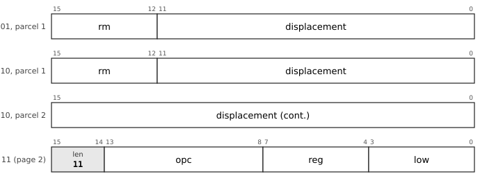

**9.4.2** Instructions are parcel-aligned and little-endian; an instruction may cross any boundary of 8 bytes, a cache line or a page. *(D)*

**9.4.3** Most instructions are two or four bytes: register-to-register work and the whole conversion set is one parcel; any memory operand within ±2 KB is two; displacements to ±128 MB, 32-bit immediates and branches to ±4 GB are three. *(D)*

**9.4.4** Where an addressing mode names no base register (immediate, absolute, PC-relative), the register nibble of the second parcel carries payload, so those modes reach 16 bits at four bytes and 32 bits at six. *(D)*

**9.4.5** A constant wider than 32 bits is loaded from a literal pool with `MOVQ =K, Rd`, written with an explicit `=`; nothing is pooled silently. *(D)*

*Commentary.* **Precedent.** The PDP-11 had the length in the first word, but as a function of both of its six-bit specifiers; UTF-8 made "the leading unit says how long" famous, but what matters here is that length is the *primary* partition, so the payload is budgeted by what each form needs and not carved from a fixed width. **Trade-offs.** Byte-granular encoding, as in x86, buys perhaps a tenth of the code size and costs a full alignment rotator and cross-line splice logic in the fetch path on a 64-bit datapath; the pdp64 refuses it. Forcing an instruction to stay inside an eight-byte window would simplify fetch and would cost 5% to 10% of code size in padding. **Improvements.** The `len` code `11` selects a second page of one-parcel abbreviations; the measured average is near three bytes per instruction. **Benefits.** The front end is a two-bit counter, a two-deep parcel buffer and no feedback. **Modern comparables.** Thumb-2 and RISC-V's compressed instructions mix 16- and 32-bit forms too, with the length read from the low bits. **Impact.** *Kernel:* Page-2 forms make kernel text smaller with no source change. *Compiler:* The assembler picks the shortest form, branch relaxation is a length choice, and the cost model knows only 2, 4 and 6 bytes. *Hardware:* The fetch unit is a two-bit down-counter and a two-deep parcel buffer with no feedback.

## 9.5 Addressing modes

**9.5.1** Four bits select one of eight modes, present at four bytes and longer. *(D)*

| Mode | Syntax | Effect |
|---|---|---|
| `0000` | `d(Rn)` | base plus displacement |
| `0001` | `d(Rn)(Rx*s)` | scaled index, `s` in {1, 2, 4, 8} |
| `0010` | `d(PC)` | PC-relative; the base is the first parcel of the instruction |
| `0011` | `d(DP)` | direct page |
| `0100` | `#imm` | immediate, sign-extended |
| `0101` | `@abs` | absolute, sign-extended |
| `0110` | `(Rn)+d` | post-increment by `d` (default: the operand size) |
| `0111` | `-(Rn)` or `(Rn)-d` | pre-decrement by the operand size, or by `d` |

**9.5.2** The deferred modes of the PDP-11 are removed; indirection is done with `JMPI`, `CALLI` and a load. *(D)*

**9.5.3** At most one register side effect occurs per instruction, and it is committed at retirement; a fault discards it. *(D)*

*Commentary.* **Precedent.** The PDP-11 had eight modes for each of eight registers, with a deferred flavour of each, and it made `*p++` and `*--p` single instructions. **Trade-offs.** Dropping the deferred modes removes the case where a fault occurs after a register has been updated at an address that itself came from a load; keeping the strided autoincrement costs nothing, because the undo information was already a delta (the PDP-11's `MMR1` recorded an amount for the same reason). **Improvements.** The increment is a stride, so walking an array of 16-byte records is one instruction; the PC-relative modes count from the instruction itself, so a branch needs no adjustment and `LEA` reads the PC. **Benefits.** Address generation is one adder pass, never load-then-add, which is the difference between one cycle and a long path on an FPGA. **Modern comparables.** AArch64 has pre- and post-indexed forms with an immediate; x86 has scaled index with a base; RISC-V has base plus immediate only. **Impact.** *Kernel:* A strided autoincrement walks a table of records, and `d(DP)` reaches the per-CPU structure in one instruction. *Compiler:* The modes match C idioms (`*p++`, `a[i]`) one-to-one, and dropping the deferred modes removes the cases the selector would otherwise have to consider. *Hardware:* Address generation is one adder pass, never load-then-add, and the PC-relative base is the first parcel, so no adjustment is needed.

## 9.6 Moves, conversions and address formation

<!-- notation -->
**The instructions.** Every instruction has an entry in the section of its group, laid out as in a processor reference manual: its mnemonics, its syntax, its encoding (the chart of its layout and the list of all its layouts, each with a chart of its own), its operation in pseudocode, the flags it writes, the exceptions it can take, and where the manual explains the matter it touches (*Cf.*). Every instruction, the atomic and the system instructions included, has its official entry below (sections 9.13 and 9.14 for those two groups); the chapters on the kernel and on several processors give the reasons, and an entry may point back to them for a fuller explanation. In the pseudocode, ← is assignment, = and ≠ compare, × and ÷ multiply and divide, and `M[a]` is memory at address `a`. Numbers that are encodings (prefixes, sub-opcodes, field values) are written in binary. Masks are binary too, with a subscript 2 to mark the base (`Rn & 111₂` keeps the low three bits). The layouts are generated from the grammars of the encodings, `spec/pdp64-enc.hbnf` and the grammar of the CPU, so a chart here cannot disagree with the assembler, the linker or the simulator; the words (operation, flags, exceptions) are checked against the reference executor, `common/pdp64exec.c` and `common/pdp64exec_enc.inc`, which `sim64` runs, and the Status line of each entry says whether the executor implements the instruction. The aliases, the constants, the lists of the mnemonics and the bit layouts of every opcode are in the [reference tables](dictionary/index.md).

**The stories.** An instruction that is not common (the PDP-11 core and the operations every architecture has carry none) is followed by *Why it is here*: the machine the idea came from and the reason it was chosen, with the measurements that bear on it. Where no reason is recorded, the paragraph says so. The documents behind the paragraphs are listed in [appendix F](appendix-f-evidence.md).

**Notation.** `Rd` is the destination register, `Rs` the first source, `Rt` the second, `Ru` the third; the assembler writes the destination last, and the operands of a chart are numbered `op1`, `op2`, ... in the order of the assembly syntax. `rm` is a general operand: a register, or a memory operand, an immediate, a pc-relative or an absolute address, by the addressing forms that the layouts of the instruction give (section 9.5). `EA(rm)` is its effective address. `M[a]` is memory, `M8[a]` one byte. `sext` and `zext` sign- and zero-extend. `N Z V C` are the condition flags. In the charts the bits of a parcel are numbered from 15 at the left, a shaded box is a fixed value, and a white box is a field that varies.

**Registers.** pdp64/32 has 32 registers, `R0` to `R31`; the entries that name `R0` to `R15` apply to `R16` to `R31` too, which exist only in this CPU. A register field of an instruction is the full number of bits (5), or fewer where the field names one of the hot registers; the hot-register tables are part of the ABI: the 3-bit fields hold, in order, `R0` `R1` `R8` `R2` `SP` `R3` `R9` `R10`; the 4-bit fields hold, in order, `R0` `R1` `R8` `R2` `SP` `R3` `R9` `R10` `R11` `R4` `R15` `R5` `R24` `R25` `R26` `R6`. `PUSHM` and `POPM` take a 32-bit mask there (errata 87).
<!-- /notation -->

*Cf. section 6.4 for the memory types that decide whether an access is cached, and section 6.8 for what a faulting load leaves behind.*

**9.6.1** `MOVQ`, `MOVL`, `MOVW` and `MOVB` load and store 64, 32, 16 and 8 bits; the loads sign-extend. `MOVZL`, `MOVZW` and `MOVZB` load with zero extension. *(opcodes `000000 (0x00)`-`001010 (0x0A)`)*

**9.6.2** With a register operand, the same opcodes are the conversion set: `MOVB R1, R2` sign-extends the low byte, `MOVZW R1, R2` zero-extends the low word.

**9.6.3** `LEA` forms an effective address; `LEA 0(PC), Rn` reads the program counter. *(opcode `001011 (0x0B)`)*

**9.6.4** Moves, loads and stores write no flags. *(D)*

**9.6.5** The explicit unaligned forms `MOVUB`, `MOVUW`, `MOVUL` and `MOVUQ` exist in both directions, in the memory escape. *(D)*

**9.6.6** Page 2 abbreviates the common cases to one parcel: loads and stores through `(rn)`, loads and stores at small offsets from `SP`, `LEA` from `SP`, and `MOVQ #imm, rd` with a four-bit immediate. *(D)*

*Commentary.* **Precedent.** The PDP-11 had `MOV` and `MOVB` with a byte sign-extended into a register; the VAX had a sized `MOV` for every width. **Trade-offs.** Keeping the sized loads costs four extra opcodes against a quad-only design, but without `MOVL` a struct field load becomes two `MOVW`s, a shift and an or, and ELF, timestamps and most on-disk and wire structures are full of 32- and 16-bit fields. **Improvements.** There is no separate `CVT` group: the conversions are the moves with a register source, so they cost nothing. **Benefits.** No partial-register state anywhere. **Modern comparables.** AArch64 and RISC-V have the same sized loads with sign and zero extension; x86-64 keeps 8- and 16-bit register writes that preserve the upper bits, which makes narrow writes depend on the old value. **Use.** `LEA 0(PC)` is how a position-independent program finds itself; the unaligned forms are for packed on-disk and network structures. **Impact.** *Kernel:* `LEA 0(PC)` lets position-independent kernel code find itself; the unaligned forms read packed on-disk and network structures. *Compiler:* Sized loads avoid the shift, mask and or of a struct-field read, and the conversions are moves, so no separate conversion selection exists. *Hardware:* No partial-register write anywhere; the conversions reuse the load-extend path.

<!-- entries:9.6 -->
### MOV: Move, load and store (64, 32, 16 and 8 bits)

**Mnemonics:** `MOVQ`, `MOVL`, `MOVW`, `MOVB`

**Syntax**

```
MOVQ rm, Rd        ; load
MOVQ Rs, rm        ; store
MOVL, MOVW, MOVB likewise
```

**Encoding**


The chart is the leaf `32-LDF-B28-1`, LDF.B28, prefix `011101`. `op1` is `b5d28s-x1`: memory at base register, 5 bits + signed 28-bit displacement times 1, -134217728 to 134217727 bytes. `op2` is `reg5`: register, 5 bits. `sub` (4 bits) selects the mnemonic: `movq` 0000, `movl` 0001, `movw` 0010, `movb` 0011, `movzl` 0100, `movzw` 0101, `movzb` 0110, `add` 0111, `sub` 1000, `bic` 1001, `bis` 1010, `xor` 1011, `and` 1100, `mul` 1101, `mulh` 1110, `shl` 1111.

**All the layouts of this entry** (a chart for each, with its fields and the sub-opcode of each mnemonic, in [the bit layouts of every opcode](dictionary/by-encoding.md)): [`32-LDF-B28-1`](dictionary/by-encoding.md#32-LDF-B28-1), [`32-LDF-X22-1`](dictionary/by-encoding.md#32-LDF-X22-1), [`32-LDF-PI12-1`](dictionary/by-encoding.md#32-LDF-PI12-1), [`32-LDF-PD12-1`](dictionary/by-encoding.md#32-LDF-PD12-1), [`32-LDF-PC32-1`](dictionary/by-encoding.md#32-LDF-PC32-1), [`32-LDF-A32-1`](dictionary/by-encoding.md#32-LDF-A32-1), [`32-LDFI-I32-1`](dictionary/by-encoding.md#32-LDFI-I32-1), [`32-STF-B28-1`](dictionary/by-encoding.md#32-STF-B28-1), [`32-STF-X22-1`](dictionary/by-encoding.md#32-STF-X22-1), [`32-STF-PI12-1`](dictionary/by-encoding.md#32-STF-PI12-1), [`32-STF-PD12-1`](dictionary/by-encoding.md#32-STF-PD12-1), [`32-STF-PC32-1`](dictionary/by-encoding.md#32-STF-PC32-1), [`32-STF-A32-1`](dictionary/by-encoding.md#32-STF-A32-1), [`32-DPF-D28-1`](dictionary/by-encoding.md#32-DPF-D28-1), [`32-RRF-1`](dictionary/by-encoding.md#32-RRF-1), [`32-RRF5-1`](dictionary/by-encoding.md#32-RRF5-1), [`32-RR5-1`](dictionary/by-encoding.md#32-RR5-1), [`32-STBu6-a-1`](dictionary/by-encoding.md#32-STBu6-a-1), [`32-LDX0-a-1`](dictionary/by-encoding.md#32-LDX0-a-1), [`32-LDPC12H-a-1`](dictionary/by-encoding.md#32-LDPC12H-a-1), [`32-LDI14H-a-1`](dictionary/by-encoding.md#32-LDI14H-a-1), [`32-LDPC14H-a-1`](dictionary/by-encoding.md#32-LDPC14H-a-1), [`32-STBs8H-a-1`](dictionary/by-encoding.md#32-STBs8H-a-1), [`32-LDBu8H-a-1`](dictionary/by-encoding.md#32-LDBu8H-a-1), [`32-LDI16H-a-1`](dictionary/by-encoding.md#32-LDI16H-a-1), [`32-STX0-a-1`](dictionary/by-encoding.md#32-STX0-a-1), [`32-IMMh43-a-1`](dictionary/by-encoding.md#32-IMMh43-a-1), [`32-LDI12-a-1`](dictionary/by-encoding.md#32-LDI12-a-1), [`32-LDPC16H-a-1`](dictionary/by-encoding.md#32-LDPC16H-a-1), [`32-STBu10H-a-1`](dictionary/by-encoding.md#32-STBu10H-a-1), [`32-LDBu10H-a-1`](dictionary/by-encoding.md#32-LDBu10H-a-1), [`32-LDHHH1-a-1`](dictionary/by-encoding.md#32-LDHHH1-a-1), [`32-STHHH1-a-1`](dictionary/by-encoding.md#32-STHHH1-a-1), [`32-LDBs6-a-1`](dictionary/by-encoding.md#32-LDBs6-a-1), [`32-LDSPh4-a-1`](dictionary/by-encoding.md#32-LDSPh4-a-1), [`32-IMMh45-a-1`](dictionary/by-encoding.md#32-IMMh45-a-1), [`32-STSPh4-a-1`](dictionary/by-encoding.md#32-STSPh4-a-1), [`32-LDBu12H-a-1`](dictionary/by-encoding.md#32-LDBu12H-a-1), [`32-STBu12H-a-1`](dictionary/by-encoding.md#32-STBu12H-a-1), [`32-LDHHH3-a-1`](dictionary/by-encoding.md#32-LDHHH3-a-1), [`32-LDPC12-a-1`](dictionary/by-encoding.md#32-LDPC12-a-1), [`32-IMMh47-a-1`](dictionary/by-encoding.md#32-IMMh47-a-1), [`32-LDBu8-a-1`](dictionary/by-encoding.md#32-LDBu8-a-1), [`32-STBs6-a-1`](dictionary/by-encoding.md#32-STBs6-a-1), [`32-LDX6H-a-1`](dictionary/by-encoding.md#32-LDX6H-a-1), [`32-STX6H-a-1`](dictionary/by-encoding.md#32-STX6H-a-1), [`32-LDBs10-a-1`](dictionary/by-encoding.md#32-LDBs10-a-1), [`32-STBs8-a-1`](dictionary/by-encoding.md#32-STBs8-a-1), [`32-LDFI-I32-2`](dictionary/by-encoding.md#32-LDFI-I32-2), [`32-STBu8H-b-1`](dictionary/by-encoding.md#32-STBu8H-b-1), [`32-LDBu6-b-1`](dictionary/by-encoding.md#32-LDBu6-b-1), [`32-STX0-b-1`](dictionary/by-encoding.md#32-STX0-b-1), [`32-STBs6-b-1`](dictionary/by-encoding.md#32-STBs6-b-1), [`32-LDX0-b-1`](dictionary/by-encoding.md#32-LDX0-b-1), [`32-STBu10H-b-1`](dictionary/by-encoding.md#32-STBu10H-b-1), [`32-LDBu8H-b-1`](dictionary/by-encoding.md#32-LDBu8H-b-1), [`32-STHHH1-b-1`](dictionary/by-encoding.md#32-STHHH1-b-1), [`32-STBu12H-b-1`](dictionary/by-encoding.md#32-STBu12H-b-1), [`32-LDPC12H-b-1`](dictionary/by-encoding.md#32-LDPC12H-b-1), [`32-STBs8H-b-1`](dictionary/by-encoding.md#32-STBs8H-b-1), [`32-LDS12H-b-1`](dictionary/by-encoding.md#32-LDS12H-b-1), [`32-STX4H-b-1`](dictionary/by-encoding.md#32-STX4H-b-1), [`32-LDBu12H-b-1`](dictionary/by-encoding.md#32-LDBu12H-b-1), [`32-LDBs6-b-1`](dictionary/by-encoding.md#32-LDBs6-b-1), [`32-STBu6-b-1`](dictionary/by-encoding.md#32-STBu6-b-1), [`32-LDI12-d-2`](dictionary/by-encoding.md#32-LDI12-d-2).

**Operation**

```
size = 8 (MOVQ), 4 (MOVL), 2 (MOVW) or 1 (MOVB) bytes
load :  Rd ← sext(M[EA(rm)], size)          ; len = 00: Rd ← sext(Rs[8×size-1:0])
store:  M[EA(rm)] ← Rs[8×size-1:0]          ; len = 00: Rd ← sext(Rs[8×size-1:0])
```

**Flags** None written.

**Exceptions** Memory operand: page fault, protection fault, alignment fault or bus error (a read of non-existent memory is a precise abort with cause `BUSFAULT`). Every such fault is precise and the instruction restarts after it, because the register update of an auto-increment or auto-decrement mode is held until the instruction retires.

A register is always written in full: a narrow load sign-extends to 64 bits and there is no partial-register write anywhere. The register-to-register forms of the sized moves are the conversion set: `MOVB R1, R2` sign-extends the low byte of `R1` into `R2`.

**Cf.** 6.4 for the memory type that decides whether the access is cached; 6.8 for what a faulting access leaves behind.

**Status** implemented in the reference executor (`common/pdp64exec.c` and `common/pdp64exec_enc.inc`, run by `sim64`; QEMU does not yet execute this encoding).


### MOVZ: Move zero-extended (32, 16 and 8 bits)

**Mnemonics:** `MOVZL`, `MOVZW`, `MOVZB`

**Syntax**

```
MOVZL rm, Rd
MOVZW rm, Rd
MOVZB rm, Rd
```

**Encoding**


The chart is the leaf `32-LDF-B28-1`, LDF.B28, prefix `011101`. `op1` is `b5d28s-x1`: memory at base register, 5 bits + signed 28-bit displacement times 1, -134217728 to 134217727 bytes. `op2` is `reg5`: register, 5 bits. `sub` (4 bits) selects the mnemonic: `movq` 0000, `movl` 0001, `movw` 0010, `movb` 0011, `movzl` 0100, `movzw` 0101, `movzb` 0110, `add` 0111, `sub` 1000, `bic` 1001, `bis` 1010, `xor` 1011, `and` 1100, `mul` 1101, `mulh` 1110, `shl` 1111.

**All the layouts of this entry** (a chart for each, with its fields and the sub-opcode of each mnemonic, in [the bit layouts of every opcode](dictionary/by-encoding.md)): [`32-LDF-B28-1`](dictionary/by-encoding.md#32-LDF-B28-1), [`32-LDF-X22-1`](dictionary/by-encoding.md#32-LDF-X22-1), [`32-LDF-PI12-1`](dictionary/by-encoding.md#32-LDF-PI12-1), [`32-LDF-PD12-1`](dictionary/by-encoding.md#32-LDF-PD12-1), [`32-LDF-PC32-1`](dictionary/by-encoding.md#32-LDF-PC32-1), [`32-LDF-A32-1`](dictionary/by-encoding.md#32-LDF-A32-1), [`32-LDFI-I32-2`](dictionary/by-encoding.md#32-LDFI-I32-2), [`32-DPF-D28-1`](dictionary/by-encoding.md#32-DPF-D28-1), [`32-RRF-1`](dictionary/by-encoding.md#32-RRF-1), [`32-RRF5-1`](dictionary/by-encoding.md#32-RRF5-1), [`32-LDBu6-b-1`](dictionary/by-encoding.md#32-LDBu6-b-1), [`32-LDX0-b-1`](dictionary/by-encoding.md#32-LDX0-b-1), [`32-LDBu8H-b-1`](dictionary/by-encoding.md#32-LDBu8H-b-1), [`32-LDPC12H-b-1`](dictionary/by-encoding.md#32-LDPC12H-b-1), [`32-LDS12H-b-1`](dictionary/by-encoding.md#32-LDS12H-b-1), [`32-LDBu12H-b-1`](dictionary/by-encoding.md#32-LDBu12H-b-1), [`32-LDBs6-b-1`](dictionary/by-encoding.md#32-LDBs6-b-1), [`32-LDFI-I32-3`](dictionary/by-encoding.md#32-LDFI-I32-3), [`32-LDX0-a-1`](dictionary/by-encoding.md#32-LDX0-a-1), [`32-LDPC12H-a-1`](dictionary/by-encoding.md#32-LDPC12H-a-1), [`32-LDPC14H-a-1`](dictionary/by-encoding.md#32-LDPC14H-a-1), [`32-LDBu8H-a-1`](dictionary/by-encoding.md#32-LDBu8H-a-1), [`32-LDPC16H-a-1`](dictionary/by-encoding.md#32-LDPC16H-a-1), [`32-LDBu10H-a-1`](dictionary/by-encoding.md#32-LDBu10H-a-1), [`32-LDHHH1-a-1`](dictionary/by-encoding.md#32-LDHHH1-a-1), [`32-LDBs6-a-1`](dictionary/by-encoding.md#32-LDBs6-a-1), [`32-LDSPh4-a-1`](dictionary/by-encoding.md#32-LDSPh4-a-1), [`32-LDBu12H-a-1`](dictionary/by-encoding.md#32-LDBu12H-a-1), [`32-LDHHH3-a-1`](dictionary/by-encoding.md#32-LDHHH3-a-1), [`32-LDPC12-a-1`](dictionary/by-encoding.md#32-LDPC12-a-1), [`32-LDBu8-a-1`](dictionary/by-encoding.md#32-LDBu8-a-1), [`32-LDX6H-a-1`](dictionary/by-encoding.md#32-LDX6H-a-1), [`32-LDBs10-a-1`](dictionary/by-encoding.md#32-LDBs10-a-1).

**Operation**

```
Rd ← zext(M[EA(rm)], size)      ; len = 00: Rd ← zext(Rs[8×size-1:0])
```

**Flags** None written.

**Exceptions** Memory operand: page fault, protection fault, alignment fault or bus error (a read of non-existent memory is a precise abort with cause `BUSFAULT`). Every such fault is precise and the instruction restarts after it, because the register update of an auto-increment or auto-decrement mode is held until the instruction retires.

There is no zero-extending 64-bit move (it would be `MOVQ`). The register-to-register forms are the zero-extending half of the conversion set.

**Status** implemented in the reference executor (`common/pdp64exec.c` and `common/pdp64exec_enc.inc`, run by `sim64`; QEMU does not yet execute this encoding).


### LEA: Load effective address

**Mnemonics:** `LEA`

**Syntax**

```
LEA d(Rn), Rd
LEA d(PC), Rd
LEA d(Rn)(Rx×s), Rd
```

**Encoding**


The chart is the leaf `32-LDF-B28-2`, LDF.B28, prefix `1010001`. `op1` is `b5d28s-x1`: memory at base register, 5 bits + signed 28-bit displacement times 1, -134217728 to 134217727 bytes. `op2` is `reg5`: register, 5 bits. `sub` (3 bits) selects the mnemonic: `shr` 000, `sar` 001, `fadd` 010, `fsub` 011, `fmul` 100, `bit` 101, `lea` 110, `movub` 111.

**All the layouts of this entry** (a chart for each, with its fields and the sub-opcode of each mnemonic, in [the bit layouts of every opcode](dictionary/by-encoding.md)): [`32-LDF-B28-2`](dictionary/by-encoding.md#32-LDF-B28-2), [`32-LDF-X22-2`](dictionary/by-encoding.md#32-LDF-X22-2), [`32-LDF-PI12-2`](dictionary/by-encoding.md#32-LDF-PI12-2), [`32-LDF-PD12-2`](dictionary/by-encoding.md#32-LDF-PD12-2), [`32-LDF-PC32-2`](dictionary/by-encoding.md#32-LDF-PC32-2), [`32-LDF-A32-2`](dictionary/by-encoding.md#32-LDF-A32-2), [`32-DPF-D28-2`](dictionary/by-encoding.md#32-DPF-D28-2), [`32-LEASx12H-a-1`](dictionary/by-encoding.md#32-LEASx12H-a-1), [`32-LDX0-a-1`](dictionary/by-encoding.md#32-LDX0-a-1), [`32-LDPC12H-a-1`](dictionary/by-encoding.md#32-LDPC12H-a-1), [`32-LDPC14H-a-1`](dictionary/by-encoding.md#32-LDPC14H-a-1), [`32-LDBu8H-a-1`](dictionary/by-encoding.md#32-LDBu8H-a-1), [`32-LDPC16H-a-1`](dictionary/by-encoding.md#32-LDPC16H-a-1), [`32-LDBu10H-a-1`](dictionary/by-encoding.md#32-LDBu10H-a-1), [`32-LDHHH1-a-1`](dictionary/by-encoding.md#32-LDHHH1-a-1), [`32-LEASPh4-a-1`](dictionary/by-encoding.md#32-LEASPh4-a-1), [`32-LDBs6-a-1`](dictionary/by-encoding.md#32-LDBs6-a-1), [`32-LEAS12H-a-1`](dictionary/by-encoding.md#32-LEAS12H-a-1), [`32-LDSPh4-a-1`](dictionary/by-encoding.md#32-LDSPh4-a-1), [`32-LDBu12H-a-1`](dictionary/by-encoding.md#32-LDBu12H-a-1), [`32-LDHHH3-a-1`](dictionary/by-encoding.md#32-LDHHH3-a-1), [`32-LDPC12-a-1`](dictionary/by-encoding.md#32-LDPC12-a-1), [`32-LDBu8-a-1`](dictionary/by-encoding.md#32-LDBu8-a-1), [`32-LDX6H-a-1`](dictionary/by-encoding.md#32-LDX6H-a-1), [`32-LDBs10-a-1`](dictionary/by-encoding.md#32-LDBs10-a-1), [`32-LEAS14H-a-1`](dictionary/by-encoding.md#32-LEAS14H-a-1).

**Operation**

```
Rd ← EA(rm)          ; no memory access
```

**Flags** None written.

**Exceptions** The operand must name memory (a register or an immediate is not a form). No memory access is made, so the instruction takes no memory fault. A reserved encoding aborts with the illegal-instruction vector.

`LEA 0(PC), Rd` is how the program counter is read: it puts the address of the `LEA` itself in `Rd`. The base of every PC-relative displacement is the address of the first parcel of the instruction.

**Why it is here.** The PDP-11 and the VAX made the program counter a register (R7, R15). Here the program counter is kept out of the register file, because every register write would then be a potential branch, and a read-only view of it (R7 as a view of the PC) is refused, because it would fix for ever *which* PC is meant (ARM32 is stuck with `PC+8`). `LEA 0(PC), Rn` gives the capability without the commitment: the address of the instruction itself, in one instruction. The same instruction forms any address PC-relatively, which is what makes position-independent code free (section 9.16).

**Status** implemented in the reference executor (`common/pdp64exec.c` and `common/pdp64exec_enc.inc`, run by `sim64`; QEMU does not yet execute this encoding).


### MOVU: Unaligned load and store

**Mnemonics:** `MOVUB`, `MOVUW`, `MOVUL`, `MOVUQ`

**Syntax**

```
MOVUQ rm, Rd        ; load, any alignment
MOVUQ Rs, rm        ; store, any alignment
MOVUW, MOVUL, MOVUB likewise
```

**Encoding**


The chart is the leaf `32-LDF-B28-2`, LDF.B28, prefix `1010001`. `op1` is `b5d28s-x1`: memory at base register, 5 bits + signed 28-bit displacement times 1, -134217728 to 134217727 bytes. `op2` is `reg5`: register, 5 bits. `sub` (3 bits) selects the mnemonic: `shr` 000, `sar` 001, `fadd` 010, `fsub` 011, `fmul` 100, `bit` 101, `lea` 110, `movub` 111.

**All the layouts of this entry** (a chart for each, with its fields and the sub-opcode of each mnemonic, in [the bit layouts of every opcode](dictionary/by-encoding.md)): [`32-LDF-B28-2`](dictionary/by-encoding.md#32-LDF-B28-2), [`32-LDF-X22-2`](dictionary/by-encoding.md#32-LDF-X22-2), [`32-LDF-PI12-2`](dictionary/by-encoding.md#32-LDF-PI12-2), [`32-LDF-PD12-2`](dictionary/by-encoding.md#32-LDF-PD12-2), [`32-LDF-PC32-2`](dictionary/by-encoding.md#32-LDF-PC32-2), [`32-LDF-A32-2`](dictionary/by-encoding.md#32-LDF-A32-2), [`32-STF-B28-1`](dictionary/by-encoding.md#32-STF-B28-1), [`32-STF-X22-1`](dictionary/by-encoding.md#32-STF-X22-1), [`32-STF-PI12-1`](dictionary/by-encoding.md#32-STF-PI12-1), [`32-STF-PD12-1`](dictionary/by-encoding.md#32-STF-PD12-1), [`32-STF-PC32-1`](dictionary/by-encoding.md#32-STF-PC32-1), [`32-STF-A32-1`](dictionary/by-encoding.md#32-STF-A32-1), [`32-DPF-D28-2`](dictionary/by-encoding.md#32-DPF-D28-2), [`32-LDF-B28-3`](dictionary/by-encoding.md#32-LDF-B28-3), [`32-LDF-X22-3`](dictionary/by-encoding.md#32-LDF-X22-3), [`32-LDF-PI12-3`](dictionary/by-encoding.md#32-LDF-PI12-3), [`32-LDF-PD12-3`](dictionary/by-encoding.md#32-LDF-PD12-3), [`32-LDF-PC32-3`](dictionary/by-encoding.md#32-LDF-PC32-3), [`32-LDF-A32-3`](dictionary/by-encoding.md#32-LDF-A32-3), [`32-DPF-D28-3`](dictionary/by-encoding.md#32-DPF-D28-3), [`32-LDF-B28-4`](dictionary/by-encoding.md#32-LDF-B28-4), [`32-LDF-X22-4`](dictionary/by-encoding.md#32-LDF-X22-4), [`32-LDF-PI12-4`](dictionary/by-encoding.md#32-LDF-PI12-4), [`32-LDF-PD12-4`](dictionary/by-encoding.md#32-LDF-PD12-4), [`32-LDF-PC32-4`](dictionary/by-encoding.md#32-LDF-PC32-4), [`32-LDF-A32-4`](dictionary/by-encoding.md#32-LDF-A32-4), [`32-DPF-D28-4`](dictionary/by-encoding.md#32-DPF-D28-4).

**Operation**

```
size = 1, 2, 4 or 8 bytes
load :  Rd ← sext(M[EA(rm)], size)            ; the access may cross an alignment boundary
store:  M[EA(rm)] ← Rs[8×size-1:0]
```

**Flags** None written.

**Exceptions** Page and protection faults and bus errors as for any memory operand; **no alignment fault**.

The ordinary moves fault on a misaligned address (the alignment fault is the tag check of section 9.5); these are the explicit forms for data that is not aligned.

**Why it is here.** Data alignment is architectural on this machine (9.2.11): an ordinary quad access to an address that is not a multiple of 8 aborts, and that abort doubles as the tag check for tagged pointers; a load form that ignores low pointer bits is rejected for that reason. No further reason is recorded for these four.

**Cf.** 6.4, 6.8.

**Status** implemented in the reference executor (`common/pdp64exec.c` and `common/pdp64exec_enc.inc`, run by `sim64`; QEMU does not yet execute this encoding).


### MOV2: Two register moves

**Mnemonics:** `MOV2`

**Syntax**

```
MOV2 Ra, Rb, Rc, Rd
```

**Encoding**


The chart is the leaf `32-FX-MOV2-1`, FX.MOV2, prefix `0011`. `op1` is `reg3`: register, 3 bits (an index into the hot-register table). `op2` is `reg3`: register, 3 bits (an index into the hot-register table). `op3` is `reg3`: register, 3 bits (an index into the hot-register table). `op4` is `reg3`: register, 3 bits (an index into the hot-register table).

**All the layouts of this entry** (a chart for each, with its fields and the sub-opcode of each mnemonic, in [the bit layouts of every opcode](dictionary/by-encoding.md)): [`32-FX-MOV2-1`](dictionary/by-encoding.md#32-FX-MOV2-1).

**Operation**

```
Rb ← Ra
Rd ← Rc           ; in this order
```

**Flags** None written.

**Exceptions** None.

*(D)* `MOVQ Ra, Rb` followed by `MOVQ Rc, Rd`, fused (errata 87). The four operands are 3-bit fields: only the eight hot registers (`R0 R1 R8 R2 SP R3 R9 R10`, the ABI table of the encoding) can be named, and the instruction takes one sixteenth of the first-parcel space, which is why the pdp64/16 and pdp64/32 grammars give it a prefix of four bits. If `Rb` is `Rc` the second move reads the new value, as two instructions would.

**Why it is here.** The author decided the four fused pairs in errata 87 (`movcall`, `popmret`, `popret`, `mov2`) and left the fusing to the compiler: the assembler never fuses. The reason is the measurement of `docs/encoding-proposal.md` section 8 (static size of the training corpus, in pdp64/16 and pdp64/32): `MOVQ Ra, Rb` followed by `MOVQ Rc, Rd` occurs 6,742 times and saves 0.61% (pdp64/16) and 0.50% (pdp64/32), the smallest gain of the four and the dearest in code space: four 3-bit register fields use one sixteenth of the first-parcel space and can name only the eight hot registers. The proposal lists both as costs, and one instruction that writes two registers (the rename width of an out-of-order core).

**Cf.** Appendix D (the hot-register tables).

**Status** implemented in the reference executor (`common/pdp64exec.c` and `common/pdp64exec_enc.inc`, run by `sim64`; QEMU does not yet execute this encoding).


### MOVQL: Move a 64-bit literal

**Mnemonics:** `MOVQL`

**Syntax**

```
MOVQL #imm64, Rd
```

**Encoding**

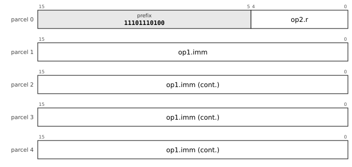

The chart is the leaf `32-MOVQL-1`, MOVQL, prefix `11101110100`. `op1` is `imm64s`: signed 64-bit immediate, -9223372036854775808 to 9223372036854775807. `op2` is `reg5`: register, 5 bits.

**All the layouts of this entry** (a chart for each, with its fields and the sub-opcode of each mnemonic, in [the bit layouts of every opcode](dictionary/by-encoding.md)): [`32-MOVQL-1`](dictionary/by-encoding.md#32-MOVQL-1).

**Operation**

```
Rd ← imm64
```

**Flags** None written.

**Exceptions** None.

*(D)* Errata 85: `MOVQL #imm64, Rd` is accepted, and breaking the three-parcel rule for it is acceptable because a 64-bit literal is not counted as part of the instruction. The instruction is five parcels, ten bytes: the literal is inside the instruction, so the length is still known from parcel 0 and the fetch has no exception for a trailing literal (`docs/encoding-proposal.md` section 3). The assembler uses it for a `MOVQ #imm, Rd` that fits no `MOVQ` form (errata 87, assumption 6).

**Why it is here.** The author accepted it in the second round of security answers (errata 85, proposal P18): "we can do the same trick for 32 bit immediates too", the author added, which the grammars have not taken up. A 64-bit constant otherwise comes from the literal pool; the literal inside the instruction is one instruction, and it is not counted against the three-parcel rule because it is data, not instruction. The encoding work found no use of a trailing literal worth its exception to the fetch rule, so the literal is part of a five-parcel instruction (`docs/encoding-proposal.md` section 3).

**Status** implemented in the reference executor (`common/pdp64exec.c` and `common/pdp64exec_enc.inc`, run by `sim64`; QEMU does not yet execute this encoding).


### MOVD: Deferred-fault load

**Mnemonics:** `MOVQ.D`, `MOVL.D`, `MOVW.D`, `MOVB.D`, `MOVZL.D`, `MOVZW.D`, `MOVZB.D`

**Syntax**

```
MOVQ.D d(Rn), Rd
MOVL.D ..., MOVW.D ..., MOVB.D ...
MOVZL.D ..., MOVZW.D ..., MOVZB.D ...
```

**Encoding**

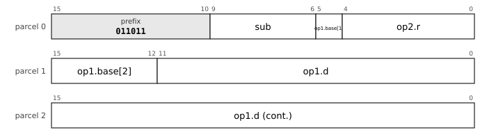

The chart is the leaf `32-LDU-B28-1`, LDU.B28, prefix `011011`. `op1` is `b5d28s-x1`: memory at base register, 5 bits + signed 28-bit displacement times 1, -134217728 to 134217727 bytes. `op2` is `reg5`: register, 5 bits. `sub` (4 bits) selects the mnemonic: `movq.u` 0000, `movl.u` 0001, `movw.u` 0010, `movb.u` 0011, `movzl.u` 0100, `movzw.u` 0101, `movzb.u` 0110, `movq.d` 0111, `movl.d` 1000, `movw.d` 1001, `movb.d` 1010, `movzl.d` 1011, `movzw.d` 1100, `movzb.d` 1101, `movq.ud` 1110, `movl.ud` 1111.

**All the layouts of this entry** (a chart for each, with its fields and the sub-opcode of each mnemonic, in [the bit layouts of every opcode](dictionary/by-encoding.md)): [`32-LDU-B28-1`](dictionary/by-encoding.md#32-LDU-B28-1), [`32-LDU-B12-1`](dictionary/by-encoding.md#32-LDU-B12-1), [`32-LDU-X6-1`](dictionary/by-encoding.md#32-LDU-X6-1).

**Operation**

```
Rd ← M[EA]                     ; as the load without .D, when the access succeeds
when the access faults: the fault is precise as always; the kernel's handler repairs the cause and restarts,
    or, if the access is invalid, marks Rd as poisoned in the saved state and goes on at the next instruction
```

**Flags** None written.

**Exceptions** The ordinary faults of a load (page fault, protection fault, alignment fault, bus error), precise; what the handler does with them is the difference.

*(P)* The deferred-fault load is item 10 of `docs/study-proposals.md` (the poison bit); the author accepted its three leanings (errata 86: the fault is taken at the instruction that writes the flags from a poisoned source; the kernel decides a deferred load's fault; the kernel dispatcher, not the hardware, tests the argument registers for poison), but the poison bit itself is a proposal, so the semantics above are *(P)*. The proposal spells the load `MOVQ.S`; the grammars spell it `.D`. Base and indexed operands only (a mode that needs a base register needs `LEA` first). **Not implemented** in the reference executor: it traps as an unimplemented instruction.

**Why it is here.** The poison bit of item 10 of the study (`docs/study-proposals.md`) wants a load that can be hoisted above its guard: it either gives a value or a poisoned value, and a use of a poisoned value is the fault the guard would have prevented. That removes the recovery code of if-conversion and software pipelining, gives a deterministic Spectre version 1 form (a deferred, bounds-checked address computation yields poison, not a branch the predictor can train), and makes a chain of checks one fault. The author accepted the three leanings of the proposal (errata 86); the record does not show the author deciding the poison bit itself, so the instruction is a proposal.

**Cf.** 6.2, docs/study-proposals.md item 10.

**Status** specified; **not yet implemented** in the reference executor.


### MOVUSER: User-qualified load and store

**Mnemonics:** `MOVQ.U`, `MOVL.U`, `MOVW.U`, `MOVB.U`, `MOVZL.U`, `MOVZW.U`, `MOVZB.U`

**Syntax**

```
MOVQ.U d(Rn), Rd
MOVQ.U Rs, d(Rn)
MOVL.U ..., MOVW.U ..., MOVB.U ...
MOVZL.U ..., MOVZW.U ..., MOVZB.U ...    ; loads only
```

**Encoding**


The chart is the leaf `32-LDU-B28-1`, LDU.B28, prefix `011011`. `op1` is `b5d28s-x1`: memory at base register, 5 bits + signed 28-bit displacement times 1, -134217728 to 134217727 bytes. `op2` is `reg5`: register, 5 bits. `sub` (4 bits) selects the mnemonic: `movq.u` 0000, `movl.u` 0001, `movw.u` 0010, `movb.u` 0011, `movzl.u` 0100, `movzw.u` 0101, `movzb.u` 0110, `movq.d` 0111, `movl.d` 1000, `movw.d` 1001, `movb.d` 1010, `movzl.d` 1011, `movzw.d` 1100, `movzb.d` 1101, `movq.ud` 1110, `movl.ud` 1111.

**All the layouts of this entry** (a chart for each, with its fields and the sub-opcode of each mnemonic, in [the bit layouts of every opcode](dictionary/by-encoding.md)): [`32-LDU-B28-1`](dictionary/by-encoding.md#32-LDU-B28-1), [`32-STU-B28-1`](dictionary/by-encoding.md#32-STU-B28-1), [`32-LDU-B12-1`](dictionary/by-encoding.md#32-LDU-B12-1), [`32-STU-B12-1`](dictionary/by-encoding.md#32-STU-B12-1), [`32-LDU-X6-1`](dictionary/by-encoding.md#32-LDU-X6-1), [`32-STU-X6-1`](dictionary/by-encoding.md#32-STU-X6-1).

**Operation**

```
the access of MOVQ, MOVL, MOVW, MOVB and MOVZ* with the operand checked as a user-mode access:
the page must be present, have U = 1, and permit R (a load) or W (a store); a kernel page takes the protection abort
whatever PSW.UA says
```

**Flags** None written.

**Exceptions** The faults of the access, as a user-mode access. In user mode the encoding is a privileged-instruction abort.

*(P)* Item 18 of `docs/study-proposals.md`: user access is an attribute of one memory operand, so it cannot outlive the instruction, cannot leak across an interrupt, and `RTI` re-executes the instruction with the attribute. The author accepted the five leanings (errata 86): a fixup table in place of `pcb_onfault`, the `.U` spelling, keeping `PSW.UA`, `STUA` and `CLUA` until the OpenBSD port confirms, `ECAUSE` bit 15 to say that the access was user-qualified, and the atomics taking the user form once the operand placement of `ATOM` is fixed. The proposal is not specified in full, so the text is *(P)*. (Not to be confused with `MOVU`, the unaligned move.) The reference executor runs a `.U` move as a plain move, because it has no MMU in that mode.

**Why it is here.** Copying between the kernel and the user is where kernels pay for the user-memory guard. x86 opens a window with `STAC` and closes it with `CLAC` (35 and 53 sites in the kernel-assembly corpus), and a forgotten `CLAC` on an error path is the bug class; Arm's `LDTR` and `STTR` make the access itself unprivileged (52 sites), but only for plain loads and stores. Item 18 of the study makes user access an attribute of one operand, so that no window exists to leave open and the range check of the copy routines (`addr + len` against the top of the user half) disappears into the hardware: a kernel address faults at the first byte. The author accepted its five leanings (errata 86) and kept `PSW.UA`, `STUA` and `CLUA` until the OpenBSD port confirms; the instruction is a proposal until then.

**Cf.** 6.4 (the user-memory guard), docs/study-proposals.md item 18.

**Status** implemented in the reference executor (`common/pdp64exec.c` and `common/pdp64exec_enc.inc`, run by `sim64`; QEMU does not yet execute this encoding).


### MOVUSERD: User-qualified deferred-fault load

**Mnemonics:** `MOVQ.UD`, `MOVL.UD`, `MOVW.UD`, `MOVB.UD`, `MOVZL.UD`, `MOVZW.UD`, `MOVZB.UD`

**Syntax**

```
MOVQ.UD d(Rn), Rd
MOVL.UD ..., MOVW.UD ..., MOVB.UD ...
MOVZL.UD ..., MOVZW.UD ..., MOVZB.UD ...
```

**Encoding**


The chart is the leaf `32-LDU-B28-1`, LDU.B28, prefix `011011`. `op1` is `b5d28s-x1`: memory at base register, 5 bits + signed 28-bit displacement times 1, -134217728 to 134217727 bytes. `op2` is `reg5`: register, 5 bits. `sub` (4 bits) selects the mnemonic: `movq.u` 0000, `movl.u` 0001, `movw.u` 0010, `movb.u` 0011, `movzl.u` 0100, `movzw.u` 0101, `movzb.u` 0110, `movq.d` 0111, `movl.d` 1000, `movw.d` 1001, `movb.d` 1010, `movzl.d` 1011, `movzw.d` 1100, `movzb.d` 1101, `movq.ud` 1110, `movl.ud` 1111.

**All the layouts of this entry** (a chart for each, with its fields and the sub-opcode of each mnemonic, in [the bit layouts of every opcode](dictionary/by-encoding.md)): [`32-LDU-B28-1`](dictionary/by-encoding.md#32-LDU-B28-1), [`32-LDU-B12-1`](dictionary/by-encoding.md#32-LDU-B12-1), [`32-LDU-X6-1`](dictionary/by-encoding.md#32-LDU-X6-1), [`32-LDU-B28-2`](dictionary/by-encoding.md#32-LDU-B28-2), [`32-LDU-B12-2`](dictionary/by-encoding.md#32-LDU-B12-2), [`32-LDU-X6-2`](dictionary/by-encoding.md#32-LDU-X6-2), [`32-LDU-B28-3`](dictionary/by-encoding.md#32-LDU-B28-3), [`32-LDU-B12-3`](dictionary/by-encoding.md#32-LDU-B12-3), [`32-LDU-X6-3`](dictionary/by-encoding.md#32-LDU-X6-3).

**Operation**

```
Rd ← M[EA], the access being both user-qualified (MOVU) and deferred (MOVD)
```

**Flags** None written.

**Exceptions** The faults of `MOVU` and `MOVD` together.

*(P)* The combination of the two qualifiers. The repository defines each qualifier alone (items 10 and 18 of `docs/study-proposals.md`) and gives the combination no text of its own: a kernel that reads a user word without wanting to fail on it (a probe of a user pointer) is the case the combination serves, and its meaning is the composition. Loads only, base and indexed operands. **Not implemented** in the reference executor.

**Why it is here.** See `MOVD` and `MOVUSER`. The record gives no separate reason for the combination; it is listed because both qualifiers exist and a probe of a user pointer wants both.

**Status** specified; **not yet implemented** in the reference executor.
<!-- /entries:9.6 -->

## 9.7 Integer arithmetic

*Cf. section 6.2 for the divide-by-zero vector (`DIV`, `DIVU`, `MOD`, `MODU`).*

**9.7.1** `ADD`, `SUB`, `CMP`, `MUL` and `MULH` are two bytes with register operands; `MULHU` (high half of an unsigned product), `DIV`, `DIVU`, `MOD` and `MODU` are in the arithmetic escape. *(D)*

**9.7.2** `CMP` is written `CMP Rd, rm`, register first, and computes `Rd - rm`. *(D)*

**9.7.3** `ADD` sets `C` on a carry; `SUB` and `CMP` set `C` on a borrow, the PDP-11 sense, so `BHIS` and `BCC` mean "no borrow", unsigned greater or equal. *(D)*

**9.7.4** `ADC` and `SBC` add and subtract the carry; `INC`, `DEC`, `NEG`, `CLR` and `TST` are single-operand forms that work on a register or memory. *(opcode group `SOP`)*

**9.7.5** `ABS`, `MIN`, `MAX`, `MINU` and `MAXU`, and `SET cc, Rd` (write 1 if the condition holds, else 0), are in the arithmetic escape. *(D)*

*Commentary.* **Precedent.** `ADD`, `SUB`, `CMP`, `BIT`, `BIS`, `BIC` and the single-operand set are the PDP-11's, unchanged in name and meaning except for the order of `CMP`'s operands. **Trade-offs.** The PDP-11 wrote `CMP a, b` to compute `a - b`; since the destination of an ALU operation here must be a register, a literal `src, dst` reading would force every comparison against an immediate or memory to be reversed, so the register comes first. Divide is in the escape group, at four bytes, because compilers turn division by a constant into `MULH` plus a shift, so a real divide is rare. **Improvements.** The high-half multiply that bignum code needs is present; a second unsigned multiply is the same instruction as the first and is not provided. **Benefits.** `SET` replaces a branch around a move for the very common "store the truth value of a comparison", and absolute value, minimum and maximum remove a compare-and-branch from small loops. **Modern comparables.** RISC-V has `MULH`, `MULHU` and `MULHSU`, and AArch64 `SMULH` and `UMULH`; x86 has a one-operand multiply that produces both halves; AArch64's conditional select and set instructions are the nearest to `SET`. **Use.** `MULH` and `MULHU` are for multi-precision arithmetic and for division by constants; `ADC` and `SBC` carry a multi-word add or subtract; `MIN`, `MAX` and `ABS` appear under a tenth of a percent of compiled code but each replaces a branch. **Impact.** *Kernel:* `ADC` and `SBC` carry multiword arithmetic for the kernel's 128-bit counters and for the bignum code in the base system. *Compiler:* `MULH` turns division by a constant into a multiply and a shift; `SET` materialises a comparison without a branch; `CMP` takes the register first, as the compiler orders its operands. *Hardware:* One adder on the carry chain; on an FPGA the multiplier is built from two to four multiplier blocks over four to eight cycles; the divide is a sequencer.

<!-- entries:9.7 -->
### ADD: Add

**Mnemonics:** `ADD`

**Syntax**

```
ADD rm, Rd
```

**Encoding**


The chart is the leaf `32-LDF-B28-1`, LDF.B28, prefix `011101`. `op1` is `b5d28s-x1`: memory at base register, 5 bits + signed 28-bit displacement times 1, -134217728 to 134217727 bytes. `op2` is `reg5`: register, 5 bits. `sub` (4 bits) selects the mnemonic: `movq` 0000, `movl` 0001, `movw` 0010, `movb` 0011, `movzl` 0100, `movzw` 0101, `movzb` 0110, `add` 0111, `sub` 1000, `bic` 1001, `bis` 1010, `xor` 1011, `and` 1100, `mul` 1101, `mulh` 1110, `shl` 1111.

**All the layouts of this entry** (a chart for each, with its fields and the sub-opcode of each mnemonic, in [the bit layouts of every opcode](dictionary/by-encoding.md)): [`32-LDF-B28-1`](dictionary/by-encoding.md#32-LDF-B28-1), [`32-LDF-X22-1`](dictionary/by-encoding.md#32-LDF-X22-1), [`32-LDF-PI12-1`](dictionary/by-encoding.md#32-LDF-PI12-1), [`32-LDF-PD12-1`](dictionary/by-encoding.md#32-LDF-PD12-1), [`32-LDF-PC32-1`](dictionary/by-encoding.md#32-LDF-PC32-1), [`32-LDF-A32-1`](dictionary/by-encoding.md#32-LDF-A32-1), [`32-LDFI-I32-1`](dictionary/by-encoding.md#32-LDFI-I32-1), [`32-DPF-D28-1`](dictionary/by-encoding.md#32-DPF-D28-1), [`32-RRF-1`](dictionary/by-encoding.md#32-RRF-1), [`32-RRF5-1`](dictionary/by-encoding.md#32-RRF5-1), [`32-SPADJF-1`](dictionary/by-encoding.md#32-SPADJF-1), [`32-RR5-1`](dictionary/by-encoding.md#32-RR5-1), [`32-LDI12H-b-1`](dictionary/by-encoding.md#32-LDI12H-b-1), [`32-LDBu6-c-1`](dictionary/by-encoding.md#32-LDBu6-c-1), [`32-SPADJ6-a-1`](dictionary/by-encoding.md#32-SPADJ6-a-1), [`32-LDBu8H-c-1`](dictionary/by-encoding.md#32-LDBu8H-c-1), [`32-LDI14H-b-1`](dictionary/by-encoding.md#32-LDI14H-b-1), [`32-LDS12H-c-1`](dictionary/by-encoding.md#32-LDS12H-c-1), [`32-IMMh43-b-1`](dictionary/by-encoding.md#32-IMMh43-b-1), [`32-LDI18H-b-1`](dictionary/by-encoding.md#32-LDI18H-b-1), [`32-LDI12-b-1`](dictionary/by-encoding.md#32-LDI12-b-1), [`32-LDX0-c-1`](dictionary/by-encoding.md#32-LDX0-c-1), [`32-LDPC16H-c-1`](dictionary/by-encoding.md#32-LDPC16H-c-1), [`32-LDBu8-c-1`](dictionary/by-encoding.md#32-LDBu8-c-1).

**Operation**

```
Rd ← Rd + rm
```

**Flags** `N` and `Z` from the result, `V` set on signed overflow, `C` set on a carry out of bit 63.

**Exceptions** Memory operand: page fault, protection fault, alignment fault or bus error (a read of non-existent memory is a precise abort with cause `BUSFAULT`). Every such fault is precise and the instruction restarts after it, because the register update of an auto-increment or auto-decrement mode is held until the instruction retires.

All ALU operations are 64 bits, with no size field.

**Status** implemented in the reference executor (`common/pdp64exec.c` and `common/pdp64exec_enc.inc`, run by `sim64`; QEMU does not yet execute this encoding).


### SUB: Subtract

**Mnemonics:** `SUB`

**Syntax**

```
SUB rm, Rd
```

**Encoding**


The chart is the leaf `32-LDF-B28-1`, LDF.B28, prefix `011101`. `op1` is `b5d28s-x1`: memory at base register, 5 bits + signed 28-bit displacement times 1, -134217728 to 134217727 bytes. `op2` is `reg5`: register, 5 bits. `sub` (4 bits) selects the mnemonic: `movq` 0000, `movl` 0001, `movw` 0010, `movb` 0011, `movzl` 0100, `movzw` 0101, `movzb` 0110, `add` 0111, `sub` 1000, `bic` 1001, `bis` 1010, `xor` 1011, `and` 1100, `mul` 1101, `mulh` 1110, `shl` 1111.

**All the layouts of this entry** (a chart for each, with its fields and the sub-opcode of each mnemonic, in [the bit layouts of every opcode](dictionary/by-encoding.md)): [`32-LDF-B28-1`](dictionary/by-encoding.md#32-LDF-B28-1), [`32-LDF-X22-1`](dictionary/by-encoding.md#32-LDF-X22-1), [`32-LDF-PI12-1`](dictionary/by-encoding.md#32-LDF-PI12-1), [`32-LDF-PD12-1`](dictionary/by-encoding.md#32-LDF-PD12-1), [`32-LDF-PC32-1`](dictionary/by-encoding.md#32-LDF-PC32-1), [`32-LDF-A32-1`](dictionary/by-encoding.md#32-LDF-A32-1), [`32-LDFI-I32-1`](dictionary/by-encoding.md#32-LDFI-I32-1), [`32-DPF-D28-1`](dictionary/by-encoding.md#32-DPF-D28-1), [`32-RRF-1`](dictionary/by-encoding.md#32-RRF-1), [`32-RRF5-1`](dictionary/by-encoding.md#32-RRF5-1), [`32-SPADJF-1`](dictionary/by-encoding.md#32-SPADJF-1), [`32-RR5-1`](dictionary/by-encoding.md#32-RR5-1), [`32-LDI12H-b-1`](dictionary/by-encoding.md#32-LDI12H-b-1), [`32-LDBu6-c-1`](dictionary/by-encoding.md#32-LDBu6-c-1), [`32-SPADJ6-a-1`](dictionary/by-encoding.md#32-SPADJ6-a-1), [`32-LDBu8H-c-1`](dictionary/by-encoding.md#32-LDBu8H-c-1), [`32-LDI14H-b-1`](dictionary/by-encoding.md#32-LDI14H-b-1), [`32-LDS12H-c-1`](dictionary/by-encoding.md#32-LDS12H-c-1), [`32-IMMh43-b-1`](dictionary/by-encoding.md#32-IMMh43-b-1), [`32-LDI18H-b-1`](dictionary/by-encoding.md#32-LDI18H-b-1), [`32-LDI12-b-1`](dictionary/by-encoding.md#32-LDI12-b-1), [`32-LDX0-c-1`](dictionary/by-encoding.md#32-LDX0-c-1), [`32-LDPC16H-c-1`](dictionary/by-encoding.md#32-LDPC16H-c-1), [`32-LDBu8-c-1`](dictionary/by-encoding.md#32-LDBu8-c-1).

**Operation**

```
Rd ← Rd - rm
```

**Flags** `N` and `Z` from the result, `V` set on signed overflow, `C` set on a **borrow** (the PDP-11 sense): `C` = 1 when the unsigned operand being subtracted is the larger.

**Exceptions** Memory operand: page fault, protection fault, alignment fault or bus error (a read of non-existent memory is a precise abort with cause `BUSFAULT`). Every such fault is precise and the instruction restarts after it, because the register update of an auto-increment or auto-decrement mode is held until the instruction retires.

**Status** implemented in the reference executor (`common/pdp64exec.c` and `common/pdp64exec_enc.inc`, run by `sim64`; QEMU does not yet execute this encoding).


### CMP: Compare

**Mnemonics:** `CMP`

**Syntax**

```
CMP Rd, rm        ; register first
```

**Encoding**


The chart is the leaf `32-CMF-B28-1`, CMF.B28, prefix `111000000`. `op1` is `reg5`: register, 5 bits. `op2` is `b5d28s-x1`: memory at base register, 5 bits + signed 28-bit displacement times 1, -134217728 to 134217727 bytes. `sub` (1 bit) selects the mnemonic: `cmp` 0, `fcmp` 1.

**All the layouts of this entry** (a chart for each, with its fields and the sub-opcode of each mnemonic, in [the bit layouts of every opcode](dictionary/by-encoding.md)): [`32-CMF-B28-1`](dictionary/by-encoding.md#32-CMF-B28-1), [`32-CMF-X22-1`](dictionary/by-encoding.md#32-CMF-X22-1), [`32-CMF-PI12-1`](dictionary/by-encoding.md#32-CMF-PI12-1), [`32-CMF-PD12-1`](dictionary/by-encoding.md#32-CMF-PD12-1), [`32-CMF-PC32-1`](dictionary/by-encoding.md#32-CMF-PC32-1), [`32-CMF-A32-1`](dictionary/by-encoding.md#32-CMF-A32-1), [`32-CMF-I32-1`](dictionary/by-encoding.md#32-CMF-I32-1), [`32-RRF-2`](dictionary/by-encoding.md#32-RRF-2), [`32-RRF5-1`](dictionary/by-encoding.md#32-RRF5-1), [`32-CMBu8H-a-1`](dictionary/by-encoding.md#32-CMBu8H-a-1), [`32-CMI12H-a-1`](dictionary/by-encoding.md#32-CMI12H-a-1), [`32-CMBu10H-a-1`](dictionary/by-encoding.md#32-CMBu10H-a-1), [`32-CMBu6-a-1`](dictionary/by-encoding.md#32-CMBu6-a-1), [`32-CMBu8-a-1`](dictionary/by-encoding.md#32-CMBu8-a-1), [`32-CMPC16H-a-1`](dictionary/by-encoding.md#32-CMPC16H-a-1), [`32-CMI18H-a-1`](dictionary/by-encoding.md#32-CMI18H-a-1), [`32-CMS12H-a-1`](dictionary/by-encoding.md#32-CMS12H-a-1), [`32-CMX0-a-1`](dictionary/by-encoding.md#32-CMX0-a-1), [`32-CMI12-a-1`](dictionary/by-encoding.md#32-CMI12-a-1).

**Operation**

```
tmp ← Rd - rm         ; the result is discarded
```

**Flags** `N` and `Z` from the result, `V` set on signed overflow, `C` set on a **borrow** (the PDP-11 sense): `C` = 1 when the unsigned operand being subtracted is the larger.

**Exceptions** Memory operand: page fault, protection fault, alignment fault or bus error (a read of non-existent memory is a precise abort with cause `BUSFAULT`). Every such fault is precise and the instruction restarts after it, because the register update of an auto-increment or auto-decrement mode is held until the instruction retires.

**The operands are in the order register, then the other operand**, the reverse of the PDP-11 `CMP src,dst`: `CMP Rd, rm` computes `Rd - rm`, so a compare of a register against an immediate or memory operand does not reverse its branch condition. After `CMP`, `BHIS`/`BCC` mean unsigned `>=` (no borrow) and `BLO`/`BCS` mean a borrow occurred.

**Status** implemented in the reference executor (`common/pdp64exec.c` and `common/pdp64exec_enc.inc`, run by `sim64`; QEMU does not yet execute this encoding).


### MUL: Multiply, low 64 bits

**Mnemonics:** `MUL`  (aliases: `MULU`)

**Syntax**

```
MUL rm, Rd
```

**Encoding**


The chart is the leaf `32-LDF-B28-1`, LDF.B28, prefix `011101`. `op1` is `b5d28s-x1`: memory at base register, 5 bits + signed 28-bit displacement times 1, -134217728 to 134217727 bytes. `op2` is `reg5`: register, 5 bits. `sub` (4 bits) selects the mnemonic: `movq` 0000, `movl` 0001, `movw` 0010, `movb` 0011, `movzl` 0100, `movzw` 0101, `movzb` 0110, `add` 0111, `sub` 1000, `bic` 1001, `bis` 1010, `xor` 1011, `and` 1100, `mul` 1101, `mulh` 1110, `shl` 1111.

**All the layouts of this entry** (a chart for each, with its fields and the sub-opcode of each mnemonic, in [the bit layouts of every opcode](dictionary/by-encoding.md)): [`32-LDF-B28-1`](dictionary/by-encoding.md#32-LDF-B28-1), [`32-LDF-X22-1`](dictionary/by-encoding.md#32-LDF-X22-1), [`32-LDF-PI12-1`](dictionary/by-encoding.md#32-LDF-PI12-1), [`32-LDF-PD12-1`](dictionary/by-encoding.md#32-LDF-PD12-1), [`32-LDF-PC32-1`](dictionary/by-encoding.md#32-LDF-PC32-1), [`32-LDF-A32-1`](dictionary/by-encoding.md#32-LDF-A32-1), [`32-LDFI-I32-1`](dictionary/by-encoding.md#32-LDFI-I32-1), [`32-DPF-D28-1`](dictionary/by-encoding.md#32-DPF-D28-1), [`32-RRF-1`](dictionary/by-encoding.md#32-RRF-1), [`32-RRF5-1`](dictionary/by-encoding.md#32-RRF5-1), [`32-LDI12H-c-1`](dictionary/by-encoding.md#32-LDI12H-c-1), [`32-LDI12-d-1`](dictionary/by-encoding.md#32-LDI12-d-1), [`32-LDPC12H-d-1`](dictionary/by-encoding.md#32-LDPC12H-d-1).

**Operation**

```
Rd ← (Rd × rm)[63:0]         ; sign-agnostic
```

**Flags** `N` and `Z` from the result, `V` set when the signed 128-bit product does not fit in 64 bits, `C` unchanged.

**Exceptions** Memory operand: page fault, protection fault, alignment fault or bus error (a read of non-existent memory is a precise abort with cause `BUSFAULT`). Every such fault is precise and the instruction restarts after it, because the register update of an auto-increment or auto-decrement mode is held until the instruction retires.

The low 64 bits of a two's-complement product are the same whether the operands are read as signed or unsigned, so there is one low-half multiply. The mnemonic `MULU` is an alias of `MUL`. The high half is `MULH` (signed) and `MULHU` (unsigned).

**Status** implemented in the reference executor (`common/pdp64exec.c` and `common/pdp64exec_enc.inc`, run by `sim64`; QEMU does not yet execute this encoding).


### MULH: Multiply, high 64 bits, signed

**Mnemonics:** `MULH`

**Syntax**

```
MULH rm, Rd
```

**Encoding**


The chart is the leaf `32-LDF-B28-1`, LDF.B28, prefix `011101`. `op1` is `b5d28s-x1`: memory at base register, 5 bits + signed 28-bit displacement times 1, -134217728 to 134217727 bytes. `op2` is `reg5`: register, 5 bits. `sub` (4 bits) selects the mnemonic: `movq` 0000, `movl` 0001, `movw` 0010, `movb` 0011, `movzl` 0100, `movzw` 0101, `movzb` 0110, `add` 0111, `sub` 1000, `bic` 1001, `bis` 1010, `xor` 1011, `and` 1100, `mul` 1101, `mulh` 1110, `shl` 1111.

**All the layouts of this entry** (a chart for each, with its fields and the sub-opcode of each mnemonic, in [the bit layouts of every opcode](dictionary/by-encoding.md)): [`32-LDF-B28-1`](dictionary/by-encoding.md#32-LDF-B28-1), [`32-LDF-X22-1`](dictionary/by-encoding.md#32-LDF-X22-1), [`32-LDF-PI12-1`](dictionary/by-encoding.md#32-LDF-PI12-1), [`32-LDF-PD12-1`](dictionary/by-encoding.md#32-LDF-PD12-1), [`32-LDF-PC32-1`](dictionary/by-encoding.md#32-LDF-PC32-1), [`32-LDF-A32-1`](dictionary/by-encoding.md#32-LDF-A32-1), [`32-LDFI-I32-1`](dictionary/by-encoding.md#32-LDFI-I32-1), [`32-DPF-D28-1`](dictionary/by-encoding.md#32-DPF-D28-1), [`32-RRF-1`](dictionary/by-encoding.md#32-RRF-1), [`32-RRF5-1`](dictionary/by-encoding.md#32-RRF5-1), [`32-LDPC12H-d-1`](dictionary/by-encoding.md#32-LDPC12H-d-1).

**Operation**

```
Rd ← (sext(Rd) × sext(rm))[127:64]
```

**Flags** `N` and `Z` from the result, `V` cleared, `C` unchanged.

**Exceptions** Memory operand: page fault, protection fault, alignment fault or bus error (a read of non-existent memory is a precise abort with cause `BUSFAULT`). Every such fault is precise and the instruction restarts after it, because the register update of an auto-increment or auto-decrement mode is held until the instruction retires.

With `MULH`, division by a constant is a multiply by a reciprocal and a shift, which is what compilers emit.

**Why it is here.** The low 64 bits of a two's-complement product are identical signed or unsigned, so a second multiply (`MULU`) would duplicate `MUL`; what the architecture needs in that place is the *high* half of the product. Without it a 64 by 64 to 128-bit multiply, every bignum multiply, 128-bit fixed point and divide-by-a-constant by multiplying by the reciprocal are impossible. `MULH` is that instruction. It is also why a divide is rare in compiled code: compilers turn division by a constant into `MULH` and a shift.

**Status** implemented in the reference executor (`common/pdp64exec.c` and `common/pdp64exec_enc.inc`, run by `sim64`; QEMU does not yet execute this encoding).


### ADDM: ALU operation with a memory destination

**Mnemonics:** `ADDM`, `SUBM`, `BICM`, `BISM`

**Syntax**

```
ADDM Rs, rm
SUBM Rs, rm
BICM Rs, rm
BISM Rs, rm
```

**Encoding**

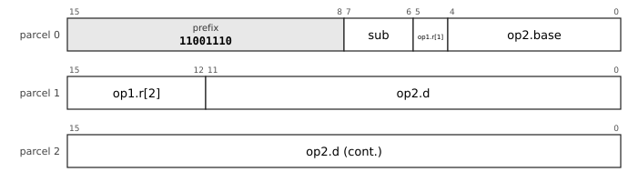

The chart is the leaf `32-STF-B28-2`, STF.B28, prefix `11001110`. `op1` is `reg5`: register, 5 bits. `op2` is `b5d28s-x1`: memory at base register, 5 bits + signed 28-bit displacement times 1, -134217728 to 134217727 bytes. `sub` (2 bits) selects the mnemonic: `addm` 00, `subm` 01, `bicm` 10, `bism` 11.

**All the layouts of this entry** (a chart for each, with its fields and the sub-opcode of each mnemonic, in [the bit layouts of every opcode](dictionary/by-encoding.md)): [`32-STF-B28-2`](dictionary/by-encoding.md#32-STF-B28-2), [`32-STF-X22-2`](dictionary/by-encoding.md#32-STF-X22-2), [`32-STF-PI12-2`](dictionary/by-encoding.md#32-STF-PI12-2), [`32-STF-PD12-2`](dictionary/by-encoding.md#32-STF-PD12-2), [`32-STF-PC32-2`](dictionary/by-encoding.md#32-STF-PC32-2), [`32-STF-A32-2`](dictionary/by-encoding.md#32-STF-A32-2).

**Operation**

```
ADDM: M[EA] ← M[EA] + Rs
SUBM: M[EA] ← M[EA] - Rs
BICM: M[EA] ← M[EA] AND NOT Rs
BISM: M[EA] ← M[EA] OR Rs
```

**Flags** As for `ADD`, `SUB`, `BIC` and `BIS`.

**Exceptions** Memory operand: page fault, protection fault, alignment fault or bus error (a read of non-existent memory is a precise abort with cause `BUSFAULT`). Every such fault is precise and the instruction restarts after it, because the register update of an auto-increment or auto-decrement mode is held until the instruction retires. Write permission is checked during the read access, so the write cannot fault after the read has succeeded.

The forms with a memory destination are in the ordinary memory families of the encoding, with every addressing form (errata 87).

**Why it is here.** These are the read-modify-write forms with a memory destination. They cover the case where the second operand is a register, for example `BISM Rmask, flags(DP)`.

**Status** implemented in the reference executor (`common/pdp64exec.c` and `common/pdp64exec_enc.inc`, run by `sim64`; QEMU does not yet execute this encoding).


### INC: Increment

**Mnemonics:** `INC`

**Syntax**

```
INC rm
```

**Encoding**

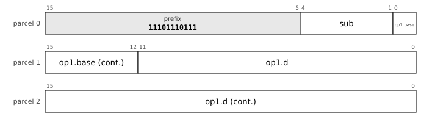

The chart is the leaf `32-SOF-B28-1`, SOF.B28, prefix `11101110111`. `op1` is `b5d28s-x1`: memory at base register, 5 bits + signed 28-bit displacement times 1, -134217728 to 134217727 bytes. `sub` (4 bits) selects the mnemonic: `clr` 0000, `com` 0001, `inc` 0010, `dec` 0011, `neg` 0100, `tst` 0101, `adc` 0110, `sbc` 0111, `asl` 1000, `asr` 1001, `push` 1010, `pop` 1011, `jmp` 1100, `call` 1101, `jmpi` 1110, `calli` 1111.

**All the layouts of this entry** (a chart for each, with its fields and the sub-opcode of each mnemonic, in [the bit layouts of every opcode](dictionary/by-encoding.md)): [`32-SOF-B28-1`](dictionary/by-encoding.md#32-SOF-B28-1), [`32-SOF-X22-1`](dictionary/by-encoding.md#32-SOF-X22-1), [`32-SOF-PI12-1`](dictionary/by-encoding.md#32-SOF-PI12-1), [`32-SOF-PD12-1`](dictionary/by-encoding.md#32-SOF-PD12-1), [`32-SOF-PC32-1`](dictionary/by-encoding.md#32-SOF-PC32-1), [`32-SOF-A32-1`](dictionary/by-encoding.md#32-SOF-A32-1), [`32-SOPR-1`](dictionary/by-encoding.md#32-SOPR-1), [`32-SOBu12H-a-1`](dictionary/by-encoding.md#32-SOBu12H-a-1), [`32-SOX4-a-1`](dictionary/by-encoding.md#32-SOX4-a-1), [`32-SOBs12-a-1`](dictionary/by-encoding.md#32-SOBs12-a-1).

**Operation**

```
rm ← rm + 1
```

**Flags** `N`, `Z` and `V` as for `ADD`; `C` **unchanged**.

**Exceptions** Memory operand: page fault, protection fault, alignment fault or bus error (a read of non-existent memory is a precise abort with cause `BUSFAULT`). Every such fault is precise and the instruction restarts after it, because the register update of an auto-increment or auto-decrement mode is held until the instruction retires.

**Status** implemented in the reference executor (`common/pdp64exec.c` and `common/pdp64exec_enc.inc`, run by `sim64`; QEMU does not yet execute this encoding).


### DEC: Decrement

**Mnemonics:** `DEC`

**Syntax**

```
DEC rm
```

**Encoding**


The chart is the leaf `32-SOF-B28-1`, SOF.B28, prefix `11101110111`. `op1` is `b5d28s-x1`: memory at base register, 5 bits + signed 28-bit displacement times 1, -134217728 to 134217727 bytes. `sub` (4 bits) selects the mnemonic: `clr` 0000, `com` 0001, `inc` 0010, `dec` 0011, `neg` 0100, `tst` 0101, `adc` 0110, `sbc` 0111, `asl` 1000, `asr` 1001, `push` 1010, `pop` 1011, `jmp` 1100, `call` 1101, `jmpi` 1110, `calli` 1111.

**All the layouts of this entry** (a chart for each, with its fields and the sub-opcode of each mnemonic, in [the bit layouts of every opcode](dictionary/by-encoding.md)): [`32-SOF-B28-1`](dictionary/by-encoding.md#32-SOF-B28-1), [`32-SOF-X22-1`](dictionary/by-encoding.md#32-SOF-X22-1), [`32-SOF-PI12-1`](dictionary/by-encoding.md#32-SOF-PI12-1), [`32-SOF-PD12-1`](dictionary/by-encoding.md#32-SOF-PD12-1), [`32-SOF-PC32-1`](dictionary/by-encoding.md#32-SOF-PC32-1), [`32-SOF-A32-1`](dictionary/by-encoding.md#32-SOF-A32-1), [`32-SOPR-1`](dictionary/by-encoding.md#32-SOPR-1), [`32-SOBu12H-a-1`](dictionary/by-encoding.md#32-SOBu12H-a-1), [`32-SOX4-a-1`](dictionary/by-encoding.md#32-SOX4-a-1), [`32-SOBs12-a-1`](dictionary/by-encoding.md#32-SOBs12-a-1).

**Operation**

```
rm ← rm - 1
```

**Flags** `N`, `Z` and `V` as for `SUB`; `C` **unchanged**.

**Exceptions** Memory operand: page fault, protection fault, alignment fault or bus error (a read of non-existent memory is a precise abort with cause `BUSFAULT`). Every such fault is precise and the instruction restarts after it, because the register update of an auto-increment or auto-decrement mode is held until the instruction retires.

**Status** implemented in the reference executor (`common/pdp64exec.c` and `common/pdp64exec_enc.inc`, run by `sim64`; QEMU does not yet execute this encoding).


### NEG: Negate

**Mnemonics:** `NEG`

**Syntax**

```
NEG rm
```

**Encoding**


The chart is the leaf `32-SOF-B28-1`, SOF.B28, prefix `11101110111`. `op1` is `b5d28s-x1`: memory at base register, 5 bits + signed 28-bit displacement times 1, -134217728 to 134217727 bytes. `sub` (4 bits) selects the mnemonic: `clr` 0000, `com` 0001, `inc` 0010, `dec` 0011, `neg` 0100, `tst` 0101, `adc` 0110, `sbc` 0111, `asl` 1000, `asr` 1001, `push` 1010, `pop` 1011, `jmp` 1100, `call` 1101, `jmpi` 1110, `calli` 1111.

**All the layouts of this entry** (a chart for each, with its fields and the sub-opcode of each mnemonic, in [the bit layouts of every opcode](dictionary/by-encoding.md)): [`32-SOF-B28-1`](dictionary/by-encoding.md#32-SOF-B28-1), [`32-SOF-X22-1`](dictionary/by-encoding.md#32-SOF-X22-1), [`32-SOF-PI12-1`](dictionary/by-encoding.md#32-SOF-PI12-1), [`32-SOF-PD12-1`](dictionary/by-encoding.md#32-SOF-PD12-1), [`32-SOF-PC32-1`](dictionary/by-encoding.md#32-SOF-PC32-1), [`32-SOF-A32-1`](dictionary/by-encoding.md#32-SOF-A32-1), [`32-SOPR-1`](dictionary/by-encoding.md#32-SOPR-1).

**Operation**

```
rm ← 0 - rm
```

**Flags** `N` and `Z` from the result, `V` set on signed overflow, `C` set on a **borrow** (the PDP-11 sense): `C` = 1 when the unsigned operand being subtracted is the larger. (`C` = 1 unless the operand was 0.)

**Exceptions** Memory operand: page fault, protection fault, alignment fault or bus error (a read of non-existent memory is a precise abort with cause `BUSFAULT`). Every such fault is precise and the instruction restarts after it, because the register update of an auto-increment or auto-decrement mode is held until the instruction retires.

**Status** implemented in the reference executor (`common/pdp64exec.c` and `common/pdp64exec_enc.inc`, run by `sim64`; QEMU does not yet execute this encoding).


### ADC: Add carry

**Mnemonics:** `ADC`

**Syntax**

```
ADC rm
```

**Encoding**


The chart is the leaf `32-SOF-B28-1`, SOF.B28, prefix `11101110111`. `op1` is `b5d28s-x1`: memory at base register, 5 bits + signed 28-bit displacement times 1, -134217728 to 134217727 bytes. `sub` (4 bits) selects the mnemonic: `clr` 0000, `com` 0001, `inc` 0010, `dec` 0011, `neg` 0100, `tst` 0101, `adc` 0110, `sbc` 0111, `asl` 1000, `asr` 1001, `push` 1010, `pop` 1011, `jmp` 1100, `call` 1101, `jmpi` 1110, `calli` 1111.

**All the layouts of this entry** (a chart for each, with its fields and the sub-opcode of each mnemonic, in [the bit layouts of every opcode](dictionary/by-encoding.md)): [`32-SOF-B28-1`](dictionary/by-encoding.md#32-SOF-B28-1), [`32-SOF-X22-1`](dictionary/by-encoding.md#32-SOF-X22-1), [`32-SOF-PI12-1`](dictionary/by-encoding.md#32-SOF-PI12-1), [`32-SOF-PD12-1`](dictionary/by-encoding.md#32-SOF-PD12-1), [`32-SOF-PC32-1`](dictionary/by-encoding.md#32-SOF-PC32-1), [`32-SOF-A32-1`](dictionary/by-encoding.md#32-SOF-A32-1), [`32-SOPR-1`](dictionary/by-encoding.md#32-SOPR-1).

**Operation**

```
rm ← rm + C
```

**Flags** `N` and `Z` from the result, `V` set on signed overflow, `C` set on a carry out of bit 63.

**Exceptions** Memory operand: page fault, protection fault, alignment fault or bus error (a read of non-existent memory is a precise abort with cause `BUSFAULT`). Every such fault is precise and the instruction restarts after it, because the register update of an auto-increment or auto-decrement mode is held until the instruction retires.

With `ADD`, multi-word addition.

**Status** implemented in the reference executor (`common/pdp64exec.c` and `common/pdp64exec_enc.inc`, run by `sim64`; QEMU does not yet execute this encoding).


### SBC: Subtract carry

**Mnemonics:** `SBC`

**Syntax**

```
SBC rm
```

**Encoding**


The chart is the leaf `32-SOF-B28-1`, SOF.B28, prefix `11101110111`. `op1` is `b5d28s-x1`: memory at base register, 5 bits + signed 28-bit displacement times 1, -134217728 to 134217727 bytes. `sub` (4 bits) selects the mnemonic: `clr` 0000, `com` 0001, `inc` 0010, `dec` 0011, `neg` 0100, `tst` 0101, `adc` 0110, `sbc` 0111, `asl` 1000, `asr` 1001, `push` 1010, `pop` 1011, `jmp` 1100, `call` 1101, `jmpi` 1110, `calli` 1111.

**All the layouts of this entry** (a chart for each, with its fields and the sub-opcode of each mnemonic, in [the bit layouts of every opcode](dictionary/by-encoding.md)): [`32-SOF-B28-1`](dictionary/by-encoding.md#32-SOF-B28-1), [`32-SOF-X22-1`](dictionary/by-encoding.md#32-SOF-X22-1), [`32-SOF-PI12-1`](dictionary/by-encoding.md#32-SOF-PI12-1), [`32-SOF-PD12-1`](dictionary/by-encoding.md#32-SOF-PD12-1), [`32-SOF-PC32-1`](dictionary/by-encoding.md#32-SOF-PC32-1), [`32-SOF-A32-1`](dictionary/by-encoding.md#32-SOF-A32-1), [`32-SOPR-1`](dictionary/by-encoding.md#32-SOPR-1).

**Operation**

```
rm ← rm - C
```

**Flags** `N` and `Z` from the result, `V` set on signed overflow, `C` set on a **borrow** (the PDP-11 sense): `C` = 1 when the unsigned operand being subtracted is the larger.

**Exceptions** Memory operand: page fault, protection fault, alignment fault or bus error (a read of non-existent memory is a precise abort with cause `BUSFAULT`). Every such fault is precise and the instruction restarts after it, because the register update of an auto-increment or auto-decrement mode is held until the instruction retires.

**Status** implemented in the reference executor (`common/pdp64exec.c` and `common/pdp64exec_enc.inc`, run by `sim64`; QEMU does not yet execute this encoding).


### DIV: Divide and remainder, signed and unsigned

**Mnemonics:** `DIV`, `DIVU`, `MOD`, `MODU`

**Syntax**

```
DIV Ra, Rb, Rd
DIVU Ra, Rb, Rd
MOD Ra, Rb, Rd
MODU Ra, Rb, Rd
```

**Encoding**

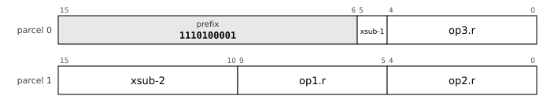

The chart is the leaf `32-R3-1`, R3, prefix `1110100001`. `op1` is `reg5`: register, 5 bits. `op2` is `reg5`: register, 5 bits. `op3` is `reg5`: register, 5 bits. `xsub` selects the mnemonic.

**All the layouts of this entry** (a chart for each, with its fields and the sub-opcode of each mnemonic, in [the bit layouts of every opcode](dictionary/by-encoding.md)): [`32-R3-1`](dictionary/by-encoding.md#32-R3-1).

**Operation**

```
if Rb = 0 then divide-by-zero abort
DIV : Rd ← Ra ÷ Rb  (signed, rounded toward zero; INT_MIN ÷ -1 = INT_MIN)
DIVU: Rd ← Ra ÷ Rb  (unsigned)
MOD : Rd ← Ra mod Rb (signed, the sign of Ra; any value mod -1 = 0)
MODU: Rd ← Ra mod Rb (unsigned)
```

**Flags** None written.

**Exceptions** Division by zero aborts with the divide-by-zero vector (cause `DIVZERO`). There is no overflow trap: `INT_MIN / -1` returns `INT_MIN`.

Division by a constant is a `MULH` and a shift, so a real divide is rare; this is why divide has no two-byte form.

**Cf.** 6.2 (the divide-by-zero vector).

**Status** implemented in the reference executor (`common/pdp64exec.c` and `common/pdp64exec_enc.inc`, run by `sim64`; QEMU does not yet execute this encoding).


### MULHU: Multiply, high 64 bits, unsigned

**Mnemonics:** `MULHU`

**Syntax**

```
MULHU Ra, Rb, Rd
```

**Encoding**


The chart is the leaf `32-R3-1`, R3, prefix `1110100001`. `op1` is `reg5`: register, 5 bits. `op2` is `reg5`: register, 5 bits. `op3` is `reg5`: register, 5 bits. `xsub` selects the mnemonic.

**All the layouts of this entry** (a chart for each, with its fields and the sub-opcode of each mnemonic, in [the bit layouts of every opcode](dictionary/by-encoding.md)): [`32-R3-1`](dictionary/by-encoding.md#32-R3-1).

**Operation**

```
Rd ← (Ra × Rb)[127:64]    ; unsigned
```

**Flags** None written.

**Exceptions** None.

`MULHSU` (signed by unsigned) is reserved and not committed.

**Why it is here.** The unsigned partner of `MULH`, for the same reason (the high half of the product). It is, where arithmetic belongs. `MULHSU`, signed times unsigned for a bignum's top limb, is reserved because it can be built from `MULH` with one correction.

**Status** implemented in the reference executor (`common/pdp64exec.c` and `common/pdp64exec_enc.inc`, run by `sim64`; QEMU does not yet execute this encoding).


### ABS: Absolute value

**Mnemonics:** `ABS`

**Syntax**

```
ABS Rs, Rd
```

**Encoding**

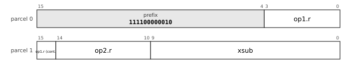

The chart is the leaf `32-R2-1`, R2, prefix `111100000010`. `op1` is `reg5`: register, 5 bits. `op2` is `reg5`: register, 5 bits. `xsub` selects the mnemonic.

**All the layouts of this entry** (a chart for each, with its fields and the sub-opcode of each mnemonic, in [the bit layouts of every opcode](dictionary/by-encoding.md)): [`32-R2-1`](dictionary/by-encoding.md#32-R2-1).

**Operation**

```
Rd ← |Rs|
```

**Flags** `N` and `Z` from the result, `V` set if `Rs` is the most negative value (the result is then still negative), `C` unchanged.

**Exceptions** None.

**Why it is here.** Integer absolute value is the counterpart of `FABS`. Its cost is about 150 to 250 lookup tables, no new operation by the folding rule (integer against float and signed against unsigned are qualifiers), and the compiler's work of recognising `x < 0 ? -x : x`, which is the real cost. The compiled corpus has 18 uses of `abs` and 5 of its unsigned form, under 0.1% of code, so the case is clarity and the idiom more than size.

**Status** implemented in the reference executor (`common/pdp64exec.c` and `common/pdp64exec_enc.inc`, run by `sim64`; QEMU does not yet execute this encoding).


### MINMAX: Minimum and maximum, signed and unsigned

**Mnemonics:** `MIN`, `MINU`, `MAX`, `MAXU`

**Syntax**

```
MIN Ra, Rb, Rd
MINU Ra, Rb, Rd
MAX Ra, Rb, Rd
MAXU Ra, Rb, Rd
```

**Encoding**


The chart is the leaf `32-R3-1`, R3, prefix `1110100001`. `op1` is `reg5`: register, 5 bits. `op2` is `reg5`: register, 5 bits. `op3` is `reg5`: register, 5 bits. `xsub` selects the mnemonic.

**All the layouts of this entry** (a chart for each, with its fields and the sub-opcode of each mnemonic, in [the bit layouts of every opcode](dictionary/by-encoding.md)): [`32-R3-1`](dictionary/by-encoding.md#32-R3-1).

**Operation**

```
MIN : Rd ← smaller of Ra, Rb (signed)         MINU: unsigned
MAX : Rd ← larger of Ra, Rb (signed)          MAXU: unsigned
```

**Flags** `N` and `Z` from the result, `V` = 0, `C` unchanged.

**Exceptions** None.

**Why it is here.** The integer counterparts of `FMIN` and `FMAX`, provided with `ABS`. By the folding rule they add no operation, and the hardware reuses the subtract-and-compare that `CMP` already does plus a 64-bit select. The corpus has 171 uses of `MIN` and 52 of `MAX` across 95 files, under 0.1% of code in all. A general conditional select is the alternative; it is open (9.21) for want of a speed model.

**Status** implemented in the reference executor (`common/pdp64exec.c` and `common/pdp64exec_enc.inc`, run by `sim64`; QEMU does not yet execute this encoding).


### SET: Set a register from a condition

**Mnemonics:** `SET`

**Syntax**

```
SET cc, Rd        ; for example SET EQ, R1
```

**Encoding**

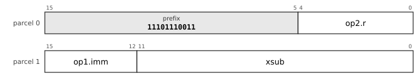

The chart is the leaf `32-SETF-1`, SETF, prefix `11101110011`. `op1` is `imm4u`: unsigned 4-bit immediate, 0 to 15. `op2` is `reg5`: register, 5 bits. `xsub` selects the mnemonic.

**All the layouts of this entry** (a chart for each, with its fields and the sub-opcode of each mnemonic, in [the bit layouts of every opcode](dictionary/by-encoding.md)): [`32-SETF-1`](dictionary/by-encoding.md#32-SETF-1).

**Operation**

```
Rd ← 1 if condition cc holds on the current flags, else 0
```

**Flags** None written.

**Exceptions** None.

The condition is numbered as the low nibble of the branch opcodes (`al` 0, `ne` 1, `eq` 2, ... `los` 14).

**Status** implemented in the reference executor (`common/pdp64exec.c` and `common/pdp64exec_enc.inc`, run by `sim64`; QEMU does not yet execute this encoding).


### MASK: Mask by a condition register

**Mnemonics:** `MASKEQZ`, `MASKNEZ`

**Syntax**

```
MASKEQZ Ra, Rc, Rd
MASKNEZ Ra, Rc, Rd
```

**Encoding**


The chart is the leaf `32-R3-1`, R3, prefix `1110100001`. `op1` is `reg5`: register, 5 bits. `op2` is `reg5`: register, 5 bits. `op3` is `reg5`: register, 5 bits. `xsub` selects the mnemonic.

**All the layouts of this entry** (a chart for each, with its fields and the sub-opcode of each mnemonic, in [the bit layouts of every opcode](dictionary/by-encoding.md)): [`32-R3-1`](dictionary/by-encoding.md#32-R3-1).

**Operation**

```
MASKEQZ: Rd ← (Rc = 0) ? 0 : Ra
MASKNEZ: Rd ← (Rc ≠ 0) ? 0 : Ra
```

**Flags** None written.

**Exceptions** None.

*(D)* Errata 85: the branch-free select is adopted. `Rc` is tested whole, all 64 bits, so any non-zero value is true; no flag is read or written, and the latency is fixed. `Rd` may be `Ra` or `Rc`. A constant-time select `d = c ? a : b` is `MASKEQZ a, c, t`, `MASKNEZ b, c, d`, `BIS t, d`. The semantics are those of LoongArch `maskeqz` and `masknez` and of RISC-V Zicond (the crypto proposal states this from memory). A flag-reading `CSEL` is not in the set (reserved, recommended only if the compiler work shows selects on comparisons matter).

**Why it is here.** The author adopted the branch-free select (errata 85) when the crypto proposal asked for it: constant-time code must choose between two values without a branch, and a flag-reading conditional move would put a secret in a flag. `MASKEQZ` and `MASKNEZ` are the select of LoongArch and of RISC-V Zicond (stated from memory in the proposal, not checked against a manual); the pair and an `OR` make `c ? a : b` in three instructions, against two for `CMP` and a conditional move, but the conditional move would be used at 783 sites in 284,641 instructions (0.28%), and the case for the pair is the constant-time idiom, where the condition is already a register. The author confirmed the pair and wrote "looks good" on the section (errata 86). About 100 look-up tables, one cycle (the proposal's estimate).

**Cf.** 9.7 (SET), docs/crypto-secure-core.md section 2.

**Status** implemented in the reference executor (`common/pdp64exec.c` and `common/pdp64exec_enc.inc`, run by `sim64`; QEMU does not yet execute this encoding).


### OVF: Add, subtract and multiply, trapping on signed overflow

**Mnemonics:** `ADDV`, `SUBV`, `MULV`

**Syntax**

```
ADDV Rs, Rd
SUBV Rs, Rd
MULV Rs, Rd
```

**Encoding**


The chart is the leaf `32-R2-1`, R2, prefix `111100000010`. `op1` is `reg5`: register, 5 bits. `op2` is `reg5`: register, 5 bits. `xsub` selects the mnemonic.

**All the layouts of this entry** (a chart for each, with its fields and the sub-opcode of each mnemonic, in [the bit layouts of every opcode](dictionary/by-encoding.md)): [`32-R2-1`](dictionary/by-encoding.md#32-R2-1).

**Operation**

```
t ← Rd op Rs                 ; op is +, - or ×, on signed 64-bit values
if t does not fit in 64 bits then abort at this instruction (vector CHECK), Rd unwritten
else Rd ← t
```

**Flags** None written.

**Exceptions** Aborts with the `CHECK` vector on signed overflow, with `EPC` at the instruction and the destination unwritten; a blind restart faults again unless the handler changed an operand.

*(D)* Errata 85: `TRAPCC` with the fused `ADDV`, `SUBV` and `MULV` forms. The tables of the grammars hold the two-register form (`Rd <- Rd op Rs`, like `ADD`, `SUB`, `MUL`) and no immediate or memory form; `docs/study-proposals.md` item 9 writes a three-register form (`Rd <- Ra op Rb`), which no table has *(P)*. The check vector is number 16 (`CHECK`) in `docs/study-proposals.md` item 9 and in the reference executor; `spec/pdp64-system.hbnf` has no vector of that name yet, so the number is *(P)*.

**Why it is here.** Checked arithmetic is what clang `-ftrapv` and `__builtin_*_overflow`, Rust's debug overflow checks, Swift's default arithmetic and Ada's `Constraint_Error` need. The author decided `TRAPCC` with the fused `ADDV`, `SUBV` and `MULV` and no compare-and-trap form (errata 85), the fused forms as the case where one non-destructive instruction beats `ADD` and `TRAPCC`. The corpus cannot size the use: it contains no `BVS` or `BVC` at all, because the overflow builtins were not implemented in the compiler that produced it, and the proposal says that sanitiser builds are the target. The record gives the precedent only for the trap, not for the fused forms.

**Cf.** 9.14 (TRAPCC), docs/study-proposals.md item 9.

**Status** implemented in the reference executor (`common/pdp64exec.c` and `common/pdp64exec_enc.inc`, run by `sim64`; QEMU does not yet execute this encoding).
<!-- /entries:9.7 -->

## 9.8 Logic, shifts and rotates

**9.8.1** `AND`, `BIC` (bit clear), `BIS` (bit set, the or), `XOR` and `BIT` (test) are two-byte ALU operations; `COM` is one's complement. *(opcodes `011000 (0x18)`, `011001 (0x19)`, `011011 (0x1B)`, `011100 (0x1C)`, `011101 (0x1D)`)*

**9.8.2** `SHL`, `SHR` and `SAR` shift by a count taken from `rm` (a register, an immediate, or memory); `ASL` and `ASR` are the by-one forms in two bytes. *(D)*

**9.8.3** A shift count of 64 or more shifts the value entirely away; `C` receives the last bit that left. *(D)*

**9.8.4** `ROR` rotates right by a register count and `RORI` by an immediate; `ROL Rd, Rs, #n` assembles to `RORI` with `64 - n`; `RORI32` rotates the low 32 bits and sign-extends. Rotates write no flags. *(D)*

**9.8.5** `DSHR` is a double-width funnel shift. It writes no flags. *(D)*

*Commentary.* **Precedent.** The PDP-11 had `ASL`, `ASR`, `ROL` and `ROR` by one through the carry; x86's `SHRD` and ARM's `EXTR` are the funnel shifts. **Trade-offs.** One rotate direction is enough, so there is no by-one `ROL` in a two-byte slot; rotates are not through the carry because a carry chain is fragile when the carry flag is shared. **Improvements.** The shift count comes from `rm`, not from a fixed register like x86's `CL`, which costs a register shuffle in every hand-written loop. **Benefits.** Multi-precision shifting is `DSHR`, two instructions for any distance. **Modern comparables.** RISC-V and AArch64 have rotates by register and by immediate; x86 has `ROL`/`ROR` through the carry as well. **Use.** `RORI` and `RORI32` are for hashes and ciphers, which rotate by constants; `DSHR` shifts a bignum. **Impact.** *Kernel:* Bit tests and mask operations on the status and page-table words are single instructions. *Compiler:* The shift count may be any register, immediate or memory operand, so the compiler never has to move a count into a fixed register; hashes and ciphers rotate by constants. *Hardware:* The barrel shifter (about 450 lookup tables) serves shifts and rotates, and writing no flag for rotates removes a result path.

<!-- entries:9.8 -->
### BIC: Bit clear

**Mnemonics:** `BIC`

**Syntax**

```
BIC rm, Rd
```

**Encoding**


The chart is the leaf `32-LDF-B28-1`, LDF.B28, prefix `011101`. `op1` is `b5d28s-x1`: memory at base register, 5 bits + signed 28-bit displacement times 1, -134217728 to 134217727 bytes. `op2` is `reg5`: register, 5 bits. `sub` (4 bits) selects the mnemonic: `movq` 0000, `movl` 0001, `movw` 0010, `movb` 0011, `movzl` 0100, `movzw` 0101, `movzb` 0110, `add` 0111, `sub` 1000, `bic` 1001, `bis` 1010, `xor` 1011, `and` 1100, `mul` 1101, `mulh` 1110, `shl` 1111.

**All the layouts of this entry** (a chart for each, with its fields and the sub-opcode of each mnemonic, in [the bit layouts of every opcode](dictionary/by-encoding.md)): [`32-LDF-B28-1`](dictionary/by-encoding.md#32-LDF-B28-1), [`32-LDF-X22-1`](dictionary/by-encoding.md#32-LDF-X22-1), [`32-LDF-PI12-1`](dictionary/by-encoding.md#32-LDF-PI12-1), [`32-LDF-PD12-1`](dictionary/by-encoding.md#32-LDF-PD12-1), [`32-LDF-PC32-1`](dictionary/by-encoding.md#32-LDF-PC32-1), [`32-LDF-A32-1`](dictionary/by-encoding.md#32-LDF-A32-1), [`32-LDFI-I32-1`](dictionary/by-encoding.md#32-LDFI-I32-1), [`32-DPF-D28-1`](dictionary/by-encoding.md#32-DPF-D28-1), [`32-RRF-1`](dictionary/by-encoding.md#32-RRF-1), [`32-RRF5-1`](dictionary/by-encoding.md#32-RRF5-1), [`32-LDI12H-c-1`](dictionary/by-encoding.md#32-LDI12H-c-1), [`32-LDI12-d-2`](dictionary/by-encoding.md#32-LDI12-d-2), [`32-LDPC12H-d-1`](dictionary/by-encoding.md#32-LDPC12H-d-1).

**Operation**

```
Rd ← Rd AND NOT rm
```

**Flags** `N` and `Z` from the result, `V` cleared, `C` unchanged.

**Exceptions** Memory operand: page fault, protection fault, alignment fault or bus error (a read of non-existent memory is a precise abort with cause `BUSFAULT`). Every such fault is precise and the instruction restarts after it, because the register update of an auto-increment or auto-decrement mode is held until the instruction retires.

The assembler also accepts `BIC #imm, rm` as `AND #~imm, rm`.

**Status** implemented in the reference executor (`common/pdp64exec.c` and `common/pdp64exec_enc.inc`, run by `sim64`; QEMU does not yet execute this encoding).


### BIS: Bit set (inclusive or)

**Mnemonics:** `BIS`

**Syntax**

```
BIS rm, Rd
```

**Encoding**


The chart is the leaf `32-LDF-B28-1`, LDF.B28, prefix `011101`. `op1` is `b5d28s-x1`: memory at base register, 5 bits + signed 28-bit displacement times 1, -134217728 to 134217727 bytes. `op2` is `reg5`: register, 5 bits. `sub` (4 bits) selects the mnemonic: `movq` 0000, `movl` 0001, `movw` 0010, `movb` 0011, `movzl` 0100, `movzw` 0101, `movzb` 0110, `add` 0111, `sub` 1000, `bic` 1001, `bis` 1010, `xor` 1011, `and` 1100, `mul` 1101, `mulh` 1110, `shl` 1111.

**All the layouts of this entry** (a chart for each, with its fields and the sub-opcode of each mnemonic, in [the bit layouts of every opcode](dictionary/by-encoding.md)): [`32-LDF-B28-1`](dictionary/by-encoding.md#32-LDF-B28-1), [`32-LDF-X22-1`](dictionary/by-encoding.md#32-LDF-X22-1), [`32-LDF-PI12-1`](dictionary/by-encoding.md#32-LDF-PI12-1), [`32-LDF-PD12-1`](dictionary/by-encoding.md#32-LDF-PD12-1), [`32-LDF-PC32-1`](dictionary/by-encoding.md#32-LDF-PC32-1), [`32-LDF-A32-1`](dictionary/by-encoding.md#32-LDF-A32-1), [`32-LDFI-I32-1`](dictionary/by-encoding.md#32-LDFI-I32-1), [`32-DPF-D28-1`](dictionary/by-encoding.md#32-DPF-D28-1), [`32-RRF-1`](dictionary/by-encoding.md#32-RRF-1), [`32-RRF5-1`](dictionary/by-encoding.md#32-RRF5-1), [`32-RR5-1`](dictionary/by-encoding.md#32-RR5-1), [`32-LDBu6-c-1`](dictionary/by-encoding.md#32-LDBu6-c-1), [`32-LDI12H-c-1`](dictionary/by-encoding.md#32-LDI12H-c-1), [`32-LDBu8H-c-1`](dictionary/by-encoding.md#32-LDBu8H-c-1), [`32-LDS12H-c-1`](dictionary/by-encoding.md#32-LDS12H-c-1), [`32-LDX0-c-1`](dictionary/by-encoding.md#32-LDX0-c-1), [`32-LDPC16H-c-1`](dictionary/by-encoding.md#32-LDPC16H-c-1), [`32-LDBu8-c-1`](dictionary/by-encoding.md#32-LDBu8-c-1).

**Operation**

```
Rd ← Rd OR rm
```

**Flags** `N` and `Z` from the result, `V` cleared, `C` unchanged.

**Exceptions** Memory operand: page fault, protection fault, alignment fault or bus error (a read of non-existent memory is a precise abort with cause `BUSFAULT`). Every such fault is precise and the instruction restarts after it, because the register update of an auto-increment or auto-decrement mode is held until the instruction retires.

**Status** implemented in the reference executor (`common/pdp64exec.c` and `common/pdp64exec_enc.inc`, run by `sim64`; QEMU does not yet execute this encoding).


### BIT: Bit test

**Mnemonics:** `BIT`

**Syntax**

```
BIT rm, Rd
```

**Encoding**


The chart is the leaf `32-LDF-B28-2`, LDF.B28, prefix `1010001`. `op1` is `b5d28s-x1`: memory at base register, 5 bits + signed 28-bit displacement times 1, -134217728 to 134217727 bytes. `op2` is `reg5`: register, 5 bits. `sub` (3 bits) selects the mnemonic: `shr` 000, `sar` 001, `fadd` 010, `fsub` 011, `fmul` 100, `bit` 101, `lea` 110, `movub` 111.

**All the layouts of this entry** (a chart for each, with its fields and the sub-opcode of each mnemonic, in [the bit layouts of every opcode](dictionary/by-encoding.md)): [`32-LDF-B28-2`](dictionary/by-encoding.md#32-LDF-B28-2), [`32-LDF-X22-2`](dictionary/by-encoding.md#32-LDF-X22-2), [`32-LDF-PI12-2`](dictionary/by-encoding.md#32-LDF-PI12-2), [`32-LDF-PD12-2`](dictionary/by-encoding.md#32-LDF-PD12-2), [`32-LDF-PC32-2`](dictionary/by-encoding.md#32-LDF-PC32-2), [`32-LDF-A32-2`](dictionary/by-encoding.md#32-LDF-A32-2), [`32-LDFI-I32-1`](dictionary/by-encoding.md#32-LDFI-I32-1), [`32-DPF-D28-2`](dictionary/by-encoding.md#32-DPF-D28-2), [`32-RRF-2`](dictionary/by-encoding.md#32-RRF-2), [`32-RRF5-1`](dictionary/by-encoding.md#32-RRF5-1), [`32-LDI12-d-3`](dictionary/by-encoding.md#32-LDI12-d-3), [`32-LDPC12H-d-2`](dictionary/by-encoding.md#32-LDPC12H-d-2).

**Operation**

```
tmp ← Rd AND rm         ; the result is discarded
```

**Flags** `N` and `Z` from the result, `V` cleared, `C` unchanged.

**Exceptions** Memory operand: page fault, protection fault, alignment fault or bus error (a read of non-existent memory is a precise abort with cause `BUSFAULT`). Every such fault is precise and the instruction restarts after it, because the register update of an auto-increment or auto-decrement mode is held until the instruction retires.

**Status** implemented in the reference executor (`common/pdp64exec.c` and `common/pdp64exec_enc.inc`, run by `sim64`; QEMU does not yet execute this encoding).


### XOR: Exclusive or

**Mnemonics:** `XOR`

**Syntax**

```
XOR rm, Rd
```

**Encoding**


The chart is the leaf `32-LDF-B28-1`, LDF.B28, prefix `011101`. `op1` is `b5d28s-x1`: memory at base register, 5 bits + signed 28-bit displacement times 1, -134217728 to 134217727 bytes. `op2` is `reg5`: register, 5 bits. `sub` (4 bits) selects the mnemonic: `movq` 0000, `movl` 0001, `movw` 0010, `movb` 0011, `movzl` 0100, `movzw` 0101, `movzb` 0110, `add` 0111, `sub` 1000, `bic` 1001, `bis` 1010, `xor` 1011, `and` 1100, `mul` 1101, `mulh` 1110, `shl` 1111.

**All the layouts of this entry** (a chart for each, with its fields and the sub-opcode of each mnemonic, in [the bit layouts of every opcode](dictionary/by-encoding.md)): [`32-LDF-B28-1`](dictionary/by-encoding.md#32-LDF-B28-1), [`32-LDF-X22-1`](dictionary/by-encoding.md#32-LDF-X22-1), [`32-LDF-PI12-1`](dictionary/by-encoding.md#32-LDF-PI12-1), [`32-LDF-PD12-1`](dictionary/by-encoding.md#32-LDF-PD12-1), [`32-LDF-PC32-1`](dictionary/by-encoding.md#32-LDF-PC32-1), [`32-LDF-A32-1`](dictionary/by-encoding.md#32-LDF-A32-1), [`32-LDFI-I32-1`](dictionary/by-encoding.md#32-LDFI-I32-1), [`32-DPF-D28-1`](dictionary/by-encoding.md#32-DPF-D28-1), [`32-RRF-1`](dictionary/by-encoding.md#32-RRF-1), [`32-RRF5-1`](dictionary/by-encoding.md#32-RRF5-1), [`32-RR5-1`](dictionary/by-encoding.md#32-RR5-1), [`32-LDBu6-c-2`](dictionary/by-encoding.md#32-LDBu6-c-2), [`32-LDI12H-c-1`](dictionary/by-encoding.md#32-LDI12H-c-1), [`32-LDBu8H-c-2`](dictionary/by-encoding.md#32-LDBu8H-c-2), [`32-LDS12H-c-2`](dictionary/by-encoding.md#32-LDS12H-c-2), [`32-LDX0-c-2`](dictionary/by-encoding.md#32-LDX0-c-2), [`32-LDPC16H-c-2`](dictionary/by-encoding.md#32-LDPC16H-c-2), [`32-LDBu8-c-2`](dictionary/by-encoding.md#32-LDBu8-c-2).

**Operation**

```
Rd ← Rd XOR rm
```

**Flags** `N` and `Z` from the result, `V` cleared, `C` unchanged.

**Exceptions** Memory operand: page fault, protection fault, alignment fault or bus error (a read of non-existent memory is a precise abort with cause `BUSFAULT`). Every such fault is precise and the instruction restarts after it, because the register update of an auto-increment or auto-decrement mode is held until the instruction retires.

**Status** implemented in the reference executor (`common/pdp64exec.c` and `common/pdp64exec_enc.inc`, run by `sim64`; QEMU does not yet execute this encoding).


### AND: And

**Mnemonics:** `AND`

**Syntax**

```
AND rm, Rd
```

**Encoding**


The chart is the leaf `32-LDF-B28-1`, LDF.B28, prefix `011101`. `op1` is `b5d28s-x1`: memory at base register, 5 bits + signed 28-bit displacement times 1, -134217728 to 134217727 bytes. `op2` is `reg5`: register, 5 bits. `sub` (4 bits) selects the mnemonic: `movq` 0000, `movl` 0001, `movw` 0010, `movb` 0011, `movzl` 0100, `movzw` 0101, `movzb` 0110, `add` 0111, `sub` 1000, `bic` 1001, `bis` 1010, `xor` 1011, `and` 1100, `mul` 1101, `mulh` 1110, `shl` 1111.

**All the layouts of this entry** (a chart for each, with its fields and the sub-opcode of each mnemonic, in [the bit layouts of every opcode](dictionary/by-encoding.md)): [`32-LDF-B28-1`](dictionary/by-encoding.md#32-LDF-B28-1), [`32-LDF-X22-1`](dictionary/by-encoding.md#32-LDF-X22-1), [`32-LDF-PI12-1`](dictionary/by-encoding.md#32-LDF-PI12-1), [`32-LDF-PD12-1`](dictionary/by-encoding.md#32-LDF-PD12-1), [`32-LDF-PC32-1`](dictionary/by-encoding.md#32-LDF-PC32-1), [`32-LDF-A32-1`](dictionary/by-encoding.md#32-LDF-A32-1), [`32-LDFI-I32-1`](dictionary/by-encoding.md#32-LDFI-I32-1), [`32-DPF-D28-1`](dictionary/by-encoding.md#32-DPF-D28-1), [`32-RRF-1`](dictionary/by-encoding.md#32-RRF-1), [`32-RRF5-1`](dictionary/by-encoding.md#32-RRF5-1), [`32-RR5-1`](dictionary/by-encoding.md#32-RR5-1), [`32-LDI12H-b-2`](dictionary/by-encoding.md#32-LDI12H-b-2), [`32-LDBu6-c-1`](dictionary/by-encoding.md#32-LDBu6-c-1), [`32-LDBu8H-c-1`](dictionary/by-encoding.md#32-LDBu8H-c-1), [`32-LDI14H-b-2`](dictionary/by-encoding.md#32-LDI14H-b-2), [`32-LDS12H-c-1`](dictionary/by-encoding.md#32-LDS12H-c-1), [`32-IMMh43-b-2`](dictionary/by-encoding.md#32-IMMh43-b-2), [`32-LDI18H-b-2`](dictionary/by-encoding.md#32-LDI18H-b-2), [`32-LDI12-b-2`](dictionary/by-encoding.md#32-LDI12-b-2), [`32-LDX0-c-1`](dictionary/by-encoding.md#32-LDX0-c-1), [`32-LDPC16H-c-1`](dictionary/by-encoding.md#32-LDPC16H-c-1), [`32-LDBu8-c-1`](dictionary/by-encoding.md#32-LDBu8-c-1).

**Operation**

```
Rd ← Rd AND rm
```

**Flags** `N` and `Z` from the result, `V` cleared, `C` unchanged.

**Exceptions** Memory operand: page fault, protection fault, alignment fault or bus error (a read of non-existent memory is a precise abort with cause `BUSFAULT`). Every such fault is precise and the instruction restarts after it, because the register update of an auto-increment or auto-decrement mode is held until the instruction retires.

**Status** implemented in the reference executor (`common/pdp64exec.c` and `common/pdp64exec_enc.inc`, run by `sim64`; QEMU does not yet execute this encoding).


### SHIFT: Shift left, shift right logical, shift right arithmetic

**Mnemonics:** `SHL`, `SHR`, `SAR`

**Syntax**

```
SHL rm, Rd
SHR rm, Rd
SAR rm, Rd
```

**Encoding**


The chart is the leaf `32-LDF-B28-1`, LDF.B28, prefix `011101`. `op1` is `b5d28s-x1`: memory at base register, 5 bits + signed 28-bit displacement times 1, -134217728 to 134217727 bytes. `op2` is `reg5`: register, 5 bits. `sub` (4 bits) selects the mnemonic: `movq` 0000, `movl` 0001, `movw` 0010, `movb` 0011, `movzl` 0100, `movzw` 0101, `movzb` 0110, `add` 0111, `sub` 1000, `bic` 1001, `bis` 1010, `xor` 1011, `and` 1100, `mul` 1101, `mulh` 1110, `shl` 1111.

**All the layouts of this entry** (a chart for each, with its fields and the sub-opcode of each mnemonic, in [the bit layouts of every opcode](dictionary/by-encoding.md)): [`32-LDF-B28-1`](dictionary/by-encoding.md#32-LDF-B28-1), [`32-LDF-X22-1`](dictionary/by-encoding.md#32-LDF-X22-1), [`32-LDF-PI12-1`](dictionary/by-encoding.md#32-LDF-PI12-1), [`32-LDF-PD12-1`](dictionary/by-encoding.md#32-LDF-PD12-1), [`32-LDF-PC32-1`](dictionary/by-encoding.md#32-LDF-PC32-1), [`32-LDF-A32-1`](dictionary/by-encoding.md#32-LDF-A32-1), [`32-LDFI-I32-1`](dictionary/by-encoding.md#32-LDFI-I32-1), [`32-DPF-D28-1`](dictionary/by-encoding.md#32-DPF-D28-1), [`32-RRF-1`](dictionary/by-encoding.md#32-RRF-1), [`32-RRF5-1`](dictionary/by-encoding.md#32-RRF5-1), [`32-RR5-1`](dictionary/by-encoding.md#32-RR5-1), [`32-LDI12-d-1`](dictionary/by-encoding.md#32-LDI12-d-1), [`32-SHIh43-a-1`](dictionary/by-encoding.md#32-SHIh43-a-1), [`32-SHIh44-a-1`](dictionary/by-encoding.md#32-SHIh44-a-1), [`32-LDPC12H-d-1`](dictionary/by-encoding.md#32-LDPC12H-d-1), [`32-LDF-B28-2`](dictionary/by-encoding.md#32-LDF-B28-2), [`32-LDF-X22-2`](dictionary/by-encoding.md#32-LDF-X22-2), [`32-LDF-PI12-2`](dictionary/by-encoding.md#32-LDF-PI12-2), [`32-LDF-PD12-2`](dictionary/by-encoding.md#32-LDF-PD12-2), [`32-LDF-PC32-2`](dictionary/by-encoding.md#32-LDF-PC32-2), [`32-LDF-A32-2`](dictionary/by-encoding.md#32-LDF-A32-2), [`32-DPF-D28-2`](dictionary/by-encoding.md#32-DPF-D28-2), [`32-RRF-2`](dictionary/by-encoding.md#32-RRF-2).

**Operation**

```
n ← rm                                 ; the count: a register, an immediate, or memory
SHL: Rd ← (n ≥ 64) ? 0 : Rd << n
SHR: Rd ← (n ≥ 64) ? 0 : Rd >>u n
SAR: Rd ← (n ≥ 64) ? (Rd < 0 ? -1 : 0) : Rd >>s n
```

**Flags** `N` and `Z` from the result, `V` cleared, `C` the last bit shifted out (bit 63 for `SHL`, bit 0 for `SHR` and `SAR`). **The same flags are written for every count**: a count of zero gives `N` and `Z` from the unchanged operand, `V` = 0 and `C` = 0.

**Exceptions** Memory operand: page fault, protection fault, alignment fault or bus error (a read of non-existent memory is a precise abort with cause `BUSFAULT`). Every such fault is precise and the instruction restarts after it, because the register update of an auto-increment or auto-decrement mode is held until the instruction retires.

The count is read as an unsigned 64-bit value, so a count of 64 or more shifts the value entirely away. Small immediate counts have one-parcel forms (the layouts of this entry); `ASL` and `ASR` are the by-one forms; rotates are `ROR` and `RORI`.

**Status** implemented in the reference executor (`common/pdp64exec.c` and `common/pdp64exec_enc.inc`, run by `sim64`; QEMU does not yet execute this encoding).


### CLR: Clear

**Mnemonics:** `CLR`

**Syntax**

```
CLR rm
```

**Encoding**


The chart is the leaf `32-SOF-B28-1`, SOF.B28, prefix `11101110111`. `op1` is `b5d28s-x1`: memory at base register, 5 bits + signed 28-bit displacement times 1, -134217728 to 134217727 bytes. `sub` (4 bits) selects the mnemonic: `clr` 0000, `com` 0001, `inc` 0010, `dec` 0011, `neg` 0100, `tst` 0101, `adc` 0110, `sbc` 0111, `asl` 1000, `asr` 1001, `push` 1010, `pop` 1011, `jmp` 1100, `call` 1101, `jmpi` 1110, `calli` 1111.

**All the layouts of this entry** (a chart for each, with its fields and the sub-opcode of each mnemonic, in [the bit layouts of every opcode](dictionary/by-encoding.md)): [`32-SOF-B28-1`](dictionary/by-encoding.md#32-SOF-B28-1), [`32-SOF-X22-1`](dictionary/by-encoding.md#32-SOF-X22-1), [`32-SOF-PI12-1`](dictionary/by-encoding.md#32-SOF-PI12-1), [`32-SOF-PD12-1`](dictionary/by-encoding.md#32-SOF-PD12-1), [`32-SOF-PC32-1`](dictionary/by-encoding.md#32-SOF-PC32-1), [`32-SOF-A32-1`](dictionary/by-encoding.md#32-SOF-A32-1), [`32-SOPR-1`](dictionary/by-encoding.md#32-SOPR-1), [`32-SOBu12H-a-1`](dictionary/by-encoding.md#32-SOBu12H-a-1), [`32-SOX4-a-1`](dictionary/by-encoding.md#32-SOX4-a-1), [`32-SOBs12-a-1`](dictionary/by-encoding.md#32-SOBs12-a-1).

**Operation**

```
rm ← 0
```

**Flags** `N` = 0, `Z` = 1, `V` = 0, `C` = 0.

**Exceptions** Memory operand: page fault, protection fault, alignment fault or bus error (a read of non-existent memory is a precise abort with cause `BUSFAULT`). Every such fault is precise and the instruction restarts after it, because the register update of an auto-increment or auto-decrement mode is held until the instruction retires.

**Status** implemented in the reference executor (`common/pdp64exec.c` and `common/pdp64exec_enc.inc`, run by `sim64`; QEMU does not yet execute this encoding).


### COM: Complement

**Mnemonics:** `COM`

**Syntax**

```
COM rm
```

**Encoding**


The chart is the leaf `32-SOF-B28-1`, SOF.B28, prefix `11101110111`. `op1` is `b5d28s-x1`: memory at base register, 5 bits + signed 28-bit displacement times 1, -134217728 to 134217727 bytes. `sub` (4 bits) selects the mnemonic: `clr` 0000, `com` 0001, `inc` 0010, `dec` 0011, `neg` 0100, `tst` 0101, `adc` 0110, `sbc` 0111, `asl` 1000, `asr` 1001, `push` 1010, `pop` 1011, `jmp` 1100, `call` 1101, `jmpi` 1110, `calli` 1111.

**All the layouts of this entry** (a chart for each, with its fields and the sub-opcode of each mnemonic, in [the bit layouts of every opcode](dictionary/by-encoding.md)): [`32-SOF-B28-1`](dictionary/by-encoding.md#32-SOF-B28-1), [`32-SOF-X22-1`](dictionary/by-encoding.md#32-SOF-X22-1), [`32-SOF-PI12-1`](dictionary/by-encoding.md#32-SOF-PI12-1), [`32-SOF-PD12-1`](dictionary/by-encoding.md#32-SOF-PD12-1), [`32-SOF-PC32-1`](dictionary/by-encoding.md#32-SOF-PC32-1), [`32-SOF-A32-1`](dictionary/by-encoding.md#32-SOF-A32-1), [`32-SOPR-1`](dictionary/by-encoding.md#32-SOPR-1).

**Operation**

```
rm ← NOT rm
```

**Flags** `N` and `Z` from the result, `V` = 0, `C` = 1 (the PDP-11 rule).

**Exceptions** Memory operand: page fault, protection fault, alignment fault or bus error (a read of non-existent memory is a precise abort with cause `BUSFAULT`). Every such fault is precise and the instruction restarts after it, because the register update of an auto-increment or auto-decrement mode is held until the instruction retires.

A two-byte instruction for a register operand.

**Status** implemented in the reference executor (`common/pdp64exec.c` and `common/pdp64exec_enc.inc`, run by `sim64`; QEMU does not yet execute this encoding).


### TST: Test

**Mnemonics:** `TST`

**Syntax**

```
TST rm
```

**Encoding**


The chart is the leaf `32-SOF-B28-1`, SOF.B28, prefix `11101110111`. `op1` is `b5d28s-x1`: memory at base register, 5 bits + signed 28-bit displacement times 1, -134217728 to 134217727 bytes. `sub` (4 bits) selects the mnemonic: `clr` 0000, `com` 0001, `inc` 0010, `dec` 0011, `neg` 0100, `tst` 0101, `adc` 0110, `sbc` 0111, `asl` 1000, `asr` 1001, `push` 1010, `pop` 1011, `jmp` 1100, `call` 1101, `jmpi` 1110, `calli` 1111.

**All the layouts of this entry** (a chart for each, with its fields and the sub-opcode of each mnemonic, in [the bit layouts of every opcode](dictionary/by-encoding.md)): [`32-SOF-B28-1`](dictionary/by-encoding.md#32-SOF-B28-1), [`32-SOF-X22-1`](dictionary/by-encoding.md#32-SOF-X22-1), [`32-SOF-PI12-1`](dictionary/by-encoding.md#32-SOF-PI12-1), [`32-SOF-PD12-1`](dictionary/by-encoding.md#32-SOF-PD12-1), [`32-SOF-PC32-1`](dictionary/by-encoding.md#32-SOF-PC32-1), [`32-SOF-A32-1`](dictionary/by-encoding.md#32-SOF-A32-1), [`32-SOPR-1`](dictionary/by-encoding.md#32-SOPR-1), [`32-SOBu12H-a-1`](dictionary/by-encoding.md#32-SOBu12H-a-1), [`32-SOX4-a-1`](dictionary/by-encoding.md#32-SOX4-a-1), [`32-SOBs12-a-1`](dictionary/by-encoding.md#32-SOBs12-a-1).

**Operation**

```
set flags from rm; nothing is written
```

**Flags** `N` and `Z` from the operand, `V` = 0, `C` = 0.

**Exceptions** Memory operand: page fault, protection fault, alignment fault or bus error (a read of non-existent memory is a precise abort with cause `BUSFAULT`). Every such fault is precise and the instruction restarts after it, because the register update of an auto-increment or auto-decrement mode is held until the instruction retires.

**Status** implemented in the reference executor (`common/pdp64exec.c` and `common/pdp64exec_enc.inc`, run by `sim64`; QEMU does not yet execute this encoding).


### ASL: Arithmetic shift left by one

**Mnemonics:** `ASL`

**Syntax**

```
ASL rm
```

**Encoding**


The chart is the leaf `32-SOF-B28-1`, SOF.B28, prefix `11101110111`. `op1` is `b5d28s-x1`: memory at base register, 5 bits + signed 28-bit displacement times 1, -134217728 to 134217727 bytes. `sub` (4 bits) selects the mnemonic: `clr` 0000, `com` 0001, `inc` 0010, `dec` 0011, `neg` 0100, `tst` 0101, `adc` 0110, `sbc` 0111, `asl` 1000, `asr` 1001, `push` 1010, `pop` 1011, `jmp` 1100, `call` 1101, `jmpi` 1110, `calli` 1111.

**All the layouts of this entry** (a chart for each, with its fields and the sub-opcode of each mnemonic, in [the bit layouts of every opcode](dictionary/by-encoding.md)): [`32-SOF-B28-1`](dictionary/by-encoding.md#32-SOF-B28-1), [`32-SOF-X22-1`](dictionary/by-encoding.md#32-SOF-X22-1), [`32-SOF-PI12-1`](dictionary/by-encoding.md#32-SOF-PI12-1), [`32-SOF-PD12-1`](dictionary/by-encoding.md#32-SOF-PD12-1), [`32-SOF-PC32-1`](dictionary/by-encoding.md#32-SOF-PC32-1), [`32-SOF-A32-1`](dictionary/by-encoding.md#32-SOF-A32-1), [`32-SOPR-2`](dictionary/by-encoding.md#32-SOPR-2).

**Operation**

```
C ← rm[63] ; rm ← rm << 1
```

**Flags** `N` and `Z` from the result, `C` the bit shifted out of bit 63, `V` = `N` xor `C` (set if the sign changed: the PDP-11 rule).

**Exceptions** Memory operand: page fault, protection fault, alignment fault or bus error (a read of non-existent memory is a precise abort with cause `BUSFAULT`). Every such fault is precise and the instruction restarts after it, because the register update of an auto-increment or auto-decrement mode is held until the instruction retires.

The by-one form of `SHL`.

**Status** implemented in the reference executor (`common/pdp64exec.c` and `common/pdp64exec_enc.inc`, run by `sim64`; QEMU does not yet execute this encoding).


### ASR: Arithmetic shift right by one

**Mnemonics:** `ASR`

**Syntax**

```
ASR rm
```

**Encoding**


The chart is the leaf `32-SOF-B28-1`, SOF.B28, prefix `11101110111`. `op1` is `b5d28s-x1`: memory at base register, 5 bits + signed 28-bit displacement times 1, -134217728 to 134217727 bytes. `sub` (4 bits) selects the mnemonic: `clr` 0000, `com` 0001, `inc` 0010, `dec` 0011, `neg` 0100, `tst` 0101, `adc` 0110, `sbc` 0111, `asl` 1000, `asr` 1001, `push` 1010, `pop` 1011, `jmp` 1100, `call` 1101, `jmpi` 1110, `calli` 1111.

**All the layouts of this entry** (a chart for each, with its fields and the sub-opcode of each mnemonic, in [the bit layouts of every opcode](dictionary/by-encoding.md)): [`32-SOF-B28-1`](dictionary/by-encoding.md#32-SOF-B28-1), [`32-SOF-X22-1`](dictionary/by-encoding.md#32-SOF-X22-1), [`32-SOF-PI12-1`](dictionary/by-encoding.md#32-SOF-PI12-1), [`32-SOF-PD12-1`](dictionary/by-encoding.md#32-SOF-PD12-1), [`32-SOF-PC32-1`](dictionary/by-encoding.md#32-SOF-PC32-1), [`32-SOF-A32-1`](dictionary/by-encoding.md#32-SOF-A32-1), [`32-SOPR-2`](dictionary/by-encoding.md#32-SOPR-2).

**Operation**

```
C ← rm[0] ; rm ← rm >>s 1
```

**Flags** `N` and `Z` from the result, `C` the bit shifted out of bit 0, `V` = 0.

**Exceptions** Memory operand: page fault, protection fault, alignment fault or bus error (a read of non-existent memory is a precise abort with cause `BUSFAULT`). Every such fault is precise and the instruction restarts after it, because the register update of an auto-increment or auto-decrement mode is held until the instruction retires.

The by-one form of `SAR`.

**Status** implemented in the reference executor (`common/pdp64exec.c` and `common/pdp64exec_enc.inc`, run by `sim64`; QEMU does not yet execute this encoding).
<!-- /entries:9.8 -->

## 9.9 Bits, bytes and text

**9.9.1** The bit-and-field escape provides `CLZ`, `CTZ`, `CLO`, `CTO` (count leading and trailing zeros and ones), `POPCNT`, `BSWAP`, `BSWAPW`, `BSWAPL` and `BITREV`. *(opcode `001100 (0x0C)`)*

**9.9.2** `EXTB` and `EXTZB` extract a bitfield at a position and width, sign- or zero-extended, and `INSB` inserts one; the position and width are in the third parcel, so these are six bytes. *(D)*

**9.9.3** `XNORPOP` computes the population count of the exclusive-nor of two registers. *(D)*

**9.9.4** `CLMULL` and `CLMULH` are the low and high halves of a carry-less multiply; no polynomial is built into the architecture. *(D)*

**9.9.5** `UTF8LEN`, `UTF8DEC` and `UTF8ENC` find the length of, decode and encode a UTF-8 sequence, and reject overlong forms, surrogates, out-of-range values and bad continuation bytes. *(D)*

*Commentary.* **Precedent.** The PDP-11 had `SWAB`; the VAX had bit-field instructions and a table-driven `CRC`; x86 added `POPCNT`, `LZCNT` and `PCLMULQDQ` late, and committed `CRC32` to one polynomial. **Trade-offs.** A bit unit is one shared structure: `POPCNT`, `XNORPOP` and a garbage collector's mark-bitmap scan all want the same 64-input adder tree, and `CLZ` and its relatives want a priority encoder over the same operand. **Improvements.** A carry-less multiply stands in for a `CRC` instruction: no polynomial is baked in, and the same instruction serves CRC, the Galois-counter-mode authentication used in TLS, and hashing. Every UTF-8 security hole of the past is three comparators, which an instruction cannot omit and software often does. **Benefits.** The bit unit and the UTF-8 decoder together cost less than 5% of the die. **Modern comparables.** RISC-V's bit-manipulation and carry-less-multiply extensions, AArch64's `CLZ`, `RBIT`, `REV` and `PMULL`, and x86's `PCLMULQDQ`. **Use.** `POPCNT` for bitsets and Hamming distance; `XNORPOP` for binary-weight neural networks and bitset intersection; `CLMUL` for CRC, GCM and fingerprinting; `UTF8*` for text validation in parsers and kernels. **Impact.** *Kernel:* `CTZ` and `CLZ` find the first set bit in a run-queue or free-page bitmap; `POPCNT` counts bits in bitmaps; `BSWAP` converts network byte order. *Compiler:* The compiler maps `__builtin_clz`, `__builtin_popcount` and `__builtin_bswap` directly, and a carry-less multiply is the primitive for CRC and hashing code. *Hardware:* One bit unit holds a shared 64-input adder tree and a priority encoder, and the UTF-8 comparators are about 300 lookup tables.

<!-- entries:9.9 -->
### COUNT: Count leading and trailing zeros and ones

**Mnemonics:** `CLZ`, `CTZ`, `CLO`, `CTO`

**Syntax**

```
CLZ Rs, Rd
CTZ Rs, Rd
CLO Rs, Rd
CTO Rs, Rd
```

**Encoding**


The chart is the leaf `32-R2-1`, R2, prefix `111100000010`. `op1` is `reg5`: register, 5 bits. `op2` is `reg5`: register, 5 bits. `xsub` selects the mnemonic.

**All the layouts of this entry** (a chart for each, with its fields and the sub-opcode of each mnemonic, in [the bit layouts of every opcode](dictionary/by-encoding.md)): [`32-R2-1`](dictionary/by-encoding.md#32-R2-1).

**Operation**

```
CLZ: Rd ← number of leading zero bits of Rs        (64 if Rs = 0)
CTZ: Rd ← number of trailing zero bits of Rs       (64 if Rs = 0)
CLO: Rd ← number of leading one bits of Rs         (64 if Rs = all ones)
CTO: Rd ← number of trailing one bits of Rs        (64 if Rs = all ones)
```

**Flags** None written.

**Exceptions** None.

`CTZ` is the VAX `FFS`. Bit manipulation is core on a machine that does filesystem and bignum work, not an extension.

**Why it is here.** The counts are the VAX `FFS` and `FFC` idiom (find first set, find first clear). The compiler emits none of them, since C has no operator for them; the corpus shows zero uses.

**Status** implemented in the reference executor (`common/pdp64exec.c` and `common/pdp64exec_enc.inc`, run by `sim64`; QEMU does not yet execute this encoding).


### POPCNT: Population count

**Mnemonics:** `POPCNT`

**Syntax**

```
POPCNT Rs, Rd
```

**Encoding**


The chart is the leaf `32-R2-1`, R2, prefix `111100000010`. `op1` is `reg5`: register, 5 bits. `op2` is `reg5`: register, 5 bits. `xsub` selects the mnemonic.

**All the layouts of this entry** (a chart for each, with its fields and the sub-opcode of each mnemonic, in [the bit layouts of every opcode](dictionary/by-encoding.md)): [`32-R2-1`](dictionary/by-encoding.md#32-R2-1).

**Operation**

```
Rd ← number of one bits in Rs
```

**Flags** None written.

**Exceptions** None.

**Why it is here.** A compiler needs `__builtin_popcount` to emit it, so the corpus shows no use (see `COUNT`).

**Status** implemented in the reference executor (`common/pdp64exec.c` and `common/pdp64exec_enc.inc`, run by `sim64`; QEMU does not yet execute this encoding).


### BSWAP: Byte swap

**Mnemonics:** `BSWAP`, `BSWAPW`, `BSWAPL`

**Syntax**

```
BSWAP Rs, Rd
BSWAPW Rs, Rd
BSWAPL Rs, Rd
```

**Encoding**


The chart is the leaf `32-R2-1`, R2, prefix `111100000010`. `op1` is `reg5`: register, 5 bits. `op2` is `reg5`: register, 5 bits. `xsub` selects the mnemonic.

**All the layouts of this entry** (a chart for each, with its fields and the sub-opcode of each mnemonic, in [the bit layouts of every opcode](dictionary/by-encoding.md)): [`32-R2-1`](dictionary/by-encoding.md#32-R2-1).

**Operation**

```
BSWAP : Rd ← Rs with all 8 bytes reversed
BSWAPW: Rd ← Rs with the bytes of each 16-bit word reversed
BSWAPL: Rd ← Rs with the bytes of each 32-bit long reversed
```

**Flags** None written.

**Exceptions** None.

The generalisation of the PDP-11 `SWAB` to 64 bits.

**Why it is here.** The PDP-11 `SWAB` swapped the bytes of a word; `BSWAP` generalises it to 64 bits, with word and long variants. `SWAB` is therefore subsumed, not lost (9.18).

**Status** implemented in the reference executor (`common/pdp64exec.c` and `common/pdp64exec_enc.inc`, run by `sim64`; QEMU does not yet execute this encoding).


### BITREV: Reverse the bits

**Mnemonics:** `BITREV`

**Syntax**

```
BITREV Rs, Rd
```

**Encoding**


The chart is the leaf `32-R2-1`, R2, prefix `111100000010`. `op1` is `reg5`: register, 5 bits. `op2` is `reg5`: register, 5 bits. `xsub` selects the mnemonic.

**All the layouts of this entry** (a chart for each, with its fields and the sub-opcode of each mnemonic, in [the bit layouts of every opcode](dictionary/by-encoding.md)): [`32-R2-1`](dictionary/by-encoding.md#32-R2-1).

**Operation**

```
Rd ← Rs with bit i moved to bit 63-i
```

**Flags** None written.

**Exceptions** None.

**Why it is here.** No workload from the corpus is recorded.

**Status** implemented in the reference executor (`common/pdp64exec.c` and `common/pdp64exec_enc.inc`, run by `sim64`; QEMU does not yet execute this encoding).


### ROR: Rotate right by a register count

**Mnemonics:** `ROR`

**Syntax**

```
ROR Ra, Rb, Rd
```

**Encoding**


The chart is the leaf `32-R3-1`, R3, prefix `1110100001`. `op1` is `reg5`: register, 5 bits. `op2` is `reg5`: register, 5 bits. `op3` is `reg5`: register, 5 bits. `xsub` selects the mnemonic.

**All the layouts of this entry** (a chart for each, with its fields and the sub-opcode of each mnemonic, in [the bit layouts of every opcode](dictionary/by-encoding.md)): [`32-R3-1`](dictionary/by-encoding.md#32-R3-1).

**Operation**

```
Rd ← Ra rotated right by (Rb mod 64)
```

**Flags** None written (rotates write no flags).

**Exceptions** None.

There is no rotate left instruction: `ROL rs, #n, rd` is an assembler spelling of `RORI rs, #(64-n), rd`. No rotate is through carry; multi-word shifting uses `DSHR`.

**Why it is here.** One rotate direction suffices and `ROR` is the one to keep: `ROL x, #n` is exactly `ROR x, #(64-n)`, and a funnel shifter yields `ROR` directly. No rotate is through carry (see `DSHR`). `ROR` is, not the ALU group: cryptographic code rotates by compile-time constants, so a four-byte immediate form is needed either way, and the register-count form has almost no users. Rotates write no flags.

**Status** implemented in the reference executor (`common/pdp64exec.c` and `common/pdp64exec_enc.inc`, run by `sim64`; QEMU does not yet execute this encoding).


### RORI: Rotate right by an immediate

**Mnemonics:** `RORI`  (aliases: `ROL`)

**Syntax**

```
RORI Rs, #n, Rd
ROL Rs, #n, Rd        ; assembles to RORI Rs, #(64-n), Rd
```

**Encoding**

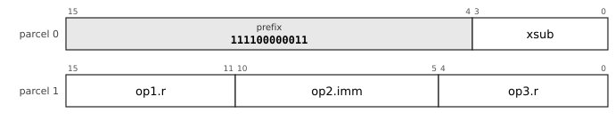

The chart is the leaf `32-RRI-1`, RRI, prefix `111100000011`. `op1` is `reg5`: register, 5 bits. `op2` is `imm6u`: unsigned 6-bit immediate, 0 to 63. `op3` is `reg5`: register, 5 bits. `xsub` selects the mnemonic.

**All the layouts of this entry** (a chart for each, with its fields and the sub-opcode of each mnemonic, in [the bit layouts of every opcode](dictionary/by-encoding.md)): [`32-RRI-1`](dictionary/by-encoding.md#32-RRI-1).

**Operation**

```
Rd ← Rs rotated right by (n mod 64)
```

**Flags** None written.

**Exceptions** None.

**Why it is here.** It has its own mnemonic because an immediate count and a register count are different encodings. `ROL Rs, #n, Rd` is accepted by the assembler as `RORI Rs, #(64-n), Rd`: the complement costs nothing at assembly time, so there is no reason to make programmers do it, and a register-count `ROL` is rejected so that one mnemonic stays one instruction.

**Status** implemented in the reference executor (`common/pdp64exec.c` and `common/pdp64exec_enc.inc`, run by `sim64`; QEMU does not yet execute this encoding).


### RORI32: Rotate right by an immediate, 32 bits

**Mnemonics:** `RORI32`

**Syntax**

```
RORI32 Rs, #n, Rd
```

**Encoding**


The chart is the leaf `32-RRI-1`, RRI, prefix `111100000011`. `op1` is `reg5`: register, 5 bits. `op2` is `imm6u`: unsigned 6-bit immediate, 0 to 63. `op3` is `reg5`: register, 5 bits. `xsub` selects the mnemonic.

**All the layouts of this entry** (a chart for each, with its fields and the sub-opcode of each mnemonic, in [the bit layouts of every opcode](dictionary/by-encoding.md)): [`32-RRI-1`](dictionary/by-encoding.md#32-RRI-1).

**Operation**

```
Rd ← sext32(ror32(Rs[31:0], n mod 32))
```

**Flags** None written.

**Exceptions** None.

The 32-bit rotate with the result sign-extended like every 32-bit result; the primitive of most hash functions and ciphers.

**Why it is here.** A 32-bit rotate by a constant, the shape of crypto and hash inner loops, estimated together with `CBCC` at 22 KB (1.3%) of the compiled image. The result is sign-extended like the rest of the 32-bit operations, so that no instruction is needed after it. It removes 44 `MOVL` instructions in the corpus (the demand analysis already removes nearly all of them).

**Status** implemented in the reference executor (`common/pdp64exec.c` and `common/pdp64exec_enc.inc`, run by `sim64`; QEMU does not yet execute this encoding).


### DSHR: Double-width funnel shift right

**Mnemonics:** `DSHR`

**Syntax**

```
DSHR Ra, Rb, #n, Rd
```

**Encoding**

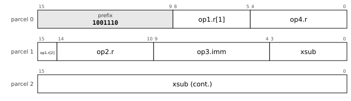

The chart is the leaf `32-BFx-1`, BFx, prefix `1001110`. `op1` is `reg5`: register, 5 bits. `op2` is `reg5`: register, 5 bits. `op3` is `imm6u`: unsigned 6-bit immediate, 0 to 63. `op4` is `reg5`: register, 5 bits. `xsub` selects the mnemonic.

**All the layouts of this entry** (a chart for each, with its fields and the sub-opcode of each mnemonic, in [the bit layouts of every opcode](dictionary/by-encoding.md)): [`32-BFx-1`](dictionary/by-encoding.md#32-BFx-1).

**Operation**

```
t ← Ra:Rb                    ; 128 bits, Ra the high half
Rd ← (t >> n)[63:0]          ; n = 0..63
```

**Flags** None written.

**Exceptions** None.

x86 `SHRD`, ARM `EXTR`. A 128-bit left shift by k is `DSHR hi, hi, lo, #(64-k)` then `SHL #k, lo`.

**Why it is here.** A double-width funnel shift (x86 `SHRD`, ARM `EXTR`), the right primitive for multi-word shifting. Two instructions shift a 128-bit value by any distance, where rotate-through-carry takes one bit per instruction, and that is why no rotate is through carry. It also subsumes `ROR` when both sources are the same register. It leaves every flag alone.

**Status** implemented in the reference executor (`common/pdp64exec.c` and `common/pdp64exec_enc.inc`, run by `sim64`; QEMU does not yet execute this encoding).


### EXTB: Extract a bit field

**Mnemonics:** `EXTB`, `EXTZB`

**Syntax**

```
EXTB Rs, #pos, #width, Rd        ; sign-extended
EXTZB Rs, #pos, #width, Rd       ; zero-extended
```

**Encoding**

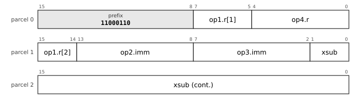

The chart is the leaf `32-BFy-1`, BFy, prefix `11000110`. `op1` is `reg5`: register, 5 bits. `op2` is `imm6u`: unsigned 6-bit immediate, 0 to 63. `op3` is `imm6u`: unsigned 6-bit immediate, 0 to 63. `op4` is `reg5`: register, 5 bits. `xsub` selects the mnemonic.

**All the layouts of this entry** (a chart for each, with its fields and the sub-opcode of each mnemonic, in [the bit layouts of every opcode](dictionary/by-encoding.md)): [`32-BFy-1`](dictionary/by-encoding.md#32-BFy-1).

**Operation**

```
Rd ← ext((Rs >> pos)[width-1:0])          ; sext for EXTB, zext for EXTZB; width 0 or > 64 means 64
```

**Flags** None written.

**Exceptions** None.

Position and width are immediate operands; a width of 64 cannot be encoded (errata 87, assumption 8).

**Why it is here.** Bit-field extract and insert are the VAX `EXTV`, `EXTZV` and `INSV` idiom. They are for hand-written protocol and bit-stream code.

**Status** implemented in the reference executor (`common/pdp64exec.c` and `common/pdp64exec_enc.inc`, run by `sim64`; QEMU does not yet execute this encoding).


### INSB: Insert a bit field

**Mnemonics:** `INSB`

**Syntax**

```
INSB Rs, #pos, #width, Rd
```

**Encoding**


The chart is the leaf `32-BFy-1`, BFy, prefix `11000110`. `op1` is `reg5`: register, 5 bits. `op2` is `imm6u`: unsigned 6-bit immediate, 0 to 63. `op3` is `imm6u`: unsigned 6-bit immediate, 0 to 63. `op4` is `reg5`: register, 5 bits. `xsub` selects the mnemonic.

**All the layouts of this entry** (a chart for each, with its fields and the sub-opcode of each mnemonic, in [the bit layouts of every opcode](dictionary/by-encoding.md)): [`32-BFy-1`](dictionary/by-encoding.md#32-BFy-1).

**Operation**

```
mask ← ((1 << width) - 1) << pos
Rd ← (Rd AND NOT mask) OR ((Rs << pos) AND mask)
```

**Flags** None written.

**Exceptions** None.

Six bytes. `Rd` is both source and destination.

**Why it is here.** The VAX `INSV` idiom, with `EXTB`. No use in the compiled corpus is recorded.

**Status** implemented in the reference executor (`common/pdp64exec.c` and `common/pdp64exec_enc.inc`, run by `sim64`; QEMU does not yet execute this encoding).


### XNORPOP: Population count of the equality of two words

**Mnemonics:** `XNORPOP`

**Syntax**

```
XNORPOP Ra, Rb, Rd
```

**Encoding**


The chart is the leaf `32-R3-1`, R3, prefix `1110100001`. `op1` is `reg5`: register, 5 bits. `op2` is `reg5`: register, 5 bits. `op3` is `reg5`: register, 5 bits. `xsub` selects the mnemonic.

**All the layouts of this entry** (a chart for each, with its fields and the sub-opcode of each mnemonic, in [the bit layouts of every opcode](dictionary/by-encoding.md)): [`32-R3-1`](dictionary/by-encoding.md#32-R3-1).

**Operation**

```
Rd ← popcount(NOT (Ra XOR Rb))
```

**Flags** None written.

**Exceptions** None.

For binary-activation networks, Hamming distance and bitset intersection cardinality. It does **not** serve sub-1-bit language models (section 8.3).

**Why it is here.** It serves binary-activation networks, Hamming distance, bitset intersection counts and counting a collector's mark bitmap. It does not serve sub-1-bit language models: their activations (in the LittleBit work) are FP16 and the inner loop is a conditional add, not a popcount.

**Status** implemented in the reference executor (`common/pdp64exec.c` and `common/pdp64exec_enc.inc`, run by `sim64`; QEMU does not yet execute this encoding).


### CLMUL: Carry-less multiply

**Mnemonics:** `CLMULL`, `CLMULH`

**Syntax**

```
CLMULL Ra, Rb, Rd
CLMULH Ra, Rb, Rd
```

**Encoding**


The chart is the leaf `32-R3-1`, R3, prefix `1110100001`. `op1` is `reg5`: register, 5 bits. `op2` is `reg5`: register, 5 bits. `op3` is `reg5`: register, 5 bits. `xsub` selects the mnemonic.

**All the layouts of this entry** (a chart for each, with its fields and the sub-opcode of each mnemonic, in [the bit layouts of every opcode](dictionary/by-encoding.md)): [`32-R3-1`](dictionary/by-encoding.md#32-R3-1).

**Operation**

```
p ← carry-less (polynomial over GF(2)) product of Ra and Rb      ; 128 bits
CLMULL: Rd ← p[63:0]
CLMULH: Rd ← p[127:64]
```

**Flags** None written.

**Exceptions** None.

The primitive under every CRC (with a Barrett reduction), GF(2^k) arithmetic and GCM; no polynomial is committed to the architecture.

**Why it is here.** Carry-less multiply is the primitive beneath every CRC polynomial (a CRC is a carry-less multiply plus a Barrett reduction), GF(2^k) erasure codes and AES-GCM. It is chosen over a `CRC` instruction because x86 and ARM each committed a polynomial to the architecture; there are no `CRC32` or `CRC32C` words.

**Status** implemented in the reference executor (`common/pdp64exec.c` and `common/pdp64exec_enc.inc`, run by `sim64`; QEMU does not yet execute this encoding).


### UTF8LEN: Length of a UTF-8 sequence from its leading byte

**Mnemonics:** `UTF8LEN`

**Syntax**

```
UTF8LEN Rs, Rd
```

**Encoding**


The chart is the leaf `32-R2-1`, R2, prefix `111100000010`. `op1` is `reg5`: register, 5 bits. `op2` is `reg5`: register, 5 bits. `xsub` selects the mnemonic.

**All the layouts of this entry** (a chart for each, with its fields and the sub-opcode of each mnemonic, in [the bit layouts of every opcode](dictionary/by-encoding.md)): [`32-R2-1`](dictionary/by-encoding.md#32-R2-1).

**Operation**

```
Rd ← length (1 to 4) implied by the leading byte Rs[7:0]; 0 if it cannot begin a valid sequence
```

**Flags** None written.

**Exceptions** None.

**Why it is here.** Most of what UTF-8 needs is general bit manipulation, but the validity rules are where the bugs are, so the group has three instructions. `UTF8LEN` is the one that is nearly free: `CLO` on the leading byte, mapped to 1, 2, 3 or 4.

**Status** implemented in the reference executor (`common/pdp64exec.c` and `common/pdp64exec_enc.inc`, run by `sim64`; QEMU does not yet execute this encoding).


### UTF8DEC: Decode a UTF-8 sequence

**Mnemonics:** `UTF8DEC`

**Syntax**

```
UTF8DEC Rs, Rd
```

**Encoding**


The chart is the leaf `32-R2-1`, R2, prefix `111100000010`. `op1` is `reg5`: register, 5 bits. `op2` is `reg5`: register, 5 bits. `xsub` selects the mnemonic.

**All the layouts of this entry** (a chart for each, with its fields and the sub-opcode of each mnemonic, in [the bit layouts of every opcode](dictionary/by-encoding.md)): [`32-R2-1`](dictionary/by-encoding.md#32-R2-1).

**Operation**

```
Rs holds up to 4 bytes, leading byte in bits 7..0
Rd ← the scalar value
V  ← 1 if the sequence is not a valid encoding
```

**Flags** `V` set for a bad continuation byte, an overlong form, a surrogate (U+D800 to U+DFFF), a value above U+10FFFF, or a leading byte of `11000000 (0xC0)`, `11000001 (0xC1)` or `11110101 (0xF5)` to `11111111 (0xFF)`; the length consumed is reported in a scratch field of the status word (details in the instruction-set text, section 4.6.1).

**Exceptions** None.

**Why it is here.** Not for speed but for correctness: overlong forms, surrogates, values above U+10FFFF and the bytes that can never begin a sequence are each a historical security hole, each is three comparators in hardware, and software implementations get them wrong or omit them for speed (about 300 lookup tables).

**Status** specified; **not yet implemented** in the reference executor.


### UTF8ENC: Encode a Unicode scalar value

**Mnemonics:** `UTF8ENC`

**Syntax**

```
UTF8ENC Rs, Rd
```

**Encoding**


The chart is the leaf `32-R2-1`, R2, prefix `111100000010`. `op1` is `reg5`: register, 5 bits. `op2` is `reg5`: register, 5 bits. `xsub` selects the mnemonic.

**All the layouts of this entry** (a chart for each, with its fields and the sub-opcode of each mnemonic, in [the bit layouts of every opcode](dictionary/by-encoding.md)): [`32-R2-1`](dictionary/by-encoding.md#32-R2-1).

**Operation**

```
Rd ← the UTF-8 bytes of the scalar value Rs, leading byte in bits 7..0
V  ← 1 if Rs is not a Unicode scalar value
```

**Flags** `V` set if `Rs` is not a Unicode scalar value (a surrogate or above U+10FFFF).

**Exceptions** None.

**Why it is here.** The encoding half of the UTF-8 pair; it refuses surrogates and values above U+10FFFF so that an encoder cannot produce what a decoder must reject.

**Status** specified; **not yet implemented** in the reference executor.


### BSEL: Bitwise select

**Mnemonics:** `BSEL`

**Syntax**

```
BSEL Rm, Ra, Rb, Rd
```

**Encoding**

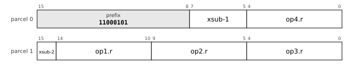

The chart is the leaf `32-R4-1`, R4, prefix `11000101`. `op1` is `reg5`: register, 5 bits. `op2` is `reg5`: register, 5 bits. `op3` is `reg5`: register, 5 bits. `op4` is `reg5`: register, 5 bits. `xsub` selects the mnemonic.

**All the layouts of this entry** (a chart for each, with its fields and the sub-opcode of each mnemonic, in [the bit layouts of every opcode](dictionary/by-encoding.md)): [`32-R4-1`](dictionary/by-encoding.md#32-R4-1).

**Operation**

```
Rd ← (Rm AND Ra) OR (NOT Rm AND Rb)       ; bit by bit
```

**Flags** None written.

**Exceptions** None.

*(P)* In the crypto proposal (`docs/crypto-secure-core.md` section 3.2), marked "adopt" there and not separately confirmed by the author; the reference executor implements it. `Ch(e, f, g)` of SHA-2 is `BSEL e, f, g`; `Maj(a, b, c)` is `BSEL (a XOR b), c, b`; a mask-controlled swap of two registers is two `BSEL`. Three sources and a destination: the four register fields of the three-operand group.

**Why it is here.** A bit select takes three sources and a destination, the four register fields of the three-operand group. Its case in the crypto proposal is SHA-2 (`Ch` and `Maj` are one `BSEL` each) and the constant-time swap: the X25519 ladder swaps ten limbs per step, 50 instructions with the mask pair against about 25 with `BSEL`. It is the select of ARM (`BSL`) and of x86 ternary logic, and it serves MD5 and SHA-1 round functions, blends and bit insertion. The proposal names it as the one instruction to drop "if the author wants fewer entities than the minimum", and the record does not show the author deciding it separately.

**Status** implemented in the reference executor (`common/pdp64exec.c` and `common/pdp64exec_enc.inc`, run by `sim64`; QEMU does not yet execute this encoding).


### AESR: AES round on a 128-bit block in two registers

**Mnemonics:** `AESES`, `AESESM`, `AESDS`, `AESDSM`

**Syntax**

```
AESES Ra, Rb, Rd
AESESM Ra, Rb, Rd
AESDS Ra, Rb, Rd
AESDSM Ra, Rb, Rd
```

**Encoding**


The chart is the leaf `32-R3-1`, R3, prefix `1110100001`. `op1` is `reg5`: register, 5 bits. `op2` is `reg5`: register, 5 bits. `op3` is `reg5`: register, 5 bits. `xsub` selects the mnemonic.

**All the layouts of this entry** (a chart for each, with its fields and the sub-opcode of each mnemonic, in [the bit layouts of every opcode](dictionary/by-encoding.md)): [`32-R3-1`](dictionary/by-encoding.md#32-R3-1).

**Operation**

```
the 16 bytes of the block are Rb:Ra (Ra holds bytes 0 to 7, columns 0 and 1; Rb bytes 8 to 15)
AESES  : ShiftRows, then SubBytes
AESESM : ShiftRows, SubBytes, then MixColumns
AESDS  : inverse ShiftRows, then inverse SubBytes
AESDSM : inverse ShiftRows, inverse SubBytes, then inverse MixColumns
Rd ← the 8 bytes of the new state that belong to columns 0 and 1; with Ra and Rb exchanged, columns 2 and 3
```

**Flags** None written.

**Exceptions** None.

*(P)* `docs/crypto-secure-core.md` section 3.2; the author approved the secure-core design and the select instructions (errata 86) and has not yet answered sections 3 to 5 of that document. Any two registers hold a block (no even-odd pairing): a round on one block is `AESESM Ra, Rb, T` and `AESESM Rb, Ra, Rb`, with the round key XORed by `XOR` with a memory operand. The latency is fixed and the instruction reads and writes no memory, so it has no cache-timing channel; the architecture does not say whether the S-box is a table inside the unit or a circuit. The definitions are those of FIPS 197 and must be checked against it before the text is final. **Not implemented** in the reference executor.

**Why it is here.** Constant-time software AES takes about 1,000 instructions a block (BearSSL's bitsliced code, scaled; the proposal's estimate), and table AES leaks through the cache. The author asked for constant-time AES and SHA instructions "or whichever opcodes would speed up and enable aes and sha" for the secure core (errata 85). The design is RISC-V's scalar cryptography (`aes64es` and its kin): the state is in the general registers, so no vector register file is needed and, unlike the AES drivers of OpenBSD for x86 and ARM, no `fpu_kernel_enter()` bracket either: a kernel AES loop saves nothing and is preemptible with the ordinary register save. A block costs 42 instructions for AES-128, 20 to 25 times fewer than the software sequence (estimates). Precedent for the pair-in-registers shape: RISC-V; the other machines (x86 AES-NI, ARM `AESE`) use vector registers.

**Cf.** docs/crypto-secure-core.md section 3.

**Status** specified; **not yet implemented** in the reference executor.


### AESK: AES key schedule steps

**Mnemonics:** `AESKS1`, `AESKS2`, `AESIM`

**Syntax**

```
AESKS1 Rs, #n, Rd
AESKS2 Ra, Rb, Rd
AESIM Rs, Rd
```

**Encoding**


The chart is the leaf `32-RRI-1`, RRI, prefix `111100000011`. `op1` is `reg5`: register, 5 bits. `op2` is `imm6u`: unsigned 6-bit immediate, 0 to 63. `op3` is `reg5`: register, 5 bits. `xsub` selects the mnemonic.

**All the layouts of this entry** (a chart for each, with its fields and the sub-opcode of each mnemonic, in [the bit layouts of every opcode](dictionary/by-encoding.md)): [`32-RRI-1`](dictionary/by-encoding.md#32-RRI-1), [`32-R3-1`](dictionary/by-encoding.md#32-R3-1), [`32-R2-1`](dictionary/by-encoding.md#32-R2-1).

**Operation**

```
AESKS1: Rd ← (SubWord(RotWord(Rs[63:32])) XOR rcon(n)), replicated in both halves   ; n = 10: no round constant (AES-256)
AESKS2: Rd[31:0] ← Ra[31:0] XOR Rb[63:32] ; Rd[63:32] ← Ra[63:32] XOR Rd[31:0]
AESIM : Rd ← InvMixColumns of the two columns in Rs         ; for the decryption key schedule
```

**Flags** None written.

**Exceptions** None.

*(P)* As `AESR`: `docs/crypto-secure-core.md` section 3.2, awaiting the author's answer. The key schedule of AES-128 takes three instructions per round. **Not implemented** in the reference executor.

**Why it is here.** The key schedule and the inverse mix of the round key complete the round instructions: three instructions per round of the AES-128 schedule, about 30 for the whole schedule instead of about 150, once per key; `AESIM` adds 18 for the decryption schedule. The same precedent as `AESR`.

**Status** specified; **not yet implemented** in the reference executor.


### SHA256: The SHA-256 functions

**Mnemonics:** `SHA256SIG0`, `SHA256SIG1`, `SHA256SUM0`, `SHA256SUM1`

**Syntax**

```
SHA256SIG0 Rs, Rd
SHA256SIG1 Rs, Rd
SHA256SUM0 Rs, Rd
SHA256SUM1 Rs, Rd
```

**Encoding**


The chart is the leaf `32-R2-1`, R2, prefix `111100000010`. `op1` is `reg5`: register, 5 bits. `op2` is `reg5`: register, 5 bits. `xsub` selects the mnemonic.

**All the layouts of this entry** (a chart for each, with its fields and the sub-opcode of each mnemonic, in [the bit layouts of every opcode](dictionary/by-encoding.md)): [`32-R2-1`](dictionary/by-encoding.md#32-R2-1).

**Operation**

```
on the low 32 bits x of Rs; the result is in the low 32 bits of Rd, the upper bits zero
SIG0: ror(x,7)  XOR ror(x,18) XOR shr(x,3)
SIG1: ror(x,17) XOR ror(x,19) XOR shr(x,10)
SUM0: ror(x,2)  XOR ror(x,13) XOR ror(x,22)
SUM1: ror(x,6)  XOR ror(x,11) XOR ror(x,25)
```

**Flags** None written.

**Exceptions** None.

*(P)* `docs/crypto-secure-core.md` section 3.2, awaiting the author's answer. The result is zero-extended there; every other 32-bit result of the machine is sign-extended (`RORI32`), so the choice is open. Rotations and three-input exclusive ors, one cycle in hardware, no data-dependent timing. **Not implemented** in the reference executor.

**Why it is here.** The SHA-2 rounds are rotations and three-input exclusive ors, which the integer instructions do in several steps; the RISC-V scalar cryptography extension has the eight functions as instructions. The crypto proposal counts the gain honestly: the primitives remove half the work, not nineteen twentieths, because a round still needs the adds and the register traffic (about 1,200 against 2,500 instructions for a 64-byte block with `BSEL`, estimates).

**Status** specified; **not yet implemented** in the reference executor.


### SHA512: The SHA-512 functions

**Mnemonics:** `SHA512SIG0`, `SHA512SIG1`, `SHA512SUM0`, `SHA512SUM1`

**Syntax**

```
SHA512SIG0 Rs, Rd
SHA512SIG1 Rs, Rd
SHA512SUM0 Rs, Rd
SHA512SUM1 Rs, Rd
```

**Encoding**


The chart is the leaf `32-R2-1`, R2, prefix `111100000010`. `op1` is `reg5`: register, 5 bits. `op2` is `reg5`: register, 5 bits. `xsub` selects the mnemonic.

**All the layouts of this entry** (a chart for each, with its fields and the sub-opcode of each mnemonic, in [the bit layouts of every opcode](dictionary/by-encoding.md)): [`32-R2-1`](dictionary/by-encoding.md#32-R2-1).

**Operation**

```
on the 64 bits x of Rs
SIG0: ror(x,1)  XOR ror(x,8)  XOR shr(x,7)
SIG1: ror(x,19) XOR ror(x,61) XOR shr(x,6)
SUM0: ror(x,28) XOR ror(x,34) XOR ror(x,39)
SUM1: ror(x,14) XOR ror(x,18) XOR ror(x,41)
```

**Flags** None written.

**Exceptions** None.

*(P)* As `SHA256`. **Not implemented** in the reference executor.

**Why it is here.** See `SHA256`: the four 64-bit functions of SHA-512, with the same gain of about two (about 1,500 against 3,100 instructions for a 128-byte block, estimates).

**Status** specified; **not yet implemented** in the reference executor.
<!-- /entries:9.9 -->

## 9.10 Branches and control flow

*Cf. section 6.7 for `TRAP`, `RTI` and `RTT`, and section 6.2 for how a trap enters the kernel; section 9.16 for `CALLI` and `JMPI` in position-independent code.*

**9.10.1** There is an unconditional branch `BR` and fourteen conditional branches, two bytes with an 8-bit displacement, four with 16 bits, six with 32 bits, counting two-byte parcels from the first parcel of the branch: ±256 bytes, ±64 KB, ±4 GB. *(opcodes `110000 (0x30)`-`111110 (0x3E)`)*

**9.10.2** The conditions are `ne`, `eq`, `pl`, `mi`, `vc`, `vs`, `cc`/`hs`, `cs`/`lo`, `ge`, `lt`, `gt`, `le`, `hi` and `los`.

**9.10.3** `SOB Rn, dst` subtracts one from `Rn` and branches if the result is nonzero, forward or backward. *(opcode `111111 (0x3F)`)*

**9.10.4** `CBCC` compares a register with a 5-bit immediate and branches (four bytes, ±1024 parcels); `CBW` takes a 16-bit immediate and a 16-bit displacement (six bytes); `CBRR` compares two registers and branches. None writes the flags. *(D)*

**9.10.5** `JMP` and `CALL` take any address mode; `RET` returns; `JMPI` and `CALLI` jump and call through a pointer in memory; `JTAG` dispatches on the tag in the low three bits of a register; `BTAG` and `BNTAG` branch on a tag. *(D)*

**9.10.6** A call pushes the return address on the stack; there is no link register. *(D)*

*Commentary.* **Precedent.** The complete PDP-11 branch set, which the long-branch problem of the PDP-11 (±256 bytes) made awkward, here reaches ±4 GB with no long-branch opcode and no trampoline, because the displacement widens with the length. `SOB` was the PDP-11's, which could only branch backward. **Trade-offs.** A compare-and-branch that writes no flags cannot feed a second branch that reads them, so a three-way compare is compare-then-branch; the compiler fuses only where the flags are dead afterwards, which costs about 0.4% in code size. **Improvements.** The tag branches serve a Lisp or other tagged runtime in one instruction. **Benefits.** Branch relaxation in the assembler is choosing a length. **Modern comparables.** RISC-V and MIPS are compare-and-branch machines with no flags; AArch64 has `CBZ` and `TBZ`; x86 uses flags like the pdp64's branches. **Use.** `JMPI` and `CALLI` are the shared-library call and the virtual call; `JTAG` is the dispatch of a dynamic-language interpreter. **Impact.** *Kernel:* `JMPI`, `CALLI` and `JTAG` are the shared-library call, the virtual call and the dispatch of an interpreter; `SOB` and `CBCC` are the loops of the kernel's inner routines. *Compiler:* Branch relaxation is choosing a length; fusing a compare and a branch is legal only where the flags are dead afterwards, so the compiler needs a flag-liveness analysis. *Hardware:* The next-PC mux takes the load-return path for the indirect forms; the compare-and-branch compare runs in the branch unit beside the ALU; displacements count parcels, so no shifter is needed.

<!-- entries:9.10 -->
### BCC: Branch on condition

**Mnemonics:** `BR`, `BNE`, `BEQ`, `BPL`, `BMI`, `BVC`, `BVS`, `BCC`, `BCS`, `BGE`, `BLT`, `BGT`, `BLE`, `BHI`, `BLOS`  (aliases: `BHIS`, `BLO`)

**Syntax**

```
BR target
BNE target
BEQ target ... and the rest
```

**Encoding**

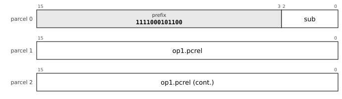

The chart is the leaf `32-BRF-1`, BRF, prefix `1111000101100`. `op1` is `pc32-u2`: pc-relative, 32 bits counted in 2-byte units (-4294967296 to 4294967294 bytes). `sub` (3 bits) selects the mnemonic: `br` 000, `bne` 001, `beq` 010, `bpl` 011, `bmi` 100, `bvc` 101, `bvs` 110, `bcc` 111.

**All the layouts of this entry** (a chart for each, with its fields and the sub-opcode of each mnemonic, in [the bit layouts of every opcode](dictionary/by-encoding.md)): [`32-BRF-1`](dictionary/by-encoding.md#32-BRF-1), [`32-BR2-16-a-1`](dictionary/by-encoding.md#32-BR2-16-a-1), [`32-BR1-6-a-1`](dictionary/by-encoding.md#32-BR1-6-a-1), [`32-BR1-7-a-1`](dictionary/by-encoding.md#32-BR1-7-a-1), [`32-BR1-8-a-1`](dictionary/by-encoding.md#32-BR1-8-a-1), [`32-BR1-9-a-1`](dictionary/by-encoding.md#32-BR1-9-a-1), [`32-BR2-16-b-1`](dictionary/by-encoding.md#32-BR2-16-b-1), [`32-BR1-6-b-1`](dictionary/by-encoding.md#32-BR1-6-b-1), [`32-BR2-16-c-1`](dictionary/by-encoding.md#32-BR2-16-c-1), [`32-BRF-2`](dictionary/by-encoding.md#32-BRF-2), [`32-BR2-16-c-2`](dictionary/by-encoding.md#32-BR2-16-c-2), [`32-BRF-3`](dictionary/by-encoding.md#32-BRF-3), [`32-BRF-4`](dictionary/by-encoding.md#32-BRF-4).

**Operation**

```
if cond(c) then PC ← address of this instruction + 2 × disp
```

**Flags** None written.

**Exceptions** None; a branch to an unmapped or non-executable address faults on the fetch of the target.

Condition numbers: `al` 0 (`BR`), `ne` 1, `eq` 2, `pl` 3, `mi` 4, `vc` 5, `vs` 6, `cc`/`hs` 7, `cs`/`lo` 8, `ge` 9, `lt` 10, `gt` 11, `le` 12, `hi` 13, `los` 14. Conditions on the flags: `ne` `!Z`; `eq` `Z`; `pl` `!N`; `mi` `N`; `vc` `!V`; `vs` `V`; `cc` `!C`; `cs` `C`; `ge` `N == V`; `lt` `N != V`; `gt` `!Z and N == V`; `le` `Z or N != V`; `hi` `!C and !Z`; `los` `C or Z`. The displacement counts 2-byte parcels; the reach of each form is in its chart.

**Cf.** 6.7 for `TRAP`, `RTI` and `RTT`.

**Status** implemented in the reference executor (`common/pdp64exec.c` and `common/pdp64exec_enc.inc`, run by `sim64`; QEMU does not yet execute this encoding).


### SOB: Subtract one and branch

**Mnemonics:** `SOB`

**Syntax**

```
SOB Rn, target
```

**Encoding**

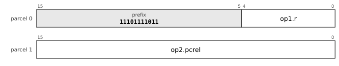

The chart is the leaf `32-SOB-1`, SOB, prefix `11101111011`. `op1` is `reg5`: register, 5 bits. `op2` is `pc16-u2`: pc-relative, 16 bits counted in 2-byte units (-65536 to 65534 bytes).

**All the layouts of this entry** (a chart for each, with its fields and the sub-opcode of each mnemonic, in [the bit layouts of every opcode](dictionary/by-encoding.md)): [`32-SOB-1`](dictionary/by-encoding.md#32-SOB-1).

**Operation**

```
Rn ← Rn - 1
if Rn ≠ 0 then PC ← address of this instruction + 2 × disp
```

**Flags** None written.

**Exceptions** None.

From the PDP-11, where it could branch only backward; here the signed displacement goes either way. Four bytes at least.

**Why it is here.** The PDP-11's could only branch backward (a 6-bit unsigned displacement); this one branches either way. Against the `cbnz` idiom of other architectures it does not save bytes (`DEC` plus `BNE` is also four) but it saves an instruction issue, a cycle per iteration on a machine that does not pipeline: same size, one instruction fewer (static `dec; bne` pairs exist).

**Status** implemented in the reference executor (`common/pdp64exec.c` and `common/pdp64exec_enc.inc`, run by `sim64`; QEMU does not yet execute this encoding).


### CBCC: Compare and branch on condition

**Mnemonics:** `CBNE`, `CBEQ`, `CBPL`, `CBMI`, `CBVC`, `CBVS`, `CBCC`, `CBCS`, `CBGE`, `CBLT`, `CBGT`, `CBLE`, `CBHI`, `CBLOS`  (aliases: `CBHIS`, `CBLO`)

**Syntax**

```
CBNE Rd, #imm, target
CBEQ Ra, Rb, target ... and the rest
```

**Encoding**

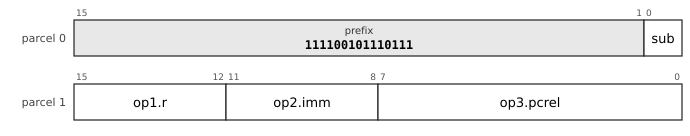

The chart is the leaf `32-CBI4-8H-a-1`, CBI4_8H/a, prefix `111100101110111`. `op1` is `reg4`: register, 4 bits (an index into the hot-register table). `op2` is `imm4s`: signed 4-bit immediate, -8 to 7. `op3` is `pc8-u2`: pc-relative, 8 bits counted in 2-byte units (-256 to 254 bytes). `sub` (1 bit) selects the mnemonic: `cbeq` 0, `cbne` 1.

**All the layouts of this entry** (a chart for each, with its fields and the sub-opcode of each mnemonic, in [the bit layouts of every opcode](dictionary/by-encoding.md)): [`32-CBI4-8H-a-1`](dictionary/by-encoding.md#32-CBI4-8H-a-1), [`32-CBR8H-a-1`](dictionary/by-encoding.md#32-CBR8H-a-1), [`32-CBZ2-12H-a-1`](dictionary/by-encoding.md#32-CBZ2-12H-a-1), [`32-CBI5-8H-a-1`](dictionary/by-encoding.md#32-CBI5-8H-a-1), [`32-CBI3-8-a-1`](dictionary/by-encoding.md#32-CBI3-8-a-1), [`32-CBI6-8H-a-1`](dictionary/by-encoding.md#32-CBI6-8H-a-1), [`32-CBI10-8H-a-1`](dictionary/by-encoding.md#32-CBI10-8H-a-1), [`32-CB3I8-20H-a-1`](dictionary/by-encoding.md#32-CB3I8-20H-a-1), [`32-CB3R24H-a-1`](dictionary/by-encoding.md#32-CB3R24H-a-1), [`32-CBI5-10H-a-1`](dictionary/by-encoding.md#32-CBI5-10H-a-1), [`32-CBR8-a-1`](dictionary/by-encoding.md#32-CBR8-a-1), [`32-CB3I16-12-a-1`](dictionary/by-encoding.md#32-CB3I16-12-a-1), [`32-CBZ1-4-a-1`](dictionary/by-encoding.md#32-CBZ1-4-a-1), [`32-CBI6-10H-a-1`](dictionary/by-encoding.md#32-CBI6-10H-a-1), [`32-CBR10H-a-1`](dictionary/by-encoding.md#32-CBR10H-a-1), [`32-CBI8-10H-a-1`](dictionary/by-encoding.md#32-CBI8-10H-a-1), [`32-CBI3-12H-a-1`](dictionary/by-encoding.md#32-CBI3-12H-a-1), [`32-CBI3-10-a-1`](dictionary/by-encoding.md#32-CBI3-10-a-1), [`32-CBZ2-14H-a-1`](dictionary/by-encoding.md#32-CBZ2-14H-a-1), [`32-CBI4-8-a-1`](dictionary/by-encoding.md#32-CBI4-8-a-1), [`32-CBI5-8-a-1`](dictionary/by-encoding.md#32-CBI5-8-a-1), [`32-CBDI-1`](dictionary/by-encoding.md#32-CBDI-1), [`32-CBDR-1`](dictionary/by-encoding.md#32-CBDR-1), [`32-CBR8H-c-1`](dictionary/by-encoding.md#32-CBR8H-c-1), [`32-CB3I16-12H-c-1`](dictionary/by-encoding.md#32-CB3I16-12H-c-1), [`32-CBI4-8H-c-1`](dictionary/by-encoding.md#32-CBI4-8H-c-1), [`32-CBR8-c-1`](dictionary/by-encoding.md#32-CBR8-c-1), [`32-CB3R24H-c-1`](dictionary/by-encoding.md#32-CB3R24H-c-1), [`32-CBI6-8H-c-1`](dictionary/by-encoding.md#32-CBI6-8H-c-1), [`32-CB3I12-16-c-1`](dictionary/by-encoding.md#32-CB3I12-16-c-1), [`32-CBR10H-c-1`](dictionary/by-encoding.md#32-CBR10H-c-1), [`32-CBI8-8H-c-1`](dictionary/by-encoding.md#32-CBI8-8H-c-1), [`32-CBI4-10H-c-1`](dictionary/by-encoding.md#32-CBI4-10H-c-1), [`32-CBI3-8-c-1`](dictionary/by-encoding.md#32-CBI3-8-c-1), [`32-CB3I16-12H-b-1`](dictionary/by-encoding.md#32-CB3I16-12H-b-1), [`32-CBR8H-b-1`](dictionary/by-encoding.md#32-CBR8H-b-1), [`32-CBI8-8H-b-1`](dictionary/by-encoding.md#32-CBI8-8H-b-1), [`32-CBZ2-12H-b-1`](dictionary/by-encoding.md#32-CBZ2-12H-b-1), [`32-CB3I8-20-b-1`](dictionary/by-encoding.md#32-CB3I8-20-b-1), [`32-CBR8-b-1`](dictionary/by-encoding.md#32-CBR8-b-1), [`32-CBI3-8-b-1`](dictionary/by-encoding.md#32-CBI3-8-b-1), [`32-CBI4-10H-b-1`](dictionary/by-encoding.md#32-CBI4-10H-b-1), [`32-CB3R24H-b-1`](dictionary/by-encoding.md#32-CB3R24H-b-1), [`32-CBI4-8-b-1`](dictionary/by-encoding.md#32-CBI4-8-b-1).

**Operation**

```
tmp ← Rd - (imm or Rb)         ; as CMP, for the decision only
if cond(c) on that comparison then PC ← address of this instruction + 2 × disp
```

**Flags** **None written**: the instruction computes the comparison for its own decision and leaves `N Z V C` as they were.

**Exceptions** None.

The family has several forms for each condition (the layouts of this entry): the second operand is a register or an immediate of some width, and the reach differs. A `cbCC` that no form reaches is assembled by `as64` as `CMP` and `bCC`, which **writes the flags** (errata 87, assumption 6; the integration measured 4 such sites in 34,387 for pdp64/16 and 17 in 34,524 for pdp64/32, errata 90).

**Why it is here.** It is not a replacement for flags: LoongArch and RISC-V chose fused compare-and-branch instead of flags, and this architecture declines that (9.20) because it needs a comparator in the branch unit and a third read port; here the fused form is added beside the flags. `CBCC` writes no flags.

**Status** implemented in the reference executor (`common/pdp64exec.c` and `common/pdp64exec_enc.inc`, run by `sim64`; QEMU does not yet execute this encoding).


### BTAG: Branch on pointer tag

**Mnemonics:** `BTAG`, `BNTAG`

**Syntax**

```
BTAG Rn, #tag, target
BNTAG Rn, #tag, target
```

**Encoding**

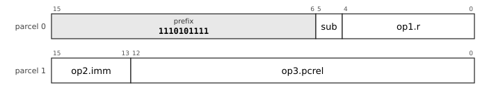

The chart is the leaf `32-TAG-1`, TAG, prefix `1110101111`. `op1` is `reg5`: register, 5 bits. `op2` is `imm3u`: unsigned 3-bit immediate, 0 to 7. `op3` is `pc13-u2`: pc-relative, 13 bits counted in 2-byte units (-8192 to 8190 bytes). `sub` (1 bit) selects the mnemonic: `btag` 0, `bntag` 1.

**All the layouts of this entry** (a chart for each, with its fields and the sub-opcode of each mnemonic, in [the bit layouts of every opcode](dictionary/by-encoding.md)): [`32-TAG-1`](dictionary/by-encoding.md#32-TAG-1).

**Operation**

```
BTAG : if (Rn & 111₂) = tag then PC ← address of this instruction + 2 × disp
BNTAG: if (Rn & 111₂) ≠ tag then PC ← address of this instruction + 2 × disp
```

**Flags** None written.

**Exceptions** None.

For runtimes that keep a 3-bit type tag in the low bits of a pointer (`lowtag`). The displacement is signed and counts parcels.

**Why it is here.** Because quad-aligned objects have zero in the low three bits, the tag is free, and an unaligned access is a fault. The compiler for C never emits them (the corpus shows none); they are for Lisp and other tagged runtimes.

**Status** implemented in the reference executor (`common/pdp64exec.c` and `common/pdp64exec_enc.inc`, run by `sim64`; QEMU does not yet execute this encoding).


### JMP: Jump

**Mnemonics:** `JMP`

**Syntax**

```
JMP rm        ; a register, or an address by any memory mode
```

**Encoding**


The chart is the leaf `32-SOF-B28-1`, SOF.B28, prefix `11101110111`. `op1` is `b5d28s-x1`: memory at base register, 5 bits + signed 28-bit displacement times 1, -134217728 to 134217727 bytes. `sub` (4 bits) selects the mnemonic: `clr` 0000, `com` 0001, `inc` 0010, `dec` 0011, `neg` 0100, `tst` 0101, `adc` 0110, `sbc` 0111, `asl` 1000, `asr` 1001, `push` 1010, `pop` 1011, `jmp` 1100, `call` 1101, `jmpi` 1110, `calli` 1111.

**All the layouts of this entry** (a chart for each, with its fields and the sub-opcode of each mnemonic, in [the bit layouts of every opcode](dictionary/by-encoding.md)): [`32-SOF-B28-1`](dictionary/by-encoding.md#32-SOF-B28-1), [`32-SOF-X22-1`](dictionary/by-encoding.md#32-SOF-X22-1), [`32-SOF-PI12-1`](dictionary/by-encoding.md#32-SOF-PI12-1), [`32-SOF-PD12-1`](dictionary/by-encoding.md#32-SOF-PD12-1), [`32-SOF-PC32-1`](dictionary/by-encoding.md#32-SOF-PC32-1), [`32-SOF-A32-1`](dictionary/by-encoding.md#32-SOF-A32-1), [`32-CALLF-1`](dictionary/by-encoding.md#32-CALLF-1), [`32-SOPR-3`](dictionary/by-encoding.md#32-SOPR-3), [`32-CALL2-16-j-1`](dictionary/by-encoding.md#32-CALL2-16-j-1), [`32-SOBu12H-x-1`](dictionary/by-encoding.md#32-SOBu12H-x-1), [`32-SOBs12-x-1`](dictionary/by-encoding.md#32-SOBs12-x-1), [`32-SOX4-x-1`](dictionary/by-encoding.md#32-SOX4-x-1).

**Operation**

```
PC ← (register operand) ? Rm : EA(rm)
```

**Flags** None written.

**Exceptions** A jump to an unmapped or non-executable address faults on the fetch of the target.

A switch is a `CMP` against the limit, a `BHIS` to the default and a `JMP` through a scaled index.

**Status** implemented in the reference executor (`common/pdp64exec.c` and `common/pdp64exec_enc.inc`, run by `sim64`; QEMU does not yet execute this encoding).


### CALL: Call

**Mnemonics:** `CALL`

**Syntax**

```
CALL rm
```

**Encoding**


The chart is the leaf `32-SOF-B28-1`, SOF.B28, prefix `11101110111`. `op1` is `b5d28s-x1`: memory at base register, 5 bits + signed 28-bit displacement times 1, -134217728 to 134217727 bytes. `sub` (4 bits) selects the mnemonic: `clr` 0000, `com` 0001, `inc` 0010, `dec` 0011, `neg` 0100, `tst` 0101, `adc` 0110, `sbc` 0111, `asl` 1000, `asr` 1001, `push` 1010, `pop` 1011, `jmp` 1100, `call` 1101, `jmpi` 1110, `calli` 1111.

**All the layouts of this entry** (a chart for each, with its fields and the sub-opcode of each mnemonic, in [the bit layouts of every opcode](dictionary/by-encoding.md)): [`32-SOF-B28-1`](dictionary/by-encoding.md#32-SOF-B28-1), [`32-SOF-X22-1`](dictionary/by-encoding.md#32-SOF-X22-1), [`32-SOF-PI12-1`](dictionary/by-encoding.md#32-SOF-PI12-1), [`32-SOF-PD12-1`](dictionary/by-encoding.md#32-SOF-PD12-1), [`32-SOF-PC32-1`](dictionary/by-encoding.md#32-SOF-PC32-1), [`32-SOF-A32-1`](dictionary/by-encoding.md#32-SOF-A32-1), [`32-CALLF-1`](dictionary/by-encoding.md#32-CALLF-1), [`32-SOPR-3`](dictionary/by-encoding.md#32-SOPR-3), [`32-CALL2-16-c-1`](dictionary/by-encoding.md#32-CALL2-16-c-1), [`32-CALL2-18-c-1`](dictionary/by-encoding.md#32-CALL2-18-c-1), [`32-SOBu12H-x-1`](dictionary/by-encoding.md#32-SOBu12H-x-1), [`32-SOBs12-x-1`](dictionary/by-encoding.md#32-SOBs12-x-1), [`32-SOX4-x-1`](dictionary/by-encoding.md#32-SOX4-x-1).

**Operation**

```
t ← (register operand) ? Rm : EA(rm)
SP ← SP - 8 ; M[SP] ← address of the next instruction
PC ← t
```

**Flags** None written.

**Exceptions** Memory operand: page fault, protection fault, alignment fault or bus error (a read of non-existent memory is a precise abort with cause `BUSFAULT`). Every such fault is precise and the instruction restarts after it, because the register update of an auto-increment or auto-decrement mode is held until the instruction retires.

The return address is on the data stack where every unwinder and debugger expects it. `RET` pops it.

**Status** implemented in the reference executor (`common/pdp64exec.c` and `common/pdp64exec_enc.inc`, run by `sim64`; QEMU does not yet execute this encoding).


### JMPI: Jump and call through memory

**Mnemonics:** `JMPI`, `CALLI`

**Syntax**

```
JMPI rm        ; PC ← M[EA]
CALLI rm       ; push the return address, then PC ← M[EA]
```

**Encoding**


The chart is the leaf `32-SOF-B28-1`, SOF.B28, prefix `11101110111`. `op1` is `b5d28s-x1`: memory at base register, 5 bits + signed 28-bit displacement times 1, -134217728 to 134217727 bytes. `sub` (4 bits) selects the mnemonic: `clr` 0000, `com` 0001, `inc` 0010, `dec` 0011, `neg` 0100, `tst` 0101, `adc` 0110, `sbc` 0111, `asl` 1000, `asr` 1001, `push` 1010, `pop` 1011, `jmp` 1100, `call` 1101, `jmpi` 1110, `calli` 1111.

**All the layouts of this entry** (a chart for each, with its fields and the sub-opcode of each mnemonic, in [the bit layouts of every opcode](dictionary/by-encoding.md)): [`32-SOF-B28-1`](dictionary/by-encoding.md#32-SOF-B28-1), [`32-SOF-X22-1`](dictionary/by-encoding.md#32-SOF-X22-1), [`32-SOF-PI12-1`](dictionary/by-encoding.md#32-SOF-PI12-1), [`32-SOF-PD12-1`](dictionary/by-encoding.md#32-SOF-PD12-1), [`32-SOF-PC32-1`](dictionary/by-encoding.md#32-SOF-PC32-1), [`32-SOF-A32-1`](dictionary/by-encoding.md#32-SOF-A32-1), [`32-SOBu12H-x-1`](dictionary/by-encoding.md#32-SOBu12H-x-1), [`32-SOBs12-x-1`](dictionary/by-encoding.md#32-SOBs12-x-1), [`32-SOX4-x-1`](dictionary/by-encoding.md#32-SOX4-x-1).

**Operation**

```
JMPI : PC ← M[EA(rm)]
CALLI: t ← M[EA(rm)] ; SP ← SP - 8 ; M[SP] ← address of the next instruction ; PC ← t
```

**Flags** None written.

**Exceptions** Memory operand: page fault, protection fault, alignment fault or bus error (a read of non-existent memory is a precise abort with cause `BUSFAULT`). Every such fault is precise and the instruction restarts after it, because the register update of an auto-increment or auto-decrement mode is held until the instruction retires. For `CALLI` the order is specified: load the target, then push, then transfer; a fault on the load leaves nothing changed.

The one deferred reference the architecture admits, for control transfer only: the PLT stub (`JMPI got_slot(PC)`) and virtual-method dispatch (`CALLI vtbl_off(Robj)`). It needs a memory operand.

**Why it is here.** It is admitted because it breaks none of the reasons deferred modes are removed (no register is side-effected, the reference is in the branch path and not the operand path, a fault is clean by ordering).

**Status** implemented in the reference executor (`common/pdp64exec.c` and `common/pdp64exec_enc.inc`, run by `sim64`; QEMU does not yet execute this encoding).


### JTAG: Jump through a tag table

**Mnemonics:** `JTAG`

**Syntax**

```
JTAG d(Rb)(Rx×s)
```

**Encoding**

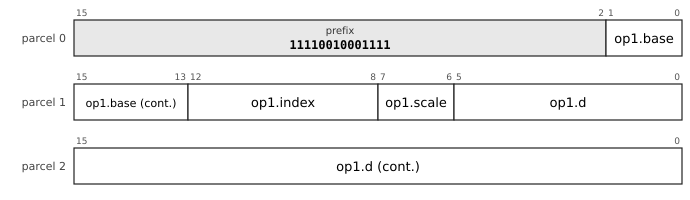

The chart is the leaf `32-JTAG3-1`, JTAG3, prefix `11110010001111`. `op1` is `x5-5d22s`: memory at base + (index << scale) + signed 22-bit displacement; base register, 5 bits, index register, 5 bits.

**All the layouts of this entry** (a chart for each, with its fields and the sub-opcode of each mnemonic, in [the bit layouts of every opcode](dictionary/by-encoding.md)): [`32-JTAG3-1`](dictionary/by-encoding.md#32-JTAG3-1), [`32-JTAG2-1`](dictionary/by-encoding.md#32-JTAG2-1).

**Operation**

```
PC ← M[Rb + d + 8 × (Rx & 111₂)]
```

**Flags** None written.

**Exceptions** Memory operand: page fault, protection fault, alignment fault or bus error (a read of non-existent memory is a precise abort with cause `BUSFAULT`). Every such fault is precise and the instruction restarts after it, because the register update of an auto-increment or auto-decrement mode is held until the instruction retires.

Legal only with the scaled-index mode (`0001`). Dispatches on the low three bits of a tagged pointer through a table of eight entries; the 3-bit tag cannot index out of range.

**Why it is here.** The table-dispatch partner of `BTAG`. It is legal only in the scaled-index mode, the one mode with a free register slot for the tagged value. It replaces the PDP-11 dispatch-table idiom `@(Rn)+` better, because it needs no pointer register and cannot index out of range.

**Status** implemented in the reference executor (`common/pdp64exec.c` and `common/pdp64exec_enc.inc`, run by `sim64`; QEMU does not yet execute this encoding).


### MOVCALL: Move a register and call

**Mnemonics:** `MOVCALL`

**Syntax**

```
MOVCALL Rs, Rd, target
```

**Encoding**

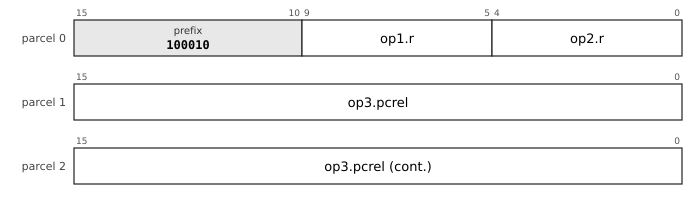

The chart is the leaf `32-FX-MOVCALL3-1`, FX.MOVCALL3, prefix `100010`. `op1` is `reg5`: register, 5 bits. `op2` is `reg5`: register, 5 bits. `op3` is `pc32-u2`: pc-relative, 32 bits counted in 2-byte units (-4294967296 to 4294967294 bytes).

**All the layouts of this entry** (a chart for each, with its fields and the sub-opcode of each mnemonic, in [the bit layouts of every opcode](dictionary/by-encoding.md)): [`32-FX-MOVCALL3-1`](dictionary/by-encoding.md#32-FX-MOVCALL3-1), [`32-FX-MOVCALL2-1`](dictionary/by-encoding.md#32-FX-MOVCALL2-1).

**Operation**

```
Rd ← Rs
SP ← SP - 8 ; M[SP] ← address of the next instruction
PC ← target
```

**Flags** None written.

**Exceptions** The store of the return address can fault (the memory faults of `CALL`): the instruction restarts whole, because the first half reads a register that the second half does not change.

*(D)* One of the four fused pairs of errata 87: `MOVQ Rs, Rd` followed by `CALL target`, in one instruction. The target is a pc-relative field in parcels, measured from the first parcel of the fused instruction (errata 87, assumption 9); the instruction is two parcels (a 16-bit field) or three (a 32-bit field), and the linker grows it from its shortest form like a `CALL` (`docs/relaxation.md`). **The assembler never fuses**: the compiler writes `MOVCALL` where it wants it. An instruction that writes two registers (`Rd` and the stack pointer) and stores to memory is a two-micro-operation instruction for an out-of-order core (errata 87).

**Why it is here.** The author decided the four fused pairs in errata 87 (`movcall`, `popmret`, `popret`, `mov2`) and left the fusing to the compiler: the assembler never fuses. The reason is the measurement of `docs/encoding-proposal.md` section 8 (static size of the training corpus, in pdp64/16 and pdp64/32): `MOVQ Rs, Rd` followed by `CALL` occurs 11,123 times, and fusing it alone shrinks the code by 2.19% (pdp64/16) and 2.39% (pdp64/32), the largest of the four; all four together fuse 20,428 pairs and save 3.29% and 3.18% of the bytes and about 1.1% of the executed instructions. The call keeps its reach (four or six bytes). The cost, named in the proposal: a new mnemonic, and one instruction that writes two registers (the destination and the stack pointer), which is two micro-operations for an out-of-order core. The record gives no earlier machine for this particular pair; the reasoning is the fourth priority of the definitive list (errata 83), fewer instructions executed, where coalescing is good.

**Cf.** 9.5 (the pc-relative operand and the relaxation), 6.2 (restart after a fault).

**Status** implemented in the reference executor (`common/pdp64exec.c` and `common/pdp64exec_enc.inc`, run by `sim64`; QEMU does not yet execute this encoding).


### POPRET: Pop a register and return

**Mnemonics:** `POPRET`

**Syntax**

```
POPRET Rd
```

**Encoding**


The chart is the leaf `32-FX-POPRET-1`, FX.POPRET, prefix `11101111100`. `op1` is `reg5`: register, 5 bits.

**All the layouts of this entry** (a chart for each, with its fields and the sub-opcode of each mnemonic, in [the bit layouts of every opcode](dictionary/by-encoding.md)): [`32-FX-POPRET-1`](dictionary/by-encoding.md#32-FX-POPRET-1).

**Operation**

```
Rd ← M[SP] ; SP ← SP + 8
PC ← M[SP] ; SP ← SP + 8
```

**Flags** None written.

**Exceptions** Memory operand: page fault, protection fault, alignment fault or bus error (a read of non-existent memory is a precise abort with cause `BUSFAULT`). Every such fault is precise and the instruction restarts after it, because the register update of an auto-increment or auto-decrement mode is held until the instruction retires.

*(D)* `POP Rd` followed by `RET`, fused (errata 87). The register is the one the function restores last, usually a callee-saved register or the frame pointer. One parcel of 16 bits at pdp64/16 with the register in a 4-bit field; at pdp64/32 the 5-bit field makes the prefix one bit shorter.

**Why it is here.** The author decided the four fused pairs in errata 87 (`movcall`, `popmret`, `popret`, `mov2`) and left the fusing to the compiler: the assembler never fuses. The reason is the measurement of `docs/encoding-proposal.md` section 8 (static size of the training corpus, in pdp64/16 and pdp64/32): `POP Rd` followed by `RET` and `POPM` followed by `RET` (`POPMRET`) occur 4,862 times together and save 0.95% (pdp64/16) and 1.00% (pdp64/32); this is the epilogue of nearly every function. The fault of the second half restarts the whole instruction, which is idempotent because the first half reads a register the second does not change and `POPM` is already specified restartable (the proposal's decision 2).

**Status** implemented in the reference executor (`common/pdp64exec.c` and `common/pdp64exec_enc.inc`, run by `sim64`; QEMU does not yet execute this encoding).


### POPMRET: Pop several registers and return

**Mnemonics:** `POPMRET`

**Syntax**

```
POPMRET #mask
```

**Encoding**


The chart is the leaf `32-FX-POPMRET-1`, FX.POPMRET, prefix `11010110`. `op1` is `imm8u-x256`: unsigned 8-bit immediate times 256, 0 to 65280.

**All the layouts of this entry** (a chart for each, with its fields and the sub-opcode of each mnemonic, in [the bit layouts of every opcode](dictionary/by-encoding.md)): [`32-FX-POPMRET-1`](dictionary/by-encoding.md#32-FX-POPMRET-1).

**Operation**

```
for each bit i set in mask, highest register first:
    Ri ← M[SP] ; SP ← SP + 8
PC ← M[SP] ; SP ← SP + 8
```

**Flags** None written.

**Exceptions** Memory operand: page fault, protection fault, alignment fault or bus error (a read of non-existent memory is a precise abort with cause `BUSFAULT`). Every such fault is precise and the instruction restarts after it, because the register update of an auto-increment or auto-decrement mode is held until the instruction retires. A fault after some registers have been popped leaves them popped: the instruction restarts whole and pops them again, which is idempotent because the stack pointer is restored with the rest of the state at the start of the instruction.

*(D)* `POPM #mask` followed by `RET`, fused (errata 87): the epilogue of every function that saved registers with `PUSHM`. The mask is an 8-bit field scaled by 256, so the instruction names `R8` to `R15`; any other set of registers is `POPM` and `RET`. One parcel.

**Why it is here.** See `POPRET`: the two are measured together (4,862 pairs, 0.95% and 1.00% of the bytes). The mask is an 8-bit field scaled by 256 because one parcel has no room for a wider one; the epilogue that restores `R8` to `R15` is the common case the corpus shows, and any other set stays `POPM` and `RET`.

**Status** implemented in the reference executor (`common/pdp64exec.c` and `common/pdp64exec_enc.inc`, run by `sim64`; QEMU does not yet execute this encoding).
<!-- /entries:9.10 -->

## 9.11 The stack and block operations

*Cf. section 6.8 for restarting a block operation after a fault (progress is held in registers) and section 6.4 for the page faults it can take; section 7.2 for how block operations order their accesses.*

**9.11.1** `PUSH` and `POP` move one register; `PUSHM` and `POPM` move a set named by a mask (a short mask form is in page 2). A mask containing `R14` is reserved. *(D)*

**9.11.2** `PUSHX` and `POPX` save and restore the exception state `EPSW` and `EPC` in one instruction each; both words are checked before either is accessed, so an abort leaves nothing changed. *(D)*

**9.11.3** The block operations `MCPY`, `MMOV` (overlap-safe), `MSET`, `MCMP`, `MSCN` and `MSCNN` take a destination pointer, a source pointer or value and a count in registers; `MVAL` validates a buffer as UTF-8. *(opcode `001101 (0x0D)`)*

**9.11.4** A block operation keeps its progress in its registers: when it completes, the count is zero and the pointers are one past the end; when it stops early or is interrupted, they point where it stopped, and it restarts by running again. *(D)*

**9.11.5** An implementation may move more than a byte per step, provided the registers are consistent with byte-at-a-time progress wherever an exception can be taken. *(D)*

*Commentary.* **Precedent.** The VAX's `MOVC5` is the canonical argument against such instructions: its operands could be memory, its architectural definition needed the original values to survive, and so it required hidden state and a first-part-done bit in the status word to resume. The PDP-10 had a block transfer, and x86's `REP MOVS` keeps its progress in registers as the pdp64's do. **Trade-offs.** This is the one admitted exception to the one-memory-operand rule, accepted because its mechanism, hidden state, is absent: the state is the registers, which are already architectural. A large copy can evict the whole data cache, and a non-temporal variant is an open question. **Improvements.** ARM reached the same design in 2022 with `FEAT_MOPS`, whose specification says the registers are updated so that progress is not lost. **Benefits.** The block-move sequencer is three counters and a byte-lane selector, about 1,500 transistors. **Modern comparables.** x86 `REP MOVSB` and `REP STOSB` with fast-string microcode; AArch64 `CPYP`/`CPYM`/`CPYE` and `SETP`/`SETM`/`SETE`; s390 `MVC`. **Use.** `memcpy`, `memmove`, `memset`, `memcmp` and `memchr` in the C library; `MVAL` in parsers and kernels. **Impact.** *Kernel:* `PUSHM`, `POPM`, `PUSHX` and `POPX` shorten entry, exit and the context switch, and the block operations are `copyin`, `copyout`, page clearing and `memcpy`. *Compiler:* A prologue and an epilogue are one instruction each, and `memcpy` and `memset` lower to the block operations. *Hardware:* The block-move sequencer is three counters and a byte-lane selector, about 1,500 transistors, with no hidden state.

<!-- entries:9.11 -->
### PUSHM: Push registers by mask

**Mnemonics:** `PUSHM`

**Syntax**

```
PUSHM #mask        ; a 16-bit immediate, bit n is Rn
```

**Encoding**

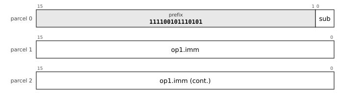

The chart is the leaf `32-PUSHMF-1`, PUSHMF, prefix `111100101110101`. `op1` is `imm32u`: unsigned 32-bit immediate, 0 to 4294967295. `sub` (1 bit) selects the mnemonic: `pushm` 0, `popm` 1.

**All the layouts of this entry** (a chart for each, with its fields and the sub-opcode of each mnemonic, in [the bit layouts of every opcode](dictionary/by-encoding.md)): [`32-PUSHMF-1`](dictionary/by-encoding.md#32-PUSHMF-1), [`32-PUSHM16b-a-1`](dictionary/by-encoding.md#32-PUSHM16b-a-1), [`32-PUSHM8-a-1`](dictionary/by-encoding.md#32-PUSHM8-a-1), [`32-PUSHM24-a-1`](dictionary/by-encoding.md#32-PUSHM24-a-1).

**Operation**

```
for n = 0 to 15, if mask bit n:
    SP ← SP - 8 ; M[SP] ← Rn
```

**Flags** None written.

**Exceptions** Memory operand: page fault, protection fault, alignment fault or bus error (a read of non-existent memory is a precise abort with cause `BUSFAULT`). Every such fault is precise and the instruction restarts after it, because the register update of an auto-increment or auto-decrement mode is held until the instruction retires. A mask that includes `R14` (`SP`) is reserved.

The registers are pushed in ascending order, so `POPM` with the same mask restores them. The mask is the low 32 bits of the number (errata 87, assumption 7); the one-parcel form takes an 8-bit mask scaled by 256, which names `R8` to `R15`.

**Why it is here.** The VAX procedure entry mask was the useful half of `CALLS`; `PUSHM` and `POPM` keep that half without the frame (hardware call frames ran slower than the sequence on later VAXes). The second page has 8-bit forms for `R8` to `R15`, because all 2,392 push sites and 2,392 pop sites in the measured corpus use a mask within `R8` to `R15`.

**Cf.** 6.8 for the restart rule.

**Status** implemented in the reference executor (`common/pdp64exec.c` and `common/pdp64exec_enc.inc`, run by `sim64`; QEMU does not yet execute this encoding).


### POPM: Pop registers by mask

**Mnemonics:** `POPM`

**Syntax**

```
POPM #mask
```

**Encoding**


The chart is the leaf `32-PUSHMF-1`, PUSHMF, prefix `111100101110101`. `op1` is `imm32u`: unsigned 32-bit immediate, 0 to 4294967295. `sub` (1 bit) selects the mnemonic: `pushm` 0, `popm` 1.

**All the layouts of this entry** (a chart for each, with its fields and the sub-opcode of each mnemonic, in [the bit layouts of every opcode](dictionary/by-encoding.md)): [`32-PUSHMF-1`](dictionary/by-encoding.md#32-PUSHMF-1), [`32-PUSHM16b-a-1`](dictionary/by-encoding.md#32-PUSHM16b-a-1), [`32-PUSHM8-a-1`](dictionary/by-encoding.md#32-PUSHM8-a-1), [`32-PUSHM24-a-1`](dictionary/by-encoding.md#32-PUSHM24-a-1).

**Operation**

```
for n = 15 down to 0, if mask bit n:
    Rn ← M[SP] ; SP ← SP + 8
```

**Flags** None written.

**Exceptions** Memory operand: page fault, protection fault, alignment fault or bus error (a read of non-existent memory is a precise abort with cause `BUSFAULT`). Every such fault is precise and the instruction restarts after it, because the register update of an auto-increment or auto-decrement mode is held until the instruction retires.

The mirror of `PUSHM`.

**Status** implemented in the reference executor (`common/pdp64exec.c` and `common/pdp64exec_enc.inc`, run by `sim64`; QEMU does not yet execute this encoding).


### PUSH: Push

**Mnemonics:** `PUSH`

**Syntax**

```
PUSH rm
```

**Encoding**


The chart is the leaf `32-SOF-B28-1`, SOF.B28, prefix `11101110111`. `op1` is `b5d28s-x1`: memory at base register, 5 bits + signed 28-bit displacement times 1, -134217728 to 134217727 bytes. `sub` (4 bits) selects the mnemonic: `clr` 0000, `com` 0001, `inc` 0010, `dec` 0011, `neg` 0100, `tst` 0101, `adc` 0110, `sbc` 0111, `asl` 1000, `asr` 1001, `push` 1010, `pop` 1011, `jmp` 1100, `call` 1101, `jmpi` 1110, `calli` 1111.

**All the layouts of this entry** (a chart for each, with its fields and the sub-opcode of each mnemonic, in [the bit layouts of every opcode](dictionary/by-encoding.md)): [`32-SOF-B28-1`](dictionary/by-encoding.md#32-SOF-B28-1), [`32-SOF-X22-1`](dictionary/by-encoding.md#32-SOF-X22-1), [`32-SOF-PI12-1`](dictionary/by-encoding.md#32-SOF-PI12-1), [`32-SOF-PD12-1`](dictionary/by-encoding.md#32-SOF-PD12-1), [`32-SOF-PC32-1`](dictionary/by-encoding.md#32-SOF-PC32-1), [`32-SOF-A32-1`](dictionary/by-encoding.md#32-SOF-A32-1), [`32-SOPR-2`](dictionary/by-encoding.md#32-SOPR-2), [`32-PUSHI3-1`](dictionary/by-encoding.md#32-PUSHI3-1), [`32-PUSHI2-1`](dictionary/by-encoding.md#32-PUSHI2-1), [`32-SOBu12H-a-2`](dictionary/by-encoding.md#32-SOBu12H-a-2), [`32-SOX4-a-2`](dictionary/by-encoding.md#32-SOX4-a-2), [`32-SOBs12-a-2`](dictionary/by-encoding.md#32-SOBs12-a-2).

**Operation**

```
v ← rm ; SP ← SP - 8 ; M[SP] ← v
```

**Flags** None written.

**Exceptions** Memory operand: page fault, protection fault, alignment fault or bus error (a read of non-existent memory is a precise abort with cause `BUSFAULT`). Every such fault is precise and the instruction restarts after it, because the register update of an auto-increment or auto-decrement mode is held until the instruction retires.

**Status** implemented in the reference executor (`common/pdp64exec.c` and `common/pdp64exec_enc.inc`, run by `sim64`; QEMU does not yet execute this encoding).


### POP: Pop

**Mnemonics:** `POP`

**Syntax**

```
POP rm
```

**Encoding**


The chart is the leaf `32-SOF-B28-1`, SOF.B28, prefix `11101110111`. `op1` is `b5d28s-x1`: memory at base register, 5 bits + signed 28-bit displacement times 1, -134217728 to 134217727 bytes. `sub` (4 bits) selects the mnemonic: `clr` 0000, `com` 0001, `inc` 0010, `dec` 0011, `neg` 0100, `tst` 0101, `adc` 0110, `sbc` 0111, `asl` 1000, `asr` 1001, `push` 1010, `pop` 1011, `jmp` 1100, `call` 1101, `jmpi` 1110, `calli` 1111.

**All the layouts of this entry** (a chart for each, with its fields and the sub-opcode of each mnemonic, in [the bit layouts of every opcode](dictionary/by-encoding.md)): [`32-SOF-B28-1`](dictionary/by-encoding.md#32-SOF-B28-1), [`32-SOF-X22-1`](dictionary/by-encoding.md#32-SOF-X22-1), [`32-SOF-PI12-1`](dictionary/by-encoding.md#32-SOF-PI12-1), [`32-SOF-PD12-1`](dictionary/by-encoding.md#32-SOF-PD12-1), [`32-SOF-PC32-1`](dictionary/by-encoding.md#32-SOF-PC32-1), [`32-SOF-A32-1`](dictionary/by-encoding.md#32-SOF-A32-1), [`32-SOPR-2`](dictionary/by-encoding.md#32-SOPR-2), [`32-SOBu12H-a-2`](dictionary/by-encoding.md#32-SOBu12H-a-2), [`32-SOX4-a-2`](dictionary/by-encoding.md#32-SOX4-a-2), [`32-SOBs12-a-2`](dictionary/by-encoding.md#32-SOBs12-a-2).

**Operation**

```
v ← M[SP] ; SP ← SP + 8 ; rm ← v
```

**Flags** None written.

**Exceptions** Memory operand: page fault, protection fault, alignment fault or bus error (a read of non-existent memory is a precise abort with cause `BUSFAULT`). Every such fault is precise and the instruction restarts after it, because the register update of an auto-increment or auto-decrement mode is held until the instruction retires.

**Status** implemented in the reference executor (`common/pdp64exec.c` and `common/pdp64exec_enc.inc`, run by `sim64`; QEMU does not yet execute this encoding).


### MCPY: Copy a block of bytes

**Mnemonics:** `MCPY`, `MMOV`

**Syntax**

```
MCPY Rd, Rs, Rn        ; destination pointer, source pointer, count
MMOV Rd, Rs, Rn        ; correct for overlap
```

**Encoding**


The chart is the leaf `32-R3-1`, R3, prefix `1110100001`. `op1` is `reg5`: register, 5 bits. `op2` is `reg5`: register, 5 bits. `op3` is `reg5`: register, 5 bits. `xsub` selects the mnemonic.

**All the layouts of this entry** (a chart for each, with its fields and the sub-opcode of each mnemonic, in [the bit layouts of every opcode](dictionary/by-encoding.md)): [`32-R3-1`](dictionary/by-encoding.md#32-R3-1).

**Operation**

```
MCPY:                            ; ascending; overlap is undefined
  while Rn ≠ 0:  M8[Rd] ← M8[Rs] ; Rd ← Rd + 1 ; Rs ← Rs + 1 ; Rn ← Rn - 1
MMOV: as MCPY, but the direction is chosen from the pointers so that an overlapping copy is correct
```

**Flags** None written.

**Exceptions** Memory operand: page fault, protection fault, alignment fault or bus error (a read of non-existent memory is a precise abort with cause `BUSFAULT`). Every such fault is precise and the instruction restarts after it, because the register update of an auto-increment or auto-decrement mode is held until the instruction retires. The three registers are updated as work completes, so a fault leaves a consistent state and the instruction restarts from its registers.

The one granted exception to the one-memory-operand rule. All three registers are architectural state: on completion `Rn` is 0 and `Rd` and `Rs` point one past the end. An implementation may move more than a byte per step, so long as the register state at every point where an exception can be taken is consistent with a byte-at-a-time copy. The accesses made inside one block operation are unordered with respect to each other.

**Why it is here.** The block operations are the one granted exception to the one-memory-operand rule (an exception to a principle is allowed where there is a clear benefit), made safe by keeping the progress in architectural registers: the VAX `MOVC5` kept it in hidden microstate, which is why it is rejected, and ARM reached the same design in 2022 with `FEAT_MOPS`. The names `MCPY`, `MMOV` and `MSET` follow the memory operations of IBM System z; `MCMP` and `MSCN` complete the set. `MCPY` replaces the PDP-11 `MOV (R1)+,(R2)+` loop, and the `rep movsb` of x86, with one restartable instruction.

**Cf.** 6.8 (restart, progress faults); 7.2 (ordering of the accesses).

**Status** implemented in the reference executor (`common/pdp64exec.c` and `common/pdp64exec_enc.inc`, run by `sim64`; QEMU does not yet execute this encoding).


### MSET: Fill a block of bytes

**Mnemonics:** `MSET`

**Syntax**

```
MSET Rd, Rv, Rn
```

**Encoding**


The chart is the leaf `32-R3-1`, R3, prefix `1110100001`. `op1` is `reg5`: register, 5 bits. `op2` is `reg5`: register, 5 bits. `op3` is `reg5`: register, 5 bits. `xsub` selects the mnemonic.

**All the layouts of this entry** (a chart for each, with its fields and the sub-opcode of each mnemonic, in [the bit layouts of every opcode](dictionary/by-encoding.md)): [`32-R3-1`](dictionary/by-encoding.md#32-R3-1).

**Operation**

```
while Rn ≠ 0:  M8[Rd] ← Rv[7:0] ; Rd ← Rd + 1 ; Rn ← Rn - 1
```

**Flags** None written.

**Exceptions** Memory operand: page fault, protection fault, alignment fault or bus error (a read of non-existent memory is a precise abort with cause `BUSFAULT`). Every such fault is precise and the instruction restarts after it, because the register update of an auto-increment or auto-decrement mode is held until the instruction retires.

`MSET` with `Rv = 0` is the range-zeroing instruction: `bzero` and the clear of `calloc` are one instruction.

**Cf.** 6.8.

**Status** implemented in the reference executor (`common/pdp64exec.c` and `common/pdp64exec_enc.inc`, run by `sim64`; QEMU does not yet execute this encoding).


### MCMP: Compare two blocks of bytes

**Mnemonics:** `MCMP`

**Syntax**

```
MCMP Rd, Rs, Rn
```

**Encoding**


The chart is the leaf `32-R3-1`, R3, prefix `1110100001`. `op1` is `reg5`: register, 5 bits. `op2` is `reg5`: register, 5 bits. `op3` is `reg5`: register, 5 bits. `xsub` selects the mnemonic.

**All the layouts of this entry** (a chart for each, with its fields and the sub-opcode of each mnemonic, in [the bit layouts of every opcode](dictionary/by-encoding.md)): [`32-R3-1`](dictionary/by-encoding.md#32-R3-1).

**Operation**

```
while Rn ≠ 0:
    x ← M8[Rd] ; y ← M8[Rs]
    if x ≠ y then  flags ← flags of (x - y) ; stop      ; pointers left AT the differing byte
    Rd ← Rd + 1 ; Rs ← Rs + 1 ; Rn ← Rn - 1
if equal:  N = 0, Z = 1, V = 0, C = 0
```

**Flags** From the first differing byte as for `CMP` of the two bytes (`C` set if `x < y` unsigned, `N` and `V` from the signed difference); for equal blocks `N` = 0, `Z` = 1, `V` = 0, `C` = 0.

**Exceptions** Memory operand: page fault, protection fault, alignment fault or bus error (a read of non-existent memory is a precise abort with cause `BUSFAULT`). Every such fault is precise and the instruction restarts after it, because the register update of an auto-increment or auto-decrement mode is held until the instruction retires.

When the instruction stops at a difference, `Rd` and `Rs` point at the differing bytes and `Rn` is the count remaining, so the position of the difference is in the registers.

**Why it is here.** Seven of the VAX's ten character-string instructions are present (`MOVC3`, `CMPC3`, `LOCC` and `SKPC` among them); the rejected ones are `EDITPC` and packed decimal. `MCMP` is the `CMPC3` equivalent.

**Cf.** 6.8.

**Status** implemented in the reference executor (`common/pdp64exec.c` and `common/pdp64exec_enc.inc`, run by `sim64`; QEMU does not yet execute this encoding).


### MSCN: Scan a block for a byte, or for a byte not equal to it

**Mnemonics:** `MSCN`, `MSCNN`

**Syntax**

```
MSCN Rd, Rv, Rn
MSCNN Rd, Rv, Rn
```

**Encoding**


The chart is the leaf `32-R3-1`, R3, prefix `1110100001`. `op1` is `reg5`: register, 5 bits. `op2` is `reg5`: register, 5 bits. `op3` is `reg5`: register, 5 bits. `xsub` selects the mnemonic.

**All the layouts of this entry** (a chart for each, with its fields and the sub-opcode of each mnemonic, in [the bit layouts of every opcode](dictionary/by-encoding.md)): [`32-R3-1`](dictionary/by-encoding.md#32-R3-1).

**Operation**

```
while Rn ≠ 0:
    hit ← (M8[Rd] = Rv[7:0])             ; MSCNN: hit ← (M8[Rd] ≠ Rv[7:0])
    if hit then  Z = 1 ; stop              ; Rd points AT the byte found
    Rd ← Rd + 1 ; Rn ← Rn - 1
not found: Z = 0
```

**Flags** **All four flags are written**: `Z` = 1 if the byte was found, else 0; `N`, `V` and `C` are cleared.

**Exceptions** Memory operand: page fault, protection fault, alignment fault or bus error (a read of non-existent memory is a precise abort with cause `BUSFAULT`). Every such fault is precise and the instruction restarts after it, because the register update of an auto-increment or auto-decrement mode is held until the instruction retires.

`MSCN` is `memchr`; with an explicit count it gives `strnlen`, and composing it with `MCPY` gives a bounded `strcpy` in two instructions. There are no NUL-terminated string instructions.

**Why it is here.** `MSCN` is `LOCC` and `memchr`; `MSCNN` fills the `SKPC` gap (the first byte that is *not* equal). With an explicit count `MSCN` gives `strnlen`, and with `MCPY` a bounded `strcpy` in two instructions. NUL-terminated string instructions (the System/z `MVST`, `SRST`, `CLST`) are rejected, because they encode an unbounded read, the largest single source of memory-safety failures in C (9.17).

**Cf.** 6.8.

**Status** implemented in the reference executor (`common/pdp64exec.c` and `common/pdp64exec_enc.inc`, run by `sim64`; QEMU does not yet execute this encoding).


### MVAL: Validate a block as UTF-8

**Mnemonics:** `MVAL`

**Syntax**

```
MVAL Rd, Rn
```

**Encoding**


The chart is the leaf `32-R2-1`, R2, prefix `111100000010`. `op1` is `reg5`: register, 5 bits. `op2` is `reg5`: register, 5 bits. `xsub` selects the mnemonic.

**All the layouts of this entry** (a chart for each, with its fields and the sub-opcode of each mnemonic, in [the bit layouts of every opcode](dictionary/by-encoding.md)): [`32-R2-1`](dictionary/by-encoding.md#32-R2-1).

**Operation**

```
scan Rn bytes at Rd; stop at the first byte that cannot be part of a valid UTF-8 sequence (the rules of UTF8DEC)
```

**Flags** On completion `Rn` is 0 and the buffer is valid; otherwise `Rd` points at the offending sequence and `Rn` counts the bytes remaining (details in the instruction-set text, section 4.7.1).

**Exceptions** Memory operand: page fault, protection fault, alignment fault or bus error (a read of non-existent memory is a precise abort with cause `BUSFAULT`). Every such fault is precise and the instruction restarts after it, because the register update of an auto-increment or auto-decrement mode is held until the instruction retires.

The `UTF8DEC` comparators wired to the block sequencer.

**Why it is here.** The alternative, a SWAR loop (SIMD within a register), runs at about two to three cycles a byte and is respectable, which is why the justification is cost and not throughput.

**Cf.** 6.8.

**Status** specified; **not yet implemented** in the reference executor.


### MSHA: Hash whole blocks of memory

**Mnemonics:** `MSHA256`, `MSHA512`

**Syntax**

```
MSHA256 Rd, Rs, Rn
MSHA512 Rd, Rs, Rn
```

**Encoding**


The chart is the leaf `32-R3-1`, R3, prefix `1110100001`. `op1` is `reg5`: register, 5 bits. `op2` is `reg5`: register, 5 bits. `op3` is `reg5`: register, 5 bits. `xsub` selects the mnemonic.

**All the layouts of this entry** (a chart for each, with its fields and the sub-opcode of each mnemonic, in [the bit layouts of every opcode](dictionary/by-encoding.md)): [`32-R3-1`](dictionary/by-encoding.md#32-R3-1).

**Operation**

```
hash the Rn bytes (whole blocks) at (Rs) into the state at (Rd)
progress is held in Rd, Rs and Rn; an interrupt or a fault restarts the instruction where it stopped
```

**Flags** None written.

**Exceptions** Memory operand: page fault, protection fault, alignment fault or bus error (a read of non-existent memory is a precise abort with cause `BUSFAULT`). Every such fault is precise and the instruction restarts after it, because the register update of an auto-increment or auto-decrement mode is held until the instruction retires.

*(P)* Stage 2 of the crypto proposal (`docs/crypto-secure-core.md` section 3.4): the whole-buffer form, in the manner of the s390 CPACF instructions, to be built "only after measurement"; the grammars reserve its encoding. The unit would need about 2,000 look-up tables and 1,000 flip-flops (the proposal's estimate). **Not implemented** in the reference executor.

**Why it is here.** Stage 2 of the crypto proposal, in the manner of the s390 CPACF instructions (`KIMD` and kin): one instruction hashes a buffer, the padding and chaining are done in hardware and so cannot be got wrong, and progress is held in registers, so a fault or an interrupt restarts it, as for `MCPY`. The estimate is 64 cycles for a 64-byte SHA-256 block against about 1,200 instructions, roughly 18 times; the cost is gates in proportion to the algorithms frozen into opcodes. The proposal says to build `MSHA256` first and the others only after measurement, and the author has not decided it.

**Status** specified; **not yet implemented** in the reference executor.


### MAESCTR: AES in counter mode over a buffer

**Mnemonics:** `MAESCTR`

**Syntax**

```
MAESCTR Rd, Rs, Rn, Rp
```

**Encoding**


The chart is the leaf `32-R4-1`, R4, prefix `11000101`. `op1` is `reg5`: register, 5 bits. `op2` is `reg5`: register, 5 bits. `op3` is `reg5`: register, 5 bits. `op4` is `reg5`: register, 5 bits. `xsub` selects the mnemonic.

**All the layouts of this entry** (a chart for each, with its fields and the sub-opcode of each mnemonic, in [the bit layouts of every opcode](dictionary/by-encoding.md)): [`32-R4-1`](dictionary/by-encoding.md#32-R4-1).

**Operation**

```
AES counter mode over the Rn bytes at (Rs), written at (Rd); the key, the counter and the number of rounds are in the parameter block at (Rp)
progress is held in the registers and the parameter block; an interrupt or a fault restarts the instruction where it stopped
```

**Flags** None written.

**Exceptions** Memory operand: page fault, protection fault, alignment fault or bus error (a read of non-existent memory is a precise abort with cause `BUSFAULT`). Every such fault is precise and the instruction restarts after it, because the register update of an auto-increment or auto-decrement mode is held until the instruction retires.

*(P)* Stage 2, as `MSHA`; the layout of the parameter block is not specified. **Not implemented** in the reference executor.

**Why it is here.** Stage 2, as `MSHA`; whole-buffer AES gains less (about 4 times: 0.6 against 2.6 instructions per byte), because the round instructions are already good, and the proposal puts it after `MSHA256` and `MSHA512`.

**Status** specified; **not yet implemented** in the reference executor.
<!-- /entries:9.11 -->

## 9.12 Floating point

**9.12.1** Floating point uses the general registers: a `binary64` value fills one register, and the instruction, not the register, decides how its bits are read. *(D)*

**9.12.2** `FADD`, `FSUB`, `FMUL` and `FCMP` are two-byte instructions; `FDIV`, `FSQRT`, the fused multiply-add family, `FABS`, `FMIN`, `FMAX`, `FCLASS`, the roundings and the `binary32` forms are in the floating-point escape; `binary16` has seventeen operations and conversions. *(D)*

**9.12.3** The five IEEE flags (invalid, divide by zero, overflow, underflow, inexact) accumulate in `FPSR`; no floating-point operation traps; `FSFLAGS` reads and clears them. *(D)*

**9.12.4** Every NaN that an operation creates is the canonical quiet NaN. *(D)*

**9.12.5** There are no rounding-mode or precision mode bits: the precision is in the opcode, and so is the rounding mode wherever it is not nearest-even. *(D)*

**9.12.6** There are no transcendental instructions. *(D)*

*Commentary.* **Precedent.** The PDP-11's FP11 had `AC0` to `AC5` and mode bits for single and double precision; the VAX had F, D, G and H formats. **Trade-offs.** An integer operation applied to a register holding a `binary64` destroys it, with no trap and no tag; that is intended and the ABI states it. A separate register file would cost a second set of read ports and a floating-point context; on a small implementation the register file is among the largest blocks. **Improvements.** The fused multiply-add is the largest single addition to the datapath (about 9,000 transistors) and the least negotiable; the IEEE exception flags are recorded without traps, which is what C99 `<fenv.h>` needs. **Benefits.** No transfer instructions between files and a single calling convention. **Modern comparables.** RISC-V Zfinx and Zdinx use the integer register file for the same reason; AArch64 and x86 have separate vector and floating-point files. **Use.** `FCLASS` begins every library maths function; `FMA` is the building block of accurate polynomial evaluation. **Impact.** *Kernel:* There is no separate floating-point state to save at a context switch beyond the registers already saved, and the sticky flags go with the status word. *Compiler:* One calling convention for integers and floats, fused multiply-add contraction, and no rounding-mode state for the compiler to track. *Hardware:* No second register file (one of the largest blocks of a small floating-point unit); the floating-point unit with fused multiply-add is about 34,000 transistors.

<!-- entries:9.12 -->
### FADD: Floating add, subtract and multiply, binary64

**Mnemonics:** `FADD`, `FSUB`, `FMUL`  (aliases: `FADDD`, `FSUBD`, `FMULD`)

**Syntax**

```
FADD rm, Rd
FSUB rm, Rd
FMUL rm, Rd
```

**Encoding**


The chart is the leaf `32-LDF-B28-2`, LDF.B28, prefix `1010001`. `op1` is `b5d28s-x1`: memory at base register, 5 bits + signed 28-bit displacement times 1, -134217728 to 134217727 bytes. `op2` is `reg5`: register, 5 bits. `sub` (3 bits) selects the mnemonic: `shr` 000, `sar` 001, `fadd` 010, `fsub` 011, `fmul` 100, `bit` 101, `lea` 110, `movub` 111.

**All the layouts of this entry** (a chart for each, with its fields and the sub-opcode of each mnemonic, in [the bit layouts of every opcode](dictionary/by-encoding.md)): [`32-LDF-B28-2`](dictionary/by-encoding.md#32-LDF-B28-2), [`32-LDF-X22-2`](dictionary/by-encoding.md#32-LDF-X22-2), [`32-LDF-PI12-2`](dictionary/by-encoding.md#32-LDF-PI12-2), [`32-LDF-PD12-2`](dictionary/by-encoding.md#32-LDF-PD12-2), [`32-LDF-PC32-2`](dictionary/by-encoding.md#32-LDF-PC32-2), [`32-LDF-A32-2`](dictionary/by-encoding.md#32-LDF-A32-2), [`32-LDFI-I32-1`](dictionary/by-encoding.md#32-LDFI-I32-1), [`32-DPF-D28-2`](dictionary/by-encoding.md#32-DPF-D28-2), [`32-RRF-2`](dictionary/by-encoding.md#32-RRF-2), [`32-RRF5-1`](dictionary/by-encoding.md#32-RRF5-1), [`32-LDPC12H-d-1`](dictionary/by-encoding.md#32-LDPC12H-d-1), [`32-LDPC12H-d-2`](dictionary/by-encoding.md#32-LDPC12H-d-2).

**Operation**

```
Rd ← Rd + rm   (FADD)
Rd ← Rd - rm   (FSUB)
Rd ← Rd × rm   (FMUL)       ; IEEE 754 binary64, round to nearest even
```

**Flags** None written. The five IEEE exception flags are ORed into `FPSR`; no instruction traps.

**Exceptions** Memory operand: page fault, protection fault, alignment fault or bus error (a read of non-existent memory is a precise abort with cause `BUSFAULT`). Every such fault is precise and the instruction restarts after it, because the register update of an auto-increment or auto-decrement mode is held until the instruction retires. Floating-point exceptions never trap.

Floating-point values live in the general registers; there is no separate register file and no mode bit. A NaN result is the canonical quiet NaN `0x7FF8000000000000`. The alternative spellings `FADDD`, `FSUBD`, `FMULD` are aliases.

**Status** implemented in the reference executor (`common/pdp64exec.c` and `common/pdp64exec_enc.inc`, run by `sim64`; QEMU does not yet execute this encoding).


### FCMP: Floating compare, binary64

**Mnemonics:** `FCMP`  (aliases: `FCMPD`)

**Syntax**

```
FCMP Rd, rm        ; register first
```

**Encoding**


The chart is the leaf `32-CMF-B28-1`, CMF.B28, prefix `111000000`. `op1` is `reg5`: register, 5 bits. `op2` is `b5d28s-x1`: memory at base register, 5 bits + signed 28-bit displacement times 1, -134217728 to 134217727 bytes. `sub` (1 bit) selects the mnemonic: `cmp` 0, `fcmp` 1.

**All the layouts of this entry** (a chart for each, with its fields and the sub-opcode of each mnemonic, in [the bit layouts of every opcode](dictionary/by-encoding.md)): [`32-CMF-B28-1`](dictionary/by-encoding.md#32-CMF-B28-1), [`32-CMF-X22-1`](dictionary/by-encoding.md#32-CMF-X22-1), [`32-CMF-PI12-1`](dictionary/by-encoding.md#32-CMF-PI12-1), [`32-CMF-PD12-1`](dictionary/by-encoding.md#32-CMF-PD12-1), [`32-CMF-PC32-1`](dictionary/by-encoding.md#32-CMF-PC32-1), [`32-CMF-A32-1`](dictionary/by-encoding.md#32-CMF-A32-1), [`32-CMF-I32-1`](dictionary/by-encoding.md#32-CMF-I32-1), [`32-RRF-2`](dictionary/by-encoding.md#32-RRF-2), [`32-RRF5-1`](dictionary/by-encoding.md#32-RRF5-1).

**Operation**

```
N ← Rd < rm ; Z ← Rd = rm ; V ← unordered ; C ← 0
```

**Flags** `N` set if `Rd < rm`, `Z` if equal, `V` if the operands are unordered (either is a NaN), `C` cleared. A signalling NaN raises `NV` in `FPSR`.

**Exceptions** Memory operand: page fault, protection fault, alignment fault or bus error (a read of non-existent memory is a precise abort with cause `BUSFAULT`). Every such fault is precise and the instruction restarts after it, because the register update of an auto-increment or auto-decrement mode is held until the instruction retires.

The signed branches do not treat the unordered case cleanly (`BLT` after an unordered compare takes `N xor V` = 1); this is an open item of the instruction set.

**Status** implemented in the reference executor (`common/pdp64exec.c` and `common/pdp64exec_enc.inc`, run by `sim64`; QEMU does not yet execute this encoding).


### FDIV: Floating divide and square root, binary64

**Mnemonics:** `FDIV`, `FSQRT`  (aliases: `FDIVD`, `FSQRTD`)

**Syntax**

```
FDIV Rs, Rd
FSQRT Rs, Rd
```

**Encoding**


The chart is the leaf `32-R2-1`, R2, prefix `111100000010`. `op1` is `reg5`: register, 5 bits. `op2` is `reg5`: register, 5 bits. `xsub` selects the mnemonic.

**All the layouts of this entry** (a chart for each, with its fields and the sub-opcode of each mnemonic, in [the bit layouts of every opcode](dictionary/by-encoding.md)): [`32-R2-1`](dictionary/by-encoding.md#32-R2-1).

**Operation**

```
FDIV : Rd ← Rd ÷ Rs
FSQRT: Rd ← sqrt(Rs)
```

**Flags** No integer flag is written. The IEEE exception flags raised are ORed into `FPSR` (`NX` inexact, `UF` underflow, `OF` overflow, `DZ` divide by zero, `NV` invalid); nothing traps.

**Exceptions** None.

`FDIV` and `FSQRT` are multi-cycle sequencer operations and rarely appear in a one-parcel form. The alternative spellings `FDIVD`, `FSQRTD` are aliases.

**Status** implemented in the reference executor (`common/pdp64exec.c` and `common/pdp64exec_enc.inc`, run by `sim64`; QEMU does not yet execute this encoding).


### FSINGLE: Floating arithmetic, binary32

**Mnemonics:** `FADD32`, `FSUB32`, `FMUL32`, `FDIV32`, `FSQRT32`, `FCMP32`  (aliases: `FADDS`, `FSUBS`, `FMULS`, `FDIVS`, `FSQRTS`, `FCMPS`)

**Syntax**

```
FADD32 Rs, Rd
FSUB32 Rs, Rd
FMUL32 Rs, Rd
FDIV32 Rs, Rd
FSQRT32 Rs, Rd
FCMP32 Rd, Rs
```

**Encoding**


The chart is the leaf `32-R2-1`, R2, prefix `111100000010`. `op1` is `reg5`: register, 5 bits. `op2` is `reg5`: register, 5 bits. `xsub` selects the mnemonic.

**All the layouts of this entry** (a chart for each, with its fields and the sub-opcode of each mnemonic, in [the bit layouts of every opcode](dictionary/by-encoding.md)): [`32-R2-1`](dictionary/by-encoding.md#32-R2-1).

**Operation**

```
Rd ← Rd op Rs  (FADD32 FSUB32 FMUL32 FDIV32); Rd ← sqrt(Rs) (FSQRT32)
FCMP32: flags as FCMP, comparing Rd with Rs
```

**Flags** No integer flag is written. The IEEE exception flags raised are ORed into `FPSR` (`NX` inexact, `UF` underflow, `OF` overflow, `DZ` divide by zero, `NV` invalid); nothing traps. `FCMP32` writes `N Z V C` as `FCMP` does.

**Exceptions** None.

A `binary32` lives in the low 32 bits of a register, sign-extended to 64 like every 32-bit result. Results are correctly rounded to nearest even. The alternative spellings `FADDS`, `FSUBS`, ... are aliases.

**Why it is here.** `binary32` is with the same operations, held in the low 32 bits of a register and sign-extended like every other 32-bit value (see also the ABI). The naming rule is an `F` in front of the integer mnemonic (`FADD`) and a size suffix for the other formats (`FADD16`); the older spellings (`FADDS` and so on) are aliases.

**Status** implemented in the reference executor (`common/pdp64exec.c` and `common/pdp64exec_enc.inc`, run by `sim64`; QEMU does not yet execute this encoding).


### FMADD: Fused multiply-add, binary64

**Mnemonics:** `FMADD`, `FMSUB`, `FNMADD`, `FNMSUB`  (aliases: `FMADDD`, `FMSUBD`, `FNMADDD`, `FNMSUBD`)

**Syntax**

```
FMADD Rs, Rt, Ru, Rd
FMSUB Rs, Rt, Ru, Rd
FNMADD Rs, Rt, Ru, Rd
FNMSUB Rs, Rt, Ru, Rd
```

**Encoding**


The chart is the leaf `32-R4-1`, R4, prefix `11000101`. `op1` is `reg5`: register, 5 bits. `op2` is `reg5`: register, 5 bits. `op3` is `reg5`: register, 5 bits. `op4` is `reg5`: register, 5 bits. `xsub` selects the mnemonic.

**All the layouts of this entry** (a chart for each, with its fields and the sub-opcode of each mnemonic, in [the bit layouts of every opcode](dictionary/by-encoding.md)): [`32-R4-1`](dictionary/by-encoding.md#32-R4-1).

**Operation**

```
FMADD : Rd ← Rs×Rt + Ru
FMSUB : Rd ← Rs×Rt - Ru
FNMADD: Rd ← -(Rs×Rt) - Ru
FNMSUB: Rd ← -(Rs×Rt) + Ru          ; each rounded once
```

**Flags** No integer flag is written. The IEEE exception flags raised are ORed into `FPSR` (`NX` inexact, `UF` underflow, `OF` overflow, `DZ` divide by zero, `NV` invalid); nothing traps.

**Exceptions** None.

The alternative spellings `FMADDD`, ... are aliases.

**Why it is here.** The whole fused multiply-add family is, because its absence would be the single worst gap in the floating-point set: one rounding instead of two, and the inner step of dot products, polynomial evaluation and every matrix kernel. It replaces the VAX `POLY`, which was the best answer before fused multiply-add.

**Status** implemented in the reference executor (`common/pdp64exec.c` and `common/pdp64exec_enc.inc`, run by `sim64`; QEMU does not yet execute this encoding).


### FMADD32: Fused multiply-add, binary32

**Mnemonics:** `FMADD32`, `FMSUB32`, `FNMADD32`, `FNMSUB32`  (aliases: `FMADDS`, `FMSUBS`, `FNMADDS`, `FNMSUBS`)

**Syntax**

```
FMADD32 Rs, Rt, Ru, Rd
FMSUB32 ...
FNMADD32 ...
FNMSUB32 ...
```

**Encoding**


The chart is the leaf `32-R4-1`, R4, prefix `11000101`. `op1` is `reg5`: register, 5 bits. `op2` is `reg5`: register, 5 bits. `op3` is `reg5`: register, 5 bits. `op4` is `reg5`: register, 5 bits. `xsub` selects the mnemonic.

**All the layouts of this entry** (a chart for each, with its fields and the sub-opcode of each mnemonic, in [the bit layouts of every opcode](dictionary/by-encoding.md)): [`32-R4-1`](dictionary/by-encoding.md#32-R4-1).

**Operation**

```
As FMADD, in binary32, rounded once
```

**Flags** No integer flag is written. The IEEE exception flags raised are ORed into `FPSR` (`NX` inexact, `UF` underflow, `OF` overflow, `DZ` divide by zero, `NV` invalid); nothing traps.

**Exceptions** None.

**Why it is here.** The `binary32` forms of the fused multiply-add family.

**Status** implemented in the reference executor (`common/pdp64exec.c` and `common/pdp64exec_enc.inc`, run by `sim64`; QEMU does not yet execute this encoding).


### FSIGN: Sign operations on the bits

**Mnemonics:** `FNEG`, `FABS`, `FCOPYSIGN`

**Syntax**

```
FNEG Rs, Rd
FABS Rs, Rd
FCOPYSIGN Rs, Rt, Rd
```

**Encoding**


The chart is the leaf `32-R2-1`, R2, prefix `111100000010`. `op1` is `reg5`: register, 5 bits. `op2` is `reg5`: register, 5 bits. `xsub` selects the mnemonic.

**All the layouts of this entry** (a chart for each, with its fields and the sub-opcode of each mnemonic, in [the bit layouts of every opcode](dictionary/by-encoding.md)): [`32-R2-1`](dictionary/by-encoding.md#32-R2-1), [`32-R3-1`](dictionary/by-encoding.md#32-R3-1).

**Operation**

```
FNEG     : Rd ← Rs with the sign bit flipped
FABS     : Rd ← Rs with the sign bit cleared
FCOPYSIGN: Rd ← magnitude of Rs, sign of Rt
```

**Flags** None. These operate on the bits, do not canonicalise a NaN and raise no exception flag.

**Exceptions** None.

**Why it is here.** Sign and selection operations (negate, absolute value and the like) work on the bits, do not canonicalise a NaN and raise no flag, so they cost almost nothing. The PowerPC 601 floating-point set has the same operations (stated from memory, not checked against a manual). No separate reason is recorded for these three.

**Status** implemented in the reference executor (`common/pdp64exec.c` and `common/pdp64exec_enc.inc`, run by `sim64`; QEMU does not yet execute this encoding).


### FMIN: Floating minimum and maximum, binary64

**Mnemonics:** `FMIN`, `FMAX`  (aliases: `FMIND`, `FMAXD`)

**Syntax**

```
FMIN Rs, Rt, Rd
FMAX Rs, Rt, Rd
```

**Encoding**


The chart is the leaf `32-R3-1`, R3, prefix `1110100001`. `op1` is `reg5`: register, 5 bits. `op2` is `reg5`: register, 5 bits. `op3` is `reg5`: register, 5 bits. `xsub` selects the mnemonic.

**All the layouts of this entry** (a chart for each, with its fields and the sub-opcode of each mnemonic, in [the bit layouts of every opcode](dictionary/by-encoding.md)): [`32-R3-1`](dictionary/by-encoding.md#32-R3-1).

**Operation**

```
if Rs is a NaN then Rd ← Rt ; else if Rt is a NaN then Rd ← Rs ; else Rd ← smaller (FMIN) or larger (FMAX)
if both are NaNs the result is the canonical quiet NaN
```

**Flags** No integer flag is written. The IEEE exception flags raised are ORed into `FPSR` (`NX` inexact, `UF` underflow, `OF` overflow, `DZ` divide by zero, `NV` invalid); nothing traps.

**Exceptions** None.

The alternative spellings `FMIND`, `FMAXD` are aliases.

**Why it is here.** The floating counterparts of the integer `MIN` and `MAX`. A NaN operand loses to a number and two NaNs give the canonical quiet NaN.

**Status** implemented in the reference executor (`common/pdp64exec.c` and `common/pdp64exec_enc.inc`, run by `sim64`; QEMU does not yet execute this encoding).


### FCLASS: Classify a floating-point value

**Mnemonics:** `FCLASS`, `FCLASS32`, `FCLASS16`  (aliases: `FCLASSD`, `FCLASSS`)

**Syntax**

```
FCLASS Rs, Rd
FCLASS32 Rs, Rd
FCLASS16 Rs, Rd
```

**Encoding**


The chart is the leaf `32-R2-1`, R2, prefix `111100000010`. `op1` is `reg5`: register, 5 bits. `op2` is `reg5`: register, 5 bits. `xsub` selects the mnemonic.

**All the layouts of this entry** (a chart for each, with its fields and the sub-opcode of each mnemonic, in [the bit layouts of every opcode](dictionary/by-encoding.md)): [`32-R2-1`](dictionary/by-encoding.md#32-R2-1).

**Operation**

```
Rd ← a bit vector with exactly one bit set:
bit 0 -infinity      bit 1 -normal      bit 2 -subnormal   bit 3 -zero
bit 4 +zero          bit 5 +subnormal   bit 6 +normal      bit 7 +infinity
bit 8 signalling NaN bit 9 quiet NaN
```

**Flags** None.

**Exceptions** None.

Every libm function begins with this dispatch. The alternative spellings `FCLASSD`, `FCLASSS` are aliases.

**Why it is here.** Every libm function begins with this dispatch: one instruction returns which of ten kinds a value is (signalling or quiet NaN, infinity, normal, subnormal, zero, each signed), where software needs several compares and masks. It is justified by a workload, library mathematics, and not by compiled C, as the tag branches are. Nothing in the corpus emits it, because the compiler does not use it.

**Status** implemented in the reference executor (`common/pdp64exec.c` and `common/pdp64exec_enc.inc`, run by `sim64`; QEMU does not yet execute this encoding).


### FRINT: Round to an integral value, binary64

**Mnemonics:** `FRINT`, `FRINTZ`, `FRINTM`, `FRINTP`, `FRINTA`  (aliases: `FRINTD`, `FRINTDZ`, `FRINTDM`, `FRINTDP`, `FRINTDA`)

**Syntax**

```
FRINT Rs, Rd
FRINTZ Rs, Rd
FRINTM Rs, Rd
FRINTP Rs, Rd
FRINTA Rs, Rd
```

**Encoding**


The chart is the leaf `32-R2-1`, R2, prefix `111100000010`. `op1` is `reg5`: register, 5 bits. `op2` is `reg5`: register, 5 bits. `xsub` selects the mnemonic.

**All the layouts of this entry** (a chart for each, with its fields and the sub-opcode of each mnemonic, in [the bit layouts of every opcode](dictionary/by-encoding.md)): [`32-R2-1`](dictionary/by-encoding.md#32-R2-1).

**Operation**

```
FRINT : Rd ← Rs rounded to nearest, ties to even
FRINTZ: toward zero         FRINTM: toward -infinity
FRINTP: toward +infinity    FRINTA: to nearest, ties away from zero (C round())
```

**Flags** No integer flag is written. The IEEE exception flags raised are ORed into `FPSR` (`NX` inexact, `UF` underflow, `OF` overflow, `DZ` divide by zero, `NV` invalid); nothing traps.

**Exceptions** None.

The rounding mode is in the instruction, never in a mode bit. The alternative spellings `FRINTD`, `FRINTDZ`, ... are aliases.

**Why it is here.** Rounding to an integral value in each direction (nearest even, toward zero, down, up) is in the set, and `FRINTA`, ties away from zero, serves C's `round()`, which is common in libm; it is a qualifier of the round operation and so costs no new operation.

**Status** implemented in the reference executor (`common/pdp64exec.c` and `common/pdp64exec_enc.inc`, run by `sim64`; QEMU does not yet execute this encoding).


### FCVT: Floating conversions

**Mnemonics:** `FCVTDQ`, `FCVTDQU`, `FCVTQD`, `FCVTQUD`, `FCVTDS`, `FCVTSD`, `FCVTSL`, `FCVTLS`

**Syntax**

```
FCVTDQ Rs, Rd        ; binary64 to signed quad
FCVTDQU Rs, Rd       ; binary64 to unsigned quad
FCVTQD Rs, Rd        ; signed quad to binary64
FCVTQUD Rs, Rd       ; unsigned quad to binary64
FCVTDS Rs, Rd        ; binary64 to binary32
FCVTSD Rs, Rd        ; binary32 to binary64
FCVTSL Rs, Rd        ; binary32 to signed 32-bit integer
FCVTLS Rs, Rd        ; signed 32-bit integer to binary32
```

**Encoding**


The chart is the leaf `32-R2-1`, R2, prefix `111100000010`. `op1` is `reg5`: register, 5 bits. `op2` is `reg5`: register, 5 bits. `xsub` selects the mnemonic.

**All the layouts of this entry** (a chart for each, with its fields and the sub-opcode of each mnemonic, in [the bit layouts of every opcode](dictionary/by-encoding.md)): [`32-R2-1`](dictionary/by-encoding.md#32-R2-1).

**Operation**

```
float to integer: truncate toward zero, then saturate; a NaN gives the largest value
integer to float: round to nearest even
```

**Flags** No integer flag is written. The IEEE exception flags raised are ORed into `FPSR` (`NX` inexact, `UF` underflow, `OF` overflow, `DZ` divide by zero, `NV` invalid); nothing traps. A NaN or an out-of-range value raises `NV` and saturates.

**Exceptions** None.

Integer results are 64-bit (`FCVTDQ`, `FCVTDQU`) or 32-bit sign-extended (`FCVTSL`). Unsigned conversion of a negative value is invalid and gives 0.

**Why it is here.** `FCVTDQU` and `FCVTQUD` convert unsigned 64-bit integers to and from `binary64`. C needs both, and without them each takes a branch and several instructions.

**Status** implemented in the reference executor (`common/pdp64exec.c` and `common/pdp64exec_enc.inc`, run by `sim64`; QEMU does not yet execute this encoding).


### FSFLAGS: Swap the floating-point exception flags

**Mnemonics:** `FSFLAGS`

**Syntax**

```
FSFLAGS Rs, Rd
```

**Encoding**


The chart is the leaf `32-R2-1`, R2, prefix `111100000010`. `op1` is `reg5`: register, 5 bits. `op2` is `reg5`: register, 5 bits. `xsub` selects the mnemonic.

**All the layouts of this entry** (a chart for each, with its fields and the sub-opcode of each mnemonic, in [the bit layouts of every opcode](dictionary/by-encoding.md)): [`32-R2-1`](dictionary/by-encoding.md#32-R2-1).

**Operation**

```
old ← FPSR
FPSR ← Rs[4:0]
Rd ← old
```

**Flags** None.

**Exceptions** None.

`FPSR` is the sticky five-bit register (`NX` bit 0, `UF` 1, `OF` 2, `DZ` 3, `NV` 4). C99 `<fenv.h>` is built on this one instruction.

**Why it is here.** IEEE 754 requires five status flags, and C99 `<fenv.h>` needs software access to them. The architecture has a sticky five-bit `FPSR`, laid out as RISC-V's `fflags`, written by every operation that can raise a flag and never trapping, and one swap instruction to read and write it. It is a record of what happened, not a mode, so the rule against mode bits is untouched.

**Status** implemented in the reference executor (`common/pdp64exec.c` and `common/pdp64exec_enc.inc`, run by `sim64`; QEMU does not yet execute this encoding).


### FHALF: Floating arithmetic, binary16

**Mnemonics:** `FADD16`, `FSUB16`, `FMUL16`, `FDIV16`, `FSQRT16`, `FCMP16`, `FMADD16`, `FMSUB16`, `FNMADD16`, `FNMSUB16`

**Syntax**

```
FADD16 Rs, Rd
FSUB16 Rs, Rd
FMUL16 Rs, Rd
FDIV16 Rs, Rd
FSQRT16 Rs, Rd
FCMP16 Rd, Rs
FMADD16 Rs, Rt, Ru, Rd ...
```

**Encoding**


The chart is the leaf `32-R2-1`, R2, prefix `111100000010`. `op1` is `reg5`: register, 5 bits. `op2` is `reg5`: register, 5 bits. `xsub` selects the mnemonic.

**All the layouts of this entry** (a chart for each, with its fields and the sub-opcode of each mnemonic, in [the bit layouts of every opcode](dictionary/by-encoding.md)): [`32-R2-1`](dictionary/by-encoding.md#32-R2-1), [`32-R4-1`](dictionary/by-encoding.md#32-R4-1).

**Operation**

```
as the binary32 words, in binary16: Rd ← Rd op Rs ; the fused forms take Rs, Rt, Ru, Rd
a half lives in the low 16 bits of a register, sign-extended to 64
```

**Flags** No integer flag is written. The IEEE exception flags raised are ORed into `FPSR` (`NX` inexact, `UF` underflow, `OF` overflow, `DZ` divide by zero, `NV` invalid); nothing traps. `FCMP16` writes `N Z V C` as `FCMP`.

**Exceptions** None.

Results are correctly rounded to nearest even, tininess judged after rounding; a NaN result is the canonical `0x7E00`. Half `FMIN`, `FMAX`, `FRINT*`, bfloat16 and conversions to and from 64-bit integers are open items.

**Why it is here.** Half precision began as a GPU format (NVIDIA's `half`, 2002), spread to machine learning and image formats, and is in CPUs (x86 `F16C` and AVX-512 FP16, ARMv8.2, RISC-V `Zfh` and `Zfhmin`); this account is from memory and not checked against a manual. Two levels are possible: conversions only (about 500 to 1,000 lookup tables, no new operation by the folding rule) and full arithmetic (about 2,000 to 3,500 tables; estimates), and the existing double datapath can compute half correctly rounded. The architecture has both conversions and arithmetic. The leftovers (half `FMIN`, `FRINT*`, bfloat16, 64-bit integer conversions) are open items. 16-bit *integer* arithmetic is not provided: the ALU has one width (9.2.9).

**Status** implemented in the reference executor (`common/pdp64exec.c` and `common/pdp64exec_enc.inc`, run by `sim64`; QEMU does not yet execute this encoding).


### FCVTH: Conversions to and from binary16

**Mnemonics:** `FCVTSH`, `FCVTHS`, `FCVTDH`, `FCVTHD`, `FCVTHL`, `FCVTLH`

**Syntax**

```
FCVTSH Rs, Rd        ; binary32 to half
FCVTHS Rs, Rd        ; half to binary32
FCVTDH Rs, Rd        ; binary64 to half
FCVTHD Rs, Rd        ; half to binary64
FCVTHL Rs, Rd        ; half to signed 32-bit integer, toward zero
FCVTLH Rs, Rd        ; signed 32-bit integer to half
```

**Encoding**


The chart is the leaf `32-R2-1`, R2, prefix `111100000010`. `op1` is `reg5`: register, 5 bits. `op2` is `reg5`: register, 5 bits. `xsub` selects the mnemonic.

**All the layouts of this entry** (a chart for each, with its fields and the sub-opcode of each mnemonic, in [the bit layouts of every opcode](dictionary/by-encoding.md)): [`32-R2-1`](dictionary/by-encoding.md#32-R2-1).

**Operation**

```
narrowing: round to nearest even ; widening: exact
FCVTHL of a NaN or an infinity is invalid and saturates; truncating a fraction is inexact
```

**Flags** No integer flag is written. The IEEE exception flags raised are ORed into `FPSR` (`NX` inexact, `UF` underflow, `OF` overflow, `DZ` divide by zero, `NV` invalid); nothing traps.

**Exceptions** None.

**Why it is here.** The conversion half of the `binary16` support (see `FHALF`). The conversions are the part machine-learning code needs most, because a half is normally loaded and stored with `MOVW`, converted, computed in single or double, and converted back.

**Status** implemented in the reference executor (`common/pdp64exec.c` and `common/pdp64exec_enc.inc`, run by `sim64`; QEMU does not yet execute this encoding).
<!-- /entries:9.12 -->

## 9.13 Atomics and ordering

*Cf. chapter 7, section 7.12 (the atomic and ordering instructions), section 7.3 (the atomics in detail) and section 7.2 (the memory model).*

**9.13.1** The atomic escape `ATOM` (opcode `010001 (0x11)`) holds `CAS`, `SWAP`, `XADD`, `XAND`, `XOR_`, `XXOR`, `XMAX`, `XMIN`, `XMAXU` and `XMINU`, each with a `_DB` variant that adds a barrier, and `LL` and `SC`; `FENCE`, `WFE`, `SEV`, `ISYNC` and `HINT` are in `SYS`. Their semantics, ordering rules and the reservation monitor are in chapter 7. *(opcode `010001 (0x11)`)*

**9.13.2** `CAS` operates on 4 or 8 bytes; an 8-byte compare-and-swap may span two adjacent 4-byte fields, because the usual lock-and-count fast path of an operating system is exactly that (an 8-byte whole over two 4-byte members). *(D)* The encoding of the `CAS` size is unspecified. *(S)*

*Commentary.* The official entry of each instruction is below, in this section; chapter 7 gives the reasons, the memory model and the use. **Impact.** *Kernel:* the entries below are all a kernel needs to write its locks; chapter 7 explains how they compose. *Compiler:* a lock acquire is one `_DB` instruction. *Hardware:* a reservation monitor beside the data cache.

<!-- entries:9.13 -->
### CAS: Compare and swap

**Mnemonics:** `CAS`, `CASDB`

**Syntax**

```
CAS expected, new, (address)        ; operand placement and size encoding unspecified; size is 4 or 8 bytes
CASDB ...                            ; with a full barrier
```

**Encoding**


The chart is the leaf `32-R4-1`, R4, prefix `11000101`. `op1` is `reg5`: register, 5 bits. `op2` is `reg5`: register, 5 bits. `op3` is `reg5`: register, 5 bits. `op4` is `reg5`: register, 5 bits. `xsub` selects the mnemonic.

**All the layouts of this entry** (a chart for each, with its fields and the sub-opcode of each mnemonic, in [the bit layouts of every opcode](dictionary/by-encoding.md)): [`32-R4-1`](dictionary/by-encoding.md#32-R4-1).

**Operation**

```
old ← M[address]                         ; 4 or 8 bytes, naturally aligned
if old = expected then M[address] ← new
result ← old          ; the program compares result with expected to learn whether the swap happened
```

**Flags** Not specified beyond "none for the read-modify-write forms"; `SC` reports success in its result register.

**Exceptions** Page fault, protection fault, alignment fault (the address must be naturally aligned) or bus error. The access is atomic with respect to every initiator, cores and devices alike.

The sub-opcodes and the semantics of this group are specified. The ISA text still does not fix where the operands go; the grammars of the prefix-coded encodings **assume** a placement (errata 87, assumption 4: three registers, the address in a register, in the order written; four for `CAS` and `CASDB`), so the forms below name the roles and the placement is *(P)*. The reference executor does not implement the group.

**Why it is here.** The barrier-fused variants are taken from LoongArch's pragmatism: a lock acquire is one instruction rather than an atomic followed by a `FENCE`, and that pair is in every critical section of the system. With the other multiprocessor operations the atomics make the seventeen-operation SMP umbrella (7.1). They are defined on a reservation monitor and not on a bus lock (2.5).

**Cf.** 7.12 (the atomic instructions), 7.3 (the atomics in detail: the reservation monitor), 7.2 (the memory model).

**Status** specified; **not yet implemented** in the reference executor.


### SWAP: Atomic exchange

**Mnemonics:** `SWAP`, `SWAPDB`

**Syntax**

```
SWAP value, (address)
SWAPDB ...
```

**Encoding**


The chart is the leaf `32-R3-1`, R3, prefix `1110100001`. `op1` is `reg5`: register, 5 bits. `op2` is `reg5`: register, 5 bits. `op3` is `reg5`: register, 5 bits. `xsub` selects the mnemonic.

**All the layouts of this entry** (a chart for each, with its fields and the sub-opcode of each mnemonic, in [the bit layouts of every opcode](dictionary/by-encoding.md)): [`32-R3-1`](dictionary/by-encoding.md#32-R3-1).

**Operation**

```
old ← M[address] ; M[address] ← value ; result ← old
```

**Flags** Not specified beyond "none for the read-modify-write forms"; `SC` reports success in its result register.

**Exceptions** Page fault, protection fault, alignment fault (the address must be naturally aligned) or bus error. The access is atomic with respect to every initiator, cores and devices alike.

The sub-opcodes and the semantics of this group are specified. The ISA text still does not fix where the operands go; the grammars of the prefix-coded encodings **assume** a placement (errata 87, assumption 4: three registers, the address in a register, in the order written; four for `CAS` and `CASDB`), so the forms below name the roles and the placement is *(P)*. The reference executor does not implement the group.

**Why it is here.** No separate reason is recorded for it.

**Cf.** 7.12 (the atomic instructions), 7.3 (the atomics in detail: the reservation monitor), 7.2 (the memory model).

**Status** specified; **not yet implemented** in the reference executor.


### XADD: Atomic fetch and add

**Mnemonics:** `XADD`, `XADDDB`

**Syntax**

```
XADD value, (address)
XADDDB ...
```

**Encoding**


The chart is the leaf `32-R3-1`, R3, prefix `1110100001`. `op1` is `reg5`: register, 5 bits. `op2` is `reg5`: register, 5 bits. `op3` is `reg5`: register, 5 bits. `xsub` selects the mnemonic.

**All the layouts of this entry** (a chart for each, with its fields and the sub-opcode of each mnemonic, in [the bit layouts of every opcode](dictionary/by-encoding.md)): [`32-R3-1`](dictionary/by-encoding.md#32-R3-1).

**Operation**

```
old ← M[address] ; M[address] ← old + value ; result ← old
```

**Flags** Not specified beyond "none for the read-modify-write forms"; `SC` reports success in its result register.

**Exceptions** Page fault, protection fault, alignment fault (the address must be naturally aligned) or bus error. The access is atomic with respect to every initiator, cores and devices alike.

The sub-opcodes and the semantics of this group are specified. The ISA text still does not fix where the operands go; the grammars of the prefix-coded encodings **assume** a placement (errata 87, assumption 4: three registers, the address in a register, in the order written; four for `CAS` and `CASDB`), so the forms below name the roles and the placement is *(P)*. The reference executor does not implement the group.

**Cf.** 7.12 (the atomic instructions), 7.3 (the atomics in detail: the reservation monitor), 7.2 (the memory model).

**Status** specified; **not yet implemented** in the reference executor.


### XAND: Atomic fetch and and, or, xor

**Mnemonics:** `XAND`, `XANDDB`, `XOR`, `XOR_DB`, `XXOR`, `XXORDB`

**Syntax**

```
XAND value, (address)
XOR_ value, (address)        ; the trailing underscore keeps the mnemonic distinct from XOR
XXOR value, (address)
each with a DB form
```

**Encoding**


The chart is the leaf `32-R3-1`, R3, prefix `1110100001`. `op1` is `reg5`: register, 5 bits. `op2` is `reg5`: register, 5 bits. `op3` is `reg5`: register, 5 bits. `xsub` selects the mnemonic.

**All the layouts of this entry** (a chart for each, with its fields and the sub-opcode of each mnemonic, in [the bit layouts of every opcode](dictionary/by-encoding.md)): [`32-R3-1`](dictionary/by-encoding.md#32-R3-1).

**Operation**

```
old ← M[address]
XAND: M[address] ← old AND value
XOR_: M[address] ← old OR value
XXOR: M[address] ← old XOR value
result ← old
```

**Flags** Not specified beyond "none for the read-modify-write forms"; `SC` reports success in its result register.

**Exceptions** Page fault, protection fault, alignment fault (the address must be naturally aligned) or bus error. The access is atomic with respect to every initiator, cores and devices alike.

The sub-opcodes and the semantics of this group are specified. The ISA text still does not fix where the operands go; the grammars of the prefix-coded encodings **assume** a placement (errata 87, assumption 4: three registers, the address in a register, in the order written; four for `CAS` and `CASDB`), so the forms below name the roles and the placement is *(P)*. The reference executor does not implement the group.

**Why it is here.** No separate reason is recorded for them.

**Cf.** 7.12 (the atomic instructions), 7.3 (the atomics in detail: the reservation monitor), 7.2 (the memory model).

**Status** specified; **not yet implemented** in the reference executor.


### XMAX: Atomic fetch and minimum or maximum

**Mnemonics:** `XMAX`, `XMAXDB`, `XMIN`, `XMINDB`, `XMAXU`, `XMAXUDB`, `XMINU`, `XMINUDB`

**Syntax**

```
XMAX value, (address)
XMIN ..., XMAXU ..., XMINU ...
each with a DB form
```

**Encoding**


The chart is the leaf `32-R3-1`, R3, prefix `1110100001`. `op1` is `reg5`: register, 5 bits. `op2` is `reg5`: register, 5 bits. `op3` is `reg5`: register, 5 bits. `xsub` selects the mnemonic.

**All the layouts of this entry** (a chart for each, with its fields and the sub-opcode of each mnemonic, in [the bit layouts of every opcode](dictionary/by-encoding.md)): [`32-R3-1`](dictionary/by-encoding.md#32-R3-1).

**Operation**

```
old ← M[address] ; M[address] ← max(old, value) (XMAX, XMAXU) or min (XMIN, XMINU) ; result ← old
signed for XMAX and XMIN, unsigned for the U forms
```

**Flags** Not specified beyond "none for the read-modify-write forms"; `SC` reports success in its result register.

**Exceptions** Page fault, protection fault, alignment fault (the address must be naturally aligned) or bus error. The access is atomic with respect to every initiator, cores and devices alike.

The sub-opcodes and the semantics of this group are specified. The ISA text still does not fix where the operands go; the grammars of the prefix-coded encodings **assume** a placement (errata 87, assumption 4: three registers, the address in a register, in the order written; four for `CAS` and `CASDB`), so the forms below name the roles and the placement is *(P)*. The reference executor does not implement the group.

**Why it is here.** The fetch-and-minimum and maximum atomics, borrowed from LoongArch's richer atomic set: each is a couple of hundred lookup tables and saves a compare-and-swap retry loop.

**Cf.** 7.12 (the atomic instructions), 7.3 (the atomics in detail: the reservation monitor), 7.2 (the memory model).

**Status** specified; **not yet implemented** in the reference executor.


### LLSC: Load-linked and store-conditional

**Mnemonics:** `LL`, `SC`

**Syntax**

```
LL (address), Rd
SC value, (address), result
```

**Encoding**


The chart is the leaf `32-R3-1`, R3, prefix `1110100001`. `op1` is `reg5`: register, 5 bits. `op2` is `reg5`: register, 5 bits. `op3` is `reg5`: register, 5 bits. `xsub` selects the mnemonic.

**All the layouts of this entry** (a chart for each, with its fields and the sub-opcode of each mnemonic, in [the bit layouts of every opcode](dictionary/by-encoding.md)): [`32-R3-1`](dictionary/by-encoding.md#32-R3-1).

**Operation**

```
LL: Rd ← M[address] ; take a reservation on the granule containing address
SC: if the reservation is intact then M[address] ← value ; result ← 0 (success)
    else nothing is written ; result ← 1 (failure)
a write to the granule by any initiator, core or device, clears the reservation
```

**Flags** Not specified beyond "none for the read-modify-write forms"; `SC` reports success in its result register.

**Exceptions** Page fault, protection fault, alignment fault (the address must be naturally aligned) or bus error. The access is atomic with respect to every initiator, cores and devices alike.

The sub-opcodes and the semantics of this group are specified. The ISA text still does not fix where the operands go; the grammars of the prefix-coded encodings **assume** a placement (errata 87, assumption 4: three registers, the address in a register, in the order written; four for `CAS` and `CASDB`), so the forms below name the roles and the placement is *(P)*. The reference executor does not implement the group.

**Why it is here.** Load-linked and store-conditional, with the reservation a monitor, because a monitor maps onto the exclusive access of AXI and of FPGA and modern memory systems, where the Unibus's locked read-modify-write (`DATIP`/`DATO`) does not scale as cores multiply. A short sequence must eventually succeed if no other initiator keeps writing the granule, the RISC-V rule.

**Cf.** 7.12 (the atomic instructions), 7.3 (the atomics in detail: the reservation monitor), 7.2 (the memory model).

**Status** specified; **not yet implemented** in the reference executor.
<!-- /entries:9.13 -->

## 9.14 System instructions, exceptions and interrupts

*Cf. chapter 6, section 6.7 (system instructions, exceptions and interrupts), section 6.2 (exceptions and interrupts) and section 6.3 (system registers).*

**9.14.1** The system escape `SYS` (opcode `010100 (0x14)`) holds the privileged and system instructions: `TRAP`, `TRAPL`, `RTI`, `RTT`, `RET`, `HALT`, `BPT`, `MTPS`, `MFPS`, `SPL`, `MFSR`, `MTSR`, `MTDP`, `MFDP`, `MFCPUID`, `PROBER`, `PROBEW`, `PUSHX`, `POPX`, and the translation and cache maintenance instructions (`TLBI`, `TLBIA`, `TLBSYNC`, `MTASID`, `MFASID`, `ICINV`, `ICINVA`). The user-memory guard instructions `STUA` and `CLUA` are described with them. *(opcode `010100 (0x14)`)*

*Commentary.* The official entry of each instruction is below, in this section; the kernel chapter gives the modes, the entry sequence, the system registers and the reasons. **Impact.** *Kernel:* the entries below are the complete list of what the kernel may execute that user code may not, and of what both may; chapter 6 explains how they are used. *Compiler:* none, apart from `TRAP` in system-call stubs. *Hardware:* a class decode and one privilege check.

<!-- entries:9.14 -->
### NOP: No operation and landing pad

**Mnemonics:** `NOP`, `LPAD`

**Syntax**

```
NOP
LPAD
```

**Encoding**


The chart is the leaf `32-SYS0-1`, SYS0, prefix `11101110010`. `sub` (5 bits) selects the mnemonic: `nop` 00000, `rti` 00001, `rtt` 00010, `ret` 00011, `halt` 00100, `bpt` 00101, `fence` 00110, `wfe` 00111, `sev` 01000, `lpad` 01001, `tlbia` 01010, `tlbsync` 01011, `icinva` 01100, `pushx` 01101, `popx` 01110, `isync` 01111, `trapcc.ne` 10000, `trapcc.eq` 10001, `trapcc.pl` 10010, `trapcc.mi` 10011, `trapcc.vc` 10100, `trapcc.vs` 10101, `trapcc.cc` 10110, `trapcc.cs` 10111, `trapcc.ge` 11000, `trapcc.lt` 11001, `trapcc.gt` 11010, `trapcc.le` 11011, `trapcc.hi` 11100, `trapcc.los` 11101, `syspg0` 11110, `syspg1` 11111.

**All the layouts of this entry** (a chart for each, with its fields and the sub-opcode of each mnemonic, in [the bit layouts of every opcode](dictionary/by-encoding.md)): [`32-SYS0-1`](dictionary/by-encoding.md#32-SYS0-1).

**Operation**

```
nothing
```

**Flags** None written.

**Exceptions** None.

`LPAD` marks a legal target of an indirect jump or call; no instruction enforces it in ABI version 1.

**Why it is here.** `NOP` is common and has no story; `LPAD` is the landing pad. Landing pads mark the legal targets of indirect jumps and calls so that jump-oriented attacks can be stopped at the transfer, as Intel's indirect-branch tracking and ARM's branch target identification do and OpenBSD enforces. ABI version 1 leaves them off (an open item of the instruction set, 9.21), and the assembler provides `.lpad`; the kernel pain-points and mitigations reports record why deciding later is more expensive (appendix A, section A.1).

**Cf.** Appendix A, section A.1 (landing pads).

**Status** implemented in the reference executor (`common/pdp64exec.c` and `common/pdp64exec_enc.inc`, run by `sim64`; QEMU does not yet execute this encoding).


### RTI: Return from interrupt or exception

**Mnemonics:** `RTI`, `RTT`

**Syntax**

```
RTI
RTT
```

**Encoding**


The chart is the leaf `32-SYS0-1`, SYS0, prefix `11101110010`. `sub` (5 bits) selects the mnemonic: `nop` 00000, `rti` 00001, `rtt` 00010, `ret` 00011, `halt` 00100, `bpt` 00101, `fence` 00110, `wfe` 00111, `sev` 01000, `lpad` 01001, `tlbia` 01010, `tlbsync` 01011, `icinva` 01100, `pushx` 01101, `popx` 01110, `isync` 01111, `trapcc.ne` 10000, `trapcc.eq` 10001, `trapcc.pl` 10010, `trapcc.mi` 10011, `trapcc.vc` 10100, `trapcc.vs` 10101, `trapcc.cc` 10110, `trapcc.cs` 10111, `trapcc.ge` 11000, `trapcc.lt` 11001, `trapcc.gt` 11010, `trapcc.le` 11011, `trapcc.hi` 11100, `trapcc.los` 11101, `syspg0` 11110, `syspg1` 11111.

**All the layouts of this entry** (a chart for each, with its fields and the sub-opcode of each mnemonic, in [the bit layouts of every opcode](dictionary/by-encoding.md)): [`32-SYS0-1`](dictionary/by-encoding.md#32-SYS0-1).

**Operation**

```
PC ← EPC ; PSW ← EPSW           ; a PSW with the reserved mode 2 in either mode field aborts
RTT: and then set the trace bit T after the return
```

**Flags** Replaced by `EPSW`, including the flags.

**Exceptions** Privileged: outside kernel mode the instruction aborts with the privileged-instruction vector.

`RTT` sets the trace bit *after* the return rather than before, which is what lets a debugger single-step out of its own trap handler.

**Why it is here.** `RTT` looks redundant against `RTI`, and stays: it sets the trace bit *after* the return rather than before, which is what lets a debugger single-step out of its own trap handler.

**Cf.** 6.2 (exceptions and interrupts), 6.7.

**Status** implemented in the reference executor (`common/pdp64exec.c` and `common/pdp64exec_enc.inc`, run by `sim64`; QEMU does not yet execute this encoding).


### RET: Return from subroutine

**Mnemonics:** `RET`

**Syntax**

```
RET
```

**Encoding**


The chart is the leaf `32-SYS0-1`, SYS0, prefix `11101110010`. `sub` (5 bits) selects the mnemonic: `nop` 00000, `rti` 00001, `rtt` 00010, `ret` 00011, `halt` 00100, `bpt` 00101, `fence` 00110, `wfe` 00111, `sev` 01000, `lpad` 01001, `tlbia` 01010, `tlbsync` 01011, `icinva` 01100, `pushx` 01101, `popx` 01110, `isync` 01111, `trapcc.ne` 10000, `trapcc.eq` 10001, `trapcc.pl` 10010, `trapcc.mi` 10011, `trapcc.vc` 10100, `trapcc.vs` 10101, `trapcc.cc` 10110, `trapcc.cs` 10111, `trapcc.ge` 11000, `trapcc.lt` 11001, `trapcc.gt` 11010, `trapcc.le` 11011, `trapcc.hi` 11100, `trapcc.los` 11101, `syspg0` 11110, `syspg1` 11111.

**All the layouts of this entry** (a chart for each, with its fields and the sub-opcode of each mnemonic, in [the bit layouts of every opcode](dictionary/by-encoding.md)): [`32-SYS0-1`](dictionary/by-encoding.md#32-SYS0-1).

**Operation**

```
PC ← M[SP] ; SP ← SP + 8
```

**Flags** None written.

**Exceptions** Memory operand: page fault, protection fault, alignment fault or bus error (a read of non-existent memory is a precise abort with cause `BUSFAULT`). Every such fault is precise and the instruction restarts after it, because the register update of an auto-increment or auto-decrement mode is held until the instruction retires.

Not privileged: it is the partner of `CALL`.

**Status** implemented in the reference executor (`common/pdp64exec.c` and `common/pdp64exec_enc.inc`, run by `sim64`; QEMU does not yet execute this encoding).


### HALT: Halt the processor

**Mnemonics:** `HALT`

**Syntax**

```
HALT
```

**Encoding**


The chart is the leaf `32-SYS0-1`, SYS0, prefix `11101110010`. `sub` (5 bits) selects the mnemonic: `nop` 00000, `rti` 00001, `rtt` 00010, `ret` 00011, `halt` 00100, `bpt` 00101, `fence` 00110, `wfe` 00111, `sev` 01000, `lpad` 01001, `tlbia` 01010, `tlbsync` 01011, `icinva` 01100, `pushx` 01101, `popx` 01110, `isync` 01111, `trapcc.ne` 10000, `trapcc.eq` 10001, `trapcc.pl` 10010, `trapcc.mi` 10011, `trapcc.vc` 10100, `trapcc.vs` 10101, `trapcc.cc` 10110, `trapcc.cs` 10111, `trapcc.ge` 11000, `trapcc.lt` 11001, `trapcc.gt` 11010, `trapcc.le` 11011, `trapcc.hi` 11100, `trapcc.los` 11101, `syspg0` 11110, `syspg1` 11111.

**All the layouts of this entry** (a chart for each, with its fields and the sub-opcode of each mnemonic, in [the bit layouts of every opcode](dictionary/by-encoding.md)): [`32-SYS0-1`](dictionary/by-encoding.md#32-SYS0-1).

**Operation**

```
stop the processor
```

**Flags** None written.

**Exceptions** Privileged: outside kernel mode the instruction aborts with the privileged-instruction vector.

**Cf.** 6.6.

**Status** implemented in the reference executor (`common/pdp64exec.c` and `common/pdp64exec_enc.inc`, run by `sim64`; QEMU does not yet execute this encoding).


### BPT: Breakpoint

**Mnemonics:** `BPT`

**Syntax**

```
BPT
```

**Encoding**


The chart is the leaf `32-SYS0-1`, SYS0, prefix `11101110010`. `sub` (5 bits) selects the mnemonic: `nop` 00000, `rti` 00001, `rtt` 00010, `ret` 00011, `halt` 00100, `bpt` 00101, `fence` 00110, `wfe` 00111, `sev` 01000, `lpad` 01001, `tlbia` 01010, `tlbsync` 01011, `icinva` 01100, `pushx` 01101, `popx` 01110, `isync` 01111, `trapcc.ne` 10000, `trapcc.eq` 10001, `trapcc.pl` 10010, `trapcc.mi` 10011, `trapcc.vc` 10100, `trapcc.vs` 10101, `trapcc.cc` 10110, `trapcc.cs` 10111, `trapcc.ge` 11000, `trapcc.lt` 11001, `trapcc.gt` 11010, `trapcc.le` 11011, `trapcc.hi` 11100, `trapcc.los` 11101, `syspg0` 11110, `syspg1` 11111.

**All the layouts of this entry** (a chart for each, with its fields and the sub-opcode of each mnemonic, in [the bit layouts of every opcode](dictionary/by-encoding.md)): [`32-SYS0-1`](dictionary/by-encoding.md#32-SYS0-1).

**Operation**

```
take the breakpoint vector with EPC = the address of the next instruction
```

**Flags** None written.

**Exceptions** Enters the kernel by the `BPT` vector.

A trap like any other, but kept as its own two-byte instruction because a debugger patches it over an existing instruction, so it must be the shortest instruction the machine has.

**Why it is here.** `BPT` is a trap vector, but a debugger patches it over an existing instruction, so it must be the shortest instruction the machine has; that is why it is kept although `IOT` and `EMT` are not.

**Cf.** 6.2.

**Status** implemented in the reference executor (`common/pdp64exec.c` and `common/pdp64exec_enc.inc`, run by `sim64`; QEMU does not yet execute this encoding).


### FENCE: Memory fence

**Mnemonics:** `FENCE`

**Syntax**

```
FENCE
```

**Encoding**


The chart is the leaf `32-SYS0-1`, SYS0, prefix `11101110010`. `sub` (5 bits) selects the mnemonic: `nop` 00000, `rti` 00001, `rtt` 00010, `ret` 00011, `halt` 00100, `bpt` 00101, `fence` 00110, `wfe` 00111, `sev` 01000, `lpad` 01001, `tlbia` 01010, `tlbsync` 01011, `icinva` 01100, `pushx` 01101, `popx` 01110, `isync` 01111, `trapcc.ne` 10000, `trapcc.eq` 10001, `trapcc.pl` 10010, `trapcc.mi` 10011, `trapcc.vc` 10100, `trapcc.vs` 10101, `trapcc.cc` 10110, `trapcc.cs` 10111, `trapcc.ge` 11000, `trapcc.lt` 11001, `trapcc.gt` 11010, `trapcc.le` 11011, `trapcc.hi` 11100, `trapcc.los` 11101, `syspg0` 11110, `syspg1` 11111.

**All the layouts of this entry** (a chart for each, with its fields and the sub-opcode of each mnemonic, in [the bit layouts of every opcode](dictionary/by-encoding.md)): [`32-SYS0-1`](dictionary/by-encoding.md#32-SYS0-1).

**Operation**

```
order the memory accesses before it against those after it, for every initiator that observes them
```

**Flags** None written.

**Exceptions** None.

Owed to devices (one `FENCE` separates writing a device's registers from setting its go bit) and to other cores.

**Why it is here.** The memory model is sequentially consistent, so `FENCE` is needed only for what is outside the model: devices and the framebuffer (one `FENCE` between writing a device's registers and setting its go bit, section 3.4) and instruction streams. The `_DB` barrier forms of the atomics exist so that a `FENCE` is not needed in a lock acquire.

**Cf.** 7.2 (the memory model), 2.2 (what the processor owes the bus).

**Status** implemented in the reference executor (`common/pdp64exec.c` and `common/pdp64exec_enc.inc`, run by `sim64`; QEMU does not yet execute this encoding).


### WFE: Wait for an event

**Mnemonics:** `WFE`  (aliases: `WAIT`)

**Syntax**

```
WFE
```

**Encoding**


The chart is the leaf `32-SYS0-1`, SYS0, prefix `11101110010`. `sub` (5 bits) selects the mnemonic: `nop` 00000, `rti` 00001, `rtt` 00010, `ret` 00011, `halt` 00100, `bpt` 00101, `fence` 00110, `wfe` 00111, `sev` 01000, `lpad` 01001, `tlbia` 01010, `tlbsync` 01011, `icinva` 01100, `pushx` 01101, `popx` 01110, `isync` 01111, `trapcc.ne` 10000, `trapcc.eq` 10001, `trapcc.pl` 10010, `trapcc.mi` 10011, `trapcc.vc` 10100, `trapcc.vs` 10101, `trapcc.cc` 10110, `trapcc.cs` 10111, `trapcc.ge` 11000, `trapcc.lt` 11001, `trapcc.gt` 11010, `trapcc.le` 11011, `trapcc.hi` 11100, `trapcc.los` 11101, `syspg0` 11110, `syspg1` 11111.

**All the layouts of this entry** (a chart for each, with its fields and the sub-opcode of each mnemonic, in [the bit layouts of every opcode](dictionary/by-encoding.md)): [`32-SYS0-1`](dictionary/by-encoding.md#32-SYS0-1).

**Operation**

```
sleep until an interrupt is pending or another core executes SEV
```

**Flags** None written.

**Exceptions** Privileged: outside kernel mode the instruction aborts with the privileged-instruction vector.

`WAIT` is an assembler alias. Whether `WFE` wakes on a pending but masked interrupt (the idle-loop question) is open.

**Why it is here.** `WAIT` was a PDP-11 instruction (sleep until an interrupt); `WFE` subsumes it: it sleeps until an interrupt or another core's `SEV`, and on a uniprocessor it behaves exactly as `WAIT` did. `WFE` and `SEV` belong to the multiprocessor operations (7.6). The wake rule (whether a pending but masked interrupt wakes it) is open item P1.

**Cf.** 7.6 (waiting and signalling).

**Status** implemented in the reference executor (`common/pdp64exec.c` and `common/pdp64exec_enc.inc`, run by `sim64`; QEMU does not yet execute this encoding).


### SEV: Send an event

**Mnemonics:** `SEV`

**Syntax**

```
SEV
```

**Encoding**


The chart is the leaf `32-SYS0-1`, SYS0, prefix `11101110010`. `sub` (5 bits) selects the mnemonic: `nop` 00000, `rti` 00001, `rtt` 00010, `ret` 00011, `halt` 00100, `bpt` 00101, `fence` 00110, `wfe` 00111, `sev` 01000, `lpad` 01001, `tlbia` 01010, `tlbsync` 01011, `icinva` 01100, `pushx` 01101, `popx` 01110, `isync` 01111, `trapcc.ne` 10000, `trapcc.eq` 10001, `trapcc.pl` 10010, `trapcc.mi` 10011, `trapcc.vc` 10100, `trapcc.vs` 10101, `trapcc.cc` 10110, `trapcc.cs` 10111, `trapcc.ge` 11000, `trapcc.lt` 11001, `trapcc.gt` 11010, `trapcc.le` 11011, `trapcc.hi` 11100, `trapcc.los` 11101, `syspg0` 11110, `syspg1` 11111.

**All the layouts of this entry** (a chart for each, with its fields and the sub-opcode of each mnemonic, in [the bit layouts of every opcode](dictionary/by-encoding.md)): [`32-SYS0-1`](dictionary/by-encoding.md#32-SYS0-1).

**Operation**

```
wake every core waiting in WFE
```

**Flags** None written.

**Exceptions** None.

**Why it is here.** The signalling half of `WFE`, so that a core waiting for a lock can sleep instead of spinning and be woken by the core that releases it.

**Cf.** 7.6.

**Status** implemented in the reference executor (`common/pdp64exec.c` and `common/pdp64exec_enc.inc`, run by `sim64`; QEMU does not yet execute this encoding).


### TLBA: Invalidate all translations; wait for translation invalidations; invalidate the whole instruction cache

**Mnemonics:** `TLBIA`, `TLBSYNC`, `ICINVA`

**Syntax**

```
TLBIA
TLBSYNC
ICINVA
```

**Encoding**


The chart is the leaf `32-SYS0-1`, SYS0, prefix `11101110010`. `sub` (5 bits) selects the mnemonic: `nop` 00000, `rti` 00001, `rtt` 00010, `ret` 00011, `halt` 00100, `bpt` 00101, `fence` 00110, `wfe` 00111, `sev` 01000, `lpad` 01001, `tlbia` 01010, `tlbsync` 01011, `icinva` 01100, `pushx` 01101, `popx` 01110, `isync` 01111, `trapcc.ne` 10000, `trapcc.eq` 10001, `trapcc.pl` 10010, `trapcc.mi` 10011, `trapcc.vc` 10100, `trapcc.vs` 10101, `trapcc.cc` 10110, `trapcc.cs` 10111, `trapcc.ge` 11000, `trapcc.lt` 11001, `trapcc.gt` 11010, `trapcc.le` 11011, `trapcc.hi` 11100, `trapcc.los` 11101, `syspg0` 11110, `syspg1` 11111.

**All the layouts of this entry** (a chart for each, with its fields and the sub-opcode of each mnemonic, in [the bit layouts of every opcode](dictionary/by-encoding.md)): [`32-SYS0-1`](dictionary/by-encoding.md#32-SYS0-1).

**Operation**

```
TLBIA   : invalidate every translation-buffer entry on this core and, by broadcast, on the others
TLBSYNC : wait until the invalidations this core started have completed on every core
ICINVA  : invalidate the whole instruction cache
```

**Flags** None written.

**Exceptions** Privileged (`TLBIA`, `TLBSYNC`); the reference executor treats `ICINVA` as a no-op.

**Why it is here.** `TLBI` and `TLBIA` broadcast, `TLBSYNC` waits for the other cores, and `ICINV` and `ICINVA` invalidate the instruction cache: a Lisp runtime that compiles a function cannot work without an instruction-cache invalidate.

**Cf.** 7.5 (translation and instruction-cache coherence).

**Status** implemented in the reference executor (`common/pdp64exec.c` and `common/pdp64exec_enc.inc`, run by `sim64`; QEMU does not yet execute this encoding).


### PUSHX: Push and pop the exception state

**Mnemonics:** `PUSHX`, `POPX`

**Syntax**

```
PUSHX
POPX
```

**Encoding**


The chart is the leaf `32-SYS0-1`, SYS0, prefix `11101110010`. `sub` (5 bits) selects the mnemonic: `nop` 00000, `rti` 00001, `rtt` 00010, `ret` 00011, `halt` 00100, `bpt` 00101, `fence` 00110, `wfe` 00111, `sev` 01000, `lpad` 01001, `tlbia` 01010, `tlbsync` 01011, `icinva` 01100, `pushx` 01101, `popx` 01110, `isync` 01111, `trapcc.ne` 10000, `trapcc.eq` 10001, `trapcc.pl` 10010, `trapcc.mi` 10011, `trapcc.vc` 10100, `trapcc.vs` 10101, `trapcc.cc` 10110, `trapcc.cs` 10111, `trapcc.ge` 11000, `trapcc.lt` 11001, `trapcc.gt` 11010, `trapcc.le` 11011, `trapcc.hi` 11100, `trapcc.los` 11101, `syspg0` 11110, `syspg1` 11111.

**All the layouts of this entry** (a chart for each, with its fields and the sub-opcode of each mnemonic, in [the bit layouts of every opcode](dictionary/by-encoding.md)): [`32-SYS0-1`](dictionary/by-encoding.md#32-SYS0-1).

**Operation**

```
PUSHX: SP ← SP - 16 ; M[SP] ← EPSW ; M[SP + 8] ← EPC
POPX : EPSW ← M[SP] ; EPC ← M[SP + 8] ; SP ← SP + 16
```

**Flags** None written.

**Exceptions** Privileged: outside kernel mode the instruction aborts with the privileged-instruction vector. `SP` must be 8-byte aligned (a misaligned-access abort); both words are checked before either is touched.

For a handler that wants to be interrupted: it can save the exception state and lower the priority.

**Why it is here.** A handler that can be interrupted must save `EPC` and `EPSW` before it lowers the priority; with only `MFSR` that costs two moves and two stores (sixteen bytes) on every such kernel entry, and the same to restore. The instructions may not show up high in the instruction count, but they save bytes and cycles in a tight, very often used kernel loop.

**Cf.** 6.2, 6.7.

**Status** implemented in the reference executor (`common/pdp64exec.c` and `common/pdp64exec_enc.inc`, run by `sim64`; QEMU does not yet execute this encoding).


### ISYNC: Instruction synchronisation

**Mnemonics:** `ISYNC`

**Syntax**

```
ISYNC
```

**Encoding**


The chart is the leaf `32-SYS0-1`, SYS0, prefix `11101110010`. `sub` (5 bits) selects the mnemonic: `nop` 00000, `rti` 00001, `rtt` 00010, `ret` 00011, `halt` 00100, `bpt` 00101, `fence` 00110, `wfe` 00111, `sev` 01000, `lpad` 01001, `tlbia` 01010, `tlbsync` 01011, `icinva` 01100, `pushx` 01101, `popx` 01110, `isync` 01111, `trapcc.ne` 10000, `trapcc.eq` 10001, `trapcc.pl` 10010, `trapcc.mi` 10011, `trapcc.vc` 10100, `trapcc.vs` 10101, `trapcc.cc` 10110, `trapcc.cs` 10111, `trapcc.ge` 11000, `trapcc.lt` 11001, `trapcc.gt` 11010, `trapcc.le` 11011, `trapcc.hi` 11100, `trapcc.los` 11101, `syspg0` 11110, `syspg1` 11111.

**All the layouts of this entry** (a chart for each, with its fields and the sub-opcode of each mnemonic, in [the bit layouts of every opcode](dictionary/by-encoding.md)): [`32-SYS0-1`](dictionary/by-encoding.md#32-SYS0-1).

**Operation**

```
make earlier writes to PTBR, ASID, MMUCTL and VBR, and earlier ICINVs, take effect for the instructions that follow
```

**Flags** None written.

**Exceptions** Privileged: outside kernel mode the instruction aborts with the privileged-instruction vector. A non-zero pad byte is an illegal instruction.

The architecture promises the effect only after the next `ISYNC`; an in-order implementation may make it immediate, and software must not rely on that.

**Why it is here.** Taken from the out-of-order readiness review: it makes earlier writes to `PTBR`, `ASID`, `MMUCTL` and `VBR` take effect for what follows, so an in-order machine may make them immediate and a speculative one has a place to serialise. It serves the aim that the architecture is efficient on both in-order and out-of-order cores (1.4.4).

**Cf.** 7.5, 6.3.

**Status** implemented in the reference executor (`common/pdp64exec.c` and `common/pdp64exec_enc.inc`, run by `sim64`; QEMU does not yet execute this encoding).


### HINT: Hint

**Mnemonics:** `HINT`

**Syntax**

```
HINT #n        ; n = 0 to 255
```

**Encoding**


The chart is the leaf `32-SYSI-1`, SYSI, prefix `011010`. `op1` is `imm8u`: unsigned 8-bit immediate, 0 to 255. `sub` (2 bits) selects the mnemonic: `spl` 00, `trap` 01, `trapl` 10, `hint` 11.

**All the layouts of this entry** (a chart for each, with its fields and the sub-opcode of each mnemonic, in [the bit layouts of every opcode](dictionary/by-encoding.md)): [`32-SYSI-1`](dictionary/by-encoding.md#32-SYSI-1).

**Operation**

```
no architectural effect
```

**Flags** None written.

**Exceptions** None.

Defined codes: 0 a plain no-op hint, 1 pause (spin-wait), 2 speculation barrier. Every other code is a reserved hint that executes as a no-op; software shall not use it. Not privileged.

**Why it is here.** Defined with `ISYNC`: a no-op with a byte of code, defined for `0` (plain), `1` (pause, for spin-wait loops) and `2` (speculation barrier), every other code a reserved hint that executes as a no-op so that a later machine can give it a meaning without breaking an old binary.

**Status** implemented in the reference executor (`common/pdp64exec.c` and `common/pdp64exec_enc.inc`, run by `sim64`; QEMU does not yet execute this encoding).


### MFSR: Move from and to a system register

**Mnemonics:** `MFSR`, `MTSR`

**Syntax**

```
MFSR Rd, name
MTSR name, Rs
```

**Encoding**

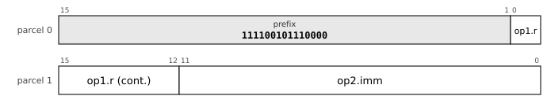

The chart is the leaf `32-MFSR-1`, MFSR, prefix `111100101110000`. `op1` is `reg5`: register, 5 bits. `op2` is `imm12u`: unsigned 12-bit immediate, 0 to 4095.

**All the layouts of this entry** (a chart for each, with its fields and the sub-opcode of each mnemonic, in [the bit layouts of every opcode](dictionary/by-encoding.md)): [`32-MFSR-1`](dictionary/by-encoding.md#32-MFSR-1), [`32-MTSR-1`](dictionary/by-encoding.md#32-MTSR-1).

**Operation**

```
MFSR: Rd ← system register `name`
MTSR: system register `name` ← Rs         ; read-only registers are an illegal instruction
```

**Flags** None written.

**Exceptions** Privileged: outside kernel mode the instruction aborts with the privileged-instruction vector. An unassigned system register is an illegal instruction.

The register is chosen by name. A write to `PTBR`, `ASID` or `MMUCTL` flushes the translation buffer.

| Name | Number | Access |
|---|---|---|
| `PTBR` | 0 | read and write |
| `EPC` | 1 | read and write |
| `EVA` | 2 | read only |
| `ECAUSE` | 3 | read only |
| `DMW0` | 4 | read and write |
| `DMW1` | 5 | read and write |
| `USP` | 6 | read and write |
| `SSP` | 7 | read and write |
| `EPSW` | 8 | read and write |
| `VBR` | 9 | read and write |
| `MMUCTL` | 10 | read and write |
| `ASID` | 11 | read and write |
| `CPUID` | 12 | read only |

**Why it is here.** A paging operating system must install a page table and learn why it was entered, which needs instructions to write `PTBR` and read `EPC`, `EVA` and `ECAUSE`. One general pair reaches all of the system registers by number. The user and supervisor stack pointers are in the set because any kernel must read and write the user stack pointer to build a signal frame, copy a process or switch context.

**Cf.** 6.3 (system registers).

**Status** implemented in the reference executor (`common/pdp64exec.c` and `common/pdp64exec_enc.inc`, run by `sim64`; QEMU does not yet execute this encoding).


### MTPS: Move to and from the processor status word

**Mnemonics:** `MTPS`, `MFPS`

**Syntax**

```
MTPS Rs
MFPS Rd
```

**Encoding**


The chart is the leaf `32-SYSR-1`, SYSR, prefix `11000100`. `op1` is `reg5`: register, 5 bits. `sub` (3 bits) selects the mnemonic: `mtps` 000, `mfps` 001, `tlbi` 010, `mtasid` 011, `mfasid` 100, `mtdp` 101, `mfdp` 110, `mtdmw` 111.

**All the layouts of this entry** (a chart for each, with its fields and the sub-opcode of each mnemonic, in [the bit layouts of every opcode](dictionary/by-encoding.md)): [`32-SYSR-1`](dictionary/by-encoding.md#32-SYSR-1).

**Operation**

```
MTPS: PSW ← Rs          ; in user mode only the flags N Z V C are written
MFPS: Rd ← PSW
```

**Flags** `MTPS` writes the flags from `Rs`; `MFPS` writes none.

**Exceptions** A `MTPS` value with the reserved mode 2 in a mode field aborts.

**Cf.** 6.1 (modes and the status word).

**Status** implemented in the reference executor (`common/pdp64exec.c` and `common/pdp64exec_enc.inc`, run by `sim64`; QEMU does not yet execute this encoding).


### SPL: Set the interrupt priority level

**Mnemonics:** `SPL`

**Syntax**

```
SPL #n        ; n = 0 to 7
```

**Encoding**


The chart is the leaf `32-SYSI-1`, SYSI, prefix `011010`. `op1` is `imm8u`: unsigned 8-bit immediate, 0 to 255. `sub` (2 bits) selects the mnemonic: `spl` 00, `trap` 01, `trapl` 10, `hint` 11.

**All the layouts of this entry** (a chart for each, with its fields and the sub-opcode of each mnemonic, in [the bit layouts of every opcode](dictionary/by-encoding.md)): [`32-SYSI-1`](dictionary/by-encoding.md#32-SYSI-1).

**Operation**

```
PSW.priority ← n
```

**Flags** None written. The condition flags are untouched.

**Exceptions** Privileged: outside kernel mode the instruction aborts with the privileged-instruction vector. A priority above 7 is an illegal instruction.

Kept despite `MTPS` writing the whole word because it sets the priority alone: a kernel raising priority around a critical section must not clobber the flags.

**Why it is here.** `SPL` stays although `MTPS` writes the whole status word: it sets the priority alone, leaving the condition codes untouched, so a kernel raising priority around a critical section does not clobber flags. It is the PDP-11 instruction of the same name.

**Cf.** 6.2.

**Status** implemented in the reference executor (`common/pdp64exec.c` and `common/pdp64exec_enc.inc`, run by `sim64`; QEMU does not yet execute this encoding).


### TRAP: System call and trap

**Mnemonics:** `TRAP`, `TRAPL`

**Syntax**

```
TRAP #n        ; n = 0 to 15, two bytes
TRAPL #n       ; n = 0 to 255, four bytes
```

**Encoding**


The chart is the leaf `32-SYSI-1`, SYSI, prefix `011010`. `op1` is `imm8u`: unsigned 8-bit immediate, 0 to 255. `sub` (2 bits) selects the mnemonic: `spl` 00, `trap` 01, `trapl` 10, `hint` 11.

**All the layouts of this entry** (a chart for each, with its fields and the sub-opcode of each mnemonic, in [the bit layouts of every opcode](dictionary/by-encoding.md)): [`32-SYSI-1`](dictionary/by-encoding.md#32-SYSI-1).

**Operation**

```
enter the kernel by vector (TRAP_BASE + n), with EPC = the address of the next instruction
```

**Flags** None written.

**Exceptions** Enters the kernel; not privileged.

The replacement for the PDP-11 `IOT` and `EMT`. In these encodings `TRAP` and `TRAPL` are one word with an 8-bit vector number (`docs/encoding-proposal.md`).

**Why it is here.** `IOT` and `EMT`, which were `TRAP` at two particular vectors on the PDP-11, are not provided.

**Cf.** 6.2, 6.5 (system calls).

**Status** implemented in the reference executor (`common/pdp64exec.c` and `common/pdp64exec_enc.inc`, run by `sim64`; QEMU does not yet execute this encoding).


### TLBI: Invalidate a translation

**Mnemonics:** `TLBI`

**Syntax**

```
TLBI Rs
```

**Encoding**


The chart is the leaf `32-SYSR-1`, SYSR, prefix `11000100`. `op1` is `reg5`: register, 5 bits. `sub` (3 bits) selects the mnemonic: `mtps` 000, `mfps` 001, `tlbi` 010, `mtasid` 011, `mfasid` 100, `mtdp` 101, `mfdp` 110, `mtdmw` 111.

**All the layouts of this entry** (a chart for each, with its fields and the sub-opcode of each mnemonic, in [the bit layouts of every opcode](dictionary/by-encoding.md)): [`32-SYSR-1`](dictionary/by-encoding.md#32-SYSR-1).

**Operation**

```
invalidate the translation-buffer entry for the page containing the address in Rs, on this core and by broadcast on the others
```

**Flags** None written.

**Exceptions** Privileged: outside kernel mode the instruction aborts with the privileged-instruction vector.

**Why it is here.** It broadcasts: a translation changed by one core must be invalidated on all of them, and `TLBSYNC` waits for it.

**Cf.** 7.5, 6.4.

**Status** implemented in the reference executor (`common/pdp64exec.c` and `common/pdp64exec_enc.inc`, run by `sim64`; QEMU does not yet execute this encoding).


### MTASID: Move to and from the address-space identifier

**Mnemonics:** `MTASID`, `MFASID`

**Syntax**

```
MTASID Rs
MFASID Rd
```

**Encoding**


The chart is the leaf `32-SYSR-1`, SYSR, prefix `11000100`. `op1` is `reg5`: register, 5 bits. `sub` (3 bits) selects the mnemonic: `mtps` 000, `mfps` 001, `tlbi` 010, `mtasid` 011, `mfasid` 100, `mtdp` 101, `mfdp` 110, `mtdmw` 111.

**All the layouts of this entry** (a chart for each, with its fields and the sub-opcode of each mnemonic, in [the bit layouts of every opcode](dictionary/by-encoding.md)): [`32-SYSR-1`](dictionary/by-encoding.md#32-SYSR-1).

**Operation**

```
MTASID: ASID ← Rs[15:0]          ; the translation buffer is flushed in the reference executor
MFASID: Rd ← ASID
```

**Flags** None written.

**Exceptions** Privileged: outside kernel mode the instruction aborts with the privileged-instruction vector.

The `ASID` tags translation-buffer entries so a context switch is one store.

**Why it is here.** The `ASID` tags translation-buffer entries so a context switch is one store and no flush. No further reason is recorded.

**Cf.** 6.4.

**Status** implemented in the reference executor (`common/pdp64exec.c` and `common/pdp64exec_enc.inc`, run by `sim64`; QEMU does not yet execute this encoding).


### MTDP: Move to and from the direct pointer

**Mnemonics:** `MTDP`, `MFDP`

**Syntax**

```
MTDP Rs
MFDP Rd
```

**Encoding**


The chart is the leaf `32-SYSR-1`, SYSR, prefix `11000100`. `op1` is `reg5`: register, 5 bits. `sub` (3 bits) selects the mnemonic: `mtps` 000, `mfps` 001, `tlbi` 010, `mtasid` 011, `mfasid` 100, `mtdp` 101, `mfdp` 110, `mtdmw` 111.

**All the layouts of this entry** (a chart for each, with its fields and the sub-opcode of each mnemonic, in [the bit layouts of every opcode](dictionary/by-encoding.md)): [`32-SYSR-1`](dictionary/by-encoding.md#32-SYSR-1).

**Operation**

```
MTDP: DP ← Rs
MFDP: Rd ← DP
```

**Flags** None written.

**Exceptions** None.

`DP` is the thread pointer in user mode and the per-CPU pointer in kernel mode; there is one copy per mode.

**Why it is here.** `MTDP` and `MFDP` read and write the current mode's copy.

**Cf.** 7.4 (per-CPU state).

**Status** implemented in the reference executor (`common/pdp64exec.c` and `common/pdp64exec_enc.inc`, run by `sim64`; QEMU does not yet execute this encoding).


### MTDMW: Move to a direct-mapping window

**Mnemonics:** `MTDMW`

**Syntax**

```
MTDMW Rs
```

**Encoding**


The chart is the leaf `32-SYSR-1`, SYSR, prefix `11000100`. `op1` is `reg5`: register, 5 bits. `sub` (3 bits) selects the mnemonic: `mtps` 000, `mfps` 001, `tlbi` 010, `mtasid` 011, `mfasid` 100, `mtdp` 101, `mfdp` 110, `mtdmw` 111.

**All the layouts of this entry** (a chart for each, with its fields and the sub-opcode of each mnemonic, in [the bit layouts of every opcode](dictionary/by-encoding.md)): [`32-SYSR-1`](dictionary/by-encoding.md#32-SYSR-1).

**Operation**

```
DMW0 ← Rs          ; storage only: the operand names no window and the format of the windows is unspecified
```

**Flags** None written.

**Exceptions** Privileged: outside kernel mode the instruction aborts with the privileged-instruction vector.

The direct-mapping windows have no defined format.

**Why it is here.** Taken from LoongArch's direct-mapping windows, which stop the kernel taking translation-buffer misses on its own text. The windows are deferred: the instruction is storage only.

**Cf.** 6.4.

**Status** implemented in the reference executor (`common/pdp64exec.c` and `common/pdp64exec_enc.inc`, run by `sim64`; QEMU does not yet execute this encoding).


### MFCPUID: Read the processor identifier

**Mnemonics:** `MFCPUID`

**Syntax**

```
MFCPUID Rd
```

**Encoding**


The chart is the leaf `32-SYSR-2`, SYSR, prefix `1110100000`. `op1` is `reg5`: register, 5 bits. `sub` (1 bit) selects the mnemonic: `mfcpuid` 0, `icinv` 1.

**All the layouts of this entry** (a chart for each, with its fields and the sub-opcode of each mnemonic, in [the bit layouts of every opcode](dictionary/by-encoding.md)): [`32-SYSR-2`](dictionary/by-encoding.md#32-SYSR-2).

**Operation**

```
Rd ← CPUID
```

**Flags** None written.

**Exceptions** None.

The index of this core, for per-CPU data.

**Why it is here.** Part of the multiprocessor operations, because per-CPU data needs each core to know which one it is.

**Cf.** 7.4, 7.8.

**Status** implemented in the reference executor (`common/pdp64exec.c` and `common/pdp64exec_enc.inc`, run by `sim64`; QEMU does not yet execute this encoding).


### ICINV: Invalidate the instruction cache for an address

**Mnemonics:** `ICINV`

**Syntax**

```
ICINV Rs
```

**Encoding**


The chart is the leaf `32-SYSR-2`, SYSR, prefix `1110100000`. `op1` is `reg5`: register, 5 bits. `sub` (1 bit) selects the mnemonic: `mfcpuid` 0, `icinv` 1.

**All the layouts of this entry** (a chart for each, with its fields and the sub-opcode of each mnemonic, in [the bit layouts of every opcode](dictionary/by-encoding.md)): [`32-SYSR-2`](dictionary/by-encoding.md#32-SYSR-2).

**Operation**

```
invalidate the instruction-cache line containing the address in Rs
```

**Flags** None written.

**Exceptions** The reference executor treats it as a no-op; privilege as for the other cache-maintenance instructions.

**Why it is here.** Instruction-cache invalidation, by address (`ICINV`) and whole (`ICINVA`). The reason is the one given for `TLBA`: a runtime that compiles a function cannot work without it.

**Cf.** 7.5.

**Status** implemented in the reference executor (`common/pdp64exec.c` and `common/pdp64exec_enc.inc`, run by `sim64`; QEMU does not yet execute this encoding).


### PROBE: Probe an address for read or write access

**Mnemonics:** `PROBER`, `PROBEW`

**Syntax**

```
PROBER Rd, Rs
PROBEW Rd, Rs
```

**Encoding**


The chart is the leaf `32-R2-1`, R2, prefix `111100000010`. `op1` is `reg5`: register, 5 bits. `op2` is `reg5`: register, 5 bits. `xsub` selects the mnemonic.

**All the layouts of this entry** (a chart for each, with its fields and the sub-opcode of each mnemonic, in [the bit layouts of every opcode](dictionary/by-encoding.md)): [`32-R2-1`](dictionary/by-encoding.md#32-R2-1).

**Operation**

```
Rd ← 1 if the address in Rs is readable (PROBER) or writable (PROBEW) in the previous mode, else 0
no fault is taken
```

**Flags** None written.

**Exceptions** Privileged: outside kernel mode the instruction aborts with the privileged-instruction vector.

Taken from the VAX `PROBER` and `PROBEW`: the kernel validates a user address before using it.

**Why it is here.** Taken from the VAX `PROBER` and `PROBEW`: the kernel validates a user address before using it, and it replaces the `nofault` global of the V7 kernel for the address-validation case.

**Cf.** 6.5 (the user-memory guard), 6.4.

**Status** implemented in the reference executor (`common/pdp64exec.c` and `common/pdp64exec_enc.inc`, run by `sim64`; QEMU does not yet execute this encoding).


### TRAPCC: Trap on condition

**Mnemonics:** `TRAPCC.NE`, `TRAPCC.EQ`, `TRAPCC.PL`, `TRAPCC.MI`, `TRAPCC.VC`, `TRAPCC.VS`, `TRAPCC.CC`, `TRAPCC.CS`, `TRAPCC.GE`, `TRAPCC.LT`, `TRAPCC.GT`, `TRAPCC.LE`, `TRAPCC.HI`, `TRAPCC.LOS`

**Syntax**

```
TRAPCC.cc          ; one word for each of the 14 conditions: TRAPCC.EQ, TRAPCC.VS, TRAPCC.HI ...
```

**Encoding**


The chart is the leaf `32-SYS0-1`, SYS0, prefix `11101110010`. `sub` (5 bits) selects the mnemonic: `nop` 00000, `rti` 00001, `rtt` 00010, `ret` 00011, `halt` 00100, `bpt` 00101, `fence` 00110, `wfe` 00111, `sev` 01000, `lpad` 01001, `tlbia` 01010, `tlbsync` 01011, `icinva` 01100, `pushx` 01101, `popx` 01110, `isync` 01111, `trapcc.ne` 10000, `trapcc.eq` 10001, `trapcc.pl` 10010, `trapcc.mi` 10011, `trapcc.vc` 10100, `trapcc.vs` 10101, `trapcc.cc` 10110, `trapcc.cs` 10111, `trapcc.ge` 11000, `trapcc.lt` 11001, `trapcc.gt` 11010, `trapcc.le` 11011, `trapcc.hi` 11100, `trapcc.los` 11101, `syspg0` 11110, `syspg1` 11111.

**All the layouts of this entry** (a chart for each, with its fields and the sub-opcode of each mnemonic, in [the bit layouts of every opcode](dictionary/by-encoding.md)): [`32-SYS0-1`](dictionary/by-encoding.md#32-SYS0-1).

**Operation**

```
if condition cc holds on the flags then take the CHECK trap
    EPC ← address of the next instruction ; EVA ← address of this instruction
```

**Flags** None written.

**Exceptions** The `CHECK` trap, when the condition holds. A *trap*, not an abort: the instruction completes, `EPC` is the next instruction, and `RTI` resumes after the check.

*(D)* Errata 85 and 86: `TRAPCC` is a trap and not an abort, there is no compare-and-trap form, and the fused `ADDV`, `SUBV` and `MULV` carry the register-only cases. There is one word for each of the 14 conditions, in two bytes with no operand: the condition numbers are those of the branches (`ne` 1 ... `los` 14; `al` is not a word). After `ADD` the check for signed overflow is `TRAPCC.VS` (`docs/study-proposals.md` item 9 calls it `ADD; TRAPV`). `EVA` is the address of the `TRAPCC` itself, the one trap that defines it, so a handler need not decode backwards from `EPC`. The check vector is number 16 (`CHECK`) in `docs/study-proposals.md` item 9 and in the reference executor; `spec/pdp64-system.hbnf` has no vector of that name yet, so the number is *(P)*. The reference executor takes a trap that fires outside the kernel as the end of the program.

**Why it is here.** A check that costs two bytes and no branch. The comparison with the alternatives is in the study (`docs/study-proposals.md` item 9): `ADD #1, 8(R2)` and a check is four plus two bytes and the add keeps its immediate and memory forms, where `ADD` and a `BVS` to a shared stub is six bytes and two instructions; and the same instruction checks what is not overflow (a bounds check after `CMP`, unsigned overflow after `ADD`). The OpenBSD kernels of i386, hppa and sparc64 already deliver integer-overflow traps as `SIGFPE` (`FPE_INTOVF`), so the signal route exists. The author made it a trap and not an abort (errata 85 and 86), so a handler that promotes a fixnum to a bignum can repair the register and resume; the one case where a trap defines `EVA`.

**Cf.** 6.2 (traps and aborts), docs/study-proposals.md item 9.

**Status** implemented in the reference executor (`common/pdp64exec.c` and `common/pdp64exec_enc.inc`, run by `sim64`; QEMU does not yet execute this encoding).


### SYSPG: Reserved system words

**Mnemonics:** `SYSPG0`, `SYSPG1`, `SYSPG2`, `SYSPG3`, `SYSPG4`, `SYSPG5`

**Syntax**

```
SYSPG0 ... SYSPG5
```

**Encoding**


The chart is the leaf `32-SYS0-1`, SYS0, prefix `11101110010`. `sub` (5 bits) selects the mnemonic: `nop` 00000, `rti` 00001, `rtt` 00010, `ret` 00011, `halt` 00100, `bpt` 00101, `fence` 00110, `wfe` 00111, `sev` 01000, `lpad` 01001, `tlbia` 01010, `tlbsync` 01011, `icinva` 01100, `pushx` 01101, `popx` 01110, `isync` 01111, `trapcc.ne` 10000, `trapcc.eq` 10001, `trapcc.pl` 10010, `trapcc.mi` 10011, `trapcc.vc` 10100, `trapcc.vs` 10101, `trapcc.cc` 10110, `trapcc.cs` 10111, `trapcc.ge` 11000, `trapcc.lt` 11001, `trapcc.gt` 11010, `trapcc.le` 11011, `trapcc.hi` 11100, `trapcc.los` 11101, `syspg0` 11110, `syspg1` 11111.

**All the layouts of this entry** (a chart for each, with its fields and the sub-opcode of each mnemonic, in [the bit layouts of every opcode](dictionary/by-encoding.md)): [`32-SYS0-1`](dictionary/by-encoding.md#32-SYS0-1), [`32-SYS0-2`](dictionary/by-encoding.md#32-SYS0-2).

**Operation**

```
none: the six words are reserved
```

**Flags** None written.

**Exceptions** Not specified. The reference executor traps them as unimplemented instructions.

*(S)* Placeholders. The grammars reserve six system words for the page-bit mechanisms that the author approved to be specified (errata 84: landing pads gated by a page bit, the `SYS` page bit), which `docs/retire-stage-candidates.md` describes as needing no opcode; no text of the repository gives these words a meaning, and software must not use them.

**Why it is here.** The grammars reserve six words next to `LPAD` and `TRAPCC` for the page-bit mechanisms: the author approved landing pads gated by a page bit and the `SYS` page bit "to be specified" (errata 84), and the retire-stage study found that these need no opcode. The placeholders keep the space; the record does not say what any of them will be.

**Status** specified; **not yet implemented** in the reference executor.
<!-- /entries:9.14 -->

## 9.15 Faults, restart and memory management

*Cf. chapter 6, section 6.8 (faults, restart and memory management) and section 6.4 (memory management).*

**9.15.1** A fault is a trap, an abort, a progress stop in a block operation or a machine check, and every instruction either completes or is annulled and restarted with no state to undo (`MCPY` and its kin keep their progress in registers); the page-table format, the memory types and the translation registers are in the kernel chapter. *(D)*

*Commentary.* The instruction-set consequence is the restart rule: the register update of an auto-increment mode is held until the instruction retires. **Impact.** *Kernel:* see 6.8. *Compiler:* no scheduling restriction arises from faults. *Hardware:* a single-entry undo buffer and a read-only walker.

## 9.16 Position-independent code

**9.16.1** Position-independent code costs nothing extra on this machine: every access to code or data in the same module is PC-relative by an ordinary addressing mode, so there is no GOT register and no prologue to set one up. *(D)*

**9.16.2** A call to an imported function is `CALLI got_slot(PC)` and a PLT stub is the single instruction `JMPI got_slot(PC)`; an imported variable's address is one `MOVQ got_slot(PC), Rd`. *(D)*

**9.16.3** A position-independent access to a global is no longer than an absolute one: four bytes within 32 KB and six within 2 GB, against six for a 32-bit absolute address. *(D)*

**9.16.4** The thread pointer is `DP`, so the local-exec thread-local model is one four-byte `MOVQ tls_offset(DP), Rd`. *(D)*

**9.16.5** A branch at the middle length reaches 4 GB, so no linker veneers are needed for any binary smaller than that; the assembler's and the linker's branch relaxation both reduce to choosing a length. *(D)*

**9.16.6** `R12` is the linker's scratch register. The ABI (appendix D) decides that imports are called without a PLT stub; lazy against eager binding is open. *(D for `R12` and no stub; open for binding)*

*Commentary.* **Precedent.** On i386 a position-independent executable reserved `%ebx` (one of eight registers) for the GOT base and set it in every prologue, which cost a few percent of size and speed; x86-64 fixed that with RIP-relative addressing, and AArch64 needs linker veneers because its branches reach only 128 MB. **Trade-offs.** The two-byte PC-relative form is the shortest, so position-independent data access is slightly smaller than absolute access; the price is a GOT load per imported call site where a PLT stub would cost a load per function. **Improvements.** Position-independence is a side effect of three decisions made for other reasons: PC-relative as an ordinary mode (adopted because the PC left the register file), variable-length encoding (for density) and `DP` (a 6502 zero-page descendant kept for density), which is exactly the thread pointer. **Benefits.** OpenBSD builds everything position-independent by default, and here that costs nothing. **Modern comparables.** x86-64 RIP-relative addressing; AArch64 `ADRP` with a GOT load and veneers for far calls. **Impact.** *Kernel:* a loader applies only relocations for data pointers, and write-xor-execute and randomisation come with no code penalty. *Compiler:* `-fPIE` is the default and emits the same instructions as `-fno-pic` for local data; no reserved register, no per-function setup. *Hardware:* nothing; the PC-relative mode is in the address adder already.

## 9.17 What was rejected

**9.17.1** The architecture refuses, by design, every feature that adds hidden state, an unbounded instruction, a second operand path or a mode bit that changes what other instructions mean. *(D)*

**9.17.2** From the PDP-11 and VAX it refuses general memory-to-memory operands, deferred addressing as a general form (only `JMPI` and `CALLI` are deferred), unbounded instructions with hidden microstate (`MOVC5`, `EDITPC`), packed decimal, hardware call frames (`CALLS`, `CALLG`), the PC as a general register, multiple floating-point formats, `POLY`, the `IOT`, `EMT`, `WAIT` and `RESET` instructions, a distinct low-half unsigned multiply, and the PDP-11's compare operand order. *(D)*

**9.17.3** From x86 it refuses partial-register writes that preserve upper bits, operand-size and `REX` prefixes, segmentation, flag writes that vary by instruction, implicit registers for multiply, divide and shift count, the x87 stack, transcendental instructions and byte-granular instruction fetch. *(D)*

**9.17.4** From the RISC family it refuses a register hardwired to zero (a sixteenth of a 16-register file), fused compare-and-branch in place of flags, branch delay slots, register windows and software-refilled translation buffers. *(D)*

**9.17.5** It also refuses features of its own invention: NUL-terminated string instructions (`MSCN` with an explicit maximum gives a bounded `strlen`), `CRC32` words (carry-less multiply is the primitive under every CRC), reciprocal-estimate instructions, NaN payload propagation, a 32-bit profile, an eight-byte instruction alignment, `MOVT` and `MOVK` partial-immediate inserts, hardware tag checking, store-with-write-barrier, a self-synchronising encoding, and a scalar instruction for sub-1-bit inference (the accelerator of chapter 8 does it). *(D)*

*Commentary.* **Precedent.** The VAX's `EDITPC` is a bytecode interpreter in microcode, and DEC needed a separate control chip for the PDP-11's commercial instruction set and shipped none; the VAX's hardware call frames ran slower than the equivalent sequence on later models; ARM32's `PC+8` and MIPS's delay slot expose one implementation's pipeline forever. **Trade-offs.** Each refusal gives up a real convenience: the lost `MOV (R1)+,(R2)+` copy loop, the byte-wide `ADDB`, the inline-argument `JSR`. Section 9.18 says what replaces each. **Improvements.** The common pattern is that a refused feature was either subsumed by a more general one (`MCPY` for the copy loop) or paid its cost in every implementation for a few users (`EDITPC`). **Benefits.** An instruction set a small in-order core can implement completely and a compiler can target without exceptions. **Modern comparables.** RISC-V and AArch64 also refuse memory-to-memory operands and delay slots; AArch64 keeps flags where RISC-V refuses them. **Impact.** *Kernel:* no instruction has a restart state except the three that keep their progress in architectural registers, so a fault is always restartable. *Compiler:* no special cases: every operand rule is uniform, one memory operand and the rest registers. *Hardware:* no microcode engine, no second operand path, no hidden-state latch, no alignment rotator in the fetch path.

## 9.18 Idioms: restored, lost and replaced

**9.18.1** Several idioms that the PDP-11 and VAX had and later RISC designs dropped are restored: subtract-one-and-branch (`SOB`, here in both directions), probe an address without faulting (`PROBER`, `PROBEW`), bit-field extract and insert, find-first-set (`CTZ`, `CLZ`), byte swap, block move, fill, compare and scan with their progress held in registers, the register-save mask (`PUSHM`, `POPM`, the useful half of `CALLS`), and carry-less multiply. *(D)*

**9.18.2** The VAX's counted-string instructions are largely present: `MOVC3` is `MCPY`, `CMPC3` is `MCMP`, `LOCC` is `MSCN`, `SKPC` is `MSCNN`, and `MOVC5` is `MCPY` plus `MSET`. Table-translated move, table scans and substring search are absent because a per-byte table lookup stops a block operation from streaming. *(D)*

**9.18.3** Deliberately lost, with their replacements: memory-to-memory `MOV` (replaced by `MCPY`); autoincrement-deferred and the dispatch-table idiom (replaced by `JTAG` for tag dispatch and a scaled-index `JMP` for the rest); `JSR Rn` and `RTS Rn` with inline arguments and cheap coroutines (replaced by `CALL` and `RET` with the return address on the stack where every unwinder and debugger expects it); the VAX `CASE` and `INDEX` instructions (replaced by a compare, branch and scaled `JMP`); byte and word ALU operations (`MOVZB`, the operation, `MOVB`: three instructions where the PDP-11 had one); and the flag set and clear instructions. *(D)*

**9.18.4** Subsumed, so not losses: `SXT` (the conversion moves), `SWAB` (`BSWAP`), `MARK` (the convention it served is gone), `ASH` and `ASHC` (the shifts take a register count), `MFPI` and `MTPI` (`PROBER` with the previous-mode bits and the user-memory guard), `MULU` (identical to `MUL` in the low half), and `ROL` (an assembler alias for `ROR`). *(D)*

**9.18.5** Measurements decide what is included: the compiler uses `SET cc, rd` (about 0.4% of code), not integer `ABS`, `MIN` or `MAX` (under 0.1%), not the bit-field instructions (0.03%) and not the auto-increment modes (0.1%); the second opcode page is about 7% of the instructions emitted. *(D)*

*Commentary.* **Precedent.** The PDP-11's `JSR Rn` put the return address in a register of the caller's choosing, which made coroutines a pair of `JSR`s and inline arguments free; the VAX replaced it with `CALLS` and a frame, which was slower than the code it replaced. **Trade-offs.** The most frequently felt loss in hand-written code is the byte-wide read-modify-write; the compiler never notices it. A bounds-checked `INDEX` for Pascal and Ada is a possible addition. **Improvements.** `SOB` branches either way, with four reaches; the block operations keep their progress in registers, which is what the VAX got wrong, so a fault restarts for free. **Benefits.** The code a compiler emits is the code the table above measures, and the extras are for the people who write assembler. **Modern comparables.** x86 keeps `LOOP` and the string instructions with `REP`; AArch64 has bit-field moves and no memory-to-memory forms; RISC-V has none of them in the base. **Impact.** *Kernel:* `PROBER` and `PROBEW` replace the `nofault` global in the user-copy routines. *Compiler:* idioms the compiler never emits are not built for it, so the compiler's instruction selection stays small. *Hardware:* each restored idiom is a few hundred gates of existing datapath, and each lost one is a decode that never existed.

## 9.19 Side by side: the PDP-11, the VAX and the pdp64

**9.19.1** The word is 64 bits against the PDP-11's 16 and the VAX's 32, the registers are 16 as on the VAX, the virtual address is 39 bits with 40 physical, and the instruction count is 58 assigned opcodes plus 45 on the second page, against the VAX's 304. *(D)*

**9.19.2** The program counter is not a register, there is no argument pointer, and the frame pointer and the linker scratch are ordinary software conventions. *(D)*

**9.19.3** An instruction has one or two operands (three for the block operations) and at most one memory operand, against the PDP-11's two and the VAX's six. *(D)*

**9.19.4** The condition codes are the same four, `N`, `Z`, `V` and `C`; floating point is in the base and in the general registers, with three IEEE formats (half, single, double) and no mode bits that change the meaning of other instructions, where the PDP-11 had `FPS.FD`, `FL` and `FT` and the VAX had rounding bits in the status word. *(D)*

**9.19.5** An instruction is two, four or six bytes (one to three parcels of 16 bits) with a one-parcel second page, against the PDP-11's two to six and the VAX's one to more than fifty. *(D)*

*Commentary.* **Precedent.** The PDP-11 and VAX instruction formats, with their encodings drawn side by side, are in the instruction-set text, section 13. **Trade-offs.** The pdp64 keeps what made the PDP-11 pleasant, orthogonal addressing and a small register set, and what made the VAX powerful, flags, a register-save mask and string operations, and drops what made both expensive: memory-to-memory operands and unbounded instructions. **Improvements.** The compiler's code averages about 3.3 bytes an instruction, measured on the fair corpus before the second page. **Benefits.** A processor that is smaller than either predecessor while running 64-bit code. **Modern comparables.** The closest family is AArch64 in the number of registers and addressing modes and RISC-V compressed in density; neither has flags and a variable length together. **Impact.** *Kernel:* the exception model is the PDP-11's with the VAX's per-mode stacks. *Compiler:* one memory operand makes instruction selection a register-allocation problem, as on a RISC. *Hardware:* a decoder that reads two bits to find the length, and no microcode.

## 9.20 What was taken from LoongArch, and what was not

**9.20.1** LoongArch64 is the most recent clean-room instruction set designed without an ideological commitment: it borrowed from MIPS, RISC-V and ARM as each had the better answer, which is the posture of the pdp64.

**9.20.2** Adopted from it: bit manipulation in the base (`CLO`, `CLZ`, `CTZ`, bit-field moves, byte reverse), atomics with the barrier folded in (the `_DB` variants), a richer atomic set (fetch-and-minimum and maximum), and memory type as a page attribute. *(D)*

**9.20.3** Declined, with reasons: `R0` hardwired to zero (a sixteenth of a 16-register file, and `CLR` and `NEG` are one parcel already); no condition codes (a third read port in the branch unit against a four-bit latch); `FCSR` rounding-mode bits (hidden state that changes other instructions); four PC-relative address-formation instructions (one `LEA` carries 32 bits); 32 registers (this encoding has no bit to spare for the field); and separate vector register files (chapter 8). *(D)*

**9.20.4** Under consideration: separate floating-point condition flags, software-visible translation-buffer manipulation (to pin an entry for a real-time kernel), and a conditional select for constant-time code. *(P)*

*Commentary.* **Precedent.** LoongArch has a fixed 32-bit encoding with room for two register fields and a displacement, so it can afford compare-and-branch and needs four instructions to form an address; this machine's variable length reverses both trade-offs. **Trade-offs.** The direct-mapping windows LoongArch uses to avoid translation-buffer misses on kernel text are deferred: `DMW0` and `DMW1` are stored without effect (6.3). **Improvements.** The same idea is right or wrong depending on the encoding around it, and each adoption is judged against this encoding. **Benefits.** Borrowing the tested parts saves design time and avoids their bugs. **Modern comparables.** LoongArch itself; the RISC-V bit-manipulation extensions (Zbb, Zbs) do much of the same. **Impact.** *Kernel:* atomics with barriers make a lock acquire one instruction. *Compiler:* bit operations in the base mean the compiler can use them without a feature test. *Hardware:* each adopted idea is a few hundred lookup tables and each declined one is a block not built.

## 9.21 What is still open in the instruction set

**9.21.1** Open, with the reasoning in appendix B or in the instruction-set text, section 12: the thin 6-bit displacement of the shortest scaled-index form; the landing-pad decision (optional first, mandatory later); atomics against the bus (the lock against the monitor; the monitor is chosen); worst-case instruction latency for the block operations (an interrupt-latency claim must state the block granularity); the floating-point condition flags (the signed branches do not treat unordered cleanly); the block operations and the cache (a streaming memory type or a non-temporal variant); directed rounding for arithmetic (a rounding field in the instruction); the leftovers of half precision (minimum, maximum, rounding, bfloat16); conditional select; lazy against eager binding in the ABI; the verification of the memory model against published litmus tests; and the coherence protocol if the core count passes four. *(P and open)*

**9.21.2** Settled: the reserved-opcode discipline (a top-level opcode is for an operation whose common case is register to register), the fourth parcel (absent; the code `11` is a second page of 64 one-parcel opcodes), UTF-8 scope (`MVAL` is committed), and the measured length distribution (2, 4, 6 and 8 bytes at 46.5, 42.8, 10.6 and 0.1 percent, before the second page). *(D)*

*Commentary.* **Trade-offs.** None of the open items blocks the first implementation; the three that must be settled before silicon, the memory model verification, the coherence choice and the worst-case latency figure, are verification tasks, not design changes. **Impact.** *Kernel:* the open items touching the kernel are the user-memory guard, the floating-point state and the block-operation granularity. *Compiler:* conditional select and directed rounding would change instruction selection. *Hardware:* the coherence protocol must be chosen before the cache is built, not after.
