# The bit layout of every instruction word (pdp64/32)

[← dictionary index](index.md)

One chart for each way a word is encoded: the bits that the word fixes (its opcode or prefix, its sub-opcode, the fields it holds constant) are shaded and carry their value; the operand fields are named. A word that has several forms (a length, an addressing form, a load and a store) has one chart for each, one under the other. The charts are generated from the grammar by `tools/mkmanual.py`, as those of [the bit layouts of every opcode](by-encoding.md), which show a layout once for all the words that share it.

### ABS

Entry: [ABS](../09-isa.md#abs-absolute-value). 1 form.

### ADC

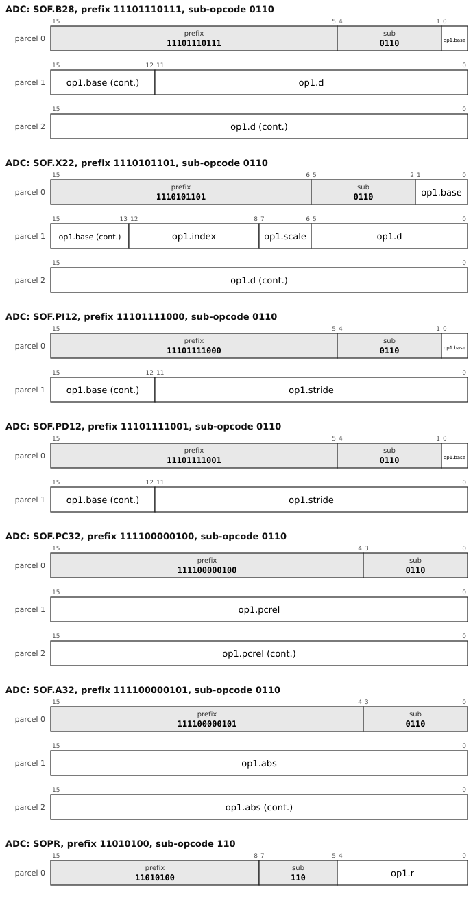

Entry: [ADC](../09-isa.md#adc-add-carry). 7 forms.

### ADD

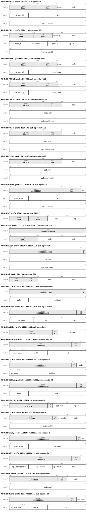

Entry: [ADD](../09-isa.md#add-add). 24 forms.

### ADDM

Entry: [ADDM](../09-isa.md#addm-alu-operation-with-a-memory-destination). 6 forms.

### ADDV

Entry: [OVF](../09-isa.md#ovf-add-subtract-and-multiply-trapping-on-signed-overflow). 1 form.

### AESDS

Entry: [AESR](../09-isa.md#aesr-aes-round-on-a-128-bit-block-in-two-registers). 1 form.

### AESDSM

Entry: [AESR](../09-isa.md#aesr-aes-round-on-a-128-bit-block-in-two-registers). 1 form.

### AESES

Entry: [AESR](../09-isa.md#aesr-aes-round-on-a-128-bit-block-in-two-registers). 1 form.

### AESESM

Entry: [AESR](../09-isa.md#aesr-aes-round-on-a-128-bit-block-in-two-registers). 1 form.

### AESIM

Entry: [AESK](../09-isa.md#aesk-aes-key-schedule-steps). 1 form.

### AESKS1

Entry: [AESK](../09-isa.md#aesk-aes-key-schedule-steps). 1 form.

### AESKS2

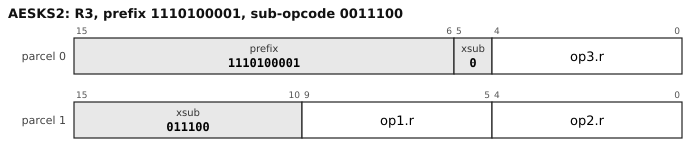

Entry: [AESK](../09-isa.md#aesk-aes-key-schedule-steps). 1 form.

### AND

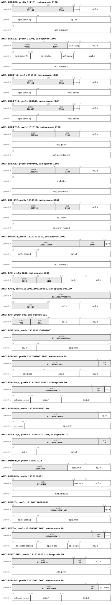

Entry: [AND](../09-isa.md#and-and). 22 forms.

### ASL

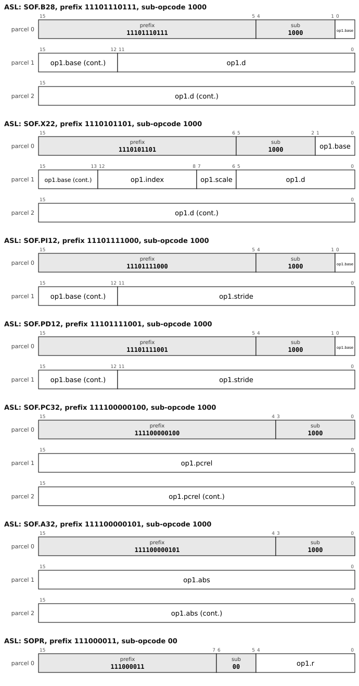

Entry: [ASL](../09-isa.md#asl-arithmetic-shift-left-by-one). 7 forms.

### ASR

Entry: [ASR](../09-isa.md#asr-arithmetic-shift-right-by-one). 7 forms.

### BCC

Entry: [BCC](../09-isa.md#bcc-branch-on-condition). 2 forms.

### BCS

Entry: [BCC](../09-isa.md#bcc-branch-on-condition). 2 forms.

### BEQ

Entry: [BCC](../09-isa.md#bcc-branch-on-condition). 3 forms.

### BGE

Entry: [BCC](../09-isa.md#bcc-branch-on-condition). 2 forms.

### BGT

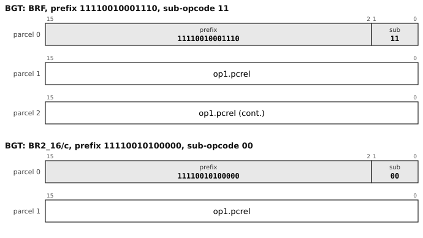

Entry: [BCC](../09-isa.md#bcc-branch-on-condition). 2 forms.

### BHI

Entry: [BCC](../09-isa.md#bcc-branch-on-condition). 2 forms.

### BIC

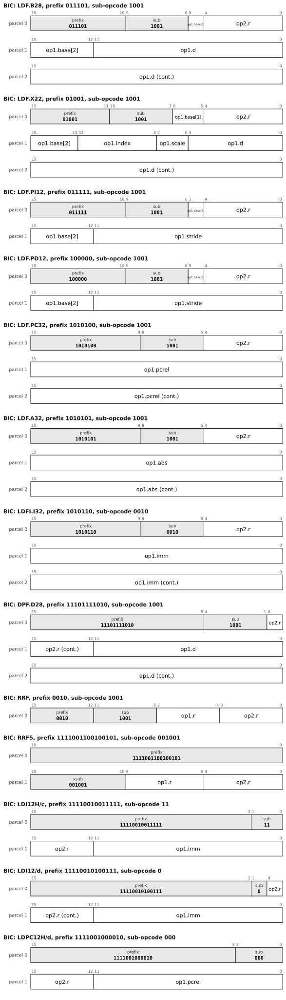

Entry: [BIC](../09-isa.md#bic-bit-clear). 13 forms.

### BICM

Entry: [ADDM](../09-isa.md#addm-alu-operation-with-a-memory-destination). 6 forms.

### BIS

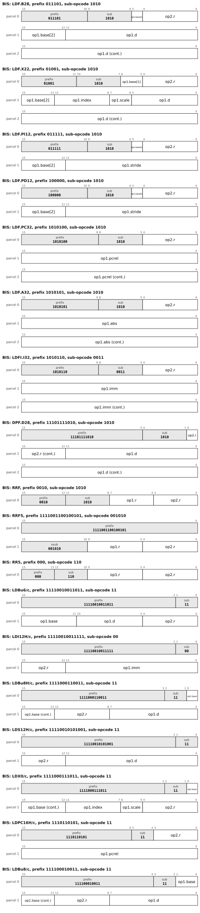

Entry: [BIS](../09-isa.md#bis-bit-set-inclusive-or). 18 forms.

### BISM

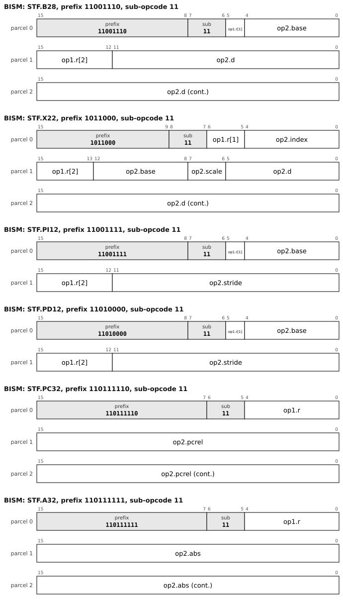

Entry: [ADDM](../09-isa.md#addm-alu-operation-with-a-memory-destination). 6 forms.

### BIT

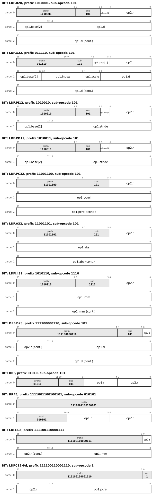

Entry: [BIT](../09-isa.md#bit-bit-test). 12 forms.

### BITREV

Entry: [BITREV](../09-isa.md#bitrev-reverse-the-bits). 1 form.

### BLE

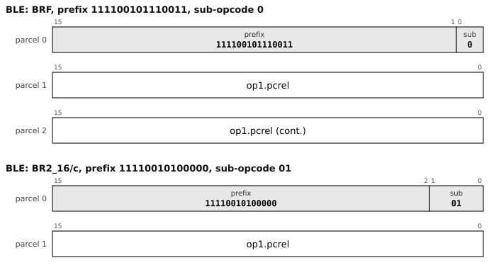

Entry: [BCC](../09-isa.md#bcc-branch-on-condition). 2 forms.

### BLOS

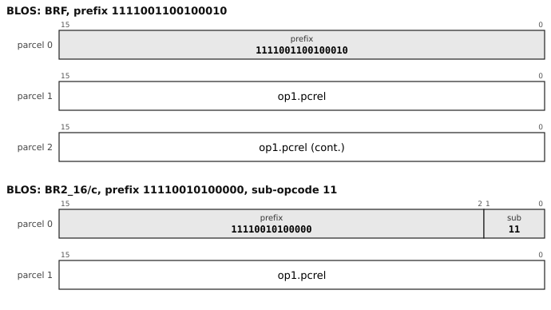

Entry: [BCC](../09-isa.md#bcc-branch-on-condition). 2 forms.

### BLT

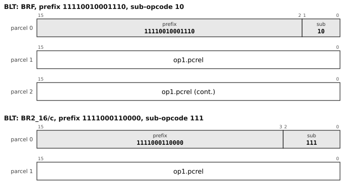

Entry: [BCC](../09-isa.md#bcc-branch-on-condition). 2 forms.

### BMI

Entry: [BCC](../09-isa.md#bcc-branch-on-condition). 2 forms.

### BNE

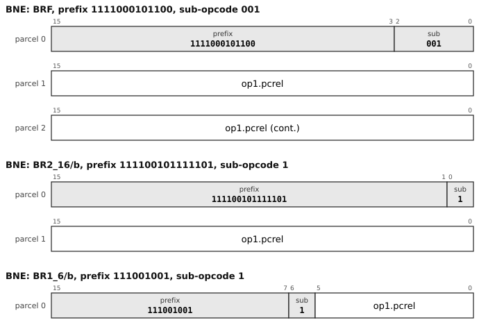

Entry: [BCC](../09-isa.md#bcc-branch-on-condition). 3 forms.

### BNTAG

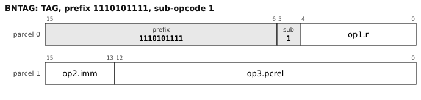

Entry: [BTAG](../09-isa.md#btag-branch-on-pointer-tag). 1 form.

### BPL

Entry: [BCC](../09-isa.md#bcc-branch-on-condition). 2 forms.

### BPT

Entry: [BPT](../09-isa.md#bpt-breakpoint). 1 form.

### BR

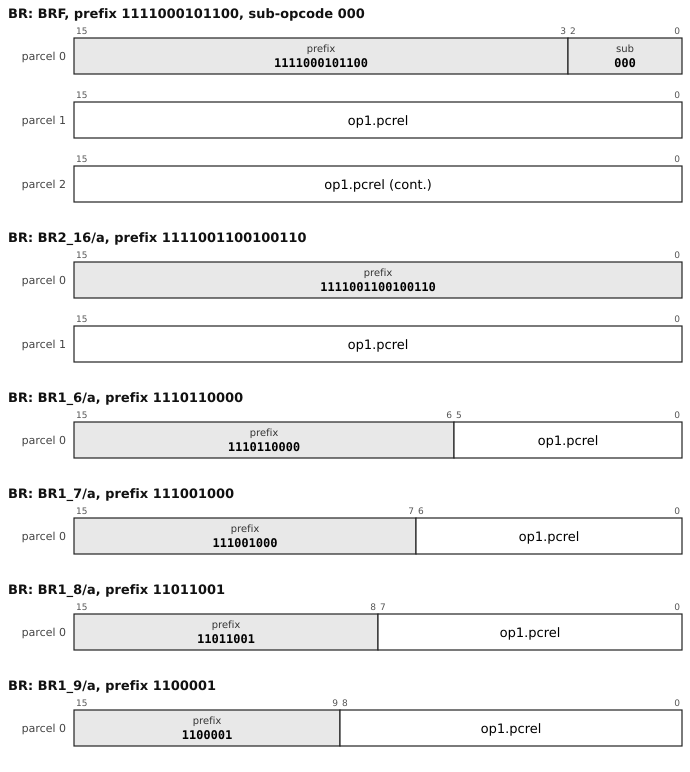

Entry: [BCC](../09-isa.md#bcc-branch-on-condition). 6 forms.

### BSEL

Entry: [BSEL](../09-isa.md#bsel-bitwise-select). 1 form.

### BSWAP

Entry: [BSWAP](../09-isa.md#bswap-byte-swap). 1 form.

### BSWAPL

Entry: [BSWAP](../09-isa.md#bswap-byte-swap). 1 form.

### BSWAPW

Entry: [BSWAP](../09-isa.md#bswap-byte-swap). 1 form.

### BTAG

Entry: [BTAG](../09-isa.md#btag-branch-on-pointer-tag). 1 form.

### BVC

Entry: [BCC](../09-isa.md#bcc-branch-on-condition). 2 forms.

### BVS

Entry: [BCC](../09-isa.md#bcc-branch-on-condition). 2 forms.

### CALL

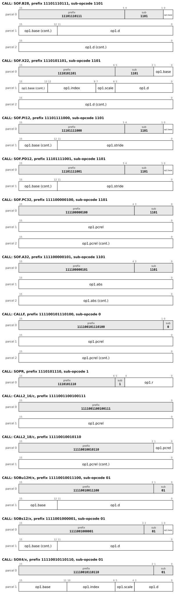

Entry: [CALL](../09-isa.md#call-call). 13 forms.

### CALLI

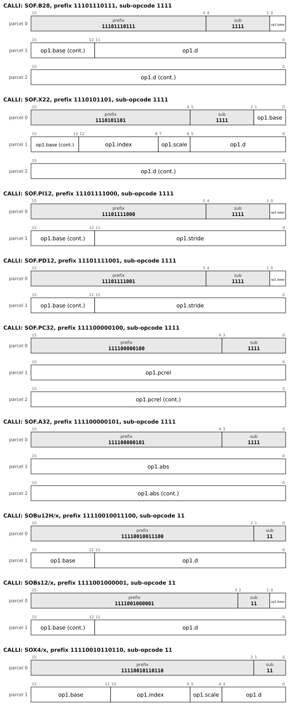

Entry: [JMPI](../09-isa.md#jmpi-jump-and-call-through-memory). 9 forms.

### CAS

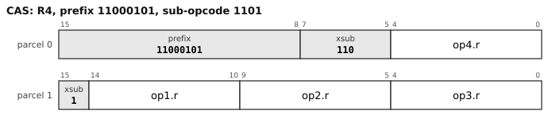

Entry: [CAS](../09-isa.md#cas-compare-and-swap). 1 form.

### CASDB

Entry: [CAS](../09-isa.md#cas-compare-and-swap). 1 form.

### CBCC

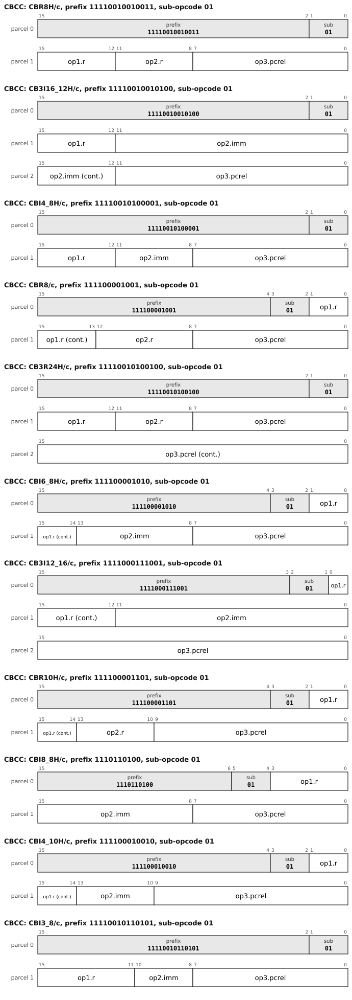

Entry: [CBCC](../09-isa.md#cbcc-compare-and-branch-on-condition). 11 forms.

### CBCS

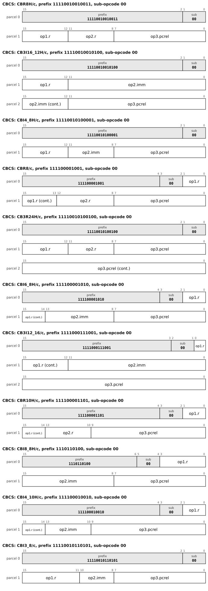

Entry: [CBCC](../09-isa.md#cbcc-compare-and-branch-on-condition). 11 forms.

### CBEQ

Entry: [CBCC](../09-isa.md#cbcc-compare-and-branch-on-condition). 21 forms.

### CBGE

Entry: [CBCC](../09-isa.md#cbcc-compare-and-branch-on-condition). 10 forms.

### CBGT

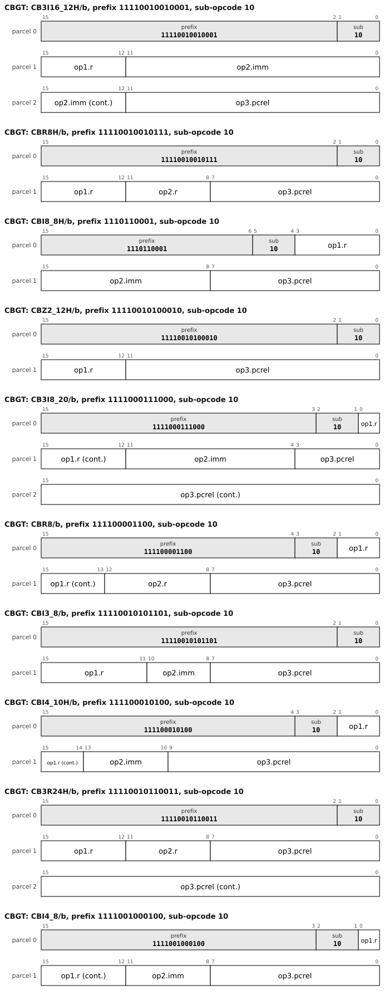

Entry: [CBCC](../09-isa.md#cbcc-compare-and-branch-on-condition). 10 forms.

### CBHI

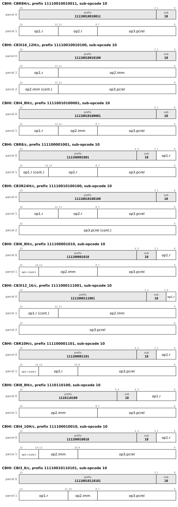

Entry: [CBCC](../09-isa.md#cbcc-compare-and-branch-on-condition). 11 forms.

### CBLE

Entry: [CBCC](../09-isa.md#cbcc-compare-and-branch-on-condition). 10 forms.

### CBLOS

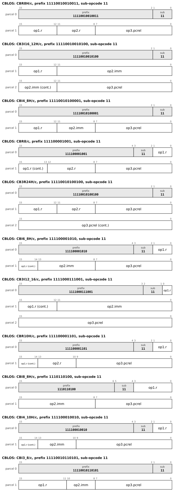

Entry: [CBCC](../09-isa.md#cbcc-compare-and-branch-on-condition). 11 forms.

### CBLT

Entry: [CBCC](../09-isa.md#cbcc-compare-and-branch-on-condition). 10 forms.

### CBMI

Entry: [CBCC](../09-isa.md#cbcc-compare-and-branch-on-condition). 2 forms.

### CBNE

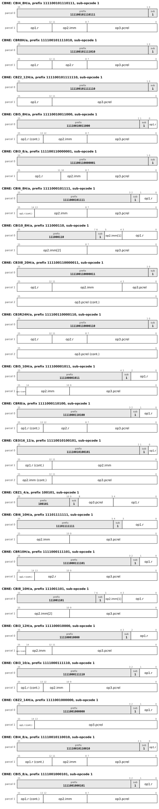

Entry: [CBCC](../09-isa.md#cbcc-compare-and-branch-on-condition). 21 forms.

### CBPL

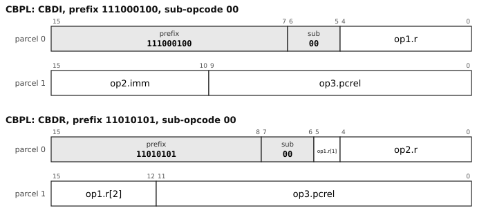

Entry: [CBCC](../09-isa.md#cbcc-compare-and-branch-on-condition). 2 forms.

### CBVC

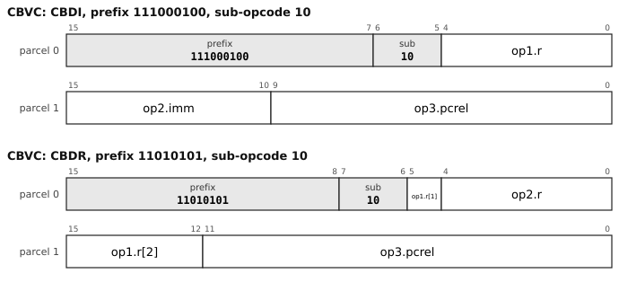

Entry: [CBCC](../09-isa.md#cbcc-compare-and-branch-on-condition). 2 forms.

### CBVS

Entry: [CBCC](../09-isa.md#cbcc-compare-and-branch-on-condition). 2 forms.

### CLMULH

Entry: [CLMUL](../09-isa.md#clmul-carry-less-multiply). 1 form.

### CLMULL

Entry: [CLMUL](../09-isa.md#clmul-carry-less-multiply). 1 form.

### CLO

Entry: [COUNT](../09-isa.md#count-count-leading-and-trailing-zeros-and-ones). 1 form.

### CLR

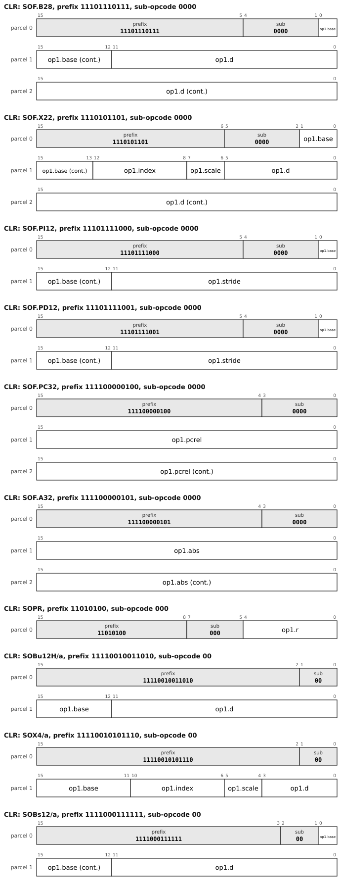

Entry: [CLR](../09-isa.md#clr-clear). 10 forms.

### CLZ

Entry: [COUNT](../09-isa.md#count-count-leading-and-trailing-zeros-and-ones). 1 form.

### CMP

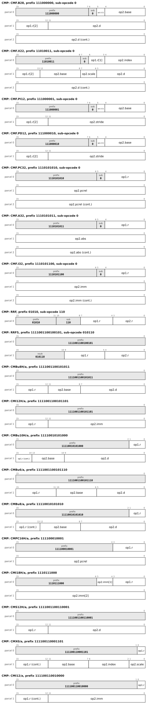

Entry: [CMP](../09-isa.md#cmp-compare). 19 forms.

### COM

Entry: [COM](../09-isa.md#com-complement). 7 forms.

### CTO

Entry: [COUNT](../09-isa.md#count-count-leading-and-trailing-zeros-and-ones). 1 form.

### CTZ

Entry: [COUNT](../09-isa.md#count-count-leading-and-trailing-zeros-and-ones). 1 form.

### DEC

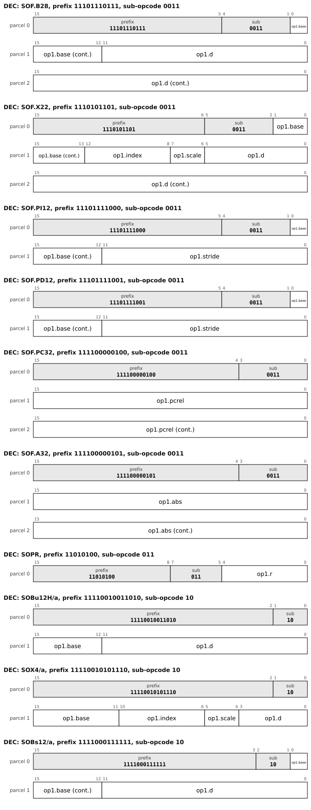

Entry: [DEC](../09-isa.md#dec-decrement). 10 forms.

### DIV

Entry: [DIV](../09-isa.md#div-divide-and-remainder-signed-and-unsigned). 1 form.

### DIVU

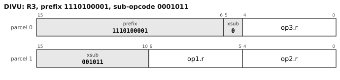

Entry: [DIV](../09-isa.md#div-divide-and-remainder-signed-and-unsigned). 1 form.

### DSHR

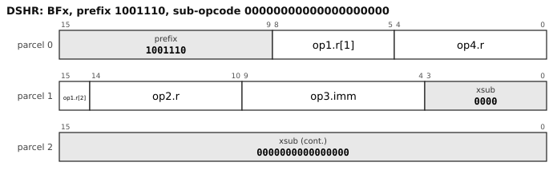

Entry: [DSHR](../09-isa.md#dshr-double-width-funnel-shift-right). 1 form.

### EXTB

Entry: [EXTB](../09-isa.md#extb-extract-a-bit-field). 1 form.

### EXTZB

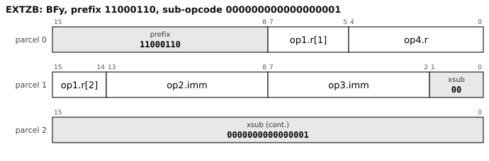

Entry: [EXTB](../09-isa.md#extb-extract-a-bit-field). 1 form.

### FABS

Entry: [FSIGN](../09-isa.md#fsign-sign-operations-on-the-bits). 1 form.

### FADD

Entry: [FADD](../09-isa.md#fadd-floating-add-subtract-and-multiply-binary64). 11 forms.

### FADD16

Entry: [FHALF](../09-isa.md#fhalf-floating-arithmetic-binary16). 1 form.

### FADD32

Entry: [FSINGLE](../09-isa.md#fsingle-floating-arithmetic-binary32). 1 form.

### FCLASS

Entry: [FCLASS](../09-isa.md#fclass-classify-a-floating-point-value). 1 form.

### FCLASS16

Entry: [FCLASS](../09-isa.md#fclass-classify-a-floating-point-value). 1 form.

### FCLASS32

Entry: [FCLASS](../09-isa.md#fclass-classify-a-floating-point-value). 1 form.

### FCMP

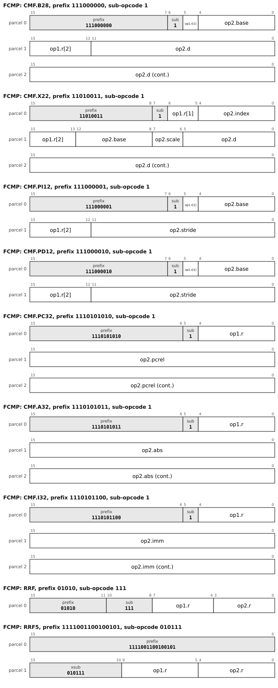

Entry: [FCMP](../09-isa.md#fcmp-floating-compare-binary64). 9 forms.

### FCMP16

Entry: [FHALF](../09-isa.md#fhalf-floating-arithmetic-binary16). 1 form.

### FCMP32

Entry: [FSINGLE](../09-isa.md#fsingle-floating-arithmetic-binary32). 1 form.

### FCOPYSIGN

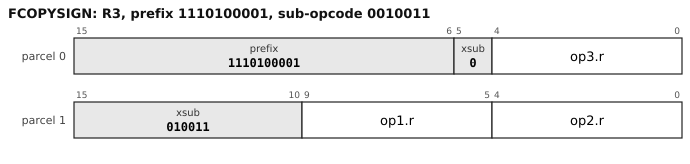

Entry: [FSIGN](../09-isa.md#fsign-sign-operations-on-the-bits). 1 form.

### FCVTDH

Entry: [FCVTH](../09-isa.md#fcvth-conversions-to-and-from-binary16). 1 form.

### FCVTDQ

Entry: [FCVT](../09-isa.md#fcvt-floating-conversions). 1 form.

### FCVTDQU

Entry: [FCVT](../09-isa.md#fcvt-floating-conversions). 1 form.

### FCVTDS

Entry: [FCVT](../09-isa.md#fcvt-floating-conversions). 1 form.

### FCVTHD

Entry: [FCVTH](../09-isa.md#fcvth-conversions-to-and-from-binary16). 1 form.

### FCVTHL

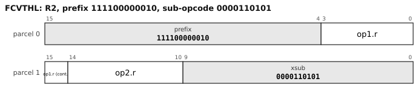

Entry: [FCVTH](../09-isa.md#fcvth-conversions-to-and-from-binary16). 1 form.

### FCVTHS

Entry: [FCVTH](../09-isa.md#fcvth-conversions-to-and-from-binary16). 1 form.

### FCVTLH

Entry: [FCVTH](../09-isa.md#fcvth-conversions-to-and-from-binary16). 1 form.

### FCVTLS

Entry: [FCVT](../09-isa.md#fcvt-floating-conversions). 1 form.

### FCVTQD

Entry: [FCVT](../09-isa.md#fcvt-floating-conversions). 1 form.

### FCVTQUD

Entry: [FCVT](../09-isa.md#fcvt-floating-conversions). 1 form.

### FCVTSD

Entry: [FCVT](../09-isa.md#fcvt-floating-conversions). 1 form.

### FCVTSH

Entry: [FCVTH](../09-isa.md#fcvth-conversions-to-and-from-binary16). 1 form.

### FCVTSL

Entry: [FCVT](../09-isa.md#fcvt-floating-conversions). 1 form.

### FDIV

Entry: [FDIV](../09-isa.md#fdiv-floating-divide-and-square-root-binary64). 1 form.

### FDIV16

Entry: [FHALF](../09-isa.md#fhalf-floating-arithmetic-binary16). 1 form.

### FDIV32

Entry: [FSINGLE](../09-isa.md#fsingle-floating-arithmetic-binary32). 1 form.

### FENCE

Entry: [FENCE](../09-isa.md#fence-memory-fence). 1 form.

### FMADD

Entry: [FMADD](../09-isa.md#fmadd-fused-multiply-add-binary64). 1 form.

### FMADD16

Entry: [FHALF](../09-isa.md#fhalf-floating-arithmetic-binary16). 1 form.

### FMADD32

Entry: [FMADD32](../09-isa.md#fmadd32-fused-multiply-add-binary32). 1 form.

### FMAX

Entry: [FMIN](../09-isa.md#fmin-floating-minimum-and-maximum-binary64). 1 form.

### FMIN

Entry: [FMIN](../09-isa.md#fmin-floating-minimum-and-maximum-binary64). 1 form.

### FMSUB

Entry: [FMADD](../09-isa.md#fmadd-fused-multiply-add-binary64). 1 form.

### FMSUB16

Entry: [FHALF](../09-isa.md#fhalf-floating-arithmetic-binary16). 1 form.

### FMSUB32

Entry: [FMADD32](../09-isa.md#fmadd32-fused-multiply-add-binary32). 1 form.

### FMUL

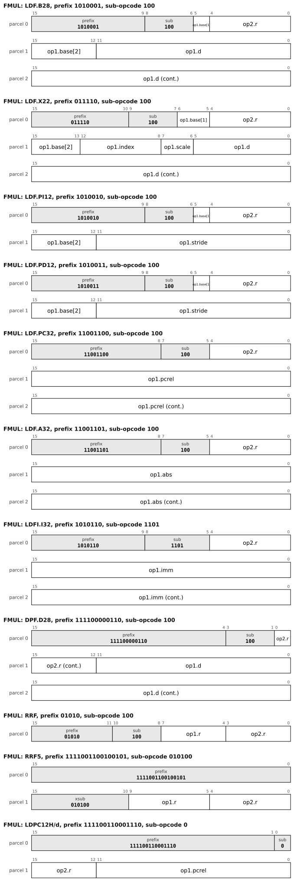

Entry: [FADD](../09-isa.md#fadd-floating-add-subtract-and-multiply-binary64). 11 forms.

### FMUL16

Entry: [FHALF](../09-isa.md#fhalf-floating-arithmetic-binary16). 1 form.

### FMUL32

Entry: [FSINGLE](../09-isa.md#fsingle-floating-arithmetic-binary32). 1 form.

### FNEG

Entry: [FSIGN](../09-isa.md#fsign-sign-operations-on-the-bits). 1 form.

### FNMADD

Entry: [FMADD](../09-isa.md#fmadd-fused-multiply-add-binary64). 1 form.

### FNMADD16

Entry: [FHALF](../09-isa.md#fhalf-floating-arithmetic-binary16). 1 form.

### FNMADD32

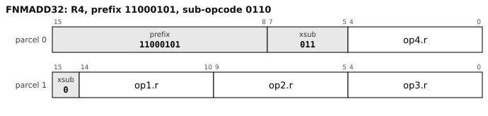

Entry: [FMADD32](../09-isa.md#fmadd32-fused-multiply-add-binary32). 1 form.

### FNMSUB

Entry: [FMADD](../09-isa.md#fmadd-fused-multiply-add-binary64). 1 form.

### FNMSUB16

Entry: [FHALF](../09-isa.md#fhalf-floating-arithmetic-binary16). 1 form.

### FNMSUB32

Entry: [FMADD32](../09-isa.md#fmadd32-fused-multiply-add-binary32). 1 form.

### FRINT

Entry: [FRINT](../09-isa.md#frint-round-to-an-integral-value-binary64). 1 form.

### FRINTA

Entry: [FRINT](../09-isa.md#frint-round-to-an-integral-value-binary64). 1 form.

### FRINTM

Entry: [FRINT](../09-isa.md#frint-round-to-an-integral-value-binary64). 1 form.

### FRINTP

Entry: [FRINT](../09-isa.md#frint-round-to-an-integral-value-binary64). 1 form.

### FRINTZ

Entry: [FRINT](../09-isa.md#frint-round-to-an-integral-value-binary64). 1 form.

### FSFLAGS

Entry: [FSFLAGS](../09-isa.md#fsflags-swap-the-floating-point-exception-flags). 1 form.

### FSQRT

Entry: [FDIV](../09-isa.md#fdiv-floating-divide-and-square-root-binary64). 1 form.

### FSQRT16

Entry: [FHALF](../09-isa.md#fhalf-floating-arithmetic-binary16). 1 form.

### FSQRT32

Entry: [FSINGLE](../09-isa.md#fsingle-floating-arithmetic-binary32). 1 form.

### FSUB

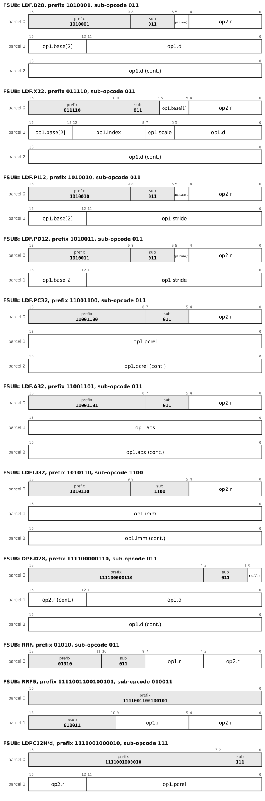

Entry: [FADD](../09-isa.md#fadd-floating-add-subtract-and-multiply-binary64). 11 forms.

### FSUB16

Entry: [FHALF](../09-isa.md#fhalf-floating-arithmetic-binary16). 1 form.

### FSUB32

Entry: [FSINGLE](../09-isa.md#fsingle-floating-arithmetic-binary32). 1 form.

### HALT

Entry: [HALT](../09-isa.md#halt-halt-the-processor). 1 form.

### HINT

Entry: [HINT](../09-isa.md#hint-hint). 1 form.

### ICINV

Entry: [ICINV](../09-isa.md#icinv-invalidate-the-instruction-cache-for-an-address). 1 form.

### ICINVA

Entry: [TLBA](../09-isa.md#tlba-invalidate-all-translations-wait-for-translation-invalidations-invalidate-the-whole-instruction-cache). 1 form.

### INC

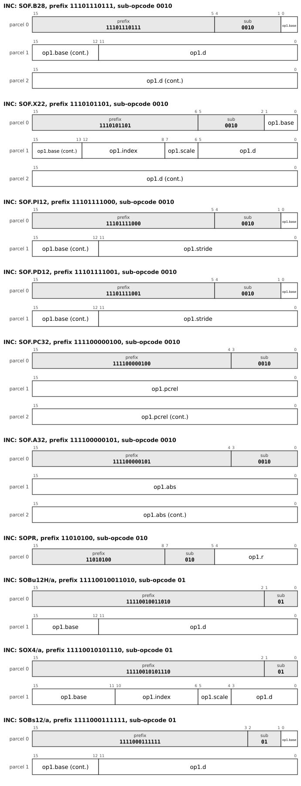

Entry: [INC](../09-isa.md#inc-increment). 10 forms.

### INSB

Entry: [INSB](../09-isa.md#insb-insert-a-bit-field). 1 form.

### ISYNC

Entry: [ISYNC](../09-isa.md#isync-instruction-synchronisation). 1 form.

### JMP

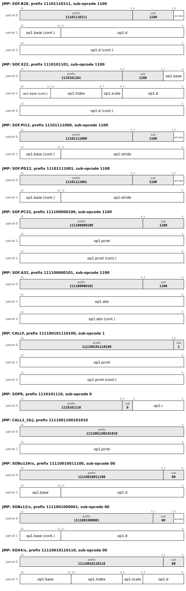

Entry: [JMP](../09-isa.md#jmp-jump). 12 forms.

### JMPI

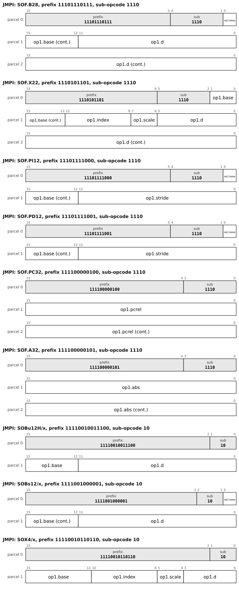

Entry: [JMPI](../09-isa.md#jmpi-jump-and-call-through-memory). 9 forms.

### JTAG

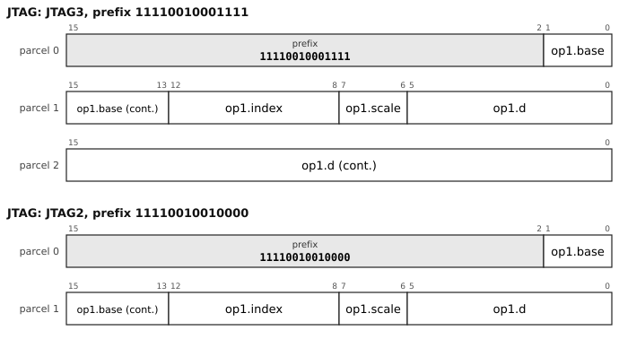

Entry: [JTAG](../09-isa.md#jtag-jump-through-a-tag-table). 2 forms.

### LEA

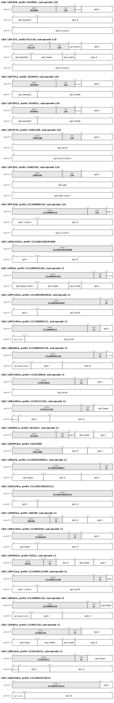

Entry: [LEA](../09-isa.md#lea-load-effective-address). 26 forms.

### LL

Entry: [LLSC](../09-isa.md#llsc-load-linked-and-store-conditional). 1 form.

### LPAD

Entry: [NOP](../09-isa.md#nop-no-operation-and-landing-pad). 1 form.

### MAESCTR

Entry: [MAESCTR](../09-isa.md#maesctr-aes-in-counter-mode-over-a-buffer). 1 form.

### MASKEQZ

Entry: [MASK](../09-isa.md#mask-mask-by-a-condition-register). 1 form.

### MASKNEZ

Entry: [MASK](../09-isa.md#mask-mask-by-a-condition-register). 1 form.

### MAX

Entry: [MINMAX](../09-isa.md#minmax-minimum-and-maximum-signed-and-unsigned). 1 form.

### MAXU

Entry: [MINMAX](../09-isa.md#minmax-minimum-and-maximum-signed-and-unsigned). 1 form.

### MCMP

Entry: [MCMP](../09-isa.md#mcmp-compare-two-blocks-of-bytes). 1 form.

### MCPY

Entry: [MCPY](../09-isa.md#mcpy-copy-a-block-of-bytes). 1 form.

### MFASID

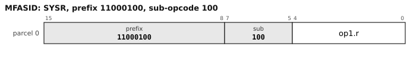

Entry: [MTASID](../09-isa.md#mtasid-move-to-and-from-the-address-space-identifier). 1 form.

### MFCPUID

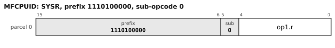

Entry: [MFCPUID](../09-isa.md#mfcpuid-read-the-processor-identifier). 1 form.

### MFDP

Entry: [MTDP](../09-isa.md#mtdp-move-to-and-from-the-direct-pointer). 1 form.

### MFPS

Entry: [MTPS](../09-isa.md#mtps-move-to-and-from-the-processor-status-word). 1 form.

### MFSR

Entry: [MFSR](../09-isa.md#mfsr-move-from-and-to-a-system-register). 1 form.

### MIN

Entry: [MINMAX](../09-isa.md#minmax-minimum-and-maximum-signed-and-unsigned). 1 form.

### MINU

Entry: [MINMAX](../09-isa.md#minmax-minimum-and-maximum-signed-and-unsigned). 1 form.

### MMOV

Entry: [MCPY](../09-isa.md#mcpy-copy-a-block-of-bytes). 1 form.

### MOD

Entry: [DIV](../09-isa.md#div-divide-and-remainder-signed-and-unsigned). 1 form.

### MODU

Entry: [DIV](../09-isa.md#div-divide-and-remainder-signed-and-unsigned). 1 form.

### MOV2

Entry: [MOV2](../09-isa.md#mov2-two-register-moves). 1 form.

### MOVB

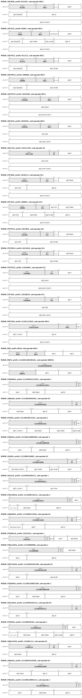

Entry: [MOV](../09-isa.md#mov-move-load-and-store-64-32-16-and-8-bits). 33 forms.

### MOVB.D

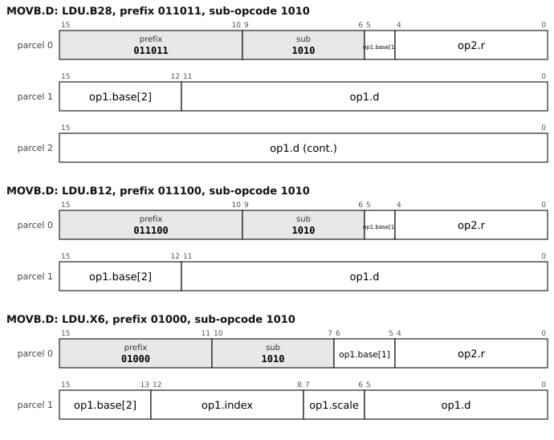

Entry: [MOVD](../09-isa.md#movd-deferred-fault-load). 3 forms.

### MOVB.U

Entry: [MOVUSER](../09-isa.md#movuser-user-qualified-load-and-store). 6 forms.

### MOVB.UD

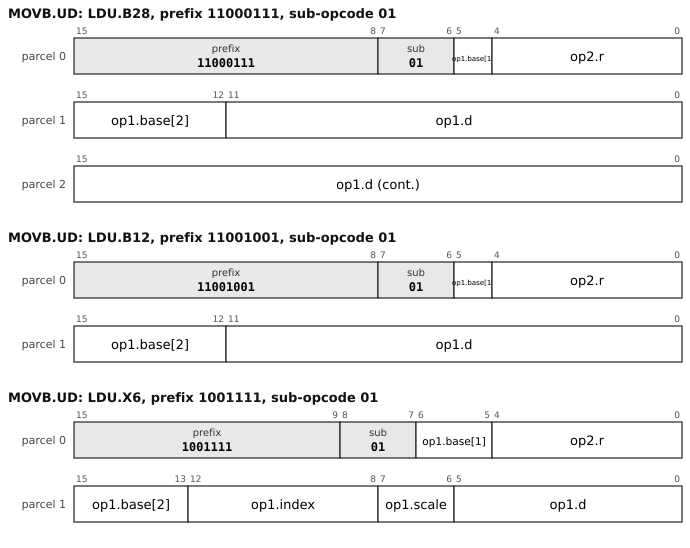

Entry: [MOVUSERD](../09-isa.md#movuserd-user-qualified-deferred-fault-load). 3 forms.

### MOVCALL

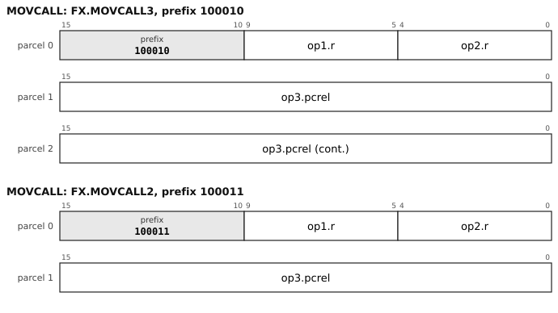

Entry: [MOVCALL](../09-isa.md#movcall-move-a-register-and-call). 2 forms.

### MOVL

Entry: [MOV](../09-isa.md#mov-move-load-and-store-64-32-16-and-8-bits). 42 forms.

### MOVL.D

Entry: [MOVD](../09-isa.md#movd-deferred-fault-load). 3 forms.

### MOVL.U

Entry: [MOVUSER](../09-isa.md#movuser-user-qualified-load-and-store). 6 forms.

### MOVL.UD

Entry: [MOVUSERD](../09-isa.md#movuserd-user-qualified-deferred-fault-load). 3 forms.

### MOVQ

Entry: [MOV](../09-isa.md#mov-move-load-and-store-64-32-16-and-8-bits). 48 forms.

### MOVQ.D

Entry: [MOVD](../09-isa.md#movd-deferred-fault-load). 3 forms.

### MOVQ.U

Entry: [MOVUSER](../09-isa.md#movuser-user-qualified-load-and-store). 6 forms.

### MOVQ.UD

Entry: [MOVUSERD](../09-isa.md#movuserd-user-qualified-deferred-fault-load). 3 forms.

### MOVQL

Entry: [MOVQL](../09-isa.md#movql-move-a-64-bit-literal). 1 form.

### MOVUB

Entry: [MOVU](../09-isa.md#movu-unaligned-load-and-store). 13 forms.

### MOVUL

Entry: [MOVU](../09-isa.md#movu-unaligned-load-and-store). 13 forms.

### MOVUQ

Entry: [MOVU](../09-isa.md#movu-unaligned-load-and-store). 13 forms.

### MOVUW

Entry: [MOVU](../09-isa.md#movu-unaligned-load-and-store). 13 forms.

### MOVW

Entry: [MOV](../09-isa.md#mov-move-load-and-store-64-32-16-and-8-bits). 32 forms.

### MOVW.D

Entry: [MOVD](../09-isa.md#movd-deferred-fault-load). 3 forms.

### MOVW.U

Entry: [MOVUSER](../09-isa.md#movuser-user-qualified-load-and-store). 6 forms.

### MOVW.UD

Entry: [MOVUSERD](../09-isa.md#movuserd-user-qualified-deferred-fault-load). 3 forms.

### MOVZB

Entry: [MOVZ](../09-isa.md#movz-move-zero-extended-32-16-and-8-bits). 25 forms.

### MOVZB.D

Entry: [MOVD](../09-isa.md#movd-deferred-fault-load). 3 forms.

### MOVZB.U

Entry: [MOVUSER](../09-isa.md#movuser-user-qualified-load-and-store). 3 forms.

### MOVZB.UD

Entry: [MOVUSERD](../09-isa.md#movuserd-user-qualified-deferred-fault-load). 3 forms.

### MOVZL

Entry: [MOVZ](../09-isa.md#movz-move-zero-extended-32-16-and-8-bits). 17 forms.

### MOVZL.D

Entry: [MOVD](../09-isa.md#movd-deferred-fault-load). 3 forms.

### MOVZL.U

Entry: [MOVUSER](../09-isa.md#movuser-user-qualified-load-and-store). 3 forms.

### MOVZL.UD

Entry: [MOVUSERD](../09-isa.md#movuserd-user-qualified-deferred-fault-load). 3 forms.

### MOVZW

Entry: [MOVZ](../09-isa.md#movz-move-zero-extended-32-16-and-8-bits). 17 forms.

### MOVZW.D

Entry: [MOVD](../09-isa.md#movd-deferred-fault-load). 3 forms.

### MOVZW.U

Entry: [MOVUSER](../09-isa.md#movuser-user-qualified-load-and-store). 3 forms.

### MOVZW.UD

Entry: [MOVUSERD](../09-isa.md#movuserd-user-qualified-deferred-fault-load). 3 forms.

### MSCN

Entry: [MSCN](../09-isa.md#mscn-scan-a-block-for-a-byte-or-for-a-byte-not-equal-to-it). 1 form.

### MSCNN

Entry: [MSCN](../09-isa.md#mscn-scan-a-block-for-a-byte-or-for-a-byte-not-equal-to-it). 1 form.

### MSET

Entry: [MSET](../09-isa.md#mset-fill-a-block-of-bytes). 1 form.

### MSHA256

Entry: [MSHA](../09-isa.md#msha-hash-whole-blocks-of-memory). 1 form.

### MSHA512

Entry: [MSHA](../09-isa.md#msha-hash-whole-blocks-of-memory). 1 form.

### MTASID

Entry: [MTASID](../09-isa.md#mtasid-move-to-and-from-the-address-space-identifier). 1 form.

### MTDMW

Entry: [MTDMW](../09-isa.md#mtdmw-move-to-a-direct-mapping-window). 1 form.

### MTDP

Entry: [MTDP](../09-isa.md#mtdp-move-to-and-from-the-direct-pointer). 1 form.

### MTPS

Entry: [MTPS](../09-isa.md#mtps-move-to-and-from-the-processor-status-word). 1 form.

### MTSR

Entry: [MFSR](../09-isa.md#mfsr-move-from-and-to-a-system-register). 1 form.

### MUL

Entry: [MUL](../09-isa.md#mul-multiply-low-64-bits). 13 forms.

### MULH

Entry: [MULH](../09-isa.md#mulh-multiply-high-64-bits-signed). 11 forms.

### MULHU

Entry: [MULHU](../09-isa.md#mulhu-multiply-high-64-bits-unsigned). 1 form.

### MULV

Entry: [OVF](../09-isa.md#ovf-add-subtract-and-multiply-trapping-on-signed-overflow). 1 form.

### MVAL

Entry: [MVAL](../09-isa.md#mval-validate-a-block-as-utf-8). 1 form.

### NEG

Entry: [NEG](../09-isa.md#neg-negate). 7 forms.

### NOP

Entry: [NOP](../09-isa.md#nop-no-operation-and-landing-pad). 1 form.

### POP

Entry: [POP](../09-isa.md#pop-pop). 10 forms.

### POPCNT

Entry: [POPCNT](../09-isa.md#popcnt-population-count). 1 form.

### POPM

Entry: [POPM](../09-isa.md#popm-pop-registers-by-mask). 4 forms.

### POPMRET

Entry: [POPMRET](../09-isa.md#popmret-pop-several-registers-and-return). 1 form.

### POPRET

Entry: [POPRET](../09-isa.md#popret-pop-a-register-and-return). 1 form.

### POPX

Entry: [PUSHX](../09-isa.md#pushx-push-and-pop-the-exception-state). 1 form.

### PROBER

Entry: [PROBE](../09-isa.md#probe-probe-an-address-for-read-or-write-access). 1 form.

### PROBEW

Entry: [PROBE](../09-isa.md#probe-probe-an-address-for-read-or-write-access). 1 form.

### PUSH

Entry: [PUSH](../09-isa.md#push-push). 12 forms.

### PUSHM

Entry: [PUSHM](../09-isa.md#pushm-push-registers-by-mask). 4 forms.

### PUSHX

Entry: [PUSHX](../09-isa.md#pushx-push-and-pop-the-exception-state). 1 form.

### RET

Entry: [RET](../09-isa.md#ret-return-from-subroutine). 1 form.

### ROR

Entry: [ROR](../09-isa.md#ror-rotate-right-by-a-register-count). 1 form.

### RORI

Entry: [RORI](../09-isa.md#rori-rotate-right-by-an-immediate). 1 form.

### RORI32

Entry: [RORI32](../09-isa.md#rori32-rotate-right-by-an-immediate-32-bits). 1 form.

### RTI

Entry: [RTI](../09-isa.md#rti-return-from-interrupt-or-exception). 1 form.

### RTT

Entry: [RTI](../09-isa.md#rti-return-from-interrupt-or-exception). 1 form.

### SAR

Entry: [SHIFT](../09-isa.md#shift-shift-left-shift-right-logical-shift-right-arithmetic). 14 forms.

### SBC

Entry: [SBC](../09-isa.md#sbc-subtract-carry). 7 forms.

### SC

Entry: [LLSC](../09-isa.md#llsc-load-linked-and-store-conditional). 1 form.

### SET

Entry: [SET](../09-isa.md#set-set-a-register-from-a-condition). 1 form.

### SEV

Entry: [SEV](../09-isa.md#sev-send-an-event). 1 form.

### SHA256SIG0

Entry: [SHA256](../09-isa.md#sha256-the-sha-256-functions). 1 form.

### SHA256SIG1

Entry: [SHA256](../09-isa.md#sha256-the-sha-256-functions). 1 form.

### SHA256SUM0

Entry: [SHA256](../09-isa.md#sha256-the-sha-256-functions). 1 form.

### SHA256SUM1

Entry: [SHA256](../09-isa.md#sha256-the-sha-256-functions). 1 form.

### SHA512SIG0

Entry: [SHA512](../09-isa.md#sha512-the-sha-512-functions). 1 form.

### SHA512SIG1

Entry: [SHA512](../09-isa.md#sha512-the-sha-512-functions). 1 form.

### SHA512SUM0

Entry: [SHA512](../09-isa.md#sha512-the-sha-512-functions). 1 form.

### SHA512SUM1

Entry: [SHA512](../09-isa.md#sha512-the-sha-512-functions). 1 form.

### SHL

Entry: [SHIFT](../09-isa.md#shift-shift-left-shift-right-logical-shift-right-arithmetic). 15 forms.

### SHR

Entry: [SHIFT](../09-isa.md#shift-shift-left-shift-right-logical-shift-right-arithmetic). 14 forms.

### SOB

Entry: [SOB](../09-isa.md#sob-subtract-one-and-branch). 1 form.

### SPL

Entry: [SPL](../09-isa.md#spl-set-the-interrupt-priority-level). 1 form.

### SUB

Entry: [SUB](../09-isa.md#sub-subtract). 24 forms.

### SUBM

Entry: [ADDM](../09-isa.md#addm-alu-operation-with-a-memory-destination). 6 forms.

### SUBV

Entry: [OVF](../09-isa.md#ovf-add-subtract-and-multiply-trapping-on-signed-overflow). 1 form.

### SWAP

Entry: [SWAP](../09-isa.md#swap-atomic-exchange). 1 form.

### SWAPDB

Entry: [SWAP](../09-isa.md#swap-atomic-exchange). 1 form.

### SYSPG0

Entry: [SYSPG](../09-isa.md#syspg-reserved-system-words). 1 form.

### SYSPG1

Entry: [SYSPG](../09-isa.md#syspg-reserved-system-words). 1 form.

### SYSPG2

Entry: [SYSPG](../09-isa.md#syspg-reserved-system-words). 1 form.

### SYSPG3

Entry: [SYSPG](../09-isa.md#syspg-reserved-system-words). 1 form.

### SYSPG4

Entry: [SYSPG](../09-isa.md#syspg-reserved-system-words). 1 form.

### SYSPG5

Entry: [SYSPG](../09-isa.md#syspg-reserved-system-words). 1 form.

### TLBI

Entry: [TLBI](../09-isa.md#tlbi-invalidate-a-translation). 1 form.

### TLBIA

Entry: [TLBA](../09-isa.md#tlba-invalidate-all-translations-wait-for-translation-invalidations-invalidate-the-whole-instruction-cache). 1 form.

### TLBSYNC

Entry: [TLBA](../09-isa.md#tlba-invalidate-all-translations-wait-for-translation-invalidations-invalidate-the-whole-instruction-cache). 1 form.

### TRAP

Entry: [TRAP](../09-isa.md#trap-system-call-and-trap). 1 form.

### TRAPCC.CC

Entry: [TRAPCC](../09-isa.md#trapcc-trap-on-condition). 1 form.

### TRAPCC.CS

Entry: [TRAPCC](../09-isa.md#trapcc-trap-on-condition). 1 form.

### TRAPCC.EQ

Entry: [TRAPCC](../09-isa.md#trapcc-trap-on-condition). 1 form.

### TRAPCC.GE

Entry: [TRAPCC](../09-isa.md#trapcc-trap-on-condition). 1 form.

### TRAPCC.GT

Entry: [TRAPCC](../09-isa.md#trapcc-trap-on-condition). 1 form.

### TRAPCC.HI

Entry: [TRAPCC](../09-isa.md#trapcc-trap-on-condition). 1 form.

### TRAPCC.LE

Entry: [TRAPCC](../09-isa.md#trapcc-trap-on-condition). 1 form.

### TRAPCC.LOS

Entry: [TRAPCC](../09-isa.md#trapcc-trap-on-condition). 1 form.

### TRAPCC.LT

Entry: [TRAPCC](../09-isa.md#trapcc-trap-on-condition). 1 form.

### TRAPCC.MI

Entry: [TRAPCC](../09-isa.md#trapcc-trap-on-condition). 1 form.

### TRAPCC.NE

Entry: [TRAPCC](../09-isa.md#trapcc-trap-on-condition). 1 form.

### TRAPCC.PL

Entry: [TRAPCC](../09-isa.md#trapcc-trap-on-condition). 1 form.

### TRAPCC.VC

Entry: [TRAPCC](../09-isa.md#trapcc-trap-on-condition). 1 form.

### TRAPCC.VS

Entry: [TRAPCC](../09-isa.md#trapcc-trap-on-condition). 1 form.

### TRAPL

Entry: [TRAP](../09-isa.md#trap-system-call-and-trap). 1 form.

### TST

Entry: [TST](../09-isa.md#tst-test). 10 forms.

### UTF8DEC

Entry: [UTF8DEC](../09-isa.md#utf8dec-decode-a-utf-8-sequence). 1 form.

### UTF8ENC

Entry: [UTF8ENC](../09-isa.md#utf8enc-encode-a-unicode-scalar-value). 1 form.

### UTF8LEN

Entry: [UTF8LEN](../09-isa.md#utf8len-length-of-a-utf-8-sequence-from-its-leading-byte). 1 form.

### WFE

Entry: [WFE](../09-isa.md#wfe-wait-for-an-event). 1 form.

### XADD

Entry: [XADD](../09-isa.md#xadd-atomic-fetch-and-add). 1 form.

### XADDDB

Entry: [XADD](../09-isa.md#xadd-atomic-fetch-and-add). 1 form.

### XAND

Entry: [XAND](../09-isa.md#xand-atomic-fetch-and-and-or-xor). 1 form.

### XANDDB

Entry: [XAND](../09-isa.md#xand-atomic-fetch-and-and-or-xor). 1 form.

### XMAX

Entry: [XMAX](../09-isa.md#xmax-atomic-fetch-and-minimum-or-maximum). 1 form.

### XMAXDB

Entry: [XMAX](../09-isa.md#xmax-atomic-fetch-and-minimum-or-maximum). 1 form.

### XMAXU

Entry: [XMAX](../09-isa.md#xmax-atomic-fetch-and-minimum-or-maximum). 1 form.

### XMAXUDB

Entry: [XMAX](../09-isa.md#xmax-atomic-fetch-and-minimum-or-maximum). 1 form.

### XMIN

Entry: [XMAX](../09-isa.md#xmax-atomic-fetch-and-minimum-or-maximum). 1 form.

### XMINDB

Entry: [XMAX](../09-isa.md#xmax-atomic-fetch-and-minimum-or-maximum). 1 form.

### XMINU

Entry: [XMAX](../09-isa.md#xmax-atomic-fetch-and-minimum-or-maximum). 1 form.

### XMINUDB

Entry: [XMAX](../09-isa.md#xmax-atomic-fetch-and-minimum-or-maximum). 1 form.

### XNORPOP

Entry: [XNORPOP](../09-isa.md#xnorpop-population-count-of-the-equality-of-two-words). 1 form.

### XOR

Entry: [XOR](../09-isa.md#xor-exclusive-or). 18 forms.

### XOR_

Entry: [XAND](../09-isa.md#xand-atomic-fetch-and-and-or-xor). 1 form.

### XOR_DB

Entry: [XAND](../09-isa.md#xand-atomic-fetch-and-and-or-xor). 1 form.

### XXOR

Entry: [XAND](../09-isa.md#xand-atomic-fetch-and-and-or-xor). 1 form.

### XXORDB

Entry: [XAND](../09-isa.md#xand-atomic-fetch-and-and-or-xor). 1 form.

*Generated by `tools/mkmanual.py`; do not edit.*
