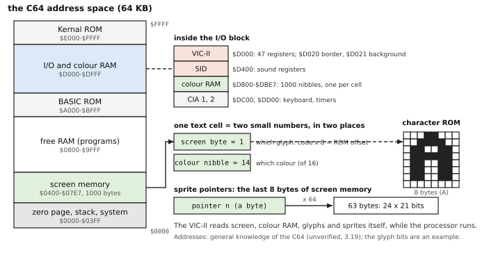
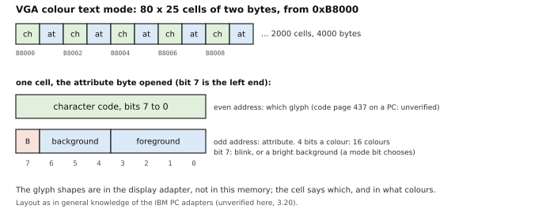
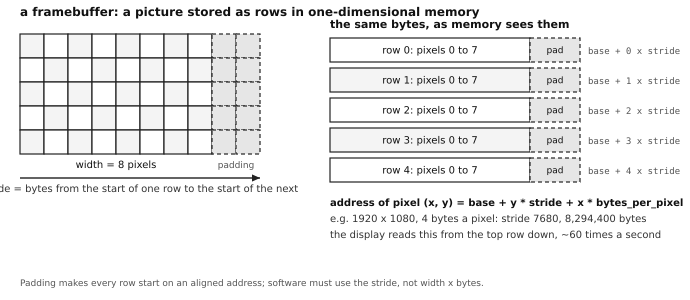
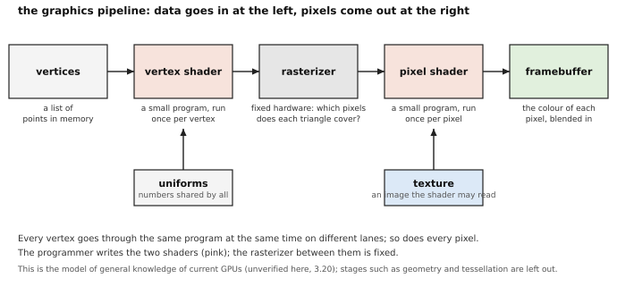
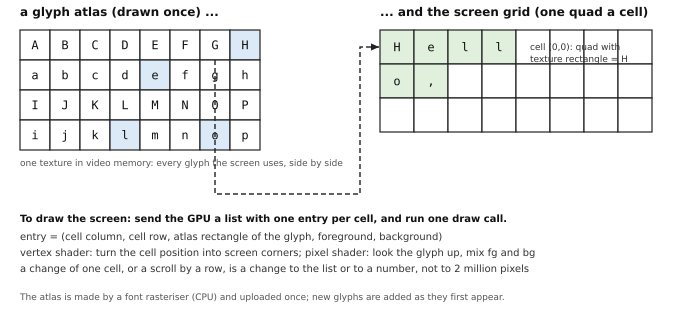
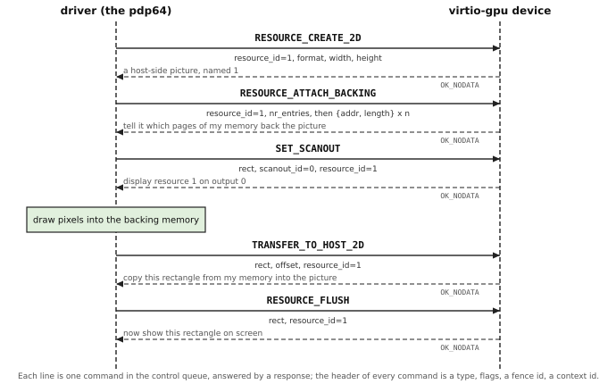
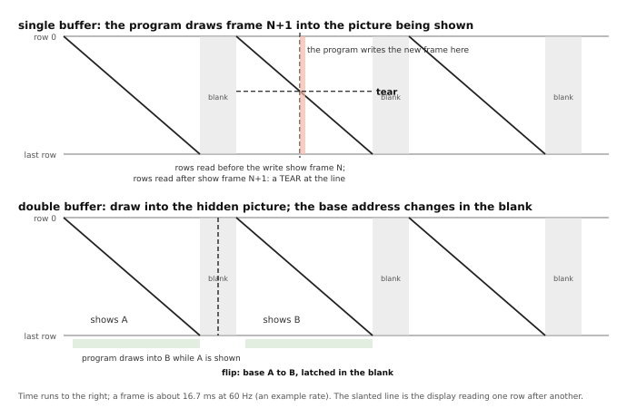

# 3. Graphics: the terminal and its devices

[← manual index](00-index.md)

**The pdp64's display is meant to bring back what the Blit terminal and the Commodore 64 had, text and graphics on the screen at once, set by simple stores to memory, at a modern colour depth and screen size; its output is HDMI or another standard graphics output (errata 105), and its standard video device is virtio-gpu (errata 79).** The chapter is written for a reader who knows the PDP-11 and its teletype, or who is learning computing from the start, and who has met nothing invented after the 1970s. It follows the order in which the ideas arrived, because each one answers a complaint about the one before:

| Stage | What it contributed | Section |
|---|---|---|
| PDP-11 teletype (KL11) | a stream of characters, one line at a time | 3.1 |
| VT52, VT100 (the author's "vt55") | a screen the program can address by position, through escape codes | 3.2 |
| Blit (Bell Labs, 1980s) | a bitmap in the address space, the bit-block-transfer, a terminal that runs downloaded programs | 3.3 |
| Commodore 64 (1982) | text, bitmap, sprites and sound together, all set by pokes | 3.4 |
| VGA, SVGA, VESA | memory-mapped text and pixels again, but planes, banks and no sprites | 3.5 |
| GPU | vertices, shaders and command buffers; the text path of every terminal emulator | 3.6, 3.7 |
| pdp64 display | the Blit and the C64 at a modern depth, on a standard output | 3.8 to 3.13 |

After the terminal come the problems that made graphics programming annoying (3.14), tearing (3.15), the C128 (3.16), audio (3.17) and windows (3.18). The PDP-11 had a teletype and nothing else of this chapter; where a later topic has no PDP-11 antecedent the text says so. A fact that could not be checked on this machine is marked *unverified* and listed in 3.19.

*How to read this chapter.* A term is defined where it first appears, as the technical word and a plain restatement. In the boxes-and-arrows figures a box is a piece of memory and an arrow an address or index stored in it. Code blocks are pseudocode (C-like; `poke(address, value)` and `peek(address)` are an ordinary store and load, as in chapter 2) unless marked PDP-11 assembly. The numbered statements are the rules; the history and explanation are unnumbered prose, as in chapter 2.

## 3.1 The teletype: one line at a time

A PDP-11 in 1975 talked to a person through a **teletype** (a keyboard and a printer on one machine, joined to the computer by a serial line: characters go one after another along a single wire pair, each as a short burst of bits). The machine knew nothing about the page. A character went out and the printer put it to the right of the last one; a carriage-return character moved the print head back to the left margin and a line-feed character moved the paper up one line. Nothing could be erased, because the ink was on paper. This is **line-at-a-time output**: the program's only notion of position is "the end of what I have printed".

The hardware was a Unibus device like those of chapter 2: a few registers. The console of 2.11BSD is a KL11/DL11, declared in `sys/pdp/cons.h` as four words (receive status, receive buffer, transmit status, transmit buffer) at address 0177560 (`cnaddr` in `cons.c`); the transmitter-ready bit of the transmit status word is `DLXCSR_TRDY`, 0200 (both checked in the 2.11BSD tree on this machine, where the files are stored gzipped). Printing a line was a loop that waits for ready and stores a byte:

```
print_line(string):
    for each byte c in string:
        while (peek(XCSR) & TRDY) == 0:     # the printer is slow: ten characters a second or so (unverified)
            wait
        poke(XBUF, c)
    poke(XBUF, CR); poke(XBUF, LF)          # carriage return, line feed
```

and in PDP-11 assembly, with the console's register addresses (transmit status 0177564, transmit buffer 0177566, the third and fourth words of the structure; the loop is in the style of the `rk` driver of chapter 2, not copied from a driver):

```
        MOV  #msg, R0
1$:     MOVB (R0)+, R1        ; next character; R0 now points at the one after
        BEQ  3$               ; a zero byte ends the string
2$:     TSTB @#177564         ; XCSR: bit 7 is READY
        BPL  2$               ; plus: not ready, look again
        MOVB R1, @#177566     ; XBUF: this sends it
        BR   1$
3$:
```

Everything a program can say to such a device is a stream of characters. The Unix **tty** (short for teletype: the device file that a program reads and writes characters from and to) is therefore a stream, and the programs written for it, the shell, the editor `ed` and the compiler's messages, think in lines. The stream has no way to say "put this here", which matters as soon as the printer is replaced by a screen.

## 3.2 The glass teletype and its escape codes

A **video terminal** is a keyboard and a screen on the end of the same serial line. At first it imitated the teletype (the "glass teletype": characters appear at the bottom and the page scrolls up). Then it did what paper could not: move the cursor to any place and change what was there. The program asked for this with **escape sequences** (characters that the terminal obeys instead of displaying, introduced by the escape character, code 27, written ESC), so the stream carries both text and commands.

Two generations matter here. The DEC VT52 is the textbook example of the problem, and the author's chat of 2026-06-18 (`c64stuff.txt`, line 4888, the assistant's words) records its cursor-to-position code: ESC Y, then a row character and a column character, each with 32 added so that the numbers arrive as printable characters. In pseudocode:

```
goto(row, col):
    send(ESC); send('Y'); send(row + 32); send(col + 32)   # the VT52 form, as recorded in the chat
send_string("Hello")                                       # the text appears at the cursor
```

The later DEC VT100 and the ANSI standard that followed it use ESC, an opening square bracket, numbers and a letter: `ESC [ 12 ; 40 H` moves the cursor to row 12, column 40, and `ESC [ 31 m` makes what follows red (these two sequences are general knowledge, *unverified* here). The chat records only that "VT100/ANSI" and the "xterm-256color" subset are what ordinary programs speak (`c64stuff.txt`, lines 218 and 4875).

The author's request names a "vt55" between the teletype and the Blit. No text in the repository mentions a VT55; the records name the VT52 and the VT100, so the chapter describes those. (The DEC model of that number was a graphics terminal, which would fit the author's order; that is general knowledge and *unverified*.)

The escape-code terminal gave a **character-cell display** (a screen that is a grid of cells, 80 columns by 24 rows being the usual size, each holding one character) that a program could address by position. It gave no control over the shape of a character, no drawing, no mix of fonts, and it kept a slow serial line between the program and the screen, speaking escape codes that differed from one make to the next. Unix answered the variety with a database of terminal descriptions (**termcap**, then **terminfo**: a file saying, for each make of terminal, which bytes mean "move the cursor") and a library (**curses**: a program that works out the fewest bytes to send to turn the screen as it was into the screen as wanted). *The UNIX-HATERS Handbook* complains of this (chapter 6, "Original Sin", recorded in `docs/kernel-pain-points.md`, section 14G: "Unfortunately for us, Unix was designed in the days of teletypes"). Each change to a cell cost several bytes of command over a slow line; the Blit answered that.

## 3.3 The Blit: a bitmap, and the blit

The Bell Labs terminal called the **Blit** (Rob Pike, Bart Locanthi and John Reiser; the repository records their papers as *Blit 1983* and *Tradeoffs 1985* in `docs/kernel-pain-points.md`, section 14I) took the opposite course. Instead of obeying commands about a grid of characters it had a **bitmap display** (a screen in which every dot, every pixel, is one or more bits in memory, so a program draws anything by changing bits) and a Motorola 68000 processor at 8 MHz to do the drawing: "256K bytes of memory dual-ported between an 800×1024×1 bit display and a Motorola MC68000 microprocessor". The screen memory was in the processor's address space like any other memory, and a program changed the picture by storing into it.

A bitmap is a picture stored row after row (the figure in 3.5 shows it). The operation that makes it usable is the **bit-block-transfer**, written **bitblt** and said "bit blit": copy a rectangle of bits from one place to another, combining each source bit with the destination bit by a chosen rule, the **raster operation** (RasterOp: the bit-by-bit rule that gives the result, such as "replace", "OR" or "exclusive-OR"). A rule of two inputs has sixteen possible forms; the Blit authors found that four sufficed (store, OR, clear, XOR), and XOR dominated its use, because drawing a shape twice with it erases it again, so a cursor moves without a saved copy of what was beneath it. With bitblt a program scrolls a window (copy the rectangle up by one line of text), moves a window (copy it), draws a letter (copy the letter's rectangle from a stored font to the screen) and fills an area. In pseudocode in the style of the Blit's library:

```
bitblt(source_bitmap, source_rect, destination_bitmap, destination_point, operation)
bitblt(font, rect_of('A'), screen, (x, y), OR)       # draws an A with its top left at (x, y)
bitblt(screen, window_rect, screen, window_rect + (0, -line_height), STORE)   # scroll one line
```

The Blit was a small computer, not a protocol. Its authors give the reason: "To draw graphics in the windows, sending escape sequences is traditional but makes poor use of the processing power of the terminal"; an earlier terminal that interpreted escape sequences failed because "too much state information was maintained by the terminal and guessed at by the Unix program". The host sent it programs over an RS-232 serial line, and the authors name that line as the weak point: "The greatest problem, though, is certainly the low bandwidth." The pdp64 keeps the framebuffer in the address space (errata 66). The authors' advice in 1985 about the blit was that it be "transparent, so it can be bypassed".


On the author's account the Blit inspired rio (Plan 9) and NeWS (Sun's); the sources confirm the line from the Blit's `mux` through 8½ to rio. Section 3.18 says what they were.


The Blit drew its cursor in software, in XOR, redrawing it at 60 Hz (`kernel-pain-points.md`, section 14I); other machines had **sprites** (small pictures that the display hardware overlays on the screen at a position the program gives, without touching the screen memory beneath). The next machine had eight of them.

## 3.4 The Commodore 64: text, graphics, sprites and sound together

The Commodore 64 (1982) was a home computer with a 6510 processor (a 6502 with a few input and output lines added) and two custom chips, the **VIC-II** (video interface chip) and the **SID** (sound interface device); every figure in this section is general knowledge, *unverified* here. It was built for games, and a game needs a scrolling background, characters moving over it, colour, music and noise at once. The chips read their data from memory by themselves, and every control is a memory location that the programmer can **peek** (read a byte) or **poke** (write a byte): the names are the C64 BASIC commands for a load and a store, and the source of the author's phrase "peek poke style".



**Text mode.** The standard screen is 40 columns by 25 rows, 1000 cells. The picture is *two* arrays in memory: screen memory, 1000 bytes, normally at $0400 (the number of the glyph for each cell), and **colour RAM**, 1000 four-bit entries at $D800 (the colour of each cell, one of 16). The shape of each glyph is not in these arrays; it is in the **character ROM** (a read-only memory of 8 bytes a glyph, one byte a row of eight dots, 256 glyphs: 2 KB for one set), which the video chip reads, and which a program can also replace by pointing the chip at glyphs it has made in RAM. To put an A at the top left, in red, the BASIC programmer writes two pokes, and the video chip, which reads screen memory sixty times a second by itself, shows it (screen codes, colour numbers and addresses *unverified*):

```
poke(1024, 1)          # $0400: screen code 1 is the letter A
poke(55296, 2)         # $D800: colour 2 is red
poke(53280, 0)         # $D020: the border colour, black
poke(53281, 6)         # $D021: the background colour, blue
```

This is the "peek poke" model: the screen is memory, a cell is an address, and the chip does the display. There are no escape codes and no stream; a program that pokes address 1024 + 40 * row + column has put a character there, at any time, in any order.

**Bitmap mode.** The same chip could show a bitmap of 320 by 200 dots in memory, with colour attributes per 8 by 8 block, and **multicolour** modes that trade width for colour. These were modes of one chip, and a program could mix them, text in one band of the screen and graphics in another, by changing mode at a chosen line (the raster interrupt below).

**Sprites.** The VIC-II had eight **sprites**: movable objects of 24 by 21 dots, each described by 63 bytes of data in memory, a pointer byte (the last eight bytes of screen memory, $07F8 to $07FF, say which 64-byte block holds each sprite's shape) and a few registers (x position, y position, colour, enable, size, priority; collision registers that say which sprites touched). The chip draws the sprites over the background as the picture is read out; to move a sprite, the program changes two registers, and the picture underneath is never disturbed. A ship, a bullet and an enemy are each a sprite, and a game's movement is a handful of pokes per frame.

**The raster and the raster interrupt.** The VIC-II draws the screen by reading it in order, row by row, while an electron beam sweeps the tube (the **raster**; the whole sweep is a **frame**, 50 or 60 times a second depending on the television standard). A register holds the number of the line being drawn, and another can be set to a line number so that the chip interrupts the processor when the beam reaches it: the **raster interrupt**. Programs used it to change a register mid-screen, such as the background colour or a sprite position, and to make changes while the beam was elsewhere (3.15).

**Sound.** The SID is a three-voice synthesiser with filters, again with registers that the programmer pokes: a voice has a frequency, a waveform (triangle, sawtooth, pulse, noise), and an attack, decay, sustain and release envelope. A note is a handful of pokes. Sound came from the same few chips, controlled the same way: **one machine, one address space, a few chips whose registers are memory, and a program that sets them directly**.

The C64's limits are those of 1982: 16 colours, 40 columns, 8 by 8 cells, 8 sprites, three voices. The author asks for the same ease without them (3.8).

## 3.5 The PC years: VGA, SVGA, VESA

The IBM PC took a different road: its video adapters were separate cards with their own memory and registers, and the software model mixed memory with input/output ports (separate I/O instructions, which neither the PDP-11 nor the C64 had). The **VGA** (Video Graphics Array, IBM, 1987) became the baseline that later adapters imitated. Everything in this section about the PC adapters is general knowledge, *unverified* here.

**VGA text mode.** The text mode is the C64's idea with the colour folded into the cell: 80 columns by 25 rows, 2000 cells, in memory at 0xB8000, two bytes a cell: the character code and an **attribute byte** (four bits of foreground, three of background and one bit for blink, or for a bright background). The shapes come from a font in the adapter's own memory, which a program can replace. To put a red A at the top left:

```
poke(0xB8000, 'A')          # the character
poke(0xB8001, 0x04)         # attribute: black background, red foreground
```



**VGA graphics.** The same card had graphics modes, and here the trouble began. Mode 13h (320 by 200, 256 colours, one byte a pixel, at 0xA0000) was the easy one: the framebuffer is a single array and a pixel is the byte at y * 320 + x. A byte names one of 256 palette entries, and the palette (a table of 256 colours that the program loads through I/O ports) is in the card. Modes with 16 colours and higher resolutions were **planar**: the four bits of a pixel's colour were stored in four separate **planes** (four arrays, the same pixel position in each), and a write reached whichever planes the registers selected. That was fast for some operations and a puzzle for the rest. The adapter's window onto its memory was 64 KB at 0xA0000, so any picture larger than 64 KB needed **bank switching** (the card has more memory than the window shows; a register chooses which 64 KB slice appears in the window, and the program must change the register whenever its drawing crosses a slice boundary).

**SVGA and VESA.** Every manufacturer's Super VGA added modes (800 by 600, 1024 by 768, more colours) and, since there was no standard, each used its own registers to switch to them and to select a bank. **VESA** (a standards body of display makers) wrote the **VBE** (VESA BIOS Extensions: calls into the adapter's ROM that list the modes, set one, and switch banks), and a later version let the card present its whole memory as one **linear framebuffer** at a high address, ending the banks. The result is a block of memory, a **width** and **height** in pixels, a number of bits per pixel, and a **stride** (also called pitch: the number of bytes from the start of one row to the start of the next, which can be more than the width times the bytes per pixel, because rows are padded to a convenient boundary).



**What the programmer had to know.** A graphics programmer of the late 1980s and the 1990s carried all of this: the VGA registers, set through ports, that choose which planes a write reaches and how its bits combine with what is already there; the planar layout, with one pixel's colour spread over four arrays; **Mode X** (the games community's name for an unofficial VGA mode of 320 by 240 that used the planar memory for more than one screen of pixels and faster fills); the bank register of each Super VGA chip, which differed from chip to chip, with quirks that the VESA calls hid only in part; the palette, whose entries could be rewritten to cycle or fade colours without touching the picture; the **retrace**, because a change made at the wrong moment tore the picture; and hand-written assembly **inner loops** for the fill, the copy and the line, because a few cycles a pixel decided whether a game ran. The author's referent is the books of Michael Abrash on PC graphics programming: "still, is ok to mention the problems graphics coders faced, which is why we had 800 page michael abrash books" (errata 105). The titles, dates and page counts are *unverified*; no copy is on this machine and no record in the repository names a title. The depth of those books measures what the hardware pushed onto the programmer.


**The uncomfortable split.** The PC now had two worlds. In **text mode** the hardware drew the characters, so text was fast, small (4000 bytes) and easy, and nothing else could be on the screen. In **graphics mode** a program could show anything but drew every dot: even a letter was the program's job (copy its rectangle from a font, the Blit's bitblt in software), and text became slow and ugly. Changing between the two meant switching modes, blanking the screen and losing the conveniences of the other world. The C64 had mixed text, bitmap and sprites in one frame; the PC made the programmer choose. Windowing systems, which need both together, chose graphics and drew everything.

**Why sprites vanished.** The VGA had no sprites, so games of its era drew every moving object into the framebuffer in software, while a second copy of the screen was being prepared (3.15). The processor was by then fast enough to move a screenful of dots in a frame time, the framebuffer was ordinary memory that any program could write, and windowing systems composed overlapping windows in software, which left no use for a hardware plane or sprite. The cost was real: moving a mouse cursor, a ship or a window meant writing and restoring pixels while the display was reading the same pixels (3.15).

## 3.6 The GPU: pipelines, vertices, shaders

In the 1990s a new kind of chip took the drawing from the processor: the **GPU** (graphics processing unit), first for three-dimensional games and now for every screen (general knowledge, *unverified* here, as is the rest of this section). Its design follows from what a three-dimensional scene is: a list of **vertices** (points in space with a position, and perhaps a colour, a direction the surface faces and a place in a picture), joined into **triangles** (three vertices: the one shape that is always flat, so any surface can be built from them), seen by a camera. To draw it, the machine must (a) work out where on the screen each vertex lands, (b) find which pixels each triangle covers (**rasterization**: turning a shape into the set of pixels it covers), and (c) decide each pixel's colour, which is usually where a **texture** (a picture stored in memory, which is looked up at a position given by the vertex, to paint a surface with, say, brick) comes in. The three steps are the **graphics pipeline**.



The early GPUs did each step in fixed hardware. The change that made the current GPU is that two of the steps became **programmable**: the programmer supplies a **shader** (a small program, in a special language, that the GPU runs; the name is historical, because shaders began as programs that computed the shading of a surface). A **vertex shader** runs once for every vertex and says where it goes; a **pixel shader** (also called a fragment shader) runs once for every pixel a triangle covers and says what colour it is. The rasterizer between them stays fixed, because it is the same arithmetic for every program.

**Why a GPU is fast.** A processor core runs one thread of arbitrary code as fast as it can, with a deep pipeline, large caches and logic to guess and reorder. A GPU is built for *the same small program run on a very large number of independent items*: a million pixels each need the same few dozen instructions. So it has thousands of simple **lanes** (units that each do arithmetic on one item), grouped so that 32 or 64 lanes (the size varies by maker) execute one instruction at the same time on different data (**SIMD**: single instruction, multiple data), and memory of very high **bandwidth** (bytes per second) feeds them. When one group waits for memory the hardware switches to another. Three more things matter in practice. The CPU does not touch pixels: it writes a **command buffer** (a list of commands in memory, such as "bind this texture, use these shaders, draw these 3,000 vertices as triangles") that the GPU reads and carries out by itself, like the descriptor rings of chapter 2. Work is **batched**: one command draws thousands of things, so its cost is paid once. And textures are stored in a layout that keeps neighbouring pixels close together, with the filtering done in hardware.

The GPU is poor at code with many decisions or with items that depend on each other, and the programmer must describe the whole job as a pipeline, write shaders and feed it in large batches. Section 3.14 shows how much graphics boilerplate comes from that model.

## 3.7 Why a terminal emulator uses the GPU, and why a font needs three dimensions

A **terminal emulator** (a program that shows a grid of text in a window of a graphical desktop and acts like the VT-series terminal of 3.2) has a small job: a grid of cells, each a glyph with a foreground and a background colour. Alacritty, kitty and WezTerm draw that grid on the GPU (general knowledge, *unverified* here; the author's chat names kitty). Why would a program that shows only text use machinery built for three-dimensional games?

**How a GPU draws text.** A screen of text is the same glyphs over and over. The program draws each glyph once, with a font rasteriser, into a **glyph atlas** (one texture holding every glyph the screen uses, side by side), then describes the screen as a list with one entry per cell: its position, the part of the atlas to show, and the two colours. The GPU draws each cell as a **quad** (a rectangle of two triangles) textured with that part of the atlas, and the pixel shader mixes foreground and background by the glyph's value at each pixel. The whole screen is **one draw call** (one command that draws a whole list).



The processor never touches a pixel. It changes a cell in the list when the text changes, and scrolling a line is a change of one number (where the list starts) or a shift of the list, not a copy of two million pixels. The glyph is stored as coverage values, so the shader can place it at a fraction of a pixel and blend it: **antialiasing** (smoothing an edge by giving the pixels it crosses an in-between colour) and **subpixel positioning** (placing a glyph more finely than the pixel grid). The GPU does this from its own memory, and the processor stays free to run the program whose output is shown.

**Why a font needs the three-dimensional machinery.** There are two parts to the answer. First, a glyph in a TrueType font is not a bitmap but an **outline** (curves in a coordinate system independent of size), and turning it into pixels is **rasterization** again, the job the GPU's rasterizer does for triangles. A font rasteriser on the processor produces the atlas once; the GPU can also do the curves itself, by tessellating the outline into triangles, by testing in the pixel shader whether each pixel is inside the curve, or by storing a **signed distance field** (a texture in which each pixel holds its distance to the nearest edge of the glyph, positive outside and negative inside, so a pixel shader draws the glyph sharply at any size from a small texture; credited to a Valve paper of 2007, *unverified*). Each is the 3D pipeline used on a flat shape.

Second, the pipeline is three-dimensional only by convention. A current GPU has **no 2D mode**: the 2D accelerator of the 1990s, with its blits, line draws and rectangle fills, is gone from the hardware, and drivers draw a rectangle as two triangles with a shader (general knowledge, *unverified*). A flat picture is the case of the 3D machinery in which every z value is the same and the camera looks straight on. A flat-rectangle engine would be smaller and would do the terminal's job; it is not built because the GPU has to handle the harder case anyway. That is how the terminal ends up on the 3D chip.

## 3.8 The pdp64 terminal: the Blit's bitmap and the C64's pokes

The chain so far: the PDP-11 sent characters down a wire (3.1); the VT52 and VT100 let the program address a screen by position (3.2); the Blit put the bitmap in the address space and the C64 put text, sprites and sound behind pokes (3.3, 3.4); the PC split text from pixels (3.5); the GPU made drawing a pipeline of shaders (3.6). The pdp64 terminal takes the Blit's and the C64's side of that history.

**3.8.1** The graphics terminal is based on two machines, not one: the **Commodore 64**, for text, graphics, sprites and sound together under simple stores to memory, and the **Blit terminal** (Rob Pike's bit-mapped windowing terminal), for its framebuffer in the address space and the bit-block-transfer operation that moves rectangles of pixels. The pdp64 modernises and extends both (errata 66). *(D)*

**3.8.2** One core is dedicated to the graphics device, the Blit's model of a terminal with a processor of its own (errata 76, the author's recommendation; the core classes are in chapter 7, 7.8.6). *(D)* Details pending ([J.7.4](appendix-j-open.md#j74)).

## 3.9 The form of the terminal

The author, 2026-11-10: "our virtio-console device is an attempt to bring the nice properties of the blit terminal and c64 for doing simple and easy peek poke style display of text and also doing graphics, but with modern color depths and screen sizes, and with glyph maps we can even have a ttf engine generate glyphs and they will go into their memory slots for use."

**3.9.1** The pdp64's terminal brings the nice properties of the Blit terminal and the C64: a display that a program drives by simple peeks and pokes, for text and for graphics together, at modern colour depths and screen sizes; and a **glyph map** (a table of slots, each a place in memory for the picture of one glyph) that a TrueType engine fills, so that the shapes of the characters are made by software and used by the display through their slots (errata 105). *(D)* Details pending ([J.3.2](appendix-j-open.md#j32)): the form of the device and the name the author gives it, which is not yet the virtio-console of the virtio specification, a serial text device.

Details pending ([J.3.4](appendix-j-open.md#j34)): whether a cell of the text display holds a character code or a glyph slot, and the layout of a slot.

Open: whether the terminal has sprites or a hardware cursor ([J.3.5](appendix-j-open.md#j35)).

Open: how text, pixels and sprites are composed on the display, the author's mashup of a GPU, video memory, the C64 and the Blit ([J.3.3](appendix-j-open.md#j33)).

## 3.10 How the terminal drives HDMI and the other ports

**3.10.1** The display connector is standard kit: HDMI (and DVI and DisplayPort) is a transmitter chip that takes pixels and sync signals in parallel and does the link protocol, the encoding and the electrical signalling itself; on the first board it is the DE10-Nano's ADV7513, set up once over an I2C-style control bus. *(D)*

**3.10.2** The output is HDMI or some other standard graphics output: a different transmitter (DisplayPort, a VGA digital-to-analogue converter, an LVDS panel) takes the same pixel stream, so the pdp64's side does not change (errata 105: "it is agreed that output is hdmi or some other standard graphics output"). *(D)*

**3.10.3** The ports that carry data, SATA for storage and USB for peripherals, follow the same pattern: the protocol is in the chip or controller block, and the processor's side is a slot with the common registers and a ring (chapter 5). *(D)*


*Commentary.* **Chain.** The PDP-11's output was the serial line of 3.1, with no display connector. The MiSTer framework on the DE10-Nano already works this way: the retro cores produce a pixel stream, and the framework's scaler and the HDMI transmitter do the rest, which is why the plan buys HDMI there. **Trade-offs.** The transmitter's control bus needs one-time setup, which a boot routine does with a few register writes; the pixel clock must be generated to the mode, with a phase-locked loop on an FPGA and the same block in silicon. **Improvements.** Replacing the transmitter or the connector changes nothing in the program that draws, as a SATA controller behind its ring can be replaced without changing the disk driver. **Benefits.** No part of the operating system carries an HDMI, SATA or USB protocol stack. **Modern comparables.** Single-board ARM computers with a display controller and an HDMI transmitter (general knowledge, *unverified*). **Impact.** *Kernel:* hot-plug of a monitor is a bus event if the transmitter reports one. *Compiler:* none. *Hardware:* a pixel generator (the scan-out), a clock and an off-chip transmitter, with no protocol logic in the pdp64's own gates.

## 3.11 The framebuffer, the memory type and the memory budget

**3.11.1** The framebuffer is mapped with the uncached memory type, or the processor's writes sit in the data cache while the video device scans out stale memory; a `FENCE` separates writing a device's registers from setting its go bit. *(D)*


**3.11.2** On the first board the block RAM (about 5.5 megabits on the DE10-Nano) cannot hold a modern frame (a 1920 by 1080 frame at 32 bits is 8.3 MB), so the framebuffer lives in main memory and the block RAM holds the scan-out line buffer of a few kilobytes. *(D)*

**3.11.3** The block RAM budget (caches, translation buffer and the scan-out line buffer) is settled before the video hardware is built. *(D)*

Open: whether the framebuffer has a write-combining memory type, which the four memory types of 2.3.3 do not name ([J.3.10](appendix-j-open.md#j310)).

*Commentary.* **Chain.** The PDP-11 had no framebuffer; whether the 11/70's cache watched Unibus writes so that DMA looked coherent is *unverified* (2.5, commentary). The VAX Unibus adapter's buffered data paths needed purging (2.5), and ARM and MIPS systems with non-coherent DMA place cache maintenance in the kernel (*unverified*). The pdp64 chooses the memory type instead (2.5.2). **Trade-offs.** An uncached framebuffer makes a single pixel write slow and a long run of writes no slower per byte. That punishes pixel-by-pixel drawing from the processor. **Modern comparables.** Write-combining memory types on x86 and ARM serve the same purpose (general knowledge, *unverified*). **Impact.** *Kernel:* the mapping rule is one memory-type value in the page-table entry. *Compiler:* none. *Hardware:* the scan-out reads main memory by bus mastering and competes with the processor for bandwidth.

## 3.12 virtio-gpu: the standard graphics device

The standard display (errata 79: "virtio is fine"; virtio-gpu in its 2D mode) is a virtio device like the disk of chapter 2, so 2.7 applies: it is found by enumeration, its queues are rings of descriptors in memory, and the work is commands in a queue. The commands below are from the Linux header `virtio_gpu.h` and from QEMU's `hw/display/virtio-gpu.c`.

**The vocabulary.** A **resource** is a picture that the device owns, named by a number the driver chooses (`resource_id`), with a pixel format, a width and a height. Its **backing** is the driver's own memory that holds the pixels: a list of `{addr, length}` entries (`struct virtio_gpu_mem_entry`) naming the pages. A **scanout** is one output of the device (up to `VIRTIO_GPU_MAX_SCANOUTS`, 16, in the header); `SET_SCANOUT` says which resource, and which rectangle of it, an output shows. Two commands move and show the pixels: `TRANSFER_TO_HOST_2D` copies a rectangle of the backing memory into the device's picture, and `RESOURCE_FLUSH` tells the device that a rectangle changed and should be shown. The pixel formats are 32 bits with 8 bits a channel (eight in the header): `B8G8R8A8_UNORM`, `B8G8R8X8_UNORM`, `A8R8G8B8_UNORM`, `X8R8G8B8_UNORM`, `R8G8B8A8_UNORM`, `X8B8G8R8_UNORM`, `A8B8G8R8_UNORM`, `R8G8B8X8_UNORM` (values 1 to 4, 67, 68, 121 and 134; the names give the channel order, the *colour order* annoyance of 3.14). Every command starts with a `virtio_gpu_ctrl_hdr`: a type, flags, a 64-bit fence id, a context id and a ring index; the flag `VIRTIO_GPU_FLAG_FENCE` asks that the response carry the fence id once the work is done, which is the device's only completion-ordering tool. The rectangle is `struct virtio_gpu_rect`: x, y, width, height, four 32-bit numbers.



```
# the whole of a virtio-gpu 2D start-up and one update, as pseudocode over the queue of chapter 2.7
send(RESOURCE_CREATE_2D,     resource_id=1, format=X8R8G8B8, width=1024, height=768)
send(RESOURCE_ATTACH_BACKING, resource_id=1, entries=[{addr=PAGES, length=1024*768*4}])
send(SET_SCANOUT,            scanout_id=0, resource_id=1, rect={0,0,1024,768})

draw_into(PAGES)                                       # the driver writes pixels: ordinary stores
send(TRANSFER_TO_HOST_2D,    resource_id=1, rect={0,0,1024,768}, offset=0)
send(RESOURCE_FLUSH,         resource_id=1, rect={0,0,1024,768})
```

In QEMU's `virtio-gpu.c`, `transfer_to_host_2d` rejects a rectangle that is not inside the resource with `VIRTIO_GPU_RESP_ERR_INVALID_PARAMETER`, then copies it **row by row** from the backing into the resource using the resource's stride, or in one copy if the rectangle spans whole rows. `resource_flush` rejects a rectangle outside the resource the same way, then asks each scanout showing the resource to update the part of its display that the rectangle covers. The transfer is the **upload** and the flush is the **present**, and the program does both after drawing.

**What it does not define.** Neither the header nor the QEMU function mentions the vertical blank, a page flip, a refresh rate or tearing: the flush says "show this rectangle now" and the host decides when its display next reads it. The only timing handle is the fence of the header. QEMU's configuration has a `refresh_rate` field for each output (`include/hw/virtio/virtio-gpu.h`), and the device can report an EDID with the optional feature `VIRTIO_GPU_F_EDID`; the header does not say that either changes how a flush is timed. The standard device therefore gives a program a damage rectangle (the flush rectangle), a cursor (the cursor queue, `UPDATE_CURSOR` and `MOVE_CURSOR`), a fence and display information (`GET_DISPLAY_INFO`: size and enabled flag of each output), and nothing about the vertical blank.


**3.12.1** The standard graphics device is virtio-gpu in 2D mode over the virtio PCI Express transport (errata 79); its commands are the five of the figure, plus the cursor queue and the display-information query. *(D)*

Open: the feature subset of virtio-gpu and of virtio-snd that the pdp64 requires, the hot-plug scope and whether OpenBSD has a virtio-snd driver ([J.3.7](appendix-j-open.md#j37)).

Open: the 48-bit pixel against the 32-bit formats of virtio-gpu ([J.3.6](appendix-j-open.md#j36)).

*Commentary.* **Chain.** The PDP-11 has no antecedent: its devices had registers, not queues (2.1). QEMU offers virtio-gpu as a virtual machine's display (`hw/display`): the guest draws into its own memory and tells the host which rectangle to show. **Trade-offs.** It is the most standard route (one tested driver, the same in QEMU, `sim64` and the FPGA, as errata 79 says) and does everything in software: the processor writes every pixel and the host copies them, which is cheap for a terminal with little damage and costs a game what 3.5 described. **Benefits.** No special hardware. **Modern comparables.** Linux's `virtio_gpu` driver, which sits on the DRM interface of 3.14. **Impact.** *Kernel:* a driver for the five commands, one queue of 2.7 and a cursor queue. *Compiler:* none. *Hardware:* none beyond the virtio device and the bus.

## 3.13 A standard graphics card

**3.13.1** A PCI Express graphics card may be attached and supported with its own driver, as any PCI Express device may; the standard does not require one (errata 78). *(D)*

**3.13.2** The standard does not require a card because of what one costs: PCI Express configuration space, base-address mapping and message-signalled interrupts, a driver stack for a programming model that for some vendors must be reverse-engineered, the card's firmware and the initialisation a PC's firmware performs, and no hard PCI Express block on the first board (the Cyclone V and the Zynq 7020 are recorded as lacking one, *unverified* here; a Zynq UltraScale+ has a hard root complex, `docs/pdp64-fpga-plan.md`). *(D)*

*Commentary.* **Trade-offs.** A standard card needs a PCI Express root complex, a large block where the chip has none, and a graphics driver ported to the pdp64, which is a larger task than the architecture (`docs/pdp64-fpga-plan.md` says the same and answers no to a discrete GPU). **Modern comparables.** PowerPC and RISC-V workstations take PCI Express graphics cards with open drivers (general knowledge, *unverified*). **Impact.** *Kernel:* a large graphics driver ported. *Compiler:* none. *Hardware:* a PCI Express root complex and a bridge to the bus.

## 3.14 What made graphics programming annoying

Graphics programming has been annoying, cumbersome and full of **boilerplate** (code written the same way in every program before the program can do anything of its own). This section lists the boilerplate that exists and shows three pieces of it. The PDP-11 has no antecedent: its console needed none (3.1). The chain runs from the VGA programmer's register lore (3.5) to the Linux and Vulkan setup lists below.

**3.14.1** What made graphics programming annoying, cumbersome or boilerplate is sugared away by the architecture to almost nothing (the author, 2026-11-10: "basically, anything that made graphics programming annoying or cumbersome or boiler platey, we want to sugar away to almost nothing", errata 105). *(D)*

**3.14.2** The measure that every design in this chapter is held to is the author's: "graphics programming should be as simple and pleasurable as the c64 was." *(D)* (Errata 105.) Details pending ([J.3.9](appendix-j-open.md#j39)): which sugar, for 3.14.1 and 3.14.2; the table below lists the pain points.

The books of Michael Abrash on VGA and PC graphics programming (the author's "800 page michael abrash books"; titles and page counts *unverified*, 3.5) exist because a programmer could not get a fast picture without knowing the VGA's registers, its planar memory, its retrace, the banking of each chip and how to hand-tune the inner loops. Each row of the table below is a piece of that knowledge, or of its successor (the long setup lists of the Linux display interface and of Vulkan), The knowledge was real and was needed.

Three worked examples follow. Each shows the boilerplate as the real systems have it (names are those of the real interfaces, checked in the headers on this machine where marked, otherwise general knowledge, *unverified*).

**Example 1: getting a picture on the screen at all.** On a VGA/VESA PC the program asked the BIOS for the list of modes, picked one, set it, and found the framebuffer:

```
# VESA (VBE), 1990s: about 15 lines in a real program (illustrative, not measured)
info = vbe_get_controller_info()
for m in info.mode_list:
    mi = vbe_get_mode_info(m)
    if mi.width == 1024 and mi.height == 768 and mi.bits_per_pixel == 32 and mi.has_linear_framebuffer:
        mode = m
vbe_set_mode(mode | LINEAR_FRAMEBUFFER_BIT)
fb = map_physical(mi.physical_base, mi.pitch * mi.height)
```

On Linux (DRM/KMS, the kernel's display interface) the same job is longer. The program opens the device, lists **connectors** (the outputs), reads the monitor's modes (**EDID**, the data block in which a monitor describes the modes it supports; general knowledge), chooses one (`struct drm_mode_modeinfo` in `drm_mode.h`: pixel clock, horizontal and vertical totals and sync positions, refresh rate), allocates a **dumb buffer** (a plain pixel buffer), registers it as a framebuffer (`DRM_IOCTL_MODE_ADDFB2`, with a format code and a pitch), maps it, and sets the mode on a **CRTC** (the unit that does scanout; the name comes from cathode-ray tube controller):

```
# Linux DRM/KMS, one output, no atomic: about 40 lines in a real program (illustrative, not measured)
fd = open("/dev/dri/card0")
res = drmModeGetResources(fd)
conn = first connected connector in res
mode = conn.modes[0]                           # the monitor's preferred mode, by convention first
crtc = a crtc the encoder of conn can use
buf = create_dumb(fd, mode.hdisplay, mode.vdisplay, 32)    # returns handle, pitch, size
fb_id = drmModeAddFB2(fd, w, h, XRGB8888, handle, pitch)
ptr = mmap(fd, map_dumb(buf).offset, size)
drmModeSetCrtc(fd, crtc, fb_id, 0, 0, conn, mode)
```

A program on Vulkan or OpenGL meets another list: create an instance, enumerate physical devices, choose a queue family, create a logical device, a window surface, a swap chain and its images, image views, a render pass, framebuffers, command pools and buffers and synchronisation objects (the names `vkCreateInstance` and `vkCreateSwapchainKHR` are Vulkan's, whose headers are not on this machine, *unverified*; OpenGL's `glGenBuffers`, `glCompileShader` and `glLinkProgram` are in `glext.h` here). A "hello triangle" in Vulkan is commonly several hundred lines (general knowledge, illustrative). In virtio-gpu the equivalent is five commands (3.12): create resource, attach backing, set scanout, transfer, flush, with the drawing between them.

**Example 2: the cache and the flush.** A processor has a **cache** (a small fast memory that keeps recently used data close to the core). Pixels the program has written may still be in the cache and not in memory, and a device that reads memory by DMA then sees the old data. Where the device does not snoop the cache, the program must flush:

```
# a display that does not snoop the cache: about 3 lines per update, in every program (illustrative)
draw(framebuffer)
cache_clean_range(framebuffer, size)       # push the dirty lines to memory
memory_barrier()                           # and make sure the writes are ordered before the notification
poke(DOORBELL, 1)
```

The pdp64 already removes this, and chapter 2 says how: processor caches are coherent with each other, a device and the processor are not, and the answer is a memory type, **uncached**, instead of a flush instruction: "buffers are mapped uncached and the hand-off is explicit" (2.5.2), and "No driver can forget a cache clean or invalidate, because there is none" (2.5, commentary). The framebuffer is mapped uncached too (3.11.1). So on the pdp64 the program does none of this *(D)*.

**Example 3: drawing text.** On a GL or Vulkan system text is the longest boilerplate, because the GPU has no text:

```
# a GPU text path (illustrative; about 150 lines in a real small program, not measured)
font = ft_load("DejaVuSansMono.ttf"); ft_set_size(font, 16)
atlas = new_texture(1024, 1024)
for each character c needed:
    bitmap = ft_render_glyph(font, c)           # the font rasteriser (CPU)
    rect = pack_into_atlas(atlas, bitmap)       # find room: a bin-packing problem
    upload(atlas, rect, bitmap)
    remember(c, rect, advance, bearing)         # metrics: how far to move on, where the glyph sits
for each cell on screen:
    append_quad(vertex_list, x, y, rect_of(char), fg, bg)
upload(vertex_list); bind(atlas, shader); draw(vertex_list)
# plus kerning, ligatures, right-to-left runs, combining marks, fallback fonts, scaling for HiDPI
```

### The pain points, in a table

Each row names something that has annoyed graphics programmers and the size of its boilerplate (line counts are *illustrative* and **not measured**).

| Pain point | Typical boilerplate (illustrative) |
|---|---|
| Mode setting and discovering what the display supports (EDID, modes) | 15 lines (VESA) to 40 (DRM) |
| Pixel formats | one format code to get right, and conversion code when it is not |
| Stride and pitch | one multiply in every pixel address |
| Endianness and colour order (RGB or BGR, alpha first or last) | a swap or a table, in every program |
| Bank switching and mapping the framebuffer | 5 to 20 lines |
| Double buffering and tearing | 10 to 30 lines, plus a frame loop |
| Synchronising with the display | polling or a vblank interrupt handler |
| Cache coherence between CPU writes and the device | 3 lines per update, forgotten once per project |
| Device initialisation and context creation | 50 to 200 lines (Vulkan), 25 (virtio-gpu) |
| Buffer and memory management (allocate, map, upload, barriers, fences) | 20 to 100 lines |
| Shader compilation and pipeline state | 50 to 300 lines |
| Drawing text (glyph atlases, kerning, layout) | 100 to 300 lines |
| Clipping and windows | 10 to 30 lines per drawing call |
| Sprites and cursors | 20 lines to save, draw and restore |
| Colour spaces and gamma | a table and a conversion, or wrong colours |
| Resolution changes and hot-plug | 20 to 60 lines of event handling |
| Fonts and scaling (HiDPI: screens with several pixels to a logical dot) | a scale factor threaded through every program |
| Input of palettes | 256 writes through ports (VGA) |
| Sound and video sync | a timestamp and a resampler |

The pdp64 has decided two of them: cache coherence is a memory type and no flush exists (2.5.2, 3.11.1), and the machine is little-endian (errata 72).

Details pending ([J.3.9](appendix-j-open.md#j39)): the means by which the architecture removes the rest.

## 3.15 Scanout, tearing and double buffering

The chain: the C64's raster register and interrupt (3.4) let a program time its changes to the beam; the VGA's retrace (3.5) asked the same of PC programmers; double buffering and compositors moved the timing into the operating system. The PDP-11's teletype had nothing to tear.


**Scanout.** A display does not hold a picture; it is **refreshed**. The adapter reads the framebuffer from the first row to the last, in order, at a fixed rate, and sends each pixel to the monitor as it is read: this is **scanout**. The rate is the **refresh rate**, 60 times a second on most monitors (the C64's was 50 or 60, by television standard). Between frames, and between rows, there are **blanking intervals** when the monitor is sent no pixels (the beam of a tube had to fly back); the gap between the last row of a frame and the first of the next is the **vertical blank**, which VGA called the vertical **retrace**. The C64's raster register and interrupt (3.4) are the program's view of it: the number of the row being read now, and a way to be told when the beam reaches a chosen row.

**Tearing.** If the program changes the picture while the scanout is reading it, the part of the screen above the row being read shows the old picture and the part below shows the new one. The seam is a **tear**: a horizontal line where a moved object appears cut in two. **Flicker** is the related fault: a program that clears the screen and then draws lets the scanout catch it empty or half drawn. In the figure time runs to the right and the row being read rises from the first row to the last once a frame.



**Double buffering.** The standard fix is two pictures. The **front buffer** is being shown; the program draws the next frame in the **back buffer**, and when it is complete the two exchange roles while the scanout is in the vertical blank and no row is being read. The exchange is a **swap** or a **page flip**. It can *change the base address* the scanout reads from (a register write; nothing is copied) or *copy* the back buffer into the front buffer (a **blit**, cheap with a blitter and slow without, and the copy itself tears if it outlasts the blank). In peek/poke pseudocode, single buffer first:

```
# 1. single buffer: tears and flickers
loop:
    clear(FRAME)                          # the scanout can see an empty screen here
    draw_scene(FRAME)                     # and half a scene here
```

```
# 2. double buffer, swap by changing the base address (a page flip), done by polling
front = BUF_A; back = BUF_B
poke(SCANOUT_BASE, front)
loop:
    draw_scene(back)                      # nobody is reading `back`
    while peek(RASTER_LINE) != 0:         # wait for the start of the blank: busy-waiting
        wait                              # (or wait for a vertical-blank interrupt)
    poke(SCANOUT_BASE, back)              # the flip: takes effect now
    swap(front, back)                     # draw next into the picture just retired
```

Double buffering has four costs. It **needs twice the memory**: at 1920 by 1080 and 4 bytes a pixel, 8.3 MB twice (3.11.2). It **needs a deadline**: if the next frame takes longer than a frame time the flip misses the blank, and the program either waits for the next one (the rate falls from 60 to 30 and then to 20, the "half frame rate" cost of `kernel-pain-points.md` 0.6 #3) or flips at once and tears. **Triple buffering** (three pictures, so the program can start the next frame while the finished one waits for the blank) removes the wait and adds a frame of memory and of **latency** (the delay between the program's input and what the screen shows). Polling the blank occupies the processor, and the interrupt version needs a driver. Finally, a base-address register must change *in the blank*, which a program that is itself interrupted cannot always manage: the Linux driver for one common graphics chip disables interrupts and busy-waits for the row to pass before it updates registers ("vblank evasion", `kernel-pain-points.md` 0.6 #13, from `intel_pipe_update_start`).

**Is this still a problem with HDMI?** The author asked (2026-11-10): "with modern hdmi is tearing even a concern?" Tearing is not a property of HDMI. HDMI (like DVI and DisplayPort, 3.10) carries a pixel stream at a steady rate and cannot know whether the picture was complete when it was read. A tear happens one step earlier, in the display controller that reads the framebuffer while a program changes it. On a phone or desktop the **compositor** (the system program that gathers the pictures of all windows and builds the one that is shown) and the driver hide it: they draw the next frame in a spare buffer and flip it at the vertical blank. A program on the pdp64 that writes straight into the framebuffer with no operating system between (a boot program, a game written to the metal, a C64-style program) can still tear, whatever the cable.

Variable refresh (HDMI VRR, adaptive sync) turns a late frame into a short delay, which reduces the need for a blank-time flip but does not remove it: the frame still must not change *while* it is read. A television may hold a whole frame before showing it (latency), and a laptop panel may refresh itself from its own memory when nothing changes (panel self-refresh). Checked on this machine: HDMI is a pixel-stream transmitter (3.10.1), and the DRM header `drm_mode.h` has a page-flip call with a completion event (`DRM_MODE_PAGE_FLIP_EVENT`) and an asynchronous flag that allows a flip with tearing (`DRM_MODE_PAGE_FLIP_ASYNC`). *Unverified* general knowledge: the VRR and adaptive-sync standards and what a sink does with a late frame, television latency, panel self-refresh, and what phone and desktop compositors do.

**3.15.1** The architecture offers conveniences, "nice architectural sugar", that avoid tearing, flicker and the other faults that forced graphics programmers to double-buffer (the author, 2026-11-10, errata 105). *(D)* Details pending ([J.3.8](appendix-j-open.md#j38)): which conveniences, and whether a tear-free flip is worth hardware when the display is variable-refresh.

## 3.16 The C128

**3.16.1** The pdp64 has a **c64 mode**: a C128 built onto the die, with the SID and the C64's other circuits, into whose address space a program is loaded by DMA over PCI Express so that it acts as a terminal, the way the Blit's terminal and the VT-series terminals did (the author, 2026-11-10: "we will have a c64 mode, where a c128 is built onto the die with sid etc, so a bit of code loaded into its address space by pcie dma will let it act as a terminal the way the blit and vt55 did"). *(D)* The C128 is a device on the bus, as 3.16.4 says. Details pending ([J.3.11](appendix-j-open.md#j311)): which core, whether unmodified C64 software runs, how the core and the host talk, how the loaded image is contained.

**3.16.2** C64 mode is the enabling or disabling of the C128 as a PCI Express device: when it is enabled it takes over the graphics and audio output, or sends them to a compositor (the author: "the mode is just enabling/disabling the c128 as a pcie device so it takes over the graphics and audio output... or sends them to a compositor"). *(D)* A **compositor** is the program or hardware that combines the pictures of several windows or sources into the one picture that is scanned out. Details pending ([J.3.12](appendix-j-open.md#j312)): the form of the compositor path.

**3.16.3** Of the paths to a compositor, the C128 draws into a buffer that the host's compositor treats as a surface: "c128 drawing into a buffer makes most sense" (the author, 2026-11-10, errata 106). Details pending ([J.3.12](appendix-j-open.md#j312)): how the compositor learns that the buffer is the core's, who owns the memory, how the core's frame timing meets the compositor's, and the audio form (3.17).

**3.16.4** The Commodore 128 is another device on the PCI Express bus and is not part of the pdp64 standard: its 8502 core, memory management, 80-column video chip and compatibility island are an optional device reached through the IOMMU window (errata 77 and 75). The instruction set, the memory model and the standard devices neither contain nor depend on it, and no instruction, register or PSW bit exists for it. *(D)*


## 3.17 The audio path: samples, mixers and the pdp64

Audio has the same structure as video, with a **mixer** (the audio compositor) where video has a compositor, and this section follows the order of 3.15. The chain: the PDP-11 had no sound hardware in this repository's records, so there is no antecedent there; the C64's SID synthesised sound from registers (3.4); PC sound cards stored samples and read them out; a sound server mixes several programs.

**What a sound card does.** A sound is a pressure wave, stored as a list of **samples** (numbers, each the height of the wave at one instant) taken at a fixed rate, commonly 44,100 or 48,000 a second (both appear in the virtio-snd rate list below), each sample a 16-bit integer, 24 bits or a floating-point number. A **DAC** (digital-to-analogue converter: the chip that turns a number into a voltage) takes one sample on each tick of a clock, and the speaker moves. The device is fed from a **ring buffer** (a block of memory treated as a circle, which the program fills and the device empties, the device reading the next sample at each tick and the program writing ahead of it). This is the scanout of 3.15 again: the display reads the framebuffer at a fixed rate and the DAC reads the ring buffer at a fixed rate. A **buffer underrun** (the device reaches samples the program has not yet written) is **audio's tearing**, heard as a click or a gap, and as certain when the program is late as a tear is when it draws late.

```
# fill the ring buffer: the program writes ahead of the read pointer, and notices an underrun
fill_ring(ring, next_frame):                 # called by an interrupt each period, or in a loop
    while free_space(ring) >= PERIOD:
        samples = generate_or_read(PERIOD)   # this period's samples
        write_to_ring(ring, samples)
    if device_read_pointer_passed_write_pointer(ring):    # underrun
        count_underrun(); write_silence_up_to(...)        # a click is unavoidable; at least not noise
```

**The SID's way.** The C64 stored no samples (3.4). The SID has three **voices**, each an oscillator with a waveform, an envelope and a filter, in hardware: a program says "this frequency, this waveform, this attack and release" and the chip *synthesises* the sound. The sound is never in memory as numbers, so nothing underruns and nothing is mixed in software; the chip mixes its three voices inside itself. This is the difference between the C64's text mode (the chip draws from a description) and a framebuffer (the program draws every dot).

**What a mixer does.** When several programs play sound the card has one ring buffer and one DAC, so something must combine the sounds into one stream: the **mixer**, the audio compositor. Its job, per **period** (a short block of samples, a few milliseconds):

```
mix_period(streams, out):                    # one block of the output; runs once per period
    for each frame i in 0 .. PERIOD-1:
        sum = 0
        for s in streams:
            x = s.next_sample()              # after converting s to the output's rate and format
            sum += x * s.volume              # per-stream volume
        out[i] = clip(sum)                   # or a limiter: a gentle gain reduction instead of a hard cut
    write_to_ring(out)
```

A mixer also has four other jobs. It **converts each stream to a common rate and format**, because one program plays 44.1 kHz music, another 48 kHz speech and a third floating-point effects; this **sample-rate conversion** (resampling: computing the samples of a wave at the new rate) is a filtering job, so a mixer is more than an adder. It **applies per-stream volume** and **clips or limits** the sum, because two loud samples added exceed what the output can hold (**clipping**: a hard cut of the top of the wave, heard as distortion; a **limiter** lowers the gain smoothly instead). It balances **latency against underrun**: a small buffer follows the program quickly and leaves little margin for the program being late; a large one is safe and late. And it handles **clock drift**: the program's timer and the DAC's clock are different crystals, so over minutes one runs ahead of the other. The remedy is to drive the mixer from the *device's* clock (write when the ring buffer has room) and to resample by a fraction of a percent to absorb the difference.

**Who the mixer is in real systems** (general knowledge, *unverified* except where noted): on Linux a **sound server** (PulseAudio and, more recently, PipeWire) or ALSA's software mixing plug-in (`dmix`); on macOS CoreAudio; on Windows WASAPI's shared mode. This machine has the `pulseaudio` program and the ALSA library `libasound`; it has PipeWire's client library but no PipeWire program. QEMU has a mixing engine (`audio/mixeng.c`, `audio-mixeng-be.c`) and backends for ALSA, PulseAudio, PipeWire, CoreAudio, DirectSound, JACK, SDL and others (`qemu-src/audio`): a virtual machine's sound is mixed by the **host**, like any other program's.


**What virtio-snd defines** (checked in `/usr/include/linux/virtio_snd.h`). Four queues: control, event, transmit (`TX`) and receive (`RX`). Streams are **PCM streams** (pulse-code modulation: plain samples) with a direction (output or input), described by `virtio_snd_pcm_info`: a bitmap of formats (from 4-bit ADPCM and 8-bit mu-law through `S16`, `S24`, `S32`, `FLOAT` and `FLOAT64` to DSD and IEC958), a bitmap of rates (5,512 Hz to 384,000 Hz, including 44,100 and 48,000), and a range of channels. The driver sets a stream's parameters (`PCM_SET_PARAMS`: `buffer_bytes`, `period_bytes`, channels, format, rate), prepares, starts and stops it, then sends audio as buffers on the TX queue, each tagged with a `stream_id` and answered with a `virtio_snd_pcm_status` that carries a `status` and the **current device latency** in bytes. The event queue reports `PCM_PERIOD_ELAPSED` and `PCM_XRUN` (an underrun or overrun: the same word as the ring buffer's), and jack events; each stream has feature bits for shared memory, polling, and period and xrun events (`VIRTIO_SND_PCM_F_*`). Controls such as volume are optional (`VIRTIO_SND_F_CTLS`). The header says nothing about **who mixes**: it defines one stream at a time, as one card. Mixing several programs happens on the host side of the device (QEMU's engine above) or, on a machine with no host, in the pdp64's own kernel or library before the stream is sent.

**3.17.1** The standard audio device is virtio-snd (errata 79); the device carries one stream at a time as a PCM stream of the formats and rates the device lists. *(D)*

Open: where the pdp64's mixer lives (the kernel, a library or the device) and who drives it ([J.3.13](appendix-j-open.md#j313)).

## 3.18 Windows: from the Blit to rio and NeWS

**What the sources confirm and what they do not.** The Blit's `mux` was a window system in the terminal; its successor on Plan 9 was **8½**, whose paper says "Primarily for reasons of history and familiarity, the general model and appearance of 8½ are similar to those of mux"; and **rio** replaced 8½ ("Note that 8½ has been replaced by rio (see rio(1))"; rio(1): "Rio manages asynchronous layers of text, or windows, on a raster display"; *layers* is the Blit's word). All of this is recorded in `docs/kernel-pain-points.md` section 14I. That the Blit inspired **NeWS** is the author's statement; no source read for the repository makes the claim, and the glossary says so. From *The UNIX-HATERS Handbook* (section 14G of the same file) the repository records that NeWS was an extensible window server in which "the client can download programs and data structures to draw the whole schematic", and that "Ultimately, NeWS was not economically or politically viable" (the reasons given are about licensing). That NeWS was Sun's, written in PostScript (a page-description language that is also a programming language) and designed by James Gosling is general knowledge, *unverified*.

**What rio is.** rio is the window system of Plan 9 (the research operating system that followed Unix at Bell Labs; Rob Pike wrote 8½ and rio descends from it). Its central idea, in the 8½ paper, is that the window system is a **file server**: "The most important contributor to its small size, though, is its overall design as a file server." A program uses a window by opening files (`/dev/cons` for text, `/dev/mouse`, `/dev/bitblt` or later `/dev/draw` for graphics); each window is a private screen, and the server keeps its bitmap and does the drawing ("no bitmap graphics operations are executed in the client at all"). It is one small server with no **toolkit** (a library of buttons, menus and other widgets that every program of a window system links in; that X has several and rio's base system none is general knowledge, *unverified*).

**What NeWS was.** In a conventional window system a program on the host sends the display server drawing commands one at a time over a slow link, and each round trip costs time (the latency complaint of 3.2). NeWS made the server programmable: the host *downloaded a program* into the display server, which ran it locally for every mouse movement, so dragging a shape never crossed the link. This is the Blit's idea one step on: the Blit downloaded a program into a *terminal*, NeWS into a *window server*. The repository's note in section 14G of `kernel-pain-points.md` says the NeWS argument "is the same shape as the Blit lineage" and records that the text read does not mention the Blit.

The chain for windows: the PDP-11's teletype had none; the Blit's `mux` (terminal-side windows over a serial line), 8½ and rio (windows as files, on a local bus), NeWS (windows as downloaded code).

**3.18.1** The pdp64 brings over what it can of the simplicity of rio and NeWS, the windowing systems that the Blit terminal inspired (the author, 2026-11-10: "we'd like to bring over what we can of that simplicity also", errata 106). *(D)* Details pending ([J.3.14](appendix-j-open.md#j314)): which simplicities, and in what form.

## 3.19 What was checked, and what was not

* **Checked against the Linux headers on this machine:** `virtio_gpu.h` (command names and structures, formats and their values, the fence flag, cursor commands, `VIRTIO_GPU_MAX_SCANOUTS`, feature bits; no vertical-blank or flip command), `virtio_snd.h` (queues, formats, rates, `PCM_SET_PARAMS`, events, features), `/usr/include/drm/drm.h` and `drm_mode.h` (the page-flip and add-framebuffer ioctls and their flags, the mode structure) and `GL/glext.h` (the OpenGL entry points named).
* **Checked against QEMU sources** (`/home/david/claude/qemu-src`): `transfer_to_host_2d` and `resource_flush` and what they reject (`hw/display/virtio-gpu.c`); the `refresh_rate` field (`include/hw/virtio/virtio-gpu.h`); the audio backends (`audio/`).
* **Checked against 2.11BSD** (`/home/david/claude/facetlang/unixtree/2.11BSD/sys/pdp/cons.h.gz` and `cons.c.gz`): the KL11/DL11 register structure, address 0177560 and `DLXCSR_TRDY`.
* **Checked against the repository's records:** the Blit's statements and numbers (the Blit and Tradeoffs papers as recorded in `docs/kernel-pain-points.md` section 14I; the Handbook quotations in section 14G); the VT52 `ESC Y` code and the "VT100/ANSI" and "xterm-256color" remarks (`c64stuff.txt`, lines 218, 4875, 4888, the assistant's words).
* **Unverified** (general knowledge; no manual of these machines is on this computer): everything about the C64 chips (addresses, sizes, sprite size and count, colours, the SID's voices, the processor) and the IBM PC adapters (VGA text addresses and attributes, mode 13h and the planar modes, the 64 KB window, VBE, the palette, Mode X); the details of VT52 and VT100 sequences beyond the records; **what "vt55" refers to**; the speed of a teletype; which terminal emulators use the GPU; the Valve signed-distance-field paper; the titles, dates and page counts of Michael Abrash's books; GPU lane group sizes; variable refresh and its names; the Vulkan names; EDID as a data block; the Amiga's blitter; the C128's chips; NeWS as Sun's, in PostScript, by Gosling; the toolkit comparison; the real mixers on other systems; the Cyclone V and Zynq 7020 lacking a hard PCI Express block; and the line counts of boilerplate (illustrative throughout).
