# The bit layouts of every opcode (pdp64/r20)

[← dictionary index](index.md)

Every opcode of the original encoding has a chart here: one for each distinct layout (class of instruction, length, and body) that the grammar admits. The fields and their widths are the bit rules of `spec/pdp64.hbnf.in` (parcel 0 is `len opcode reg low`, and the body that follows is chosen by the guards of its alternatives), the numbers are the enumerations of `spec/pdp64-mnemonics.hbnf`, and what a field is called is `spec/pdp64-layout.hbnf`. The charts are generated from those files by `tools/mkmanual.py`; changing a field in a grammar changes the chart.

**How to read a chart.** Each row is one 16-bit parcel, bit 15 on the left, the bit numbers above the boxes. A shaded box has a fixed value, written in it; a white box is a field of the instruction. Fields are named `opN.part` for the part of the Nth operand of the assembly syntax (`op1.d` is the displacement of the first operand); a field the layout splits is `name[1]`, `name[2]` from the top. A register field of 3 or 4 bits holds an index into the hot-register table of the ABI, not a register number.

## The charts

### Moves, address formation and the ALU

#### r20-mem-0: Moves, address formation and the ALU, one parcel (`len = 00`)

`reg` is the register `Rd` (the source of a store); `low` is a second register (`Rs`) at `len = 00` and the addressing mode from `len = 01`; the extension parcels hold the operand (section 9.5).

| Mnemonic | Opcode |
|---|---|
| `MOVQ` | `000000 (0x00)`, `000001 (0x01)` |
| `MOVL` | `000010 (0x02)`, `000011 (0x03)` |
| `MOVW` | `000100 (0x04)`, `000101 (0x05)` |
| `MOVB` | `000110 (0x06)`, `000111 (0x07)` |
| `MOVZL` | `001000 (0x08)` |
| `MOVZW` | `001001 (0x09)` |
| `MOVZB` | `001010 (0x0A)` |
| `LEA` | `001011 (0x0B)` |
| `ADD` | `010110 (0x16)` |
| `SUB` | `010111 (0x17)` |
| `BIC` | `011000 (0x18)` |
| `BIS` | `011001 (0x19)` |
| `CMP` | `011010 (0x1A)` |
| `BIT` | `011011 (0x1B)` |
| `XOR` | `011100 (0x1C)` |
| `AND` | `011101 (0x1D)` |
| `MUL` | `011110 (0x1E)` |
| `MULH` | `011111 (0x1F)` |
| `SHL` | `100000 (0x20)` |
| `SHR` | `100001 (0x21)` |
| `SAR` | `100010 (0x22)` |
| `FADD` | `100100 (0x24)` |
| `FSUB` | `100101 (0x25)` |
| `FMUL` | `100110 (0x26)` |
| `FCMP` | `100111 (0x27)` |

#### r20-mem-1: Moves, address formation and the ALU, two parcels (`len = 01`)

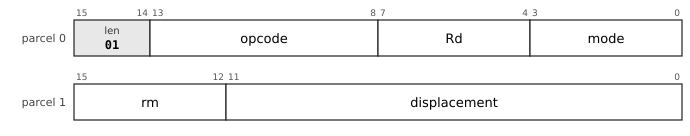

Addressing modes (`low`) that use this layout: `base` 0000, `postinc` 0110, `predec` 0111.

`reg` is the register `Rd` (the source of a store); `low` is a second register (`Rs`) at `len = 00` and the addressing mode from `len = 01`; the extension parcels hold the operand (section 9.5).

| Mnemonic | Opcode |
|---|---|
| `MOVQ` | `000000 (0x00)`, `000001 (0x01)` |
| `MOVL` | `000010 (0x02)`, `000011 (0x03)` |
| `MOVW` | `000100 (0x04)`, `000101 (0x05)` |
| `MOVB` | `000110 (0x06)`, `000111 (0x07)` |
| `MOVZL` | `001000 (0x08)` |
| `MOVZW` | `001001 (0x09)` |
| `MOVZB` | `001010 (0x0A)` |
| `LEA` | `001011 (0x0B)` |
| `ADD` | `010110 (0x16)` |
| `SUB` | `010111 (0x17)` |
| `BIC` | `011000 (0x18)` |
| `BIS` | `011001 (0x19)` |
| `CMP` | `011010 (0x1A)` |
| `BIT` | `011011 (0x1B)` |
| `XOR` | `011100 (0x1C)` |
| `AND` | `011101 (0x1D)` |
| `MUL` | `011110 (0x1E)` |
| `MULH` | `011111 (0x1F)` |
| `SHL` | `100000 (0x20)` |
| `SHR` | `100001 (0x21)` |
| `SAR` | `100010 (0x22)` |
| `FADD` | `100100 (0x24)` |
| `FSUB` | `100101 (0x25)` |
| `FMUL` | `100110 (0x26)` |
| `FCMP` | `100111 (0x27)` |

#### r20-mem-1-2: Moves, address formation and the ALU, two parcels (`len = 01`)

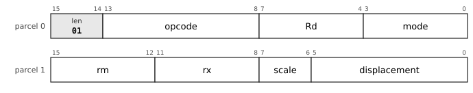

Addressing modes (`low`) that use this layout: `index` 0001.

`reg` is the register `Rd` (the source of a store); `low` is a second register (`Rs`) at `len = 00` and the addressing mode from `len = 01`; the extension parcels hold the operand (section 9.5).

| Mnemonic | Opcode |
|---|---|
| `MOVQ` | `000000 (0x00)`, `000001 (0x01)` |
| `MOVL` | `000010 (0x02)`, `000011 (0x03)` |
| `MOVW` | `000100 (0x04)`, `000101 (0x05)` |
| `MOVB` | `000110 (0x06)`, `000111 (0x07)` |
| `MOVZL` | `001000 (0x08)` |
| `MOVZW` | `001001 (0x09)` |
| `MOVZB` | `001010 (0x0A)` |
| `LEA` | `001011 (0x0B)` |
| `ADD` | `010110 (0x16)` |
| `SUB` | `010111 (0x17)` |
| `BIC` | `011000 (0x18)` |
| `BIS` | `011001 (0x19)` |
| `CMP` | `011010 (0x1A)` |
| `BIT` | `011011 (0x1B)` |
| `XOR` | `011100 (0x1C)` |
| `AND` | `011101 (0x1D)` |
| `MUL` | `011110 (0x1E)` |
| `MULH` | `011111 (0x1F)` |
| `SHL` | `100000 (0x20)` |
| `SHR` | `100001 (0x21)` |
| `SAR` | `100010 (0x22)` |
| `FADD` | `100100 (0x24)` |
| `FSUB` | `100101 (0x25)` |
| `FMUL` | `100110 (0x26)` |
| `FCMP` | `100111 (0x27)` |

#### r20-mem-1-3: Moves, address formation and the ALU, two parcels (`len = 01`)

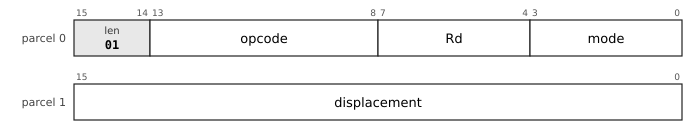

Addressing modes (`low`) that use this layout: `pcrel` 0010, `imm` 0100, `abs` 0101.

`reg` is the register `Rd` (the source of a store); `low` is a second register (`Rs`) at `len = 00` and the addressing mode from `len = 01`; the extension parcels hold the operand (section 9.5).

| Mnemonic | Opcode |
|---|---|
| `MOVQ` | `000000 (0x00)`, `000001 (0x01)` |
| `MOVL` | `000010 (0x02)`, `000011 (0x03)` |
| `MOVW` | `000100 (0x04)`, `000101 (0x05)` |
| `MOVB` | `000110 (0x06)`, `000111 (0x07)` |
| `MOVZL` | `001000 (0x08)` |
| `MOVZW` | `001001 (0x09)` |
| `MOVZB` | `001010 (0x0A)` |
| `LEA` | `001011 (0x0B)` |
| `ADD` | `010110 (0x16)` |
| `SUB` | `010111 (0x17)` |
| `BIC` | `011000 (0x18)` |
| `BIS` | `011001 (0x19)` |
| `CMP` | `011010 (0x1A)` |
| `BIT` | `011011 (0x1B)` |
| `XOR` | `011100 (0x1C)` |
| `AND` | `011101 (0x1D)` |
| `MUL` | `011110 (0x1E)` |
| `MULH` | `011111 (0x1F)` |
| `SHL` | `100000 (0x20)` |
| `SHR` | `100001 (0x21)` |
| `SAR` | `100010 (0x22)` |
| `FADD` | `100100 (0x24)` |
| `FSUB` | `100101 (0x25)` |
| `FMUL` | `100110 (0x26)` |
| `FCMP` | `100111 (0x27)` |

#### r20-mem-1-4: Moves, address formation and the ALU, two parcels (`len = 01`)

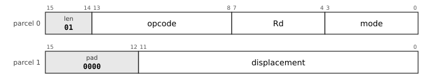

Addressing modes (`low`) that use this layout: `dp` 0011.

`reg` is the register `Rd` (the source of a store); `low` is a second register (`Rs`) at `len = 00` and the addressing mode from `len = 01`; the extension parcels hold the operand (section 9.5).

| Mnemonic | Opcode |
|---|---|
| `MOVQ` | `000000 (0x00)`, `000001 (0x01)` |
| `MOVL` | `000010 (0x02)`, `000011 (0x03)` |
| `MOVW` | `000100 (0x04)`, `000101 (0x05)` |
| `MOVB` | `000110 (0x06)`, `000111 (0x07)` |
| `MOVZL` | `001000 (0x08)` |
| `MOVZW` | `001001 (0x09)` |
| `MOVZB` | `001010 (0x0A)` |
| `LEA` | `001011 (0x0B)` |
| `ADD` | `010110 (0x16)` |
| `SUB` | `010111 (0x17)` |
| `BIC` | `011000 (0x18)` |
| `BIS` | `011001 (0x19)` |
| `CMP` | `011010 (0x1A)` |
| `BIT` | `011011 (0x1B)` |
| `XOR` | `011100 (0x1C)` |
| `AND` | `011101 (0x1D)` |
| `MUL` | `011110 (0x1E)` |
| `MULH` | `011111 (0x1F)` |
| `SHL` | `100000 (0x20)` |
| `SHR` | `100001 (0x21)` |
| `SAR` | `100010 (0x22)` |
| `FADD` | `100100 (0x24)` |
| `FSUB` | `100101 (0x25)` |
| `FMUL` | `100110 (0x26)` |
| `FCMP` | `100111 (0x27)` |

#### r20-mem-2: Moves, address formation and the ALU, three parcels (`len = 10`)

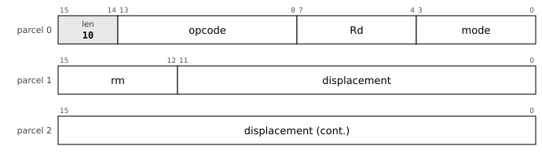

Addressing modes (`low`) that use this layout: `base` 0000, `postinc` 0110, `predec` 0111.

`reg` is the register `Rd` (the source of a store); `low` is a second register (`Rs`) at `len = 00` and the addressing mode from `len = 01`; the extension parcels hold the operand (section 9.5).

| Mnemonic | Opcode |
|---|---|
| `MOVQ` | `000000 (0x00)`, `000001 (0x01)` |
| `MOVL` | `000010 (0x02)`, `000011 (0x03)` |
| `MOVW` | `000100 (0x04)`, `000101 (0x05)` |
| `MOVB` | `000110 (0x06)`, `000111 (0x07)` |
| `MOVZL` | `001000 (0x08)` |
| `MOVZW` | `001001 (0x09)` |
| `MOVZB` | `001010 (0x0A)` |
| `LEA` | `001011 (0x0B)` |
| `ADD` | `010110 (0x16)` |
| `SUB` | `010111 (0x17)` |
| `BIC` | `011000 (0x18)` |
| `BIS` | `011001 (0x19)` |
| `CMP` | `011010 (0x1A)` |
| `BIT` | `011011 (0x1B)` |
| `XOR` | `011100 (0x1C)` |
| `AND` | `011101 (0x1D)` |
| `MUL` | `011110 (0x1E)` |
| `MULH` | `011111 (0x1F)` |
| `SHL` | `100000 (0x20)` |
| `SHR` | `100001 (0x21)` |
| `SAR` | `100010 (0x22)` |
| `FADD` | `100100 (0x24)` |
| `FSUB` | `100101 (0x25)` |
| `FMUL` | `100110 (0x26)` |
| `FCMP` | `100111 (0x27)` |

#### r20-mem-2-2: Moves, address formation and the ALU, three parcels (`len = 10`)

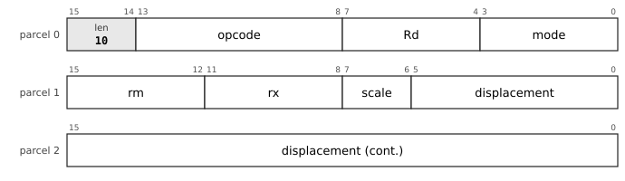

Addressing modes (`low`) that use this layout: `index` 0001.

`reg` is the register `Rd` (the source of a store); `low` is a second register (`Rs`) at `len = 00` and the addressing mode from `len = 01`; the extension parcels hold the operand (section 9.5).

| Mnemonic | Opcode |
|---|---|
| `MOVQ` | `000000 (0x00)`, `000001 (0x01)` |
| `MOVL` | `000010 (0x02)`, `000011 (0x03)` |
| `MOVW` | `000100 (0x04)`, `000101 (0x05)` |
| `MOVB` | `000110 (0x06)`, `000111 (0x07)` |
| `MOVZL` | `001000 (0x08)` |
| `MOVZW` | `001001 (0x09)` |
| `MOVZB` | `001010 (0x0A)` |
| `LEA` | `001011 (0x0B)` |
| `ADD` | `010110 (0x16)` |
| `SUB` | `010111 (0x17)` |
| `BIC` | `011000 (0x18)` |
| `BIS` | `011001 (0x19)` |
| `CMP` | `011010 (0x1A)` |
| `BIT` | `011011 (0x1B)` |
| `XOR` | `011100 (0x1C)` |
| `AND` | `011101 (0x1D)` |
| `MUL` | `011110 (0x1E)` |
| `MULH` | `011111 (0x1F)` |
| `SHL` | `100000 (0x20)` |
| `SHR` | `100001 (0x21)` |
| `SAR` | `100010 (0x22)` |
| `FADD` | `100100 (0x24)` |
| `FSUB` | `100101 (0x25)` |
| `FMUL` | `100110 (0x26)` |
| `FCMP` | `100111 (0x27)` |

#### r20-mem-2-3: Moves, address formation and the ALU, three parcels (`len = 10`)

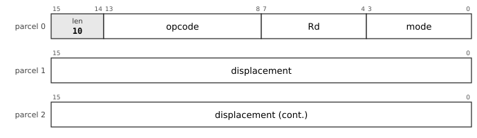

Addressing modes (`low`) that use this layout: `pcrel` 0010, `imm` 0100, `abs` 0101.

`reg` is the register `Rd` (the source of a store); `low` is a second register (`Rs`) at `len = 00` and the addressing mode from `len = 01`; the extension parcels hold the operand (section 9.5).

| Mnemonic | Opcode |
|---|---|
| `MOVQ` | `000000 (0x00)`, `000001 (0x01)` |
| `MOVL` | `000010 (0x02)`, `000011 (0x03)` |
| `MOVW` | `000100 (0x04)`, `000101 (0x05)` |
| `MOVB` | `000110 (0x06)`, `000111 (0x07)` |
| `MOVZL` | `001000 (0x08)` |
| `MOVZW` | `001001 (0x09)` |
| `MOVZB` | `001010 (0x0A)` |
| `LEA` | `001011 (0x0B)` |
| `ADD` | `010110 (0x16)` |
| `SUB` | `010111 (0x17)` |
| `BIC` | `011000 (0x18)` |
| `BIS` | `011001 (0x19)` |
| `CMP` | `011010 (0x1A)` |
| `BIT` | `011011 (0x1B)` |
| `XOR` | `011100 (0x1C)` |
| `AND` | `011101 (0x1D)` |
| `MUL` | `011110 (0x1E)` |
| `MULH` | `011111 (0x1F)` |
| `SHL` | `100000 (0x20)` |
| `SHR` | `100001 (0x21)` |
| `SAR` | `100010 (0x22)` |
| `FADD` | `100100 (0x24)` |
| `FSUB` | `100101 (0x25)` |
| `FMUL` | `100110 (0x26)` |
| `FCMP` | `100111 (0x27)` |

#### r20-mem-2-4: Moves, address formation and the ALU, three parcels (`len = 10`)

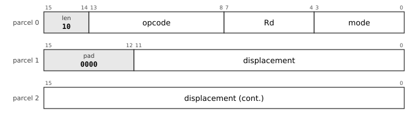

Addressing modes (`low`) that use this layout: `dp` 0011.

`reg` is the register `Rd` (the source of a store); `low` is a second register (`Rs`) at `len = 00` and the addressing mode from `len = 01`; the extension parcels hold the operand (section 9.5).

| Mnemonic | Opcode |
|---|---|
| `MOVQ` | `000000 (0x00)`, `000001 (0x01)` |
| `MOVL` | `000010 (0x02)`, `000011 (0x03)` |
| `MOVW` | `000100 (0x04)`, `000101 (0x05)` |
| `MOVB` | `000110 (0x06)`, `000111 (0x07)` |
| `MOVZL` | `001000 (0x08)` |
| `MOVZW` | `001001 (0x09)` |
| `MOVZB` | `001010 (0x0A)` |
| `LEA` | `001011 (0x0B)` |
| `ADD` | `010110 (0x16)` |
| `SUB` | `010111 (0x17)` |
| `BIC` | `011000 (0x18)` |
| `BIS` | `011001 (0x19)` |
| `CMP` | `011010 (0x1A)` |
| `BIT` | `011011 (0x1B)` |
| `XOR` | `011100 (0x1C)` |
| `AND` | `011101 (0x1D)` |
| `MUL` | `011110 (0x1E)` |
| `MULH` | `011111 (0x1F)` |
| `SHL` | `100000 (0x20)` |
| `SHR` | `100001 (0x21)` |
| `SAR` | `100010 (0x22)` |
| `FADD` | `100100 (0x24)` |
| `FSUB` | `100101 (0x25)` |
| `FMUL` | `100110 (0x26)` |
| `FCMP` | `100111 (0x27)` |

### Conditional branches

#### r20-br-0: Conditional branches, one parcel (`len = 00`)

The displacement is signed and counts 2-byte parcels from the first parcel of the instruction.

| Mnemonic | Opcode |
|---|---|
| `BR` | `110000 (0x30)` |
| `BNE` | `110001 (0x31)` |
| `BEQ` | `110010 (0x32)` |
| `BPL` | `110011 (0x33)` |
| `BMI` | `110100 (0x34)` |
| `BVC` | `110101 (0x35)` |
| `BVS` | `110110 (0x36)` |
| `BCC` | `110111 (0x37)` |
| `BCS` | `111000 (0x38)` |
| `BGE` | `111001 (0x39)` |
| `BLT` | `111010 (0x3A)` |
| `BGT` | `111011 (0x3B)` |
| `BLE` | `111100 (0x3C)` |
| `BHI` | `111101 (0x3D)` |
| `BLOS` | `111110 (0x3E)` |

#### r20-br-1: Conditional branches, two parcels (`len = 01`)

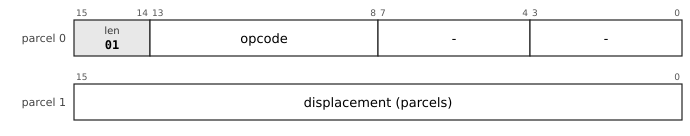

The displacement is signed and counts 2-byte parcels from the first parcel of the instruction.

| Mnemonic | Opcode |
|---|---|
| `BR` | `110000 (0x30)` |
| `BNE` | `110001 (0x31)` |
| `BEQ` | `110010 (0x32)` |
| `BPL` | `110011 (0x33)` |
| `BMI` | `110100 (0x34)` |
| `BVC` | `110101 (0x35)` |
| `BVS` | `110110 (0x36)` |
| `BCC` | `110111 (0x37)` |
| `BCS` | `111000 (0x38)` |
| `BGE` | `111001 (0x39)` |
| `BLT` | `111010 (0x3A)` |
| `BGT` | `111011 (0x3B)` |
| `BLE` | `111100 (0x3C)` |
| `BHI` | `111101 (0x3D)` |
| `BLOS` | `111110 (0x3E)` |

#### r20-br-2: Conditional branches, three parcels (`len = 10`)

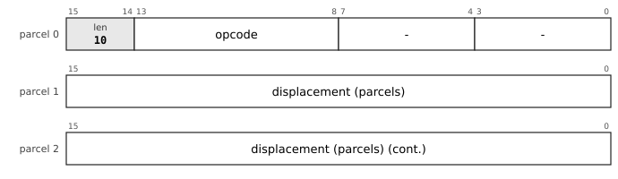

The displacement is signed and counts 2-byte parcels from the first parcel of the instruction.

| Mnemonic | Opcode |
|---|---|
| `BR` | `110000 (0x30)` |
| `BNE` | `110001 (0x31)` |
| `BEQ` | `110010 (0x32)` |
| `BPL` | `110011 (0x33)` |
| `BMI` | `110100 (0x34)` |
| `BVC` | `110101 (0x35)` |
| `BVS` | `110110 (0x36)` |
| `BCC` | `110111 (0x37)` |
| `BCS` | `111000 (0x38)` |
| `BGE` | `111001 (0x39)` |
| `BLT` | `111010 (0x3A)` |
| `BGT` | `111011 (0x3B)` |
| `BLE` | `111100 (0x3C)` |
| `BHI` | `111101 (0x3D)` |
| `BLOS` | `111110 (0x3E)` |

### Compare and branch

#### r20-cb-1: Compare and branch, two parcels (`len = 01`)

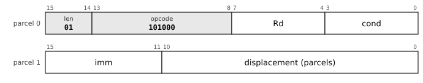

`low` is the condition; the immediate and the displacement are signed.

| Mnemonic | Opcode | `low` |
|---|---|---|
| `CBNE` | `101000 (0x28)` | `0001 (0x1)` |
| `CBEQ` | `101000 (0x28)` | `0010 (0x2)` |
| `CBPL` | `101000 (0x28)` | `0011 (0x3)` |
| `CBMI` | `101000 (0x28)` | `0100 (0x4)` |
| `CBVC` | `101000 (0x28)` | `0101 (0x5)` |
| `CBVS` | `101000 (0x28)` | `0110 (0x6)` |
| `CBCC` | `101000 (0x28)` | `0111 (0x7)` |
| `CBCS` | `101000 (0x28)` | `1000 (0x8)` |
| `CBGE` | `101000 (0x28)` | `1001 (0x9)` |
| `CBLT` | `101000 (0x28)` | `1010 (0xA)` |
| `CBGT` | `101000 (0x28)` | `1011 (0xB)` |
| `CBLE` | `101000 (0x28)` | `1100 (0xC)` |
| `CBHI` | `101000 (0x28)` | `1101 (0xD)` |
| `CBLOS` | `101000 (0x28)` | `1110 (0xE)` |

#### r20-cb-1-2: Compare two registers and branch, two parcels (`len = 01`)

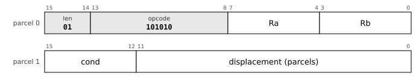

Parcel 1 starts with the condition; `Ra` and `Rb` are compared.

| Mnemonic | Opcode | `low` |
|---|---|---|
| `CBNE` | `101010 (0x2A)` | `0001 (0x1)` |
| `CBEQ` | `101010 (0x2A)` | `0010 (0x2)` |
| `CBPL` | `101010 (0x2A)` | `0011 (0x3)` |
| `CBMI` | `101010 (0x2A)` | `0100 (0x4)` |
| `CBVC` | `101010 (0x2A)` | `0101 (0x5)` |
| `CBVS` | `101010 (0x2A)` | `0110 (0x6)` |
| `CBCC` | `101010 (0x2A)` | `0111 (0x7)` |
| `CBCS` | `101010 (0x2A)` | `1000 (0x8)` |
| `CBGE` | `101010 (0x2A)` | `1001 (0x9)` |
| `CBLT` | `101010 (0x2A)` | `1010 (0xA)` |
| `CBGT` | `101010 (0x2A)` | `1011 (0xB)` |
| `CBLE` | `101010 (0x2A)` | `1100 (0xC)` |
| `CBHI` | `101010 (0x2A)` | `1101 (0xD)` |
| `CBLOS` | `101010 (0x2A)` | `1110 (0xE)` |

#### r20-cb-2: Compare and branch, three parcels (`len = 10`)

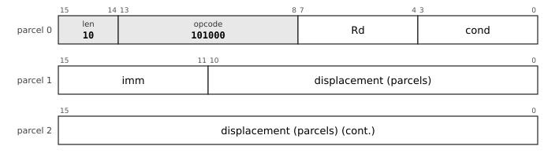

`low` is the condition; the immediate and the displacement are signed.

| Mnemonic | Opcode | `low` |
|---|---|---|
| `CBNE` | `101000 (0x28)` | `0001 (0x1)` |
| `CBEQ` | `101000 (0x28)` | `0010 (0x2)` |
| `CBPL` | `101000 (0x28)` | `0011 (0x3)` |
| `CBMI` | `101000 (0x28)` | `0100 (0x4)` |
| `CBVC` | `101000 (0x28)` | `0101 (0x5)` |
| `CBVS` | `101000 (0x28)` | `0110 (0x6)` |
| `CBCC` | `101000 (0x28)` | `0111 (0x7)` |
| `CBCS` | `101000 (0x28)` | `1000 (0x8)` |
| `CBGE` | `101000 (0x28)` | `1001 (0x9)` |
| `CBLT` | `101000 (0x28)` | `1010 (0xA)` |
| `CBGT` | `101000 (0x28)` | `1011 (0xB)` |
| `CBLE` | `101000 (0x28)` | `1100 (0xC)` |
| `CBHI` | `101000 (0x28)` | `1101 (0xD)` |
| `CBLOS` | `101000 (0x28)` | `1110 (0xE)` |

#### r20-cb-2-2: Compare and branch, three parcels (`len = 10`)

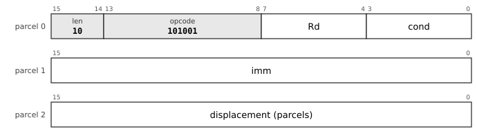

`low` is the condition; the immediate and the displacement are signed.

| Mnemonic | Opcode | `low` |
|---|---|---|
| `CBNE` | `101001 (0x29)` | `0001 (0x1)` |
| `CBEQ` | `101001 (0x29)` | `0010 (0x2)` |
| `CBPL` | `101001 (0x29)` | `0011 (0x3)` |
| `CBMI` | `101001 (0x29)` | `0100 (0x4)` |
| `CBVC` | `101001 (0x29)` | `0101 (0x5)` |
| `CBVS` | `101001 (0x29)` | `0110 (0x6)` |
| `CBCC` | `101001 (0x29)` | `0111 (0x7)` |
| `CBCS` | `101001 (0x29)` | `1000 (0x8)` |
| `CBGE` | `101001 (0x29)` | `1001 (0x9)` |
| `CBLT` | `101001 (0x29)` | `1010 (0xA)` |
| `CBGT` | `101001 (0x29)` | `1011 (0xB)` |
| `CBLE` | `101001 (0x29)` | `1100 (0xC)` |
| `CBHI` | `101001 (0x29)` | `1101 (0xD)` |
| `CBLOS` | `101001 (0x29)` | `1110 (0xE)` |

#### r20-cb-2-3: Compare two registers and branch, three parcels (`len = 10`)

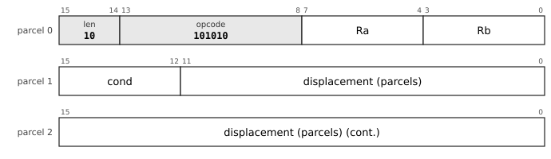

Parcel 1 starts with the condition; `Ra` and `Rb` are compared.

| Mnemonic | Opcode | `low` |
|---|---|---|
| `CBNE` | `101010 (0x2A)` | `0001 (0x1)` |
| `CBEQ` | `101010 (0x2A)` | `0010 (0x2)` |
| `CBPL` | `101010 (0x2A)` | `0011 (0x3)` |
| `CBMI` | `101010 (0x2A)` | `0100 (0x4)` |
| `CBVC` | `101010 (0x2A)` | `0101 (0x5)` |
| `CBVS` | `101010 (0x2A)` | `0110 (0x6)` |
| `CBCC` | `101010 (0x2A)` | `0111 (0x7)` |
| `CBCS` | `101010 (0x2A)` | `1000 (0x8)` |
| `CBGE` | `101010 (0x2A)` | `1001 (0x9)` |
| `CBLT` | `101010 (0x2A)` | `1010 (0xA)` |
| `CBGT` | `101010 (0x2A)` | `1011 (0xB)` |
| `CBLE` | `101010 (0x2A)` | `1100 (0xC)` |
| `CBHI` | `101010 (0x2A)` | `1101 (0xD)` |
| `CBLOS` | `101010 (0x2A)` | `1110 (0xE)` |

### SOB

#### r20-sob-1: SOB, two parcels (`len = 01`)

The displacement is signed and counts parcels.

| Mnemonic | Opcode |
|---|---|
| `SOB` | `111111 (0x3F)` |

#### r20-sob-2: SOB, three parcels (`len = 10`)

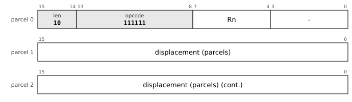

The displacement is signed and counts parcels.

| Mnemonic | Opcode |
|---|---|
| `SOB` | `111111 (0x3F)` |

### Tag branches

#### r20-tag-1: Tag branches, two parcels (`len = 01`)

`sense` is 0 for `BTAG` and 1 for `BNTAG`; `tag` is the 3-bit tag.

| Mnemonic | Opcode |
|---|---|
| `BTAG` | `010101 (0x15)` |
| `BNTAG` | `010101 (0x15)` |

#### r20-tag-2: Tag branches, three parcels (`len = 10`)

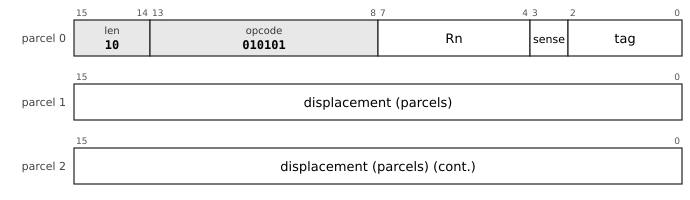

`sense` is 0 for `BTAG` and 1 for `BNTAG`; `tag` is the 3-bit tag.

| Mnemonic | Opcode |
|---|---|
| `BTAG` | `010101 (0x15)` |
| `BNTAG` | `010101 (0x15)` |

### Single operand (SOP)

#### r20-sop-0: Single operand (SOP), one parcel (`len = 00`)

The `reg` field is the sub-opcode; the operand is `rm` with its mode, at any length.

| Mnemonic | Opcode | `reg` |
|---|---|---|
| `CLR` | `010011 (0x13)` | `0000 (0x0)` |
| `COM` | `010011 (0x13)` | `0001 (0x1)` |
| `INC` | `010011 (0x13)` | `0010 (0x2)` |
| `DEC` | `010011 (0x13)` | `0011 (0x3)` |
| `NEG` | `010011 (0x13)` | `0100 (0x4)` |
| `TST` | `010011 (0x13)` | `0101 (0x5)` |
| `ADC` | `010011 (0x13)` | `0110 (0x6)` |
| `SBC` | `010011 (0x13)` | `0111 (0x7)` |
| `ASL` | `010011 (0x13)` | `1000 (0x8)` |
| `ASR` | `010011 (0x13)` | `1001 (0x9)` |
| `PUSHM` | `010011 (0x13)` | `1010 (0xA)` |
| `POPM` | `010011 (0x13)` | `1011 (0xB)` |
| `JMP` | `010011 (0x13)` | `1100 (0xC)` |
| `CALL` | `010011 (0x13)` | `1101 (0xD)` |
| `PUSH` | `010011 (0x13)` | `1110 (0xE)` |
| `POP` | `010011 (0x13)` | `1111 (0xF)` |

#### r20-sop-1: Single operand (SOP), two parcels (`len = 01`)

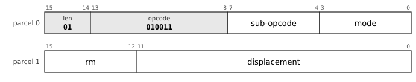

Addressing modes (`low`) that use this layout: `base` 0000, `postinc` 0110, `predec` 0111.

The `reg` field is the sub-opcode; the operand is `rm` with its mode, at any length.

| Mnemonic | Opcode | `reg` |
|---|---|---|
| `CLR` | `010011 (0x13)` | `0000 (0x0)` |
| `COM` | `010011 (0x13)` | `0001 (0x1)` |
| `INC` | `010011 (0x13)` | `0010 (0x2)` |
| `DEC` | `010011 (0x13)` | `0011 (0x3)` |
| `NEG` | `010011 (0x13)` | `0100 (0x4)` |
| `TST` | `010011 (0x13)` | `0101 (0x5)` |
| `ADC` | `010011 (0x13)` | `0110 (0x6)` |
| `SBC` | `010011 (0x13)` | `0111 (0x7)` |
| `ASL` | `010011 (0x13)` | `1000 (0x8)` |
| `ASR` | `010011 (0x13)` | `1001 (0x9)` |
| `PUSHM` | `010011 (0x13)` | `1010 (0xA)` |
| `POPM` | `010011 (0x13)` | `1011 (0xB)` |
| `JMP` | `010011 (0x13)` | `1100 (0xC)` |
| `CALL` | `010011 (0x13)` | `1101 (0xD)` |
| `PUSH` | `010011 (0x13)` | `1110 (0xE)` |
| `POP` | `010011 (0x13)` | `1111 (0xF)` |

#### r20-sop-1-2: Single operand (SOP), two parcels (`len = 01`)

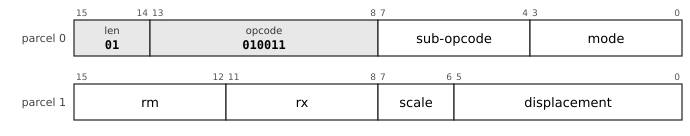

Addressing modes (`low`) that use this layout: `index` 0001.

The `reg` field is the sub-opcode; the operand is `rm` with its mode, at any length.

| Mnemonic | Opcode | `reg` |
|---|---|---|
| `CLR` | `010011 (0x13)` | `0000 (0x0)` |
| `COM` | `010011 (0x13)` | `0001 (0x1)` |
| `INC` | `010011 (0x13)` | `0010 (0x2)` |
| `DEC` | `010011 (0x13)` | `0011 (0x3)` |
| `NEG` | `010011 (0x13)` | `0100 (0x4)` |
| `TST` | `010011 (0x13)` | `0101 (0x5)` |
| `ADC` | `010011 (0x13)` | `0110 (0x6)` |
| `SBC` | `010011 (0x13)` | `0111 (0x7)` |
| `ASL` | `010011 (0x13)` | `1000 (0x8)` |
| `ASR` | `010011 (0x13)` | `1001 (0x9)` |
| `PUSHM` | `010011 (0x13)` | `1010 (0xA)` |
| `POPM` | `010011 (0x13)` | `1011 (0xB)` |
| `JMP` | `010011 (0x13)` | `1100 (0xC)` |
| `CALL` | `010011 (0x13)` | `1101 (0xD)` |
| `PUSH` | `010011 (0x13)` | `1110 (0xE)` |
| `POP` | `010011 (0x13)` | `1111 (0xF)` |

#### r20-sop-1-3: Single operand (SOP), two parcels (`len = 01`)

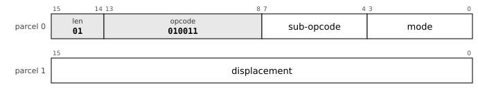

Addressing modes (`low`) that use this layout: `pcrel` 0010, `imm` 0100, `abs` 0101.

The `reg` field is the sub-opcode; the operand is `rm` with its mode, at any length.

| Mnemonic | Opcode | `reg` |
|---|---|---|
| `CLR` | `010011 (0x13)` | `0000 (0x0)` |
| `COM` | `010011 (0x13)` | `0001 (0x1)` |
| `INC` | `010011 (0x13)` | `0010 (0x2)` |
| `DEC` | `010011 (0x13)` | `0011 (0x3)` |
| `NEG` | `010011 (0x13)` | `0100 (0x4)` |
| `TST` | `010011 (0x13)` | `0101 (0x5)` |
| `ADC` | `010011 (0x13)` | `0110 (0x6)` |
| `SBC` | `010011 (0x13)` | `0111 (0x7)` |
| `ASL` | `010011 (0x13)` | `1000 (0x8)` |
| `ASR` | `010011 (0x13)` | `1001 (0x9)` |
| `PUSHM` | `010011 (0x13)` | `1010 (0xA)` |
| `POPM` | `010011 (0x13)` | `1011 (0xB)` |
| `JMP` | `010011 (0x13)` | `1100 (0xC)` |
| `CALL` | `010011 (0x13)` | `1101 (0xD)` |
| `PUSH` | `010011 (0x13)` | `1110 (0xE)` |
| `POP` | `010011 (0x13)` | `1111 (0xF)` |

#### r20-sop-1-4: Single operand (SOP), two parcels (`len = 01`)

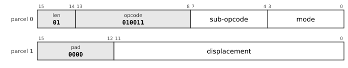

Addressing modes (`low`) that use this layout: `dp` 0011.

The `reg` field is the sub-opcode; the operand is `rm` with its mode, at any length.

| Mnemonic | Opcode | `reg` |
|---|---|---|
| `CLR` | `010011 (0x13)` | `0000 (0x0)` |
| `COM` | `010011 (0x13)` | `0001 (0x1)` |
| `INC` | `010011 (0x13)` | `0010 (0x2)` |
| `DEC` | `010011 (0x13)` | `0011 (0x3)` |
| `NEG` | `010011 (0x13)` | `0100 (0x4)` |
| `TST` | `010011 (0x13)` | `0101 (0x5)` |
| `ADC` | `010011 (0x13)` | `0110 (0x6)` |
| `SBC` | `010011 (0x13)` | `0111 (0x7)` |
| `ASL` | `010011 (0x13)` | `1000 (0x8)` |
| `ASR` | `010011 (0x13)` | `1001 (0x9)` |
| `PUSHM` | `010011 (0x13)` | `1010 (0xA)` |
| `POPM` | `010011 (0x13)` | `1011 (0xB)` |
| `JMP` | `010011 (0x13)` | `1100 (0xC)` |
| `CALL` | `010011 (0x13)` | `1101 (0xD)` |
| `PUSH` | `010011 (0x13)` | `1110 (0xE)` |
| `POP` | `010011 (0x13)` | `1111 (0xF)` |

#### r20-sop-2: Single operand (SOP), three parcels (`len = 10`)

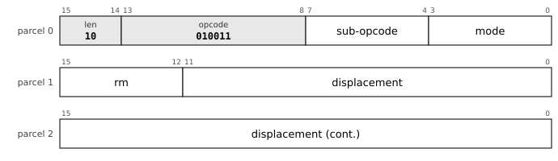

Addressing modes (`low`) that use this layout: `base` 0000, `postinc` 0110, `predec` 0111.

The `reg` field is the sub-opcode; the operand is `rm` with its mode, at any length.

| Mnemonic | Opcode | `reg` |
|---|---|---|
| `CLR` | `010011 (0x13)` | `0000 (0x0)` |
| `COM` | `010011 (0x13)` | `0001 (0x1)` |
| `INC` | `010011 (0x13)` | `0010 (0x2)` |
| `DEC` | `010011 (0x13)` | `0011 (0x3)` |
| `NEG` | `010011 (0x13)` | `0100 (0x4)` |
| `TST` | `010011 (0x13)` | `0101 (0x5)` |
| `ADC` | `010011 (0x13)` | `0110 (0x6)` |
| `SBC` | `010011 (0x13)` | `0111 (0x7)` |
| `ASL` | `010011 (0x13)` | `1000 (0x8)` |
| `ASR` | `010011 (0x13)` | `1001 (0x9)` |
| `PUSHM` | `010011 (0x13)` | `1010 (0xA)` |
| `POPM` | `010011 (0x13)` | `1011 (0xB)` |
| `JMP` | `010011 (0x13)` | `1100 (0xC)` |
| `CALL` | `010011 (0x13)` | `1101 (0xD)` |
| `PUSH` | `010011 (0x13)` | `1110 (0xE)` |
| `POP` | `010011 (0x13)` | `1111 (0xF)` |

#### r20-sop-2-2: Single operand (SOP), three parcels (`len = 10`)

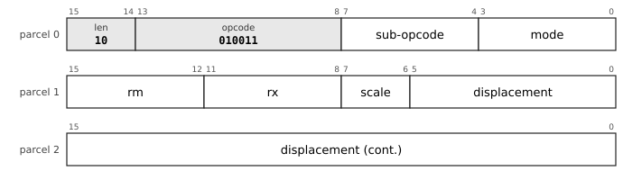

Addressing modes (`low`) that use this layout: `index` 0001.

The `reg` field is the sub-opcode; the operand is `rm` with its mode, at any length.

| Mnemonic | Opcode | `reg` |
|---|---|---|
| `CLR` | `010011 (0x13)` | `0000 (0x0)` |
| `COM` | `010011 (0x13)` | `0001 (0x1)` |
| `INC` | `010011 (0x13)` | `0010 (0x2)` |
| `DEC` | `010011 (0x13)` | `0011 (0x3)` |
| `NEG` | `010011 (0x13)` | `0100 (0x4)` |
| `TST` | `010011 (0x13)` | `0101 (0x5)` |
| `ADC` | `010011 (0x13)` | `0110 (0x6)` |
| `SBC` | `010011 (0x13)` | `0111 (0x7)` |
| `ASL` | `010011 (0x13)` | `1000 (0x8)` |
| `ASR` | `010011 (0x13)` | `1001 (0x9)` |
| `PUSHM` | `010011 (0x13)` | `1010 (0xA)` |
| `POPM` | `010011 (0x13)` | `1011 (0xB)` |
| `JMP` | `010011 (0x13)` | `1100 (0xC)` |
| `CALL` | `010011 (0x13)` | `1101 (0xD)` |
| `PUSH` | `010011 (0x13)` | `1110 (0xE)` |
| `POP` | `010011 (0x13)` | `1111 (0xF)` |

#### r20-sop-2-3: Single operand (SOP), three parcels (`len = 10`)

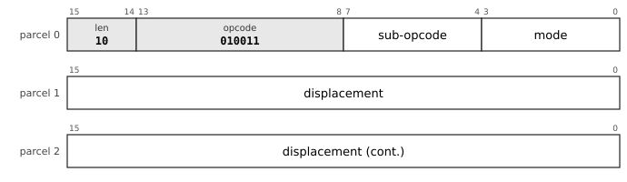

Addressing modes (`low`) that use this layout: `pcrel` 0010, `imm` 0100, `abs` 0101.

The `reg` field is the sub-opcode; the operand is `rm` with its mode, at any length.

| Mnemonic | Opcode | `reg` |
|---|---|---|
| `CLR` | `010011 (0x13)` | `0000 (0x0)` |
| `COM` | `010011 (0x13)` | `0001 (0x1)` |
| `INC` | `010011 (0x13)` | `0010 (0x2)` |
| `DEC` | `010011 (0x13)` | `0011 (0x3)` |
| `NEG` | `010011 (0x13)` | `0100 (0x4)` |
| `TST` | `010011 (0x13)` | `0101 (0x5)` |
| `ADC` | `010011 (0x13)` | `0110 (0x6)` |
| `SBC` | `010011 (0x13)` | `0111 (0x7)` |
| `ASL` | `010011 (0x13)` | `1000 (0x8)` |
| `ASR` | `010011 (0x13)` | `1001 (0x9)` |
| `PUSHM` | `010011 (0x13)` | `1010 (0xA)` |
| `POPM` | `010011 (0x13)` | `1011 (0xB)` |
| `JMP` | `010011 (0x13)` | `1100 (0xC)` |
| `CALL` | `010011 (0x13)` | `1101 (0xD)` |
| `PUSH` | `010011 (0x13)` | `1110 (0xE)` |
| `POP` | `010011 (0x13)` | `1111 (0xF)` |

#### r20-sop-2-4: Single operand (SOP), three parcels (`len = 10`)

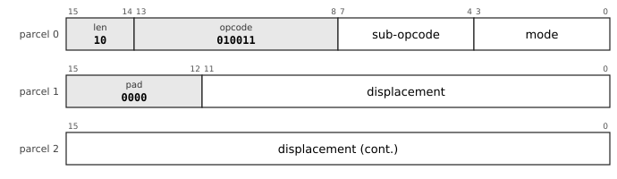

Addressing modes (`low`) that use this layout: `dp` 0011.

The `reg` field is the sub-opcode; the operand is `rm` with its mode, at any length.

| Mnemonic | Opcode | `reg` |
|---|---|---|
| `CLR` | `010011 (0x13)` | `0000 (0x0)` |
| `COM` | `010011 (0x13)` | `0001 (0x1)` |
| `INC` | `010011 (0x13)` | `0010 (0x2)` |
| `DEC` | `010011 (0x13)` | `0011 (0x3)` |
| `NEG` | `010011 (0x13)` | `0100 (0x4)` |
| `TST` | `010011 (0x13)` | `0101 (0x5)` |
| `ADC` | `010011 (0x13)` | `0110 (0x6)` |
| `SBC` | `010011 (0x13)` | `0111 (0x7)` |
| `ASL` | `010011 (0x13)` | `1000 (0x8)` |
| `ASR` | `010011 (0x13)` | `1001 (0x9)` |
| `PUSHM` | `010011 (0x13)` | `1010 (0xA)` |
| `POPM` | `010011 (0x13)` | `1011 (0xB)` |
| `JMP` | `010011 (0x13)` | `1100 (0xC)` |
| `CALL` | `010011 (0x13)` | `1101 (0xD)` |
| `PUSH` | `010011 (0x13)` | `1110 (0xE)` |
| `POP` | `010011 (0x13)` | `1111 (0xF)` |

### Indirect transfers (XFER)

#### r20-xfer-0: Indirect transfers (XFER), one parcel (`len = 00`)

The `reg` field is the sub-opcode; the operand is `rm` with its mode, at any length.

| Mnemonic | Opcode | `reg` |
|---|---|---|
| `JMPI` | `010010 (0x12)` | `0000 (0x0)` |
| `CALLI` | `010010 (0x12)` | `0001 (0x1)` |
| `JTAG` | `010010 (0x12)` | `0010 (0x2)` |

#### r20-xfer-1: Indirect transfers (XFER), two parcels (`len = 01`)

Addressing modes (`low`) that use this layout: `base` 0000, `postinc` 0110, `predec` 0111.

The `reg` field is the sub-opcode; the operand is `rm` with its mode, at any length.

| Mnemonic | Opcode | `reg` |
|---|---|---|
| `JMPI` | `010010 (0x12)` | `0000 (0x0)` |
| `CALLI` | `010010 (0x12)` | `0001 (0x1)` |
| `JTAG` | `010010 (0x12)` | `0010 (0x2)` |

#### r20-xfer-1-2: Indirect transfers (XFER), two parcels (`len = 01`)

Addressing modes (`low`) that use this layout: `index` 0001.

The `reg` field is the sub-opcode; the operand is `rm` with its mode, at any length.

| Mnemonic | Opcode | `reg` |
|---|---|---|
| `JMPI` | `010010 (0x12)` | `0000 (0x0)` |
| `CALLI` | `010010 (0x12)` | `0001 (0x1)` |
| `JTAG` | `010010 (0x12)` | `0010 (0x2)` |

#### r20-xfer-1-3: Indirect transfers (XFER), two parcels (`len = 01`)

Addressing modes (`low`) that use this layout: `pcrel` 0010, `imm` 0100, `abs` 0101.

The `reg` field is the sub-opcode; the operand is `rm` with its mode, at any length.

| Mnemonic | Opcode | `reg` |
|---|---|---|
| `JMPI` | `010010 (0x12)` | `0000 (0x0)` |
| `CALLI` | `010010 (0x12)` | `0001 (0x1)` |
| `JTAG` | `010010 (0x12)` | `0010 (0x2)` |

#### r20-xfer-1-4: Indirect transfers (XFER), two parcels (`len = 01`)

Addressing modes (`low`) that use this layout: `dp` 0011.

The `reg` field is the sub-opcode; the operand is `rm` with its mode, at any length.

| Mnemonic | Opcode | `reg` |
|---|---|---|
| `JMPI` | `010010 (0x12)` | `0000 (0x0)` |
| `CALLI` | `010010 (0x12)` | `0001 (0x1)` |
| `JTAG` | `010010 (0x12)` | `0010 (0x2)` |

#### r20-xfer-2: Indirect transfers (XFER), three parcels (`len = 10`)

Addressing modes (`low`) that use this layout: `base` 0000, `postinc` 0110, `predec` 0111.

The `reg` field is the sub-opcode; the operand is `rm` with its mode, at any length.

| Mnemonic | Opcode | `reg` |
|---|---|---|
| `JMPI` | `010010 (0x12)` | `0000 (0x0)` |
| `CALLI` | `010010 (0x12)` | `0001 (0x1)` |
| `JTAG` | `010010 (0x12)` | `0010 (0x2)` |

#### r20-xfer-2-2: Indirect transfers (XFER), three parcels (`len = 10`)

Addressing modes (`low`) that use this layout: `index` 0001.

The `reg` field is the sub-opcode; the operand is `rm` with its mode, at any length.

| Mnemonic | Opcode | `reg` |
|---|---|---|
| `JMPI` | `010010 (0x12)` | `0000 (0x0)` |
| `CALLI` | `010010 (0x12)` | `0001 (0x1)` |
| `JTAG` | `010010 (0x12)` | `0010 (0x2)` |

#### r20-xfer-2-3: Indirect transfers (XFER), three parcels (`len = 10`)

Addressing modes (`low`) that use this layout: `pcrel` 0010, `imm` 0100, `abs` 0101.

The `reg` field is the sub-opcode; the operand is `rm` with its mode, at any length.

| Mnemonic | Opcode | `reg` |
|---|---|---|
| `JMPI` | `010010 (0x12)` | `0000 (0x0)` |
| `CALLI` | `010010 (0x12)` | `0001 (0x1)` |
| `JTAG` | `010010 (0x12)` | `0010 (0x2)` |

#### r20-xfer-2-4: Indirect transfers (XFER), three parcels (`len = 10`)

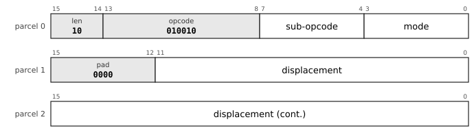

Addressing modes (`low`) that use this layout: `dp` 0011.

The `reg` field is the sub-opcode; the operand is `rm` with its mode, at any length.

| Mnemonic | Opcode | `reg` |
|---|---|---|
| `JMPI` | `010010 (0x12)` | `0000 (0x0)` |
| `CALLI` | `010010 (0x12)` | `0001 (0x1)` |
| `JTAG` | `010010 (0x12)` | `0010 (0x2)` |

### Bits and fields (BESC)

#### r20-besc-1: Bits and fields (BESC), two parcels (`len = 01`)

From `len = 01`. In this group `low` is a register, never a mode.

| Mnemonic | Opcode | Sub-opcode |
|---|---|---|
| `CLZ` | `001100 (0x0C)` | `00000000 (0x00)` |
| `CTZ` | `001100 (0x0C)` | `00000001 (0x01)` |
| `CLO` | `001100 (0x0C)` | `00000010 (0x02)` |
| `CTO` | `001100 (0x0C)` | `00000011 (0x03)` |
| `POPCNT` | `001100 (0x0C)` | `00000100 (0x04)` |
| `BSWAP` | `001100 (0x0C)` | `00000101 (0x05)` |
| `BSWAPW` | `001100 (0x0C)` | `00000110 (0x06)` |
| `BSWAPL` | `001100 (0x0C)` | `00000111 (0x07)` |
| `BITREV` | `001100 (0x0C)` | `00001000 (0x08)` |
| `ROR` | `001100 (0x0C)` | `00010000 (0x10)` |
| `DSHR` | `001100 (0x0C)` | `00100000 (0x20)` |
| `EXTB` | `001100 (0x0C)` | `00100001 (0x21)` |
| `EXTZB` | `001100 (0x0C)` | `00100010 (0x22)` |
| `INSB` | `001100 (0x0C)` | `00100011 (0x23)` |
| `XNORPOP` | `001100 (0x0C)` | `00110000 (0x30)` |
| `CLMULL` | `001100 (0x0C)` | `00110001 (0x31)` |
| `CLMULH` | `001100 (0x0C)` | `00110010 (0x32)` |
| `UTF8LEN` | `001100 (0x0C)` | `01000000 (0x40)` |
| `UTF8DEC` | `001100 (0x0C)` | `01000001 (0x41)` |
| `UTF8ENC` | `001100 (0x0C)` | `01000010 (0x42)` |

#### r20-besc-1-2: Bits and fields (BESC), two parcels (`len = 01`)

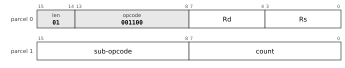

From `len = 01`. In this group `low` is a register, never a mode.

| Mnemonic | Opcode | Sub-opcode |
|---|---|---|
| `RORI` | `001100 (0x0C)` | `00010001 (0x11)` |
| `RORI32` | `001100 (0x0C)` | `00010010 (0x12)` |

#### r20-besc-2: Bits and fields (BESC), three parcels (`len = 10`)

From `len = 01`. In this group `low` is a register, never a mode.

| Mnemonic | Opcode | Sub-opcode |
|---|---|---|
| `CLZ` | `001100 (0x0C)` | `00000000 (0x00)` |
| `CTZ` | `001100 (0x0C)` | `00000001 (0x01)` |
| `CLO` | `001100 (0x0C)` | `00000010 (0x02)` |
| `CTO` | `001100 (0x0C)` | `00000011 (0x03)` |
| `POPCNT` | `001100 (0x0C)` | `00000100 (0x04)` |
| `BSWAP` | `001100 (0x0C)` | `00000101 (0x05)` |
| `BSWAPW` | `001100 (0x0C)` | `00000110 (0x06)` |
| `BSWAPL` | `001100 (0x0C)` | `00000111 (0x07)` |
| `BITREV` | `001100 (0x0C)` | `00001000 (0x08)` |
| `ROR` | `001100 (0x0C)` | `00010000 (0x10)` |
| `XNORPOP` | `001100 (0x0C)` | `00110000 (0x30)` |
| `CLMULL` | `001100 (0x0C)` | `00110001 (0x31)` |
| `CLMULH` | `001100 (0x0C)` | `00110010 (0x32)` |
| `UTF8LEN` | `001100 (0x0C)` | `01000000 (0x40)` |
| `UTF8DEC` | `001100 (0x0C)` | `01000001 (0x41)` |
| `UTF8ENC` | `001100 (0x0C)` | `01000010 (0x42)` |

#### r20-besc-2-2: Bits and fields (BESC), three parcels (`len = 10`)

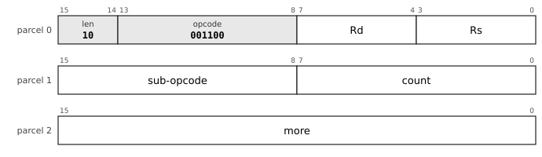

From `len = 01`. In this group `low` is a register, never a mode.

| Mnemonic | Opcode | Sub-opcode |
|---|---|---|
| `RORI` | `001100 (0x0C)` | `00010001 (0x11)` |
| `RORI32` | `001100 (0x0C)` | `00010010 (0x12)` |

#### r20-besc-2-3: Bits and fields (BESC), three parcels (`len = 10`)

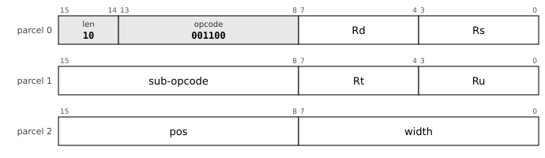

From `len = 01`. In this group `low` is a register, never a mode.

| Mnemonic | Opcode | Sub-opcode |
|---|---|---|
| `DSHR` | `001100 (0x0C)` | `00100000 (0x20)` |
| `EXTB` | `001100 (0x0C)` | `00100001 (0x21)` |
| `EXTZB` | `001100 (0x0C)` | `00100010 (0x22)` |
| `INSB` | `001100 (0x0C)` | `00100011 (0x23)` |

### Block memory (MBLK)

#### r20-mblk-1: Block memory (MBLK), two parcels (`len = 01`)

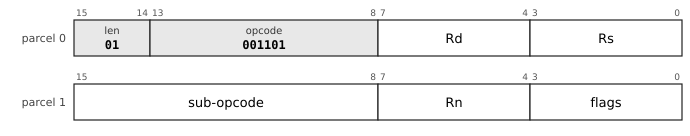

`reg` is the destination pointer, `low` the source pointer (or the value register), `Rn` the count register.

| Mnemonic | Opcode | Sub-opcode |
|---|---|---|
| `MCPY` | `001101 (0x0D)` | `00000000 (0x00)` |
| `MMOV` | `001101 (0x0D)` | `00000001 (0x01)` |
| `MSET` | `001101 (0x0D)` | `00000010 (0x02)` |
| `MCMP` | `001101 (0x0D)` | `00000011 (0x03)` |
| `MSCN` | `001101 (0x0D)` | `00000100 (0x04)` |
| `MSCNN` | `001101 (0x0D)` | `00000101 (0x05)` |
| `MVAL` | `001101 (0x0D)` | `00000110 (0x06)` |

#### r20-mblk-2: Block memory (MBLK), three parcels (`len = 10`)

`reg` is the destination pointer, `low` the source pointer (or the value register), `Rn` the count register.

| Mnemonic | Opcode | Sub-opcode |
|---|---|---|
| `MCPY` | `001101 (0x0D)` | `00000000 (0x00)` |
| `MMOV` | `001101 (0x0D)` | `00000001 (0x01)` |
| `MSET` | `001101 (0x0D)` | `00000010 (0x02)` |
| `MCMP` | `001101 (0x0D)` | `00000011 (0x03)` |
| `MSCN` | `001101 (0x0D)` | `00000100 (0x04)` |
| `MSCNN` | `001101 (0x0D)` | `00000101 (0x05)` |
| `MVAL` | `001101 (0x0D)` | `00000110 (0x06)` |

### Arithmetic (AESC)

#### r20-aesc-1: Arithmetic (AESC), two parcels (`len = 01`)

From `len = 01`. In this group `low` is a register, never a mode.

| Mnemonic | Opcode | Sub-opcode |
|---|---|---|
| `DIV` | `001110 (0x0E)` | `00000000 (0x00)` |
| `DIVU` | `001110 (0x0E)` | `00000001 (0x01)` |
| `MOD` | `001110 (0x0E)` | `00000010 (0x02)` |
| `MODU` | `001110 (0x0E)` | `00000011 (0x03)` |
| `MULHU` | `001110 (0x0E)` | `00000100 (0x04)` |
| `ABS` | `001110 (0x0E)` | `00001000 (0x08)` |
| `MIN` | `001110 (0x0E)` | `00010000 (0x10)` |
| `MINU` | `001110 (0x0E)` | `00010001 (0x11)` |
| `MAX` | `001110 (0x0E)` | `00010010 (0x12)` |
| `MAXU` | `001110 (0x0E)` | `00010011 (0x13)` |
| `SET` | `001110 (0x0E)` | `00100000 (0x20)` |

#### r20-aesc-2: Arithmetic (AESC), three parcels (`len = 10`)

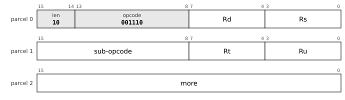

From `len = 01`. In this group `low` is a register, never a mode.

| Mnemonic | Opcode | Sub-opcode |
|---|---|---|
| `DIV` | `001110 (0x0E)` | `00000000 (0x00)` |
| `DIVU` | `001110 (0x0E)` | `00000001 (0x01)` |
| `MOD` | `001110 (0x0E)` | `00000010 (0x02)` |
| `MODU` | `001110 (0x0E)` | `00000011 (0x03)` |
| `MULHU` | `001110 (0x0E)` | `00000100 (0x04)` |
| `ABS` | `001110 (0x0E)` | `00001000 (0x08)` |
| `MIN` | `001110 (0x0E)` | `00010000 (0x10)` |
| `MINU` | `001110 (0x0E)` | `00010001 (0x11)` |
| `MAX` | `001110 (0x0E)` | `00010010 (0x12)` |
| `MAXU` | `001110 (0x0E)` | `00010011 (0x13)` |
| `SET` | `001110 (0x0E)` | `00100000 (0x20)` |

### Floating point (FESC)

#### r20-fesc-1: Floating point (FESC), two parcels (`len = 01`)

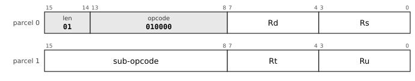

From `len = 01`. In this group `low` is a register, never a mode.

| Mnemonic | Opcode | Sub-opcode |
|---|---|---|
| `FDIV` | `010000 (0x10)` | `00000000 (0x00)` |
| `FSQRT` | `010000 (0x10)` | `00000001 (0x01)` |
| `FADD32` | `010000 (0x10)` | `00001000 (0x08)` |
| `FSUB32` | `010000 (0x10)` | `00001001 (0x09)` |
| `FMUL32` | `010000 (0x10)` | `00001010 (0x0A)` |
| `FDIV32` | `010000 (0x10)` | `00001011 (0x0B)` |
| `FSQRT32` | `010000 (0x10)` | `00001100 (0x0C)` |
| `FCMP32` | `010000 (0x10)` | `00001101 (0x0D)` |
| `FMADD` | `010000 (0x10)` | `00010000 (0x10)` |
| `FMSUB` | `010000 (0x10)` | `00010001 (0x11)` |
| `FNMADD` | `010000 (0x10)` | `00010010 (0x12)` |
| `FNMSUB` | `010000 (0x10)` | `00010011 (0x13)` |
| `FMADD32` | `010000 (0x10)` | `00011000 (0x18)` |
| `FMSUB32` | `010000 (0x10)` | `00011001 (0x19)` |
| `FNMADD32` | `010000 (0x10)` | `00011010 (0x1A)` |
| `FNMSUB32` | `010000 (0x10)` | `00011011 (0x1B)` |
| `FNEG` | `010000 (0x10)` | `00100000 (0x20)` |
| `FABS` | `010000 (0x10)` | `00100001 (0x21)` |
| `FCOPYSIGN` | `010000 (0x10)` | `00100010 (0x22)` |
| `FMIN` | `010000 (0x10)` | `00100011 (0x23)` |
| `FMAX` | `010000 (0x10)` | `00100100 (0x24)` |
| `FCLASS` | `010000 (0x10)` | `00101000 (0x28)` |
| `FCLASS32` | `010000 (0x10)` | `00101001 (0x29)` |
| `FRINT` | `010000 (0x10)` | `00110000 (0x30)` |
| `FRINTZ` | `010000 (0x10)` | `00110001 (0x31)` |
| `FRINTM` | `010000 (0x10)` | `00110010 (0x32)` |
| `FRINTP` | `010000 (0x10)` | `00110011 (0x33)` |
| `FRINTA` | `010000 (0x10)` | `00110100 (0x34)` |
| `FCVTDQ` | `010000 (0x10)` | `00111000 (0x38)` |
| `FCVTQD` | `010000 (0x10)` | `00111001 (0x39)` |
| `FCVTDS` | `010000 (0x10)` | `00111010 (0x3A)` |
| `FCVTSD` | `010000 (0x10)` | `00111011 (0x3B)` |
| `FCVTSL` | `010000 (0x10)` | `00111100 (0x3C)` |
| `FCVTLS` | `010000 (0x10)` | `00111101 (0x3D)` |
| `FCVTDQU` | `010000 (0x10)` | `00111110 (0x3E)` |
| `FCVTQUD` | `010000 (0x10)` | `00111111 (0x3F)` |
| `FSFLAGS` | `010000 (0x10)` | `01000000 (0x40)` |
| `FADD16` | `010000 (0x10)` | `01010000 (0x50)` |
| `FSUB16` | `010000 (0x10)` | `01010001 (0x51)` |
| `FMUL16` | `010000 (0x10)` | `01010010 (0x52)` |
| `FDIV16` | `010000 (0x10)` | `01010011 (0x53)` |
| `FSQRT16` | `010000 (0x10)` | `01010100 (0x54)` |
| `FCMP16` | `010000 (0x10)` | `01010101 (0x55)` |
| `FMADD16` | `010000 (0x10)` | `01011000 (0x58)` |
| `FMSUB16` | `010000 (0x10)` | `01011001 (0x59)` |
| `FNMADD16` | `010000 (0x10)` | `01011010 (0x5A)` |
| `FNMSUB16` | `010000 (0x10)` | `01011011 (0x5B)` |
| `FCLASS16` | `010000 (0x10)` | `01011100 (0x5C)` |
| `FCVTSH` | `010000 (0x10)` | `01100000 (0x60)` |
| `FCVTHS` | `010000 (0x10)` | `01100001 (0x61)` |
| `FCVTDH` | `010000 (0x10)` | `01100010 (0x62)` |
| `FCVTHD` | `010000 (0x10)` | `01100011 (0x63)` |
| `FCVTHL` | `010000 (0x10)` | `01100100 (0x64)` |
| `FCVTLH` | `010000 (0x10)` | `01100101 (0x65)` |

#### r20-fesc-2: Floating point (FESC), three parcels (`len = 10`)

From `len = 01`. In this group `low` is a register, never a mode.

| Mnemonic | Opcode | Sub-opcode |
|---|---|---|
| `FDIV` | `010000 (0x10)` | `00000000 (0x00)` |
| `FSQRT` | `010000 (0x10)` | `00000001 (0x01)` |
| `FADD32` | `010000 (0x10)` | `00001000 (0x08)` |
| `FSUB32` | `010000 (0x10)` | `00001001 (0x09)` |
| `FMUL32` | `010000 (0x10)` | `00001010 (0x0A)` |
| `FDIV32` | `010000 (0x10)` | `00001011 (0x0B)` |
| `FSQRT32` | `010000 (0x10)` | `00001100 (0x0C)` |
| `FCMP32` | `010000 (0x10)` | `00001101 (0x0D)` |
| `FMADD` | `010000 (0x10)` | `00010000 (0x10)` |
| `FMSUB` | `010000 (0x10)` | `00010001 (0x11)` |
| `FNMADD` | `010000 (0x10)` | `00010010 (0x12)` |
| `FNMSUB` | `010000 (0x10)` | `00010011 (0x13)` |
| `FMADD32` | `010000 (0x10)` | `00011000 (0x18)` |
| `FMSUB32` | `010000 (0x10)` | `00011001 (0x19)` |
| `FNMADD32` | `010000 (0x10)` | `00011010 (0x1A)` |
| `FNMSUB32` | `010000 (0x10)` | `00011011 (0x1B)` |
| `FNEG` | `010000 (0x10)` | `00100000 (0x20)` |
| `FABS` | `010000 (0x10)` | `00100001 (0x21)` |
| `FCOPYSIGN` | `010000 (0x10)` | `00100010 (0x22)` |
| `FMIN` | `010000 (0x10)` | `00100011 (0x23)` |
| `FMAX` | `010000 (0x10)` | `00100100 (0x24)` |
| `FCLASS` | `010000 (0x10)` | `00101000 (0x28)` |
| `FCLASS32` | `010000 (0x10)` | `00101001 (0x29)` |
| `FRINT` | `010000 (0x10)` | `00110000 (0x30)` |
| `FRINTZ` | `010000 (0x10)` | `00110001 (0x31)` |
| `FRINTM` | `010000 (0x10)` | `00110010 (0x32)` |
| `FRINTP` | `010000 (0x10)` | `00110011 (0x33)` |
| `FRINTA` | `010000 (0x10)` | `00110100 (0x34)` |
| `FCVTDQ` | `010000 (0x10)` | `00111000 (0x38)` |
| `FCVTQD` | `010000 (0x10)` | `00111001 (0x39)` |
| `FCVTDS` | `010000 (0x10)` | `00111010 (0x3A)` |
| `FCVTSD` | `010000 (0x10)` | `00111011 (0x3B)` |
| `FCVTSL` | `010000 (0x10)` | `00111100 (0x3C)` |
| `FCVTLS` | `010000 (0x10)` | `00111101 (0x3D)` |
| `FCVTDQU` | `010000 (0x10)` | `00111110 (0x3E)` |
| `FCVTQUD` | `010000 (0x10)` | `00111111 (0x3F)` |
| `FSFLAGS` | `010000 (0x10)` | `01000000 (0x40)` |
| `FADD16` | `010000 (0x10)` | `01010000 (0x50)` |
| `FSUB16` | `010000 (0x10)` | `01010001 (0x51)` |
| `FMUL16` | `010000 (0x10)` | `01010010 (0x52)` |
| `FDIV16` | `010000 (0x10)` | `01010011 (0x53)` |
| `FSQRT16` | `010000 (0x10)` | `01010100 (0x54)` |
| `FCMP16` | `010000 (0x10)` | `01010101 (0x55)` |
| `FMADD16` | `010000 (0x10)` | `01011000 (0x58)` |
| `FMSUB16` | `010000 (0x10)` | `01011001 (0x59)` |
| `FNMADD16` | `010000 (0x10)` | `01011010 (0x5A)` |
| `FNMSUB16` | `010000 (0x10)` | `01011011 (0x5B)` |
| `FCLASS16` | `010000 (0x10)` | `01011100 (0x5C)` |
| `FCVTSH` | `010000 (0x10)` | `01100000 (0x60)` |
| `FCVTHS` | `010000 (0x10)` | `01100001 (0x61)` |
| `FCVTDH` | `010000 (0x10)` | `01100010 (0x62)` |
| `FCVTHD` | `010000 (0x10)` | `01100011 (0x63)` |
| `FCVTHL` | `010000 (0x10)` | `01100100 (0x64)` |
| `FCVTLH` | `010000 (0x10)` | `01100101 (0x65)` |

### Atomics (ATOM)

#### r20-atom-1: Atomics (ATOM), two parcels (`len = 01`)

From `len = 01`. The placement of the operands is not specified.

| Mnemonic | Opcode | Sub-opcode |
|---|---|---|
| `CAS` | `010001 (0x11)` | `00000000 (0x00)` |
| `CASDB` | `010001 (0x11)` | `00000001 (0x01)` |
| `SWAP` | `010001 (0x11)` | `00000010 (0x02)` |
| `SWAPDB` | `010001 (0x11)` | `00000011 (0x03)` |
| `XADD` | `010001 (0x11)` | `00000100 (0x04)` |
| `XADDDB` | `010001 (0x11)` | `00000101 (0x05)` |
| `XAND` | `010001 (0x11)` | `00000110 (0x06)` |
| `XANDDB` | `010001 (0x11)` | `00000111 (0x07)` |
| `XOR_` | `010001 (0x11)` | `00001000 (0x08)` |
| `XOR_DB` | `010001 (0x11)` | `00001001 (0x09)` |
| `XXOR` | `010001 (0x11)` | `00001010 (0x0A)` |
| `XXORDB` | `010001 (0x11)` | `00001011 (0x0B)` |
| `XMAX` | `010001 (0x11)` | `00001100 (0x0C)` |
| `XMAXDB` | `010001 (0x11)` | `00001101 (0x0D)` |
| `XMIN` | `010001 (0x11)` | `00001110 (0x0E)` |
| `XMINDB` | `010001 (0x11)` | `00001111 (0x0F)` |
| `XMAXU` | `010001 (0x11)` | `00010000 (0x10)` |
| `XMAXUDB` | `010001 (0x11)` | `00010001 (0x11)` |
| `XMINU` | `010001 (0x11)` | `00010010 (0x12)` |
| `XMINUDB` | `010001 (0x11)` | `00010011 (0x13)` |
| `LL` | `010001 (0x11)` | `00100000 (0x20)` |
| `SC` | `010001 (0x11)` | `00100001 (0x21)` |

#### r20-atom-2: Atomics (ATOM), three parcels (`len = 10`)

From `len = 01`. The placement of the operands is not specified.

| Mnemonic | Opcode | Sub-opcode |
|---|---|---|
| `CAS` | `010001 (0x11)` | `00000000 (0x00)` |
| `CASDB` | `010001 (0x11)` | `00000001 (0x01)` |
| `SWAP` | `010001 (0x11)` | `00000010 (0x02)` |
| `SWAPDB` | `010001 (0x11)` | `00000011 (0x03)` |
| `XADD` | `010001 (0x11)` | `00000100 (0x04)` |
| `XADDDB` | `010001 (0x11)` | `00000101 (0x05)` |
| `XAND` | `010001 (0x11)` | `00000110 (0x06)` |
| `XANDDB` | `010001 (0x11)` | `00000111 (0x07)` |
| `XOR_` | `010001 (0x11)` | `00001000 (0x08)` |
| `XOR_DB` | `010001 (0x11)` | `00001001 (0x09)` |
| `XXOR` | `010001 (0x11)` | `00001010 (0x0A)` |
| `XXORDB` | `010001 (0x11)` | `00001011 (0x0B)` |
| `XMAX` | `010001 (0x11)` | `00001100 (0x0C)` |
| `XMAXDB` | `010001 (0x11)` | `00001101 (0x0D)` |
| `XMIN` | `010001 (0x11)` | `00001110 (0x0E)` |
| `XMINDB` | `010001 (0x11)` | `00001111 (0x0F)` |
| `XMAXU` | `010001 (0x11)` | `00010000 (0x10)` |
| `XMAXUDB` | `010001 (0x11)` | `00010001 (0x11)` |
| `XMINU` | `010001 (0x11)` | `00010010 (0x12)` |
| `XMINUDB` | `010001 (0x11)` | `00010011 (0x13)` |
| `LL` | `010001 (0x11)` | `00100000 (0x20)` |
| `SC` | `010001 (0x11)` | `00100001 (0x21)` |

### Memory escape (MESC)

#### r20-mesc-1: Memory escape (MESC), two parcels (`len = 01`)

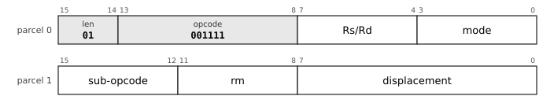

Addressing modes (`low`) that use this layout: `base` 0000, `index` 0001, `pcrel` 0010, `dp` 0011, `imm` 0100, `abs` 0101, `postinc` 0110, `predec` 0111.

`low` of parcel 0 is an addressing mode; parcel 1 holds the sub-opcode, `rm` and the first 8 bits of the displacement.

| Mnemonic | Opcode | Sub-opcode |
|---|---|---|
| `MOVUB` | `001111 (0x0F)` | `0000 (0x0)` |
| `MOVUW` | `001111 (0x0F)` | `0010 (0x2)` |
| `MOVUL` | `001111 (0x0F)` | `0100 (0x4)` |
| `MOVUQ` | `001111 (0x0F)` | `0110 (0x6)` |
| `ADDM` | `001111 (0x0F)` | `1000 (0x8)` |
| `SUBM` | `001111 (0x0F)` | `1001 (0x9)` |
| `BICM` | `001111 (0x0F)` | `1010 (0xA)` |
| `BISM` | `001111 (0x0F)` | `1011 (0xB)` |

#### r20-mesc-2: Memory escape (MESC), three parcels (`len = 10`)

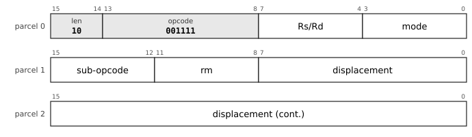

Addressing modes (`low`) that use this layout: `base` 0000, `index` 0001, `pcrel` 0010, `dp` 0011, `imm` 0100, `abs` 0101, `postinc` 0110, `predec` 0111.

`low` of parcel 0 is an addressing mode; parcel 1 holds the sub-opcode, `rm` and the first 8 bits of the displacement.

| Mnemonic | Opcode | Sub-opcode |
|---|---|---|
| `MOVUB` | `001111 (0x0F)` | `0000 (0x0)` |
| `MOVUW` | `001111 (0x0F)` | `0010 (0x2)` |
| `MOVUL` | `001111 (0x0F)` | `0100 (0x4)` |
| `MOVUQ` | `001111 (0x0F)` | `0110 (0x6)` |
| `ADDM` | `001111 (0x0F)` | `1000 (0x8)` |
| `SUBM` | `001111 (0x0F)` | `1001 (0x9)` |
| `BICM` | `001111 (0x0F)` | `1010 (0xA)` |
| `BISM` | `001111 (0x0F)` | `1011 (0xB)` |

### System, no operand

#### r20-sysn-0: System, no operand, one parcel (`len = 00`)

The `reg` field is the class (0); class 0 takes a minor opcode from `low`.

| Mnemonic | Opcode | `reg` | `low` |
|---|---|---|---|
| `NOP` | `010100 (0x14)` | `0000 (0x0)` | `0000 (0x0)` |
| `RTI` | `010100 (0x14)` | `0000 (0x0)` | `0001 (0x1)` |
| `RTT` | `010100 (0x14)` | `0000 (0x0)` | `0010 (0x2)` |
| `RET` | `010100 (0x14)` | `0000 (0x0)` | `0011 (0x3)` |
| `HALT` | `010100 (0x14)` | `0000 (0x0)` | `0100 (0x4)` |
| `BPT` | `010100 (0x14)` | `0000 (0x0)` | `0101 (0x5)` |
| `FENCE` | `010100 (0x14)` | `0000 (0x0)` | `0110 (0x6)` |
| `WFE` | `010100 (0x14)` | `0000 (0x0)` | `0111 (0x7)` |
| `SEV` | `010100 (0x14)` | `0000 (0x0)` | `1000 (0x8)` |
| `LPAD` | `010100 (0x14)` | `0000 (0x0)` | `1001 (0x9)` |
| `TLBIA` | `010100 (0x14)` | `0000 (0x0)` | `1010 (0xA)` |
| `TLBSYNC` | `010100 (0x14)` | `0000 (0x0)` | `1011 (0xB)` |
| `ICINVA` | `010100 (0x14)` | `0000 (0x0)` | `1100 (0xC)` |

#### r20-sysn-1: System, no operand, two parcels (`len = 01`)

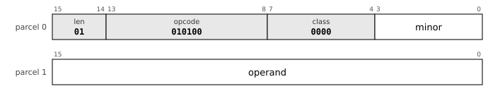

The `reg` field is the class (0); class 0 takes a minor opcode from `low`.

| Mnemonic | Opcode | `reg` | `low` |
|---|---|---|---|
| `NOP` | `010100 (0x14)` | `0000 (0x0)` | `0000 (0x0)` |
| `RTI` | `010100 (0x14)` | `0000 (0x0)` | `0001 (0x1)` |
| `RTT` | `010100 (0x14)` | `0000 (0x0)` | `0010 (0x2)` |
| `RET` | `010100 (0x14)` | `0000 (0x0)` | `0011 (0x3)` |
| `HALT` | `010100 (0x14)` | `0000 (0x0)` | `0100 (0x4)` |
| `BPT` | `010100 (0x14)` | `0000 (0x0)` | `0101 (0x5)` |
| `FENCE` | `010100 (0x14)` | `0000 (0x0)` | `0110 (0x6)` |
| `WFE` | `010100 (0x14)` | `0000 (0x0)` | `0111 (0x7)` |
| `SEV` | `010100 (0x14)` | `0000 (0x0)` | `1000 (0x8)` |
| `LPAD` | `010100 (0x14)` | `0000 (0x0)` | `1001 (0x9)` |
| `TLBIA` | `010100 (0x14)` | `0000 (0x0)` | `1010 (0xA)` |
| `TLBSYNC` | `010100 (0x14)` | `0000 (0x0)` | `1011 (0xB)` |
| `ICINVA` | `010100 (0x14)` | `0000 (0x0)` | `1100 (0xC)` |

#### r20-sysn-2: System, no operand, three parcels (`len = 10`)

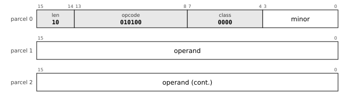

The `reg` field is the class (0); class 0 takes a minor opcode from `low`.

| Mnemonic | Opcode | `reg` | `low` |
|---|---|---|---|
| `NOP` | `010100 (0x14)` | `0000 (0x0)` | `0000 (0x0)` |
| `RTI` | `010100 (0x14)` | `0000 (0x0)` | `0001 (0x1)` |
| `RTT` | `010100 (0x14)` | `0000 (0x0)` | `0010 (0x2)` |
| `RET` | `010100 (0x14)` | `0000 (0x0)` | `0011 (0x3)` |
| `HALT` | `010100 (0x14)` | `0000 (0x0)` | `0100 (0x4)` |
| `BPT` | `010100 (0x14)` | `0000 (0x0)` | `0101 (0x5)` |
| `FENCE` | `010100 (0x14)` | `0000 (0x0)` | `0110 (0x6)` |
| `WFE` | `010100 (0x14)` | `0000 (0x0)` | `0111 (0x7)` |
| `SEV` | `010100 (0x14)` | `0000 (0x0)` | `1000 (0x8)` |
| `LPAD` | `010100 (0x14)` | `0000 (0x0)` | `1001 (0x9)` |
| `TLBIA` | `010100 (0x14)` | `0000 (0x0)` | `1010 (0xA)` |
| `TLBSYNC` | `010100 (0x14)` | `0000 (0x0)` | `1011 (0xB)` |
| `ICINVA` | `010100 (0x14)` | `0000 (0x0)` | `1100 (0xC)` |

### System, SYSX

#### r20-sysx-0: System, SYSX, one parcel (`len = 00`)

Class 0, minor 15: the sub-opcode is in parcel 1.

| Mnemonic | Opcode | `reg` | `low` | Sub-opcode |
|---|---|---|---|---|
| `PUSHX` | `010100 (0x14)` | `0000 (0x0)` | `1111 (0xF)` | `00000000 (0x00)` |
| `POPX` | `010100 (0x14)` | `0000 (0x0)` | `1111 (0xF)` | `00000001 (0x01)` |
| `ISYNC` | `010100 (0x14)` | `0000 (0x0)` | `1111 (0xF)` | `00000010 (0x02)` |
| `HINT` | `010100 (0x14)` | `0000 (0x0)` | `1111 (0xF)` | `00000011 (0x03)` |

#### r20-sysx-1: System, SYSX, two parcels (`len = 01`)

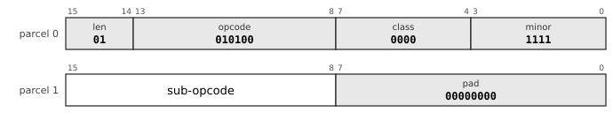

Class 0, minor 15: the sub-opcode is in parcel 1.

| Mnemonic | Opcode | `reg` | `low` | Sub-opcode |
|---|---|---|---|---|
| `PUSHX` | `010100 (0x14)` | `0000 (0x0)` | `1111 (0xF)` | `00000000 (0x00)` |
| `POPX` | `010100 (0x14)` | `0000 (0x0)` | `1111 (0xF)` | `00000001 (0x01)` |
| `ISYNC` | `010100 (0x14)` | `0000 (0x0)` | `1111 (0xF)` | `00000010 (0x02)` |
| `HINT` | `010100 (0x14)` | `0000 (0x0)` | `1111 (0xF)` | `00000011 (0x03)` |

### System registers (MFSR, MTSR)

#### r20-sysreg-0: System registers (MFSR, MTSR), one parcel (`len = 00`)

Class 0: the system register number is in parcel 1.

| Mnemonic | Opcode | `reg` | `low` |
|---|---|---|---|
| `MFSR` | `010100 (0x14)` | `0000 (0x0)` | `1101 (0xD)` |
| `MTSR` | `010100 (0x14)` | `0000 (0x0)` | `1110 (0xE)` |

#### r20-sysreg-1: System registers (MFSR, MTSR), two parcels (`len = 01`)

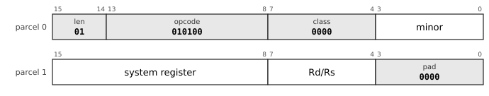

Class 0: the system register number is in parcel 1.

| Mnemonic | Opcode | `reg` | `low` |
|---|---|---|---|
| `MFSR` | `010100 (0x14)` | `0000 (0x0)` | `1101 (0xD)` |
| `MTSR` | `010100 (0x14)` | `0000 (0x0)` | `1110 (0xE)` |

### System

#### r20-sys-0: System, one parcel (`len = 00`)

The `reg` field is the class; the other classes take a register or a 4-bit immediate from `low`.

| Mnemonic | Opcode | `reg` |
|---|---|---|
| `MTPS` | `010100 (0x14)` | `0001 (0x1)` |
| `MFPS` | `010100 (0x14)` | `0010 (0x2)` |
| `SPL` | `010100 (0x14)` | `0011 (0x3)` |
| `TRAP` | `010100 (0x14)` | `0100 (0x4)` |
| `TLBI` | `010100 (0x14)` | `0101 (0x5)` |
| `MTASID` | `010100 (0x14)` | `0110 (0x6)` |
| `MFASID` | `010100 (0x14)` | `0111 (0x7)` |
| `MTDP` | `010100 (0x14)` | `1000 (0x8)` |
| `MFDP` | `010100 (0x14)` | `1001 (0x9)` |
| `MTDMW` | `010100 (0x14)` | `1010 (0xA)` |
| `MFCPUID` | `010100 (0x14)` | `1011 (0xB)` |
| `ICINV` | `010100 (0x14)` | `1100 (0xC)` |
| `PROBER` | `010100 (0x14)` | `1101 (0xD)` |
| `PROBEW` | `010100 (0x14)` | `1110 (0xE)` |
| `TRAPL` | `010100 (0x14)` | `1111 (0xF)` |

#### r20-sys-1: System, two parcels (`len = 01`)

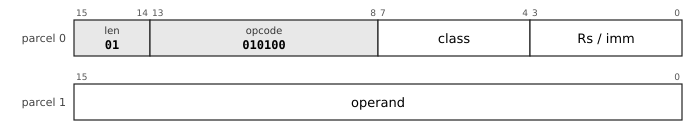

The `reg` field is the class; the other classes take a register or a 4-bit immediate from `low`.

| Mnemonic | Opcode | `reg` |
|---|---|---|
| `MTPS` | `010100 (0x14)` | `0001 (0x1)` |
| `MFPS` | `010100 (0x14)` | `0010 (0x2)` |
| `SPL` | `010100 (0x14)` | `0011 (0x3)` |
| `TRAP` | `010100 (0x14)` | `0100 (0x4)` |
| `TLBI` | `010100 (0x14)` | `0101 (0x5)` |
| `MTASID` | `010100 (0x14)` | `0110 (0x6)` |
| `MFASID` | `010100 (0x14)` | `0111 (0x7)` |
| `MTDP` | `010100 (0x14)` | `1000 (0x8)` |
| `MFDP` | `010100 (0x14)` | `1001 (0x9)` |
| `MTDMW` | `010100 (0x14)` | `1010 (0xA)` |
| `MFCPUID` | `010100 (0x14)` | `1011 (0xB)` |
| `ICINV` | `010100 (0x14)` | `1100 (0xC)` |

#### r20-sys-1-2: System, two parcels (`len = 01`)

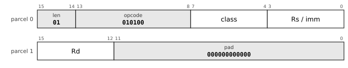

The `reg` field is the class; the other classes take a register or a 4-bit immediate from `low`.

| Mnemonic | Opcode | `reg` |
|---|---|---|
| `PROBER` | `010100 (0x14)` | `1101 (0xD)` |
| `PROBEW` | `010100 (0x14)` | `1110 (0xE)` |

#### r20-sys-1-3: System, two parcels (`len = 01`)

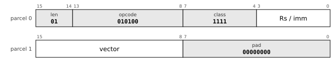

The `reg` field is the class; the other classes take a register or a 4-bit immediate from `low`.

| Mnemonic | Opcode | `reg` |
|---|---|---|
| `TRAPL` | `010100 (0x14)` | `1111 (0xF)` |

#### r20-sys-2: System, three parcels (`len = 10`)

The `reg` field is the class; the other classes take a register or a 4-bit immediate from `low`.

| Mnemonic | Opcode | `reg` |
|---|---|---|
| `MTPS` | `010100 (0x14)` | `0001 (0x1)` |
| `MFPS` | `010100 (0x14)` | `0010 (0x2)` |
| `SPL` | `010100 (0x14)` | `0011 (0x3)` |
| `TRAP` | `010100 (0x14)` | `0100 (0x4)` |
| `TLBI` | `010100 (0x14)` | `0101 (0x5)` |
| `MTASID` | `010100 (0x14)` | `0110 (0x6)` |
| `MFASID` | `010100 (0x14)` | `0111 (0x7)` |
| `MTDP` | `010100 (0x14)` | `1000 (0x8)` |
| `MFDP` | `010100 (0x14)` | `1001 (0x9)` |
| `MTDMW` | `010100 (0x14)` | `1010 (0xA)` |
| `MFCPUID` | `010100 (0x14)` | `1011 (0xB)` |
| `ICINV` | `010100 (0x14)` | `1100 (0xC)` |
| `PROBER` | `010100 (0x14)` | `1101 (0xD)` |
| `PROBEW` | `010100 (0x14)` | `1110 (0xE)` |
| `TRAPL` | `010100 (0x14)` | `1111 (0xF)` |

### Page 2

#### r20-page2: Page 2: a one-parcel instruction with its own opcode map

## The index of the mnemonics

For every mnemonic, the charts in which it is a sub-opcode or the whole leaf.

* `ABS`: [r20-aesc-1](#r20-aesc-1), [r20-aesc-2](#r20-aesc-2)
* `ADC`: [r20-sop-0](#r20-sop-0), [r20-sop-1](#r20-sop-1), [r20-sop-1-2](#r20-sop-1-2), [r20-sop-1-3](#r20-sop-1-3), [r20-sop-1-4](#r20-sop-1-4), [r20-sop-2](#r20-sop-2), [r20-sop-2-2](#r20-sop-2-2), [r20-sop-2-3](#r20-sop-2-3), [r20-sop-2-4](#r20-sop-2-4)
* `ADD`: [r20-mem-0](#r20-mem-0), [r20-mem-1](#r20-mem-1), [r20-mem-1-2](#r20-mem-1-2), [r20-mem-1-3](#r20-mem-1-3), [r20-mem-1-4](#r20-mem-1-4), [r20-mem-2](#r20-mem-2), [r20-mem-2-2](#r20-mem-2-2), [r20-mem-2-3](#r20-mem-2-3), [r20-mem-2-4](#r20-mem-2-4)
* `ADDM`: [r20-mesc-1](#r20-mesc-1), [r20-mesc-2](#r20-mesc-2)
* `AND`: [r20-mem-0](#r20-mem-0), [r20-mem-1](#r20-mem-1), [r20-mem-1-2](#r20-mem-1-2), [r20-mem-1-3](#r20-mem-1-3), [r20-mem-1-4](#r20-mem-1-4), [r20-mem-2](#r20-mem-2), [r20-mem-2-2](#r20-mem-2-2), [r20-mem-2-3](#r20-mem-2-3), [r20-mem-2-4](#r20-mem-2-4)
* `ASL`: [r20-sop-0](#r20-sop-0), [r20-sop-1](#r20-sop-1), [r20-sop-1-2](#r20-sop-1-2), [r20-sop-1-3](#r20-sop-1-3), [r20-sop-1-4](#r20-sop-1-4), [r20-sop-2](#r20-sop-2), [r20-sop-2-2](#r20-sop-2-2), [r20-sop-2-3](#r20-sop-2-3), [r20-sop-2-4](#r20-sop-2-4)
* `ASR`: [r20-sop-0](#r20-sop-0), [r20-sop-1](#r20-sop-1), [r20-sop-1-2](#r20-sop-1-2), [r20-sop-1-3](#r20-sop-1-3), [r20-sop-1-4](#r20-sop-1-4), [r20-sop-2](#r20-sop-2), [r20-sop-2-2](#r20-sop-2-2), [r20-sop-2-3](#r20-sop-2-3), [r20-sop-2-4](#r20-sop-2-4)
* `BCC`: [r20-br-0](#r20-br-0), [r20-br-1](#r20-br-1), [r20-br-2](#r20-br-2)
* `BCS`: [r20-br-0](#r20-br-0), [r20-br-1](#r20-br-1), [r20-br-2](#r20-br-2)
* `BEQ`: [r20-br-0](#r20-br-0), [r20-br-1](#r20-br-1), [r20-br-2](#r20-br-2)
* `BGE`: [r20-br-0](#r20-br-0), [r20-br-1](#r20-br-1), [r20-br-2](#r20-br-2)
* `BGT`: [r20-br-0](#r20-br-0), [r20-br-1](#r20-br-1), [r20-br-2](#r20-br-2)
* `BHI`: [r20-br-0](#r20-br-0), [r20-br-1](#r20-br-1), [r20-br-2](#r20-br-2)
* `BIC`: [r20-mem-0](#r20-mem-0), [r20-mem-1](#r20-mem-1), [r20-mem-1-2](#r20-mem-1-2), [r20-mem-1-3](#r20-mem-1-3), [r20-mem-1-4](#r20-mem-1-4), [r20-mem-2](#r20-mem-2), [r20-mem-2-2](#r20-mem-2-2), [r20-mem-2-3](#r20-mem-2-3), [r20-mem-2-4](#r20-mem-2-4)
* `BICM`: [r20-mesc-1](#r20-mesc-1), [r20-mesc-2](#r20-mesc-2)
* `BIS`: [r20-mem-0](#r20-mem-0), [r20-mem-1](#r20-mem-1), [r20-mem-1-2](#r20-mem-1-2), [r20-mem-1-3](#r20-mem-1-3), [r20-mem-1-4](#r20-mem-1-4), [r20-mem-2](#r20-mem-2), [r20-mem-2-2](#r20-mem-2-2), [r20-mem-2-3](#r20-mem-2-3), [r20-mem-2-4](#r20-mem-2-4)
* `BISM`: [r20-mesc-1](#r20-mesc-1), [r20-mesc-2](#r20-mesc-2)
* `BIT`: [r20-mem-0](#r20-mem-0), [r20-mem-1](#r20-mem-1), [r20-mem-1-2](#r20-mem-1-2), [r20-mem-1-3](#r20-mem-1-3), [r20-mem-1-4](#r20-mem-1-4), [r20-mem-2](#r20-mem-2), [r20-mem-2-2](#r20-mem-2-2), [r20-mem-2-3](#r20-mem-2-3), [r20-mem-2-4](#r20-mem-2-4)
* `BITREV`: [r20-besc-1](#r20-besc-1), [r20-besc-2](#r20-besc-2)
* `BLE`: [r20-br-0](#r20-br-0), [r20-br-1](#r20-br-1), [r20-br-2](#r20-br-2)
* `BLOS`: [r20-br-0](#r20-br-0), [r20-br-1](#r20-br-1), [r20-br-2](#r20-br-2)
* `BLT`: [r20-br-0](#r20-br-0), [r20-br-1](#r20-br-1), [r20-br-2](#r20-br-2)
* `BMI`: [r20-br-0](#r20-br-0), [r20-br-1](#r20-br-1), [r20-br-2](#r20-br-2)
* `BNE`: [r20-br-0](#r20-br-0), [r20-br-1](#r20-br-1), [r20-br-2](#r20-br-2)
* `BNTAG`: [r20-tag-1](#r20-tag-1), [r20-tag-2](#r20-tag-2)
* `BPL`: [r20-br-0](#r20-br-0), [r20-br-1](#r20-br-1), [r20-br-2](#r20-br-2)
* `BPT`: [r20-sysn-0](#r20-sysn-0), [r20-sysn-1](#r20-sysn-1), [r20-sysn-2](#r20-sysn-2)
* `BR`: [r20-br-0](#r20-br-0), [r20-br-1](#r20-br-1), [r20-br-2](#r20-br-2)
* `BSWAP`: [r20-besc-1](#r20-besc-1), [r20-besc-2](#r20-besc-2)
* `BSWAPL`: [r20-besc-1](#r20-besc-1), [r20-besc-2](#r20-besc-2)
* `BSWAPW`: [r20-besc-1](#r20-besc-1), [r20-besc-2](#r20-besc-2)
* `BTAG`: [r20-tag-1](#r20-tag-1), [r20-tag-2](#r20-tag-2)
* `BVC`: [r20-br-0](#r20-br-0), [r20-br-1](#r20-br-1), [r20-br-2](#r20-br-2)
* `BVS`: [r20-br-0](#r20-br-0), [r20-br-1](#r20-br-1), [r20-br-2](#r20-br-2)
* `CALL`: [r20-sop-0](#r20-sop-0), [r20-sop-1](#r20-sop-1), [r20-sop-1-2](#r20-sop-1-2), [r20-sop-1-3](#r20-sop-1-3), [r20-sop-1-4](#r20-sop-1-4), [r20-sop-2](#r20-sop-2), [r20-sop-2-2](#r20-sop-2-2), [r20-sop-2-3](#r20-sop-2-3), [r20-sop-2-4](#r20-sop-2-4)
* `CALLI`: [r20-xfer-0](#r20-xfer-0), [r20-xfer-1](#r20-xfer-1), [r20-xfer-1-2](#r20-xfer-1-2), [r20-xfer-1-3](#r20-xfer-1-3), [r20-xfer-1-4](#r20-xfer-1-4), [r20-xfer-2](#r20-xfer-2), [r20-xfer-2-2](#r20-xfer-2-2), [r20-xfer-2-3](#r20-xfer-2-3), [r20-xfer-2-4](#r20-xfer-2-4)
* `CAS`: [r20-atom-1](#r20-atom-1), [r20-atom-2](#r20-atom-2)
* `CASDB`: [r20-atom-1](#r20-atom-1), [r20-atom-2](#r20-atom-2)
* `CBCC`: [r20-cb-1](#r20-cb-1), [r20-cb-1-2](#r20-cb-1-2), [r20-cb-2](#r20-cb-2), [r20-cb-2-2](#r20-cb-2-2), [r20-cb-2-3](#r20-cb-2-3)
* `CBCS`: [r20-cb-1](#r20-cb-1), [r20-cb-1-2](#r20-cb-1-2), [r20-cb-2](#r20-cb-2), [r20-cb-2-2](#r20-cb-2-2), [r20-cb-2-3](#r20-cb-2-3)
* `CBEQ`: [r20-cb-1](#r20-cb-1), [r20-cb-1-2](#r20-cb-1-2), [r20-cb-2](#r20-cb-2), [r20-cb-2-2](#r20-cb-2-2), [r20-cb-2-3](#r20-cb-2-3)
* `CBGE`: [r20-cb-1](#r20-cb-1), [r20-cb-1-2](#r20-cb-1-2), [r20-cb-2](#r20-cb-2), [r20-cb-2-2](#r20-cb-2-2), [r20-cb-2-3](#r20-cb-2-3)
* `CBGT`: [r20-cb-1](#r20-cb-1), [r20-cb-1-2](#r20-cb-1-2), [r20-cb-2](#r20-cb-2), [r20-cb-2-2](#r20-cb-2-2), [r20-cb-2-3](#r20-cb-2-3)
* `CBHI`: [r20-cb-1](#r20-cb-1), [r20-cb-1-2](#r20-cb-1-2), [r20-cb-2](#r20-cb-2), [r20-cb-2-2](#r20-cb-2-2), [r20-cb-2-3](#r20-cb-2-3)
* `CBLE`: [r20-cb-1](#r20-cb-1), [r20-cb-1-2](#r20-cb-1-2), [r20-cb-2](#r20-cb-2), [r20-cb-2-2](#r20-cb-2-2), [r20-cb-2-3](#r20-cb-2-3)
* `CBLOS`: [r20-cb-1](#r20-cb-1), [r20-cb-1-2](#r20-cb-1-2), [r20-cb-2](#r20-cb-2), [r20-cb-2-2](#r20-cb-2-2), [r20-cb-2-3](#r20-cb-2-3)
* `CBLT`: [r20-cb-1](#r20-cb-1), [r20-cb-1-2](#r20-cb-1-2), [r20-cb-2](#r20-cb-2), [r20-cb-2-2](#r20-cb-2-2), [r20-cb-2-3](#r20-cb-2-3)
* `CBMI`: [r20-cb-1](#r20-cb-1), [r20-cb-1-2](#r20-cb-1-2), [r20-cb-2](#r20-cb-2), [r20-cb-2-2](#r20-cb-2-2), [r20-cb-2-3](#r20-cb-2-3)
* `CBNE`: [r20-cb-1](#r20-cb-1), [r20-cb-1-2](#r20-cb-1-2), [r20-cb-2](#r20-cb-2), [r20-cb-2-2](#r20-cb-2-2), [r20-cb-2-3](#r20-cb-2-3)
* `CBPL`: [r20-cb-1](#r20-cb-1), [r20-cb-1-2](#r20-cb-1-2), [r20-cb-2](#r20-cb-2), [r20-cb-2-2](#r20-cb-2-2), [r20-cb-2-3](#r20-cb-2-3)
* `CBVC`: [r20-cb-1](#r20-cb-1), [r20-cb-1-2](#r20-cb-1-2), [r20-cb-2](#r20-cb-2), [r20-cb-2-2](#r20-cb-2-2), [r20-cb-2-3](#r20-cb-2-3)
* `CBVS`: [r20-cb-1](#r20-cb-1), [r20-cb-1-2](#r20-cb-1-2), [r20-cb-2](#r20-cb-2), [r20-cb-2-2](#r20-cb-2-2), [r20-cb-2-3](#r20-cb-2-3)
* `CLMULH`: [r20-besc-1](#r20-besc-1), [r20-besc-2](#r20-besc-2)
* `CLMULL`: [r20-besc-1](#r20-besc-1), [r20-besc-2](#r20-besc-2)
* `CLO`: [r20-besc-1](#r20-besc-1), [r20-besc-2](#r20-besc-2)
* `CLR`: [r20-sop-0](#r20-sop-0), [r20-sop-1](#r20-sop-1), [r20-sop-1-2](#r20-sop-1-2), [r20-sop-1-3](#r20-sop-1-3), [r20-sop-1-4](#r20-sop-1-4), [r20-sop-2](#r20-sop-2), [r20-sop-2-2](#r20-sop-2-2), [r20-sop-2-3](#r20-sop-2-3), [r20-sop-2-4](#r20-sop-2-4)
* `CLZ`: [r20-besc-1](#r20-besc-1), [r20-besc-2](#r20-besc-2)
* `CMP`: [r20-mem-0](#r20-mem-0), [r20-mem-1](#r20-mem-1), [r20-mem-1-2](#r20-mem-1-2), [r20-mem-1-3](#r20-mem-1-3), [r20-mem-1-4](#r20-mem-1-4), [r20-mem-2](#r20-mem-2), [r20-mem-2-2](#r20-mem-2-2), [r20-mem-2-3](#r20-mem-2-3), [r20-mem-2-4](#r20-mem-2-4)
* `COM`: [r20-sop-0](#r20-sop-0), [r20-sop-1](#r20-sop-1), [r20-sop-1-2](#r20-sop-1-2), [r20-sop-1-3](#r20-sop-1-3), [r20-sop-1-4](#r20-sop-1-4), [r20-sop-2](#r20-sop-2), [r20-sop-2-2](#r20-sop-2-2), [r20-sop-2-3](#r20-sop-2-3), [r20-sop-2-4](#r20-sop-2-4)
* `CTO`: [r20-besc-1](#r20-besc-1), [r20-besc-2](#r20-besc-2)
* `CTZ`: [r20-besc-1](#r20-besc-1), [r20-besc-2](#r20-besc-2)
* `DEC`: [r20-sop-0](#r20-sop-0), [r20-sop-1](#r20-sop-1), [r20-sop-1-2](#r20-sop-1-2), [r20-sop-1-3](#r20-sop-1-3), [r20-sop-1-4](#r20-sop-1-4), [r20-sop-2](#r20-sop-2), [r20-sop-2-2](#r20-sop-2-2), [r20-sop-2-3](#r20-sop-2-3), [r20-sop-2-4](#r20-sop-2-4)
* `DIV`: [r20-aesc-1](#r20-aesc-1), [r20-aesc-2](#r20-aesc-2)
* `DIVU`: [r20-aesc-1](#r20-aesc-1), [r20-aesc-2](#r20-aesc-2)
* `DSHR`: [r20-besc-1](#r20-besc-1), [r20-besc-2-3](#r20-besc-2-3)
* `EXTB`: [r20-besc-1](#r20-besc-1), [r20-besc-2-3](#r20-besc-2-3)
* `EXTZB`: [r20-besc-1](#r20-besc-1), [r20-besc-2-3](#r20-besc-2-3)
* `FABS`: [r20-fesc-1](#r20-fesc-1), [r20-fesc-2](#r20-fesc-2)
* `FADD`: [r20-mem-0](#r20-mem-0), [r20-mem-1](#r20-mem-1), [r20-mem-1-2](#r20-mem-1-2), [r20-mem-1-3](#r20-mem-1-3), [r20-mem-1-4](#r20-mem-1-4), [r20-mem-2](#r20-mem-2), [r20-mem-2-2](#r20-mem-2-2), [r20-mem-2-3](#r20-mem-2-3), [r20-mem-2-4](#r20-mem-2-4)
* `FADD16`: [r20-fesc-1](#r20-fesc-1), [r20-fesc-2](#r20-fesc-2)
* `FADD32`: [r20-fesc-1](#r20-fesc-1), [r20-fesc-2](#r20-fesc-2)
* `FCLASS`: [r20-fesc-1](#r20-fesc-1), [r20-fesc-2](#r20-fesc-2)
* `FCLASS16`: [r20-fesc-1](#r20-fesc-1), [r20-fesc-2](#r20-fesc-2)
* `FCLASS32`: [r20-fesc-1](#r20-fesc-1), [r20-fesc-2](#r20-fesc-2)
* `FCMP`: [r20-mem-0](#r20-mem-0), [r20-mem-1](#r20-mem-1), [r20-mem-1-2](#r20-mem-1-2), [r20-mem-1-3](#r20-mem-1-3), [r20-mem-1-4](#r20-mem-1-4), [r20-mem-2](#r20-mem-2), [r20-mem-2-2](#r20-mem-2-2), [r20-mem-2-3](#r20-mem-2-3), [r20-mem-2-4](#r20-mem-2-4)
* `FCMP16`: [r20-fesc-1](#r20-fesc-1), [r20-fesc-2](#r20-fesc-2)
* `FCMP32`: [r20-fesc-1](#r20-fesc-1), [r20-fesc-2](#r20-fesc-2)
* `FCOPYSIGN`: [r20-fesc-1](#r20-fesc-1), [r20-fesc-2](#r20-fesc-2)
* `FCVTDH`: [r20-fesc-1](#r20-fesc-1), [r20-fesc-2](#r20-fesc-2)
* `FCVTDQ`: [r20-fesc-1](#r20-fesc-1), [r20-fesc-2](#r20-fesc-2)
* `FCVTDQU`: [r20-fesc-1](#r20-fesc-1), [r20-fesc-2](#r20-fesc-2)
* `FCVTDS`: [r20-fesc-1](#r20-fesc-1), [r20-fesc-2](#r20-fesc-2)
* `FCVTHD`: [r20-fesc-1](#r20-fesc-1), [r20-fesc-2](#r20-fesc-2)
* `FCVTHL`: [r20-fesc-1](#r20-fesc-1), [r20-fesc-2](#r20-fesc-2)
* `FCVTHS`: [r20-fesc-1](#r20-fesc-1), [r20-fesc-2](#r20-fesc-2)
* `FCVTLH`: [r20-fesc-1](#r20-fesc-1), [r20-fesc-2](#r20-fesc-2)
* `FCVTLS`: [r20-fesc-1](#r20-fesc-1), [r20-fesc-2](#r20-fesc-2)
* `FCVTQD`: [r20-fesc-1](#r20-fesc-1), [r20-fesc-2](#r20-fesc-2)
* `FCVTQUD`: [r20-fesc-1](#r20-fesc-1), [r20-fesc-2](#r20-fesc-2)
* `FCVTSD`: [r20-fesc-1](#r20-fesc-1), [r20-fesc-2](#r20-fesc-2)
* `FCVTSH`: [r20-fesc-1](#r20-fesc-1), [r20-fesc-2](#r20-fesc-2)
* `FCVTSL`: [r20-fesc-1](#r20-fesc-1), [r20-fesc-2](#r20-fesc-2)
* `FDIV`: [r20-fesc-1](#r20-fesc-1), [r20-fesc-2](#r20-fesc-2)
* `FDIV16`: [r20-fesc-1](#r20-fesc-1), [r20-fesc-2](#r20-fesc-2)
* `FDIV32`: [r20-fesc-1](#r20-fesc-1), [r20-fesc-2](#r20-fesc-2)
* `FENCE`: [r20-sysn-0](#r20-sysn-0), [r20-sysn-1](#r20-sysn-1), [r20-sysn-2](#r20-sysn-2)
* `FMADD`: [r20-fesc-1](#r20-fesc-1), [r20-fesc-2](#r20-fesc-2)
* `FMADD16`: [r20-fesc-1](#r20-fesc-1), [r20-fesc-2](#r20-fesc-2)
* `FMADD32`: [r20-fesc-1](#r20-fesc-1), [r20-fesc-2](#r20-fesc-2)
* `FMAX`: [r20-fesc-1](#r20-fesc-1), [r20-fesc-2](#r20-fesc-2)
* `FMIN`: [r20-fesc-1](#r20-fesc-1), [r20-fesc-2](#r20-fesc-2)
* `FMSUB`: [r20-fesc-1](#r20-fesc-1), [r20-fesc-2](#r20-fesc-2)
* `FMSUB16`: [r20-fesc-1](#r20-fesc-1), [r20-fesc-2](#r20-fesc-2)
* `FMSUB32`: [r20-fesc-1](#r20-fesc-1), [r20-fesc-2](#r20-fesc-2)
* `FMUL`: [r20-mem-0](#r20-mem-0), [r20-mem-1](#r20-mem-1), [r20-mem-1-2](#r20-mem-1-2), [r20-mem-1-3](#r20-mem-1-3), [r20-mem-1-4](#r20-mem-1-4), [r20-mem-2](#r20-mem-2), [r20-mem-2-2](#r20-mem-2-2), [r20-mem-2-3](#r20-mem-2-3), [r20-mem-2-4](#r20-mem-2-4)
* `FMUL16`: [r20-fesc-1](#r20-fesc-1), [r20-fesc-2](#r20-fesc-2)
* `FMUL32`: [r20-fesc-1](#r20-fesc-1), [r20-fesc-2](#r20-fesc-2)
* `FNEG`: [r20-fesc-1](#r20-fesc-1), [r20-fesc-2](#r20-fesc-2)
* `FNMADD`: [r20-fesc-1](#r20-fesc-1), [r20-fesc-2](#r20-fesc-2)
* `FNMADD16`: [r20-fesc-1](#r20-fesc-1), [r20-fesc-2](#r20-fesc-2)
* `FNMADD32`: [r20-fesc-1](#r20-fesc-1), [r20-fesc-2](#r20-fesc-2)
* `FNMSUB`: [r20-fesc-1](#r20-fesc-1), [r20-fesc-2](#r20-fesc-2)
* `FNMSUB16`: [r20-fesc-1](#r20-fesc-1), [r20-fesc-2](#r20-fesc-2)
* `FNMSUB32`: [r20-fesc-1](#r20-fesc-1), [r20-fesc-2](#r20-fesc-2)
* `FRINT`: [r20-fesc-1](#r20-fesc-1), [r20-fesc-2](#r20-fesc-2)
* `FRINTA`: [r20-fesc-1](#r20-fesc-1), [r20-fesc-2](#r20-fesc-2)
* `FRINTM`: [r20-fesc-1](#r20-fesc-1), [r20-fesc-2](#r20-fesc-2)
* `FRINTP`: [r20-fesc-1](#r20-fesc-1), [r20-fesc-2](#r20-fesc-2)
* `FRINTZ`: [r20-fesc-1](#r20-fesc-1), [r20-fesc-2](#r20-fesc-2)
* `FSFLAGS`: [r20-fesc-1](#r20-fesc-1), [r20-fesc-2](#r20-fesc-2)
* `FSQRT`: [r20-fesc-1](#r20-fesc-1), [r20-fesc-2](#r20-fesc-2)
* `FSQRT16`: [r20-fesc-1](#r20-fesc-1), [r20-fesc-2](#r20-fesc-2)
* `FSQRT32`: [r20-fesc-1](#r20-fesc-1), [r20-fesc-2](#r20-fesc-2)
* `FSUB`: [r20-mem-0](#r20-mem-0), [r20-mem-1](#r20-mem-1), [r20-mem-1-2](#r20-mem-1-2), [r20-mem-1-3](#r20-mem-1-3), [r20-mem-1-4](#r20-mem-1-4), [r20-mem-2](#r20-mem-2), [r20-mem-2-2](#r20-mem-2-2), [r20-mem-2-3](#r20-mem-2-3), [r20-mem-2-4](#r20-mem-2-4)
* `FSUB16`: [r20-fesc-1](#r20-fesc-1), [r20-fesc-2](#r20-fesc-2)
* `FSUB32`: [r20-fesc-1](#r20-fesc-1), [r20-fesc-2](#r20-fesc-2)
* `HALT`: [r20-sysn-0](#r20-sysn-0), [r20-sysn-1](#r20-sysn-1), [r20-sysn-2](#r20-sysn-2)
* `HINT`: [r20-sysx-0](#r20-sysx-0), [r20-sysx-1](#r20-sysx-1)
* `ICINV`: [r20-sys-0](#r20-sys-0), [r20-sys-1](#r20-sys-1), [r20-sys-2](#r20-sys-2)
* `ICINVA`: [r20-sysn-0](#r20-sysn-0), [r20-sysn-1](#r20-sysn-1), [r20-sysn-2](#r20-sysn-2)
* `INC`: [r20-sop-0](#r20-sop-0), [r20-sop-1](#r20-sop-1), [r20-sop-1-2](#r20-sop-1-2), [r20-sop-1-3](#r20-sop-1-3), [r20-sop-1-4](#r20-sop-1-4), [r20-sop-2](#r20-sop-2), [r20-sop-2-2](#r20-sop-2-2), [r20-sop-2-3](#r20-sop-2-3), [r20-sop-2-4](#r20-sop-2-4)
* `INSB`: [r20-besc-1](#r20-besc-1), [r20-besc-2-3](#r20-besc-2-3)
* `ISYNC`: [r20-sysx-0](#r20-sysx-0), [r20-sysx-1](#r20-sysx-1)
* `JMP`: [r20-sop-0](#r20-sop-0), [r20-sop-1](#r20-sop-1), [r20-sop-1-2](#r20-sop-1-2), [r20-sop-1-3](#r20-sop-1-3), [r20-sop-1-4](#r20-sop-1-4), [r20-sop-2](#r20-sop-2), [r20-sop-2-2](#r20-sop-2-2), [r20-sop-2-3](#r20-sop-2-3), [r20-sop-2-4](#r20-sop-2-4)
* `JMPI`: [r20-xfer-0](#r20-xfer-0), [r20-xfer-1](#r20-xfer-1), [r20-xfer-1-2](#r20-xfer-1-2), [r20-xfer-1-3](#r20-xfer-1-3), [r20-xfer-1-4](#r20-xfer-1-4), [r20-xfer-2](#r20-xfer-2), [r20-xfer-2-2](#r20-xfer-2-2), [r20-xfer-2-3](#r20-xfer-2-3), [r20-xfer-2-4](#r20-xfer-2-4)
* `JTAG`: [r20-xfer-0](#r20-xfer-0), [r20-xfer-1](#r20-xfer-1), [r20-xfer-1-2](#r20-xfer-1-2), [r20-xfer-1-3](#r20-xfer-1-3), [r20-xfer-1-4](#r20-xfer-1-4), [r20-xfer-2](#r20-xfer-2), [r20-xfer-2-2](#r20-xfer-2-2), [r20-xfer-2-3](#r20-xfer-2-3), [r20-xfer-2-4](#r20-xfer-2-4)
* `LEA`: [r20-mem-0](#r20-mem-0), [r20-mem-1](#r20-mem-1), [r20-mem-1-2](#r20-mem-1-2), [r20-mem-1-3](#r20-mem-1-3), [r20-mem-1-4](#r20-mem-1-4), [r20-mem-2](#r20-mem-2), [r20-mem-2-2](#r20-mem-2-2), [r20-mem-2-3](#r20-mem-2-3), [r20-mem-2-4](#r20-mem-2-4)
* `LL`: [r20-atom-1](#r20-atom-1), [r20-atom-2](#r20-atom-2)
* `LPAD`: [r20-sysn-0](#r20-sysn-0), [r20-sysn-1](#r20-sysn-1), [r20-sysn-2](#r20-sysn-2)
* `MAX`: [r20-aesc-1](#r20-aesc-1), [r20-aesc-2](#r20-aesc-2)
* `MAXU`: [r20-aesc-1](#r20-aesc-1), [r20-aesc-2](#r20-aesc-2)
* `MCMP`: [r20-mblk-1](#r20-mblk-1), [r20-mblk-2](#r20-mblk-2)
* `MCPY`: [r20-mblk-1](#r20-mblk-1), [r20-mblk-2](#r20-mblk-2)
* `MFASID`: [r20-sys-0](#r20-sys-0), [r20-sys-1](#r20-sys-1), [r20-sys-2](#r20-sys-2)
* `MFCPUID`: [r20-sys-0](#r20-sys-0), [r20-sys-1](#r20-sys-1), [r20-sys-2](#r20-sys-2)
* `MFDP`: [r20-sys-0](#r20-sys-0), [r20-sys-1](#r20-sys-1), [r20-sys-2](#r20-sys-2)
* `MFPS`: [r20-sys-0](#r20-sys-0), [r20-sys-1](#r20-sys-1), [r20-sys-2](#r20-sys-2)
* `MFSR`: [r20-sysreg-0](#r20-sysreg-0), [r20-sysreg-1](#r20-sysreg-1)
* `MIN`: [r20-aesc-1](#r20-aesc-1), [r20-aesc-2](#r20-aesc-2)
* `MINU`: [r20-aesc-1](#r20-aesc-1), [r20-aesc-2](#r20-aesc-2)
* `MMOV`: [r20-mblk-1](#r20-mblk-1), [r20-mblk-2](#r20-mblk-2)
* `MOD`: [r20-aesc-1](#r20-aesc-1), [r20-aesc-2](#r20-aesc-2)
* `MODU`: [r20-aesc-1](#r20-aesc-1), [r20-aesc-2](#r20-aesc-2)
* `MOVB`: [r20-mem-0](#r20-mem-0), [r20-mem-1](#r20-mem-1), [r20-mem-1-2](#r20-mem-1-2), [r20-mem-1-3](#r20-mem-1-3), [r20-mem-1-4](#r20-mem-1-4), [r20-mem-2](#r20-mem-2), [r20-mem-2-2](#r20-mem-2-2), [r20-mem-2-3](#r20-mem-2-3), [r20-mem-2-4](#r20-mem-2-4)
* `MOVL`: [r20-mem-0](#r20-mem-0), [r20-mem-1](#r20-mem-1), [r20-mem-1-2](#r20-mem-1-2), [r20-mem-1-3](#r20-mem-1-3), [r20-mem-1-4](#r20-mem-1-4), [r20-mem-2](#r20-mem-2), [r20-mem-2-2](#r20-mem-2-2), [r20-mem-2-3](#r20-mem-2-3), [r20-mem-2-4](#r20-mem-2-4)
* `MOVQ`: [r20-mem-0](#r20-mem-0), [r20-mem-1](#r20-mem-1), [r20-mem-1-2](#r20-mem-1-2), [r20-mem-1-3](#r20-mem-1-3), [r20-mem-1-4](#r20-mem-1-4), [r20-mem-2](#r20-mem-2), [r20-mem-2-2](#r20-mem-2-2), [r20-mem-2-3](#r20-mem-2-3), [r20-mem-2-4](#r20-mem-2-4)
* `MOVUB`: [r20-mesc-1](#r20-mesc-1), [r20-mesc-2](#r20-mesc-2)
* `MOVUL`: [r20-mesc-1](#r20-mesc-1), [r20-mesc-2](#r20-mesc-2)
* `MOVUQ`: [r20-mesc-1](#r20-mesc-1), [r20-mesc-2](#r20-mesc-2)
* `MOVUW`: [r20-mesc-1](#r20-mesc-1), [r20-mesc-2](#r20-mesc-2)
* `MOVW`: [r20-mem-0](#r20-mem-0), [r20-mem-1](#r20-mem-1), [r20-mem-1-2](#r20-mem-1-2), [r20-mem-1-3](#r20-mem-1-3), [r20-mem-1-4](#r20-mem-1-4), [r20-mem-2](#r20-mem-2), [r20-mem-2-2](#r20-mem-2-2), [r20-mem-2-3](#r20-mem-2-3), [r20-mem-2-4](#r20-mem-2-4)
* `MOVZB`: [r20-mem-0](#r20-mem-0), [r20-mem-1](#r20-mem-1), [r20-mem-1-2](#r20-mem-1-2), [r20-mem-1-3](#r20-mem-1-3), [r20-mem-1-4](#r20-mem-1-4), [r20-mem-2](#r20-mem-2), [r20-mem-2-2](#r20-mem-2-2), [r20-mem-2-3](#r20-mem-2-3), [r20-mem-2-4](#r20-mem-2-4)
* `MOVZL`: [r20-mem-0](#r20-mem-0), [r20-mem-1](#r20-mem-1), [r20-mem-1-2](#r20-mem-1-2), [r20-mem-1-3](#r20-mem-1-3), [r20-mem-1-4](#r20-mem-1-4), [r20-mem-2](#r20-mem-2), [r20-mem-2-2](#r20-mem-2-2), [r20-mem-2-3](#r20-mem-2-3), [r20-mem-2-4](#r20-mem-2-4)
* `MOVZW`: [r20-mem-0](#r20-mem-0), [r20-mem-1](#r20-mem-1), [r20-mem-1-2](#r20-mem-1-2), [r20-mem-1-3](#r20-mem-1-3), [r20-mem-1-4](#r20-mem-1-4), [r20-mem-2](#r20-mem-2), [r20-mem-2-2](#r20-mem-2-2), [r20-mem-2-3](#r20-mem-2-3), [r20-mem-2-4](#r20-mem-2-4)
* `MSCN`: [r20-mblk-1](#r20-mblk-1), [r20-mblk-2](#r20-mblk-2)
* `MSCNN`: [r20-mblk-1](#r20-mblk-1), [r20-mblk-2](#r20-mblk-2)
* `MSET`: [r20-mblk-1](#r20-mblk-1), [r20-mblk-2](#r20-mblk-2)
* `MTASID`: [r20-sys-0](#r20-sys-0), [r20-sys-1](#r20-sys-1), [r20-sys-2](#r20-sys-2)
* `MTDMW`: [r20-sys-0](#r20-sys-0), [r20-sys-1](#r20-sys-1), [r20-sys-2](#r20-sys-2)
* `MTDP`: [r20-sys-0](#r20-sys-0), [r20-sys-1](#r20-sys-1), [r20-sys-2](#r20-sys-2)
* `MTPS`: [r20-sys-0](#r20-sys-0), [r20-sys-1](#r20-sys-1), [r20-sys-2](#r20-sys-2)
* `MTSR`: [r20-sysreg-0](#r20-sysreg-0), [r20-sysreg-1](#r20-sysreg-1)
* `MUL`: [r20-mem-0](#r20-mem-0), [r20-mem-1](#r20-mem-1), [r20-mem-1-2](#r20-mem-1-2), [r20-mem-1-3](#r20-mem-1-3), [r20-mem-1-4](#r20-mem-1-4), [r20-mem-2](#r20-mem-2), [r20-mem-2-2](#r20-mem-2-2), [r20-mem-2-3](#r20-mem-2-3), [r20-mem-2-4](#r20-mem-2-4)
* `MULH`: [r20-mem-0](#r20-mem-0), [r20-mem-1](#r20-mem-1), [r20-mem-1-2](#r20-mem-1-2), [r20-mem-1-3](#r20-mem-1-3), [r20-mem-1-4](#r20-mem-1-4), [r20-mem-2](#r20-mem-2), [r20-mem-2-2](#r20-mem-2-2), [r20-mem-2-3](#r20-mem-2-3), [r20-mem-2-4](#r20-mem-2-4)
* `MULHU`: [r20-aesc-1](#r20-aesc-1), [r20-aesc-2](#r20-aesc-2)
* `MVAL`: [r20-mblk-1](#r20-mblk-1), [r20-mblk-2](#r20-mblk-2)
* `NEG`: [r20-sop-0](#r20-sop-0), [r20-sop-1](#r20-sop-1), [r20-sop-1-2](#r20-sop-1-2), [r20-sop-1-3](#r20-sop-1-3), [r20-sop-1-4](#r20-sop-1-4), [r20-sop-2](#r20-sop-2), [r20-sop-2-2](#r20-sop-2-2), [r20-sop-2-3](#r20-sop-2-3), [r20-sop-2-4](#r20-sop-2-4)
* `NOP`: [r20-sysn-0](#r20-sysn-0), [r20-sysn-1](#r20-sysn-1), [r20-sysn-2](#r20-sysn-2)
* `POP`: [r20-sop-0](#r20-sop-0), [r20-sop-1](#r20-sop-1), [r20-sop-1-2](#r20-sop-1-2), [r20-sop-1-3](#r20-sop-1-3), [r20-sop-1-4](#r20-sop-1-4), [r20-sop-2](#r20-sop-2), [r20-sop-2-2](#r20-sop-2-2), [r20-sop-2-3](#r20-sop-2-3), [r20-sop-2-4](#r20-sop-2-4)
* `POPCNT`: [r20-besc-1](#r20-besc-1), [r20-besc-2](#r20-besc-2)
* `POPM`: [r20-sop-0](#r20-sop-0), [r20-sop-1](#r20-sop-1), [r20-sop-1-2](#r20-sop-1-2), [r20-sop-1-3](#r20-sop-1-3), [r20-sop-1-4](#r20-sop-1-4), [r20-sop-2](#r20-sop-2), [r20-sop-2-2](#r20-sop-2-2), [r20-sop-2-3](#r20-sop-2-3), [r20-sop-2-4](#r20-sop-2-4)
* `POPX`: [r20-sysx-0](#r20-sysx-0), [r20-sysx-1](#r20-sysx-1)
* `PROBER`: [r20-sys-0](#r20-sys-0), [r20-sys-1-2](#r20-sys-1-2), [r20-sys-2](#r20-sys-2)
* `PROBEW`: [r20-sys-0](#r20-sys-0), [r20-sys-1-2](#r20-sys-1-2), [r20-sys-2](#r20-sys-2)
* `PUSH`: [r20-sop-0](#r20-sop-0), [r20-sop-1](#r20-sop-1), [r20-sop-1-2](#r20-sop-1-2), [r20-sop-1-3](#r20-sop-1-3), [r20-sop-1-4](#r20-sop-1-4), [r20-sop-2](#r20-sop-2), [r20-sop-2-2](#r20-sop-2-2), [r20-sop-2-3](#r20-sop-2-3), [r20-sop-2-4](#r20-sop-2-4)
* `PUSHM`: [r20-sop-0](#r20-sop-0), [r20-sop-1](#r20-sop-1), [r20-sop-1-2](#r20-sop-1-2), [r20-sop-1-3](#r20-sop-1-3), [r20-sop-1-4](#r20-sop-1-4), [r20-sop-2](#r20-sop-2), [r20-sop-2-2](#r20-sop-2-2), [r20-sop-2-3](#r20-sop-2-3), [r20-sop-2-4](#r20-sop-2-4)
* `PUSHX`: [r20-sysx-0](#r20-sysx-0), [r20-sysx-1](#r20-sysx-1)
* `RET`: [r20-sysn-0](#r20-sysn-0), [r20-sysn-1](#r20-sysn-1), [r20-sysn-2](#r20-sysn-2)
* `ROR`: [r20-besc-1](#r20-besc-1), [r20-besc-2](#r20-besc-2)
* `RORI`: [r20-besc-1-2](#r20-besc-1-2), [r20-besc-2-2](#r20-besc-2-2)
* `RORI32`: [r20-besc-1-2](#r20-besc-1-2), [r20-besc-2-2](#r20-besc-2-2)
* `RTI`: [r20-sysn-0](#r20-sysn-0), [r20-sysn-1](#r20-sysn-1), [r20-sysn-2](#r20-sysn-2)
* `RTT`: [r20-sysn-0](#r20-sysn-0), [r20-sysn-1](#r20-sysn-1), [r20-sysn-2](#r20-sysn-2)
* `SAR`: [r20-mem-0](#r20-mem-0), [r20-mem-1](#r20-mem-1), [r20-mem-1-2](#r20-mem-1-2), [r20-mem-1-3](#r20-mem-1-3), [r20-mem-1-4](#r20-mem-1-4), [r20-mem-2](#r20-mem-2), [r20-mem-2-2](#r20-mem-2-2), [r20-mem-2-3](#r20-mem-2-3), [r20-mem-2-4](#r20-mem-2-4)
* `SBC`: [r20-sop-0](#r20-sop-0), [r20-sop-1](#r20-sop-1), [r20-sop-1-2](#r20-sop-1-2), [r20-sop-1-3](#r20-sop-1-3), [r20-sop-1-4](#r20-sop-1-4), [r20-sop-2](#r20-sop-2), [r20-sop-2-2](#r20-sop-2-2), [r20-sop-2-3](#r20-sop-2-3), [r20-sop-2-4](#r20-sop-2-4)
* `SC`: [r20-atom-1](#r20-atom-1), [r20-atom-2](#r20-atom-2)
* `SET`: [r20-aesc-1](#r20-aesc-1), [r20-aesc-2](#r20-aesc-2)
* `SEV`: [r20-sysn-0](#r20-sysn-0), [r20-sysn-1](#r20-sysn-1), [r20-sysn-2](#r20-sysn-2)
* `SHL`: [r20-mem-0](#r20-mem-0), [r20-mem-1](#r20-mem-1), [r20-mem-1-2](#r20-mem-1-2), [r20-mem-1-3](#r20-mem-1-3), [r20-mem-1-4](#r20-mem-1-4), [r20-mem-2](#r20-mem-2), [r20-mem-2-2](#r20-mem-2-2), [r20-mem-2-3](#r20-mem-2-3), [r20-mem-2-4](#r20-mem-2-4)
* `SHR`: [r20-mem-0](#r20-mem-0), [r20-mem-1](#r20-mem-1), [r20-mem-1-2](#r20-mem-1-2), [r20-mem-1-3](#r20-mem-1-3), [r20-mem-1-4](#r20-mem-1-4), [r20-mem-2](#r20-mem-2), [r20-mem-2-2](#r20-mem-2-2), [r20-mem-2-3](#r20-mem-2-3), [r20-mem-2-4](#r20-mem-2-4)
* `SOB`: [r20-sob-1](#r20-sob-1), [r20-sob-2](#r20-sob-2)
* `SPL`: [r20-sys-0](#r20-sys-0), [r20-sys-1](#r20-sys-1), [r20-sys-2](#r20-sys-2)
* `SUB`: [r20-mem-0](#r20-mem-0), [r20-mem-1](#r20-mem-1), [r20-mem-1-2](#r20-mem-1-2), [r20-mem-1-3](#r20-mem-1-3), [r20-mem-1-4](#r20-mem-1-4), [r20-mem-2](#r20-mem-2), [r20-mem-2-2](#r20-mem-2-2), [r20-mem-2-3](#r20-mem-2-3), [r20-mem-2-4](#r20-mem-2-4)
* `SUBM`: [r20-mesc-1](#r20-mesc-1), [r20-mesc-2](#r20-mesc-2)
* `SWAP`: [r20-atom-1](#r20-atom-1), [r20-atom-2](#r20-atom-2)
* `SWAPDB`: [r20-atom-1](#r20-atom-1), [r20-atom-2](#r20-atom-2)
* `TLBI`: [r20-sys-0](#r20-sys-0), [r20-sys-1](#r20-sys-1), [r20-sys-2](#r20-sys-2)
* `TLBIA`: [r20-sysn-0](#r20-sysn-0), [r20-sysn-1](#r20-sysn-1), [r20-sysn-2](#r20-sysn-2)
* `TLBSYNC`: [r20-sysn-0](#r20-sysn-0), [r20-sysn-1](#r20-sysn-1), [r20-sysn-2](#r20-sysn-2)
* `TRAP`: [r20-sys-0](#r20-sys-0), [r20-sys-1](#r20-sys-1), [r20-sys-2](#r20-sys-2)
* `TRAPL`: [r20-sys-0](#r20-sys-0), [r20-sys-1-3](#r20-sys-1-3), [r20-sys-2](#r20-sys-2)
* `TST`: [r20-sop-0](#r20-sop-0), [r20-sop-1](#r20-sop-1), [r20-sop-1-2](#r20-sop-1-2), [r20-sop-1-3](#r20-sop-1-3), [r20-sop-1-4](#r20-sop-1-4), [r20-sop-2](#r20-sop-2), [r20-sop-2-2](#r20-sop-2-2), [r20-sop-2-3](#r20-sop-2-3), [r20-sop-2-4](#r20-sop-2-4)
* `UTF8DEC`: [r20-besc-1](#r20-besc-1), [r20-besc-2](#r20-besc-2)
* `UTF8ENC`: [r20-besc-1](#r20-besc-1), [r20-besc-2](#r20-besc-2)
* `UTF8LEN`: [r20-besc-1](#r20-besc-1), [r20-besc-2](#r20-besc-2)
* `WFE`: [r20-sysn-0](#r20-sysn-0), [r20-sysn-1](#r20-sysn-1), [r20-sysn-2](#r20-sysn-2)
* `XADD`: [r20-atom-1](#r20-atom-1), [r20-atom-2](#r20-atom-2)
* `XADDDB`: [r20-atom-1](#r20-atom-1), [r20-atom-2](#r20-atom-2)
* `XAND`: [r20-atom-1](#r20-atom-1), [r20-atom-2](#r20-atom-2)
* `XANDDB`: [r20-atom-1](#r20-atom-1), [r20-atom-2](#r20-atom-2)
* `XMAX`: [r20-atom-1](#r20-atom-1), [r20-atom-2](#r20-atom-2)
* `XMAXDB`: [r20-atom-1](#r20-atom-1), [r20-atom-2](#r20-atom-2)
* `XMAXU`: [r20-atom-1](#r20-atom-1), [r20-atom-2](#r20-atom-2)
* `XMAXUDB`: [r20-atom-1](#r20-atom-1), [r20-atom-2](#r20-atom-2)
* `XMIN`: [r20-atom-1](#r20-atom-1), [r20-atom-2](#r20-atom-2)
* `XMINDB`: [r20-atom-1](#r20-atom-1), [r20-atom-2](#r20-atom-2)
* `XMINU`: [r20-atom-1](#r20-atom-1), [r20-atom-2](#r20-atom-2)
* `XMINUDB`: [r20-atom-1](#r20-atom-1), [r20-atom-2](#r20-atom-2)
* `XNORPOP`: [r20-besc-1](#r20-besc-1), [r20-besc-2](#r20-besc-2)
* `XOR`: [r20-mem-0](#r20-mem-0), [r20-mem-1](#r20-mem-1), [r20-mem-1-2](#r20-mem-1-2), [r20-mem-1-3](#r20-mem-1-3), [r20-mem-1-4](#r20-mem-1-4), [r20-mem-2](#r20-mem-2), [r20-mem-2-2](#r20-mem-2-2), [r20-mem-2-3](#r20-mem-2-3), [r20-mem-2-4](#r20-mem-2-4)
* `XOR_`: [r20-atom-1](#r20-atom-1), [r20-atom-2](#r20-atom-2)
* `XOR_DB`: [r20-atom-1](#r20-atom-1), [r20-atom-2](#r20-atom-2)
* `XXOR`: [r20-atom-1](#r20-atom-1), [r20-atom-2](#r20-atom-2)
* `XXORDB`: [r20-atom-1](#r20-atom-1), [r20-atom-2](#r20-atom-2)

*Generated by `tools/mkmanual.py`; do not edit.*
